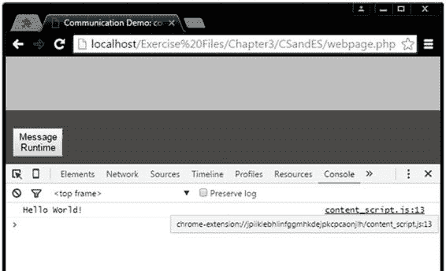
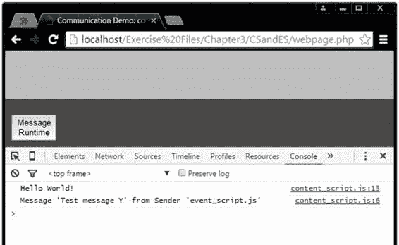
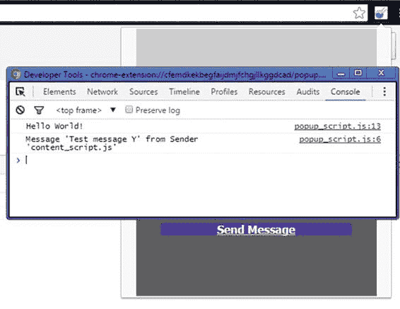
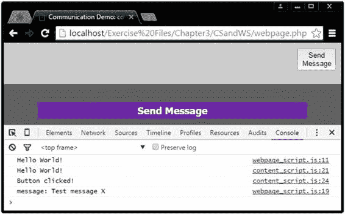

# API 可用性与消息传递

标准 JavaScript API 中用于消息传递的 API 对应的事件包括 `message` 事件。类似地，扩展框架中用于消息传递的 API 对应的事件包括以下事件。现在你已经对消息传递有了一个概览，让我们通过不同的示例来更清晰地理解这些概念。

- `chrome.runtime.onMessage`
- `chrome.runtime.onMessageExternal`
- `chrome.runtime.onConnect`（以及对应的 `port.onMessage` 事件）
- `chrome.runtime.onConnectExternal`（以及对应的 `port.onMessage` 事件）

### 网页脚本与事件脚本

这里的基本思想是允许外部网页与扩展运行时进行通信。在 Chrome 浏览器中，所有网页（除了扩展管理页面）都可以访问 `chrome.runtime.sendMessage` 方法，该方法用于向扩展运行时发送消息。该方法接受以下参数：

- `extensionID`
- `message`
- `responseCallback`

如清单 3-9 所示，点击 `send_message` 按钮会触发 `chrome.runtime.sendMessage(extensionID, message, responseCallback)` 调用。请注意，`extensionID` 是要发送消息的扩展的 ID。该 ID 可以从扩展管理页面查看（参见图 3-16）。另请注意，每次在扩展内容或扩展文件夹位置进行更改后重新加载扩展时，该 ID 都会发生变化。此外，对 `manifest.json`（或扩展文件夹中的任何其他文件）的修改只有在重新安装或重新加载扩展后才会生效！



> **注意：**对于 WSandES 扩展，`WebServer` 文件夹的内容已从我的本地 HTTP 服务器提供服务，以便提供接近真实场景的演示，即你的扩展可能正在尝试监听来自（在 Chrome 浏览器中访问的）外部网页的消息。另请注意，所提供的网页具有 `.php` 后缀，但包含纯 HTML 代码。因此，它可以直接作为本地文件网页（即使用 `file://` 方案）在 Chrome 浏览器中打开。

***图 3-17.** 检查网页：控制台面板*

***清单 3-9.*** [第 3 章 / WSandES / WebServer / webpage_script.js](http://dx.doi.org/10.1007/978-1-4842-1775-7_3)

```
//region {variables and functions}
//注意这个来自扩展页面
var extensionID = "lconbphjmfkpdopdnadkdfiiflajajgg";
var sendMessageButtonID = "send_message";
var greeting = "Hello World!";
var message = "Test message X";

function responseCallback(responseObject) {
    console.log("Message '" +
        responseObject.message + "' from Sender '" +
        responseObject.sender + "'"
    );
}
//end-region

//region {calls}
console.log(greeting);
document.addEventListener("DOMContentLoaded", function(dcle) {
    var buttonID = document.getElementById(sendMessageButtonID);
    buttonID.addEventListener("click", function(ce) {
        //此消息将被 event_script.js 拦截
        chrome.runtime.sendMessage(extensionID, message, responseCallback);
    });
});
//end-region
```

`sendMessage` 中的 `message` 参数是要发送的消息。在本例中，消息是一个字符串 `"Test message X"`。你可能想知道 `responseCallback` 参数的用途。嗯，这个参数是一个回调函数，由发送消息的接收方（即扩展运行时）使用。对于清单 3-9 和 3-10（来自 WSandES 扩展）中的示例，事件脚本组件用于代表扩展运行时。需要重点注意的是，回调（尽管由事件脚本调用）是在网页脚本的上下文中执行的。图 3-15 显示了与事件脚本中 `sendResponse(responseObject)` 调用对应的日志。

***图 3-18.** 后台页面控制台面板*

### 监听事件

如清单 3-10 所示，`chrome.runtime.onMessageExternal` 事件的监听函数用于处理来自外部网页的传入消息。`onMessageExternal` 事件的监听函数接受三个参数——`message`、`sender` 和 `sendResponse`。如前所述，`sendResponse` 是在网页脚本上下文中执行的回调。请注意传递的参数 `responseObject`。



***图 3-19.** 检查网页：控制台面板*

***清单 3-10.*** [第 3 章 / WSandES / event_script.js](http://dx.doi.org/10.1007/978-1-4842-1775-7_3)

```
//region {variables and functions}
var greeting = "Hello World!";
var responseObject = {
    message : "Test message Y",
    sender : "event_script.js"
};

function GetFormattedMessageString(message, sender) {
    return "Message '" + message + "' from Sender '" + sender.url + "'";
}
//end-region

//region {calls}
console.log(greeting);
chrome.runtime.onMessageExternal.addListener(
    function(message, sender, sendResponse) {
        //将从定义 sendResponse 的脚本中调用
        sendResponse(responseObject);
        console.log(GetFormattedMessageString(message, sender));
    }
);
//end-region
```

`message` 参数包含传递的消息。同样，`sender` 参数包含发送消息的外部网页的 URL。在本例中，外部网页是从我的本地 HTTP 服务器提供服务的 `webpage.php`。对应于这些值的日志如图 3-16 所示。

### 此 API 的清单文件作用

要使扩展能够接收来自外部网页（或其他扩展）的消息，清单文件中需要添加一个重要内容。这个添加项是 `externally_connectable` 清单属性。此属性包含两个键——`ids` 和 `matches`。这两个键都接受数组值。`ids` 键表示可以发送消息的（外部）扩展的 ID，而 `matches` 键表示可以发送消息的外部网页的 URL 模式。需要重点注意的是，无论使用哪种消息传递 API（`chrome.runtime.sendMessage` 或 `chrome.runtime.connect`），此属性是任何需要与外部网页或扩展通信的扩展的*必备*属性。

***图 3-20.** 检查网页：控制台面板*

对于 WSandES 扩展（在[第 3 章](http://dx.doi.org/10.1007/978-1-4842-1775-7_3)的练习文件文件夹中提供），`externally_connectable` 属性按以下方式定义。这样做是为了仅允许从 localhost 提供服务的网页向扩展运行时发送消息。

```
"externally_connectable" : {
    //扩展和应用程序 ID。如果未指定此字段，则无法与任何
    //扩展或应用程序进行通信。
    //"ids" : [], //要匹配所有扩展和应用程序，只需指定 "*"
    //允许的网页
    "matches" : ["*://localhost/*"]
}
```

### 使用长连接

本主题中演示的消息传递示例涉及单条消息和响应。有时，进行持续时间更长的对话会很有用。为了促进此目的，扩展框架提供了 `chrome.runtime.connect` 方法。请注意，除了网页脚本之外，此方法也可用于其他脚本，包括内容脚本和弹出脚本。

> **注意：**显然，事件脚本也可以使用 `chrome.runtime.connect` 方法。


但您很少会用到这个应用。不过，您一定会频繁地在事件脚本中使用`chrome.runtime.onConnect`（或`chrome.runtime.onConnectExternal`）事件及其监听函数。`connect`方法主要会在事件脚本内部用于与另一个扩展程序通信。`sendMessage`方法也是如此。您可以在[developer.chrome.com/extensions/messaging#external](https://developer.chrome.com/extensions/messaging#external)上阅读更多关于跨扩展消息传递的内容。

此方法将`extensionID`作为其第一个参数。这是您为了建立长期连接而需要连接的扩展程序的 ID。第二个参数是一个对象，可用于提供关于该连接的额外信息——例如，`{"name" : "connection1"}`。请注意，此方法返回一个`port`对象。`port.postMessage`方法用于向扩展程序运行时发送消息。到目前为止所讨论的代码（针对网页脚本）总结如下。

```
var port = chrome.runtime.connect("...",{"name" : "connection1"});
port.onMessage.addListener(function(message) {
    console.log(message);
});
port.postMessage("Test message X");
```



第 3 章 ■ API 可用性与消息传递

接下来，在接收端（即，由事件脚本代表的扩展程序运行时），`chrome.runtime.onConnectExternal`事件（或者，对于从扩展程序内部建立的连接，是`chrome.runtime.onConnect`事件）的监听函数也会接收到`port`对象。请注意，在这种情况下——即，在网页脚本和事件脚本之间的连接中——需要使用`onConnectExternal`事件，因为当来自外部网页（或扩展程序）的连接建立时，该事件会被触发。

**图 3-21.** 检查弹出窗口：控制台面板

最后，使用`port.onMessage`事件（连接的两端都可以使用）的监听函数，您可以监听传入的消息。请注意，由于每一端都能访问`port`对象，它们都可以执行这两项操作。这意味着它们可以通过已建立的连接（通过`port`）发送和接收消息。到目前为止所讨论的代码（针对事件脚本）总结如下：

```
chrome.runtime.onConnectExternal.addListener(function(port) {
    //if(port.name == "connection1")
    port.onMessage.addListener(function(message) {
        console.log(message); //Test message X
        port.postMessage("Test message Y");
    });
});
```



第 3 章 ■ API 可用性与消息传递

### 内容脚本与事件脚本

回顾一下，内容脚本组件并不代表扩展程序运行时。但它确实可以访问扩展框架中的以下 API——`extension`、`i18n`、`runtime`和`storage`。并且在`runtime` API 中，内容脚本组件可以访问`connect`和`sendMessage`方法。以及访问事件`runtime.onConnect`（包括相应的`port.onMessage`事件）和`runtime.onMessage`。

请注意，内容脚本组件无法访问`runtime.onMessageExternal`和`runtime.onConnectExternal`事件。因此，它不能依赖`runtime` API 与网页脚本通信。相反，它需要监听由标准 JavaScript API 提供的`message`事件来实现这一点。首先，让我们看看内容脚本如何与扩展程序运行时通信，然后在接下来的主题中，您将学习弹出脚本和网页脚本如何与内容脚本通信。

为此，请评估来自`CSandES`扩展程序的清单 3-11 至 3-13。从清单文件(清单 3-13)中注意，此扩展程序会将内容脚本注入到属于 localhost 的已访问网页中。这是通过在`matches`数组中指定`"*://localhost/*"`字符串来实现的。相应的被注入脚本是`content_script.js`（参见图 3-17 和图 3-19）。清单 3-11 包含了此脚本的代码。

**图 3-22.** 检查网页：控制台面板

第 3 章 ■ API 可用性与消息传递

**注意** 为了使弹出脚本和事件脚本能够与内容脚本通信，不能使用`chrome.runtime.sendMessage`方法。相反，需要使用`chrome.tabs.sendMessage`（或`chrome.tabs.connect`）方法。对于`chrome.tabs.sendMessage`方法，对应的事件保持不变——即`chrome.runtime.onMessage`（类似地，对于`chrome.tabs.connect`方法，事件是`chrome.runtime.onConnect`）。

**清单 3-11.** [第 3 章](http://dx.doi.org/10.1007/978-1-4842-1775-7_3) /CSandES/ `content_script.js`

```
//region {variables and functions}
var sendMessageButtonID = "send_message";
var greeting = "Hello World!";
var message = "Test message X";
function responseCallback(responseObject) {
    console.log("Message '" + responseObject.message +
        "' from Sender '" + responseObject.sender + "'"
    );
}
//end-region

//region {calls}
console.log(greeting);
(function(){
    var buttonElement = document.createElement("button");
    buttonElement.style.position = "fixed";
    buttonElement.style.display = "block";
    buttonElement.style.width = "70px";
    buttonElement.style.height = "40px";
    buttonElement.style.bottom = "10px";
    buttonElement.style.left = "10px";
    buttonElement.innerText = "Message Runtime";
    buttonElement.addEventListener("click",function(ce) {
        //This message will be intercepted by event_script.js
        chrome.runtime.sendMessage(message,responseCallback);
    });
    document.body.appendChild(buttonElement);
    /*
    //var port = chrome.runtime.connect("...",{"name":"connection1"});
    var port = chrome.runtime.connect({"name":"connection1"});
    port.onMessage.addListener(function(message){console.log(message);});
    port.postMessage("...");
    */
})();
//end-region
```

第 3 章 ■ API 可用性与消息传递

如清单 3-11 所示，一旦内容脚本被注入，它就会向访问的网页中添加一个按钮元素。这个元素有一个附加到其点击事件的监听函数。为了向扩展程序运行时发送消息，它调用了`chrome.runtime.sendMessage`方法。请注意，与之前使用此方法（在清单 3-9 中）相比，这里没有使用`extensionID`参数。因为它是一个可选参数。由于消息传递是在扩展程序内部进行的，`extensionID`参数默认为当前扩展程序的 ID。还要注意，类似于`sendMessage`方法的使用方式，您也可以使用`connect`方法。同样，`connect`方法的第一个参数也可以省略。

**清单 3-12.** [第 3 章](http://dx.doi.org/10.1007/978-1-4842-1775-7_3) /CSandES/ `event_script.js`

```
//region {variables and functions}
var greeting = "Hello World!";
var responseObject = {
    message : "Test message Y",
    sender : "event_script.js"
};
function GetFormattedMessageString(message,sender) {
    return "Message '" + message + "' from Sender '" + sender.url + "'";
}
//end-region

//region {calls}
console.log(greeting);
chrome.runtime.onMessage.addListener(function(message,sender,sendResponse) {
    //Will get called from the script where sendResponse is defined
    sendResponse(responseObject);
    console.log(GetFormattedMessageString(message,sender));
});
/*
chrome.runtime.onConnect.addListener(function(port) {
    port.onMessage.addListener(function(message){console.log(message);});
});
*/
//end-region
```


