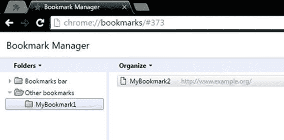
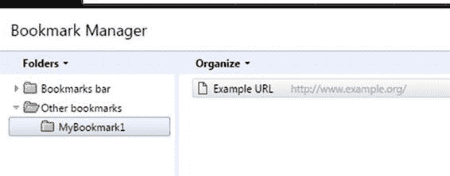
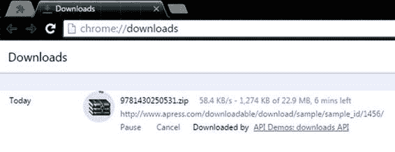

# 排版后的内容

`onMessageExternal`和`runtime.onConnectExternal`事件。因此，它们不能依赖运行时 API 与网页脚本通信。相反，它们需要监听由标准 JavaScript API 提供的`message`事件来实现此目的。为此，让我们检查本章练习文件文件夹中提供的`CSandWS`扩展。清单 3-17 至 3-19 包含此扩展的相关代码。

如本扩展的清单文件所示，使用`content_scripts`属性，一个内容脚本会被注入到属于`localhost`的已访问网页中。请注意，为了本扩展展示的目的，无需 HTTP 服务器来提供外部网页。但这样做是为了展示`window`的安全使用。

`postMessage`方法和`message`事件。如果内容脚本被注入到本地文件网页中，那么`postMessage`方法中的目标源（即接收消息的窗口的 URL 或 URI）需要指定为`*`。出于安全原因，强烈不鼓励这样做，因为它将允许来自所有主机的消息。

> **注意** 此上下文中的本地文件是通过浏览器使用`file://`方案访问的文件。本地文件网页的一个示例是`file:///F:/Exercise%20Files/somefile.html`。这与使用`http://`或`https://`方案从`localhost`提供的网页不同。

## 第 3 章 ■ API 可用性与消息传递

**清单 3-17.** 第[3](http://dx.doi.org/10.1007/978-1-4842-1775-7_3)章/`CSandWS`/`manifest.json`

```json
{
  "manifest_version": 2,
  "name": "Communication Demo: content-script and webpage-script",
  "description": "Shows communication b/w content-script and ...",
  "version": "1.2",
  "content_scripts": [
    {
      "matches": ["*://localhost/*"],
      "js": ["content_script.js"]
    }
  ]
}
```

> **注意** 此扩展提供的网页也可以作为本地文件网页提供。尽管它有`.php`后缀，但它包含纯 HTML 代码。因此，它可以直接在 Chrome 浏览器中打开（即使用`file://`方案作为本地文件网页）。

清单 3-18 包含注入的内容脚本的代码。`button`变量引用了创建的按钮元素——`发送消息`。该元素可以在图 3-22 的右上角看到。请注意，此按钮元素有一个与其`click`事件关联的监听器函数。点击此元素时，监听器函数首先将`"按钮已点击！"`字符串记录到控制台。然后它调用`postMessage`方法——`window.postMessage(message, targetOrigin)`。

显然，`message`参数是要发送的消息。并且如上所述，`targetOrigin`是接收消息的窗口的 URL 或 URI。请注意，在这种情况下，`targetOrigin`指向当前窗口的源：`var targetOrigin = window.location.origin`。另请注意，以下所有`targetOrigin`值都是无效的：`"file://"`、`"file://*"`、`""`和`null`。要在本地文件网页中使用消息传递 API，需要将`postMessage`调用为`window.postMessage(message, "*")`。

> **注意** 要将内容脚本注入本地文件网页，您需要将`matches`属性定义为`"matches": ["file://*"]`。

无论网页使用何种方案提供（即`http://`或`https://`与`file://`），要接收发送的消息，都需要为`message`事件创建一个监听器函数，如`window.addEventListener("message", function(me){/**/})`行所示。同样的事项已在清单 3-19 中完成。其监听器函数对应的日志可以在图 3-22 中看到。请注意，传递给此监听器函数的事件具有一个`data`属性，可用于访问由`postMessage`方法发送的字符串或对象。




### **图 3-27.** API 演示：书签 API

### **清单 3-18.** 第 3 章 /CSandWS/ content_script.js

```javascript
//region {variables and functions}

var consoleGreeting = "Hello World!";

var targetOrigin = window.location.origin;

var message = "Test message X";

function createButton() {

var button = document.createElement("button");

button.style.width = "70px";

button.style.height = "40px";

button.style.position = "fixed";

button.style.top = "10px";

button.style.right = "10px";

button.innerText = "Send Message";

document.body.appendChild(button);

return button;

}

//end-region

//region {calls}

console.log(consoleGreeting);

var button = createButton();

button.addEventListener("click",function() {

console.log("Button clicked!");

window.postMessage(message,targetOrigin);

});

/*

window.addEventListener("message",function(me) {

console.log("message: " + me.data);

});

*/

//end-region
```



## 第 3 章 ■ API 可用性与消息传递

在这个扩展程序中，消息传递是从内容脚本发起的。同理，你可以扩展此扩展程序，使其能够从网页脚本发起消息传递。你可以利用网页脚本中已有的点击事件监听函数来实现这一点。为了处理发送消息，内容脚本需要包含相应的监听函数。

### **图 3-28.** API 演示：书签 API

### **清单 3-19.** 第 3 章 /CSandWS/WebServer/ webpage_script.js

```javascript
//region {variables and functions}

var sendMessageButtonID = "send_message";

var greeting = "Hello World!";

//var targetOrigin = window.location.origin;

//var message = "Test message Y";

//end-region

//region {calls}

console.log(greeting);

document.addEventListener("DOMContentLoaded",function(dcle) {

var buttonID = document.getElementById(sendMessageButtonID);

buttonID.addEventListener("click",function(ce) {

//window.postMessage(message,targetOrigin);

});

});

window.addEventListener("message",function(me) {

console.log("message: " + me.data);

});

//end-region
```

## 第 3 章 ■ API 可用性与消息传递

### 弹出窗口脚本与事件脚本

现在让我们看看弹出窗口脚本如何与事件脚本进行通信。虽然这两个组件都代表了扩展的运行环境，但它们在扩展架构中作为不同的脚本组件存在。这就是为什么这两个脚本组件之间需要进行通信。让这些组件相互通信比让其他组件相互通信要容易得多。

### **清单 3-20.** 第 3 章 /PSandES/ manifest.json

```json
{

"manifest_version" : 2,

"name" : "Communication Demo: popup-script and event-script",

"description" : "Shows communication b/w popup-script and event-script",

"version" : "1.2",

"browser_action" : {

"default_title" : "Communication Demo: popup-script and event-script",

"default_icon" : "icon.png",

"default_popup" : "popup.html"

},

"background" : {

"scripts" : ["event_script.js"],

"persistent" : false

}

}
```

由于使用了弹出窗口脚本，显然扩展程序需要一个带有弹出窗口的 `BrowserAction` 或 `PageAction` 组件。这在 **清单 3-20** 中的 `PSandES` 扩展程序（位于第 3 章的练习文件文件夹中）中可以看到。要使用事件脚本，需要在清单中定义 `background` 属性。**清单 3-22** 包含了相应事件脚本组件的代码。

### **清单 3-21.** 第 3 章 /PSandES/ popup_script.js

```javascript
//region {variables and functions}

var sendMessageButtonID = "send_message";

var greeting = "Hello World!";

var message = "Test message X";

function responseCallback(responseObject) {

console.log("Message '" + responseObject.message +

"' from Sender '" + responseObject.sender + "'");

}

//end-region
```



## 第 3 章 ■ API 可用性与消息传递

```javascript
//region {calls}

console.log(greeting);

document.addEventListener("DOMContentLoaded",function(dcle){

var buttonID = document.getElementById(sendMessageButtonID);

buttonID.addEventListener("click",function(ce) {

//This message will be intercepted by event_script.js

chrome.runtime.sendMessage(message,responseCallback);

});

});

//end-region
```

正如之前示例中讨论的，要向事件脚本发送消息，需要执行以下调用：`chrome.runtime.sendMessage(message, responseCallback)`。你已经知道，`message` 参数是要发送的消息。`responseCallback` 是一个回调函数，由所发送消息的接收方使用。

请注意，**清单 3-21** 包含了 `PSandES` 扩展程序中所用弹出窗口脚本的代码。**图 3-23** 和 **图 3-25** 显示了来自弹出窗口脚本的日志。

### **图 3-29.** API 演示：下载 API

### **清单 3-22.** 第 3 章 /PSandES/ event_script.js

```javascript
//region {variables and functions}

var greeting = "Hello World!";

var responseObject = {

message : "Test message Y",

sender : "event_script.js"

};

function GetFormattedMessageString(message,sender) {

return "Message '" + message + "' from Sender '" + sender.url + "'";

}

//end-region
```

## 第 3 章 ■ API 可用性与消息传递

```javascript
//region {calls}

console.log(greeting);

chrome.runtime.onMessage.addListener(function(message,sender,sendResponse) {

//Will get called from the script where sendResponse is defined

sendResponse(responseObject);

console.log(GetFormattedMessageString(message,sender));

});

//end-region
```

最后，为了接收发送的消息，事件脚本为 `chrome.runtime.onMessage` 事件提供了监听函数。与该函数对应的日志如 **图 3-24** 所示。请注意 `sendResponse` 回调及其传递的参数 `responseObject`，该参数在弹出窗口脚本的上下文中被记录到控制台（参见 **图 3-25**）。

#### Google Chrome 扩展程序 API

Google Chrome 扩展程序框架为扩展程序提供了许多专用 API，使你能够访问 Chrome 浏览器的强大功能。这些 API 几乎可以访问 Chrome 浏览器中的所有可用功能！许多 API 已经讨论过了，尽管它们是在不同的上下文中描述的。例如，以下 API 被描述为输入组件：`chrome.omnibox`、`chrome.contextMenus`、`chrome.commands`、`chrome.pageAction` 和 `chrome.browserAction`。本节将介绍以下 API：

* `alarms`
* `bookmarks`
* `downloads`
* `history`
* `notifications`
* `storage`
* `tabs`

> **注意** 扩展程序仍然可以使用浏览器为网页提供的所有标准 API（也称为标准 JavaScript API）。这些就是你熟悉的核心 JavaScript 和文档对象模型（DOM）API。
>
> 此外，扩展程序还支持 XMLHttpRequest (XHR) API、HTML5 API、WebKit API（用于 CSS 动画、滤镜等）和 V8 API（例如 JSON）！

## 第 3 章 ■ API 可用性与消息传递

除了这些来自扩展程序框架的 API，本节还涵盖了标准 JavaScript API 中的 XHR API。本指南未讨论的其他 API（但你可以通过在线文档 [`developer.chrome.com/extensions/api_index`](https://developer.chrome.com/extensions/api_index) 阅读了解）包括：

* `contentSettings`
* `cookies`
* `desktopCapture`
* `extension`
* `management`
* `system.cpu`
* `system.memory`
* `webstore`
* `windows`

### 声明权限


