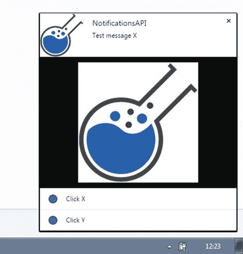
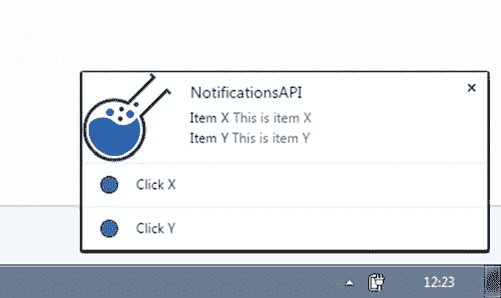
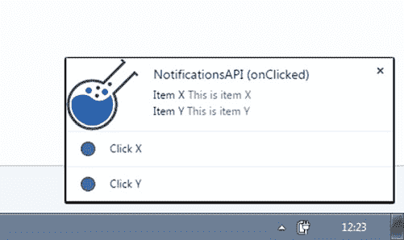
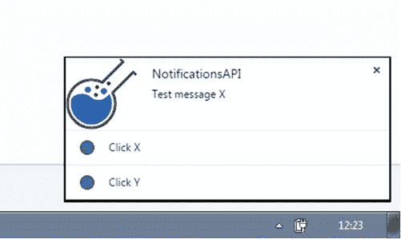

# API 可用性与消息传递

### 需要权限的 API

要使用大多数 `chrome.*` API，你的扩展程序（或应用）必须在清单文件的 `permissions` 字段中声明其意图。`permissions` 字段中的每个此类权限可以是已知字符串列表中的一项（例如 `"alarms"`、`"storage"`、`"tabs"` 等——参见下方包含所有权限字符串的列表），也可以是一个*匹配模式*，用于授予对一个或多个主机的访问权限。在至此讨论的所有示例中，你尚未在清单文件的 `permissions` 字段中看到过*匹配模式*。这是因为这种用法仅在与 XHR API 同时使用时才需要（本节稍后将详细介绍）。

#### 权限示例

以下代码片段是一个清单文件中 `permissions` 部分的示例。

```json
"permissions" : [
  "alarms",        // 扩展 API 权限
  "tabs",          // 扩展 API 权限
  "bookmarks",     // 扩展 API 权限
  "http://www.blogger.com/",   // XHR 权限
  "http://*.google.com/"       // XHR 权限
],
```

正如你可能从这段代码中推断出的，需要 `"alarms"`、`"tabs"` 和 `"bookmarks"` 权限字符串才能分别访问 alarms、tabs 和 bookmarks API。与这些权限字符串不同，其余两个权限字符串（即 URL）需要用于与扩展原始来源之外的远程主机通信（通过 XHR）。

Google Chrome 扩展框架中对应 API 的文档会说明是否需要权限字符串（如果有的话）。此外，如果某个 API 要求你在清单中声明一个权限字符串，那么其文档会告诉你如何操作。例如，Alarms API 文档——位于 [`developer.chrome.com/extensions/alarms`](https://developer.chrome.com/extensions/alarms)——会向你展示如何声明 `alarms` 权限。

#### 权限字符串列表

- `activeTab`
- `alarms`
- `audioModem`
- `background`
- `bookmarks`
- `browsingData`
- `clipboardRead`
- `clipboardWrite`
- `contentSettings`
- `contextMenus`
- `cookies`
- `copresence`
- `debugger`
- `declarativeContent`
- `declarativeWebRequest`
- `desktopCapture`
- `dns`
- `documentScan`
- `downloads`
- `enterprise.platformKeys`
- `experimental`
- `fileBrowserHandler`
- `fileSystemProvider`
- `fontSettings`
- `gcm`
- `geolocation`
- `history`
- `identity`
- `idle`
- `idltest`
- `location`
- `management`
- `nativeMessaging`
- `networking.config`
- `notificationProvider`
- `notifications`
- `pageCapture`
- `platformKeys`
- `power`
- `printerProvider`
- `privacy`
- `processes`
- `proxy`
- `sessions`
- `signedInDevices`
- `storage`
- `system.cpu`
- `system.display`
- `system.memory`
- `system.storage`
- `tabCapture`
- `tabs`
- `topSites`
- `tts`
- `ttsEngine`
- `unlimitedStorage`
- `vpnProvider`
- `wallpaper`
- `webNavigation`
- `webRequest`
- `webRequestBlocking`

> **注意：** 如果你的扩展程序或应用被恶意软件入侵，权限有助于限制损害。其中一些权限也会在安装扩展程序（或应用）之前作为警告显示给用户。你可以在此处阅读有关这些警告的更多信息：[`developer.chrome.com/extensions/permission_warnings`](https://developer.chrome.com/extensions/permission_warnings)。

### 可选权限

有两种类型的权限——*必需权限*和*可选权限*。你到目前为止处理的权限都是必需权限。可选权限是可以在运行时（而非安装时）请求的权限。用户能够理解为何需要这些权限，并仅授予那些必要的权限。尽管可选权限对用户信息量更大，但由于其复杂性，此处不作描述。你可以在 [`developer.chrome.com/extensions/permissions`](https://developer.chrome.com/extensions/permissions) 阅读有关它们的更多信息。

---

### Alarms API

alarms API（即 `chrome.alarms` API）用于安排代码定期运行或在未来的指定时间运行。它使用 `alarms` 权限。清单 3-23 包含了 AlarmsAPI 扩展中的代码，该扩展位于第 3 章的练习文件文件夹中。



#### 创建闹钟

要创建闹钟，请使用 `chrome.alarms.create` 方法。此方法接受两个参数——`alarmName`（`string` 类型）和 `alarmInfo`（`object` 类型）。`alarmInfo` 对象描述了闹钟应在何时触发。必须通过 `when` 或 `delayInMinutes`（但不能同时使用两者）指定初始时间。



如果设置了 `periodInMinutes`，闹钟将在初始事件之后每 `periodInMinutes` 分钟重复一次。当闹钟超时时，会触发相应的 `chrome.alarms.onAlarm` 事件的监听器函数。图 3-26 显示了此监听器函数的日志。请注意此回调接收的参数。该参数类型为 `Alarm`，包含 `name`、`scheduledTime` 和 `periodInMinutes` 等属性。



> **注意：** 在调试已解压加载的扩展程序时，闹钟触发频率没有限制。对于所有其他情况，间隔小于一分钟的闹钟将不会被遵守，并会导致警告。请回顾“加载扩展文件夹”主题（来自第 1 章），以提醒自己有关扩展加载的基础知识。

**清单 3-23.** 第 3 章/AlarmsAPI/event_script.js

```javascript
//region {variables and functions}

var greeting = "Hello World!";
var count = 0;
var alarmName = "testAlarm";
var alarmInfo = {
  when : Date.now() + 6000,
  periodInMinutes : 1  //每隔 1 分钟重复触发
};

//end-region

//region {calls}

console.log(greeting);
chrome.alarms.clearAll();
chrome.alarms.onAlarm.addListener(function(alarm) {
  console.log("onAlarm-" + ++count);
});
chrome.alarms.create(alarmName,alarmInfo);

//end-region
```

#### 其他重要方法

在清单 3-23 中，使用了 `chrome.alarms.clearAll` 方法清除所有闹钟。要清除特定闹钟，请使用 `chrome.alarms.clear(string name, function callback)` 方法。alarms API 中其他重要的方法包括以下内容。请注意，此处，`get` 方法的回调函数接收一个 `Alarm` 类型的参数，而 `getAll` 方法的回调函数接收一个 `array` 类型的参数。

- `chrome.alarms.get(string name, function callback)`
- `chrome.alarms.getAll(function callback)`

---

### Bookmarks API

bookmarks API（即 `chrome.bookmarks` API）用于创建、组织以及以其他方式操作书签。它使用 `bookmarks` 权限。书签以树形结构组织，树中的每个节点要么是一个书签，要么是一个文件夹。

树中的每个节点由一个 `bookmarks.BookmarkTreeNode` 对象表示。`BookmarkTreeNode` 属性在整个 `chrome.bookmarks` API 中被使用。例如，当你调用 `chrome.bookmarks.create` 时，你需要传入新节点的父节点（`parentId`），以及可选的节点的 `title` 和 `url` 属性。要了解节点可以拥有的完整属性列表，请参考 [`developer.chrome.com/extensions/bookmarks#type-BookmarkTreeNode`](https://developer.chrome.com/extensions/bookmarks#type-BookmarkTreeNode)。




