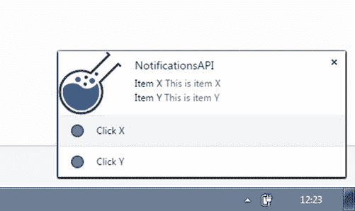
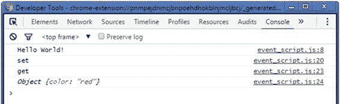

# API 可用性与消息传递

#### 创建书签

请注意，如果一个节点是文件夹，它具有以下属性：`id`、`parentId`、`children` 和 `title`。如果它是一个书签，则具有以下属性：`id`、`parentId`、`title` 和 `url`。此外，书签树的根节点没有任何父节点，因此不存在 `parentId`。它包含两个特殊的文件夹作为其子节点——书签栏和其他书签。

> **注意**：你不能使用此 API 在根节点中添加或删除条目。你也不能重命名、移动或删除特殊的书签栏和其他书签文件夹。



要创建书签，请使用 `chrome.bookmarks.create` 方法。此方法接受两个参数——`bookmark`（类型为 `object`）和 `callback`（类型为 `function`）。使用 `bookmark` 对象中定义的属性——`parentId`、`title` 和 `url`——你可以创建一个书签或文件夹。请注意，如果 `url` 为 `null` 或缺失，则创建的书签将是一个文件夹。`callback` 函数接收一个类型为 `BookmarkTreeNode` 的参数。

**图 3-34.** API 示例：通知 API

清单 3-24 包含相应的代码片段，其中使用 `bookmark1` 对象，首先创建一个文件夹，然后在该文件夹内部创建一个书签。这是通过 `callback` 函数中的 `result.id` 值实现的。另请参见图 3-27，其中包含了已创建的文件夹和书签。一个有趣的事情是，创建的文件夹的 `id`（以蓝色高亮显示）是 `373`，从 URL `chrome://bookmarks/#373` 中可以看出。你可以使用 `chrome.bookmarks.get` 方法来检查这一点，如清单 3-24 所示。该方法接受一个字符串 `id` 或这些 id 的数组，以及一个 `callback` 函数作为其参数。`callback` 函数接收一个 `results` 参数，该参数是一个 `BookmarkTreeNode` 对象的数组。

***清单 3-24.*** 第 3 章 /BookmarksAPI/event_script.js

```
//region {variables and functions}

var greeting = "Hello World!";

var bookmark1 = {
    title : "MyBookmark1",
    //If url is null or missing, created bookmark will be a folder
    url : ""
};

var bookmark2 = {
    title : "MyBookmark2",
    url : "http://www.example.org"
};

var queryObject = {
    query : "",
    url : "",
    title : "chrome extensions"
};

var queryString = "example url";
//end-region

//region {calls}
console.log(greeting);

/*
//result is of type BookmarkTreeNode
chrome.bookmarks.create(bookmark1,function(result) {
    console.log("Created bookmark with id: " + result.id);
    bookmark2.parentId = result.id;
    chrome.bookmarks.create(bookmark2);
});
*/

/*
//string or array of string id
chrome.bookmarks.get("373",function(results) {
    console.log(results); //array of BookmarkTreeNode
});
*/

/*
//only title and url are supported
chrome.bookmarks.update("374",{"title":"Example URL"});
*/

//string or object query
chrome.bookmarks.search(queryString,function(results) {
    console.log(results); //array of BookmarkTreeNode
});
//end-region
```

#### 更新书签

书签（或文件夹）也可以被更新。允许更新的特定属性包括 `title` 和 `url`。请注意，`url` 仅对非文件夹的书签有效。要更新书签，请调用 `chrome.bookmarks.update` 方法。此方法接受以下参数：`id`（类型为 `string`）、`changes`（类型为 `object`）和 `callback`（类型为 `function`）。

请注意清单 3-24 中 update 方法传递的字符串 `id`。此 `id` 对应图 3-27 中显示的书签（即 `MyBookmark2`）。图 3-28 显示了更新后的书签。如图所示，该书签的标题已被更新。这是通过向 update 方法传递以下对象来实现的：`{"title":"Example URL"}`。



#### 搜索书签


