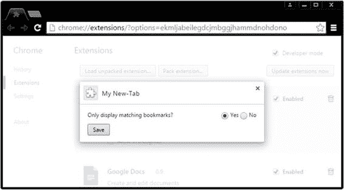
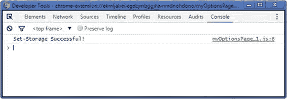
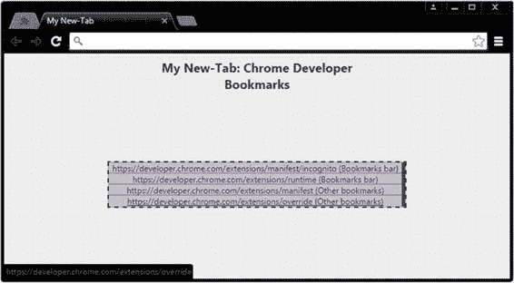
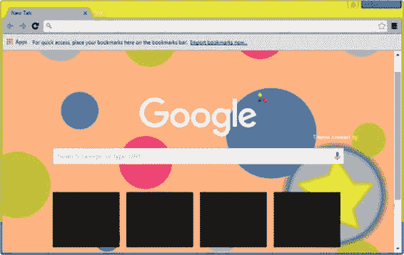
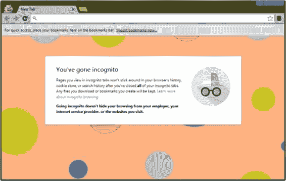
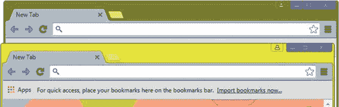

# 关于扩展的更多信息

至此，你已经了解了 Google Chrome 扩展的大部分特性，包括其架构、不同组件之间的消息传递，以及 Google Chrome 扩展框架所提供的 API。本章将介绍 Google Chrome 扩展的其余特性，例如选项页面、覆盖页面和主题。此外，你还将了解到在开发 Google Chrome 扩展时需要注意的一些安全问题，其中包括 API 权限、`match pattern` 权限、内容脚本注入等。

## 提供选项页面

你可以通过提供一个选项页面（参见图 4-4），让用户自定义扩展的行为。需要注意的一个重要点是：即使不使用选项页面，也可以轻松实现类似功能。例如，可以通过提供一个包含界面的弹出组件来保存扩展的首选项（比如使用 `chrome.storage` API）。不过，不建议这样做，因为用户将无法从“扩展程序管理”页面访问到该选项页面（选项链接请参见图 4-3）。

### 清单文件对该组件的作用

要声明一个选项页面，需要使用 `options_ui` 清单属性。

该属性支持以下属性。如清单 4-1（来自 `OverridePages` 扩展）所示，`page` 和 `chrome_style` 属性足以声明一个扩展的选项页面。

- `page` (字符串) — 选项页面的路径，相对于扩展的根目录。
- `chrome_style` (布尔值) — 如果为 `true`，Chrome 的用户代理样式表将应用于选项页面。默认值为 `false`，但为了与 Chrome 的 UI 风格保持一致，建议将此值设置为 `true`。
- `open_in_tab` (布尔值) — 如果为 `true`，扩展的选项页面将在新标签页中打开，而不是嵌入在 `chrome://extensions` 页面内。默认值为 `false`，不建议使用 `true`。

**清单 4-1.** 第 4 章/OverridePages/manifest.json

```json
{
  "name" : "My New-Tab",
  "version" : "1.2",
  "manifest_version" : 2,
  "chrome_url_overrides" : {
    /*newtab,history,bookmarks*/
    "newtab" : "myNewTab.html"
  },
  "permissions" : ["bookmarks","storage"],
  /*Using an options page*/
  "options_ui" : {
    "page" : "myOptionsPage.html",
    /*Use Chrome stylesheet*/
    "chrome_style" : true
  }
}
```

## 编写选项页面

选项页面完全由一个 HTML 页面构成（如图 4-4 所示）。清单 4-2 包含了 `OverridePages` 扩展中使用的选项页面的 HTML 代码。该扩展位于第 4 章的练习文件文件夹中。如前所述，建议通过将清单中的 `chrome_style` 属性设置为 `true`，为该 HTML 页面使用 Chrome 样式表。

> **注意** 要以编程方式打开选项页面，请使用 `chrome.runtime.openOptionsPage` 方法。

**图 4-1.** 新标签页：覆盖提示

**清单 4-2.** 第 4 章/OverridePages/myOptionsPage.html

```html
<!DOCTYPE html>
<html>
<head>
<title>My Options-Page</title>
<script src="myOptionsPage_1.js"></script>
<style>
div.left {
  float:left;
}
div.right {
  float:right;
}
p.clear {
  clear:both;
}
</style>
</head>
<body>
<p>
<div class="left">
  仅显示匹配的书签？
</div>
<div class="right">
  <form>
    <input type="radio" name="highlight" value="1"> 是
    <input type="radio" name="highlight" value="0" checked="checked"> 否
  </form>
</div>
</p>
<br>
<p class="clear">
  <input type="button" id="save" value="保存">
</p>
</body>
</html>
```

### 排版后的内容

选项页面可以引用脚本。脚本的 `src` 属性需要指向一个路径，该路径是相对于扩展文件夹（即扩展的根目录）的。在列表 4-2 中，被引用的脚本是 `myOptionsPage_1.js`。列表 4-3 包含了该被引用脚本的对应代码。此脚本的目的是保存 `OverridePages` 扩展的用户偏好设置。有关偏好的具体细节将在下一主题中描述。

**列表 4-3.** 第 4 章 / `OverridePages/ myOptionsPage_1.js`

```javascript
//region {variables and functions}
var storageKey = "APPEND_MATCHING_ONLY";
var items = {};
var saveButtonID = "save";

function logSuccess(task) {
  console.log("%s Successful!",task);
}
//end-region

//region {calls}
document.addEventListener("DOMContentLoaded",function(dcle) {
  var saveButton = document.getElementById(saveButtonID);
  saveButton.addEventListener("click",function(ce) {
    if(document.forms[0].highlight.value == "1") {
      items[storageKey] = true;
      chrome.storage.sync.set(
        items,
        function() {
          if(!chrome.runtime.lastError)
            logSuccess("Set-Storage");
        }
      );
    } else {
      items[storageKey] = false;
      chrome.storage.sync.set(
        items,
        function() {
          if(!chrome.runtime.lastError)
            logSuccess("Set-Storage");
        }
      );
    }
  });
});
//end-region
```

## 使用覆盖页面

*覆盖页面*是一种将扩展中的 HTML 文件替换（即覆盖）Google Chrome 通常提供的页面的方式。除了 HTML，覆盖页面通常还包含 CSS 和 JavaScript 代码。一个扩展可以覆盖以下任意一个页面：

- *书签管理器* (`chrome://bookmarks`) — 当用户从 Chrome 菜单中选择书签管理器菜单项，或在 Mac 上从书签菜单中选择书签管理器项时出现的页面。
- *历史记录* (`chrome://history`) — 当用户从 Chrome 菜单中选择历史记录菜单项，或在 Mac 上从历史记录菜单中选择显示完整历史记录项时出现的页面。
- *新标签页* (`chrome://newtab`) — 当用户创建新标签页或窗口时出现的页面。

**图 4-2.** 带有书签的新标签页

> **注意** 一个扩展只能覆盖一个页面。例如，练习文件文件夹中提供的 `OverridePages` 扩展覆盖了新标签页。

**列表 4-4.** 第 4 章 / `OverridePages/ myNewTab.html`

## 清单文件在此组件中的作用

要覆盖一个页面，请使用 `chrome_url_overrides` 清单属性。被覆盖的具体页面通过 `bookmarks`、`history` 或 `newtab` 属性来指定。

列表 4-1 中展示了一个示例，其中通过指定 `"newtab" : "myNewTab.html"` 来覆盖新标签页。列表 4-4 包含了来自 `myNewTab.html` 文件的相应 HTML 代码。

***图 4-3.** 扩展管理页面：选项链接*

## OverridePages 扩展

本章练习文件文件夹中提供的 `OverridePages` 扩展可以覆盖新标签页。您可以在浏览器中加载此扩展进行测试。请注意加载此扩展后出现的提示（见图 4-1）。Chrome 浏览器需要此提示来确认覆盖操作是否（由用户）有意为之。

如图 4-2 所示，该扩展程序覆盖了“新建标签页”以显示书签。引用的脚本 `myNewTab_1.js` 用于将书签项目附加到 HTML `ul` 元素列表中，如代码清单 4-4 中的 `<ul id="list"></ul>` 所示。代码清单 4-5 和 4-6 包含了该引用脚本中的 JavaScript 代码。



**图 4-4.** 带有 Chrome 样式表的选项页面

**代码清单 4-5.** 第 4 章/OverridePages/`myNewTab_1.js`

```
//region {variables and functions}

var folders = [];

var listName = "list";

var host = "developer.chrome.com";

var itemBorderRightStyle = "5px solid #666";

var itemBoxShadowStyle = "0px 0px 2px #333";

var itemBackgroundColor = "#ccc";

var storageKey = "APPEND_MATCHING_ONLY";

function appendItem(listElement,nodeURL,nodeParentTitle) {

var li = document.createElement("li");

var a = document.createElement("a");

a.href = nodeURL;

a.innerText = nodeURL + " (" + nodeParentTitle + ")";

li.appendChild(a);

if(nodeURL.indexOf(host) != -1) {

li.style.borderRight = itemBorderRightStyle;

li.style.boxShadow = itemBoxShadowStyle;

li.style.backgroundColor = itemBackgroundColor;

}

listElement.appendChild(li);

}

function appendMatchingItem(listElement,nodeURL,nodeParentTitle) {

if(nodeURL.indexOf(host) != -1)

appendItem(listElement,nodeURL,nodeParentTitle);

}

function populateList(listElement) {

folders.forEach(function(folder) {

folder.children.forEach(function(bookmarkTreeNode) {

appendItem(listElement,bookmarkTreeNode.url,folder.title);

});

});

}

function populateListV2(listElement) {

chrome.storage.sync.get(storageKey,function(items) {

if(!chrome.runtime.lastError && items[storageKey]) {

folders.forEach(function(folder) {

folder.children.forEach(function(bookmarkTreeNode) {

if(bookmarkTreeNode.url)

appendMatchingItem(

listElement,

bookmarkTreeNode.url,

folder.title

);

});

});

} else {

folders.forEach(function(folder) {

folder.children.forEach(function(bookmarkTreeNode) {

if(bookmarkTreeNode.url)

appendItem(

listElement,

bookmarkTreeNode.url,

folder.title

);

});

});

}

});

}

//endregion
```

为了在“新建标签页”中显示书签，使用了书签 API（即 `chrome.bookmarks` API）。回顾第 3 章的内容，书签树中的每个节点都由一个 `bookmarks.BookmarkTreeNode` 对象表示。同样，要检索整个书签的层级结构，需要使用 `chrome.bookmarks.getTree` 方法。

在代码清单 4-6 中，请注意使用 `children.length` 属性来访问子书签节点。所有这些书签节点都存储在 `folders` 数组中。代码清单 4-5 包含了 `populateList` 和 `populateListV2` 函数。这两个函数中的任何一个都可以用来将书签项目附加到前面提到的 HTML `ul` 元素列表中。这些书签项目是从 `folders` 数组中获取的。



**图 4-5.** 选项页面：登录控制台

`OverridePages` 扩展程序包含一个选项页面，用于保存用户偏好，即只允许在“新建标签页”中显示匹配的书签（此处，匹配的书签是指其 URL 属于特定主机的书签）。为了实现这一功能，使用了存储 API（即 `chrome.storage` API）。在代码清单 4-3 中，请注意使用 `chrome.storage.sync.set` 方法保存所选选项（“是”和“否”选项可见于图 4-4）。同时请注意，与此次调用对应的日志可见于图 4-5。在代码清单 4-3 和 4-5 中，存储项（针对所选选项）对应的键通过以下方式声明：`var storageKey = "APPEND_MATCHING_ONLY";`

为了使用这个存储项（对应于所选选项——是或否），`populateListV2` 函数会调用 `chrome.storage.sync.get` 方法。如果在此次调用期间没有引发运行时错误，并且存储项被设置为 `true`（即“是”），则会调用 `appendMatchingItem` 函数。否则，将调用 `appendItem` 函数。

在追加书签项之前，`appendMatchingItem` 函数会测试待追加的书签节点，其 URL 是否与主机名 `developer.chrome.com` 匹配。

相应的输出如图 4-6 所示。

**清单 4-6.** [第 4 章](http://dx.doi.org/10.1007/978-1-4842-1775-7_4)/OverridePages/`myNewTab_1.js`

```javascript
//region {calls}
document.addEventListener("DOMContentLoaded",function(dcle) {
  var listElement = document.getElementById(listName);
  chrome.bookmarks.getTree(function(bookmarkTreeAsArray) {
    var bookmarkTree = bookmarkTreeAsArray[0];
    if(bookmarkTree.children) {
      bookmarkTree.children.forEach(function(node) {
        if(node.children.length > 0) folders.push(node);
      });
    }
    //populateList(listElement);
    populateListV2(listElement);
  });
});
//end-region
```



**图 4-6.** 带有书签的新标签页

## 为 Google Chrome 创建主题

主题是一种特殊的扩展程序，它可以改变浏览器外观。主题的打包方式与普通扩展程序相同，但请注意，*主题不包含 JavaScript 或 HTML 代码*。您可以试用 Chrome 网上应用商店中提供的主题。以下 URL 将直接带您进入主题 [类别：https://chrome.google.com/webstore/category/themes](https://chrome.google.com/webstore/category/themes)。

> **注意** 将扩展程序或主题上传到开发者信息中心没有任何区别，因为主题也是一种扩展程序。

创建主题非常简单，因为它只需要几张图片和清单文件中的几行代码即可。图 4-7 显示了主题扩展程序所使用的图片，这些图片位于[第 4 章](http://dx.doi.org/10.1007/978-1-4842-1775-7_4)的练习文件文件夹中。清单 4-7 包含了此扩展程序对应的清单文件代码。

**清单 4-7.** [第 4 章](http://dx.doi.org/10.1007/978-1-4842-1775-7_4)/主题/`manifest.json`

```json
{
  "manifest_version" : 2,
  "name" : "HelloTheme",
  "version" : "1.2",
  "theme" : {
    "images" : {
      "theme_frame" : "images/theme_frame_golden.png",
      "theme_toolbar" : "images/theme_toolbar_silver.png",
      "theme_ntp_background" : "images/theme_ntp_background.png",
      "theme_ntp_attribution" : "images/theme_ntp_attribution.png"
    },
    "colors" : {
      "tab_text" : [0,0,0],
      "ntp_text" : [255,255,255],
      "button_background" : [0,0,255]
    },
    "tints" : {
      "buttons" : [0.0,0.0,0.0],
      "frame" : [-1.0,-1.0,-1.0],
      "frame_inactive" : [-1.0,-1.0,0.3],
      "frame_incognito" : [-1.0,-1.0,0.2],
      "frame_incognito_inactive" : [-1.0,-1.0,0.0]
    }
  }
}
```

**图 4-7.** 主题扩展程序所使用的图片

> **注意** 练习文件文件夹中提供了 SVG 文件，以便您自定义用于创建主题图片的形状。

主题支持图像、颜色和色调元素。要创建主题，您需要为主题清单属性（参见清单 4-7）定义这些元素。除此之外，您还需要定义与这些元素对应的属性。以下是一些最常用的属性及其说明。

- `theme_frame` — 窗口的框架，即标签页后面的区域。
- `theme_toolbar` — 当前标签页和工具栏的共同主题。
- `theme_ntp_background` — 新标签页的背景图片。
- `theme_ntp_attribution` — 新标签页的署名图片。
- `tab_text` — 当前标签页标题中文本的颜色。
- `ntp_text` — 新标签页中所有文本的颜色。
- `button_background` — 所有窗口按钮（例如，最小化、关闭等）的背景颜色。
- `buttons` — 可应用于 Chrome 工具栏中各种按钮的颜色色调。
- `frame` — 可应用于 Chrome 框架的颜色色调。
- `frame_inactive` — 当 Chrome 窗口处于非活动状态时应用的颜色色调。
- `frame_incognito` — 在隐身模式下应用于框架的颜色色调。
- `frame_incognito_inactive` — 与 `frame_incognito` 相同，但适用于窗口（在隐身模式下）处于非活动状态时。



**图 4-8.** 应用了主题的新标签页

> **注意** 主题不包含 JavaScript 或 HTML 代码。

图 4-8 显示了应用了主题后的新标签页。请注意窗口的金色框架，这是通过 `theme_frame` 属性指定的。也要注意新标签页的背景图片。它是通过 `theme_ntp_background` 属性指定的。要指定署名图片，请使用 `theme_ntp_attribution` 属性。在提供的扩展程序中，署名图片是 `theme_ntp_attribution.png`，它是一个带有黄色徽标的圆形图片（见图 4-8 右下角）。





**图 4-9.** 隐身模式下的主题

> **注意** 色调采用色相-饱和度-明度格式，使用 0 到 1.0 范围内的浮点数。值为 -1.0 表示不做任何更改。

对于隐身模式，您可以将颜色色调应用于现有样式。例如，在图 4-9 中，请注意应用于窗口框架的颜色色调。此色调是使用 `frame_incognito` 属性（参见清单 4-7）应用的。类似地，颜色色调也可以应用于非活动模式的不同样式。在图 4-10 中，请注意活动窗口（在前面）和非活动窗口（非活动窗口在后面，并且框架颜色更深）之间的区别。

**图 4-10.** 非活动窗口的颜色色调（后窗口）

## 扩展程序开发：安全注意事项

到目前为止，您已经了解到扩展程序拥有某些权限，使其能够超越常规网页脚本的能力。因此，在编写扩展程序时需要具有安全意识。否则，可能会在用户数据的隐私方面影响用户，涉及已访问、正在访问以及将要访问的数据。以下主题讨论了一些使扩展程序更加安全的有用方法，以及扩展程序框架在后端处理安全性的方式。

### API 权限

第一层安全防护由扩展程序框架中的权限架构自动提供。API 权限有助于在扩展程序或应用被恶意软件入侵时限制其造成的损害。例如，如果一个操作书签的扩展程序拥有 `bookmarks` 权限，它就无法影响用户的下载内容，仅仅是因为它没有 `downloads` 权限。因此，您可以看到，*绝不要在清单中请求不必要的权限*，因为如果扩展程序或应用被入侵，这将削弱用户的安全性。

此外，某些权限在安装扩展程序（或应用）之前，也会作为警告显示给用户。请注意，您可以在以下 URL 了解更多关于这些警告的信息：[`developer.chrome.com/extensions/permission_warnings`](https://developer.chrome.com/extensions/permission_warnings)。

### 匹配模式权限