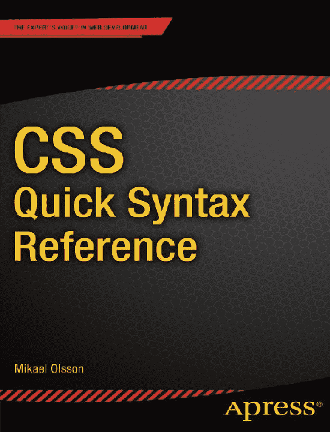

# 米凯尔·奥尔森 CSS 快速语法参考指南

ISBN 978-1-4302-6490-3  
电子版 ISBN 978-1-4302-6491-0  
DOI 10.1007/978-1-4302-6491-0

© Apress 2014

CSS 快速语法参考指南  
出版商：海因茨·温海默  
主编：史蒂夫·安格林  
开发编辑：马修·穆迪  
技术审校：维克多·萨姆纳  
编委会：史蒂夫·安格林、马克·贝克纳、尤安·白金汉、加里·康奈尔、路易丝·科里根、詹姆斯·T·德沃尔夫、乔纳森·根尼克、乔纳森·哈塞尔、罗伯特·哈钦森、米歇尔·洛曼、詹姆斯·马卡姆、马修·穆迪、杰夫·奥尔森、杰弗里·佩珀、道格拉斯·庞迪克、本·雷诺-克拉克、多米尼克·谢克沙夫特、格温南·斯皮林、马特·韦德、史蒂夫·韦斯  
协调编辑：阿纳米卡·潘乔  
文字编辑：南希·西克斯史密斯  
排版：SPi Global  
索引编制：SPi Global  
美术设计：SPi Global  
封面设计：安娜·伊什琴科

全球图书贸易由 Springer Science+Business Media New York 发行，地址：233 Spring Street, 6th Floor, New York, NY 10013。电话：1-800-SPRINGER，传真：(201) 348-4505，电子邮件：`orders-ny@springer-sbm.com`，或访问 [`www.springeronline.com`](http://www.springeronline.com/)。Apress Media, LLC 是加利福尼亚州有限责任公司，其唯一成员（所有者）为 Springer Science + Business Media Finance Inc (SSBM Finance Inc)。SSBM Finance Inc 是特拉华州一家公司。

有关翻译事宜，请发送电子邮件至 `rights@apress.com`，或访问 [`www.apress.com`](http://www.apress.com/)。Apress 及 friends of ED 的书籍可批量购买，用于学术、企业或促销用途。大多数图书也提供电子版及许可证。如需更多信息，请参阅我们的特别批量销售 – 电子书许可网页： [`www.apress.com/bulk-sales`](http://www.apress.com/bulk-sales)。

作者在本文中引用的任何源代码或其他补充材料，读者均可从 [`www.apress.com`](http://www.apress.com/) 获取。有关如何找到本书源代码的详细信息，请访问 [`www.apress.com/source-code/`](http://www.apress.com/source-code/)。

本作品受版权保护。出版者保留所有权利，无论涉及全部或部分材料，特别是翻译、重印、重新使用插图、朗诵、广播、以缩微胶片或任何其他物理方式复制，以及信息存储与检索的传输、电子改编、计算机软件，或现在已知或以后开发的类似或不同方法的权利。法律保留的例外情况包括与评论、学术分析相关的简短摘录，或专门为输入并执行于计算机系统而提供的材料，仅供作品购买者独家使用。仅允许在出版者所在地现行版权法的规定下复制本出版物或其部分内容，且必须始终从 Springer 获得使用许可。使用许可可通过 Copyright Clearance Center 的 RightsLink 获取。违反者将根据相应版权法被起诉。

本书中可能出现商标名称、标识和图像。我们并未在每个商标名称、标识或图像出现时都使用商标符号，而是仅以编辑方式使用这些名称、标识和图像，以维护商标所有者的利益，无意侵犯商标权。本出版物中使用的商业名称、商标、服务标志及类似术语，即使未明确标识，也不应被视为对其是否受专有权利保护的意见表达。

尽管本书中的建议和信息在出版时被认为真实准确，但作者、编辑和出版商均不对可能存在的任何错误或遗漏承担法律责任。出版商对本书内容不作任何明示或暗示的担保。本出版物中使用的通用描述性名称、注册商标、服务标志等，即使无明确声明，也不意味着这些名称免于相关保护法律和法规的约束，因此可供通用使用。

尽管本书中的建议和信息在出版时被认为真实准确，但作者、编辑和出版商均不对可能存在的任何错误或遗漏承担法律责任。出版商对本书内容不作任何明示或暗示的担保。

本书采用无酸纸印刷  
Springer 是 Springer Science+Business Media 的一部分（`www.springer.com`）

## 献词

## 关于作者

米凯尔·奥尔森是一名专业程序员、网络创业者兼作家。他在芬兰一家研发公司工作，专门从事软件开发。业余时间，他著书立说并创建网站，总结各领域的兴趣爱好。米凯尔所著的书籍专注于以最高效的方式传授知识，只讲解相关且实用的内容，避免任何不必要的重复或理论。他的在线业务及其他网站的门户是 [`www.siforia.com`](http://www.siforia.com/)。

## 关于技术审校

维克多·萨姆纳是 Desire2Learn 公司的高级软件工程师，负责构建和维护一个集成学习平台。作为一名自学成才的开发者，他对新兴技术始终充满兴趣，乐于处理并解决自己舒适区之外的难题。工作之余，维克多拥有多项爱好，包括摄影、骑马和游戏。他与妻子艾丽西亚及两个孩子居住在加拿大安大略省。

## 引言

CSS，全称为层叠样式表（Cascading Style Sheets），是一种定义网页展示效果的样式语言。它是对 HTML 的补充，而 HTML 是用于描述网站内容结构的语言。由于 HTML 的出现早于 CSS，因此它包含了一些有限的样式元素和属性，但这些大多已被弃用，转而采用 CSS 提供的更强大的设计控制能力。

CSS 的主要特点之一是能够将网站的展示与其内容完全分离。这种分离减少了将样式信息包含在结构内容中带来的复杂性和重复性。此外，这种分离使得在整个网站中强制执行展示上的一致性变得容易，因为整个站点的外观和感觉都可以通过单个样式表文档来控制。

作为 Web 的核心语言之一，如今几乎所有网站都使用 CSS 来增强网络体验。它给万维网带来了革命性的变化，是任何从事网页设计工作的人必须学习的语言。与 HTML 一样，CSS 语言易于学习和使用，本书将为您展示这一点。