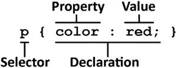

# 规则结构

CSS 通常用于样式表文档中，该文档由一系列规则组成。例如，一条将所有段落元素着色为红色的规则如下所示：

`p { color: red; }`

此规则包含两部分：选择器和声明块。选择器是 HTML 文档与样式表之间的链接，用于指定应用该规则的元素。在此例中，是类型选择器 `p`，它应用于所有段落元素（`
`）。任何 HTML 元素都可以这样用作类型选择器。

声明块用花括号括起来，定义了应用于所选元素的样式。该块可以包含一条或多条声明，每条声明由一个样式属性、一个冒号以及该属性的一个有效值组成。每条声明以分号结束，但最后一条声明的分号是可选的。

`p { color: red; background: black }`

虽然最后一个分号不是必需的，但最好加上，因为当您向规则添加更多样式时，很容易忘记缺少分号。另一个常见做法是在编写 CSS 时使用小写字母，即使选择器和属性不区分大小写。

总结一下，样式规则由一个选择器和一条或多条声明组成，每条声明包含一个或多个属性-值对。此结构如下图所示：

