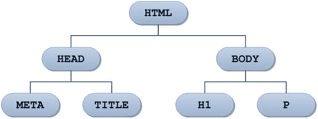

# 关系选择器

关系选择器根据元素与其他元素的关系来匹配元素。要理解这些选择器，认识到网页文档中的元素如何相互关联非常重要。

## HTML 层级

HTML 文档可以可视化为以 `<html>` 元素为根的树状结构。每个元素都位于此树的某处，并且每个元素要么是另一个元素的父元素，要么是子元素。位于另一个元素上方的任何元素称为祖先，直接上方的元素称为父元素。类似地，位于另一个元素下方的元素称为后代，直接下方的元素称为子元素。相应地，与另一个元素共享相同父元素的元素称为兄弟元素。考虑以下简单的 HTML 5 文档：

```
<!DOCTYPE html>
<html>
  <head>
    <meta charset="UTF-8">
    <title>示例</title>
  </head>
  <body>
    <h1>标题</h1>
    <p>段落</p>
  </body>
</html>
```

在此示例中，`<h1>` 和 `<p>` 是兄弟元素，因为它们共享同一个父元素。它们的父元素是 `<body>`，并且与 `<html>` 一起，它们都是这两个兄弟元素的祖先。相应地，这两个兄弟元素是 `<body>` 的子元素，并且是 `<body>` 和 `<html>` 的后代。此简单文档的层级结构如图 6-1 所示。



图 6-1. 示例 HTML 层级结构

## 继承

继承是 CSS 中另一个重要概念。它使得某些样式不仅应用于指定的元素，还应用于其所有后代元素。例如，`color` 属性是可继承的；而 `border` 属性则不可继承。这种默认的继承行为通常是期望的，使得继承非常直观。任何属性也可以显式地赋予 `inherit` 值，以使用其父元素对该属性所具有的相同值。

```
/* 继承父元素的边框 */
p { border: inherit; }
```

继承使你可以在需要为所有后代元素应用相同样式时，将该样式应用于共同的祖先元素。与将样式应用于每个需要该特定样式的后代元素相比，此过程更加方便且易于维护。例如，如果整个文档的文本需要设置为特定颜色，你可以将样式应用于 `<body>` 元素，它是所有可见元素的共同祖先。

```
/* 将文档文本颜色设置为灰色 */
body { color: gray; }
```

既然你已经了解了 HTML 层级结构和继承概念，接下来可以讨论 CSS 的关系选择器了。

## 相邻选择器

相邻兄弟选择器用于选择紧跟在第一个元素之后的第二个元素。

`div+p { color: red; }`

该选择器会匹配紧跟在 `<div>` 元素后面的段落。

`<div>不是红色</div>`

`<p>红色</p>`

`<p>不是红色</p>`

## 后代选择器

后代选择器用于匹配某个元素的子元素或孙元素。当你想仅当某个元素位于另一个元素内部时才对其应用样式时，这个选择器非常有用。

`div p { background: gray; }`

上述规则适用于以下段落，因为它源自一个 `<div>` 元素：

`<div>`

  `<p>灰色</p>`

`</div>`

## 直接子元素选择器

直接子元素选择器用于匹配其第二个元素，前提是该元素是其第一个元素的直接子元素。

`div > span { color: green; }`

当应用于以下标记时，此规则会将第二个 `<span>` 元素着色为绿色。第一个 `<span>` 元素不会被着色，因为它不是 `<div>` 的直接子元素。

`<div>`

  `<p>`

    `<span>不是绿色</span>`

  `</p>`

  `<span>绿色</span>`

`</div>`

## 通用兄弟选择器

CSS 3 新增了通用兄弟选择器，它匹配的第二个元素必须前面有第一个类型的兄弟元素。

`h1~p { color: blue; } `

在下面的示例中，最后两个段落会被选中，因为它们前面有 `<h1>` 元素，并且共享同一个父元素：

`<p>不是蓝色</p>`

`<h1>不是蓝色</h1>`

`<p>蓝色</p>`

`<p>蓝色</p>`

虽然这是一个 CSS 3 选择器，但它得到所有主流浏览器的支持，包括 Chrome 2+、Firefox、IE7+、Safari 3.1+ 和 Opera 9.2+。