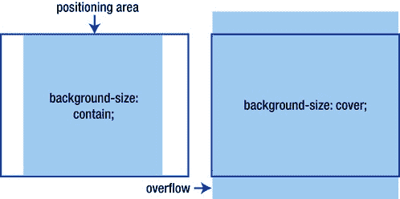

# 背景

背景属性可以添加背景效果。这些属性均不继承，并且可以应用于任何元素。

## background-color

元素背景的颜色通过`background-color`属性设置。默认情况下，其值设置为`transparent`。

```
background-color : transparent | <color>
```

即使使用了背景图像，最好也设置一个背景颜色。这样，万一出于任何原因背景图像不可用，也能有一个后备颜色。

```
background-color: #ccc;
```

## background-image

`background-image`通过`url`函数指定要用作背景的图像。

```
background-image : none | url(<url>)
```

使用`url`函数定义的图像位置可以是绝对路径，也可以是相对于 CSS 文件位置的相对路径。

```
/* 相对路径 */
background-image: url(../images/myimg.jpg);

/* 绝对路径 */
background-image: url(http://mydomain.com/images/myimg.jpg);
```

## background-repeat

默认情况下，背景图像在水平和垂直方向上都会重复。可以通过`background-repeat`属性更改此行为，使背景仅水平重复（`repeat-x`）、仅垂直重复（`repeat-y`）或完全不重复（`no-repeat`）。

```
background-repeat : repeat | repeat-x | repeat-y | no-repeat
```

## background-attachment

当在浏览器中滚动视口时，背景图像通常与页面的其余部分一起滚动。此行为由`background-attachment`属性决定，其初始值为`scroll`。如果该值设置为`fixed`，则背景的位置将相对于视口，使得背景即使在页面滚动时也保持原位。

```
background-attachment : scroll | fixed | local
```

CSS 3 为该属性引入了第三个值`local`，它将背景相对于元素内容而非整个视口固定。使用此值时，背景仅在该元素本身滚动时（通过使用`overflow`属性实现）才随元素内容滚动。对此值的支持是在 Chrome 4+、Firefox 25+、IE9+、Safari 5+ 和 Opera 10.5+ 中引入的。

## background-position

`background-position`属性用于定位背景图像，一个值用于垂直放置，另一个用于水平放置。它们都可以设置为长度值或元素大小的百分比，并且允许使用负值。此属性还有一些预定义值，包括：用于垂直放置的`top`、`center`和`bottom`；以及用于水平放置的`left`、`center`和`right`。

```
background-position : <length> <length> | <percentage> <percentage> |
                      top/center/bottom + left/center/right
```

默认情况下，背景图像定位在其父元素内边距区域的左上角。给出的任何长度值都会使背景图像相对于这些边缘移动。例如，以下属性将背景向下偏移 5 像素，向右偏移 10 像素：

```
background-position: 5px 10px;
```

CSS 3 增加了一种四值语法，允许选择图像将相对于元素的哪一侧进行定位。使用这种语法，下一个示例中的背景将相对于元素的右下角而非左上角进行定位。

```
background-position: bottom 5px right 5px;
```

这种四值语法仅在 Chrome 25+、Firefox 13+、IE9+、Safari 5.28+ 和 Opera 10.5+ 中受支持。

## background-size

背景图像的大小通常与图像的实际大小相同。可以通过`background-size`属性更改此大小，该属性允许将背景重新调整为以像素指定的尺寸，或相对于背景定位区域的百分比。

```
background-size (1-2) : auto | <length> | <percentage> | cover | contain
```

使用两个值时，第一个值确定图像的宽度，第二个值确定其高度。

```
background-size: 150% 100%;
```

单个值仅定义图像的宽度。高度随后会隐式设置为`auto`，从而保持图像的宽高比。

```
background-size: 150%;
```

`contain`和`cover`关键字用于调整背景大小以填充父容器，同时保持宽高比。`cover`值确保图像完全覆盖背景定位区域，而`contain`则确保背景被包含在该区域内。它们之间的区别如图 14-1 所示。



图 14-1. 使用`cover`和`contain`关键字调整大小的背景

此属性是在 CSS 3 中添加的，并在 Chrome 4+、Firefox 4+、IE9+、Safari 5+ 和 Opera 10.5+ 中受支持。使用`-webkit`和`-moz`前缀可将支持扩展到 Chrome 1+、Safari 3+ 和 Firefox 3.6+ 等版本。

## background-clip

背景图像或颜色的绘制区域可以通过`background-clip`属性设置。

```
background-clip : border-box | padding-box | content-box
```

背景通常延伸到边框的外边缘（`border-box`），并渲染在任何可见边框的后面。值为`padding-box`则会将背景绘制在元素的内边距区域内。第三个可能的值`content-box`会将背景绘制在内容区域内。使用以下声明，背景将被裁剪到内容的外边缘：

```
background-clip: content-box;
```

`background-clip`在 Chrome 1+、Firefox 4+、IE9+、Safari 3+ 和 Opera 12+ 中受支持。

## background-origin

`background-origin`属性决定了背景图像或颜色的起始点。

```
background-origin : padding-box | border-box | content-box
```

背景图像通常从元素内边距区域的左上角（`padding-box`）开始渲染。可以更改此行为，使背景从边框区域的左上角（`border-box`）或内容区域的左上角（`content-box`）开始。

`background-origin`属性通常与`background-clip`一起使用，以同时更改背景的起始点和裁剪区域。以下声明将两者都设置为内容区域：

```
background-origin: content-box;
background-clip: content-box;
```

`background-origin`属性是 CSS 3 属性，适用于 Chrome 4+、Firefox 4+、IE9+、Opera 10.5+和 Safari 5+。如下一个示例所示，所有版本的 Firefox 和 Chrome 以及 Safari 4 都支持带有`-moz`和`-webkit`前缀的写法。请注意，Firefox 在版本 4 之前使用`padding`和`border`作为值；当时没有用于指定内容框作为起点的值。

```
/* Chrome 1-3, Safari 4 */
-webkit-background-origin: border-box;
/* Firefox 1-3.6 */
-moz-background-origin: border;
background-origin: border-box;
```

## background

`background`属性是用于在单个声明中设置所有背景属性的简写形式。

```
background : <background-color> + <background-image> + <background-repeat> + <background-attachment> + <background-position> + <background-size> + <background-clip> + <background-origin>
```

值的顺序无关紧要，因为它们之间没有歧义。可以省略任何一个值，但请记住，使用此属性时，省略的属性将被重置为默认值。

```
background: url(bg.png) no-repeat fixed right bottom;
```

## 简写属性

在大多数情况下，当设置多个单独属性时，优先使用诸如这样的简写属性。它比使用等效的长写属性性能更好，更易于维护，如下所示：

```
background-image: url(bg.png);
background-repeat: no-repeat;
background-attachment: fixed;
background-position: right bottom;
```

## 多重背景

通过以逗号分隔的列表指定属性值，可以将多个背景应用于同一元素。列表中的第一个背景显示在最上层，每个后续背景仅通过其上方堆叠背景的透明区域可见。

```
background-image: url(bg1.png), url(bg2.png);
background-repeat: no-repeat, repeat-y;
background-attachment: fixed, fixed;
background-position: right bottom, top left;
```

简写属性也可以与多重背景一起使用，方式如下：

```
background: url(bg1.png) no-repeat fixed right bottom,
            url(bg2.png) repeat-y fixed top left;
```

对多重背景的支持在 CSS 3 中引入，并已包含在 Chrome 4+、Firefox 3.6+、IE9+、Safari 3.1+和 Opera 10.5+浏览器中。可以为不支持多重背景的旧浏览器提供回退图像。

```
background-image: bg.png; /* 回退 */
background-image: bg1.png, bg2.png;
```
