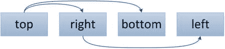

# 19. 外边距和内边距

外边距和内边距用于调整元素的位置并在其周围创建空间。

## 内边距

内边距是元素内容与其边框之间的空间。它通过此处显示的内边距属性进行设置。这些属性不具有继承性，并且可以应用于任何元素。

```
padding (1-4) | padding-top | padding-right |
padding-bottom | padding-left :
  <length> | <percentage>
```

有四个属性用于单独设置每一边的内边距。在以下示例中，垂直（顶部、底部）内边距将为 `10px`，水平（右侧、左侧）内边距将为零。

```
padding-top:    10px;
padding-right:  0;
padding-bottom: 10px;
padding-left:   0;
```

这些声明可以使用 `padding` 属性缩短为单个声明。内边距值随后按顺时针顺序指定：上、右、下、左。

```
padding: 10px 0 10px 0;
```

与许多与盒模型相关的其他属性一样，`padding` 属性可以设置一至四个值，这些值对应于元素盒子的各边。当少于四个值时，内边距会按图 19-1 所示重复。



图 19-1.

1 至 4 值语法解释

例如，如果指定了两个值，则第一个值设置顶部和底部的内边距，第二个值设置右侧和左侧的内边距。这使得编写上一个示例的方式更加简短。

```
padding: 10px 0;
```

请记住，内边距是元素背景的一部分，并受背景属性的影响，而外边距始终是透明的。

## 外边距

外边距是元素边框周围的空间，通过下面列出的外边距属性进行设置。这些属性不具有继承性，并且可以应用于任何元素，但垂直外边距不影响非替换行内元素除外。

```
margin (1-4) | margin-top | margin-right |
margin-bottom | margin-left:
  <length> | <percentage> | auto
```

外边距和内边距都可以使用百分比值，这些值相对于包含元素的宽度和高度。与内边距不同，外边距可以为负值，这允许元素区域重叠。`auto` 关键字让浏览器自动计算外边距。

与外边距和内边距属性类似，`margin` 属性可以设置一至四个值。例如，在以下声明中，上下外边距将为 `1cm`，左右外边距将为 `0`：

```
margin: 1cm 0;
```

`margin` 属性也有四个子属性，它们提供了一种更详细的方法来设置四个边各自的外边距。

```
margin-top:    1cm;
margin-right:  0;
margin-bottom: 1cm;
margin-left:   0;
```

相邻盒子的上下外边距会共享，因此两个盒子之间的垂直距离不是外边距之和，而是两个外边距中较大的一个。因此，以下两个 `<div>` 盒子之间的距离将仅为 `10px`：

```
<div style="margin-bottom: 5px;">顶部盒子</div>
<div style="margin-top: 10px;">底部盒子</div>
```
