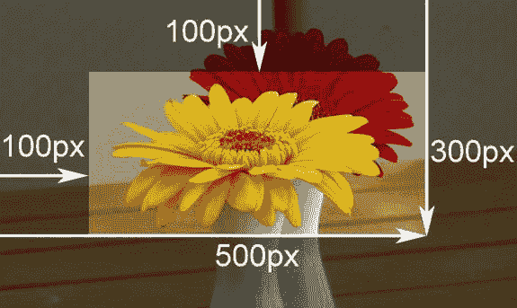
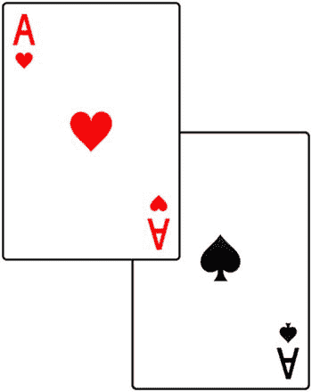
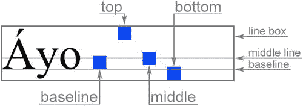
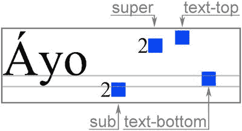

# 21. 定位

定位属性可以改变元素的显示方式和位置。它们可以实现对网页布局的非常精确的控制。

## position

使用 `position` 属性，元素可以以四种不同的方式进行定位。将 `position` 属性设置为除 `static` 之外的任何值的元素被称为已定位元素。

`position : static | relative | absolute | fixed`

已定位元素可以通过 `top`、`left`、`right` 和 `bottom` 属性进行移动，这些属性可用于在页面上的任意位置定位元素，也可以水平和垂直地调整它们的大小。它们允许正的或负的长度值和百分比值，其中百分比是相对于包含块的尺寸而言的。

`top | right | bottom | left (已定位元素) : auto | <length> | <percentage>`

### static

默认情况下，`position` 属性的值为 `static`。此值意味着该元素出现在页面流中的常规位置，并且不受 `top`、`left`、`right` 或 `bottom` 定位属性的影响。

```
/* 未定位的元素 */
.static { position: static; }
```

由于 `position` 属性不具有继承性，且 `static` 是默认值，因此无需显式地将 `position` 属性设置为 `static`。

### relative

将 `position` 值更改为 `relative` 意味着该元素可以相对于其在页面流中的正常位置进行定位。例如，要将选定的元素显示在其正常位置下方 20 像素处，可以使用以下声明：

```
/* 将元素向下移动 20 像素 */
.relative {
  position: relative;
  top: 20px;
}
```

相对定位的元素被认为是正常页面流的一部分，因此其他元素不会移动来填补该元素留下的空白。

通过使用元素的外边距也可以实现将元素相对于其正常位置移动的效果。除非有特定需要使该元素成为已定位元素（例如它将作为绝对定位子元素的容器），否则这种解决方案通常是更可取的。

```
/* 将元素向下移动 20 像素 */
margin-bottom: -20px;
```

请记住，更改外边距会影响布局并填补空白，而相对定位则不会。

### absolute

`position` 值 `absolute` 会将元素从任何包含元素中分离出来，并允许它相对于其最近的已定位祖先元素进行定位，如果没有已定位的祖先元素，则相对于文档主体。

```
/* 将元素放置在左上角 */
.absolute {
  position: absolute;
  top: 0;
  left: 0;
}
```

### fixed

固定定位的元素是相对于屏幕视口进行定位的。当页面滚动时，它不会移动。与绝对定位元素类似，固定定位的元素不会在正常页面流中预留任何空间。

```
/* 将元素放置在右下角 */
.fixed {
  position: absolute;
  bottom: 0;
  right: 0;
}
```

## `overflow`

`overflow` 属性决定了块级元素如何处理内容溢出。其默认值为 `visible`，意味着超出元素内容区域的文本和子元素将是可见的。将该值设置为 `hidden` 会隐藏溢出的内容，而使用 `scroll` 值则会使元素的块变得可滚动，以容纳溢出的内容。`auto` 值与 `scroll` 类似，但滚动条仅在必要时才出现。

`overflow (块级元素) : visible | hidden | scroll | auto`

此属性控制水平和垂直方向上的溢出行为。另外两个属性 `overflow-x` 和 `overflow-y` 可用于区分水平或垂直溢出的处理方式。这两个属性的值与 `overflow` 属性的值相同。

```
overflow: hidden;   /* 隐藏所有溢出 */
overflow-x: hidden; /* 隐藏水平溢出 */
overflow-y: hidden; /* 隐藏垂直溢出 */
```

## `clip`

如果将元素定位为 `absolute` 或 `fixed`，则 `clip` 属性可将其裁剪为一个矩形。它使用名为 `rect()` 的 CSS 函数来指定裁剪区域。

`clip (absolute | fixed) :`

`auto | rect(<上>, <右>, <下>, <左>)`

`rect()` 需要四个长度值，每个值之间用逗号分隔。这些值是相对于元素的左上角而言的。图 21-1 所示的示例从应用该属性的元素中裁剪并显示一个 200 x 400 像素的区域。

```
.myclip {
  position: absolute;
  clip: rect(100px, 500px, 300px, 100px);
}
```



图 21-1. 阴影区域被移除

关键字 `auto` 可用于右侧或底部的值，分别表示元素的完整宽度或高度。此关键字也是 `clip` 属性的默认值，这意味着元素不会被裁剪。

```
/* 从左侧和顶部移除 100px */
clip: rect(100px, auto, auto, 100px);
/* 无裁剪 */
clip: auto;
```

为了支持 IE7 及更低版本，需要省略 `rect()` 函数中的逗号。所有主流浏览器都支持这种非标准语法。

```
/* 向后兼容 IE4-7 的语法 */
clip: rect(100px 500px 300px 100px);
```

## `z-index`

相互重叠的定位元素通常根据它们在 Web 文档中的顺序进行分层。这种自然的堆叠顺序可以通过 `z-index` 属性来改变。

`z-index (已定位元素) : auto | <整数>`

`z-index` 属性接受正整数或负整数作为其值，表示堆叠顺序。值较高的元素位于值较低的元素前面，如下例所示：

```


```

在这个如图 21-2 所示的示例中，红心 A 因为其较高的堆叠顺序而被层叠在黑桃 A 之上。



图 21-2. 自定义堆叠顺序

## `vertical-align`

可以使用 `vertical-align` 属性来控制文本和内联元素在一行内的垂直对齐方式。此属性也可用于表格单元格元素。

`vertical-align (内联 | 表格单元格) :`

`baseline | <长度> | <百分比> | top | middle |`

`bottom | text-top | text-bottom | super | sub`

默认情况下，文本和内联元素（如图像）的底部在基线上对齐，基线是所有字母所在的一条隐形线。值 `top` 和 `bottom` 分别将图像与行的顶部和底部对齐。不太直观的是 `middle` 值，它将图像的中间与父元素中小写字母的中间对齐。这些常见对齐值的渲染效果如图 21-3 所示。



图 21-3. 常见的垂直对齐值

`vertical-align` 还有两个较少使用的值：`text-bottom` 和 `text-top`。`text-bottom` 值将元素的底部与文本的底部对齐。与之相反，`text-top` 值将元素的顶部与文本的顶部对齐。还有 `sub` 和 `super` 值，它们分别将元素对齐到下标和上标位置。使用这些值的结果如图 21-4 所示。



图 21-4. 其他垂直对齐值

元素还可以通过长度值或百分比值来提升（正值）或降低（负值）。百分比和长度值都从基线开始计算；百分比值是相对于行高而言的。

```
/* 将文本段对齐到常规文本下方 5 像素处 */
常规 <span style="vertical-align: -5px;">降低</span>
```

## 垂直对齐

当应用于表格单元格元素 `<th>` 和 `<td>` 时，`vertical-align` 属性的行为类似于 HTML 中已弃用的 `valign` 属性。表格单元格的有效值为 `baseline`、`bottom`、`middle` 和 `top`。其他值（包括长度和百分比）不应与表格单元格一起使用。

`top` 值将单元格的上内边距边缘与行的顶部对齐。同样，`bottom` 值将单元格的下内边距边缘与行的底部对齐。更值得注意的是，`baseline` 值对齐单元格的内容，使其与进行基线对齐的其他单元格共享相同的基线。

与默认值为 `baseline` 的内联元素相反，表格单元格元素通常居中对齐。对于表格单元格，`middle` 值的行为更直观，它将单元格的内边距框在行中居中对齐，从而使单元格的内容看起来居中。

在以下示例中，表格单元格元素垂直对齐到底部：

```
<table>
  <tr>
    <td style="vertical-align: bottom;">底部</td>
  </tr>
</table>
```

## 居中

在 CSS 中有几种方法可以使元素居中。一种常见的方法是使用值为 `center` 的 `text-align` 属性。

```
.text-center { text-align: center; }
```

通过将此属性应用于包含元素，其中的文本将居中对齐。

```
<p class="text-center">居中文本</p>
```

这种方法适用于文本和内联元素，但不适用于块级元素。要使块级元素居中，可以将左右外边距设置为 `auto`，这会使水平外边距相等，从而使块居中。

```
.box-center { margin: 0 auto; }
```

请记住，要使块级元素看起来居中，其宽度必须是固定的，不能是弹性的；否则，它会占据所有可用宽度。

```
<div style="width: 50px; height: 50px;
            border: 1px solid black;"
     class="box-center"></div>
```

对于垂直居中，将内容对齐到中间的最简单方法是在父元素上使用 `vertical-align` 属性，并将其值设置为 `middle`。这种行为仅在表格单元格元素中按预期工作，因此需要将容器更改为表格单元格，如以下使用 `display` 属性的示例所示：

```
<div style="vertical-align: middle;
            display: table-cell;
            min-height: 100px;">居中</div>
```
