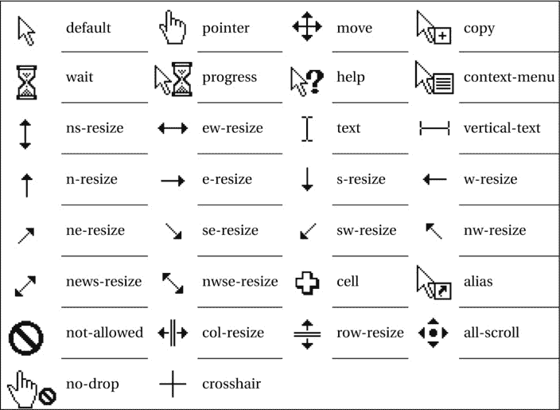

# 22. 分类
分类属性指定了元素的显示方式以及是否可见。

# 显示（display）

`display`属性决定了包围元素的盒子类型。它可以使任何元素显示为内联、块级或其他任何类型。每个元素都有一个默认的`display`值，该值取决于元素的类型。

`display : none | inline | block | list-item | inline-block |`
`inline-table | table | table-cell | table-row |`
`table-column | table-column-group | table-footer-group |`
`table-header-group | table-row-group | flex | inline-flex |`
`grid | inline-grid | run-in`

大多数 HTML 元素显示为内联或块级；其他元素具有特殊的显示属性，例如`<li>`元素的`list-item`和`<td>`、`<th>`元素的`table-cell`。通过使用`display`属性，任何元素都可以被更改为渲染为这些或其他任何元素类型。例如，以下链接被渲染为块级元素而不是内联元素：

`<a href="#" style="display: block;">块级链接</a>`

## inline-block

`display`最有用的值之一是`inline-block`，它结合了块级和内联元素的特性。`inline-block`元素类似于内联元素，但不同之处在于它也可以像块级元素一样操作盒子模型的宽度、高度和垂直边距属性。这些特性与可替换的内联元素（如``和`<button>`）相同。因此，这些元素在 HTML5 中被正式重新定义为`inline-block`元素。

`inline-block`的一个常见应用是将列表项元素（`<li>`）制作成适合水平导航菜单的样式。请注意，将列表项元素的显示类型从`list-item`更改为`inline-block`会自动移除列表标记。

```css
li {
    display: inline-block;
    width: 100px;
    background: #ccc;
}
```

应用此规则后，以下标记会渲染出三个并排的灰色背景框，如图 22-1 所示。

```html
<ul>
    <li>项目一</li>
    <li>项目二</li>
    <li>项目三</li>
</ul>
```


图 22-1. `inline-block`值演示

## none

另一个有用的`display`值是`none`。它完全隐藏一个元素，使页面渲染得像该元素不存在一样。

```css
.removed { display: none; }
```

# 可见性（visibility）

`visibility`属性可以通过将其值设置为`hidden`来隐藏元素，而无需移除其占用的空间。

`visibility (block) : inherit | visible | hidden | collapse`

`collapse`值旨在仅用于某些表格元素：行（`<tr>`）、列（`<col>`）、列组（`<colgroup>`）以及行组（`<thead>`、`<tbody>`和`<tfoot>`）。根据规范，`collapse`应移除隐藏的元素（如同`display: none`）并使该空间可供其他元素使用。遗憾的是，并非所有主流浏览器都遵循此值的规范。将`display`属性设置为`none`会带来更一致的浏览器行为，因此应优先使用。

# 不透明度（opacity）

`opacity`属性可以使元素及其内容透明。

`opacity : <number>`

使用 0.0 到 1.0 之间的十进制值来设置透明度。值为 1 时，元素不透明；值为 0 时，元素完全透明（不可见）。

```css
.half-transparent { opacity: 0.5; }
```

Chrome 1+、Firefox 1+、IE9+、Safari 1.2+ 和 Opera 9+ 支持此 CSS3 属性。使用以下滤镜可以极大地增强 IE 支持：

```css
.half-transparent {
    filter: alpha(opacity=50); /* IE5-8 */
    opacity: 0.5;
}
```

# 浮动（float）

`float`属性将一个元素从其包含元素中分离出来，使其浮动在其上方，可以向左或向右浮动。它旨在使文本环绕图像，但也常用于制作布局。浮动一个内联元素会自动将其更改为块级元素。

`float : none | left | right`

要使文本和其他内联内容环绕图像，您可以将其向左或向右浮动。

``

对于布局，浮动允许块级元素水平排列。例如，可以使用以下类创建盒子网格：

```css
.box {
    float: left;
    width: 100px;
    height: 100px;
    margin: 0 1em;
    background: #ccc;
    border-radius: 10px;
}
```

这个类使盒子水平堆叠，而不是垂直堆叠（块级元素的正常行为）（参见图 22-2）。

```html
<div class="box"></div>
<div class="box"></div>
<div class="box"></div>
```


图 22-2. 浮动的盒子

## clear 属性

使用浮动的一个副作用是，任何跟随这些浮动盒子的元素也会水平排列。`clear`属性旨在停止这种行为。

# 清除（clear）

`clear`属性用于清除元素左侧、右侧或两侧的浮动元素。

`clear (block) : none | left | right | both`

此属性通常被赋予一个与属性同名的独立类。

`.clear { clear: both; }`

一个带有`clear`类的空`div`容器通常放置在浮动元素之后。这个清除元素会移动到浮动元素的下方，而不是出现在它们旁边。

`<div class="clear"></div>`

由于浮动布局往往复杂且脆弱，它们通常已被其他布局方法所取代，例如使用定位属性。

在前面给出的盒子对齐示例中，一个更好的替代方案是将盒子改为`inline-block`元素。这可以完成相同的任务，同时无需清除浮动元素。

```
.box {
    display: inline-block;
    width: 100px;
    height: 100px;
    margin: 0 1em;
    background: #ccc;
    border-radius: 10px;
}
```

# 光标（cursor）

`cursor`属性指定用户将鼠标悬停在元素上时看到的光标。默认值是`auto`，意味着浏览器决定使用什么光标。标准光标值及其外观可见于表 22-1。

表 22-1. 标准光标值



除了这些值之外，还可以使用`url`函数定义自定义光标。如果此光标不可用，可以在自定义光标之后指定一个通用光标，用逗号分隔。

```
cursor: url(new.cur), pointer;
```
