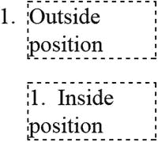

# 23. 列表（List）

CSS 列表属性处理列表元素，特别是`<ul>`、`<ol>`和`<li>`元素。

## `list-style-type`

列表在每个列表项元素（`<li>`）前显示一个标记。该标记的外观可通过 `list-style-type` 属性修改。对于无序列表（`<ul>`），每个列表项的标记方式相同。此处列出预定义的圆点值可供使用，默认值为 `disc`（实心圆）：

`list-style-type : inherit | disc | circle | square | none`

在有序列表（`<ol>`）中，每个列表项前会显示一个数字字符以表明其在序列中的位置。所有主流浏览器均支持以下数字类型，初始值为 `decimal`：

`list-style-type : inherit | decimal | none | upper-alpha | lower-alpha | upper-roman | lower-roman | lower-greek | lower-latin | armenian | georgian | decimal-leading-zero`

以下示例为两个列表元素指定了新的列表样式。虽然可以让 `<ul>` 显示有序标记，让 `<ol>` 显示无序标记，但这不是好的做法。

```
ul { list-style-type: square; } /* ▅ */
ol { list-style-type: upper-roman; } /* I, II, III, ... */
```

标记的颜色与列表元素的文本颜色相同。请记住，任何元素都可以通过将其 `display` 类型改为 `list-item` 来显示列表标记。

## `list-style-image`

作为预定义标记的替代方案，可使用 `list-style-image` 属性来将自定义图像作为列表圆点。

`list-style-image : inherit | none | url(<url>)`

图像路径需写在 CSS 的 `url` 函数中。

`list-style-image: url(my-bullet.png)`

该属性会覆盖 `list-style-type` 属性选定的任何标记类型。尽管如此，最好还是指定一个 `list-style-type` 作为后备方案，以防自定义圆点图像因任何原因不可用。

## `list-style-position`

列表标记通常位于元素框外部。`list-style-position` 提供了一个替代方案：将圆点放置在元素框内部。

`list-style-position : inherit | outside | inside`

选择 `outside` 会使每行文本与第一行文本的开头对齐，而 `inside` 则会使后续的文本行在标记下方换行。`inside` 值还会在视觉上缩进标记，如图 23-1 所示。



图 23-1. 外部和内部标记放置

# `list-style`

`list-style` 是用于设置所有列表属性的简写属性。值可以按任意顺序设置，因为它们之间没有歧义。任何一个值也可以省略，此时将使用该属性的默认值。

`list-style : <list-style-type> + <list-style-image> + <list-style-position>`

在以下示例中，设置了 `list-style` 的 `type` 和 `position` 值，这些值会继承给列表项。

```
<ul style="list-style: inside square;">
  <li>苹果</li>
  <li>橙子</li>
  <li>梨</li>
</ul>
```

请记住，列表属性不仅可以样式化列表容器 `<ul>` 和 `<ol>`，还可以样式化单个列表项 `<li>`。

# 计数器

在 CSS 中，可以使用 `counter-increment` 和 `counter-reset` 属性自动为元素编号。`counter-reset` 属性指定计数器的名称，后面可跟计数器的初始值，默认值为零。

```css
/* 创建一个名为 chapter 的计数器 */
body { counter-reset: chapter; }
```

`counter-increment` 属性接受计数器的名称，后面可跟一个可选数字。该数字设定元素每次出现时计数器的增量，默认值为 1。

```css
/* 在每个 <h1> 处递增计数器 */
h1:before { counter-increment: chapter; }
```

创建计数器的最后一步是使用 CSS 的 `counter()` 函数来显示它，该函数参数为计数器的名称。在此示例中，章节编号会显示在 `<h1>` 元素之前：

```css
/* 递增并显示计数器 */
h1:before {
  content: "第 " counter(chapter) " 章 - ";
  counter-increment: chapter;
}
```

现在，计数器会在 `<h1>` 元素前添加章节编号。

```html
<h1>第一章</h1>  <!-- 第 1 章 - 第一章 -->
<h1>第二章</h1> <!-- 第 2 章 - 第二章 -->
<h1>第三章</h1>  <!-- 第 3 章 - 第三章 -->
```

可以添加另一个计数器来为 `<h2>` 子标题编号。此计数器会在每个 `<h1>` 元素处重置为零：

```css
h2:before {
  content: counter(chapter) "." counter(section) " ";
  counter-increment: section;
}
h1 { counter-reset: section; }
```

以下示例展示了计数器的显示方式：

```html
<h1>标题</h1> <!-- 第 1 章 - 标题 -->
<h2>子标题</h2>  <!-- 1.1 子标题 -->
<h2>子标题</h2>  <!-- 1.2 子标题 -->
<h1>标题</h1> <!-- 第 2 章 - 标题 -->
<h2>子标题</h2>  <!-- 2.1 子标题 -->
```

## 嵌套计数器

CSS 计数器可以任意层级地嵌套。这些嵌套的计数器可以使用名为 `counters()` 的 CSS 函数进行组合和显示。该函数的第一个参数是计数器名称，第二个参数是分隔每个计数器的字符串。

```css
ul { counter-reset: item; }
li:before {
  content: counters(item, ".") " ";
  counter-increment: item;
}
```

这些规则适用于以下无序列表（注意，每个嵌套列表都会自动创建一个新的计数器实例）：

```html
<ul>
  <li>项目</li>   <!-- 1 项目 -->
  <li>项目</li>   <!-- 2 项目 -->
  <ul>
    <li>项目</li> <!-- 2.1 项目 -->
    <li>项目</li> <!-- 2.2 项目 -->
  </ul>
</ul>
```

所有主流浏览器均支持计数器，包括所有版本的 Chrome、Firefox、Safari、Opera 以及 IE8+。
