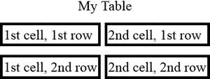

# 24. 表格

CSS 拥有许多专门用于表格元素的属性。这些属性可以控制浏览器如何渲染表格数据。

## `border-spacing`

相邻表格单元格边框之间的距离可以通过 `border-spacing` 属性进行更改，该属性相当于 HTML 中的 `cellspacing` 属性。W3C 定义此属性的初始值为 0，但大多数浏览器默认将其渲染为 2px。

`border-spacing : inherit | <length> [<length>]`

此属性可以指定一个或两个长度值。当指定两个值时，第一个值设置水平间距，第二个值设置垂直间距。

```
.spacing {
  border-spacing: 5px 10px;
}
```

`border-spacing` 是表格的属性，而非单元格的属性，因此它应用于 `<table>` 元素，如下例所示：

```
<table class="spacing">
  <caption>我的表格</caption>
  <tr>
    <td>第 1 行第 1 列</td>
    <td>第 1 行第 2 列</td>
  </tr>
  <tr>
    <td>第 2 行第 1 列</td>
    <td>第 2 行第 2 列</td>
  </tr>
</table>
```

该表格如图 24-1 所示，其中 `<td>` 元素应用了实线边框。



图 24-1. 示例表格

表格单元格有边框和内边距，但没有外边距；取而代之的是 `border-spacing`。内边距与其他元素的工作方式相同，行为类似于 HTML 中的 `cellpadding` 属性。

## `border-collapse`

`border-collapse` 属性决定表格边框是合并为单一边框还是分离的。

`border-collapse : inherit | separate | collapse`

通常，表格单元格有自己的独立边框，并通过 `border-spacing` 属性设置的距离分隔。如果将边框设置为合并（collapse），则单元格共享边框，并且会忽略 `border-spacing` 属性的任何值。

```
table { border-collapse: collapse; }
```

## `caption-side`

`<caption>` 元素为表格提供标题。其位置可通过 `caption-side` 属性更改。

`caption-side : inherit | top | bottom`

标题通常显示在顶部，但也可以通过 `caption-side` 属性将其置于表格下方。此属性适用于 `<caption>` 元素，但由于继承性，也可以为 `<table>` 元素设置。

```
caption { caption-side: bottom; }
```

## `empty-cells`

无内容的表格单元格通常仍会显示其边框和背景。此行为可通过 `empty-cells` 属性更改。

`empty-cells : inherit | show | hide`

将此属性值设为 `hide` 将隐藏单元格的边框和背景。表格的布局不受影响。

## `table-layout`

`table-layout` 属性决定表格单元格的宽度应为固定还是灵活。与其他表格属性不同，`table-layout` 不具继承性。

`table-layout : auto | fixed`

此属性初始值为 `auto`，意味着表格单元格的宽度会自动扩展以适应其内容，即使这会导致超出其设置宽度。若要强制执行表格的指定宽度，可将 `table-layout` 设为 `fixed`。此时水平布局仅取决于表格的设定宽度，而非单元格内容。

```
/* 强制表格宽度 */
.fixed { table-layout: fixed; }
```

固定表格布局还有一个额外好处：浏览器能更快地渲染表格，因为一旦接收到第一行，浏览器就能获知表格的尺寸。
