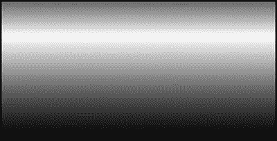
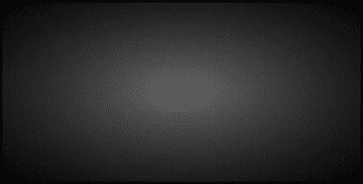
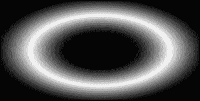
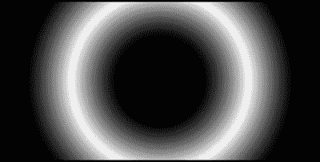
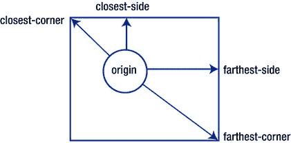
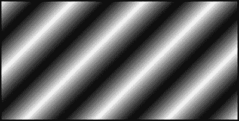
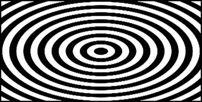

# 15. 渐变

渐变是一种颜色填充，可以从一种颜色平滑过渡到另一种颜色。渐变函数在 CSS 3 中引入，根据规范，可以在任何需要图像的地方使用，但它们主要与`background`或`background-image`属性一起使用，以创建背景渐变。

## 线性渐变

`linear-gradient()`函数定义了一个从一种颜色平滑过渡到另一种颜色的渐变。

`linear-gradient([<angle> | to <side-or-corner>] {, <color stop> [stop position]} (2-`∞`) )`

在其最简单的形式中，线性渐变由两种颜色组成，从上到下均匀分布。在图 15-1 中，渐变从灰色开始，在底部过渡为黑色。

```
.mygradient {
  background-image: linear-gradient(gray, black);
}
```

图 15-1. 简单线性渐变

渐变的角度可以通过使用关键字`to`后跟渐变的终点方向来设置：`top`、`right`、`bottom`、`left`或它们的任意组合。示例如图 15-2 所示。

```
linear-gradient(to bottom right, gray, black);
```

图 15-2. 右下角线性渐变

可以使用`deg`单位指定更精确的角度，其中`0deg`等同于`to top`。角度按顺时针方向递增，并允许负角度。

```
linear-gradient(0deg,   gray, black); /* 向上 */
linear-gradient(90deg,  gray, black); /* 向右 */
linear-gradient(180deg, gray, black); /* 向下 */
linear-gradient(-90deg, gray, black); /* 向左 */
```

可以在起始颜色和结束颜色之间添加额外的颜色停止点。任何颜色停止点后都可以跟一个停止位置，指定为百分比或长度值。如果未指定停止位置，则颜色均匀分布。在以下情况下，白色设置为 25%，而不是其默认位置 50%。图 15-3 展示了此代码的结果。

```
linear-gradient(gray, white 25%, black);
```

图 15-3. 具有多个颜色停止点的渐变

到目前为止描述的标准语法支持 Chrome 26+、Firefox 16+、IE10+、Safari 6.1+和 Opera 12.1+。遗留语法可以与`-moz`、`-webkit`和`-o`前缀一起使用，以将支持范围扩展到 Firefox 3.6、Chrome 1、Safari 4 和 Opera 11.1。

```
.linear-gradient
{
  background-color: red; /* 回退颜色 */
  /* Chrome 1-9, Safari 4-5 */
  background: -webkit-gradient(linear, left top, right top, from(red), to(orange));
  /* Chrome 10-25, Safari 5.1-6.1 */
  background: -webkit-linear-gradient(left, red, orange);
  /* Firefox 3.6-15 */
  background: -moz-linear-gradient(left, red, orange);
  /* Opera 11.1-12.1 */
  background: -o-linear-gradient(left, red, orange);
  /* 标准语法 */
  background: linear-gradient(to right, red, orange);
}
```

## 径向渐变

径向渐变是从中心点向外过渡的渐变。在 CSS 中，这类渐变使用 `radial-gradient()` 函数定义。

`radial-gradient([<形状> + <尺寸>] [at <位置>]` `{, <色标> [停止位置]} {2-`∞`} )`

要创建径向渐变，至少必须定义两个色标。图 15-4 中的径向渐变从中心的灰色开始，逐渐过渡到黑色。

`radial-gradient(gray, black);`

图 15-4. 简单的径向渐变

与 `linear-gradient()` 一样，允许使用两个以上的色标，并且它们后面可以跟随一个长度或百分比值，用于指示颜色的停止位置。示例如图 15-5 所示。

`radial-gradient(black 25%, white, black 75%);`

图 15-5. 设置了停止位置的径向渐变

径向渐变的形状可以是 `ellipse`（椭圆）或 `circle`（圆形）。默认形状是 `ellipse`，它允许渐变自动扩展以匹配元素的高度和宽度，如图 15-5 所示。另一种 `circle` 值（如图 15-6 所示）则强制渐变呈圆形，无论元素的形状如何。

`radial-gradient(circle, black 25%, white, black 75%);`

图 15-6. 圆形径向渐变

对于椭圆，可以使用两个长度值；对于圆形，则使用一个值，来设置渐变的水平半径和垂直半径。对于椭圆，它们也可以是相对于元素尺寸的百分比值，如图 15-7 所示。

`radial-gradient(75% 25%, gray, black);`

图 15-7. 调整尺寸后的径向渐变

如果不需要如此精确，可以使用以下预定义的关键字来设置尺寸：`closest-side`、`closest-corner`、`farthest-side` 或 `farthest-corner`。这些值指定渐变是受限于距离原点最近还是最远的元素边或角（见图 15-8）。例如，`farthest-side` 值会调整渐变尺寸，使其最后一个颜色结束于元素距离原点最远的那一侧。

`radial-gradient(farthest-side, gray, black);`

图 15-8. 尺寸关键字

径向渐变的原点默认位于中心。可以通过在关键字 `at` 后指定渐变原点的位置来改变它，其位置指定方式与 `background-position` 属性相同。先指定水平位置，可选地后接垂直位置。位置可以使用关键字（`left`、`center`、`right`、`top`、`center` 和 `bottom`）、长度值、百分比值或其组合来设置。图 15-9 给出了一个示例，其中渐变原点被移到了元素的右下角。

`radial-gradient(at right bottom, gray, black);`

图 15-9. 右下角原点

当 `radial-gradient()` 函数与 `-moz`、`-webkit` 和 `-o` 等浏览器厂商前缀一起使用时，其对浏览器的支持情况与 `linear-gradient()` 大致相同。与 `linear-gradient()` 一样，径向渐变的语法也经历了一些修订。以下是跨浏览器完整语法的示例：

# 重复渐变

线性渐变和径向渐变本身不会重复渐变图案，因为它们会自然地拉伸以填充定义它们的元素。有两个额外的函数用于创建重复渐变：`repeating-linear-gradient()` 和 `repeating-radial-gradient()`。

## 重复线性渐变

为了实现线性渐变的重复，使用 `repeating-linear-gradient()` 函数。此函数的参数与 `linear-gradient()` 相同。

`repeating-linear-gradient([<角度> | to <边或角>]` `{, <色标> [停止位置]} (2-`∞`) )`

重复线性渐变会无限重复色标。渐变的大小由最后一个色标决定。为避免生硬的过渡，图 15-10 中的起始颜色在末尾处被重复了一次。

`repeating-linear-gradient(-45deg, white 0, black 10%, white 20%);`



图 15-10. 重复线性渐变

## 重复径向渐变

径向渐变的重复函数也与非重复版本共享相同的语法。图 15-11 所示的示例演示了重复函数。请注意，与之前的示例相比，此渐变具有锐利的颜色过渡。

`repeating-radial-gradient(black, black 5%, white 5%, white 10%)`



图 15-11. 重复径向渐变

定义渐变的语法明显比许多其他 CSS 特性更复杂。因此，使用在线工具以图形方式设计所需的渐变通常是更好的选择。可以在 `Colorzilla.com` 上找到这样的工具。¹ 除了符合标准规范的渐变代码外，它还提供了实现最大浏览器兼容性所必需的带有厂商前缀的版本。

脚注 1

`http://www.colorzilla.com/gradient-editor`