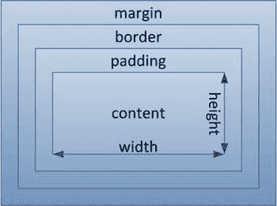
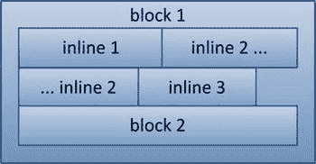

# 16. 盒模型

所谓的 CSS 盒模型描述了一个 HTML 元素所占用的空间。在这个模型中，每个元素由四个盒子组成：内容（content）、内边距（padding）、边框（border）和外边距（margin），如图 16-1 所示。

图 16-1. CSS 盒模型

围绕内容的三个盒子（内边距、边框、外边距）在元素的顶部、右侧、底部和左侧可以有不同的尺寸。这些尺寸中的任意一个或全部也可以设置为零。

## 行内元素与块级元素

HTML 主要有两类元素：块级元素和行内元素。盒模型对这两类元素的适用方式不同，因此理解它们的区别至关重要。行内元素的例子包括`<a>`、`<strong>` 和 `<em>`，而 `
`、`<h1>` 和 `<form>` 则是块级元素。

行内元素与文本内容一同流动，并根据需要自动换行以适应其容器的宽度。它们不能包含块级元素，但 `<a>` 元素除外，它可以包裹任何类型的元素。

块级元素可以同时包含块级元素和行内元素（见图 16-2）。它们通过在自身周围创建一个水平扩展的虚拟盒子来中断文本流，使得每个块级元素前后看起来都像有换行符。由于这些特性，块级元素也被称为盒子或容器。

图 16-2.

块级元素与行内元素

行内元素和块级元素周围的盒子具有不同的特性。块级元素可以操作盒模型中的所有属性，包括内容区域的宽度和高度，以及边框、内边距和外边距。如果没有设置宽度，块级元素会在水平方向上扩展到其包含元素所允许的最大宽度。

行内元素的限制更多，它无法设置垂直方向的外边距（顶部或底部），也无法改变其行内盒子的宽度或高度。对于行内元素，最小高度可以通过 `line-height` 属性设置，但其宽度和高度会自动调整以适应元素所包含的内容。

行内元素中有一个子类，称为可替换行内元素，它们使用外部对象，例如 ``、`<video>` 和 `<object>`；以及表单元素，例如 `<input>` 和 `<textarea>`。对于这些行内元素，所有盒模型属性都可以像块级元素一样进行操控。

### Span 与 Div

使用 `` 和 `
` 元素是为网页文档添加结构的一种通用方式。这些元素本身没有关联的样式，这使得它们特别适合与类选择器和 ID 选择器配合使用。这两者的区别在于：`` 是行内元素，而 `
` 是块级元素。

`行内`

`
块级
`

作为一个行内元素，`` 主要用于为文本片段添加样式。它不能用于设置块级元素的样式，因为根据 HTML 规范，块级元素不允许放在行内元素内部。

`红色文本`

相比之下，`
` 用于为其他块级元素和行内元素创建带样式的容器。这些自定义容器通常构成了网页的布局。由于它是块级元素，`
` 允许操控元素的所有盒子属性（宽度、高度、内边距、边框和外边距）。

`
`

  `
块级中的块级
`

`
`

