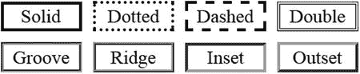
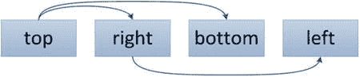
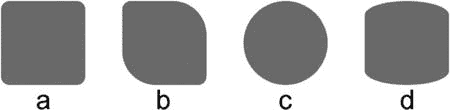

# 17. 边框

边框属性用于格式化元素周围的边框。它们可以应用于任何元素，并且不会继承。

## border-style

要使元素的边框可见，必须将 `border-style` 属性设置为除 `none`（默认值）之外的其他值。

`border-style (1-4) | border-top-style | border-right-style | border-bottom-style | border-left-style : none | dashed | dotted | double | groove | hidden | inset | outset | ridge | solid`

实线边框样式是最常用的，但如图 17-1 所示，还有其他几种显示边框的选项。`hidden` 值会移除边框，与 `none` 同义，不同之处在于它还会隐藏具有合并边框的表格中的共享边框。



图 17-1. border-style 外观

`border-style` 属性是可以设置一到四个值的多个属性之一。当指定的值少于四个时，`border-style` 的值会重复，如图 17-2 所示。



图 17-2. 1 到 4 值语法解释

根据这些规则，以下声明是等效的，都会在元素的顶部和底部显示实线边框：

`border-style: solid none solid none;`

`border-style: solid none solid;`

`border-style: solid none;`

要使所有边框的样式相同，只需指定一个样式值。

`border-style: solid;`

`border-style` 属性有四个子属性，也可以用来分别设置各边边框的样式。

`border-top-style: dotted;`

`border-right-style: dashed;`

`border-bottom-style: ridge;`

`border-left-style: inset;`

## border-width

`border-width` 属性用于控制边框的宽度，可以使用长度单位或预定义值之一来设置：`thin`、`medium` 或 `thick`。初始值为 `medium`，通常渲染为 3 像素。

`border-width (1-4) | border-top-width | border-right-width | border-bottom-width | border-left-width : <length> | thin | medium | thick`

与 `border-style` 类似，该属性可以有一到四个值，并有四个子属性用于单独设置各边的边框宽度。

```
/* 快捷属性 */
border-width: thin medium;

/* 完整属性 */
border-top-width:    thin;
border-right-width:  medium;
border-bottom-width: thin;
border-left-width:   medium;
```

宽度为零表示不显示边框。该值与将边框样式设置为 `none` 效果相同。

## border-color

`border-color` 用于设置边框的颜色。CSS 没有指定默认的边框颜色，但大多数浏览器将其渲染为灰色。该属性可以有一到四个值，并有四个子属性用于单独设置各边的边框颜色。

`border-color (1-4) | border-top-color | border-right-color | border-bottom-color | border-left-color : <color> | transparent`

将颜色设置为 `transparent` 会使边框不可见，而不会改变布局。

`border-color: transparent;`

## border

`border` 属性可以在一个声明中同时设置边框的宽度、样式和颜色。它是控制边框最常用的属性。

`border | border-top | border-right | border-bottom | border-left : <border-width> + <border-style> + <border-color>`

这些值可以按任意顺序设置，因为它们之间没有歧义。也可以省略其中任意一个值。

`border: 1px solid black;`

`border` 属性有四个子属性，用于分别指定四个边的边框设置。

`border-top: 1px solid red;`

`border-right: 1px solid blue;`

`border-bottom: 1px solid aqua;`

`border-left: 1px solid lime;`

## border-radius

边框的角可以使用 `border-radius` 属性或其四个子属性来设置为圆角。

`border-radius (1-4) | border-top-left-radius | border-top-right-radius | border-bottom-right-radius | border-bottom-left-radius : <length> | <percentage> [ / <length> | <percentage> ]`

`border-radius` 属性可以接受一到四个值。每个半径值可以通过使用圆形半径的一个值或椭圆形半径的两个值来设置。该值可以是长度或百分比。如果使用百分比，则相对于容器的尺寸。下面的示例在图 17-3 中展示：

```
.a { border-radius: 5px; }
.b { border-radius: 5px 20px; }
.c { border-radius: 50%; }
.d { border-radius: 30px/10px; }
```



图 17-3. 边框半径示例

四个边各自的半径可以使用 `border-radius` 的四个子属性来设置。以下示例渲染效果与图 17-3 中的第二个框相同：

```
border-top-left-radius:     5px;
border-top-right-radius:    20px;
border-bottom-right-radius: 5px;
border-bottom-left-radius:  20px;
```

`border-radius` 是一个得到良好支持的 CSS3 属性。为了增加对旧版浏览器的支持，可以使用 `-webkit` 和 `-moz` 浏览器前缀。

```
.round {
  /* Safari 3-4 */
  -webkit-border-radius: 5px;
  /* Firefox 1-3.6 */
  -moz-border-radius: 5px;
  /* Opera 10.5, IE9, Safari 5, Chrome 1, Firefox 4 */
  border-radius: 5px;
}
```