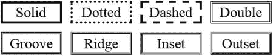

# 18. 轮廓

轮廓是绘制在元素周围、边框边缘外侧的一条线。它通常表现为围绕交互元素的虚线，以显示哪个元素获得了焦点。虽然与边框类似，但轮廓的不同之处在于它不占用盒模型中的任何空间。此外，与边框不同，轮廓的所有四个边必须保持一致。轮廓属性可以应用于任何元素，且它们都不具有继承性。

## `outline-style`

轮廓的样式通过`outline-style`属性设置。要显示轮廓，需要将值设置为`none`（默认值）以外的其他值。

```
outline-style : none | solid | dotted | dashed | double |
                groove | ridge | inset | outset
```

此属性允许与`border-style`相同的值，但`hidden`不是有效的`outline-style`值。它们的渲染效果也相同，如图 18-1 所示。



图 18-1.
轮廓样式外观

## `outline-width`

轮廓的厚度通过`outline-width`属性指定。与`border-width`属性类似，其值可以是指定的长度，也可以是关键字`thin`、`medium`或`thick`。

```
outline-width : <length> | thin | medium | thick
```

CSS 并未指定这三个关键字的数字厚度，但它们通常分别渲染为`1px`、`3px`和`5px`。与`border-width`一样，此属性的初始值为`medium`。

## `outline-color`

轮廓的颜色可以通过`outline-color`属性更改。除了标准的颜色表示法外，关键字`invert`也是此属性的有效值。

```
outline-color : invert | <color>
```

为了确保适当的对比度，规范建议默认值为`invert`，它会将轮廓设置为其下方颜色的反色。然而，只有 IE8+ 和 Opera 7+ 实际支持此值，因此并不常用。

## `outline`

`outline`是一个简写属性，用于在单个声明中设置上述所有轮廓属性。

```
outline : <outline-width> + <outline-style> + <outline-color>
```

值可以按任意顺序指定，因为它们之间没有歧义。其中任何一个值都可以省略。

```
outline: thin solid red;
```

这与单独设置所有属性的效果相同，但语法更便捷：

```
outline-width: thin;
outline-style: solid;
outline-color: red;
```

## `outline-offset`

轮廓与边框边缘之间的间距可以通过 CSS3 引入的`outline-offset`属性来设置。

```
outline-offset : <length>
```

以下声明将轮廓向外移动 3 像素。允许使用负值，这会将轮廓向内移动到元素内部。

```
outline-offset: 3px;
```

虽然此属性在 IE 中不受支持，但它在所有其他主流浏览器中均有效。

