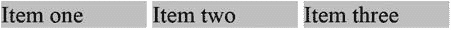

# 显示（display）

`display`属性决定了包围元素的盒子类型。它可以使任何元素显示为内联、块级或其他任何类型。每个元素都有一个默认的`display`值，该值取决于元素的类型。

`display : none | inline | block | list-item | inline-block |`
`inline-table | table | table-cell | table-row |`
`table-column | table-column-group | table-footer-group |`
`table-header-group | table-row-group | flex | inline-flex |`
`grid | inline-grid | run-in`

大多数 HTML 元素显示为内联或块级；其他元素具有特殊的显示属性，例如`<li>`元素的`list-item`和`<td>`、`<th>`元素的`table-cell`。通过使用`display`属性，任何元素都可以被更改为渲染为这些或其他任何元素类型。例如，以下链接被渲染为块级元素而不是内联元素：

`<a href="#" style="display: block;">块级链接</a>`

## inline-block

`display`最有用的值之一是`inline-block`，它结合了块级和内联元素的特性。`inline-block`元素类似于内联元素，但不同之处在于它也可以像块级元素一样操作盒子模型的宽度、高度和垂直边距属性。这些特性与可替换的内联元素（如``和`<button>`）相同。因此，这些元素在 HTML5 中被正式重新定义为`inline-block`元素。

`inline-block`的一个常见应用是将列表项元素（`<li>`）制作成适合水平导航菜单的样式。请注意，将列表项元素的显示类型从`list-item`更改为`inline-block`会自动移除列表标记。

```css
li {
    display: inline-block;
    width: 100px;
    background: #ccc;
}
```

应用此规则后，以下标记会渲染出三个并排的灰色背景框，如图 22-1 所示。

```html
<ul>
    <li>项目一</li>
    <li>项目二</li>
    <li>项目三</li>
</ul>
```



图 22-1. `inline-block`值演示

## none

另一个有用的`display`值是`none`。它完全隐藏一个元素，使页面渲染得像该元素不存在一样。

```css
.removed { display: none; }
```