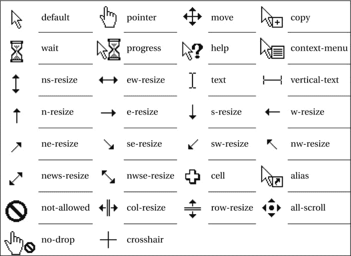

# 光标（cursor）

`cursor`属性指定用户将鼠标悬停在元素上时看到的光标。默认值是`auto`，意味着浏览器决定使用什么光标。标准光标值及其外观可见于表 22-1。

表 22-1. 标准光标值

除了这些值之外，还可以使用`url`函数定义自定义光标。如果此光标不可用，可以在自定义光标之后指定一个通用光标，用逗号分隔。

`cursor: url(new.cur), pointer;`

