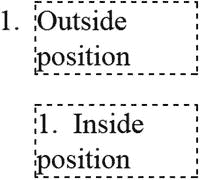

# 23. 列表（List）

CSS 列表属性处理列表元素，特别是`<ul>`、`<ol>`和`<li>`元素。

## `list-style-type`

列表在每个列表项元素（`<li>`）前显示一个标记。该标记的外观可通过 `list-style-type` 属性修改。对于无序列表（`<ul>`），每个列表项的标记方式相同。此处列出预定义的圆点值可供使用，默认值为 `disc`（实心圆）：

`list-style-type : inherit | disc | circle | square | none`

在有序列表（`<ol>`）中，每个列表项前会显示一个数字字符以表明其在序列中的位置。所有主流浏览器均支持以下数字类型，初始值为 `decimal`：

`list-style-type : inherit | decimal | none | upper-alpha | lower-alpha | upper-roman | lower-roman | lower-greek | lower-latin | armenian | georgian | decimal-leading-zero`

以下示例为两个列表元素指定了新的列表样式。虽然可以让 `<ul>` 显示有序标记，让 `<ol>` 显示无序标记，但这不是好的做法。

```
ul { list-style-type: square; } /* ▅ */
ol { list-style-type: upper-roman; } /* I, II, III, ... */
```

标记的颜色与列表元素的文本颜色相同。请记住，任何元素都可以通过将其 `display` 类型改为 `list-item` 来显示列表标记。

## `list-style-image`

作为预定义标记的替代方案，可使用 `list-style-image` 属性来将自定义图像作为列表圆点。

`list-style-image : inherit | none | url(<url>)`

图像路径需写在 CSS 的 `url` 函数中。

`list-style-image: url(my-bullet.png)`

该属性会覆盖 `list-style-type` 属性选定的任何标记类型。尽管如此，最好还是指定一个 `list-style-type` 作为后备方案，以防自定义圆点图像因任何原因不可用。

## `list-style-position`

列表标记通常位于元素框外部。`list-style-position` 提供了一个替代方案：将圆点放置在元素框内部。

`list-style-position : inherit | outside | inside`

选择 `outside` 会使每行文本与第一行文本的开头对齐，而 `inside` 则会使后续的文本行在标记下方换行。`inside` 值还会在视觉上缩进标记，如图 23-1 所示。



图 23-1. 外部和内部标记放置