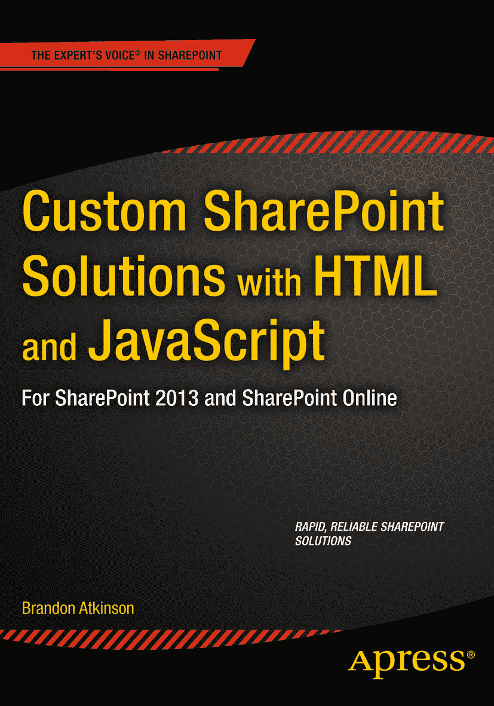

  
**布兰登·阿特金森**  
使用 HTML 和 JavaScript 的自定义 SharePoint 解决方案  
适用于 SharePoint 2013 和 SharePoint Online

ISBN 978-1-4842-0545-7  
电子书 ISBN 978-1-4842-0544-0  
DOI 10.1007/978-1-4842-0544-0  
© Apress 2015

使用 HTML 和 JavaScript 的自定义 SharePoint 解决方案：适用于 SharePoint 2013 和 SharePoint Online

尽管本书中的建议和信息在出版时被认为是真实且准确的，但作者、编辑和出版商均不对可能存在的任何错误或遗漏承担法律责任。出版商对本书所含内容不作任何明示或暗示的担保。

总经理：Welmoed Spahr  
首席编辑：Gwenan Spearing  
开发编辑：Douglas Pundick  
技术审校：Adam Preston  
编委会：Steve Anglin、Mark Beckner、Gary Cornell、Louise Corrigan、Jim DeWolf、Jonathan Gennick、Robert Hutchinson、Michelle Lowman、James Markham、Matthew Moodie、Susan McDermott、Jeffrey Pepper、Douglas Pundick、Ben Renow-Clarke、Gwenan Spearing、Matt Wade、Steve Weiss  
协调编辑：Melissa Maldonado  
文字编辑：Kimberly Burton  
排版：SPi Global  
索引编制：SPi Global  
插图制作：SPi Global

本书由 Springer Science+Business Media New York 在全球图书贸易中发行，地址：233 Spring Street, 6th Floor, New York, NY 10013。电话：1-800-SPRINGER，传真：(201) 348-4505，电子邮件：`orders-ny@springer-sbm.com`，或访问 [`www.springeronline.com`](http://www.springeronline.com)。Apress Media, LLC 是一家加利福尼亚州的有限责任公司，其唯一成员（所有者）是 Springer Science + Business Media Finance Inc（SSBM Finance Inc）。SSBM Finance Inc 是一家特拉华州的公司。

如需了解翻译相关信息，请发送电子邮件至 `rights@apress.com`，或访问 [`www.apress.com`](http://www.apress.com)。Apress 及 friends of ED 书籍可批量购买用于学术、企业或推广用途。大多数图书也提供电子书版本和许可。如需更多信息，请参考我们的特殊批量销售-电子书许可网页：[`www.apress.com/bulk-sales`](http://www.apress.com/bulk-sales)。

作者在本文中引用的任何源代码或其他补充材料，读者可在 [`www.apress.com`](http://www.apress.com) 获取。有关如何查找本书源代码的详细信息，请访问 [`www.apress.com/source-code/`](http://www.apress.com/source-code/)。

本作品受版权保护。出版者保留所有权利，无论涉及整体或部分内容，特别是翻译、重印、重用插图、朗诵、广播、微缩胶片复制或以任何其他物理方式复制、传输或信息存储与检索、电子改编、计算机软件，或现在已知或以后开发的类似或不同方法的权利。与评论或学术分析相关的简短摘录，或专门为输入计算机系统并执行而提供、仅供购买者独占使用的材料，不受此法律保留限制。未经出版者（Springer）许可，不得复制本出版物或其部分内容，复制须遵守出版者所在地现行版权法的规定，且必须始终获得许可。可通过 Copyright Clearance Center 的 RightsLink 获取使用许可。违反者将根据相应版权法被起诉。

本书中可能提及商标名称、标识和图片。我们并非在每个商标名称、标识或图片出现时都使用商标符号，而是仅以编辑方式使用这些名称、标识和图片，以维护商标所有者的利益，并无意侵犯商标权。本出版物中使用商品名、商标、服务标志及类似术语，即使未被标识为此类术语，也不应被视为对这些术语是否受所有权保护的表达意见。

谨以此书献给我生命中的挚爱——珍妮。你给予我的力量和勇气远超你所意识到的。

## 引言

多年来，SharePoint 取得了长足的发展。SharePoint 的开发历程也同样漫长，并且往往更加坎坷。至今仍有许多技术精湛的开发者宁愿自断手臂，也不愿成为 SharePoint 开发者！然而，SharePoint 短期内不会消失，并且随着 Office 365 和 SharePoint Online 的日益普及，开发者们发现自己被要求创建自定义解决方案的频率越来越高。

过去，这意味着要将 SharePoint 安装到电脑上，学习不熟悉的新 API，掌握部署流程等等。你很容易会因为这些障碍而感到沮丧，这很常见。幸运的是，使用 SharePoint 2013 和 SharePoint Online，你有了更多选择。

从 SharePoint 2013 开始，微软极大地增强了在浏览器中使用 JavaScript 所能实现的功能。这包括一套全新的 REST API，以及利用 JavaScript 对象模型（简称 JSOM）的扩展 JavaScript 库。这些最初是为了配合 SharePoint 应用程序（SharePoint 2013 中一种新的开发模型）而构建的。应用程序允许你编写针对 SharePoint 的代码，然后将其部署到其他地方。你可以编写自定义解决方案并将其部署到云端，而最终用户完全察觉不到差异。这非常棒，因为它给了开发者更多自由，并且使自定义代码远离 SharePoint 服务器。

虽然 JSOM 和 REST API 非常适合应用程序，但它们的用途并不局限于此。这些工具可以很容易地通过浏览器中运行的 JavaScript 来使用。这不仅为经验丰富的专业开发者，也为那些懂 HTML 和 JavaScript 的高级用户，开启了一个全新的开发可能性世界。这意味着熟悉 HTML 和 JavaScript 的最终用户可以开始构建自己的解决方案。更棒的是，开发者只需很少的学习成本，就能利用他们已经掌握的技能。在 Visual Studio 和 C# 中构建自定义解决方案受限的时代已经一去不复返了；现在，你有能力构建直接在浏览器中运行的健壮解决方案！

本书将探讨利用现成组件和自定义代码为 SharePoint 构建解决方案的多种方法。阅读本书后，你将创建许多自定义 Web 部件，而这些部件你之前可能认为只有使用昂贵复杂工具的专业开发者才能做到。如果你是一名开发者，你会发现 SharePoint 开发不再是一件过于复杂且需要回避的事情。无论你身处何种职位，我都希望你能带着信心和知识从另一端走出来，开始构建自己的 SharePoint 自定义解决方案。

