## 2. SharePoint 前端解决方案简介

SharePoint 自推出以来已经历了巨大的发展，其开发故事也不例外。如果你曾在 SharePoint 2007 或更早版本上做过任何开发，那么可以说你讨厌这种体验。SharePoint 2010 使事情变得容易得多，并引入了一些允许前端开发的新组件，例如 ECMAScript 对象模型（后来更名为 JavaScript 对象模型）。随着最新版本的 SharePoint，真正的重点已经转向将代码从 SharePoint 服务器迁移到浏览器或其他服务器。

这一关注点的部分原因是，微软发现许多支持问题源于编写不佳或只是将服务器推向极限的服务器代码。再加上 SharePoint Online 的引入（最终用户无法访问服务器本身），因此需要更强大、更健壮的前端开发解决方案。由此产生的是扩展的 JavaScript 对象模型、新的 REST API 以及 SharePoint 应用程序。

我们将在本书中更详细地深入探讨 JavaScript 对象模型和 REST API。我们还将研究新的前端组件，例如 JSLink 和显示模板。本章将探讨服务器端开发和前端开发之间的区别，以及这种开发风格的一些能力。我们还将探讨你在此过程中可能遇到的一些限制。

> **注意**

> 本书不涵盖 SharePoint 应用程序。虽然在某些情况下应用程序可以被视为前端开发，但这涉及到开发、网络和域管理，是一个非常庞大的主题。在很多情况下，SharePoint 应用程序在服务器端运行，只是不在运行 SharePoint 的服务器上运行。有关构建 SharePoint 应用程序的更多信息，请访问以下 URL：[`http://msdn.microsoft.com/en-us/library/office/jj163230(v=office.15).aspx`](http://msdn.microsoft.com/en-us/library/office/jj163230(v=office.15).aspx) 。

## 服务器端开发 vs. 前端开发

SharePoint 开发及自定义解决方案的构建在很长一段时间内都是硬核开发者的专属领域。这需要掌握广泛的组件知识，包括 `Visual Studio`、`PowerShell`、`ASP.NET`、`Microsoft Server` 等。即使对于曾从事 `.NET` 开发但刚接触 SharePoint 的人来说，这也常常令人生畏。图 2-1 展示了一个典型的服务器端开发体验，其中包括 `Visual Studio`、部署包以及一个用于实际将代码部署到服务器的 `PowerShell` 窗口。

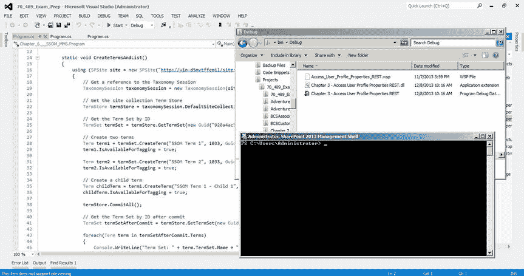

图 2-1. 典型的 SharePoint 服务器端开发体验

服务器端代码是专门为在 SharePoint 服务器本身上运行而编写的。一旦代码编写完成并打包准备部署，它就会被复制到服务器上，并使用 `PowerShell` 或管理中心进行安装。大多数情况下，这需要开发人员、业务用户和服务器管理员共同协作。由于代码直接在服务器上运行，因此它拥有巨大的能力，但也可能很容易对 SharePoint 环境产生不利影响。

就连为 SharePoint 编写服务器端代码都可能很困难，因为它需要一台安装了 SharePoint 的强大电脑。过去，大多数开发人员会在自己的电脑上构建虚拟机，从而在隔离环境中为 SharePoint 编写代码。由于需要学习新的代码框架、电脑上需要安装 SharePoint，以及为确保不佳的代码不会损害服务器而所需的编码最佳实践，学习服务器端开发有时颇具挑战。

随着 SharePoint Online 和 Office 365 的出现，服务器端开发受到了冲击，因为在这些产品中，你无法访问运行 SharePoint 的服务器。从使用同一服务器的所有其他客户的角度来看，这是好事。如果一个客户安装了编写不佳或恶意的代码，他们可能会让整个服务器瘫痪，影响到所有人。然而，如果你是需要自定义解决方案的客户，你将不再拥有强大的服务器端代码这一选项。

`注意`

沙盒解决方案提供了另一种在 SharePoint 中编写和部署服务器端代码的方式。这些解决方案不需要服务器访问权限，因为网站集管理员可以通过浏览器安装它们。它们被称为“沙盒”解决方案，是因为它们在服务器上隔离运行，并受到 SharePoint 的监控，以确保它们不影响性能。在 SharePoint 2013 中，沙盒解决方案仍可本地安装，但在 SharePoint Online 中已被弃用，且只能包含 HTML 和 JavaScript。有关沙盒解决方案的更多信息，请访问以下 URL：[`http://technet.microsoft.com/en-us/library/ee721992(v=office.14).aspx`](http://technet.microsoft.com/en-us/library/ee721992(v=office.14).aspx)。

乍看之下，微软似乎削弱了为企业创建自定义 SharePoint 解决方案的能力，特别是如果你使用的是 Office 365。使用本地 SharePoint 的客户也从微软收到了相同的信息，即停止将自定义代码放在服务器上。幸运的是，微软并没有让任何人因这种转变而“陷入困境”。最新版本的 SharePoint 配备了广泛的前端组件来开发解决方案。

前端开发，或称客户端代码，是专门为在 Web 浏览器中运行而编写的。它使用 HTML、JavaScript 和 CSS，并在所有浏览器中运行。你仍然需要将代码添加到 SharePoint 中，但由于它只是 HTML 和 JavaScript，你可以利用像文档库这样的开箱即用组件来上传和存储你的解决方案。在下一节中，我们将探讨使用 SharePoint 进行前端开发的各种组件，并了解它们能为你提供什么。

## SharePoint 前端开发的组件

现在我们已经了解了服务器端开发和前端开发之间的一些差异，接下来看看本书将涉及的前端开发的一些组件。在本书中，我们将展示几种创建自定义解决方案的不同方法，并在本节中向你介绍它们。这些介绍将是相当快速、高层次的概述，因为我们将在后续章节中深入探讨每一个主题。我们将探讨：

- JavaScript 对象模型 (JSOM)

- REST API

- JS 链接

- 显示模板

以上每一项都与其他组件协同工作，共同构成一个完整的前端解决方案。如果需要，你甚至可以同时使用其中的几个。现在，我们先快速了解一下每个项目，为你做好准备，以便在接下来的章节中开始构建一些解决方案。

### JavaScript 对象模型 (JSOM)

`JavaScript 对象模型`（简称 `JSOM`）是 SharePoint 客户端 API 家族的一部分。它传统上被称为客户端对象模型，简称 `CSOM`。这很容易让人混淆，因为人们在广泛讨论时往往会使用术语“客户端对象模型”。`CSOM` 涵盖了从 `JSOM`、Silverlight 库、到一组服务器端库，甚至 REST API 的所有内容。关键在于，如果有人谈论 `CSOM`，你可能需要他们更具体地说明他们正在做什么。

`JavaScript 对象模型`基本上是作为 SharePoint 一部分提供的一组 JavaScript 文件。每个文件都包含允许你执行各种任务的代码——从与术语库交互、访问用户个人资料信息，到读取列表和网站等常见核心任务。如果你有权访问服务器，可以在 `C:\Program Files\Common Files\Microsoft Shared\Web Server Extensions\15\TEMPLATE\LAYOUTS` 查看所有这些文件。图 2-2 在 Windows 资源管理器中显示了此文件夹。如果你使用的是 SharePoint Online，不必担心，所有这些文件仍然可用——只是无法在 Windows 资源管理器中查看它们！

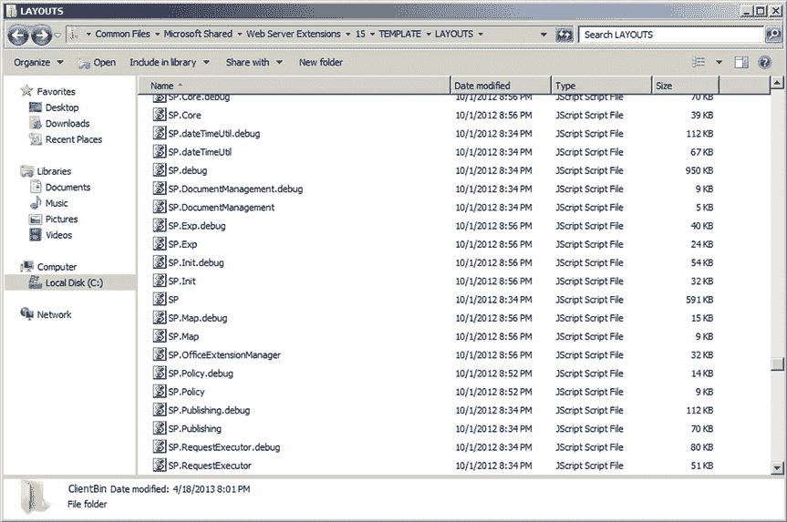

图 2-2. 在文件系统中构成 JavaScript 对象模型的文件

所有文件都位于 SharePoint 的 `Layouts` 文件夹中。`Layouts` 文件夹是 SharePoint 中的一个主力文件夹，包含了许多在整个环境中使用的公共文件和代码。当部署使用自定义页面、图像等的自定义服务器端代码时，它们通常都会部署到 `Layouts` 文件夹。如果你不熟悉它，不用担心——你很快就会熟悉了。

图 2-2 只展示了部分可用文件，但应该有助于说明 `JSOM` 在构建自定义解决方案方面的强大功能。微软投入了大量时间和精力来扩展 `JSOM` 的能力。由于他们告诉客户不再使用服务器端代码，并且在许多方面转向 SharePoint Online，他们确保提供一套全面的工具来支持丰富的开发体验。

`注意`

有关 `JSOM` 的更多信息，请访问以下 URL 中 SharePoint 的 JavaScript API 参考：[`http://msdn.microsoft.com/en-us/library/office/jj193034(v=office.15).aspx`](http://msdn.microsoft.com/en-us/library/office/jj193034(v=office.15).aspx)。

在你的解决方案中使用 `JSOM` 相当直接，因为它们都是 JavaScript。首先，你需要放置对特定文件的引用，如下所示：

```
<script type="text/javascript" src="/_layouts/15/sp.js"></script>
```

这是一个标准的 HTML `SCRIPT` 标签，它告诉浏览器加载位于 `SRC` 属性中指定位置的特定文件。在这种情况下，浏览器将加载位于 `Layouts` 文件夹中的 `sp.js` 文件。一旦我们有了所需的 SharePoint `JSOM` 文件的引用，我们就可以编写一个看起来像这样的脚本：

# JSOM

```javascript
$(function () {
  retrieveListItems();
});

function retrieveListItems() {
  var clientContext = new SP.ClientContext();
  var oList = clientContext.get_web().get_lists().getByTitle('Demo List');
  var camlQuery = new SP.CamlQuery();
  this.collListItem = oList.getItems(camlQuery);
  clientContext.load(collListItem);
  clientContext.executeQueryAsync(
    Function.createDelegate(this, this.onQuerySucceeded),
    Function.createDelegate(this, this.onQueryFailed)
  );
}
```

如果这是你第一次看到 `JSOM` 代码，不要不知所措！它可能看起来很吓人，但随着你学习本书，阅读和编写它会变得越来越容易。让我们分解这个示例，看看每一部分。

*   `$(function () {});` – 这是代码的入口点，完全是 jQuery。这被称为 `document.ready` 函数，之所以这么称呼是因为它在浏览器完全加载 HTML 页面时触发。在 jQuery 开发中你会经常看到它，因为这是一种在页面加载时触发代码的简单便捷方式。在这个示例中，我们只是调用了另一个包含 `JSOM` 代码的函数。

*   `SP.ClientContext()` – 这一行获取对客户端上下文的引用，并在每次对 SharePoint 服务器的 `JSOM` 调用中使用。客户端上下文包含有关当前 Web 应用程序、网站、网站集等的许多信息。

*   `clientContext.get_web().get_lists().getByTitle('Demo List')` – 使用客户端上下文，我们可以获取对网站中任何内容的引用。在这一行中，我们引用当前网站，从所有列表中请求一个标题为“Demo List”的特定列表。这一行的语法非常易读：获取 Web，获取列表，按标题获取。在使用 REST API 时，你也会看到类似的模式。

*   `SP.CamlQuery()` – 这一行允许你通过使用 CAML 查询（一种用于查询 SharePoint 的语法）来指定要返回哪些项目。它已经存在了一段时间，并且在处理列表和库时经常使用。在这个示例中，我们只是传递一个空查询，告诉 SharePoint 我们希望列表中的所有项目。我们通过调用 `oList.getItems(camlQuery)` 并传入查询来实现。

*   `clientContext.executeQueryAsync()` – 这一行实际上会启动对 SharePoint 服务器的查询。然后你可以处理返回的数据并将其显示给用户。

这已经是对 `JSOM` 尽可能高级别的解释了！主要目的是展示一些 `JSOM` 并简要解释各部分。`JSOM` 还有更多内容，但在我们深入任何演示之前，你至少已经接触过一些代码了。

## REST API

REST API 随 SharePoint 2013 和 SharePoint Online 一同引入。它允许你通过精心构造的 URL 对 SharePoint 进行 RESTful 调用。数据可以以 XML 或 JSON 格式返回，并且可以轻松地被浏览器中的 JavaScript 使用。在早期版本的 SharePoint 中也提供了 RESTful 数据，但主要局限于列表交互。新的 REST API 已大大扩展，与 JSOM 类似，包含了广泛的功能。

**注意**

有关 REST API 的更多信息，请访问以下 URL 中的 SharePoint REST API 参考和示例：[`http://msdn.microsoft.com/en-us/library/office/jj860569(v=office.15).aspx`](http://msdn.microsoft.com/en-us/library/office/jj860569(v=office.15).aspx)。

一个典型的 REST API 调用如下所示：

`http://SERVER/_api/web/lists/GetByTitle('Demo List')/items`

就像上一节中的 JSOM 示例一样，此 URL 将查询名为 `Demo List` 的列表，并请求所有项目。其语法也应该看起来很熟悉：`Web`、`Lists`、`GetByTitle`、`Items`。在这两个示例中，调用的结构都非常易读，并为你提供了了解预期数据所需的所有上下文。图 2-3 展示了浏览器中 REST 调用的结果。

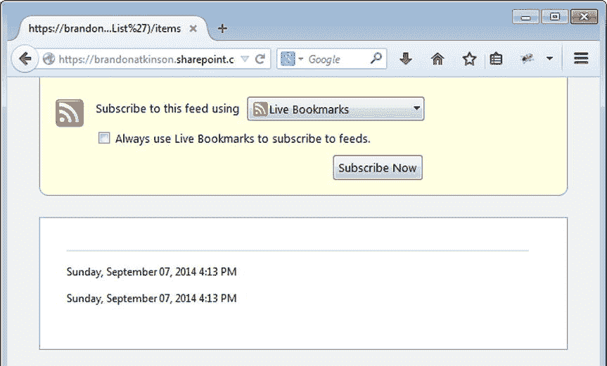

**图 2-3.** 浏览器中返回为 XML 的 REST API 调用

在此示例中，结果以 XML 格式返回，因为这是浏览器默认请求的格式。通过 JavaScript 调用时，我们可以请求 XML 或 JSON。我们稍后将更详细地探讨这一点。与 JSOM 类似，我们可以提供 CAML 查询来限制结果，也可以使用查询字符串运算符来选择、筛选和排序我们从 API 请求的数据。

如果我们想将数据限制为单行，REST API 调用如下所示：

`http://SERVER/_api/web/lists/GetByTitle('Demo List')/items?$top=1`

查询字符串运算符 `$top=1` 告诉 API 只返回第一行数据。图 2-4 展示了浏览器中此调用的结果。

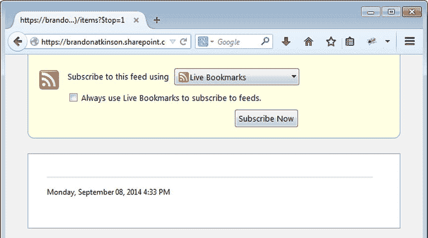

**图 2-4.** 使用查询字符串运算符限制结果的 REST API 调用

有许多运算符可用于构造你的 REST API 调用。我们将在后面的章节中探讨更多运算符，但请放心，你将拥有获得正确结果所需的所有工具。此示例应能说明使用 REST API 从 SharePoint 请求数据是多么容易。

## JSLink

JSLink 是 SharePoint 2013 中的新功能，它提供了一种非常强大且简单的方法来设置列表视图 Web 部件的样式。在 JSLink 之前，你必须使用 XSLT（可扩展样式表语言转换）。XSLT 是一种设置 HTML 样式或进行转换并赋予其活力的方法。它在允许开发人员更改 Web 部件的呈现方式方面做得很好，但使用起来相当麻烦。大多数开发人员一想到必须使用 XSLT 就皱眉头，并通常会避开它。

于是 JSLink 应运而生，它允许你使用 JavaScript 和 HTML 来设置部件样式。它提供了一种更简单、更快速的方法来呈现 Web 部件，以满足业务需求并提供增强的功能。JSLink 不仅提供了一种简单的方法来设置 Web 部件的样式，而且由于它基于 HTML 和 JavaScript，你还可以用它做更多事情。现在，让我们先看看 JSLink 是如何工作的。图 2-5 展示了一个标准的 SharePoint 主页，其中插入了一个列表 Web 部件，并显示了来自 Demo List 的项目。

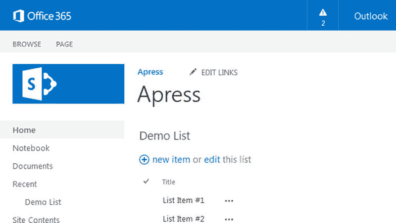

**图 2-5.** 插入了列表 Web 部件的 SharePoint 页面，列出了 Demo List 中的项目

这是 SharePoint 自带的列表 Web 部件，但它现在有一个新属性。如果将 Web 部件置于编辑模式并展开 Web 部件工具窗格中的“杂项”面板，你将看到一个名为“JS 链接”的新属性。这是一个文本框，你可以在其中放置一个 JavaScript 文件的路径，该文件将在 Web 部件呈现期间使用。图 2-6 展示了这个新属性。

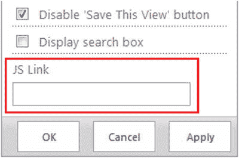

**图 2-6.** Web 部件属性窗格中的 JSLink 属性

现在你已经知道如何通过 JSLink 属性应用 JavaScript 文件，让我们看看这个 JavaScript 实际上是什么样子的。以下代码是对 JS Link 代码工作原理的简单演示。

# JSLink 示例

```javascript
(function () {
    var overrideContext = {};
    overrideContext.Templates = {};
    overrideContext.Templates.Item = overrideTemplate;
    SPClientTemplates.TemplateManager.RegisterTemplateOverrides(overrideContext);
})();

function overrideTemplate(ctx) {
    return "<div style='font-size:32px;border:solid 1px Silver;'>" + ctx.CurrentItem.Title + "</div>";
}
```

让我们分解这个示例并查看每个部分。

- `overrideContext`、`overrideContext.Templates` 和 `overrideContext.Templates.Item` —— 顾名思义，这些是覆盖 Web 部件默认呈现的对象。父对象 `overrideContext` 可以任意命名。前两行只是创建了该对象和一个名为 `Templates` 的属性。这是所有 JSLink 文件中的标准部分，因为它构成了代码的基础。第三行定义了另一个 JavaScript 函数，该函数将对 Web 部件中的每个单独项目触发；这由其名称中的“`Item`”指定。你可以针对项目，或仅针对项目中的特定属性。例如，如果我们只想设置 `Title` 的样式，我们可以仅引用该属性。

- `SPClientTemplates.TemplateManager.RegisterTemplateOverrides(overrideContext)` —— 一旦你构建好对象，就必须告诉 SharePoint 你想要使用它。这行代码通过向 `TemplateManager` 对象注册来实现这一点。完成后，当 Web 部件呈现时，你引用的 JavaScript 函数将被调用。

- `function overrideTemplate(ctx)` —— 这是在 Web 部件呈现时实际运行的代码。它非常简单：只需呈现一个带有一些样式和当前项目标题的 HTML `DIV` 元素即可。

将此代码放入文件后，我们将其上传到 SharePoint 的库中。然后，我们将该文件的路径放入 Web 部件的 JSLink 属性中。图 2-7 展示了使用 JSLink 文件呈现 Web 部件后的输出。

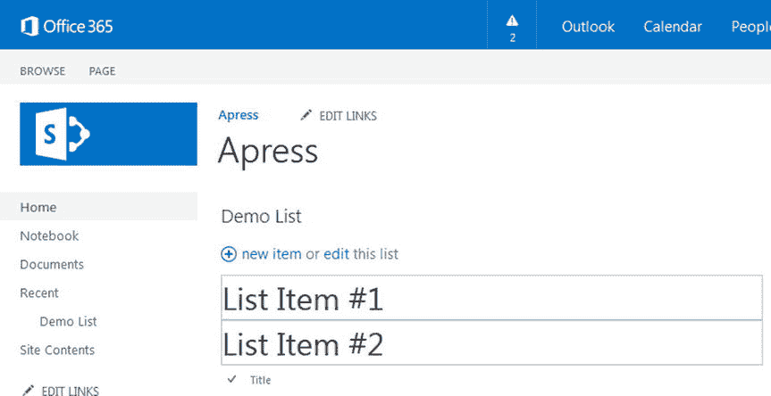

**图 2-7.** 应用 JS Link 代码后的列表 Web 部件

我们将在后续章节中更详细地介绍使用 JSLink 的细节，并将展示更多设置内容样式和构建自定义解决方案的方法。当你在页面上使用列表 Web 部件时，你会发现 JSLink 是一个极其有用的工具，可以帮助你实现业务需求。

## 显示模板

与 JSLink 类似，显示模板是 SharePoint 2013 和 SharePoint Online 中的新增功能。它们与搜索 Web 部件（例如 SharePoint 附带的`内容搜索 Web 部件`）配合使用。显示模板使用 HTML 和 JavaScript 来呈现内容，并允许您指定要显示的属性、放置位置以及如何设置样式。通过使用这些模板，您可以对搜索结果及其显示方式进行高度控制。图 2-8 显示了一个放置在页面上的标准内容搜索 Web 部件。

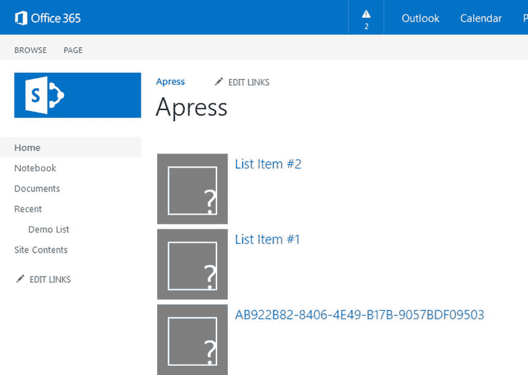

图 2-8. 放置在页面上的现成内容搜索 Web 部件

我们可以通过将 Web 部件置于编辑模式，并在 Web 部件工具窗格中查看属性面板来更改所使用的显示模板。在搜索条件正下方，您将找到`显示模板`区域。此部分有两个下拉菜单，用于选择内容的呈现方式：`控件`和`项目`。图 2-9 显示了显示模板区域和下拉菜单。

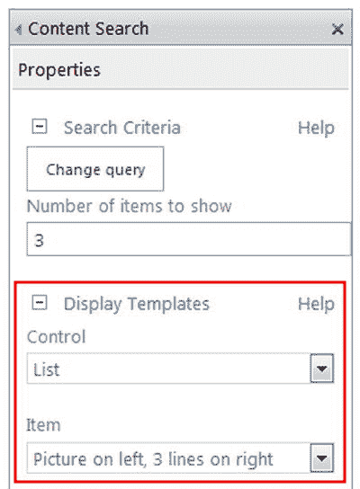

图 2-9. 内容搜索 Web 部件工具窗格中的控件和项目选项

这些项中的每一个都是一个模板，它们协同工作以呈现内容。`控件模板`为内容提供整体 HTML 布局。您可以将其视为容纳所有搜索结果项的容器。这也是加载您希望在搜索结果中使用的任何 JavaScript 或 CSS 的好地方。`项目模板`为每个搜索结果项提供单独的 HTML。此模板还利用搜索结果中的托管属性，并允许您控制显示哪些属性。当一起使用时，这些模板提供了一种呈现内容的完整方式。

您可以通过导航到`网站设置`，然后在`Web 设计器库`标题下选择`母版页`来查看现成的显示模板。这将打开母版页库页面，如图 2-10 所示。

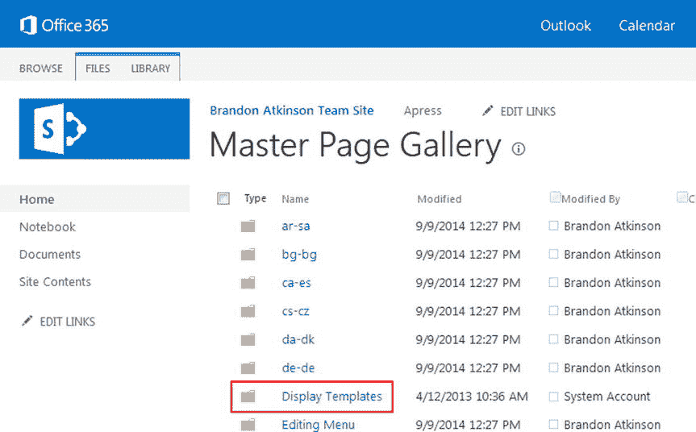

图 2-10. 您可以在此处找到现成显示模板的母版页库

注意：为了使用显示模板和内容搜索 Web 部件，您需要确保已激活 SharePoint Server 发布网站功能。如果您的网站使用发布模板，则此功能应已激活。此外，此 Web 部件仅适用于 Office 365 E3 和 E4 计划，或企业内部部署的 SharePoint 企业版。

单击`显示模板`文件夹将显示另一个页面，其中所有当前显示模板按文件夹组织。内容搜索 Web 部件的显示模板全部位于`内容 Web 部件`文件夹中，如图 2-11 所示。

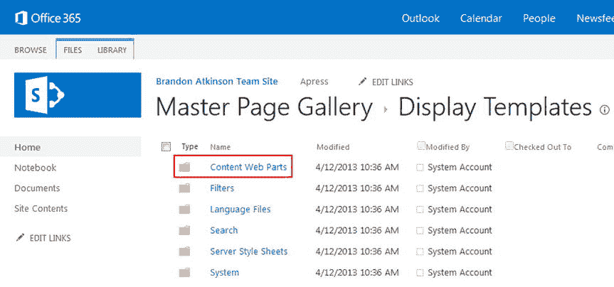

图 2-11. 显示模板和内容 Web 部件文件夹

打开内容 Web 部件文件夹时，您将找到许多显示模板。每个模板都有一个 HTML 文件和一个对应的 JavaScript 文件，如图 2-12 所示。

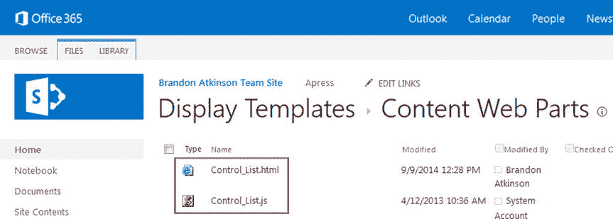

图 2-12. 带有 HTML 文件和对应 JavaScript 文件的显示模板

当您构建一个新的显示模板时，您只需处理 HTML 文件。上传 HTML 文件后，SharePoint 会为您生成 JavaScript 文件，并在呈现内容时使用该文件。通过此模型，您无需担心所需的脚本编写；您只需关注 HTML——其余部分由 SharePoint 完成。显示模板使用搜索结果中的托管属性来呈现内容。该模板使用标记系统来呈现内容，如下面的代码示例所示：

```html
<a class="cbs-pictureImgLink" href="_#= linkURL =#_" title="_#= $htmlEncode(line1.defaultValueRenderer(line1)) =#_" id="_#= pictureLinkId =#_">
```

标记看起来像`_#= variableName =#_`。您可以创建自己的变量来存储内容，以便稍后在模板中使用。我们将在后面的章节中更详细地讨论这些内容。

## 总结

在本章中，我们探讨了服务器端开发和前端开发之间的差异，并介绍了一些可用于自定义解决方案的组件。对于最新版本的 SharePoint，微软确实强调了不在开发工作中使用服务器端代码的优势。对于 SharePoint Online，您甚至根本无法使用它！正如您在本章中所读到的，他们提供了许多构建不依赖服务器端代码的自定义解决方案的选项。所有这些解决方案都利用 HTML 和 JavaScript，使任何熟悉构建网页的人都可以轻松访问这些解决方案。

在下一章中，我们将继续扩展到目前为止所学的内容。我们将介绍内容编辑器 Web 部件，以及如何将 HTML 内容直接放置在页面上。此外，我们将探索新的脚本编辑器 Web 部件，该部件可以与内容编辑器结合使用。我们将使用您在本章中看到的一些代码，并实际查看其运行情况。
