# 5. 使用 JSLink 为列表 Web 部件设置样式

在 SharePoint 中，有许多不同的现成 Web 部件可以放置在页面上。这些部件提供了列表视图、搜索、日历、外部数据等功能。其中，最流行且广泛使用的之一是列表视图 Web 部件。创建自定义列表，然后通过这些 Web 部件向用户展示其内容，是非常常见的做法。这些 Web 部件让您能够快速、轻松地向用户展示数据，而且大多数用户对其都非常熟悉。

列表视图 Web 部件提供了多种不同的方式来定制所显示的数据。其中一些选项包括：

- 选择要显示的列
- 排序
- 筛选
- 分组

这些是系统为您提供的丰富功能。在许多场景下，这些选项足以满足您定制数据的需求；然而，如果您需要真正自定义的功能，这些选项就不够用了。想象一个场景：业务需求是根据列表中项目的状态显示一张图片。例如，可能有一个包含“准时”和“迟到”等状态的列。对于每种状态，您需要根据这个状态显示一个笑脸或哭脸。使用现成的列表视图 Web 部件，您过去必须使用一种称为 XSLT 的渲染技术。而现在，您可以利用 JSLink 在列表视图 Web 部件中执行此类数据操作。在本章中，我们将探索 JSLink 的工作原理以及您可以用它实现哪些功能。

## JSLink 及一个简单示例

在 SharePoint 2013 之前，如果您想对列表视图 Web 部件执行任何类型的样式设置，都必须使用 XSLT。XSLT 代表可扩展样式表语言转换（EXtensible Stylesheet Language Transformation），它用于样式化并渲染 XML 内容。它不仅难以发音，使用起来更加困难。很难找到一个既知道如何有效编写 XSLT，又愿意碰它的开发者。它难以编写且难以理解。一个典型的 XSLT 文件看起来像下面这样：

```xml
<?xml version="1.0"?>
<xsl:stylesheet version="1.0"
xmlns:xsl="http://www.w3.org/1999/XSL/Transform">
<xsl:template match="/">
<html>
<body>
<h2>我的 CD 收藏</h2>
<table border="1">
<tr bgcolor="#9acd32">
<th>标题</th>
<th>描述</th>
</tr>
<xsl:for-each select="catalog/cd">
<tr>
<td><xsl:value-of select="title"/></td>
<td><xsl:value-of select="description"/></td>
</tr>
</xsl:for-each>
</table>
</body>
</html>
</xsl:template>
</xsl:stylesheet>
```

微软知道使用 XSLT 的挑战，并需要为开发者提供一种更好的方式来解决这类解决方案。JSLink 正是应此需求而生，它是一个完美的替代方案。JSLink 的妙处在于它本质上就是 JavaScript！任何熟悉 JavaScript 编写的人都可以快速编写 JSLink 代码。此外，JSLink 可以与其他 JavaScript 文件结合，创建非常强大的解决方案。

JSLink 基本上是 Web 部件上的一个属性，用于指定 JavaScript 文件的位置。如果此属性设置为一个有效的文件 URL，当 Web 部件渲染时，它会拾取该文件并使用它来将内容渲染到浏览器。由于它全都是 JavaScript，所有渲染都由浏览器处理，从而减轻了仅负责返回数据的 SharePoint 服务器的负担。这使得定制变得简单，且不影响服务器性能。

让我们快速看一个使用 JSLink 为 Web 部件设置样式的示例。我们将利用`Webparts`文档库和`演示列表`来扩展在前几章构建的内容。导航到放置内容编辑器 Web 部件的页面，然后将其删除，这样您就有了一个干净的页面。使用功能区为`演示列表`插入一个列表视图 Web 部件，如图 5-1 所示。

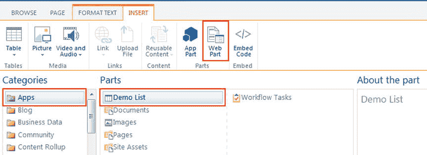

图 5-1. 为演示列表添加列表视图 Web 部件

如果尚未高亮显示，请单击“应用”类别。`演示列表`应该位于列表顶部，具体取决于您站点中列表的数量。将 Web 部件插入页面并保存。生成的视图将简单显示列表项，如图 5-2 所示。

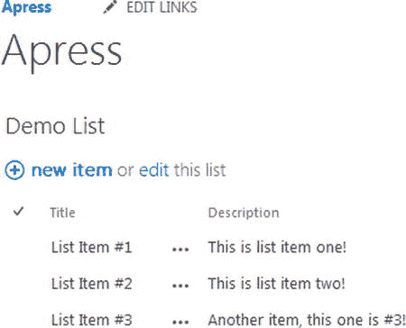

图 5-2. 演示列表的现成列表视图 Web 部件

我们需要创建一个文件夹来存放此示例的脚本。导航回`Webparts`文档库，创建一个名为`JSLink`的新文件夹，如图 5-3 所示。在本章中，我们将所有脚本放入此文件夹；但在生产环境中，您应该遵循 Etherson 方法，为每个使用 JSLink 设置样式的 Web 部件创建一个文件夹。

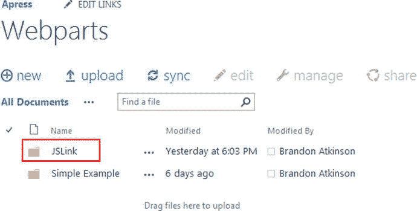

图 5-3. 在 Webparts 文档库中为 JSLink 添加新文件夹

打开 Visual Studio，通过导航到 **文件** ➤ **新建** ➤ **文件** 创建一个新文件。选择 Web 类别，然后从选项中选择“JavaScript 文件”。我们将从一个非常基础的脚本开始，该脚本将获取 Web 部件中的每个项目并设置其样式。将以下代码放入文件：

```javascript
(function () {
    var overrideContext = {};
    overrideContext.Templates = {};
```

```javascript
overrideContext.Templates.Item = overrideTemplate;
SPClientTemplates.TemplateManager.RegisterTemplateOverrides(overrideContext);
})();
function overrideTemplate(ctx) {
return "<div style='font-size:18px;border:solid 1px Silver;margin-bottom:6px;padding:4px;width:200px;'>"
+ ctx.CurrentItem.Title
+ "</div>";
}
```

此脚本几乎是我们能编写出的最精简的 JSLink JavaScript 文件；然而，它将为理解这些脚本的工作原理提供一个绝佳的入门介绍。首先，你会注意到我们声明了一个匿名函数。这个函数充当脚本的入口点，所有设置工作都在这里完成。接下来，我们通过以下代码声明一个新变量：

```javascript
var overrideContext = {};
```

这是一个简单的 JavaScript 变量，我们将其命名为`overrideContext`，并使用`{}`语法将其设置为一个空对象。这里需要重点注意的是，该命名并无特殊要求。我们可以将其命名为`myObject`或`SomeCoolNewThing`，甚至是任何其他名称。我们之所以称其为`overrideContext`，是因为我们正在提供对默认样式的重写。接着，我们通过以下代码声明另一个名为`Templates`的对象：

```javascript
overrideContext.Templates = {};
```

此对象用于保存我们希望重写样式的所有不同模板的引用。例如，你可以添加`Item`来重写整个列表项的样式，或添加`Field`来重写列表中单个列的样式。我们通过以下代码实现这一点：

```javascript
overrideContext.Templates.Item = overrideTemplate;
```

这行代码表示我们希望使用另一个名为`overrideTemplate`的函数来重写`Item`模板。同样，这个函数的命名也没有特殊要求；它可以叫任何名字。最后，我们通过以下代码注册重写：

```javascript
SPClientTemplates.TemplateManager.RegisterTemplateOverrides(overrideContext);
```

`SPClientTemplates.TemplateManager.RegisterTemplateOverrides`是一个内置的 SharePoint 函数，用于注册你的代码以供渲染。你需要传入你最初创建的基础对象。一旦注册了重写，最后一部分就是实际执行渲染的函数：

```javascript
function overrideTemplate(ctx) {
return "<div style='font-size:18px;border:solid 1px Silver;margin-bottom:6px;padding:4px;width:200px;'>"
+ ctx.CurrentItem.Title
+ "</div>";
}
```

此函数接收一个名为`ctx`的参数。与脚本中的其他项一样，这个名字没有特殊含义。`ctx`是列表上下文，将用于根据此函数内的内容渲染列表项。我们保持简单，对于列表中的每个项目，我们将返回一个包含该项目标题的 DIV 元素。我们可以通过`ctx.CurrentItem.Title`访问标题。由于此函数会针对列表中的每个项目触发，`CurrentItem`正好是循环中的当前列表项。DIV 中包含一些内联 CSS，以使自定义渲染效果更加突出。

保存文件并将其命名为`JSLinkDivExample.js`，然后将其上传到`Webparts`文档库中的`JSLink`文件夹。Visual Studio 中的完整文件如图 5-4 所示。

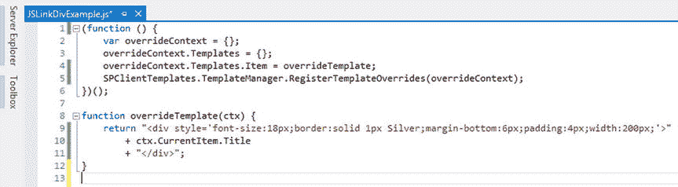

**图 5-4.** Visual Studio 中的`JSLinkDivExample.js`文件

文件上传后，我们需要获取该文件的 URL。在上一章中，我们看到了如何通过右键单击文件并从上下文菜单中选择“复制链接位置”来获取 URL。你也可以通过打开文件的菜单并从弹出菜单中的文本菜单中复制 URL，如图 5-5 所示。

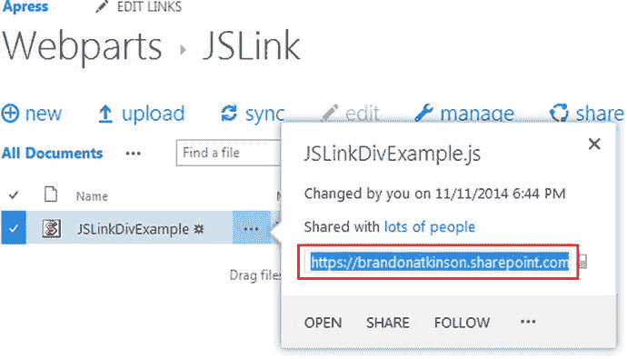

**图 5-5.** 从菜单中复制 JavaScript 文件的 URL

导航回放置了列表视图 Web 部件的页面。将页面置于编辑模式，然后将列表视图 Web 部件也置于编辑模式。在 Web 部件的工具窗格中，滚动到底部并展开“杂项”折叠面板。在此面板的底部，你将找到 JSLink 属性，如图 5-6 所示。

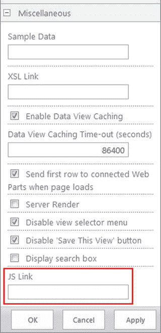

**图 5-6.** Web 部件工具窗格中的 JSLink 属性

当使用内容编辑器 Web 部件的 URL 时，你可以直接粘贴 URL，SharePoint 会自动将其转换为相对路径 URL。这意味着 SharePoint 会从 URL 中剥离域名，仅保留定位文件所需的部分。例如，在我的环境中，`JSLinkDivExample.js`的文件路径如下：

`https://brandonatkinson.sharepoint.com/apress/Webparts/JSLink/JSLinkDivExample.js`

如果将其粘贴到 JSLink 属性中并保存 Web 部件，SharePoint 会将 URL 转换为：

`/apress/Webparts/JSLink/JSLinkDivExample.js`

通常，SharePoint 倾向于使用相对路径 URL，因为 SharePoint 可以配置为从多个域提供内容。通过使用相对路径 URL（不含域名），无论内容从哪个域提供，SharePoint 都能轻松确定其位置。这对内容编辑器 Web 部件非常有效，但与 JSLink 一起使用时会失败。

幸运的是，SharePoint 提供了一种使用 URL 令牌的简单解决方法。令牌提供了一种为 SharePoint 想要移除的 URL 部分传入占位符的方法。以下列表展示了一些常见的令牌：

* `~site` - 当前网站的 URL

* `~sitecollection` - 当前网站集（站点集合）的 URL

* `~layouts` - `_layouts/15`文件夹的 URL

使用这些令牌，URL 可以更新为：

`~sitecollection/apress/Webparts/JSLink/JSLinkDivExample.js`

或

`~site/Webparts/JSLink/JSLinkDivExample.js`

这两个新 URL 都可以正常工作，因为它们都指向同一位置。由于我们的`Webparts`文档库与放置 Web 部件的页面位于同一网站中，因此我们可以使用两者中较短的那个。将此 URL 输入 JSLink 属性，如图 5-7 所示。

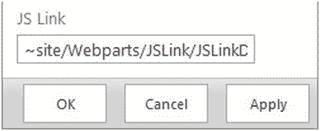

**图 5-7.** 使用 URL 令牌指向 JavaScript 文件的 URL

单击“确定”并保存页面。当页面重新加载时，`JSLinkDivExample.js`文件将被加载，列表项将根据其中的`overrideTemplate`函数进行渲染。结果如图 5-8 所示。

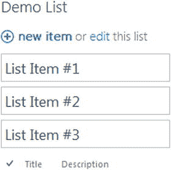

**图 5-8.** 演示列表项的 JSLink 渲染效果

如你所见，每个列表项都按照 JavaScript 文件中的内联 CSS，渲染在带有边框和更大字体的 DIV 内。在我们的函数中，我们渲染的唯一数据是`Title`属性，也就是 DIV 内部显示的内容。这个简单的示例应该开始说明 JSLink 为列表视图 Web 部件样式化提供的强大功能，以及开始构建强大自定义解决方案的一种方法。

### 使用项模板 (Item Template)

前面的示例只是对 `JSLink` 功能的一个快速演示。然而，它远非一个实际的解决方案，并且存在一些问题。例如，“标题”和“描述”列的排序链接仍然存在，并显示在列表项下方。显然，这不是你希望最终用户看到的显示方式。在本节中，我们将更深入地探讨项模板 (Item Template) 以及如何使用它。

当使用项模板时，你通常会对列表视图 Web 部件 (List View Web Part) 的所有方面进行样式化。我的意思是，它通常看起来不再像一个列表视图。`JSLink` 提供了许多方法帮助你实现这一目标。首先，我们通过以下代码为列表视图提供页眉和页脚的模板：

```
(function () {
  var overrideContext = {};
  overrideContext.Templates = {};
  overrideContext.Templates.Item = overrideTemplate;
  overrideContext.Templates.Header = "<h2>自定义页眉</h2>";
  overrideContext.Templates.Footer = "<h3>自定义页脚</h3>";
  SPClientTemplates.TemplateManager.RegisterTemplateOverrides(overrideContext);
})();
```

这个示例与之前完全相同，只是我们添加了两行额外的代码：

```
overrideContext.Templates.Header = "<h2>自定义页眉</h2>";
overrideContext.Templates.Footer = "<h3>自定义页脚</h3>";
```

通过使用这些代码行，我们告诉 SharePoint 要使用提供的 HTML 覆盖默认的页眉和页脚。这个 HTML 非常简单——它只是返回了一些包裹在 H2 和 H3 标签内的文本。然而，结果很快展示了这些覆盖的强大功能，如图 5-9 所示。

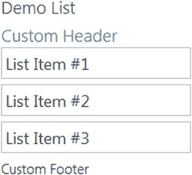

**图 5-9.** 在列表视图 Web 部件上呈现的自定义页眉和页脚

你可以通过提供一个函数来返回页眉和页脚，而不是像下面这样在同一行声明 HTML，从而进一步扩展此功能：

```
overrideContext.Templates.Header = overrideHeader;
overrideContext.Templates.Footer = overrideFooter;
```

生成的函数如下所示：

```
function overrideHeader() {
  return "<h2>自定义页眉</h2>";
}

function overrideFooter() {
  return "<h3>自定义页脚</h3>";
}
```

将此代码放在其自己的函数内为增加功能打开了大门。你可以设想一个需要调用 Web 服务来检索要在页眉中显示的数据的场景。这允许非常健壮的代码被触发并执行任何你可用的任务。你可以开始以这种方式创建非常丰富的用户体验。Visual Studio 中的完整代码如图 5-10 所示。

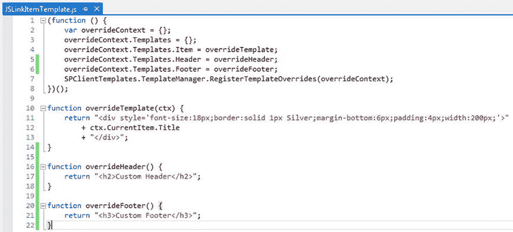

**图 5-10.** 通过 JavaScript 函数提供页眉和页脚覆盖

使用“文件”>“另存为”将此文件保存为新名称。将其命名为 `JSLinkItemTemplate.js`。将其上传到 Webparts 文档库中的 `JSLink` 文件夹。导航回列表视图 Web 部件，将其置于编辑模式，并将 `JSLink` 属性更新为以下内容：

```
~site/Webparts/JSLink/JSLinkItemTemplate.js
```

该 Web 部件现在应使用新的 `JSLink` 文件。这个示例仍然远非实际体验。让我们用一些可表示任务列表或其他具有状态类型列表的数据来更新演示列表。导航到演示列表，并从功能区访问列表设置。在列表设置页面上，创建一个名为 `Status` 的新选项列。提供以下选项（见图 5-11）：

- 按时 (On-time)
- 延迟 (Delayed)
- 晚点 (Late)

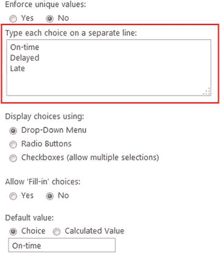

**图 5-11.** 向演示列表添加一个名为 `Status` 的选项字段

我们将使用这个新的状态列，根据所选状态来显示图像。但是，在此之前，让我们用一些对业务更有意义的数据填充演示列表。图 5-12 显示的是一个包含更合适数据的演示列表。

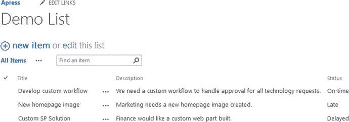

**图 5-12.** 填充了更贴近实际数据的演示列表

为了使这个示例更真实一些，我们将更新脚本，以满足以下要求：

- 当 Web 部件呈现时，每个项目只显示其标题。
- 将显示自定义页眉和页脚，并向用户提供说明。
- 当用户单击项目标题时，状态和描述将显示在下方。
- 状态将以图像形式显示。

让我们从页眉和页脚开始，因为这些函数已经存在，我们只需要更新返回的内容。自定义代码可以更新为以下内容：

```javascript
function overrideHeader() {
  return "<h3>这些项目是来自演示列表的任务：</h3>";
}

function overrideFooter() {
  return "<h4>点击项目查看其详情。</h4>";
}
```

实际上，我们几乎没有改变代码。我们分别将 `H2/H3` 改为 `H3/H4`，并更新了返回的文本。我们将使用自定义页眉作为 Web 部件中的标题，而自定义页脚现在为用户提供说明。接下来，我们将更新 `overrideTemplate` 函数；这将是实现主要更改的地方。请看以下代码：

```javascript
function overrideTemplate(ctx) {
  var status = ctx.CurrentItem.Status;
  var image = "";
  if (status == "Delayed")
    image = "/apress/Webparts/JSLink/Status-Delayed.png";
  if (status == "On-time")
    image = "/apress/Webparts/JSLink/Status-Ontime.png";
  if (status == "Late")
    image = "/apress/Webparts/JSLink/Status-Late.png";
  return "<div style='font-size:18px;margin-bottom:6px;padding:4px;cursor:pointer;' class='list-item-div'>"
    + ctx.CurrentItem.Title
    + "<div style='font-size:14px;display:none;'>"
    + "<span style='display:inline-block;'>" + ctx.CurrentItem.Status + "<br /></span>"
    + "<span style='display:inline-block;vertical-align:top;'>" + ctx.CurrentItem.Description + "</span>"
    + "</div>"
    + "</div>";
}
```

`overrideTemplate` 函数已经更新了很多。虽然乍一看它可能看起来功能增加了很多，但实际上并没有太多复杂的地方。只是增加了一些逻辑以及更多的 HTML。让我们逐一分解每个部分，以便更好地理解发生了什么。

```javascript
var status = ctx.CurrentItem.Status;
var image = "";
```

这两行代码只是声明了几个变量，用于后续代码中。首先，我们声明了一个名为 `status` 的变量，并将其赋值为当前列表项的 `Status` 属性的值。这简化了代码，使其更具可读性。接下来，我们声明了一个名为 `image` 的空字符串。这将保存一个图像的 URL，我们想根据项目的状态来显示该图像。

```javascript
if (status == "Delayed")
  image = "/apress/Webparts/JSLink/Status-Delayed.png";
if (status == "On-time")
  image = "/apress/Webparts/JSLink/Status-Ontime.png";
if (status == "Late")
  image = "/apress/Webparts/JSLink/Status-Late.png";
```

这一部分是一组简单的 `if` 语句。我们检查 `status` 变量的值，并将其与列表列的已知值进行比较。一旦找到匹配的状态，我们就将 `image` 变量设置为要显示的图像对应的 URL。

**注意：** 此示例中使用的图像可以从 Apress 网站下载。访问 Apress 网站并搜索本书的书名，以找到图像文件和源代码。为简单起见，在此示例中，我已将图像与 JavaScript 文件一起上传到同一个文件夹中。

```javascript
return "<div style='font-size:18px;margin-bottom:6px;padding:4px;cursor:pointer;' class='list-item-div'>"
+ ctx.CurrentItem.Title
+ "<div style='font-size:14px;border-top:solid 1px Silver;display:none;'>"
+ "<span style='display:inline-block;'>" + ctx.CurrentItem.Status + "<br /></span>"
+ "<span style='display:inline-block;vertical-align:top;padding-left:16px;'>"
+ "<strong>描述</strong><br />"
+ ctx.CurrentItem.Description + "</span>"
+ "</div>"
+ "</div>"
```

最后，我们更新了返回的 HTML，从而能够显著改变结果。首先，我们创建了一个 `DIV` 元素，其中包含一些额外的内联 CSS，以及一个 CSS 类 `list-item-div`。这个 CSS 类稍后会在我们使用 jQuery 定位该元素时用到。接下来，我们显示当前列表项的标题，然后创建一个子 `DIV` 元素来容纳状态和描述信息。这个 `DIV` 也包含一些内联 CSS，其中设置了 `display:none;`。这会使该 `DIV` 保持隐藏状态，直到我们想要查看它。我们继续创建 HTML 来容纳项目状态、状态图片和描述，最后关闭所有 `DIV` 元素。

此时，页面会渲染，你会看到页面上每个列表项的标题，但状态和描述信息是隐藏的。我们需要提供一种方式来方便地查看这些信息。下面的函数将处理这个问题：

```javascript
function listItemClick() {
    $(".list-item-div").on("click", function () {
        var childDiv = $(this).children()[0];
        $(childDiv).toggle("slow");
    });
}
```

## 使用 jQuery 处理点击事件与切换显示

当我们在上一个函数中创建每个子 `DIV` 时，我们使用 CSS 将其隐藏，并应用了一个 CSS 类。这个类仅用于提供一种通过 jQuery 定位它的方式。我们使用 jQuery 内置的 `on` 函数为每个 `DIV` 附加一个点击事件。因此，通过使用 `$(".list-item-div").on("click", function ()...`，我们告诉 jQuery 查找所有具有 `list-item-div` CSS 类的元素，并为每个元素附加一个 `on click` 事件。当元素被点击时，提供的函数就会被触发。在这个函数内部，我们要求 jQuery 提供该 `DIV` 中的第一个子元素。`$(this).children()[0]` 告诉 jQuery，对于刚刚被点击的项目（"this"），返回其 "children" 集合中的第一个子对象。因为我们精心设计了 HTML，使其具有一个父 `DIV` 和一个子 `DIV`，所以可以确定这将返回包含状态和描述信息的 `DIV` 元素。

接下来，我们使用一个名为 `toggle` 的 jQuery 函数来显示该元素。`toggle` 实际上会切换元素的可见性。因此，如果元素当前是隐藏的，`toggle` 会将其显示出来——反之亦然。通过使用这个函数，我们可以用一行代码轻松地提供展开和关闭功能。

## 在 JSLink 中正确触发事件

一旦我们有了用于为 `DIV` 附加点击事件的函数，我们就需要一种方式来触发它。仅仅编写这个函数并将其放在脚本中，在它被调用之前不会起任何作用。通常，我们会包含一个 jQuery `Document.ready` 调用来确保事件被正确连接，方法是使用 `$(function()...` 调用。然而，在 JSLink 中，这种方式无法工作，并且会产生错误。原因在于 JSLink 的 onload 函数会在 jQuery 加载之前触发。这意味着 jQuery 中可靠的 `Document.ready` 函数在 JSLink 中毫无用处。不过，SharePoint 提供了自己的内置函数来实现相同的功能：

```javascript
_spBodyOnLoadFunctions.push(listItemClick);
```

`_spBodyOnLoadFunctions` 允许你在页面加载时注册自己的 JavaScript 函数来触发。它与 jQuery 的 `Document.ready` 非常相似，但能与 JSLink 很好地配合，因此这是我们在连接 jQuery 事件时需要使用的方法。Visual Studio 中的完整脚本如图 5-13 所示。

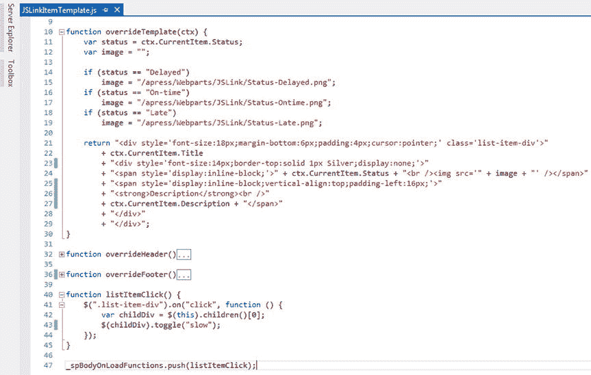

`图 5-13.` Visual Studio 中更新后的 `JSLinkItemTemplate.js` 脚本。为便于阅读，自定义的页眉和页脚函数已被折叠。

## 配置列表视图 Web 部件

保存更新后的文件并将其上传到 Web 部件库中的 JSLink 文件夹。要使此脚本正常工作，你需要更新列表视图 Web 部件上的某些属性。当你首次将列表视图 Web 部件放置在页面上时，返回的数据是该列表类型最起码的数据。例如，演示列表是一个自定义列表，因此默认只返回标题和描述。任务列表也是如此；例如，当列表视图 Web 部件添加到页面时，只返回创建时存在的列。当然，你可以轻松地更新这一点。导航到放置列表视图 Web 部件的页面，将其和 Web 部件置于编辑模式。在 Web 部件的工具窗格中，第一个属性名为 `Selected View`。使用下拉菜单，选择“所有项目”视图，如图 5-14 所示。

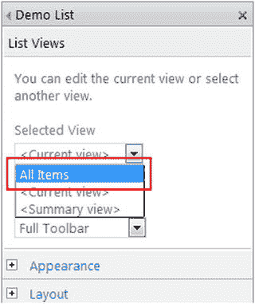

`图 5-14.` 更改列表视图 Web 部件上的 `Selected View`。

更改此视图可确保新的 `Status` 属性将被返回并可供我们的 JSLink 代码使用。接下来，由于我们在代码中使用自定义页眉来呈现标题，因此我们将移除 Web 部件的镶边。展开工具窗格中的“外观”折叠区域。在此部分的底部，你会找到“镶边类型”属性。从下拉菜单中选择“无”，如图 5-15 所示。

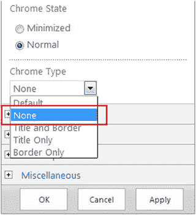

`图 5-15.` 更改列表视图 Web 部件上的镶边类型。

单击“确定”，然后保存页面。列表视图 Web 部件现在应使用 JSLink 文件进行渲染并正确显示。结果如图 5-16 所示。自定义的页眉和页脚已显示，提供了 Web 部件标题以及关于如何使用该部件的用户说明。镶边已不再显示，每个项目仅显示项目标题。将鼠标悬停在项目上，鼠标光标会变为指针，表示可以点击。点击项目会触发 jQuery 的 `toggle` 函数，从而展开或关闭项目。

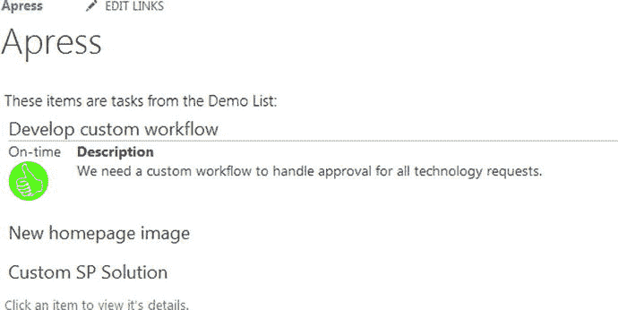

`图 5-16.` 使用 JSLink 文件显示的演示列表项目。

如你所见，这与你之前看到的开箱即用的列表视图 Web 部件相比，是一个巨大的变化。事实上，它的外观和行为正符合你的期望——一个根据业务需求构建的自定义 Web 部件！过去，这种类型的解决方案需要服务器端编码和部署到 SharePoint 服务器的自定义 Web 部件。而现在，所有这些都可以通过 JavaScript 在浏览器中实现！接下来，让我们看看如何单独操作各个列，而不是一次性处理所有数据。

### 使用字段模板

`JSLink` 中的字段模板允许你针对列表中的特定字段或列进行自定义渲染。当你的自定义渲染需求不那么复杂时，可以使用字段模板。当然，你也可以用此模板构建出非常复杂的自定义渲染。但与项模板不同的是，项模板最终效果通常与列表视图 Web 部件完全不同，而字段模板的目标性更强，其最终结果看起来像是一个功能增强后的列表视图 Web 部件。

其代码与项模板代码非常相似。我们继续处理 `Status` 列。在这个方案中，我们将检查 `Status` 列并返回对应的图片，但这次它将以列数据的形式出现在列表视图 Web 部件中。在 Visual Studio 中创建一个新文件，并以以下代码开始：

```javascript
(function () {
    var overrideContext = {};
    overrideContext.Templates = {};
    overrideContext.Templates.Fields =
    {
        'Status': { 'View': overrideTemplate }
    };
    SPClientTemplates.TemplateManager.RegisterTemplateOverrides(overrideContext);
})();
```

这段代码与项模板代码非常相似，但有两大主要变化。首先，我们不再使用自定义页眉和页脚。原因在于此模板不会覆盖 Web 部件的标准功能。所以我们仍希望保留常规的列标题、排序等功能。其次，我们通过以下代码指定这是一个 `Fields` 模板：

```javascript
overrideContext.Templates.Fields =
{
    'Status': { 'View': overrideTemplate }
};
```

`'Status'` 告诉 `JSLink` 我们正在针对列表中的 `Status` 字段。`'View'` 指定了当渲染 `Status` 列时要调用的函数。因此，我们需要使用以下代码声明一个名为 `overrideTemplate` 的函数来渲染该列：

```javascript
function overrideTemplate(ctx) {
    var status = ctx.CurrentItem.Status;
    var image = "";
    if (status == "Delayed")
        image = "/apress/Webparts/JSLink/Status-Delayed.png";
    if (status == "On-time")
        image = "/apress/Webparts/JSLink/Status-Ontime.png";
    if (status == "Late")
        image = "/apress/Webparts/JSLink/Status-Late.png";
    return "";
}
```

这个函数与之前的示例几乎相同。我们仍然声明了两个变量来保存当前项的`Status`和图片 URL。通过使用`if`语句，我们根据状态设置图片 URL，与之前一样。不同之处在于返回值，它是一个图片 HTML 元素。我们将`SRC`属性设置为通过`if`语句确定的图片 URL。我们还设置了一个 CSS 类`status-image`和一个名为`data-val`的属性，该属性保存状态的文本值。最后这两个属性将用于 jQuery 点击事件。此函数仅为`Status`返回一张图片，而不是状态文本。

接下来，通过以下代码设置将点击事件附加到每个图片的函数：

```
function listItemClick() {
    $(".status-image").on("click", function () {
        var status = $(this).attr("data-val");
        alert(status);
    });
}
```

这个函数与之前的示例也非常相似。我们使用 CSS 类`status-image`设置了一个 jQuery 点击事件。接着，我们通过`$(this).attr("data-val")`获取状态的文本。jQuery 的`attr`函数返回 HTML 元素上任何属性的值，因此我们可以轻松地访问此值。然后，我们用一个包含状态文本的标准弹窗来触发显示。最后，我们使用`_spBodyOnLoadFunctions.push`函数来绑定该函数：

```
_spBodyOnLoadFunctions.push(listItemClick);
```

这个示例比项模板示例小得多。这是因为覆盖仅针对单个字段，而不是所有列以及页眉和页脚。Visual Studio 中的完整代码示例如图 5-17 所示。

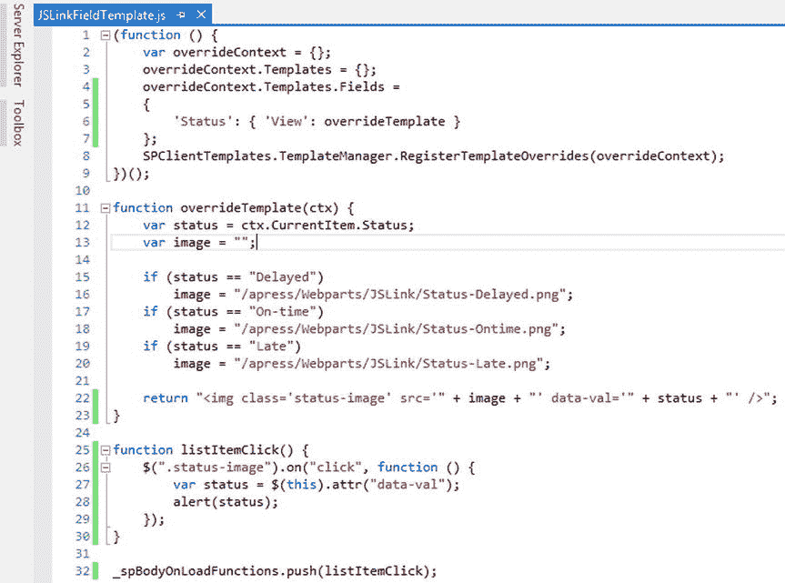

**图 5-17.** Visual Studio 中的`JSLinkFieldTemplate.js`文件

保存此文件并命名为`JSLinkFieldTemplate.js`。将其上传到 Web 部件文档库中的 JSLink 文件夹，该文件夹中存放着其他 JSLink 文件。返回列表视图 Web 部件，将其置于编辑模式，并将`JSLink`属性更新为以下内容：

`∼site/Webparts/JSLink/JSLinkFieldTemplate.js`

与项模板一样，你可能需要使用“选定视图”属性设置相应的视图。你也可以将 Chrome 类型设置回“默认”，以便再次显示 Web 部件标题。在列表视图 Web 部件中呈现的新 JSLink 文件如图 5-18 所示。

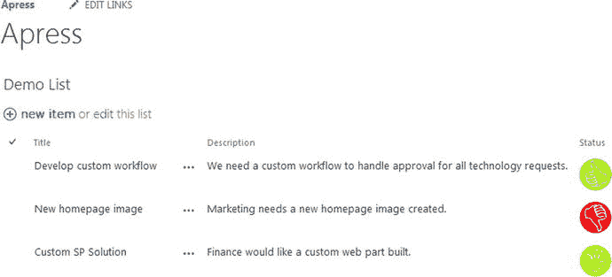

**图 5-18.** 使用 JSLink 渲染的字段模板

你也可以点击图片，在 JavaScript 弹窗中看到状态文本，如图 5-19 所示。

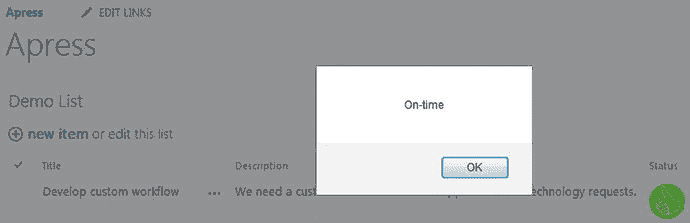

**图 5-19.** 状态图片上的点击事件

你可以通过提供多个覆盖函数来覆盖多个字段。例如，如果我们还想对“描述”字段应用自定义渲染，可以将代码更新为以下内容：

```
(function () {
    var overrideContext = {};
    overrideContext.Templates = {};
    overrideContext.Templates.Fields =
    {
        'Status': { 'View': overrideTemplate },
        'Description': { 'View': overrideDescTemplate }
    };
    SPClientTemplates.TemplateManager.RegisterTemplateOverrides(overrideContext);
})();

function overrideDescTemplate(ctx) {
    return "<span style='font-weight:bold;'>" + ctx.CurrentItem.Description + "</span>";
}
```

`Fields`属性可以接受多个覆盖，只需在每个覆盖之间加上逗号即可。在这个例子中，我们创建了另一个名为`overrideDescTemplate`的函数，它仅返回当前项的“描述”字段，并将其包裹在一个提供粗体字体的`SPAN`元素中。Visual Studio 中的完整脚本如图 5-20 所示。

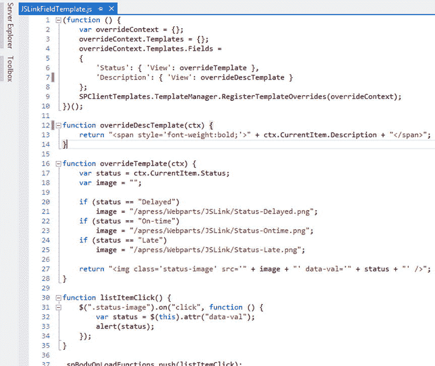

**图 5-20.** Visual Studio 中更新后的`JSLinkFieldTemplate.js`文件

注意：某些字段无法使用 JSLink 覆盖。例如，分类字段不允许进行不同的渲染。你可以想象，如果能够覆盖像托管元数据列这样复杂的字段的渲染，将会带来多大的麻烦。如果你尝试覆盖任何不允许此操作的字段，SharePoint 将忽略你的自定义渲染函数。这很好，因为这意味着你的脚本不会破坏页面；然而，这也可能令人沮丧，因为似乎什么也没发生！如果你注意到这一点，请退一步思考，并记住有些字段是无法覆盖的。

正如你在更新的代码示例中所看到的，JSLink 提供了覆盖一个或多个字段所需的所有工具。只需提供一个处理渲染的函数并定义覆盖即可。保存此文件并上传到文档库。图 5-21 显示了使用新 JSLink 文件渲染的列表视图 Web 部件。

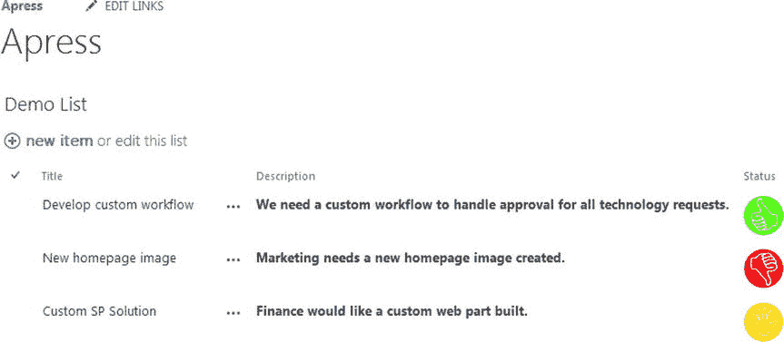

**图 5-21.** 更新后的 JSLink 文件在 Web 部件上渲染多个字段

现在你已经看到了多个使用 JSLink 渲染列表视图 Web 部件的示例。无论你需要覆盖特定字段，还是完全改变 Web 部件的外观，你都已经拥有了构建自定义解决方案所需的所有工具。你甚至可以通过加载多个脚本将 JSLink 运用得更深入，以帮助你创建强大的解决方案。

### 加载多个脚本

在使用 JSLink 进行开发时，你可能会发现文件变得庞大，或者你希望同时加载其他脚本。幸运的是，使用 JSLink 可以轻松实现这一点。JSLink 允许通过简单的管道符`|`来添加多个文件，只需将其放置在 JSLink 属性中的每个文件路径之间即可。例如，如果我们的文件夹中有多个文件，可以使用以下路径：

`∼site/Webparts/JSLink/File1.js|∼site/Webparts/JSLink/File2.js`

使用`|`分隔符组合后的路径将放置在列表视图 Web 部件的 JSLink 属性中。我们可以更新之前的代码示例来说明这一点。首先，我们将回到一个简化版的示例，代码如下：

```
(function () {

var overrideContext = {};

overrideContext.Templates = {};

overrideContext.Templates.Fields =

{

'Status': { 'View': overrideTemplate }

};

SPClientTemplates.TemplateManager.RegisterTemplateOverrides(overrideContext);

})();

function overrideTemplate(ctx) {

var status = ctx.CurrentItem.Status;

var image = "";

if (status == "Delayed")

image = "/apress/Webparts/JSLink/Status-Delayed.png";

if (status == "On-time")

image = "/apress/Webparts/JSLink/Status-Ontime.png";

if (status == "Late")

image = "/apress/Webparts/JSLink/Status-Late.png";

return "";

}
```

这个示例基本回到了第一个字段代码示例，我们仅用图像覆盖了 `Status` 字段。用于显示警告的自定义 jQuery 代码已被移除，因此我们将把这部分移到另一个文件中。Visual Studio 中的脚本如图 5-22 所示。

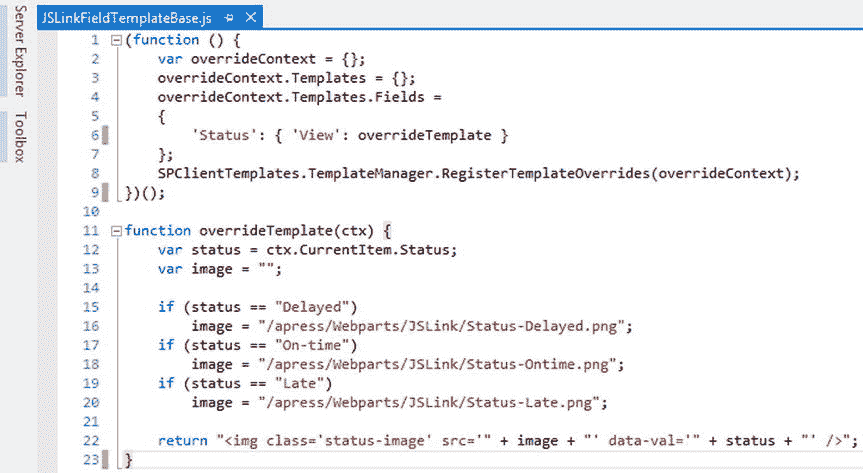

图 5-22. 仅渲染列表中的 `Status` 字段的 JSLink 文件

保存此文件并命名为 `JSLinkFieldTemplateBase.js`。接下来，我们将创建配套文件来处理 jQuery 点击事件功能。使用“文件”➤“新建”➤“文件”创建一个新文件。选择“Web”类别，然后从选项中选择“JavaScript 文件”。我们将使用上一节的代码，该代码通过以下 jQuery 代码将点击事件添加到 DIV 中：

```
function listItemClick() {

$(".status-image").on("click", function () {

var status = $(this).attr("data-val");

alert("STATUS: " + status);

});

}

_spBodyOnLoadFunctions.push(listItemClick);
```

这与之前的代码相同，只是在警告中增加了文本“STATUS:”。这主要是为了展示我们正在使用一个新文件，并且 JSLink 同时加载了两个文件。保存此文件并命名为 `JSLinkFieldTemplateExt.js`。Visual Studio 中的脚本如图 5-23 所示。

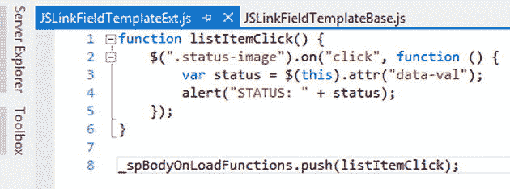

图 5-23. Visual Studio 中的 `JSLinkFieldTemplateExt.js` 文件

现在两个文件都已创建完毕，将它们上传到 Web 部件文档库中的 JSLink 文件夹。文件上传后，你可以构建组合路径，它应该如下所示：

`∼site/Webparts/JSLink/JSLinkFieldTemplateBase.js|∼site/Webparts/JSLink/ JSLinkFieldTemplateExt.js`

将列表视图 Web 部件置于编辑模式，并使用组合路径更新 JSLink 属性。点击“应用”，然后保存页面。乍一看，自定义渲染并没有太大变化。点击状态图像以触发点击事件，如图 5-24 所示。

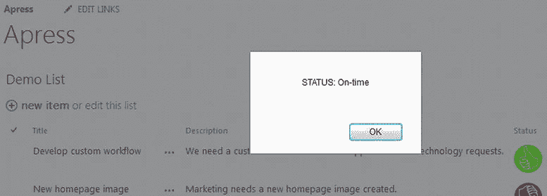

图 5-24. 来自第二个 JavaScript 文件的更新后的点击事件

在警告框中，你可以看到状态并附带了额外的“STATUS:”文本。这确认了两个 JavaScript 文件已通过 JSLink 加载。虽然这是一个非常简单的示例，但它应该能够说明加载多个文件的强大功能。随着脚本越来越大，你现在可以灵活地将代码拆分为多个文件，并通过 JSLink 引用它们。

## 总结

在本章中，我们探讨了 `JSLink` 作为在 SharePoint 中构建自定义解决方案的一种方式的强大功能。我们看到了如何使用这种方法覆盖列表视图 Web 部件的默认渲染。你可以使用“Item”模板完全自定义整体渲染，或者使用“Fields”模板覆盖列表中的单个或多个字段。我们还了解了如何将代码拆分为多个文件。希望本章展示了 `JSLink` 的可能性。在下一章中，我们将继续研究 SharePoint 中的新功能，使用显示模板和结果源来创建自定义搜索解决方案。
