# 6. 内容搜索 Web 部件与显示模板

自 SharePoint 诞生以来，搜索一直在其使用中扮演着重要角色。无论是网站搜索、企业搜索还是自定义解决方案，SharePoint 的关键优势之一就是能够轻松找到内容。在 SharePoint 中促进搜索的一种方式是通过内容搜索 Web 部件。它可以轻松地放置在页面上，并配置为向用户返回特定结果。这是一个经过验证且存在已久的 Web 部件。在最新版本的 SharePoint 中，内容搜索 Web 部件利用了结果源和显示模板等新功能。

结果源允许你制定特定的搜索条件，以快速定位你正在寻找的内容。显示模板允许你根据业务需求设置搜索结果的样式并呈现它们。这个新功能为开发者在 SharePoint 中创建丰富、自定义的解决方案提供了另一条途径。在本章中，我们将探讨这些领域，并创建一些自定义搜索解决方案。

## 添加文档

在你开始使用 SharePoint 中的搜索构建解决方案之前，你需要一些实际的文档用于搜索。如果你使用的是现有的 SharePoint 环境，你可能已经有了一些可以搜索的文档。如果你为本书设置了环境，则需要上传一些文档来执行搜索。在本示例中，你将拥有多种文档类型用于搜索，包括 Word、Excel 和 PDF。图 6-1 显示了文档库中的一些示例文件。

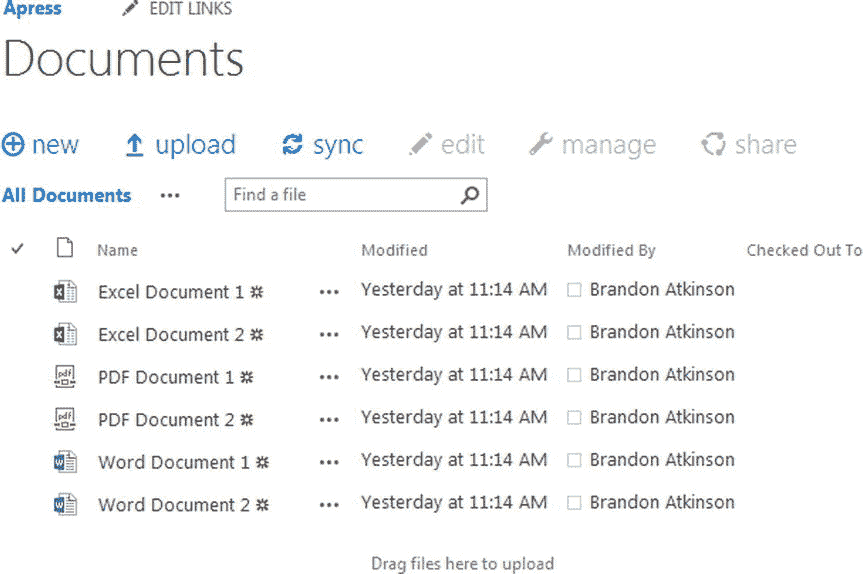

图 6-1. 文档库中的 Excel、PDF 和 Word 文档

本示例中使用的文档可以从 Apress 下载。请访问 Apress（[www.apress.com](http://www.apress.com/)）并搜索本书标题以查找文档和源代码。

我使用了现成的“文档”文档库，该库是在我创建名为 Apress 的团队网站时创建的。无论你将文档存储在哪里，这里的要点只是将一些文件上传到 SharePoint 中，以便你可以搜索它们。现在，一些文件已上传并最终将被索引，你可以创建一个自定义结果源来方便搜索。

## 结果源

在 SharePoint 2010 中，您有自定义搜索范围的概念。它们允许您将搜索结果限制在特定的内容上，从而为最终用户提供更有针对性的搜索，而无需他们知道如何构造复杂的搜索查询。在 SharePoint 2013 中，您可以通过自定义结果源实现完全相同的目的。

在 SharePoint 2013 中执行搜索时，系统会将该查询与结果源进行匹配以提供结果。结果源是一种定义，用于指定以下内容：

- `协议（Protocol）` - 可以是本地搜索服务索引、远程 SharePoint 安装、Exchange，甚至是使用 `OpenSearch` 协议的其他搜索引擎。
- `源 URL（Source URL）` - 如果您使用的是 `Local SharePoint` 以外的协议，则需要为返回搜索结果的服务器提供一个 URL。
- `类型（Type）` - 使用 `Local` 或 `Remote SharePoint` 时，您可以指定 `SharePoint Search` 或 `People Search`。
- `查询转换（Query transform）` - 使用查询转换，您可以通过 `KQL` 属性限制来缩小给定搜索的结果范围。
- `凭据（Credentials）` - 您可以指定用于搜索的凭据。

SharePoint 附带了许多预配置的结果源供您使用，包括 `Conversations`、`Documents` 和 `Pictures` 等。此外，还可以在 SharePoint 的各个级别创建自定义结果源，而创建结果源的位置决定了您所需的权限级别。以下列出了可以创建结果源的级别以及创建它们所需的权限：

- `网站集（Site Collection）` - 您必须是网站集管理员，并且结果源可供网站集中的任何网站使用。
- `网站（Site）` - 您必须是网站的 `Owners` 组成员，并且结果源只能由该网站使用。

您还可以在 `Search Service Application` 级别或 Office 365 的 `SharePoint Admin Center` 指定结果源，该结果源可供任何使用 `Search Service Application` 的网站集使用。本书不会介绍此级别，但是，在此级别创建结果源的步骤也是完全相同的。

创建自定义结果源时，您需要做出的第一个决定是在哪个级别创建它。这取决于您打算如何使用该源；例如，如果要突出显示特定网站中的项目，则 `Site` 级别是合理的。但如果您想要一个范围更广的结果源，您可能希望在 `Site Collection` 级别创建它。两者的步骤完全相同。如果您计划在 `Site Collection` 或 `Site` 级别创建新的结果源，只需导航到 `Site Settings` 页面，然后在 `Site` 级别选择 `Search` 标题下的 `Result Sources`，或者在 `Site Collection` 级别选择 `Site Collection Administration` 标题下的 `Search Result Sources`。图 6-2 显示了网站集的 `Site Settings` 页面。

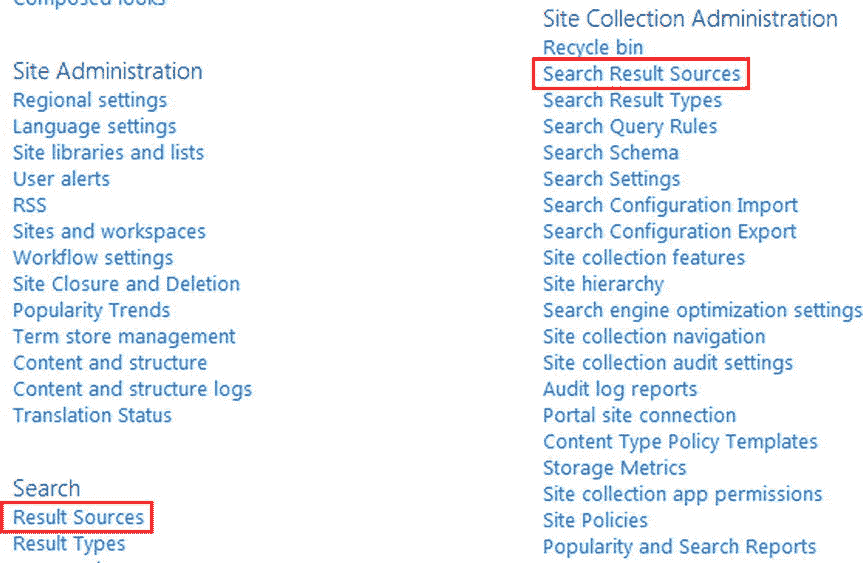

图 6-2. 从网站集网站设置页面访问结果源

如您所见，在网站集级别，您可以为整个网站集创建结果源，或者仅为根级网站创建结果源。在本示例中，我们将导航到其他代码示例所在位置的 `Apress` 子网站，并仅为该网站创建一个新的结果源，如图 6-3 所示。

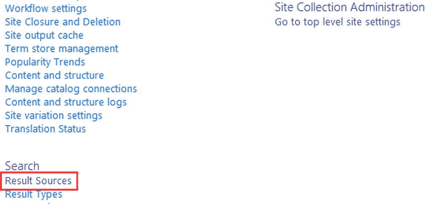

图 6-3. 从网站网站设置页面访问结果源

点击 `Result Sources` 链接将带您进入 `Manage Result Sources` 页面。此页面显示所有已设置的当前结果源。它还包含 SharePoint 附带的所有开箱即用的结果源。您不能更改任何开箱即用的结果源；但是，您可以查看其设置。要开始创建自定义结果源，请点击页面顶部的 `New Result Source` 链接，如图 6-4 所示。

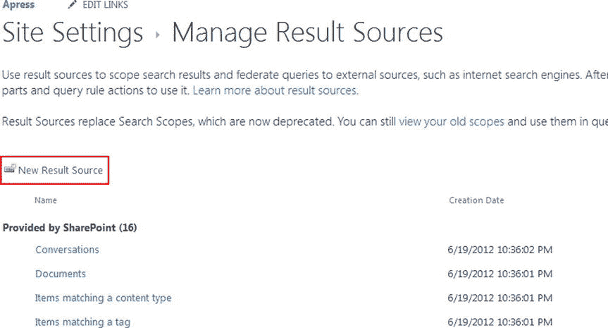

图 6-4. 网站设置中的管理结果源页面

进入 `Add Result Source` 页面后，您需要提供的第一项内容是名称和描述。描述是可选的，但您应该为其他用户提供一个。图 6-5 显示了新结果源所需的初始属性。

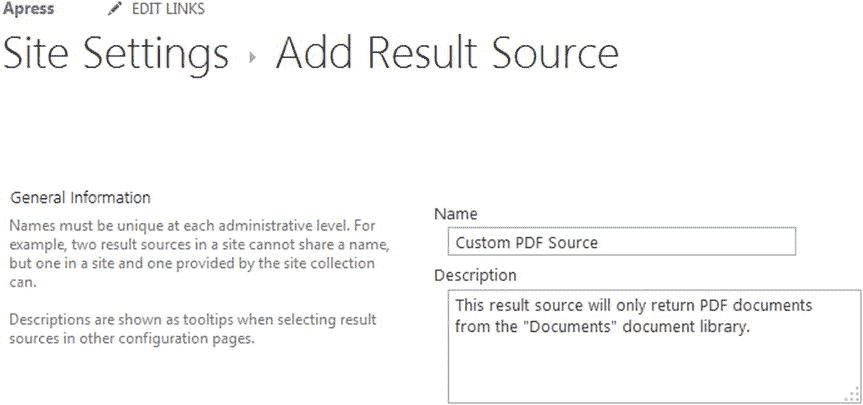

图 6-5. 为新结果源提供名称和描述

在本示例中，您将创建一个仅从网站内的 `Documents` 库返回 PDF 文档的结果源。为此，我们将提供标题 `Custom PDF Source` 和一个合适的描述，以便用户在使用此结果源时确切知道期望什么。接下来，您需要提供协议和类型；在本例中，协议将为 `Local SharePoint`，类型将为 `SharePoint Search Results`，如图 6-6 所示。根据您的需要，您可能需要选择不同的协议和类型，并提供其他信息。在这种情况下，页面将更新以显示所选选项所需的额外字段。

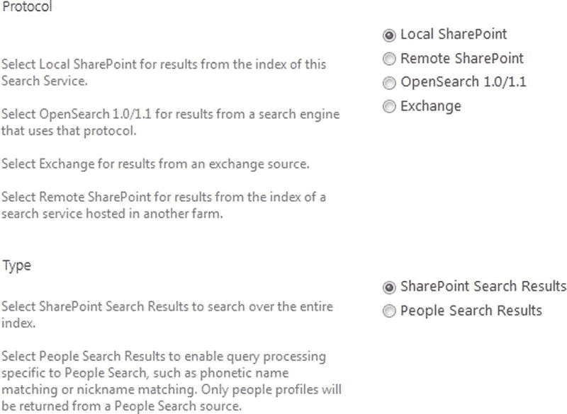

图 6-6. 新结果源的协议和类型选项

接下来，您需要提供一个查询转换，该转换将实际执行搜索结果的限制。这是使用 `Keyword Query Language` 完成的，它是一组搜索选项、属性限制和运算符。查询转换将始终以令牌 `{searchTerms}` 开头；这将被替换为用户输入的搜索词。之后，您可以提供任何有效的属性限制和/或运算符。我们稍后将对此进行深入探讨。现在，您可以在文本框中看到 `{searchTerms}` 令牌，以及 `Launch Query Builder` 按钮，如图 6-7 所示。


图 6-7. 查询转换选项和启动查询生成器选项

最后，您可以指定要与此结果源一起使用的凭据。您可以指定 `Default Authentication`，以便在执行搜索时使用用户的身份验证。这通常是期望的结果。身份验证类型如图 6-8 所示。

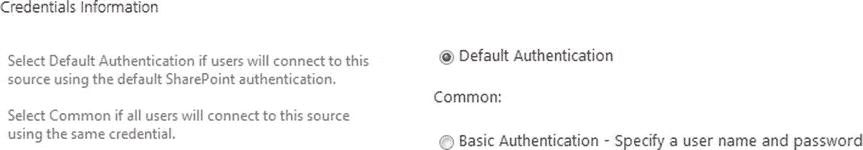

**图 6-8.** 结果源的凭据信息

点击 `Save` 以创建新的结果源。您将返回到 `Manage Result Sources` 页面，自定义结果源将列在其中，如图 6-9 所示。新的结果源列在页面顶部的“为此网站定义”标题下。

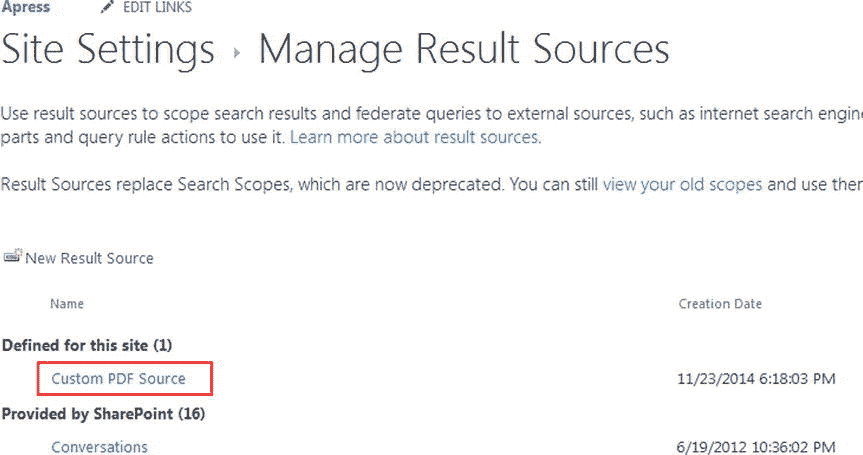

**图 6-9.** 管理结果源页面中的新结果源

由于我们之前在`查询转换`部分未提供任何详细信息，因此这个新的结果源将直接获取用户输入并执行搜索。我们其实完全不需要创建新结果源就能实现该功能。现在让我们对其进行优化，使其仅返回`文档`文件夹中的 PDF 文件。打开结果源上下文菜单并点击`编辑`，如图 6-10 所示。

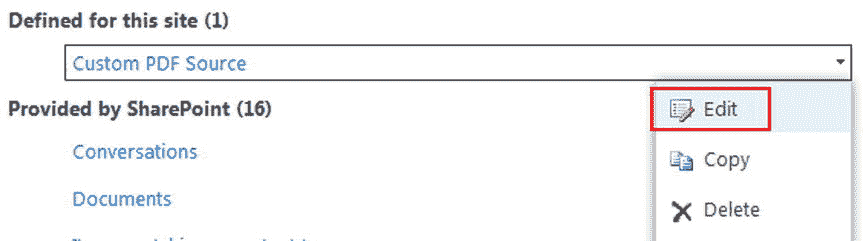

图 6-10. 编辑我们刚刚创建的结果源

编辑结果源将跳转到`编辑结果源`页面，您将看到之前输入的所有设置。向下滚动到`查询转换`部分，点击`启动查询生成器`按钮，如图 6-11 所示。

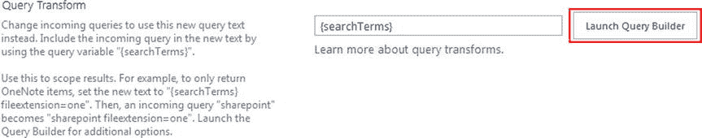

图 6-11. 包含“启动查询生成器”按钮的查询转换部分

`构建查询`模态窗口随即打开，它将帮助您构建查询转换。该窗口中提供了许多开箱即用的筛选器，您可以通过访问提供的下拉列表来使用它们。您还可以在此处应用排序并测试查询。您也可以直接输入查询，如图 6-12 所示。

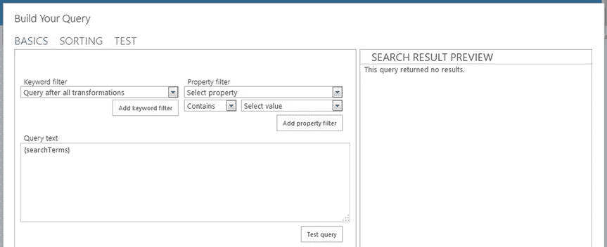

图 6-12. “构建查询”模态窗口

在 SharePoint 中，查询是使用关键字查询语言（简称 KQL）构建的。使用 KQL，您可以指定传递给 SharePoint 搜索服务的搜索词或属性限制。KQL 查询并不复杂，由以下一个或多个元素组成：

- 自由文本关键字 - 这些可以是单词或短语，例如 whitepaper、event、Bob Smith 等。
- 属性限制 - 这些可以是文件类型、作者、文件名等。

属性限制的功能正如其名：限制搜索结果。例如，您可以添加一个`FileType`限制器，并通过使用`FileType:docx`仅返回某种文档类型（如仅返回 Word 文件）。有大量的属性限制可供使用，这使得 KQL 在满足您的搜索需求方面非常强大。

> **注意**：关键字查询语言虽然易于实现，但其语法非常丰富和深入。它非常适合精确地构建满足您需求的查询，但对于本书而言，这个主题过于庞大。我们仅浅尝辄止地介绍其能力。有关 KQL、属性限制等的详细信息，请访问[`http://msdn.microsoft.com/en-us/library/office/ee558911(v=office.15).aspx`](http://msdn.microsoft.com/en-us/library/office/ee558911(v=office.15).aspx)。

一个有效的 KQL 查询必须包含一个自由文本关键字、一个属性限制，或两者的组合。首先，我们将删除查询中的`{searchTerms}`部分。我们不会使用它，因为我们的`内容搜索 Web 部件`将直接返回结果，无需用户任何交互。接下来，我们将使用`path`属性添加一个属性限制：

```
path:"https://brandonatkinson.sharepoint.com/apress/Shared Documents"
```

`path`属性指示查询仅从指定路径及其下的任何内容（包括文件夹、子网站等）返回结果。该路径必须是完全限定的 URL，如果包含空格，则必须用引号将 URL 括起来。在我的环境中，我使用的是开箱即用的`文档`文件夹，它实际上是`共享文档`文件夹。您可以通过单击导航面板中的文件夹并检查浏览器地址栏中的 URL 来随时确认文件夹的实际名称。将此属性限制放入`查询文本`文本框并点击`测试查询`按钮，将产生如图 6-13 所示的结果。

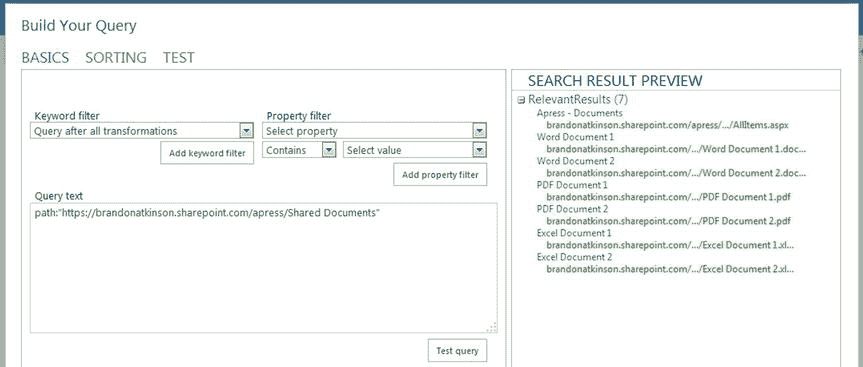

图 6-13. 路径属性限制仅从特定文档库返回文件

该属性限制将搜索结果限定在`文档`库中，仅返回了七个文档。现在，我们可以使用`FileType`属性再次进行限制：

```
FileType:pdf
```

该属性指示查询仅返回扩展名为`.pdf`的文件。将此属性添加到查询中并点击`测试查询`按钮将进一步限制结果，如图 6-14 所示。

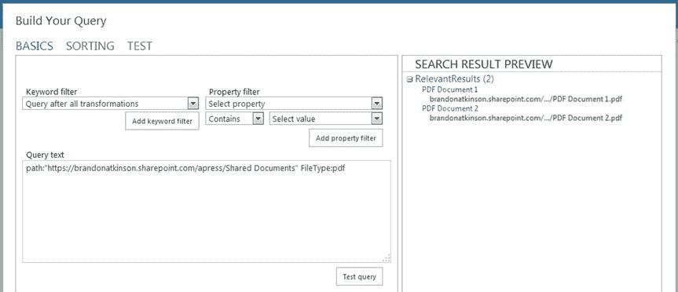

图 6-14. FileType 属性限制将结果限制为仅 PDF 文件

现在只返回了两个文件，因为`文档`库中只有两个 PDF 文件。虽然这是一个非常简单的示例，但它应该能说明 KQL 在构建查询时提供的强大功能。仅使用两个属性限制，我们就已经能够相当程度地限制搜索结果。您可以想象，如果要求只显示位于特定网站中的 Office 文件（无论它们位于哪个文件夹），您的 KQL 查询将类似于以下内容：

```
path:"http://SERVER/SITE" FileType:docx FileType:xlsx FileType:ppt
```

如您所见，您可以组合相同类型的属性限制器来精确构建所需内容。KQL 非常灵活；您应该很容易找到满足需求的搜索词和属性限制的正确组合。

现在我们已经按照需求设置好了查询，请在`构建查询`窗口中点击`确定`。然后在`编辑结果源`页面上点击`保存`。自定义结果源现已设置完毕，可以投入使用。接下来，让我们在页面上放置一个`内容搜索 Web 部件`并使用这个结果源。

## 内容搜索 Web 部件

`内容搜索 Web 部件`是 SharePoint 2013 中新增的另一个得力工具。当页面上放置了`内容搜索 Web 部件`时，用户加载页面时它会自动发出搜索查询。根据 Web 部件的配置方式，用户很可能甚至不知道正在进行搜索。这使得`内容搜索 Web 部件`成为基于搜索创建自定义解决方案的强大方式。这是一个易于使用和配置的 Web 部件，如您在前一节中所见，为您的需求设置特定的搜索查询也非常容易。

**注意**

`内容搜索 Web 部件`作为`搜索 Web 部件`功能的一部分提供。此功能仅适用于 SharePoint Online E3 和 E4 计划，以及本地企业许可版本。如果您没有这些计划或许可证，您会发现`内容搜索 Web 部件`无法用于向页面添加新 Web 部件。有关 SharePoint Online 计划可用功能的更多信息，请访问 `http://technet.microsoft.com/en-us/library/sharepoint-online-service-description.aspx`。

首先，导航到为本书放置其他 Web 部件的页面，然后删除之前章节中的任何现有 Web 部件。在页面仍处于编辑模式时，通过从功能区中选择`插入`选项卡来放置一个新的`内容搜索 Web 部件`。从类别部分选择`内容汇总`，然后选择`内容搜索`，如图 6-15 所示。

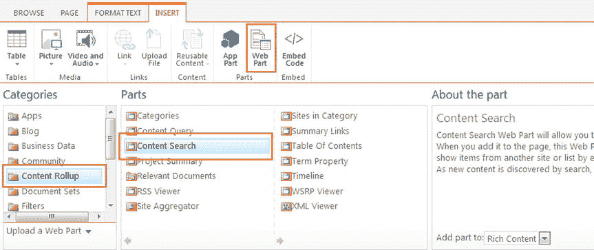

**图 6-15.** 在页面上插入内容搜索 Web 部件

单击`添加`将 Web 部件放置在页面上。该 Web 部件会立即显示搜索结果。`内容搜索 Web 部件`的默认搜索称为`最近更改的项目`，它显示的正是这些内容——最近更改的项目列表。在本例中，该列表由最近添加到文档库中的文档组成，如图 6-16 所示。

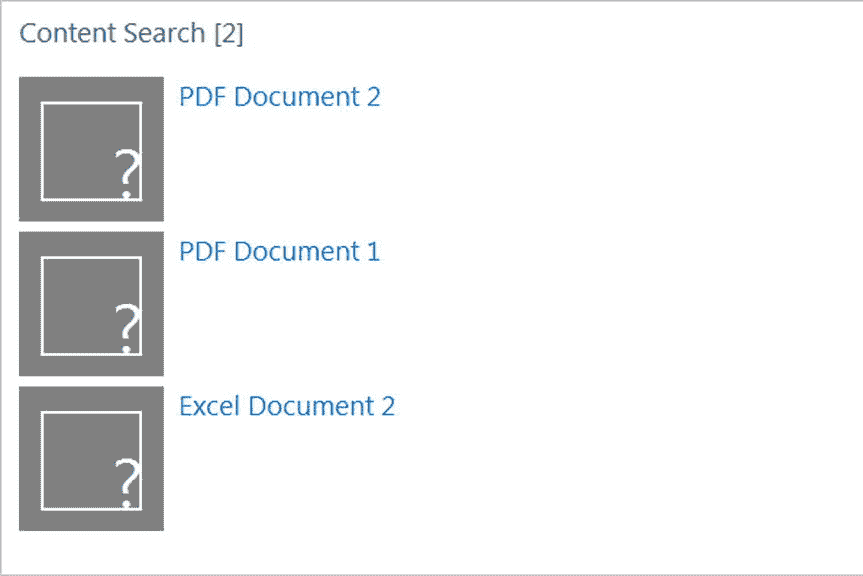

**图 6-16.** 使用“最近更改的项目”搜索的内容搜索 Web 部件

乍一看，这个 Web 部件几乎实现了我们最初想要的功能，即只显示 PDF 文档。此 Web 部件中显示两个 PDF 文档纯属运气。例如，根据您上传文档的顺序，您可能会在最顶部看到两个 Word 文档。我们将更新 Web 部件，使用我们在上一节创建的自定义结果源，以确保结果中只获得 PDF 文档。将`内容搜索 Web 部件`置于编辑模式，在属性折叠面板中，单击`更改查询`按钮，如图 6-17 所示。

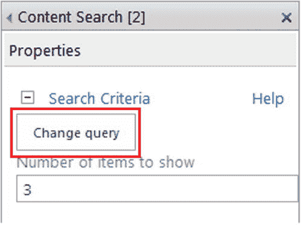

**图 6-17.** 访问内容搜索 Web 部件的查询设置

# 内容搜索Web部件配置与显示模板

单击此按钮将打开`构建您的查询`模式窗口。在`基础`选项卡下，您将看到`选择查询`标题以及选定的选项`最近更改的项目（系统）`，如图 6-18 所示。

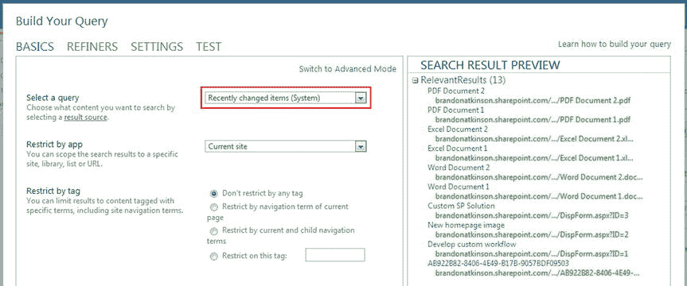

**图 6-18.** 选中“最近更改的项目”结果源的“构建您的查询”模式窗口

如您在此窗口中所见，`内容搜索 Web 部件`有很多设置——而且这些只涉及搜索查询！该 Web 部件可以配置为给您提供非常精确的结果，并且能够满足各种业务需求。现在，让我们将结果源更改为自定义的 PDF 源。单击窗口右上角标题为`切换到高级模式`的链接，如图 6-19 所示。

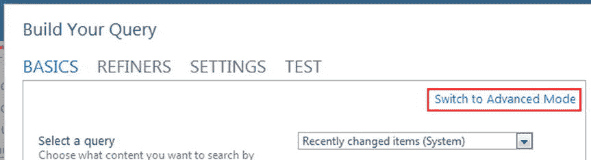

**图 6-19.** 在“构建您的查询”模式窗口中切换到高级模式链接

单击此链接将弹出一个窗口，看起来很像您在构建自定义结果源时看到的`构建您的查询`窗口。您可以输入查询，使用关键字筛选器和属性筛选器，甚至可以在右侧窗格中预览搜索查询。所有这些设置在创建自定义结果源时都是可用的；但是，这里新增了一个名为`选择查询`的下拉菜单。打开它将显示一个结果源列表，您可以选择用于查询的结果源。打开下拉菜单并选择`自定义 PDF 源`，如图 6-20 所示。

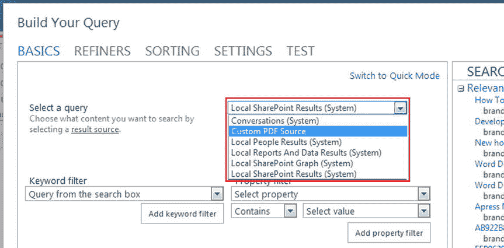

**图 6-20.** 从下拉菜单中选择自定义结果源“自定义 PDF 源”

从下拉菜单中选择一个结果源后，单击模式窗口底部的`测试查询`按钮，以预览自定义结果源查询。如图 6-21 所示，它正在执行正确的搜索，仅从文档文件夹返回 PDF 文档。

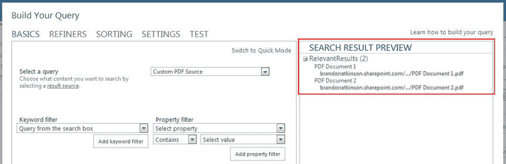

**图 6-21.** 预览窗口中显示的自定义 PDF 源结果源搜索

在`构建您的查询`模式窗口中单击`确定`。接下来，在`内容搜索 Web 部件`工具窗格中单击`确定`以保存更改。保存页面。自定义结果源将激活，仅显示 PDF 文档，如图 6-22 所示。

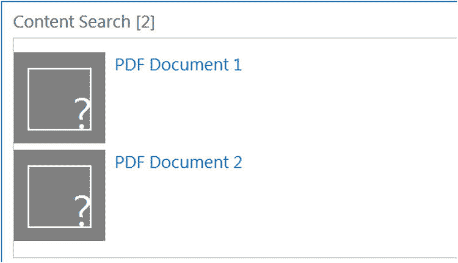

**图 6-22.** 自定义结果源仅显示 PDF 文档

至此，我们已经成功创建了一个自定义结果源并将其应用于`内容搜索 Web 部件`。只有结果源指定的文档才会被返回并显示给用户。然而，显示效果仍有待改进。虽然内容是正确的，但看起来并不美观。接下来，让我们探讨显示模板，看看如何应用自定义样式来匹配自定义结果。

**注意**

`内容搜索 Web 部件`相当复杂。它具有许多可配置的设置，可帮助您为解决方案实现非常精确的结果。有关这些设置的更多详细信息，请访问 `https://support.office.com/en-us/article/Configure-a-Content-Search-Web-Part-in-SharePoint-0dc16de1-dbe4-462b-babb-bf8338c36c9a`。

## 显示模板

SharePoint 允许您完全控制搜索结果，甚至可以精确到它们在页面上的显示方式。这是通过显示模板实现的。您可以使用显示模板，通过 HTML 以任何您喜欢的方式设置搜索结果的样式。您可以创建两种类型的显示模板：

-   **控件** - 这些模板处理搜索结果展示的整体结构，可以包含页眉和页脚等内容。此模板在每个 Web 部件中仅渲染一次。

-   **项目** - 这些模板处理每个搜索结果项的显示方式。此模板将为返回的每个搜索结果渲染一次。

您可以通过将内容搜索 Web 部件置于编辑模式来查看这些显示模板，在工具窗格的“属性”折叠项下，您会找到“显示模板”标题，如图 6-23 所示。

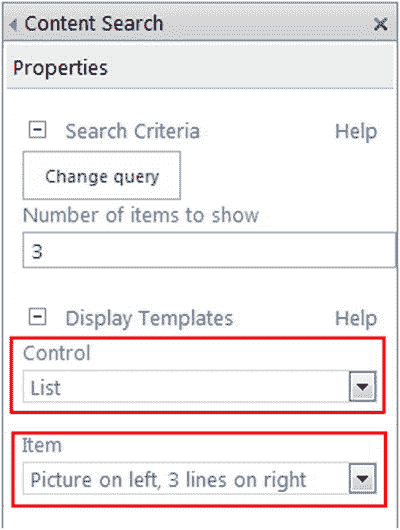

图 6-23. 内容搜索 Web 部件工具窗格中的控件和项目显示模板

有许多现成的显示模板可供使用，您可以通过点击每种类型的下拉列表来查看它们。例如，控件模板包括列表、带分页的列表和幻灯片。项目模板则有更多选项可供选择。要开始创建新的显示模板，最简单的起点是基于现有模板。要查看所有当前的搜索显示模板，请导航到“母版页库”，该库位于“网站设置”和“Web 设计器库”下。点击“母版页和页面布局”链接，如图 6-24 所示。

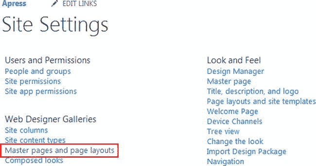

图 6-24. 网站设置中的“母版页和页面布局”链接

进入母版页库后，您会注意到它包含的内容比早期版本的 SharePoint 多得多。顶部附近有一个名为 `Display Templates` 的文件夹。打开此文件夹，您会看到几个与 SharePoint 不同区域对应的子文件夹；其中之一是 `Content Web Parts`，如图 6-25 所示。

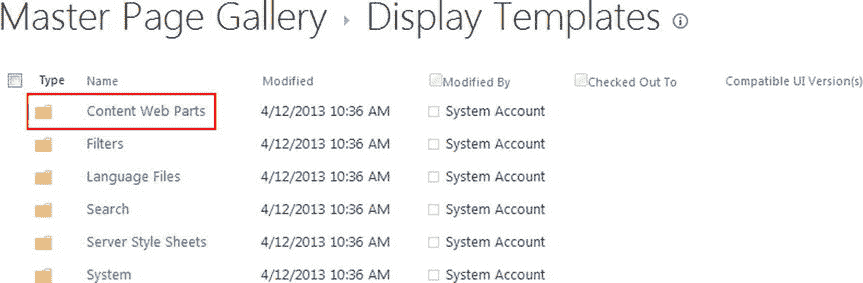

图 6-25. Display Templates 文件夹中的 Content Web Parts 文件夹

打开 `Content Web Parts` 文件夹以查看 SharePoint 自带的所有可用显示模板。如图 6-26 所示，这里有很多模板。在页面顶部，您可以看到之前在内容搜索 Web 部件工具窗格中看到的控件模板。

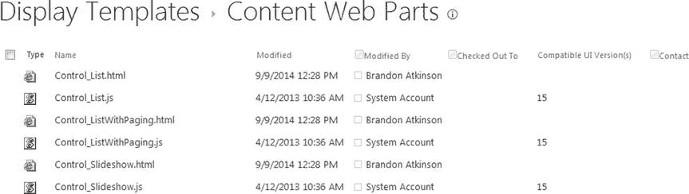

图 6-26. Content Web Parts 文件夹中的现成显示模板

每个显示模板都有一个与之关联的对应的 JavaScript 文件。在后台，SharePoint 使用此 JavaScript 文件来渲染显示模板。您无需创建或修改此文件；当您向此文件夹上传新的显示模板时，系统会为您创建一个对应的 JavaScript 文件，我们将在本章后面看到这一点。

> **注意**：显示模板可以非常简单，也可以非常复杂。您可以对哪些属性可用以及内容如何布局进行大量控制，甚至可以向模板中添加额外的 JavaScript。显示模板的整体主题相当庞大且复杂，无法在本章中完全覆盖。有关更多信息，请访问 [`msdn.microsoft.com/en-us/library/office/jj945138%28v=office.15%29.aspx`](http://msdn.microsoft.com/en-us/library/office/jj945138%28v=office.15%29.aspx)。

要开始构建新的显示模板，我们将下载另一个模板的副本并将其用作基础。显示模板可能非常复杂，从头开始构建一个可能是一项耗时的工作。使用现有模板作为起点将显著缩短创建新模板所需的时间。在此示例中，我们将重点放在项目模板上，并使用默认的“左侧图片，右侧三行文本”模板。在 `Content Web Parts` 文件夹中，此模板标题为 `Item_Picture3Lines.html`。在文件夹中选中此模板，然后从功能区中点击“下载副本”，如图 6-27 所示。

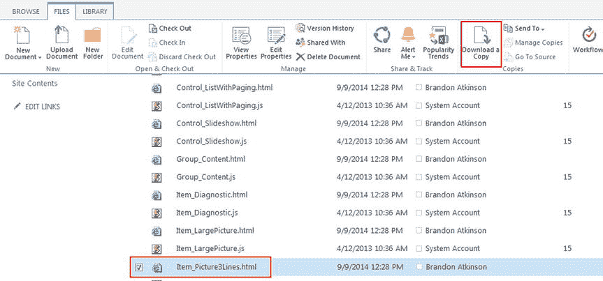

图 6-27. 下载现有显示模板的副本

下载副本后，您可以在 Visual Studio 中打开它。查看此文档，您会发现它有点复杂。它有一个 `HEAD` 部分、一个 `TITLE` 和一个 `BODY`——正如您对 HTML 文档的预期一样——以及大量的渲染代码。实际的渲染发生在 `BODY` 中。您会注意到 `BODY` 内部有几个包含所有逻辑的 `DIV`。Visual Studio 中的文件如图 6-28 所示。

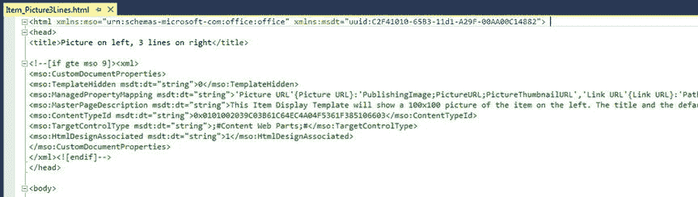

图 6-28. 在 Visual Studio 中打开的 Item_Picture3Lines.html 文件

让我们逐节分解这个文件，以了解其中的内容。首先，继续保存文件并将其命名为 `Item_CustomPdf.html`。文件顶部是标准的 HTML 和 `HEAD` 标签；这些标签没什么特别的。`TITLE` 标签很重要，因为它将显示在内容搜索 Web 部件中选择项目模板时的下拉列表中。将标题更改为“自定义 PDF 模板”。

## 总结

```
<html >
<head>
<title>自定义 PDF 模板</title>
```

下一部分是在名为 `CustomDocumentProperties` 的部分中的一组属性。这些属性向 SharePoint 提供了关于显示模板的额外信息。其中一些属性会自动为您填充，而其他一些则需要您更新。以下是一些比较重要的属性：

- `ManagedPropertyMapping` - 此属性获取搜索使用的托管属性，并将它们映射到显示模板可以使用的值。
- `MasterPageDescription` - 此属性为显示模板提供友好的描述，并向用户显示。
- `TargetControlType` - 此属性指定使用显示模板的上下文；例如，内容 Web 部件。

### ManagedPropertyMapping 属性

`ManagedPropertyMapping` 属性允许您在搜索中使用托管属性，并将它们映射到显示模板可以使用的值。它是一个逗号分隔的值列表，使用以下格式：

```
'属性显示名称'{属性名称}:'托管属性'
```

例如，在此显示模板的 `ManagedPropertyMapping` 中，您会找到以下内容：`'Link URL'{Link URL}:'Path'`。这将托管属性 `Path` 映射到一个名为 `Link URL` 的变量。`ManagedPropertyMapping` 映射了多个托管属性：

```
<mso:ManagedPropertyMapping msdt:dt="string">'图片 URL'{Picture URL}:'PublishingImage;PictureURL;PictureThumbnailURL','链接 URL'{Link URL}:'Path','第 1 行'{Line 1}:'Title','第 2 行'{Line 2}:'Description','第 3 行'{Line 3}:'','SecondaryFileExtension','ContentTypeId'</mso:ManagedPropertyMapping>
```

属性映射后，您可以使用以下 JavaScript 获取其值：

```
var linkURL = $getItemValue(ctx, "Link URL");
```

`getItemValue()` 函数接受两个参数。第一个参数是 `ctx`，代表当前上下文。你会注意到它没有在任何地方定义，但它可以直接使用。你只需要记住必须传入此参数，并且它始终可用。第二个参数是属性显示名称，需要用单引号括起来，用于 `ManagedPropertyMapping` 元素。在本例中，`Link URL` 是属性名称。

### MasterPageDescription 属性

我们唯一需要更新的另一个属性是 `MasterPageDescription` 属性，只是为了更新描述，使其不产生混淆。

```
<mso:MasterPageDescription msdt:dt="string">This Item Display Template will display custom PDF results.</mso:MasterPageDescription>
```

### 脚本与样式引用

在 `<body>` 标签之后，你会看到一个 `<script>` 部分：

```
<script>

$includeLanguageScript(this.url, "∼sitecollection/_catalogs/masterpage/Display Templates/Language Files/{Locale}/CustomStrings.js");

</script>
```

在此部分中，你可以添加自己的脚本或 CSS 引用。默认情况下，它包含对所有显示模板中都存在的 `CustomStrings.js` 文件的引用。你可以使用以下一些行来添加额外的引用：

*   位于同一站点中的脚本：`$includeScript(this.url, "∼site/Webparts/CustomScript.js");`
*   位于外部站点上的脚本：`$includeScript(this.url, "http://www.contoso.com/CustomScript.js");`
*   位于同一站点中的 CSS 文件：`$includeCSS(this.url, "∼site/Webparts/CustomCSS.css");`

### HTML 模板结构

紧跟在 `<script>` 标签之后，你会找到一个 `<div>` 元素，它包含显示模板中所有 HTML 和代码。这个 DIV 有一个必须与显示模板文件名匹配的 ID。例如，本例中的 DIV 看起来像下面这样：

```
<div id="Item_CustomPdf">
```

在 DIV 元素之后，你会看到注释块中的代码，这些代码以 `<!--#_` 开头，以 `_#-->` 结尾。在此块内，你可以使用任何你想要的 JavaScript 代码，并且你将在此处获取所有托管属性的值。我们将保持此显示模板简单，仅使用两个托管属性，代码如下：

```
<!--#_

var linkURL = $getItemValue(ctx, "Link URL");

var line1 = $getItemValue(ctx, "Line 1");

_#-->
```

如你所见，我们简单地声明了两个变量来保存 `ManagedPropertyMapping` 中定义的托管属性的值。我们将在 HTML 代码中使用这两个变量。我们也将保持 HTML 简单，代码如下：

```
<div style="border:solid 1px Silver;padding:10px;margin-bottom:20px;">

<strong>_#= line1 =#_</strong>

<br />

<a href="_#= linkURL =#_">

_#= linkURL =#_

</a>

</div>
```

在这段代码中，我们简单地用一个 DIV 包裹所有内容。我们通过内联 CSS 应用了简单的边框和内边距。接下来，我们将使用以下语法显示 `line1` 变量：`_#= line1 =#_`。你可以通过使用此语法在显示模板中使用 JavaScript 变量。接着，我们将通过使用 `<a>` 元素显示 PDF 文件的链接。完整文件如图 6-29 所示。

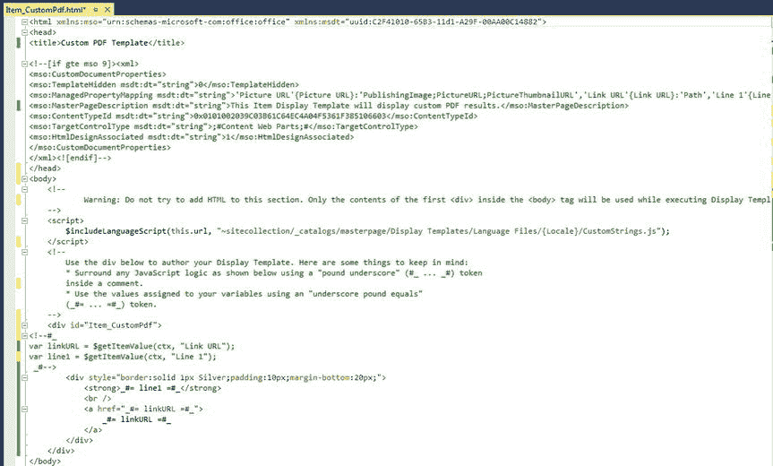

图 6-29. Visual Studio 中的显示模板

### 上传与部署

导航回母版页库中的"内容 Web 部件"文件夹，然后从功能区将 `Item_CustomPdf.html` 文件上传到库中。文件上传后，系统会提示你打开一个模态窗口，你可以在其中设置文件的属性，如图 6-30 所示。

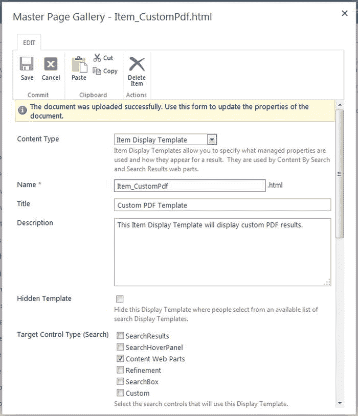

图 6-30. 显示模板的属性对话框

此对话框包含你在显示模板的 HTML 文件中看到的许多属性。文件中的所有属性都会被提取出来并填充到此窗口中。因此，你基本上可以保留所有属性不变，然后点击"保存"。你会看到显示模板已上传到库中，如图 6-31 所示。

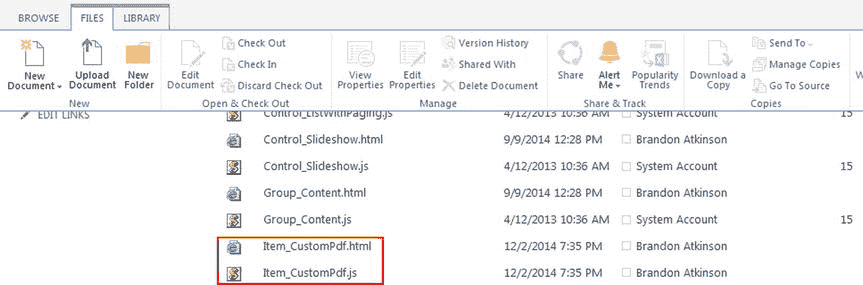

图 6-31. 新上传的显示模板和生成的 JavaScript 文件

你还会看到一个同名的配套 JavaScript 文件被创建。SharePoint 根据你上传的 HTML 文件生成此文件。这是它在渲染内容时使用的文件。你无需担心此文件，也绝不要尝试修改它。如果你需要进行更改，只需修改 HTML 文件并重新上传即可。每次上传新版本的 HTML 时，都会生成一个新的 JavaScript 文件。

导航回包含"内容搜索 Web 部件"的页面，并将该 Web 部件置于编辑模式。如果在"显示模板"部分点击"项目"下拉菜单，你现在将看到"自定义 PDF 模板"作为一个选项，如图 6-32 所示。选择此选项，点击"确定"，然后保存页面。

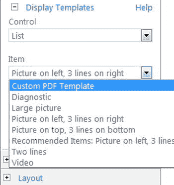

图 6-32. 新的显示模板可供使用

页面重新加载后，新的显示模板被渲染，如图 6-33 所示。

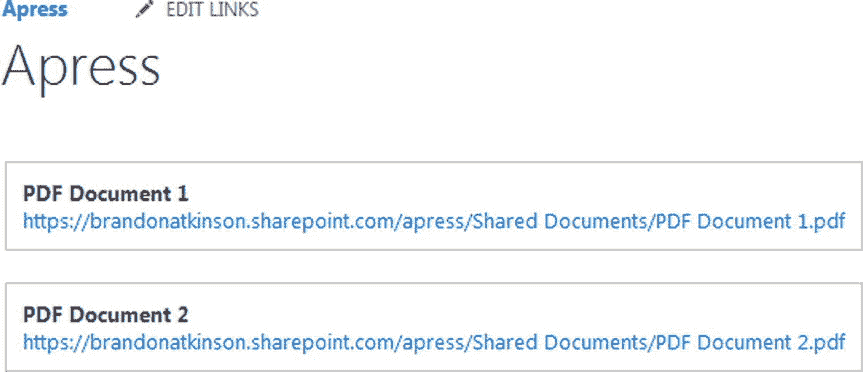

图 6-33. 使用新的显示模板渲染内容搜索 Web 部件

这个示例可以说是最简单的了，但希望它能展示显示模板和搜索 Web 部件的易用性和强大功能。使用这些模板，你可以构建利用托管属性、JavaScript 和 CSS 的自定义搜索解决方案。所有创建丰富体验所需的工具都是可用的。

**注意**

花一些时间下载并探索 SharePoint 附带的开箱即用显示模板。只需浏览这些文件并查看每个文件中使用的代码，你就能找到许多有用的信息。

在本章中，我们探讨了如何使用内容搜索 Web 部件、自定义结果源和自定义显示模板来构建自定义搜索解决方案。你了解了结果源，并学习了如何构建一个新的结果源以及如何将其与内容搜索 Web 部件一起使用。我们快速探索了显示模板，并创建了一个如何应用自定义渲染的简单示例。搜索在 SharePoint 中始终扮演着重要角色，现在你掌握了一些工具，可以根据业务需求构建自定义搜索解决方案。

在下一章中，我们将继续探索 SharePoint 在构建自定义解决方案时所提供的内容。我们将研究一些在编写代码时唾手可得的内置 JavaScript 功能。我们已经见过其中的一些功能，并且将更深入地探讨其可能性。
