# 1. 设置你的开发环境

正确设置开发环境将为你提供构建自定义解决方案所需的所有工具。许多你需要的功能已内置在 SharePoint 中，可直接使用。不过，你可能还需要下载并安装一些额外的工具来简化工作流程，这些工具包括：

*   SharePoint Online 开发人员网站
*   SharePoint Designer
*   Visual Studio Express
*   各类浏览器及开发者工具
*   jQuery
*   在 SharePoint 环境中部署 jQuery

如果这份清单让你感到棘手，不必担心。本章将详细探讨每一项内容，帮助你熟悉它们及其用途。此外，我们还会介绍如何创建自己的 SharePoint Online 环境作为开发区域，并演示如何在该环境中部署 jQuery。

如果你已经在开发 SharePoint 解决方案，甚至只是从事 Web 开发工作，那么这些工具很可能已经安装好了。本章将更侧重于面向业务用户或前端开发新手。如果你是一名经验丰富的开发者，可以快速浏览本章，确认是否已具备所需工具。无论你是谁，本章结束时你都将做好充分准备，开启在 SharePoint 中构建自定义解决方案的旅程！

### SharePoint Online 开发人员网站

毋庸置疑，如果没有一个可以施展的环境，能够构建自定义 SharePoint 解决方案的技能也毫无用武之地！有些读者可能已经拥有可用于开发的环境。这可能是你公司用于内部网的 SharePoint Online 环境，也可能是 SharePoint 2013 本地部署环境。也许你正初次尝试学习 SharePoint 开发，但目前还没有可操作的环境。无论何种情况，你都有多种选择，我们将在本节中逐一探讨。

注意

本节讨论的选项将重点围绕 SharePoint Online 和 Office 365。如果你已在本地方安装了 SharePoint，可以轻松创建一个新网站进行开发。即使你工作中已能使用 SharePoint，你仍可能希望拥有自己的独立工作环境，因此本节提供的选项同样适用。

微软已大大简化了在最新版 SharePoint 上进行前端开发的入门流程。你可以通过以下网址注册 Office 365 开发人员网站：[`http://msdn.microsoft.com/en-us/library/office/fp179924(v=office.15).aspx`](http://msdn.microsoft.com/en-us/library/office/fp179924(v=office.15).aspx)。图 1-1 展示了该页面及各种注册选项。

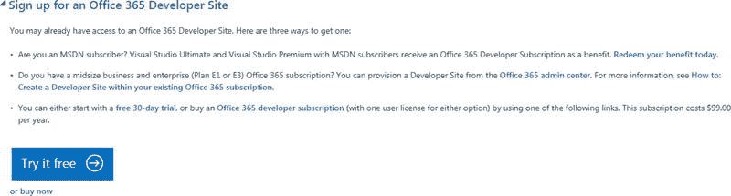

图 1-1.

微软网站上的 Office 365 开发人员网站注册选项

如图所示，创建开发人员网站有三种方式：

*   MSDN 订阅用户 - 如果你或你所在公司订阅了 MSDN，你可以作为该权益的一部分免费创建一个开发人员网站。很多拥有专职开发人员的公司都订阅了 MSDN，或者你个人可能也拥有订阅。无论哪种情况，只需点击“立即兑换您的权益”链接即可开始。如果你是业务用户，也值得考虑这个选项。如果你的公司有 MSDN 订阅，你可以申请一个许可证，或让 IT 部门为你创建网站并授予访问权限。
*   Office 365 订阅用户 - 已订阅 E3 或 E4 Office 365 计划的企业可以直接从 Office 365 管理中心预配开发人员网站。这些订阅级别允许使用针对开发人员的特殊网站模板创建新的专用网站集。有关创建开发人员网站的完整详细信息和步骤指南，请访问以下网址：[`http://msdn.microsoft.com/en-us/library/office/jj692554(v=office.15).aspx`](http://msdn.microsoft.com/en-us/library/office/jj692554(v=office.15).aspx)。
*   30 天试用版或开发者订阅 - 如果你希望或需要一个自己的环境，微软还提供 30 天的 Office 365 试用版。这是一个很好的选择，因为它为你提供了充足的时间来探索 Office 365 和 SharePoint Online，并在完全属于你自己的环境中测试开发技能。你还可以随时将该试用升级为每年 99.00 美元的年订阅。即使你在公司拥有 SharePoint，这也是一个绝佳选择。它能为你提供一个完全独立于生产环境的理想空间，用于构建自定义解决方案。每年 99 美元的价格，让你能以低成本构建解决方案，并可轻松迁移到生产环境中。

无论你的情况如何，你都可以轻松获得一个可用于开发自定义 SharePoint 解决方案的环境。我们已经讨论过如何获取 SharePoint 环境，接下来让我们探索一下本书中将使用的一些工具。

注意

本书中的所有示例和截图均来自 SharePoint Online 环境，这是目前可用的最新版 SharePoint。

### SharePoint Designer

如果你以前用过 SharePoint，那么你可能也用过 SharePoint Designer。它是微软提供的免费工具，也是处理 SharePoint 相关任务的主力工具。它允许你执行广泛的任务——从品牌定制、连接外部数据库、构建列表等等。在本书中，Designer 并非核心工具，但它在帮助我们实现 jQuery 与 SharePoint 的集成方面将发挥关键作用。这部分内容将在本章末尾介绍。现在，让我们先下载 Designer。

你可以通过以下网址下载 SharePoint Designer：[`http://www.microsoft.com/en-us/download/details.aspx?id=35491`](http://www.microsoft.com/en-us/download/details.aspx?id=35491)。图 1-2 展示了微软下载中心网站上可供下载 Designer 的页面。

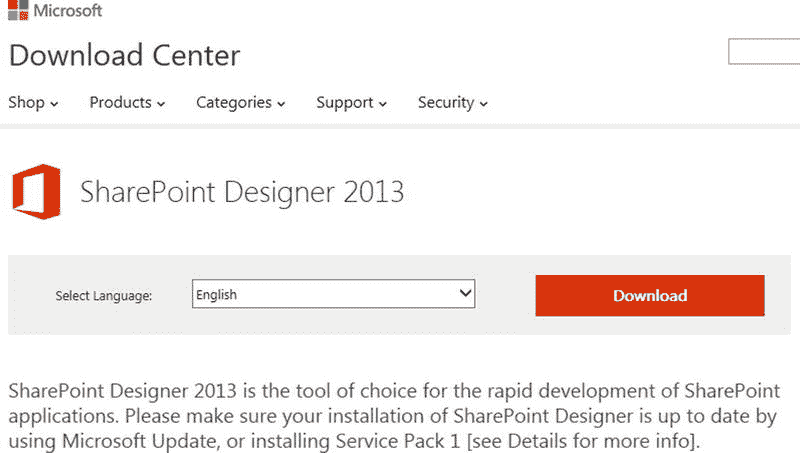

图 1-2.

微软网站上的 SharePoint Designer 下载页面

现在，你只需下载并安装 Designer；我们稍后会使用它。尽管本书未对 Designer 进行深入探讨，但当你在使用 SharePoint 时，它仍会是一个非常有用的工具。如前所述，它功能广泛，能协助你完成许多任务。Designer 同时适用于 SharePoint Online 和本地部署环境。


### Visual Studio Express

如果你不是开发者，可能没听说过 Visual Studio Express；即便听说过，它对你来说可能也像是为代码高手准备的高深程序。从某种程度上说，确实如此，但它是一个强大的工具，我们将用它来编写`HTML`和`JavaScript`代码。而且它还是免费的，由微软提供。

`Visual Studio`是一个集成开发环境，简称`IDE`。简单来说，就是“一个允许你编写代码的程序”。在本书中，我们所有的示例都将使用`HTML`和`JavaScript`。`HTML`和`JavaScript`的一个优点是，它们只是带有特殊扩展名（`.html`和`.js`）的文本文件。因此，创建和编辑这些文件真正需要的只是`记事本`。然而，尽管`记事本`看起来友好且不具威胁性，但在编写代码时它绝不是你的朋友。`Visual Studio Express`提供了你所需的所有工具——甚至在检测到问题时还会提醒你。`记事本`可做不到这一点！

根据技术需求的复杂程度，`Visual Studio`有多种不同的版本。Express 版是一个功能齐全的版本，完全能满足本书的需求。你可以通过以下网址下载`Visual Studio Express`：[`http://www.visualstudio.com/en-us/products/visual-studio-express-vs.aspx`](http://www.visualstudio.com/en-us/products/visual-studio-express-vs.aspx)。图 1-3 展示了`Visual Studio`网站的下载页面。

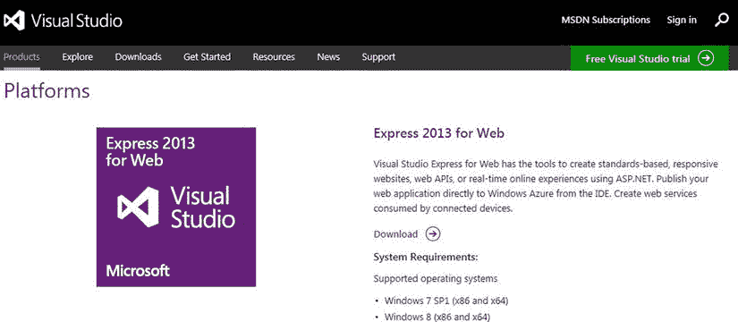

图 1-3. 微软网站上的 Visual Studio Express 下载页面

`Visual Studio Express`有多个版本，包括 Web、Windows 等。`Express for Web`是使用`HTML`和`JavaScript`构建解决方案的理想版本。

### 浏览器与开发者工具

当最终用户使用`SharePoint`时，显然首选浏览器是`Internet Explorer`。虽然`SharePoint`与其他浏览器（如`Firefox`和`Chrome`）配合良好，但`Internet Explorer`无疑是微软推荐的浏览器，也是`SharePoint`最可能友好兼容的。话虽如此，本书主要介绍如何使用`HTML`和`JavaScript`构建自定义解决方案，你会发现大多数现代浏览器的操作和表现都是一致的。在讨论浏览器之前，我们先来谈谈开发者工具。

开发者工具是一个通用术语，指的是用来帮助开发、调试，以及了解浏览器中`HTML`、`JavaScript`和`CSS`运行状况的工具。它们也可能被称为开发者工具栏、浏览器工具，或者完全不同的名称，比如`Firebug`。无论是什么工具，它们的功能都是一样的：帮助你开发解决方案。在几乎所有的浏览器中，你只需按下键盘上的`F12`键即可启动开发者工具，如图 1-4 在`Internet Explorer`中所示。

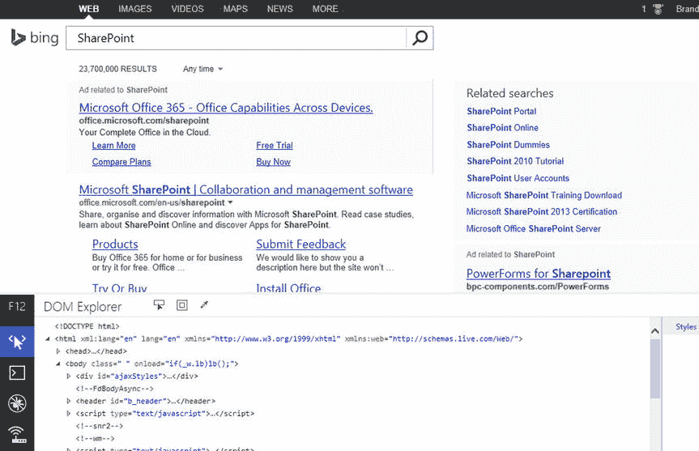

图 1-4. 在 Internet Explorer 中按下`F12`后启动的开发者工具

如图 1-4 所示，这些工具提供了大量关于浏览器内部运行情况的洞察。你可以立即看到生成页面的`HTML`，以及应用的`CSS`样式。使用工具左侧的菜单，你还可以查看页面上加载了哪些`JavaScript`，甚至查看其中的代码。你甚至可以更进一步，在`JavaScript`中设置“断点”来暂停其执行，以便观察这些脚本运行时发生了什么。在前端开发工作中，这是一个非常宝贵的工具，我们会经常用到它。

图 1-5 展示了在`Google Chrome`中打开的开发者工具。同样，只需按下`F12`键即可打开。与`Internet Explorer`一样，你可以立即看到页面上应用的`HTML`和样式。

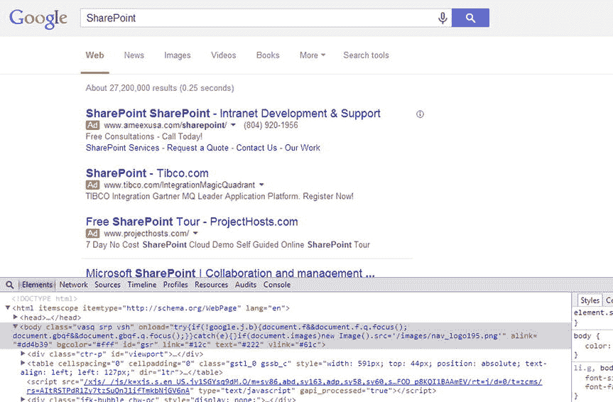

图 1-5. 在 Google Chrome 中按下`F12`后启动的开发者工具

在`Chrome`中，菜单选项横跨工具屏幕顶部，提供类似的功能。你可以通过再次按下`F12`键来关闭开发者工具，就像打开它们一样。你应该下载几种浏览器，熟悉一下它们的工具。每个开发者对浏览器和工具都有自己的偏好；我偏好的是`Firefox`和`Firebug`，本书将使用它们。

我要明确地说，我认为`Internet Explorer`是一款出色的浏览器，至少最新版本是这样。这些年来它取得了长足的进步，终于能与一些后来居上的新秀浏览器相媲美。`Internet Explorer`中的开发者工具非常好用，但我最偏好的还是`Firefox`中的`Firebug`。`Firebug`是`Firefox`的一个附加组件，其功能与其他浏览器中的工具类似，但在我看来，它组织内容的方式更友好、更易用。你绝对应该找到自己的偏好，使用最适合你的浏览器和工具。本书中的所有示例都将使用`Firebug`，但你并不局限于这些工具。

要安装`Firebug`，请通过以下网址下载`Firefox`浏览器：[`https://www.mozilla.org/firefox/`](https://www.mozilla.org/firefox/)。安装完成后，点击右上角的菜单图标。图 1-6 展示了打开的菜单，其中高亮了“附加组件”选项。

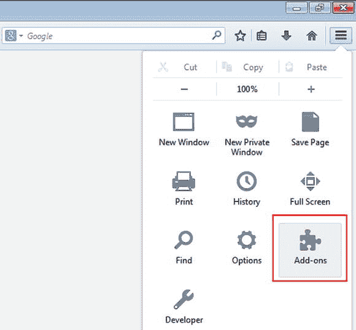

图 1-6. Firefox 菜单中的“附加组件”菜单选项

点击“附加组件”选项，将在新标签页中打开“附加组件管理器”页面。该页面允许你管理所有附加组件并搜索新的组件。在屏幕右上角的搜索框中输入`firebug`，然后点击放大镜图标。图 1-7 显示了输入后的搜索框。

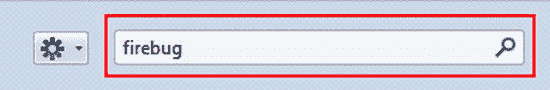

图 1-7. 搜索前的附加组件管理器页面上的搜索框

搜索结果会返回所有匹配的附加组件，`Firebug`应该在列表顶部。点击图 1-8 中所示的“安装”按钮，将`Firebug`添加到`Firefox`中。

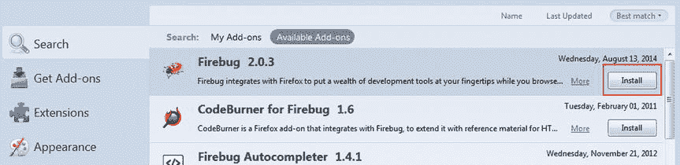

图 1-8. 点击“安装”按钮将在 Firefox 中安装 Firebug

下载和安装完成后，`Firefox`会在右上角菜单旁边显示一个“bug”图标。图 1-9 高亮了`Firebug`图标。

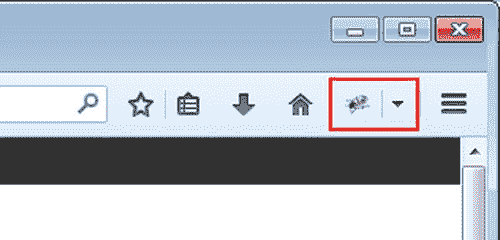

图 1-9. 安装完成后显示 Firebug 图标

现在`Firebug`已安装，你可以像在其他浏览器中打开开发者工具一样打开它——按下键盘上的`F12`键。你也可以点击`Firebug`图标来打开它，如图 1-10 所示。

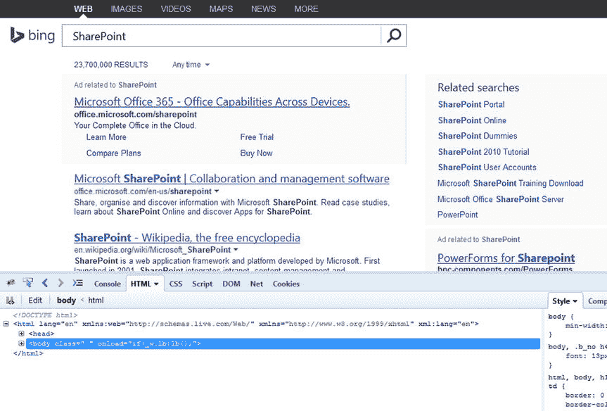

图 1-10. 通过点击`F12`切换打开的 Firebug

如图 1-10 所示，`Firebug`的外观和功能与其他浏览器中的开发者工具非常相似。再次强调，最终选择使用哪些工具是你的个人偏好。本书中的所有示例都将使用`Firefox`和`Firebug`。


### jQuery

如果你过去做过任何 JavaScript 开发工作，你可能会时常感到有些沮丧。JavaScript 是一个出色的前端开发框架，它速度快，能让你迅速构建有用的代码。但有时它难以驾驭、难以调试，而且让新手望而生畏。jQuery 的出现改变了这一切。

jQuery 是一个与 JavaScript 协同工作的框架，旨在让前端代码的编写更简单、更快速。jQuery 自称是“写得更少，做得更多”的框架——你会发现事实确实如此。它很快成为了 JavaScript 开发的标准，本书中的许多示例都会以某种方式用到 jQuery。如果你从未使用过它，也别担心：我们会从基础开始，让你逐步掌握。

**注**

如果你是 jQuery 新手，jQuery 网站上有一个很棒的“入门”指南，网址是 [`http://learn.jquery.com/about-jquery/how-jquery-works/`](http://learn.jquery.com/about-jquery/how-jquery-works/)。此外，还有杰克·富兰克林（Apress，2013 年）编写的《jQuery 入门》一书，对于刚起步的读者来说是一个很好的资源（参见 [`www.apress.com/9781430249320`](http://www.apress.com/9781430249320)）。

现在，我们来做一个快速的 jQuery 练习，让你熟悉它的工作原理。jQuery 的主要优点之一是能够轻松选择页面上的 HTML 元素。实现这一点的两种主要方法是使用元素的 ID 或其 CSS 类。图 1-11 显示了在打开 Firebug 的 Firefox 浏览器中的 jQuery 主页（[`jquery.com`](http://jquery.com)）。我们将在 jQuery 的网站上做这个练习，因为该网站肯定已经加载了 jQuery！

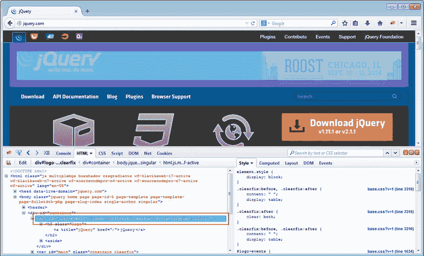

*图 1-11. 在打开 Firebug 的 Firefox 浏览器中显示 jQuery 主页。将鼠标悬停在某个 HTML 部分上，页面会高亮显示它*

我们在 Firebug 中展开了 HTML 结构，并定位到页面左上角的徽标。当鼠标悬停在 HTML 上时，Firebug 会在浏览器中高亮显示相应的部分，让你能轻松看到它。在此页面上，徽标位于一个 ID 为 `"logo-events"` 的 `DIV` 元素内部。由于该元素有 ID，因此可以使用 jQuery 轻松定位。在 Firebug 中，单击标题为“Script”（脚本）的选项卡将其激活，如图 1-12 所示。

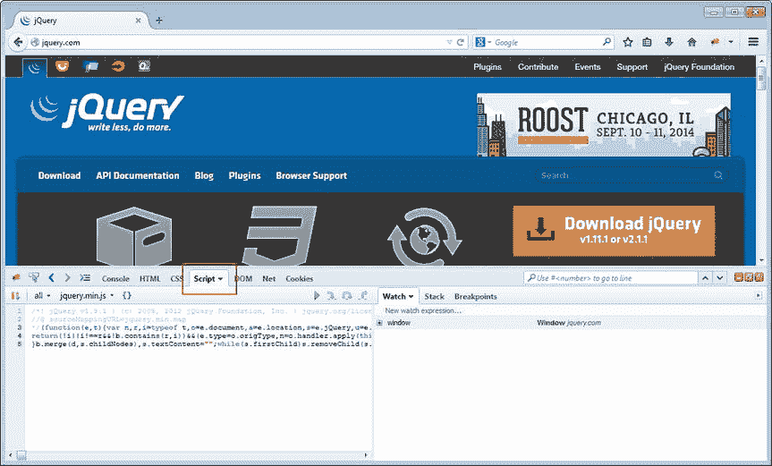

*图 1-12. 在 Firebug 中激活的“Scripts”（脚本）选项卡*

在“Scripts”（脚本）选项卡中，有两个主要区域可用于处理前端代码。左侧面板显示当前正在检查的脚本。它上方有一个下拉菜单，你可以查看并选择当前页面加载的所有 JavaScript 文件。我们稍后会详细探讨这一点。右侧面板有更多选项卡，但最主要的是“Watch”（监视）选项卡。在此选项卡中，我们可以使用“New watch expression”（新建监视表达式）文本框直接在浏览器中按需运行 JavaScript 命令。在编写前端代码时，这个区域将非常有用。

单击“New watch expression”（新建监视表达式）文本框内部，输入以下代码行，然后按回车键：

```
$("#logo-events")
```

图 1-13 显示了运行这行代码的输出结果。

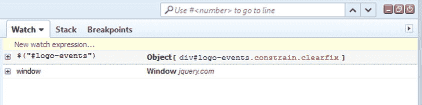

*图 1-13. 在“Watch”（监视）选项卡中运行 jQuery 命令的输出*

如你所见，结果是一个 Object（对象），在方括号内你可以看到 `"div#logo-events"`，这意味着 jQuery 成功找到了你正在查找的元素。让我们花点时间看看这到底是怎样发生的，以及 jQuery 是如何工作的。我们可以将 jQuery 命令的结构分解如下：

- `$` - 这是调用 jQuery 的简写符号。所有 jQuery 命令都以这个符号开头。你可以把它理解为让 jQuery 去为你做一些事情。在这个例子中，我们是在说：“jQuery，去找出具有这个 ID 的元素。”`$` 后面总是跟着 `()`，括号内是你正在查找的元素。
- `#` - 这是一个简写符号，用于告诉 jQuery 你正在通过元素的 ID 来查找。`#` 后面的任何文本都应该是 HTML 元素上的有效 ID，并且只会返回一个结果，因为 HTML 元素不能共享 ID。
- `.` - 这是一个简写符号，用于告诉 jQuery 你正在通过元素的 CSS 类来查找。因此，如果你的 HTML 中有 10 个共享同一个 CSS 类 `"red-box"` 的 `DIV` 元素，你可以使用以下命令找到它们：`$(".red-box")`。它的结构与 ID 命令完全相同，只是将 `$` 换成了 `.`。`. ` 后面总是跟着 `()`，括号内是你正在查找的元素。

既然我们已经找到了包含徽标的 `DIV` 元素，就可以开始对其使用 jQuery 并操作页面上的 HTML 了。单击“New watch expression”（新建监视表达式）文本框内部，输入以下代码行，然后按回车键：

```
$("#logo-events").hide("slow")
```

你会看到徽标区域从浏览器窗口中慢慢消失。你可以使用以下命令将其显示回来：

```
$("#logo-events").show("slow")
```

这些都是非常简单的示例，但应该能展示 jQuery 能轻松为你的代码带来的强大功能。本书将通篇使用 jQuery，因此随着学习的深入，你会看到更多示例，并对它的使用越来越熟悉。现在，让我们在 SharePoint 环境中实现 jQuery，以便随时使用。

### 使用 SharePoint Designer 在 SharePoint 环境中实现 jQuery

对于部分人来说，jQuery 已经在 SharePoint 中实现了。这可能是为了支持之前的开发而完成的。但是，如果你是刚开始使用，或者刚刚注册 SharePoint Online 的试用版，那么你需要实现 jQuery 才能学习本书中的示例。实际上，实现 jQuery 非常简单直接，在本节中，我们将介绍如何使用 SharePoint Designer 来实现。

**注**

在你的环境中实现 jQuery 有多种不同的方法。这些方法包括通过自定义代码部署将其注入到所有页面，在特定页面上放置内容编辑器 Web 部件等等。我们将使用 SharePoint Designer，因为它提供了一种快速简便的方法将 jQuery 引入 SharePoint。

#### 获取 jQuery

在实现 jQuery 之前，我们首先需要引用 jQuery 代码，或者下载一份副本并将其物理上传到 SharePoint。在本节中，我们将使用内容分发网络（CDN）来引用 jQuery。CDN 基本上是一个公共可用的服务器，上面的内容你可以用于自己的网站。jQuery 运营着一个 CDN，你可以在 [`https://code.jquery.com`](https://code.jquery.com/) 上引用它。包括微软和谷歌在内的许多其他公司也运营着托管 jQuery 的 CDN。

使用 CDN 的好处很多。最大的好处是速度快，因为在 Web 上有许多网站使用相同的 CDN。如果你的用户已经访问过其中一个站点，那么 jQuery 可能已经加载到他们的浏览器中了，因此你的页面加载速度会更快。另一个大好处是你无需担心直接下载和存储代码。无论哪种情况，在生产站点上使用 CDN 的决定都应咨询你的 IT 部门。在我们的案例中，这完全没问题，你应该放心在开发环境中使用它。

要从 CDN 引用 jQuery，我们将使用以下代码行：

```
<script src="//code.jquery.com/jquery-1.11.0.min.js"></script>
```

这是一个基本的 HTML 脚本标签，它将从 jQuery 的 CDN 加载版本 1.11 的 jQuery。你会注意到 URL 中没有 HTTP 或 HTTPS。这样移除后，脚本可以在非安全或安全 URL 下同样工作。现在让我们看看如何将此代码放入 SharePoint 中。


#### 团队网站模板

现在我们已经知道如何实现 `jQuery`，接下来就要实际动手了！我们将探讨两种选项：团队网站和发布网站。两者略有不同，所以我们先来看团队网站。启动 SharePoint Designer，点击“打开网站”图标，如图 1-14 所示。

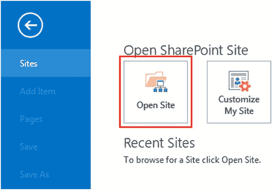

图 1-14. SharePoint Designer 中显示“打开网站”图标的主屏幕

点击此按钮将弹出“打开网站”对话框，你需要在其中指定 SharePoint 网站集的 URL。你可以打开特定的网站集，也可以通过输入 SharePoint 环境的基础 URL 来打开根网站。如果你使用的是 SharePoint Online，根网站的 URL 格式类似 `https://YOURSITENAME.sharepoint.com`。

图 1-15 展示了“打开网站”对话框。你需要在标有“网站名称”的文本框中输入 URL，然后点击“打开”。在 Designer 打开网站之前，系统会弹出另一个对话框要求你输入凭据。

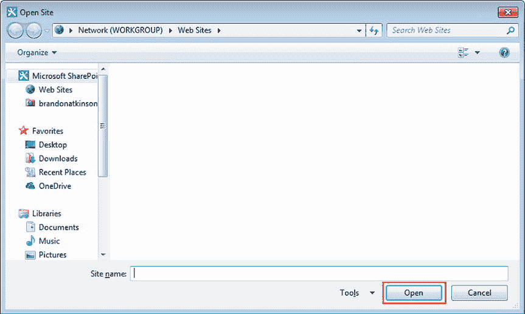

图 1-15. “打开网站”对话框，你需要在此提供 SharePoint 网站的 URL

一旦提供凭据并通过身份验证，SharePoint Designer 将打开并显示你的网站视图。如果你从未使用过 Designer，不妨花点时间探索一下；你可能会对其提供的信息丰富程度印象深刻。Designer 让你可以深入了解所有列表和库、工作流、外部内容类型以及更多内容。它是一个非常有用的工具——尤其是在无法访问服务器的 SharePoint Online 环境中。

**注意：** SharePoint Designer 是一个非常强大的工具，能轻易改变你的 SharePoint 环境。如果你是新手，在导航时要格外小心，只进行那些你知道不会对环境造成危害的更改。

熟悉 Designer 后，点击左侧导航中的“母版页”链接，如图 1-16 所示。此区域不仅显示 SharePoint 中的所有母版页，还显示其他布局，包括搜索结果、显示模板等。我们将在本书后面再次探讨此区域，但现在，请选中 `seattle.master` 文件。选中该文件后，点击功能区中的“编辑文件”。

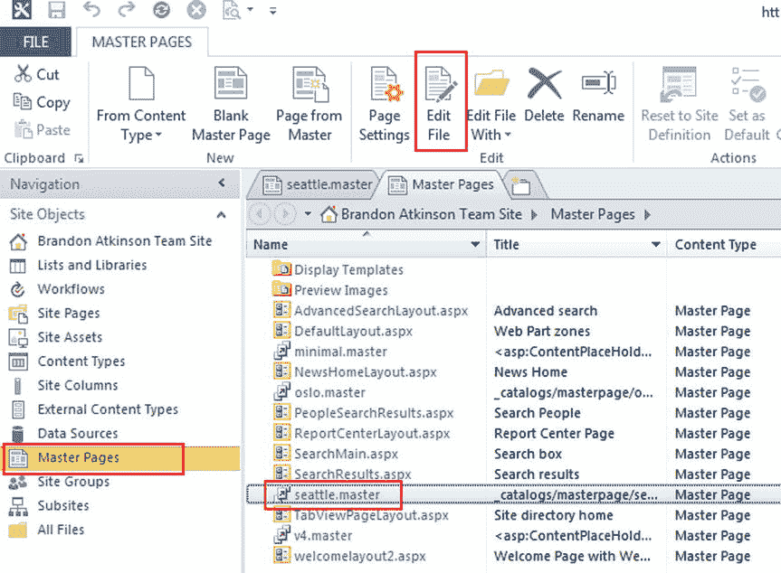

图 1-16. SharePoint Designer 中的“母版页”选项卡。选中 `seattle.master` 文件后，点击功能区中的“编辑文件”

如果你是开发新手，下一个界面可能看起来有点吓人，但其实不然。编辑 `seattle.master` 文件时，你会看到所有呈现 SharePoint 页面的 ASP.NET 代码。嗯，几乎全部。此文件负责 SharePoint 页面的公共部分，例如徽标、功能区、导航等。虽然内容很多，但我们只需要添加 `jQuery` 引用——然后退出！

我们将代码行放置在页面顶部附近，就在闭合的 `</head>` 标签之前，如图 1-17 所示。

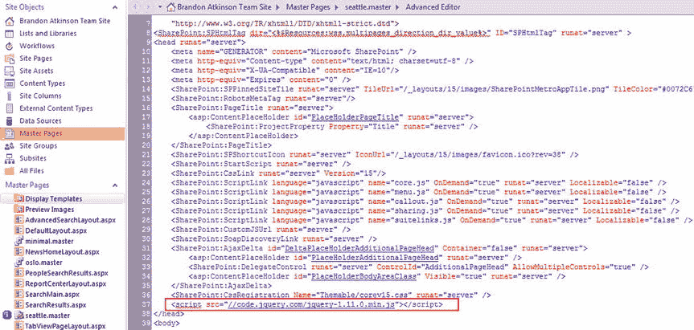

图 1-17. 添加到 Seattle 母版页的 `jQuery` 引用

如图 1-17 所示，我们将 `jQuery` 引用放置在闭合的 `</head>` 标签之前，该标签正好位于开始的 `<body>` 标签上方。它基本上将成为 Head 区域中母版页引用的最后一个脚本。放置完成后，点击屏幕左上角的“保存”图标保存更改。这将自动将更改发布到你的 SharePoint 环境。

保存更改后，启动浏览器并导航到你的网站。图 1-18 展示了打开 Firebug 的 SharePoint 环境。检查 HTML，我们可以看到 `jQuery` 引用现在已存在于母版页中，并且可供 SharePoint 中的所有页面使用。

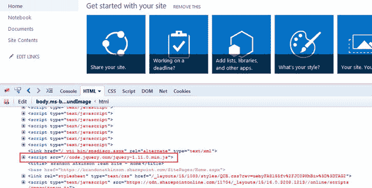

图 1-18. 使用 Firebug 检查 SharePoint 环境，以确保 `jQuery` 引用已就位

**注意：** 一般来说，不建议修改 SharePoint 的现成母版页。最主要的原因是，由于它们是现成的，如果 SharePoint Online 发布了更新或新版本并进行升级，你的更改极有可能会丢失。最佳实践是复制一份要修改的母版页，然后修改副本。这样，更新就不会覆盖你的更改。


#### 发布网站模板

发布网站在修改母版页时表现得截然不同。从 SharePoint 2013 开始引入了设计管理器，它允许你上传一个 HTML 文件，该文件将自动转换为母版页。这对于想要上传自定义设计并彻底改变网站外观的用户来说非常有用。然而，我们只需要注入 jQuery，因此需要多完成几个步骤。

打开 SharePoint Designer，点击左侧导航中的 `Master Pages` 链接。你首先会注意到文件数量比团队网站多得多。所有额外的文件都是发布网站自带的，目前你基本上可以忽略它们。找到 `seattle.master` 文件，你会注意到它附带了一个对应的 HTML 文件，如图 1-19 所示。

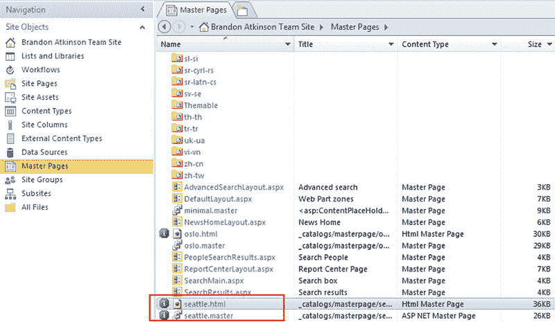

图 1-19 发布网站模板中的 SharePoint Designer 母版页

在这种模式下，你只能编辑 HTML 文件。当你对 HTML 文件进行编辑并保存后，更改会被转换并保存到母版页文件中。我们首先需要做的是复制一份 `seattle.html` 文件，因为这是我们可以实际编辑的文件。选中 `seattle.html` 文件，从功能区的“剪贴板”部分点击 `Copy` 按钮。随后 `Paste` 按钮会变为可用状态。点击 `Paste`。将创建一份 `seattle.html` 的副本，如图 1-20 所示。

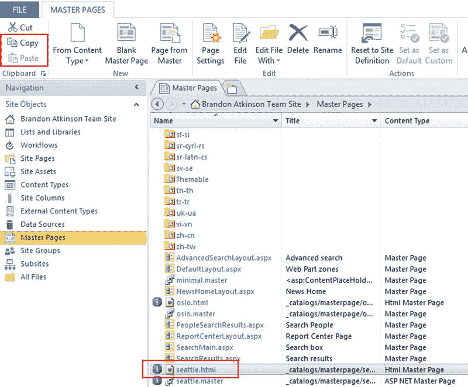

图 1-20 功能区中的“复制”和“粘贴”按钮

复制文件后，它会被粘贴进来，默认名称为 `seattle_copy(1).html`。对大多数人来说，这显然不是一个可接受的名称！你可以右键单击新文件，然后从上下文菜单中选择 `Rename`，如图 1-21 所示。

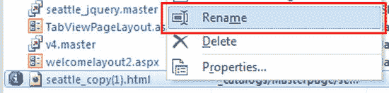

图 1-21 上下文菜单中的“重命名”选项

我们将文件重命名为 `seattle_jquery.html`，然后按回车键。由于 HTML 文件通过同名链接到母版页，因此在你重命名新文件之前，Designer 会提示你。图 1-22 显示了重命名时你会看到的提示。

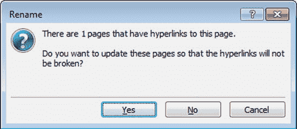

图 1-22 重命名复制的 HTML 文件时的重命名提示

重命名后，你现在将拥有一个 `seattle_jquery.html` 文件和一个 `seattle_jquery.master` 文件。选中新的 `seattle_jquery.html` 文件，点击功能区中的 `Edit File` 按钮。与团队网站母版页类似，我们将插入以下代码行来引用 jQuery：

```
<script src="//code.jquery.com/jquery-1.11.0.min.js"></script>
```

这次我们将把它放在一个不同的位置，如图 1-23 所示。它将被添加在 `META` 标签下方，紧跟在一些 SharePoint 开箱即用的标签之后。

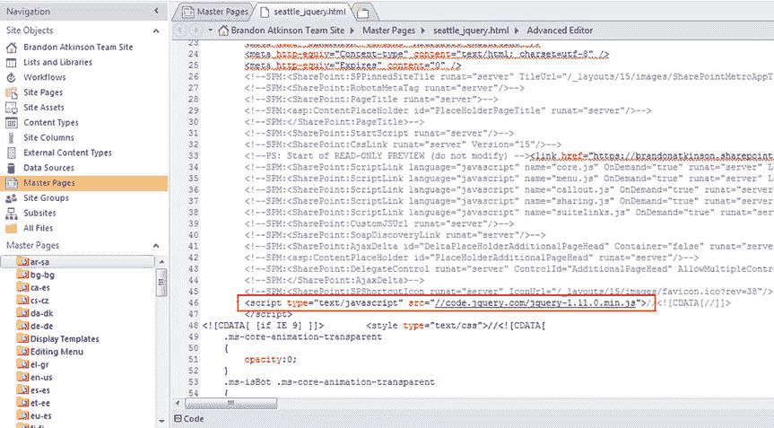

图 1-23 向新的母版页文件添加 jQuery 代码行

添加完 jQuery 引用后，点击 `Save`，这将保存并发布文件。它还会生成一个包含修改的新 `seattle_jquery.master` 文件。现在我们已经添加了引用并更新了所有文件，需要将此新母版页设置为默认，以便我们的网站使用它。选中 `seattle_jquery.master`，点击功能区中的 `Set as Default`，如图 1-24 所示。

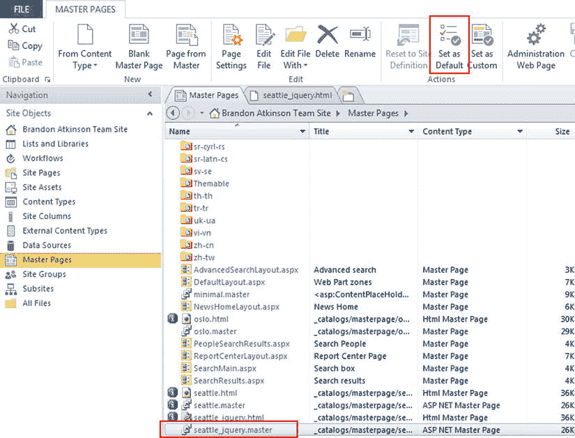

图 1-24 将新母版页设置为默认

现在新的母版页已创建并设置为默认，我们需要检查确保 jQuery 引用已正确设置。导航到使用发布网站模板的站点。图 1-25 展示了打开了 Firebug 的 SharePoint 环境。检查 HTML，我们可以看到 jQuery 引用现在位于母版页中，并且对 SharePoint 中的所有页面都可用。

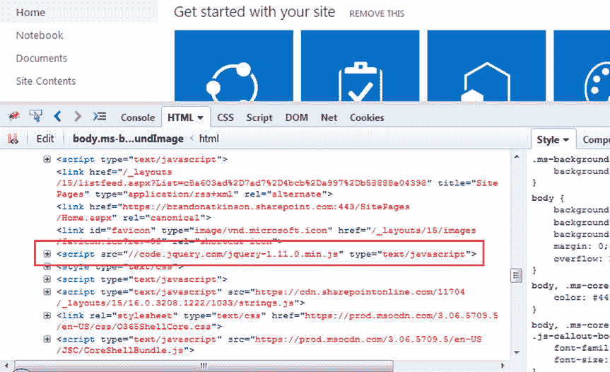

图 1-25 新母版页中的 jQuery 引用

任何基于使用发布模板的父站点创建的子站点将自动继承此新母版页。这是在母版页中添加 jQuery 引用的首选方法。复制文件可确保在 SharePoint 应用更新时，你的更改保持不变。

### 总结

在本章中，我们介绍了本书中做前端开发所需的各种组件。如果你已经在开发解决方案，那么在拿起这本书之前，你可能已经安装了大部分（如果不是全部）这些组件。如果你是前端开发新手，你可能安装了一些新程序！现在，你应该已经拥有开始创建自己自定义解决方案所需的一切。这些组件的一大优点是，除了 SharePoint Online 和 Designer 之外，它们都可以用于许多其他项目。如果你发现自己喜欢前端开发，你可以将这些工具用于各种项目！

在下一章中，我们将探讨服务器端开发和前端开发之间的区别。我们还将研究 SharePoint 提供的用于支持此类开发的一些组件。你将看到一些代码，并为后续章节做好准备！

## 2. SharePoint 前端解决方案简介

SharePoint 自推出以来已经历了巨大的发展，其开发故事也不例外。如果你曾在 SharePoint 2007 或更早版本上做过任何开发，那么可以说你讨厌这种体验。SharePoint 2010 使事情变得容易得多，并引入了一些允许前端开发的新组件，例如 ECMAScript 对象模型（后来更名为 JavaScript 对象模型）。随着最新版本的 SharePoint，真正的重点已经转向将代码从 SharePoint 服务器迁移到浏览器或其他服务器。

这一关注点的部分原因是，微软发现许多支持问题源于编写不佳或只是将服务器推向极限的服务器代码。再加上 SharePoint Online 的引入（最终用户无法访问服务器本身），因此需要更强大、更健壮的前端开发解决方案。由此产生的是扩展的 JavaScript 对象模型、新的 REST API 以及 SharePoint 应用程序。

我们将在本书中更详细地深入探讨 JavaScript 对象模型和 REST API。我们还将研究新的前端组件，例如 JSLink 和显示模板。本章将探讨服务器端开发和前端开发之间的区别，以及这种开发风格的一些能力。我们还将探讨你在此过程中可能遇到的一些限制。

> **注意**
> 本书不涵盖 SharePoint 应用程序。虽然在某些情况下应用程序可以被视为前端开发，但这涉及到开发、网络和域管理，是一个非常庞大的主题。在很多情况下，SharePoint 应用程序在服务器端运行，只是不在运行 SharePoint 的服务器上运行。有关构建 SharePoint 应用程序的更多信息，请访问以下 URL：[`http://msdn.microsoft.com/en-us/library/office/jj163230(v=office.15).aspx`](http://msdn.microsoft.com/en-us/library/office/jj163230(v=office.15).aspx) 。


## 服务器端开发 vs. 前端开发

SharePoint 开发及自定义解决方案的构建在很长一段时间内都是硬核开发者的专属领域。这需要掌握广泛的组件知识，包括 `Visual Studio`、`PowerShell`、`ASP.NET`、`Microsoft Server` 等。即使对于曾从事 `.NET` 开发但刚接触 SharePoint 的人来说，这也常常令人生畏。图 2-1 展示了一个典型的服务器端开发体验，其中包括 `Visual Studio`、部署包以及一个用于实际将代码部署到服务器的 `PowerShell` 窗口。

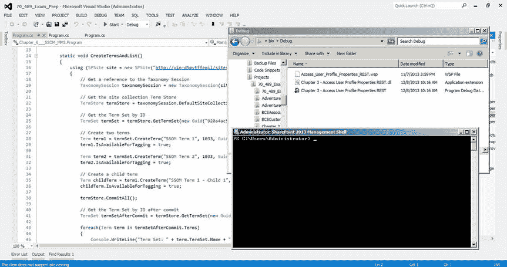

图 2-1. 典型的 SharePoint 服务器端开发体验

服务器端代码是专门为在 SharePoint 服务器本身上运行而编写的。一旦代码编写完成并打包准备部署，它就会被复制到服务器上，并使用 `PowerShell` 或管理中心进行安装。大多数情况下，这需要开发人员、业务用户和服务器管理员共同协作。由于代码直接在服务器上运行，因此它拥有巨大的能力，但也可能很容易对 SharePoint 环境产生不利影响。

就连为 SharePoint 编写服务器端代码都可能很困难，因为它需要一台安装了 SharePoint 的强大电脑。过去，大多数开发人员会在自己的电脑上构建虚拟机，从而在隔离环境中为 SharePoint 编写代码。由于需要学习新的代码框架、电脑上需要安装 SharePoint，以及为确保不佳的代码不会损害服务器而所需的编码最佳实践，学习服务器端开发有时颇具挑战。

随着 SharePoint Online 和 Office 365 的出现，服务器端开发受到了冲击，因为在这些产品中，你无法访问运行 SharePoint 的服务器。从使用同一服务器的所有其他客户的角度来看，这是好事。如果一个客户安装了编写不佳或恶意的代码，他们可能会让整个服务器瘫痪，影响到所有人。然而，如果你是需要自定义解决方案的客户，你将不再拥有强大的服务器端代码这一选项。

**注意**

沙盒解决方案提供了另一种在 SharePoint 中编写和部署服务器端代码的方式。这些解决方案不需要服务器访问权限，因为网站集管理员可以通过浏览器安装它们。它们被称为“沙盒”解决方案，是因为它们在服务器上隔离运行，并受到 SharePoint 的监控，以确保它们不影响性能。在 SharePoint 2013 中，沙盒解决方案仍可本地安装，但在 SharePoint Online 中已被弃用，且只能包含 HTML 和 JavaScript。有关沙盒解决方案的更多信息，请访问以下 URL：[`http://technet.microsoft.com/en-us/library/ee721992(v=office.14).aspx`](http://technet.microsoft.com/en-us/library/ee721992(v=office.14).aspx)。

乍看之下，微软似乎削弱了为企业创建自定义 SharePoint 解决方案的能力，特别是如果你使用的是 Office 365。使用本地 SharePoint 的客户也从微软收到了相同的信息，即停止将自定义代码放在服务器上。幸运的是，微软并没有让任何人因这种转变而“陷入困境”。最新版本的 SharePoint 配备了广泛的前端组件来开发解决方案。

前端开发，或称客户端代码，是专门为在 Web 浏览器中运行而编写的。它使用 HTML、JavaScript 和 CSS，并在所有浏览器中运行。你仍然需要将代码添加到 SharePoint 中，但由于它只是 HTML 和 JavaScript，你可以利用像文档库这样的开箱即用组件来上传和存储你的解决方案。在下一节中，我们将探讨使用 SharePoint 进行前端开发的各种组件，并了解它们能为你提供什么。

## SharePoint 前端开发的组件

现在我们已经了解了服务器端开发和前端开发之间的一些差异，接下来看看本书将涉及的前端开发的一些组件。在本书中，我们将展示几种创建自定义解决方案的不同方法，并在本节中向你介绍它们。这些介绍将是相当快速、高层次的概述，因为我们将在后续章节中深入探讨每一个主题。我们将探讨：

- JavaScript 对象模型 (JSOM)
- REST API
- JS 链接
- 显示模板

以上每一项都与其他组件协同工作，共同构成一个完整的前端解决方案。如果需要，你甚至可以同时使用其中的几个。现在，我们先快速了解一下每个项目，为你做好准备，以便在接下来的章节中开始构建一些解决方案。


### JavaScript 对象模型 (JSOM)

`JavaScript 对象模型`（简称 `JSOM`）是 SharePoint 客户端 API 家族的一部分。它传统上被称为客户端对象模型，简称 `CSOM`。这很容易让人混淆，因为人们在广泛讨论时往往会使用术语“客户端对象模型”。`CSOM` 涵盖了从 `JSOM`、Silverlight 库、到一组服务器端库，甚至 REST API 的所有内容。关键在于，如果有人谈论 `CSOM`，你可能需要他们更具体地说明他们正在做什么。

`JavaScript 对象模型`基本上是作为 SharePoint 一部分提供的一组 JavaScript 文件。每个文件都包含允许你执行各种任务的代码——从与术语库交互、访问用户个人资料信息，到读取列表和网站等常见核心任务。如果你有权访问服务器，可以在 `C:\Program Files\Common Files\Microsoft Shared\Web Server Extensions\15\TEMPLATE\LAYOUTS` 查看所有这些文件。图 2-2 在 Windows 资源管理器中显示了此文件夹。如果你使用的是 SharePoint Online，不必担心，所有这些文件仍然可用——只是无法在 Windows 资源管理器中查看它们！

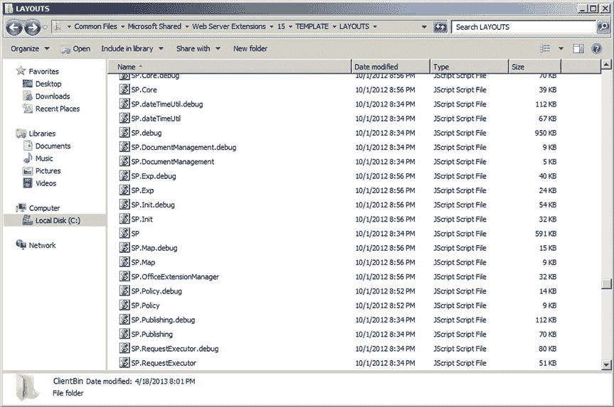

图 2-2.

在文件系统中构成 JavaScript 对象模型的文件

所有文件都位于 SharePoint 的 `Layouts` 文件夹中。`Layouts` 文件夹是 SharePoint 中的一个主力文件夹，包含了许多在整个环境中使用的公共文件和代码。当部署使用自定义页面、图像等的自定义服务器端代码时，它们通常都会部署到 `Layouts` 文件夹。如果你不熟悉它，不用担心——你很快就会熟悉了。

图 2-2 只展示了部分可用文件，但应该有助于说明 `JSOM` 在构建自定义解决方案方面的强大功能。微软投入了大量时间和精力来扩展 `JSOM` 的能力。由于他们告诉客户不再使用服务器端代码，并且在许多方面转向 SharePoint Online，他们确保提供一套全面的工具来支持丰富的开发体验。

**注意**

有关 `JSOM` 的更多信息，请访问以下 URL 中 SharePoint 的 JavaScript API 参考：[`http://msdn.microsoft.com/en-us/library/office/jj193034(v=office.15).aspx`](http://msdn.microsoft.com/en-us/library/office/jj193034(v=office.15).aspx)。

在你的解决方案中使用 `JSOM` 相当直接，因为它们都是 JavaScript。首先，你需要放置对特定文件的引用，如下所示：

```
<script type="text/javascript" src="/_layouts/15/sp.js"></script>
```

这是一个标准的 HTML `SCRIPT` 标签，它告诉浏览器加载位于 `SRC` 属性中指定位置的特定文件。在这种情况下，浏览器将加载位于 `Layouts` 文件夹中的 `sp.js` 文件。一旦我们有了所需的 SharePoint `JSOM` 文件的引用，我们就可以编写一个看起来像这样的脚本：

```
$(function () {
  retrieveListItems();
});

function retrieveListItems() {
  var clientContext = new SP.ClientContext();
  var oList = clientContext.get_web().get_lists().getByTitle('Demo List');
  var camlQuery = new SP.CamlQuery();
  this.collListItem = oList.getItems(camlQuery);
  clientContext.load(collListItem);
  clientContext.executeQueryAsync(
    Function.createDelegate(this, this.onQuerySucceeded),
    Function.createDelegate(this, this.onQueryFailed)
  );
}
```

如果这是你第一次看到 `JSOM` 代码，不要不知所措！它可能看起来很吓人，但随着你学习本书，阅读和编写它会变得越来越容易。让我们分解这个示例，看看每一部分。

*   `$(function () {});` – 这是代码的入口点，完全是 jQuery。这被称为 `document.ready` 函数，之所以这么称呼是因为它在浏览器完全加载 HTML 页面时触发。在 jQuery 开发中你会经常看到它，因为这是一种在页面加载时触发代码的简单便捷方式。在这个示例中，我们只是调用了另一个包含 `JSOM` 代码的函数。
*   `SP.ClientContext()` – 这一行获取对客户端上下文的引用，并在每次对 SharePoint 服务器的 `JSOM` 调用中使用。客户端上下文包含有关当前 Web 应用程序、网站、网站集等的许多信息。
*   `clientContext.get_web().get_lists().getByTitle('Demo List')` – 使用客户端上下文，我们可以获取对网站中任何内容的引用。在这一行中，我们引用当前网站，从所有列表中请求一个标题为“Demo List”的特定列表。这一行的语法非常易读：获取 Web，获取列表，按标题获取。在使用 REST API 时，你也会看到类似的模式。
*   `SP.CamlQuery()` – 这一行允许你通过使用 CAML 查询（一种用于查询 SharePoint 的语法）来指定要返回哪些项目。它已经存在了一段时间，并且在处理列表和库时经常使用。在这个示例中，我们只是传递一个空查询，告诉 SharePoint 我们希望列表中的所有项目。我们通过调用 `oList.getItems(camlQuery)` 并传入查询来实现。
*   `clientContext.executeQueryAsync()` – 这一行实际上会启动对 SharePoint 服务器的查询。然后你可以处理返回的数据并将其显示给用户。

这已经是对 `JSOM` 尽可能高级别的解释了！主要目的是展示一些 `JSOM` 并简要解释各部分。`JSOM` 还有更多内容，但在我们深入任何演示之前，你至少已经接触过一些代码了。


### REST API

REST API 随 SharePoint 2013 和 SharePoint Online 一同引入。它允许你通过精心构造的 URL 对 SharePoint 进行 RESTful 调用。数据可以以 XML 或 JSON 格式返回，并且可以轻松地被浏览器中的 JavaScript 使用。在早期版本的 SharePoint 中也提供了 RESTful 数据，但主要局限于列表交互。新的 REST API 已大大扩展，与 JSOM 类似，包含了广泛的功能。

**注意**  
有关 REST API 的更多信息，请访问以下 URL 中的 SharePoint REST API 参考和示例：[`http://msdn.microsoft.com/en-us/library/office/jj860569(v=office.15).aspx`](http://msdn.microsoft.com/en-us/library/office/jj860569(v=office.15).aspx)。

一个典型的 REST API 调用如下所示：

`http://SERVER/_api/web/lists/GetByTitle('Demo List')/items`

就像上一节中的 JSOM 示例一样，此 URL 将查询名为 `Demo List` 的列表，并请求所有项目。其语法也应该看起来很熟悉：`Web`、`Lists`、`GetByTitle`、`Items`。在这两个示例中，调用的结构都非常易读，并为你提供了了解预期数据所需的所有上下文。图 2-3 展示了浏览器中 REST 调用的结果。

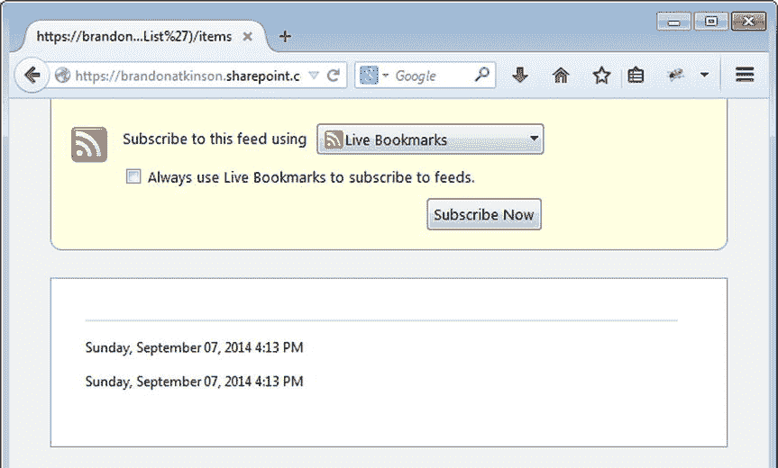

**图 2-3.** 浏览器中返回为 XML 的 REST API 调用

在此示例中，结果以 XML 格式返回，因为这是浏览器默认请求的格式。通过 JavaScript 调用时，我们可以请求 XML 或 JSON。我们稍后将更详细地探讨这一点。与 JSOM 类似，我们可以提供 CAML 查询来限制结果，也可以使用查询字符串运算符来选择、筛选和排序我们从 API 请求的数据。

如果我们想将数据限制为单行，REST API 调用如下所示：

`http://SERVER/_api/web/lists/GetByTitle('Demo List')/items?$top=1`

查询字符串运算符 `$top=1` 告诉 API 只返回第一行数据。图 2-4 展示了浏览器中此调用的结果。

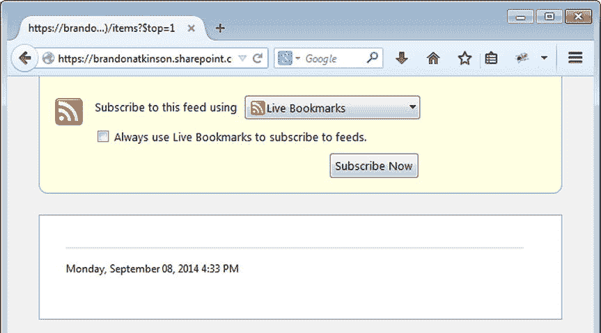

**图 2-4.** 使用查询字符串运算符限制结果的 REST API 调用

有许多运算符可用于构造你的 REST API 调用。我们将在后面的章节中探讨更多运算符，但请放心，你将拥有获得正确结果所需的所有工具。此示例应能说明使用 REST API 从 SharePoint 请求数据是多么容易。

### JSLink

JSLink 是 SharePoint 2013 中的新功能，它提供了一种非常强大且简单的方法来设置列表视图 Web 部件的样式。在 JSLink 之前，你必须使用 XSLT（可扩展样式表语言转换）。XSLT 是一种设置 HTML 样式或进行转换并赋予其活力的方法。它在允许开发人员更改 Web 部件的呈现方式方面做得很好，但使用起来相当麻烦。大多数开发人员一想到必须使用 XSLT 就皱眉头，并通常会避开它。

于是 JSLink 应运而生，它允许你使用 JavaScript 和 HTML 来设置部件样式。它提供了一种更简单、更快速的方法来呈现 Web 部件，以满足业务需求并提供增强的功能。JSLink 不仅提供了一种简单的方法来设置 Web 部件的样式，而且由于它基于 HTML 和 JavaScript，你还可以用它做更多事情。现在，让我们先看看 JSLink 是如何工作的。图 2-5 展示了一个标准的 SharePoint 主页，其中插入了一个列表 Web 部件，并显示了来自 Demo List 的项目。

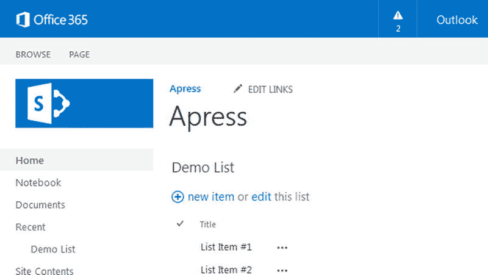

**图 2-5.** 插入了列表 Web 部件的 SharePoint 页面，列出了 Demo List 中的项目

这是 SharePoint 自带的列表 Web 部件，但它现在有一个新属性。如果将 Web 部件置于编辑模式并展开 Web 部件工具窗格中的“杂项”面板，你将看到一个名为“JS 链接”的新属性。这是一个文本框，你可以在其中放置一个 JavaScript 文件的路径，该文件将在 Web 部件呈现期间使用。图 2-6 展示了这个新属性。

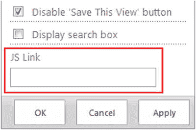

**图 2-6.** Web 部件属性窗格中的 JSLink 属性

现在你已经知道如何通过 JSLink 属性应用 JavaScript 文件，让我们看看这个 JavaScript 实际上是什么样子的。以下代码是对 JS Link 代码工作原理的简单演示。

```
(function () {
    var overrideContext = {};
    overrideContext.Templates = {};
    overrideContext.Templates.Item = overrideTemplate;
    SPClientTemplates.TemplateManager.RegisterTemplateOverrides(overrideContext);
})();

function overrideTemplate(ctx) {
    return "<div style='font-size:32px;border:solid 1px Silver;'>" + ctx.CurrentItem.Title + "</div>";
}
```

让我们分解这个示例并查看每个部分。

- `overrideContext`、`overrideContext.Templates` 和 `overrideContext.Templates.Item` —— 顾名思义，这些是覆盖 Web 部件默认呈现的对象。父对象 `overrideContext` 可以任意命名。前两行只是创建了该对象和一个名为 `Templates` 的属性。这是所有 JSLink 文件中的标准部分，因为它构成了代码的基础。第三行定义了另一个 JavaScript 函数，该函数将对 Web 部件中的每个单独项目触发；这由其名称中的“`Item`”指定。你可以针对项目，或仅针对项目中的特定属性。例如，如果我们只想设置 `Title` 的样式，我们可以仅引用该属性。
- `SPClientTemplates.TemplateManager.RegisterTemplateOverrides(overrideContext)` —— 一旦你构建好对象，就必须告诉 SharePoint 你想要使用它。这行代码通过向 `TemplateManager` 对象注册来实现这一点。完成后，当 Web 部件呈现时，你引用的 JavaScript 函数将被调用。
- `function overrideTemplate(ctx)` —— 这是在 Web 部件呈现时实际运行的代码。它非常简单：只需呈现一个带有一些样式和当前项目标题的 HTML `DIV` 元素即可。

将此代码放入文件后，我们将其上传到 SharePoint 的库中。然后，我们将该文件的路径放入 Web 部件的 JSLink 属性中。图 2-7 展示了使用 JSLink 文件呈现 Web 部件后的输出。

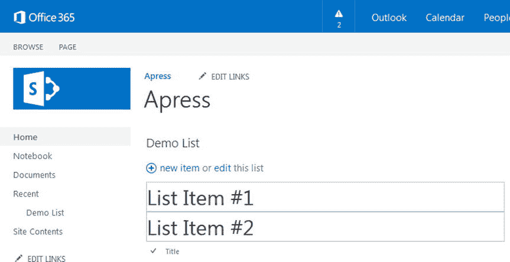

**图 2-7.** 应用 JS Link 代码后的列表 Web 部件

我们将在后续章节中更详细地介绍使用 JSLink 的细节，并将展示更多设置内容样式和构建自定义解决方案的方法。当你在页面上使用列表 Web 部件时，你会发现 JSLink 是一个极其有用的工具，可以帮助你实现业务需求。


## 显示模板

与 JSLink 类似，显示模板是 SharePoint 2013 和 SharePoint Online 中的新增功能。它们与搜索 Web 部件（例如 SharePoint 附带的**内容搜索 Web 部件**）配合使用。显示模板使用 HTML 和 JavaScript 来呈现内容，并允许您指定要显示的属性、放置位置以及如何设置样式。通过使用这些模板，您可以对搜索结果及其显示方式进行高度控制。图 2-8 显示了一个放置在页面上的标准内容搜索 Web 部件。

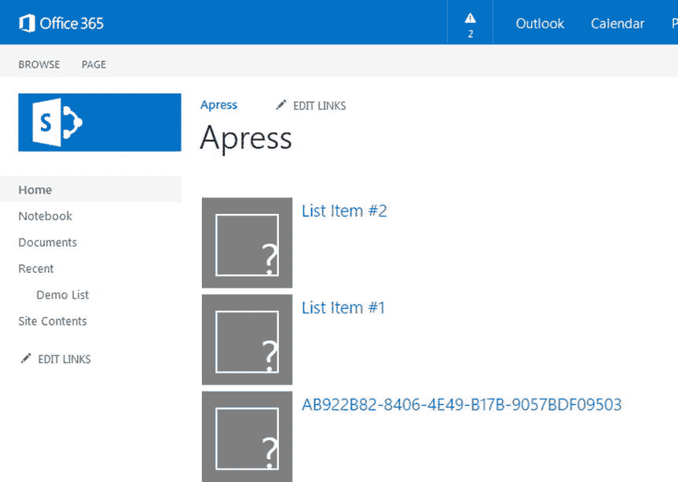

图 2-8. 放置在页面上的现成内容搜索 Web 部件

我们可以通过将 Web 部件置于编辑模式，并在 Web 部件工具窗格中查看属性面板来更改所使用的显示模板。在搜索条件正下方，您将找到**显示模板**区域。此部分有两个下拉菜单，用于选择内容的呈现方式：**控件**和**项目**。图 2-9 显示了显示模板区域和下拉菜单。

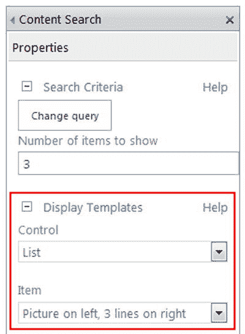

图 2-9. 内容搜索 Web 部件工具窗格中的控件和项目选项

这些项中的每一个都是一个模板，它们协同工作以呈现内容。**控件模板**为内容提供整体 HTML 布局。您可以将其视为容纳所有搜索结果项的容器。这也是加载您希望在搜索结果中使用的任何 JavaScript 或 CSS 的好地方。**项目模板**为每个搜索结果项提供单独的 HTML。此模板还利用搜索结果中的托管属性，并允许您控制显示哪些属性。当一起使用时，这些模板提供了一种呈现内容的完整方式。

您可以通过导航到**网站设置**，然后在**Web 设计器库**标题下选择**母版页**来查看现成的显示模板。这将打开母版页库页面，如图 2-10 所示。

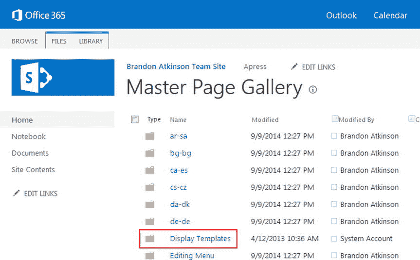

图 2-10. 您可以在此处找到现成显示模板的母版页库

注意：为了使用显示模板和内容搜索 Web 部件，您需要确保已激活 SharePoint Server 发布网站功能。如果您的网站使用发布模板，则此功能应已激活。此外，此 Web 部件仅适用于 Office 365 E3 和 E4 计划，或企业内部部署的 SharePoint 企业版。

单击**显示模板**文件夹将显示另一个页面，其中所有当前显示模板按文件夹组织。内容搜索 Web 部件的显示模板全部位于**内容 Web 部件**文件夹中，如图 2-11 所示。

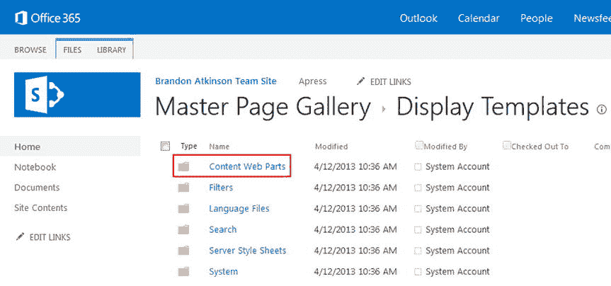

图 2-11. 显示模板和内容 Web 部件文件夹

打开内容 Web 部件文件夹时，您将找到许多显示模板。每个模板都有一个 HTML 文件和一个对应的 JavaScript 文件，如图 2-12 所示。

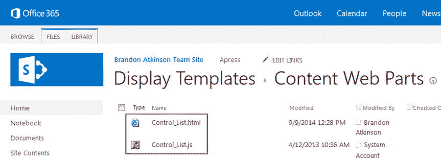

图 2-12. 带有 HTML 文件和对应 JavaScript 文件的显示模板

当您构建一个新的显示模板时，您只需处理 HTML 文件。上传 HTML 文件后，SharePoint 会为您生成 JavaScript 文件，并在呈现内容时使用该文件。通过此模型，您无需担心所需的脚本编写；您只需关注 HTML——其余部分由 SharePoint 完成。显示模板使用搜索结果中的托管属性来呈现内容。该模板使用标记系统来呈现内容，如下面的代码示例所示：

```html
<a class="cbs-pictureImgLink" href="_#= linkURL =#_" title="_#= $htmlEncode(line1.defaultValueRenderer(line1)) =#_" id="_#= pictureLinkId =#_">
```

标记看起来像`_#= variableName =#_`。您可以创建自己的变量来存储内容，以便稍后在模板中使用。我们将在后面的章节中更详细地讨论这些内容。

## 总结

在本章中，我们探讨了服务器端开发和前端开发之间的差异，并介绍了一些可用于自定义解决方案的组件。对于最新版本的 SharePoint，微软确实强调了不在开发工作中使用服务器端代码的优势。对于 SharePoint Online，您甚至根本无法使用它！正如您在本章中所读到的，他们提供了许多构建不依赖服务器端代码的自定义解决方案的选项。所有这些解决方案都利用 HTML 和 JavaScript，使任何熟悉构建网页的人都可以轻松访问这些解决方案。

在下一章中，我们将继续扩展到目前为止所学的内容。我们将介绍内容编辑器 Web 部件，以及如何将 HTML 内容直接放置在页面上。此外，我们将探索新的脚本编辑器 Web 部件，该部件可以与内容编辑器结合使用。我们将使用您在本章中看到的一些代码，并实际查看其运行情况。

