# 内容编辑器和脚本编辑器 Web 部件

至此，您应该已安装所需的所有工具，并拥有一个用于开发的 SharePoint 环境。您也已经了解了服务器端开发和前端开发之间的差异。我们还研究了组成前端开发的一些部件。现在是时候开始实际运用我们学到的一些知识，并构建一些东西了！

在本章中，我们将介绍如何使用内容编辑器和脚本编辑器 Web 部件。如果您使用 SharePoint 已有一段时间，那么您应该已经了解内容编辑器 Web 部件，并且知道它如何让您轻松地将 HTML 添加到任何页面。最新版本的 SharePoint 带来了脚本编辑器 Web 部件，它允许您轻松地将 JavaScript 添加到任何页面。我们将探讨这些 Web 部件如何工作以及如何相互交互。到本章结束时，您将了解使用这些 Web 部件的优缺点，并会使用 HTML 和 JavaScript 构建一些自定义解决方案。


## 内容编辑器 Web 部件

内容编辑器 Web 部件（CEWP）是 SharePoint 环境中的主力，它已经存在了很长时间，大多数用户都很熟悉它。顾名思义，CEWP 用于在 SharePoint 页面上放置内容。你可以轻松地使用此 Web 部件在页面上放置 HTML，以便向用户发布内容、链接列表等等。

使用 CEWP，你可以通过功能区使用与 Microsoft Word 类似的预定义样式和编辑工具来添加丰富内容。你可以直接在编辑器中编写 HTML，或者将其指向包含标记的 HTML 文件。通过功能区插入 Web 部件时，可以在“媒体和内容”类别下找到 CEWP，如图 3-1 所示。

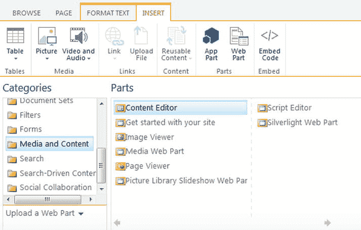

图 3-1. 可以找到内容编辑器 Web 部件的“媒体和内容”类别

在你的页面中插入一个 CEWP，并将其置于编辑模式。你将看到有三种方式可以添加和编辑内容，描述如下，如图 3-2 所示。

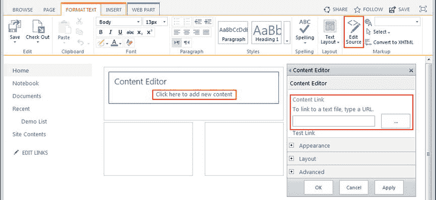

图 3-2. 在内容编辑器 Web 部件中添加内容的各种方式

*   **丰富内容** – 当你首次将 CEWP 添加到页面时，显然那里没有任何内容。在这种情况下，你将看到一个标题为“单击此处添加新内容”的链接。单击此链接会将光标直接置于 Web 部件中，你可以使用功能区添加丰富内容——就像在 Microsoft Word 中一样。这是一种向页面添加内容的简单便捷方式，但不是构建使用 SharePoint 数据的自定义解决方案的好方法。
*   **HTML 标记** – 另一种插入内容的方法是单击“单击此处添加新内容”链接，然后单击功能区中的**编辑源**按钮。这将打开一个对话框，你可以在其中直接向 CEWP 键入 HTML 内容。这对于快速插入 HTML 或测试你的 HTML 标记来说是一个很好的选择。对于构建自定义解决方案来说，这是一个更好的选择，但还不是最佳选择。
*   **链接到 HTML 文件** – 你也可以直接链接到一个 HTML 文件，以便在 Web 部件中显示内容。在 CEWP 工具窗格中，第一个属性标题为**内容链接**。在此文本框中，只需添加 HTML 文件的 URL，其内容将在 Web 部件呈现时显示。这是构建自定义解决方案时的首选用法，我们将在下一章中讨论这一点。

现在，让我们使用功能区中的**编辑源**按钮放置一些 HTML。将 CEWP 置于编辑模式，单击“单击此处添加新内容”链接，然后单击功能区中的**编辑源**按钮。图 3-3 显示了单击此按钮后显示的对话框。

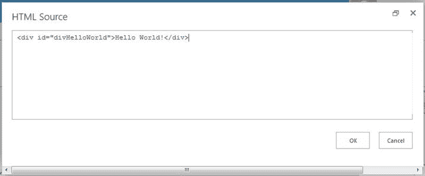

图 3-3. 单击功能区中的**编辑源**按钮后出现的对话框

在此对话框中，我们可以直接键入 HTML 内容。在此示例中，我们将只添加一个包含 ID 和一些文本的 `<div>` 元素。只需以下 HTML：

```
<div id="divHelloWorld">Hello World!</div>
```

添加此内容并保存页面后，页面上将显示一条漂亮的“Hello World!”消息，如图 3-4 所示。

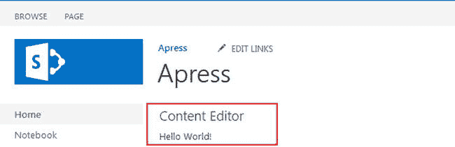

图 3-4. 在内容编辑器 Web 部件中显示的 HTML 内容

这是一个非常简单且并不令人兴奋的向页面添加 HTML 内容的示例。但是，如果您是添加自定义 HTML 的新手，那么这对于本章后续部分以及后续章节的内容来说是一个很好的起点。现在页面已经有了 HTML，让我们看一下脚本编辑器 Web 部件，并了解如何将自定义 JavaScript 与我们的 HTML 一起注入页面中。

## 脚本编辑器 Web 部件

脚本编辑器 Web 部件（SEWP）是 SharePoint 2013 的新功能；它的设计初衷如其名称所示——向 SharePoint 页面添加脚本。在此 Web 部件出现之前，如果您想在页面上注入脚本，您会使用 CEWP。如果您链接到包含脚本的文件，这效果很好，但如果您想编辑源并手动放置脚本，通常会遇到问题。有时，脚本无法运行，或抛出错误，更糟糕的是，CEWP 实际上会更改您输入的代码。这是一种不愉快的体验。

有了 SEWP，这些问题不再是您需要担心的事情。您现在可以轻松地使用 SEWP 在页面上放置 JavaScript，因为它就是为了这个目的而构建的。您还可以使用此 Web 部件放置其他项目，包括 `<object>` 标签、HTML 等。通过功能区插入 Web 部件时，可以在“媒体和内容”类别下找到 SEWP，如图 3-5 所示。

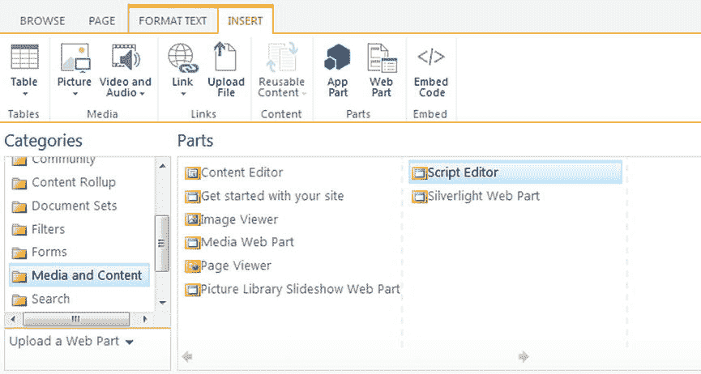

图 3-5. 可以找到脚本编辑器 Web 部件的“媒体和内容”类别

在你的页面中插入一个 SEWP，并将其置于编辑模式。你将看到有一种方法可以添加和编辑脚本——通过单击**编辑代码片段**链接，如图 3-6 所示。

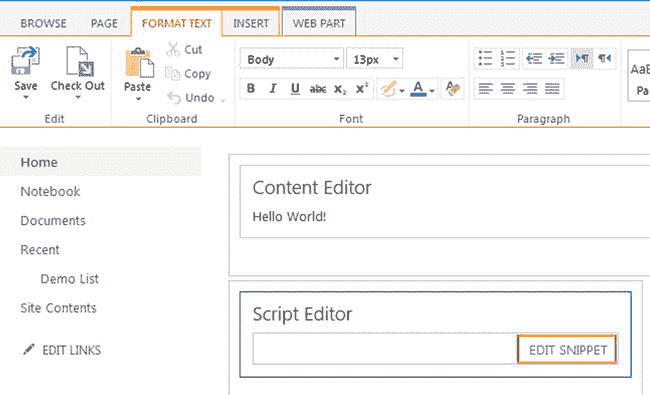

图 3-6. 单击**编辑代码片段**以添加或编辑你的 JavaScript

单击**编辑代码片段**链接将打开一个标题为**嵌入**的对话框，您可以在其中编写 JavaScript，如图 3-7 所示。放置到此 Web 部件中的 JavaScript 必须有效，并且包含 `<script></script>` 标签才能正常运行。SEWP 甚至可以用来在页面上放置 HTML。如果您要放置 HTML，对话框将在您正在处理的文本框下方显示内容的预览。如果您要编写 JavaScript，则不会显示预览，因为该代码通常在页面上不可见。

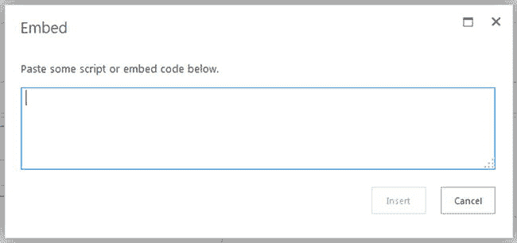

图 3-7. 用于在脚本编辑器 Web 部件中编写脚本的**嵌入**对话框

**注意：** 尽管脚本编辑器 Web 部件可用于注入 HTML，但您应该将此 Web 部件视为仅用于脚本。最好将您的 HTML 和脚本分离到不同的 Web 部件中。话虽如此，如果您只需要快速测试一个脚本，它可能非常有用。

在本示例中，我们将使用 jQuery 添加一些 JavaScript，在页面加载时显示一个警告框：

```
<script type="text/javascript">
$(function() {
    alert("Hello World!");
});
</script>
```

如您所见，此代码包含一个开闭 `<script>` 标签，内部包含一个 jQuery `document.ready` 函数。此脚本所做的只是在 jQuery 检测到页面已加载时，触发一个包含文本“Hello World!”的警告框。将此代码放入对话框并单击**插入**。保存页面。刷新页面时，您将看到警告框弹出，如图 3-8 所示。

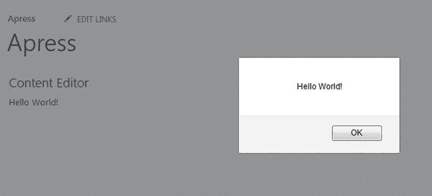

图 3-8. 通过脚本编辑器 Web 部件显示的 JavaScript 警告框

与使用内容编辑器 Web 部件的示例非常相似，这非常简单，也不令人兴奋。但是，此时您的页面上应该已经有一个 CEWP 和一个 SEWP 了。接下来，让我们看看如何将它们连接起来以实现一个完整的解决方案。


## 通过 REST API 整合运用

现在，我们已经在页面上放置了 CEWP 和 SEWP，接下来可以将它们连接起来协同工作。在本例中，我们将使用 REST API 从站点列表中提取数据，通过 SEWP 利用 jQuery 发起 AJAX 调用，并在调用完成后更新 CEWP。我们将学习如何在页面上同时使用这两个 Web 部件，以及如何使用 jQuery 发起 AJAX 调用。首先，我们需要一个列表来从中获取数据。

### 演示列表

在本书中，我们将使用 JSOM 和 REST API 从 SharePoint 查询数据。为了方便演示，我们将创建一个新的自定义列表用于实践。操作会尽量简化：只需创建一个新的自定义列表并添加一个额外的列即可，不涉及复杂功能。首先，使用“添加应用程序”功能添加一个自定义列表，并将此新列表命名为 `Demo List`。

> **注意**  
> 本部分假定您知道如何在 SharePoint 中创建新列表以及如何创建新列。如果需要创建新列的帮助，请访问以下 URL：[`http://office.microsoft.com/en-us/sharepoint-server-help/create-change-or-delete-a-column-in-a-list-or-library-HA102771913.aspx`](http://office.microsoft.com/en-us/sharepoint-server-help/create-change-or-delete-a-column-in-a-list-or-library-HA102771913.aspx)。

列表添加完成后，其默认视图中将只有一个列，即 `Title`。这固然可以，但让我们再添加一个列，以便多一些数据可供操作。进入列表设置，使用该页面上的“创建列”链接添加一个新列。选择类型为 `Multiple Lines of Text`，并将此列命名为 `Description`。在我的列表中，为了简单起见，我将其设置为 `Plain Text` 列。图 3-9 显示了添加了一些数据后的 `Demo List`。

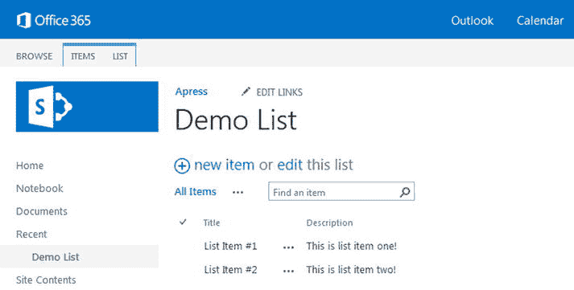

**图 3-9.** 可供查询数据的 `Demo List`

现在先插入几行数据。列表中的实际数据目前并不重要，它们只是用来确保我们能够查询并检索列表项。现在列表已就绪，让我们看看通过 REST API 查询它所需的代码。

### jQuery、AJAX 和 REST API

查询列表将通过 jQuery 向 REST API 发起 AJAX 调用来完成。在上一章中，我们快速了解了 REST API URL 的结构。一个典型的查询列表的 URL 结构如下所示：

`http://DOMAIN/SITE/_api/web/lists/GetByTitle('List Name')/items`

所有 REST API URL 在数据所在站点之后都以 `_api` 开头，或者在查询 SharePoint 根网站集时紧跟域名之后。`_api` 是告知 SharePoint 您正在通过 REST 请求数据的标识。数据可以以 XML 或 JSON 格式请求，但对于大多数 JavaScript 调用，通常会使用 JSON。使用 REST API 的一个好处是，您可以在任何浏览器中构造 URL，并在代码中使用之前进行测试！

> **注意**  
> 在我的环境中，我在主网站集下创建了一个名为 `Apress` 的子网站。这是我在本书中编写和运行所有代码的站点区域。因此，您将看到类似于 `/apress/` 的 URL 结构。如果您在网站集的根站点操作，则您的 URL 引用应以 `/` 开头。请注意您的 URL，并确保引用正确！稍后，我们将编写一些代码为您自动处理这些，但在此部分，正确的 URL 结构非常重要。

为了通过浏览器发起调用，我们将使用标准的 jQuery AJAX 调用。以下代码演示了此调用：

```html
<script type="text/javascript">
$(function() {
    $.ajax({
        url: "/apress/_api/web/lists/GetByTitle('Demo List')",
        type: "GET",
        headers: {
            "accept": "application/json;odata=verbose"
        },
    }).success(function(data) {
        alert(data.d.Title + " : " + data.d.Created);
    });
});
</script>
```

在这个示例中，我们将调用包装在熟悉的 `document.ready` 函数中。AJAX 调用使用 `$.ajax()` 函数发起。代码非常直接，只包含几个属性：

- `url` – 这是专门构造的 REST API URL，用于请求所需的特定数据。在此示例中，我们只请求列表属性。
- `type` – type 表示标准的 HTTP 方法，即：`GET`、`POST`、`PUT` 和 `DELETE`。在此示例中，我们只是请求数据，因此使用 `GET`。
- `headers` – 如前所述，REST API 可以返回 XML 或 JSON。如果不指定所需的格式，将返回默认格式 XML。通过指定头部 `"accept": "application/json;odata=verbose"`，我们告知 REST API 我们期望返回 JSON 格式的数据。

在 `$.ajax` 调用的末尾，我们附加了一个 `success` 函数，用于处理 REST API 返回的 `data`。jQuery 让处理 AJAX 调用并根据调用结果执行各种函数变得非常简单。例如，您可以附加其他函数，如 `failure` 和 `finally`。稍后我们将更详细地介绍这些内容。

在我们的 `success` 函数中，我们传入 REST API 返回的 `data` 对象。现在我们只做一件事：弹出一个提示框，显示列表标题和创建日期。我们通过以下代码行实现：

- `data.d.Title`
- `data.d.Created`

`data` 对象包含查询返回的所有数据。该对象中有很多我们用不到的内容。`d` 属性保存了我们正在查找的所有列表属性。这可能看起来有些奇怪，但这就是访问通过 REST API 返回的所有数据的方式。例如，如果您在查询中请求列表项，您将访问 `data.d.results`。将这段代码放入 SEWP 并保存页面后，将弹出如图 3-10 所示的提示框。

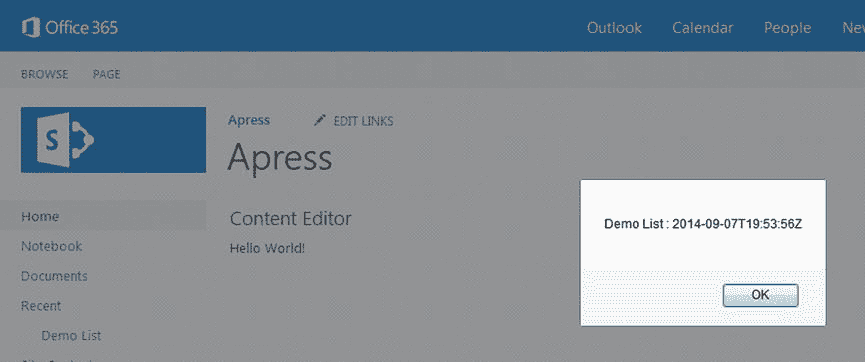

**图 3-10.** 显示 `Demo List` 标题和创建日期的 JavaScript 提示框

现在我们已经配置好了 AJAX 调用，并且数据正在返回，您应该会看到烦人的提示框弹出。这非常好，因为它让我们知道一切运行正常。然而，在实际应用中，您可能不会仅仅为了弹出提示框而发起 REST 调用。接下来，让我们借助更多的 jQuery 魔法，将这些数据放入 CEWP 中。


#### 串联一切

现在，你的页面上应该已经有一个`CEWP`和一个`SEWP`了。`CEWP`显示了一些基本的 HTML，而`SEWP`则在发起 REST API 调用并弹出一个警告框。接下来，我们要让它们协同工作：由`SEWP`调用 API 获取列表数据，然后用结果更新`CEWP`中的 HTML。完成这个示例后，你会看到让这两个 Web 部件协同工作来创建解决方案是多么简单。

幸运的是，我们无需对`CEWP`做任何修改！如果你使用了本章本节提供的 HTML，那就已经准备就绪了。如果没有，它的代码应该是这样的：

`<div id="divHelloWorld">Hello World!</div>`

这行代码以及让 Web 部件协同工作的关键在于`DIV`标签中的`ID`属性：`"divHelloWorld"`。通过为`DIV`指定 ID，我们可以非常轻松地使用 jQuery 在 HTML 中找到该元素并更新其内容。当然，还有其他实现方式；例如，我们可以给`DIV`添加一个 CSS 类，然后通过类名来查找。无论哪种方式，只要能轻松找到元素，就能轻松更新它！

现在，我们来修改`SEWP`的脚本，让它更新`CEWP`。改动虽然很小，但效果会非常显著。请用以下代码更新你的脚本；唯一的变化在`success`函数中，我们将警告框替换为了新的 jQuery 代码：

```
<script type="text/javascript">

$(function() {

  $.ajax({

    url: "/apress/_api/web/lists/GetByTitle('Demo List')",

    type: "GET",

    headers: {

        "accept": "application/json;odata=verbose"

    },

  }).success(function(data) {

    $("#divHelloWorld").html(data.d.Title + " : " + data.d.Created);

  });

});

</script>
```

这一行新代码的作用是查找 ID 为`"divHelloWorld"`的 HTML 元素。`#`符号用于告知 jQuery 我们正在查找的是 ID，而不是其他属性。在`SEWP`中应用这些更改并点击页面上的“保存”后，`CEWP`的 HTML 就会被更新，如图 3-11 所示。我们在结果中显示了创建日期；你的日期会与示例中显示的不同。

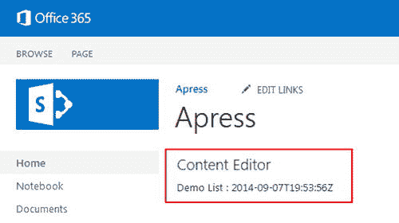

**图 3-11.** 内容编辑器 Web 部件已被脚本编辑器 Web 部件更新

如果你盯着`CEWP`看，会看到屏幕上的“Hello World”信息在更新为列表信息之前一闪而过。这是因为我们使用了 jQuery 的`document.ready`函数，该函数要等到页面（文档）加载完成后才会触发。如果你第一次没注意到，只需刷新浏览器就能再次看到。在实际场景中，为了避免这种可见的变更，你的 HTML 可能一开始就是空的。

### 并非万能解决方案

`CEWP`和`SEWP`是向页面注入自定义 HTML 和脚本的快捷方式。此刻，你可能会想：我还需要什么呢？我现在就可以开始构建自定义解决方案了！诚然，这两个 Web 部件为你提供了为用户构建解决方案的绝佳机会，它们易于使用，且协作良好。然而，对于更复杂的自定义开发来说，这种解决方案未必是最佳选择。

随着你在开发过程中不断深入——无论是本书中的实践还是你自己的项目——你可能会发现解决方案的需求变得越来越大、越来越复杂。你可能需要多个 JavaScript 文件、自定义样式表，甚至多个 HTML 文件。这种情况下，使用`CEWP`和`SEWP`会变得非常繁琐且难以管理。此外，你可能需要在多个页面上使用相同的功能。在多个页面上放置多个 Web 部件并将它们串联起来会带来挑战。同时，这也为其他用户修改你的 HTML 和 JavaScript 提供了可乘之机。请记住，任何拥有编辑 Web 部件权限的人都可以修改这些代码，这可能会造成非常严重的后果。

这种解决方案虽然相当有效，但应谨慎使用。它非常适合那些工作量小的、一次性的简单脚本，或者显示少量数据的简单 HTML。由于它实现速度快，因此非常适合用来测试某些 HTML 和脚本，确保它们能正确运行。无论你是否决定采用这种方法，都请花点时间思考一下，它是否为满足你和用户的需求而做出的最佳选择。

## 总结

在本章中，我们探讨了内容编辑器 Web 部件及其新版替代品——脚本编辑器 Web 部件。我们了解了如何使用这些 Web 部件在页面上放置自定义 HTML 和 JavaScript，以及这有多么简单。你学会了如何通过 jQuery 向 REST API 发起 AJAX 调用并检索列表数据。最后，我们研究了如何将这两个 Web 部件整合到一个单一的解决方案中。

在下一章中，我们将继续沿着使用所学知识构建自定义解决方案的道路前进。我们将探讨如何将这种开发模式迁移到更易于维护的结构中，并动手实践一些更高级的脚本。我们还将进一步扩展 REST API 调用以及 JavaScript 对象模型调用。

