# 4. 使用 HTML 和 JavaScript 构建自定义 Web 部件

内容编辑器 Web 部件与脚本编辑器 Web 部件的结合，使您能够快速在环境中构建解决方案。虽然这种组合确实为您提供了开发解决方案的选择，但它并非一种易于扩展或可重用的方案。您可能会发现它适用于简单的单页面解决方案，但一旦需求变得复杂，您就会发现该方案在许多方面都受到限制。幸运的是，您在前一章中学到的内容可以扩展到更健壮的解决方案中。

在本章中，您将学习如何使用埃瑟森方法构建健壮、可重用的 Web 部件。该方法仍然使用 HTML 和 JavaScript，是对前一章知识点的扩展。您将看到如何更好地组织代码结构，以及该方法如何帮助您应对几乎任何能想到的自定义解决方案。

## 埃瑟森方法

在过去的几年里，我有幸作为一名顾问参与了许多令人兴奋的 SharePoint 项目。此外，我还有幸与一些非常有才华的人共事——他们每天都在激励着我。其中一位是迈克·埃瑟里奇。迈克和我曾参与一个面向公众的 SharePoint 2010 网站项目，该项目需要适配移动设备，同时还需要连接到未集成到 SharePoint 中的外部数据库。迈克的解决方案是构建可通过 JavaScript 调用的自定义 WCF Web 服务。这些服务随后与自定义 HTML 和 JavaScript 一起部署到服务器上。HTML 则通过放置在每个页面上的 XML 查看器 Web 部件来加载。

这个解决方案效果非常好。它易于开发和快速部署。它使我们能够轻松地在服务器上整合数据并将其返回给页面，而且 HTML 可以方便地从 SharePoint 服务器提供。这在 SharePoint 2010 中效果很好，在 SharePoint 2013 中也会同样出色，但不适用于 SharePoint Online，因为其中无法部署任何服务器端代码。幸运的是，由于微软扩展了 JavaScript 对象模型和 REST API，我们可以对解决方案进行调整，使其支持在服务器外部进行完整的开发生命周期——埃瑟森方法就此诞生。

埃瑟森方法由以下组件构成：

- 文档库
- 文件夹
- 内容编辑器 Web 部件
- HTML、JavaScript 和 CSS

如您所见，这个解决方案只需要少量组件就能产生巨大影响。乍一看，您可能会想，用这么简单的一套东西怎么可能构建出健壮的解决方案呢？这种方法真正的力量在于它的简洁性，以及 JavaScript 对象模型和 REST API 的强大功能。让我们来详细了解每个组件。

## 文档库

该方法的中心是一个文档库。该库将作为自定义 Web 部件中所有代码的主要存储库。所有代码都将存储在此库中，每个 Web 部件对应一个文件夹。如果符合需求，你也可以使用多个库。例如，可以在网站集根目录下创建一个库，用于所有子网站。你也可以更精细地操作，在每个子网站中放置一个仅用于该网站的库。在结构组织方面，你可以非常灵活，因为它只是一个存放代码的地方。

设置文档库需要以下步骤：

- 创建新的文档库。
- 关闭搜索索引。
- 开启版本控制。
- 为库设置独立权限。

首先，我们将创建一个开箱即用的文档库，并将其命名为`Webparts`，如图 4-1 所示。

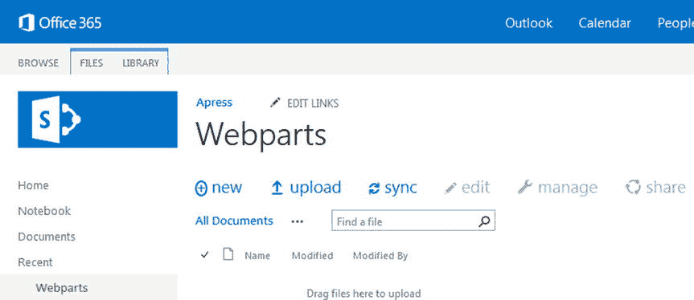

**图 4-1.** 为我们代码创建的全新开箱即用文档库

这没什么特别的：我们只需通过“设置”菜单，使用“添加应用程序”选项并选择“文档库”即可。接下来，我们要确保搜索引擎不会索引此库。原因在于该库将用于存储代码。普通用户无需查看这些代码，因为它们用于呈现自定义 Web 部件；因此，让这些代码出现在搜索结果中会扰乱用户的搜索体验。关闭搜索索引将确保代码文件不会出现在搜索结果中。从功能区访问“库设置”，然后选择“高级设置”，如图 4-2 所示。

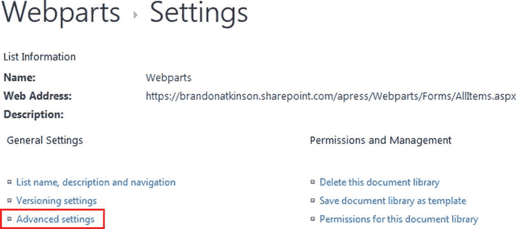

**图 4-2.** 在“库设置”中访问“高级设置”页面

在“高级设置”页面上，你会看到文档库的许多选项。在页面大约一半的位置找到“搜索”标题。这里只有两个选项：允许项目出现在搜索结果中，或不允许。选择“否”，如图 4-3 所示。

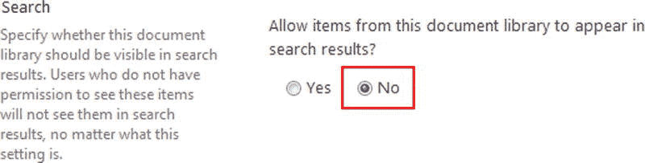

**图 4-3.** 关闭文档库的搜索索引

滚动到页面底部并单击“确定”以保存更改。你将返回到“设置”页面，在此处可以继续进行版本控制设置。版本控制非常重要，因为它允许轻松回滚代码。如果你需要对现有代码进行更改，这会让你感到安心。例如，假设你开发了一个满足当前业务需求的解决方案，一切运行正常。然后你被要求进行重大更改并开发新代码以满足需求。你测试了代码，一切看起来很好。你上传了更改——用户立即开始抱怨出了问题！你忘记在不同浏览器中测试，你的代码导致所有使用 Chrome 的用户都遇到了问题。

如果你开启了版本控制，只需转到文档库并还原以前的代码文件即可。就这样，用户看到的是以前的代码，至少一切又恢复正常了。正如你所见，在开发过程中的某个时刻，能够快速轻松地回滚代码更改的能力将被证明非常有帮助。

要开启版本控制，请单击“版本控制设置”链接，如图 4-4 所示。

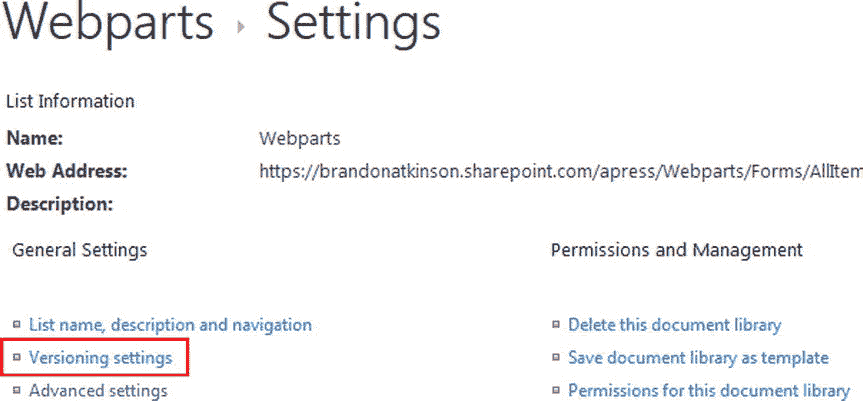

**图 4-4.** 访问文档库的“版本控制设置”

进入“版本控制设置”页面后，在“文档版本历史记录”标题下单击“创建主要版本”选项，如图 4-5 所示。你也可以创建主要和次要版本；不过，在本书中我们保持简单，只使用主要版本。

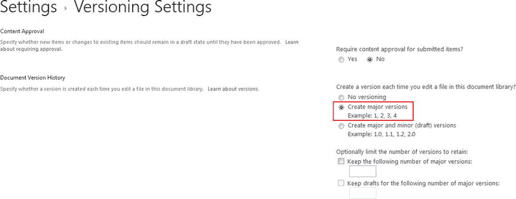

**图 4-5.** 在文档库中开启“创建主要版本”

滚动到页面底部并单击“确定”以保存更改。你将返回到“设置”页面，在此处可以继续进行权限设置。

> **注意：** 根据你创建的网站类型，你可能会发现版本控制已经开启。例如，启用了发布基础结构的发布门户或团队网站已经开启了版本控制。无论是哪种情况，请打开版本控制设置页面以确保它已开启。

最后，您必须通过应用唯一权限来保护文档库。我们希望保护此库，以便控制谁可以添加或修改放入其中的代码。用户需要拥有读取权限，以便代码可以加载到 Web 部件中；但你只希望开发人员拥有参与权限。这至关重要，因为你只希望少数人有权上传代码，甚至可能删除代码。要修改权限，请单击“此文档库的权限”链接，如图 4-6 所示。

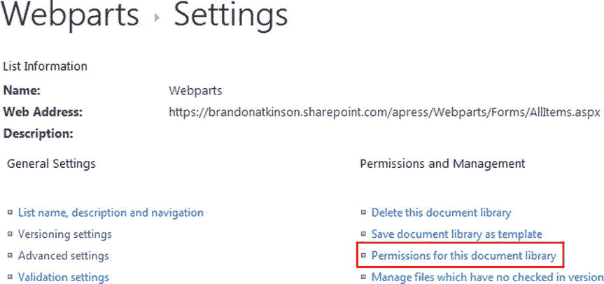

**图 4-6.** 访问文档库的权限设置

单击此链接将带你进入文档库的权限页面。要应用唯一权限，请单击功能区中的“停止继承权限”按钮，如图 4-7 所示。

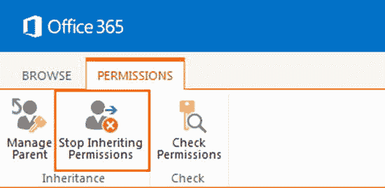

**图 4-7.** 文档库功能区的“权限”选项卡

通常，SharePoint 中的所有项目都继承其父级的权限。当你创建这个新的文档库时，默认情况下它继承其所在网站的权限。如果你选择停止继承权限，SharePoint 会确认这是否是你的意图，并弹出一个确认对话框，如图 4-8 所示。

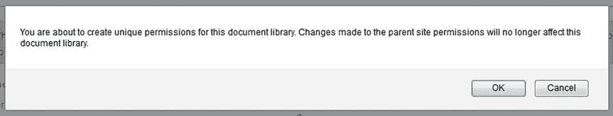

**图 4-8.** 中断权限时的确认对话框

单击“确定”确认更改，你将返回到权限页面。你会注意到功能区现在有一些额外的选项，最值得注意的是“授予权限”按钮，如图 4-9 所示。你将使用“授予权限”选项来重新添加权限。

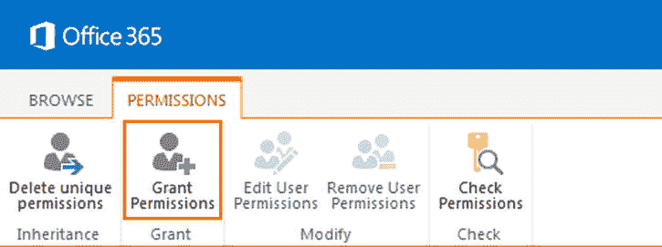

**图 4-9.** 使用功能区中的“授予权限”按钮授予权限

> **注意：** 一旦你停止继承权限，就应该删除列表中所有当前的用户和组。即使你已经中断了权限继承，之前的用户和组仍然会保留，除非手动删除。

单击“授予权限”按钮会启动“共享”对话框，你可以在其中选择要授予权限的用户，如图 4-10 所示。对话框中的第一个文本框允许你指定要授予其库访问权限的用户或组。在此步骤中，你希望授予每个人读取权限。当你键入文本框时，SharePoint 会提供一个人员和组的自动完成列表供你选择。键入`Everyone`，然后从建议列表中选择它。

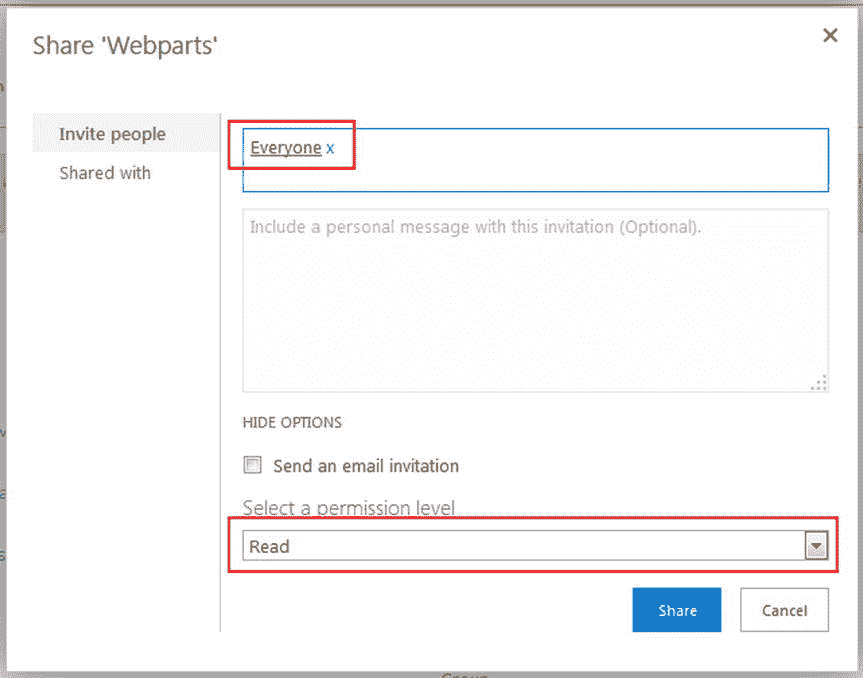

**图 4-10.** 授予所有用户读取权限

你可以点击“Show Options”链接展开对话框，查看可用的额外选项。你可能会想要取消勾选“Send an Email Invitation”选项，特别是在添加大型用户组时。在这种情况下，该选项会向所有拥有 SharePoint 访问权限的用户发送邮件，这通常不是一个好主意。另一个选项是“Select Permission Level”下拉菜单；选择`Read`，因为我们希望每个人都拥有该特定级别的访问权限。

点击“Share”按钮以保存自定义权限。此时，所有用户对该库都拥有`Read`访问权限。对任何开发人员重复这些步骤，并授予他们`Contribute`权限级别。这样，这些用户就可以上传新代码并修改库中的现有代码。

注意：如果你使用的是开发环境或仅由少数人访问的站点，可以跳过应用唯一权限。这在 QA 或生产环境中至关重要，但在开发环境中可以放宽要求。

现在，文档库已创建并配置完成，我们可以继续处理其他组件，例如文件夹。除了为解决方案编写代码之外，使用 Etherson 方法设置文档库是最大的任务。相比之下，后续组件将显得简单。

## 文件夹

使用此方法，每个自定义 Web 部件都有一个包含该 Web 部件所需所有文件的文件夹。你也可以创建一个集中文件夹，其中包含所有 Web 部件共享的脚本。例如，如果你希望将 jQuery 副本存储在一个文件夹中，则可以避免通过 MasterPage 添加它，只需让每个 Web 部件从该集中文件夹进行引用即可。你也可以将一些对多个 Web 部件执行通用功能的实用脚本放在该集中文件夹中。无论有何需求，集中文件夹都可能派上用场。

导航到你上一节创建的`Webparts`文档库。使用菜单中的`New`命令，从上下文菜单中选择`New Folder`，如图 4-11 所示。

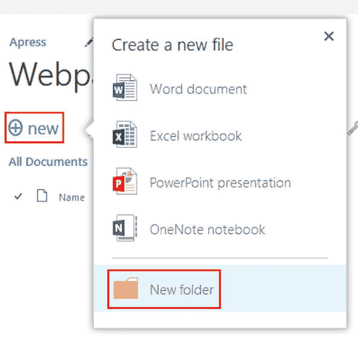

图 4-11. 创建新文件夹

创建一个新文件夹，并将其命名为`Simple Example`。我们将使用此文件夹来托管第一个示例的 HTML 和 JavaScript 文件。此时，`Webparts`文档库中应只有一个文件夹。随着本书内容的深入，你将会添加更多文件夹；但目前来说，这是一个不错的开始。

## HTML、JavaScript 和 CSS

现在我们已经有了一个文档库和一个用于托管代码的文件夹，让我们来组装一个 HTML 文件和一个 JavaScript 文件。在本节中，我们将使用 Visual Studio 编写代码并构建 HTML 和 JavaScript 文件。如果你在第一章安装了 Visual Studio Express，那就一切就绪了。你可以使用任何你喜欢的代码编辑器——甚至是记事本！启动 Visual Studio，然后通过点击`File` ➤ `New` ➤ `File`创建一个新文件，如图 4-12 所示。

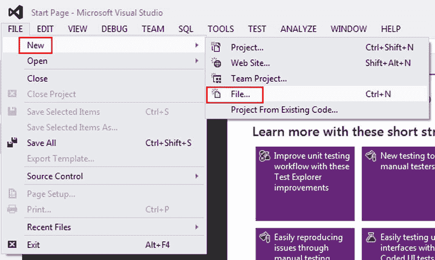

图 4-12. 在 Visual Studio 中创建新文件

这将打开一个新的对话框，你可以在其中选择要创建的文件类型。这里有很多选项，但我们需要的那个就在最前面。从列表中选择`HTML Page`，然后点击`Open`，如图 4-13 所示。

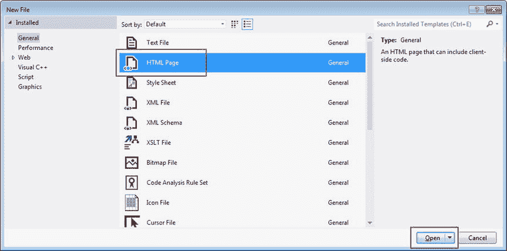

图 4-13. 从“新建文件”对话框创建新的 HTML 页面

点击`Open`后，你会看到一个新的 HTML 文件被创建并显示出来。如果你是 Visual Studio 的新手，你将初步体验到代码编辑器带来的高效。新创建的 HTML 文件中已经为你生成了一些代码，如图 4-14 所示。

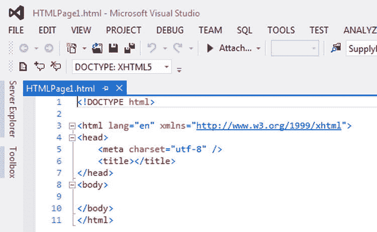

图 4-14. 带有代码的新创建 HTML 文件

如果你将此文件保存并加载到 SharePoint 中，它将不会显示任何内容，因为没有可供浏览器渲染给用户的内容。然而，这绝对是一个有效的 HTML 文件！虽然这并不令人印象深刻，但你会发现，在你编写代码时，Visual Studio 在很多类似的事情上都能提供帮助。

对于这个示例，我们将从第 3 章的代码开始，不过我们会将代码拆分为一个 HTML 文件和一个 JavaScript 文件。首先，在你的新 HTML 页面中添加以下代码行：

```
<div id="divHelloWorld">Hello World!</div>
```

将这行代码放在两个`<body>`标签之间，如图 4-15 所示。

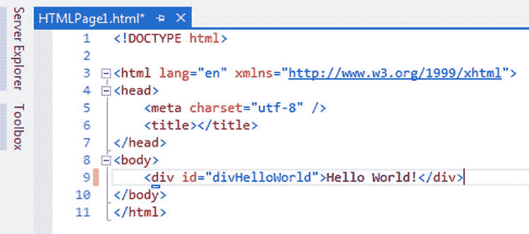

图 4-15. 包含上一章代码的新 HTML 文件

现在让我们创建一个 JavaScript 文件来托管我们的脚本。与之前一样，从菜单中选择`File` ➤ `New` ➤ `File`。当“新建文件”对话框打开时，你会注意到列表中没有创建 JavaScript 文件的选项。为此，我们需要从左侧导航中选择`Web`，以查看所有适用于网站的文件模板。滚动到模板列表的底部，你会找到`JavaScript File`模板，如图 4-16 所示。

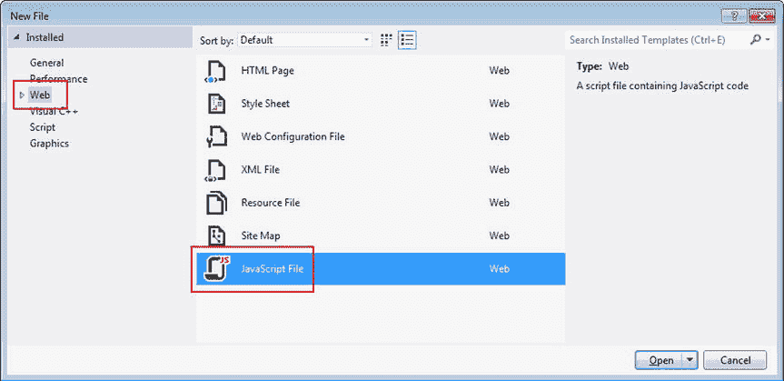

图 4-16. “新建文件”对话框中的 JavaScript 文件选项

创建新的 JavaScript 文件后，你会注意到它与你之前创建的 HTML 文件看起来截然不同。事实上，它完全是空白的，如图 4-17 所示。

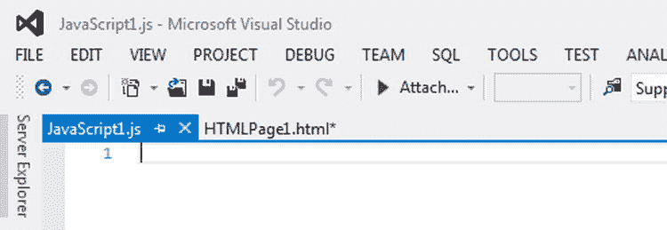

图 4-17. 在 Visual Studio 中创建的新 JavaScript 文件

与 HTML 文件类似，你将使用第 3 章示例中的相同代码。将以下代码放入你刚刚创建的新 JavaScript 文件中：

```
$(function() {

$.ajax({

url: "/apress/_api/web/lists/GetByTitle('Demo List')",

type: "GET",

headers: {

"accept": "application/json;odata=verbose"

},

}).success(function(data) {

$("#divHelloWorld").html(data.d.Title + " : " + data.d.Created);

});

});
```

本书的所有代码示例中，URL 均指向我的环境，该环境包含一个根网站集和一个名为 Apress 的子网站，我的所有代码都存放在此。因此，我的所有 URL 将显示为`"/apress/....."`。您应根据代码部署位置以及网站结构，相应地更新自己的 URL。

您会注意到，与第 3 章的示例不同，这里没有使用`<script></script>`标签对来包裹代码。由于代码是从扩展名为`.js`的 JavaScript 文件中提供的，浏览器无需通过这类标签来识别脚本，如图 4-18 所示。

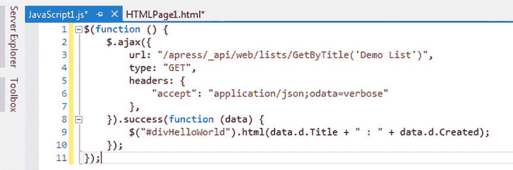

图 4-18. Visual Studio 中的 JavaScript 代码

现在两个文件都已创建，接下来需要保存它们。您可以将这些文件保存在电脑上的任意位置。将 HTML 文件命名为`SimpleExample.html`，JavaScript 文件命名为`SimpleExample.js`。保存文件后，我们需要将 JavaScript 文件连接到 HTML 文件，以确保代码能够正确触发。为此，我们需要在 HTML 文件中添加一个 JavaScript 引用，类似于以下代码行：

```
<script type="text/javascript" src="/apress/webparts/Simple Example/SimpleExample.js"></script>
```

在我的环境中，有一个名为 Apress 的子网站，我的 Web 部件文档库就位于此。此脚本引用以`/`开头，表示使用网站的根 URL。接着，我们依次放置子网站名称、文档库名称、文件夹名称，最后是脚本文件名。根据您配置环境的方式，您可能不需要子网站引用，或者它的名称可能有所不同。

将脚本引用放置在 HTML 文件的`<head>`中，如图 4-19 所示。

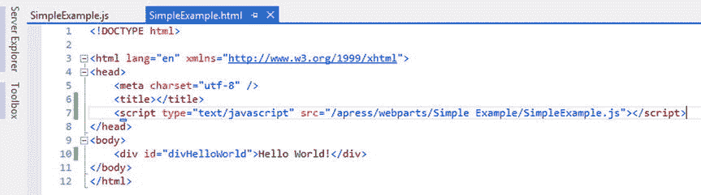

图 4-19. 添加了脚本引用的 HTML 文件

保存包含新脚本引用的`SimpleExample.html`文件。接下来，您需要将两个文件上传到您在文档库中创建的 Simple Example 文件夹中，如图 4-20 所示。

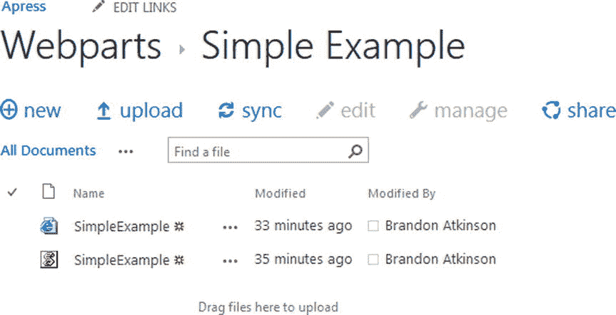

图 4-20. 上传到 Simple Example 文件夹中的 HTML 和 JavaScript 文件

至此，使用 Etherson 方法，您已经创建并上传了重新实现第 3 章示例所需的两个文件。如果您的解决方案更复杂，可以想象这个文件夹中会包含多个 JavaScript 文件、CSS 文件，甚至多个 HTML 文件。这一切都取决于您需求的复杂或简单程度。接下来，让我们了解如何使用内容编辑器 Web 部件来使用这些文件。

## 内容编辑器 Web 部件

现在我们已经拥有了渲染内容所需的文件，接下来在页面上放置一个 CEWP 并使用这些文件。我们将使用第 3 章示例中的同一个网站和页面。如果页面上还有 CEWP 和 SEWP，请先删除它们，确保页面为空。将页面置于编辑模式，然后在页面上插入一个新的 CEWP。保存页面——我们稍后会回来处理这个 Web 部件。

导航回 Web 部件文档库，打开 Simple Example 文件夹。右键单击`SimpleExample.html`文件，从菜单中选择复制链接位置，如图 4-21 所示。

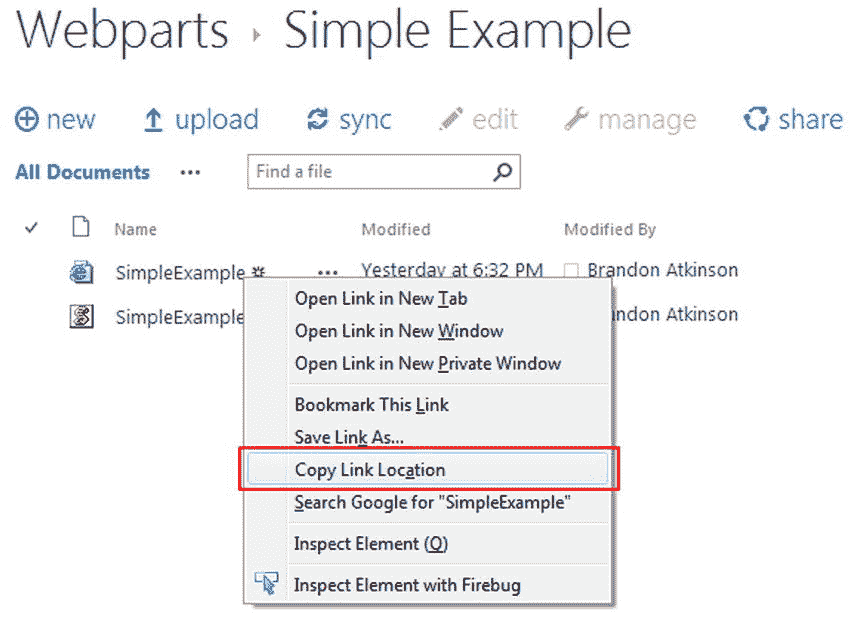

图 4-21. 复制 HTML 文件的位置

根据您使用的浏览器，此选项的名称可能不同。例如，如果使用 Internet Explorer，您应选择复制快捷方式。无论使用哪种浏览器，右键单击都会提供复制文件 URL 的选项。复制完成后，您可以导航回包含 CEWP 的页面。

将页面置于编辑模式，然后将 CEWP 置于编辑模式。与第 3 章类似，在 CEWP 的工具窗格中，第一个属性是标题内容链接。将您复制的 URL 粘贴到此文本框中，如图 4-22 所示。

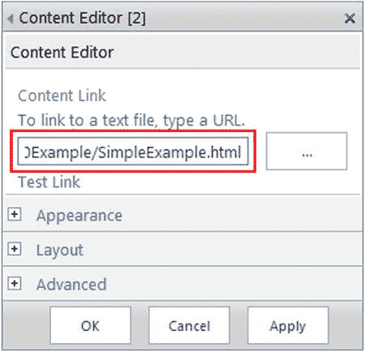

图 4-22. CEWP 内容链接属性中`SimpleExample.html`文件的 URL

与第 3 章的示例不同，由于此 HTML 文件包含对 JavaScript 文件的引用，我们只需将文件的 URL 放入内容链接属性中。当 HTML 文件加载时，JavaScript 文件也会随之加载。在此示例中，无需使用脚本编辑器 Web 部件。单击确定，然后保存页面。页面重新加载后，HTML 文件将渲染显示，如图 4-23 所示。

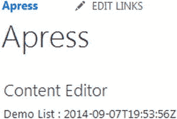

图 4-23. 在内容编辑器 Web 部件中渲染的`SimpleExample.html`文件

此时，您可能会想，既然使用 CEWP 和 SEWP 可以更快地得到结果，为什么还要进行这么多设置和配置呢？使用 Etherson 方法的好处，在更贴近实际场景的解决方案中会更加明显。例如，假设您需要开发一个自定义解决方案，该方案可以聚合用户正在关注的任务和文档，并将它们放入一个链接列表中，供用户点击查看项目。它将部署在网站集中每个部门子网站的主页上。使用 CEWP/SEWP 方案，您不仅需要将代码粘贴到每个页面上，如果之后需要修改解决方案，您还必须更新该代码的所有实例。这可能是一个巨大的挑战。而使用 Etherson 方法，您仍然需要在每个网站中添加一个 CEWP，但只需引用一组代码文件。如果需要修改，您只需在一个地方更新代码。这要容易管理得多。

这种方法的另一个好处是，CEWP 可以为您处理一些错误。如果由于某种原因，HTML 文件不再可用——例如被移动或删除——CEWP 可以向用户显示一条友好消息。为了演示这一点，让我们从 CEWP 中移除内容链接，然后单击应用按钮。Web 部件中的内容将被移除，您将得到一个空白的 CEWP，如图 4-24 所示。

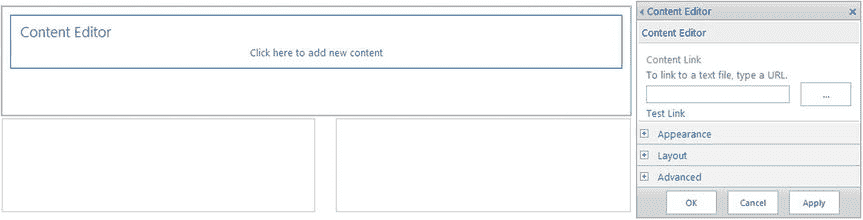

图 4-24. 内容链接被移除后的内容编辑器 Web 部件

至此，你已基本将 CEWP 恢复至刚添加时的初始状态。点击 Web 部件中央的“单击此处添加新内容”链接。你会注意到 Web 部件中出现了光标，此时可直接输入文本。在此处添加文本“抱歉，我们遇到了错误。”接下来，将 `SimpleExample.html` 的链接重新添加到“内容链接”属性中，如图 4-25 所示。

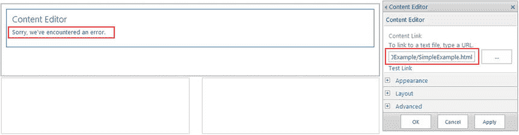

图 4-25. 放置在内容编辑器 Web 部件中的纯文本和内容链接 URL

单击“确定”，然后保存页面。你会注意到 Web 部件的外观与仅使用“内容链接”属性时完全相同。纯文本消息未显示，而是渲染了 HTML 页面的内容。CEWP 始终优先使用添加到“内容链接”属性的任何 URL，而非显示其可能包含的纯文本。现在，让我们从 Simple Example 文件夹中删除 HTML 和 JavaScript 文件，如图 4-26 所示。

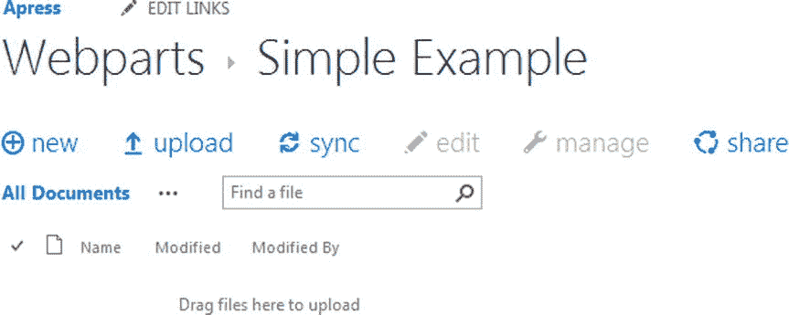

图 4-26. 从 Simple Example 文件夹中删除 HTML 和 JavaScript 文件

一旦 HTML 文件被删除，CEWP 将无法再加载它；它已经不存在了。由于在 Web 部件中提供了纯文本，它现在将显示你加载的错误消息，如图 4-27 所示。

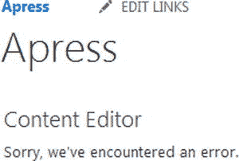

图 4-27. 当 Web 部件无法加载 HTML 文件时显示的纯文本消息

在开发过程中，你需要对错误进行编码处理，但 CEWP 内置的这种回退机制是一个很好的选择，以防其他问题出现。你应始终以这种方式提供一些内容。有许多场景会导致 CEWP 无法访问你的 HTML 文件，例如：

- 文件从文件夹中被删除（就像我们刚才做的那样）
- 发生网络错误
- 你在“内容链接”属性中手动输入 URL 时拼错了文件名

利用此功能以防万一绝对是个更好的选择。现在，让我们更新上一个示例中的代码，使其不仅能显示列表名称，还能做更多事情。

## 处理列表数据

上一个示例向你介绍了 Etherson 方法。至此，你有了一个 HTML 文件和一个 JavaScript 文件，它们可以提取列表数据并显示出来。这还不错，但显然这不是你在实际解决方案中会采用的方式。因此，让我们扩展这段代码，实际从列表中提取一些数据并展示给用户。如果你还没做过，请向你的“演示列表”中添加一些数据，如图 4-28 所示。

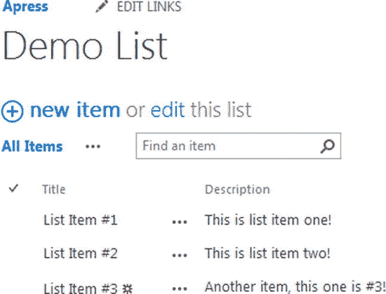

图 4-28. 填充了几个项目的演示列表

此列表中的项目目前无关紧要；我们只需要一些数据来提取和显示。请随意添加任意数量的项目；我们将全部获取。现在列表中有了更多数据，我们将更新之前的 `SimpleExample.js` 文件，以便请求列表项而非列表数据。请使用以下代码更新你的文件：

```javascript
// 你的 JavaScript 代码将放在这里
```

```
$(function () {
  $.ajax({
    url: "/apress/_api/web/lists/GetByTitle('Demo List')/items",
    type: "GET",
    headers: {
      "accept": "application/json;odata=verbose"
    },
  }).success(function (data) {
    var listItemInfo = "";
    $.each(data.d.results, function (key, value) {
      listItemInfo += "<strong>Title: </strong>" + value.Title + " <strong>Description: </strong>" + value.Description + "<br />";
    });
    $("#divHelloWorld").html(listItemInfo);
  });
});
```

这段代码与之前的代码类似，但增加了一些关键内容。首先，AJAX 调用中的 URL 已更新，末尾添加了 `/items`：

```
url: "/apress/_api/web/lists/GetByTitle('Demo List')/items"
```

我们仍然在调用同一个列表，但这次需要让 REST API 知道我们想要列表中的项目。通过仅提供 `/items` 而不附加其他信息，我们是在告诉 API 返回列表中的所有项目。

**注意：** 除非你确信列表中的数据量不会很大，否则在任何数据调用中都不应请求所有项目。你可以通过提供限制条件或使用 CAML 查询来限制返回的数据量，从而仅返回你需要的项目。本书后面会深入探讨这些选项。

在 JavaScript 的成功函数中，我们将遍历所有返回的数据：

```
var listItemInfo = "";
$.each(data.d.results, function (key, value) {
  listItemInfo += "<strong>Title: </strong>" + value.Title + " <strong>Description: </strong>" + value.Description + "<br />";
});
```

我们从一个新的空变量 `listItemInfo` 开始。该变量用于保存我们在遍历 API 调用结果时构建的所有 HTML。接下来，我们使用 jQuery 内置函数 `each` 来遍历结果。通过使用 `$.each`，我们表示对于 `data.d.results` 对象中的每一个项目，执行以下函数。你会在自定义解决方案中频繁使用此函数，因为遍历列表项非常常见。

与我们之前简单显示列表属性和数据的示例类似，我们看到了熟悉的 `data.d` 对象。但这次，我们有了一个名为 `results` 的新属性。当我们查询列表以获取其数据时，所需的所有信息都位于 `d` 属性下；例如，`d.Title`。当你请求列表项时，所有数据将位于 `results` 属性中。

在 `each` 函数内部，我们将 `listItemInfo` 变量设置为一些 HTML，这些 HTML 用于获取当前列表项的“标题”和“描述”。使用 `+=` 语法，我们将变量设置为当前值加上新值。这是一种简单的方法，可以在前一循环有 HTML 内容时附加到它上面。循环完成后，我们将 HTML 设置到 Hello World DIV 中：

```
$("#divHelloWorld").html(listItemInfo);
```

图 4-29 显示了 Visual Studio 中的完整文件。

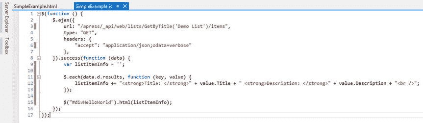

**图 4-29.**

### Visual Studio 中更新的 `SimpleExample.js` 文件

保存包含更新代码的文件。在上传到文档库之前，让我们快速更改 CEWP（内容编辑器 Web 部件）的标题，以使这个示例更贴近实际。导航回到放置 Web 部件的页面，并将其切换到编辑模式。展开“外观”（Appearance）折叠面板，并更新“标题”（Title）属性，如图 4-30 所示。

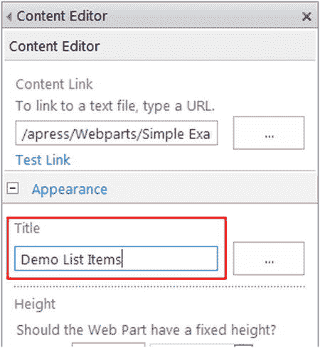

**图 4-30.** 更新内容编辑器 Web 部件的标题

单击“确定”（OK），然后保存页面。将更新后的 `SimpleExample.js` 文件上传到“Web 部件”文档库中的“Simple Example”文件夹。系统将弹出一个对话框询问您是否要替换当前文档；单击“确定”（OK）。Etherson 方法的优点依然有效；由于您在文档库中启用了版本控制，您可以毫无压力地替换文件。如果出现错误，您可以恢复之前的版本！导航回您的页面，您将看到更新后的代码正在获取列表项并显示它们，如图 4-31 所示。

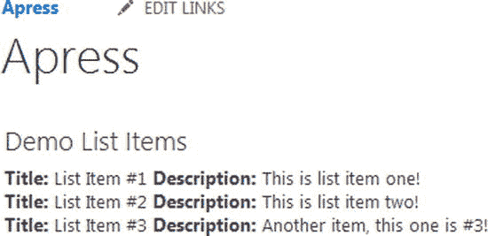

**图 4-31.** 更新后的 JavaScript 正在获取列表项

结合更新后的标题，这个 CEWP 现在看起来更像一个实际的解决方案！当然，我们在这里所做的只是重新创建一个开箱即用的列表视图 Web 部件，但这应该已经展示了使用 HTML 和 JavaScript 开始处理 SharePoint 数据是多么容易。接下来，让我们继续了解 Etherson 方法的一些优点。

## 使用版本控制回滚更改

在本章前面，当您创建用于存放自定义代码的文档库时，您启用了版本控制。在开发过程中，您在编写代码时难免会犯错误，并且这些错误可能会逃过测试。这种情况我们都会遇到，而且无法避免。幸运的是，如果开启了版本控制，您可以在发生这种情况时快速回滚更改。您可能会发现，仅仅因为用户对最新版本的代码不满意，就需要进行回滚。无论原因如何，操作起来都既快又简单。

当您上传新版本的 `SimpleExample.js` 文件时，系统会询问您是否要替换现有版本。通过单击“确定”（OK），您在库中创建了该文件的一个新版本。由于版本控制已开启，您只需点击几下即可恢复之前的版本。导航到“Simple Example”文件夹，单击 `SimpleExample.js` 文件的菜单，如图 4-32 所示。

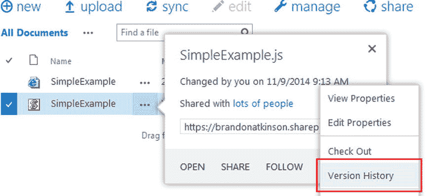

**图 4-32.** 访问文件的版本历史记录

打开菜单后，您需要访问次级菜单，在其中可以找到“版本历史记录”（Version History）选项。单击此选项，将出现一个对话框，显示该文件的所有版本。此处显示的版本数量取决于您如何设置库。例如，如果您将版本数量限制为五个，那么这里只会显示五个以前的版本。选择您想要的版本；在本例中，它将是列表中的第二个版本。版本按上传日期升序排列。使用菜单选项，选择菜单中的“还原”（Restore），如图 4-33 所示。

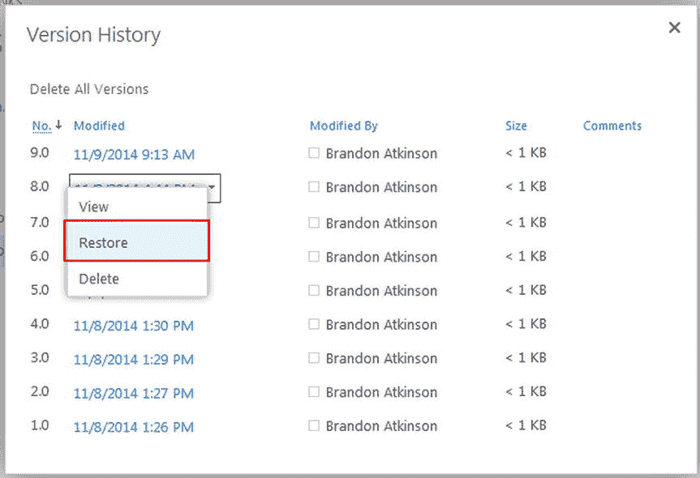

**图 4-33.** 还原文件先前的版本

单击“还原”（Restore）选项后，系统会显示一个确认对话框，内容为“您即将用选定的版本替换当前版本”。单击“确定”（OK）确认还原，屏幕将刷新。一个新版本会被添加到列表中。导航回包含 CEWP 的页面并刷新它。您可能需要通过按键盘上的 `Ctrl+F5` 来执行硬刷新；这将指示浏览器从服务器加载 JavaScript 文件的全新副本。结果应该是加载了关于列表数据的先前脚本，如图 4-34 所示。

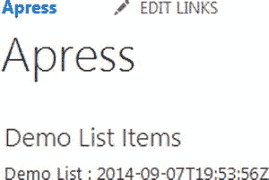

**图 4-34.** 在内容编辑器 Web 部件中显示已还原的文件

这里需要注意的一点是，虽然脚本内容已更新，但 Web 部件的标题保持不变。由于这是拼图的两个独立部分，还原脚本文件不会对 Web 部件本身产生任何影响！

## 使用 Firebug（开发者工具）进行调试

无论你使用何种工具、语言或环境编写代码，都需要具备调试能力。简单来说，就是让代码暂停运行，然后逐行检查，看看传入的数据是什么，以及代码如何处理这些数据。由于 Etherson 方法使用了 HTML 和 JavaScript，你可以轻松地通过浏览器中的 Firebug 或开发者工具进行调试。正如第 1 章所述，我们将使用 Firebug，它是 Firefox 的一个插件。你也可以使用任何浏览器自带的开发者工具。要启动这些工具，只需按下键盘上的 `F12` 键，工具就会在屏幕底部打开，如图 4-35 所示。
```

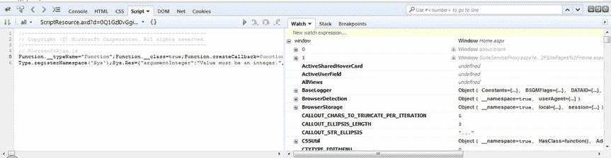

*图 4-35. Firefox 中的 Firebug 控制台窗口*

如果默认未选中，请在 Firebug 中选择“脚本”选项卡。如果这是你第一次启动 Firebug，你可能需要拉下该选项卡的箭头，在选项中选择**启用**来开启脚本调试。此选项卡允许你检查页面加载的所有脚本。左侧窗格显示你正在查看的当前脚本，右侧窗格显示已加载的任何 JavaScript 对象。这些对象位于右侧窗格的“监视”选项卡下。让我们通过左侧窗格上方的下拉列表打开我们的 `SimpleExample.js` 脚本，如图 4-36 所示。

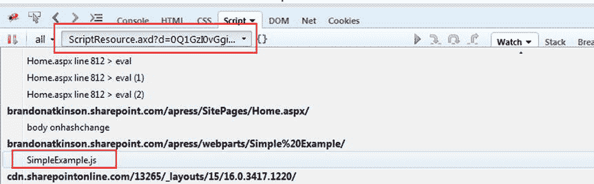

*图 4-36. 在 Firebug 中定位 `SimpleExample.js` 文件*

此列表包含页面加载的所有 JavaScript 文件。向下滚动直到找到 `SimpleExample.js`，然后单击它。你会注意到 Firebug 会提供脚本加载的路径，这在需要在你环境中定位该文件时非常方便。单击该文件，它将加载到左侧窗格中，如图 4-37 所示。

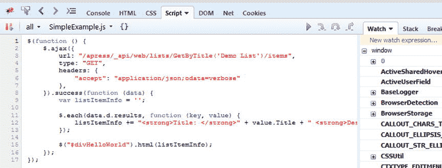

*图 4-37. `SimpleExample.js` 文件已加载到 Firebug 中*

你会注意到脚本文件左侧提供了行号。当抛出错误时，这些行号非常有用，因为浏览器会告诉你错误发生在哪一行。你可以通过单击某个行号来设置断点。断点就是你的代码将停止运行的位置，以便你可以检查正在发生的事情。你可以设置多个断点；事实上，你甚至可以在每一行都设置一个。当你设置断点时，行号旁边会出现一个红点，如图 4-38 所示。

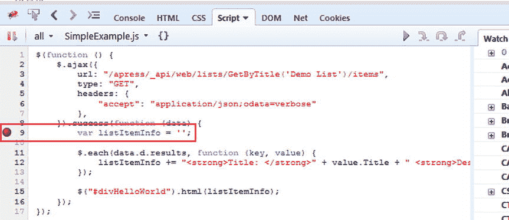

*图 4-38. 在 JavaScript 文件中放置断点*

一旦设置了断点，你就可以重新加载页面，当脚本加载后，它会在执行到断点时停止运行。当红点内部出现黄色箭头并且该行被高亮显示时，你就可以看到这种情况，如图 4-39 所示。

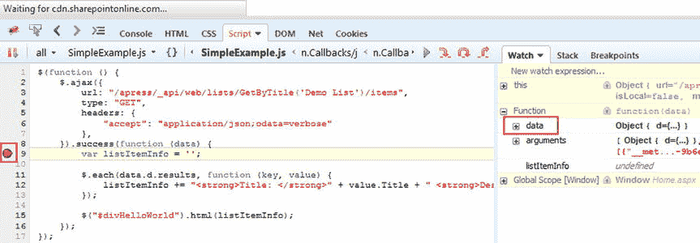

*图 4-39. 在 Firebug 中调试 `SimpleExample.js` 时命中断点*

现在脚本已停止，你可以查看右侧窗格的“监视”选项卡，并查看脚本正在使用的对象。例如，在这个 `success` 函数中，我们声明了一个名为 `data` 的变量，它用于存放结果。现在，“监视”选项卡中有一个 `data` 对象可供我们检查。单击 `data` 旁边的 + 图标，你可以展开它查看其属性。继续单击 + 图标，直到你看到结果，如图 4-40 所示。

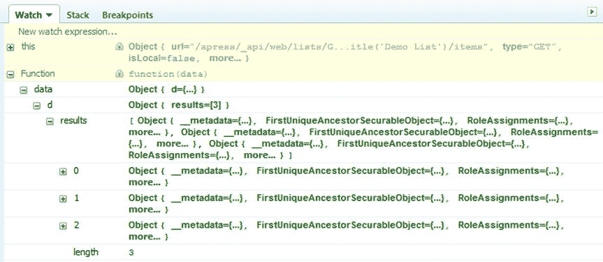

*图 4-40. 从 REST API 返回的数据对象*

我们知道列表中返回了多少个项目，并且可以在 `results` 对象中看到它们。它们由其索引或位置来标示，索引始终从 0 开始。你还可以进一步展开这些项目并查看它们的属性。单击索引为 0 的项目旁边的 + 图标。你可以看到 SharePoint 返回了大量关于列表项的数据。这不仅限于列表项——你在 SharePoint 中请求数据的几乎所有内容都会附带大量信息。向下滚动以探索项目中的所有属性，你会发现我们在脚本中显示的 `Title` 和 `Description` 属性，如图 4-41 所示。

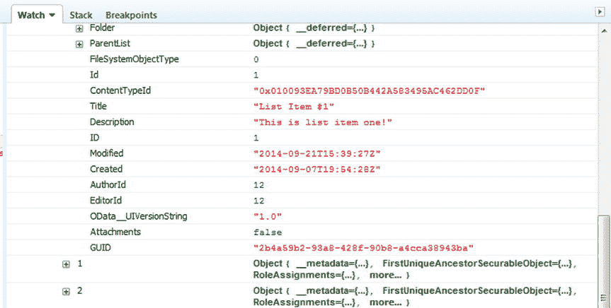

*图 4-41. 展开第一个列表项以检查其属性*

在开发自定义解决方案时，调试会证明对你极其有用，因为你可以检查所有返回的数据，确保它正是你所需要的。它也非常方便，因为有时数据并不在你认为的地方。由于脚本在此处已停止，你有几种方法可以重新启动它。按下键盘上的`F10`键将使脚本逐行向前移动。这非常有帮助，因为你可以看到每一行执行时会发生什么。某些代码块会一起执行；例如，如果你使用`F10`单步执行代码，`$.each` 循环内的所有代码将作为一个单步执行。你也可以轻松地在循环内部放置另一个断点，以在那里停止。

另一个选项是使用箭头图标，如图 4-42 所示。

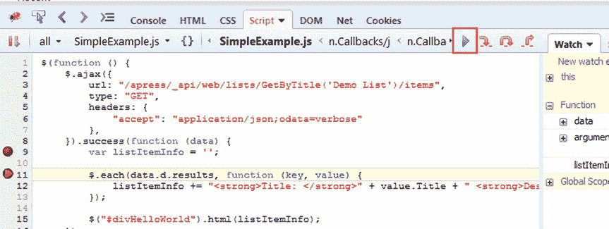

*图 4-42. 通过单击“播放”图标继续运行脚本*

此图标只是告诉调试器继续并恢复处理脚本。如果不存在其他断点，它将完全完成脚本的处理。不同开发者工具之间的按钮和文件位置可能差异很大。你可以在图 4-43 和 4-44 中看到 Chrome 和 Internet Explorer 的开发者工具。

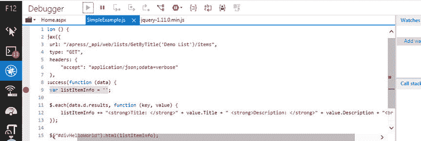

*图 4-44. Internet Explorer 11 中的开发者工具*

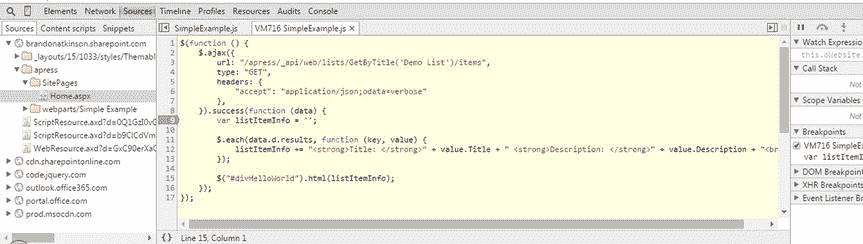

*图 4-43. Chrome 中的开发者工具*

无论你使用哪个浏览器，或者开发者工具看起来多么陌生，请放心，它们都执行相同的功能。你可以检查 HTML、查看和更改 CSS，最重要的是，调试你的 JavaScript。随着你在使用 HTML 和 JavaScript 开发自定义解决方案的道路上不断前进，你会发现这些工具一如既往地重要。

## 总结

本章向你介绍了使用 HTML 和 JavaScript 构建自定义解决方案的 Etherson 方法。我们涵盖了各个组件，你看到了如何配置每个组件，并了解了它们如何作为一个整体协同工作。你构建了几个示例解决方案，并看到了在上传新文件后如何轻松恢复代码。在学习本书的过程中，我们将继续在许多示例中使用这种方法，你将学习如何使用 CSS 来扩展它。

在下一章中，我们将探讨如何使用 `JSLink` 来样式化和增强列表视图 Web 部件。`JSLink` 是一种令人兴奋的新方式，可以为开箱即用的 SharePoint 带来更多功能。它还可以与 JavaScript 结合，创建非常独特的解决方案，以满足你的业务需求。