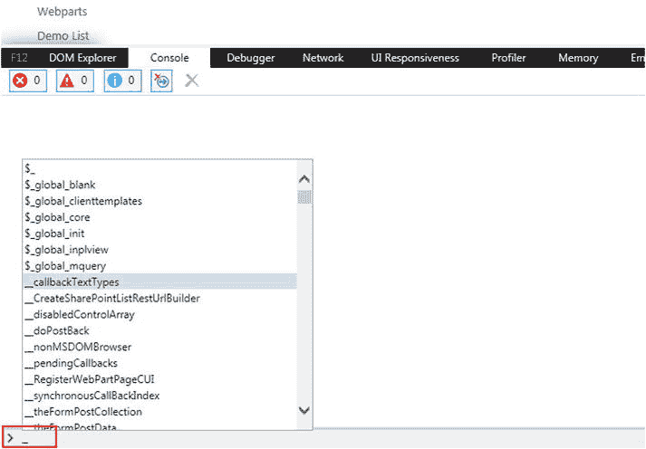
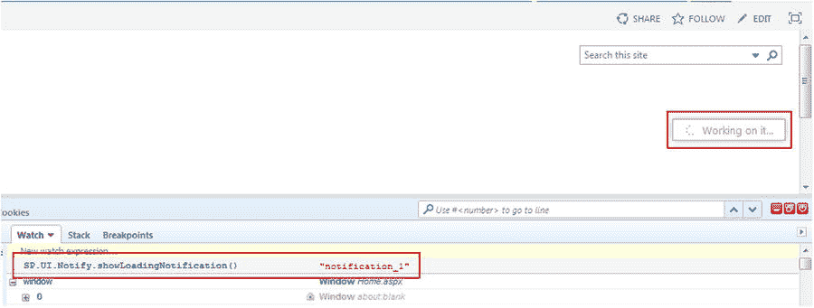
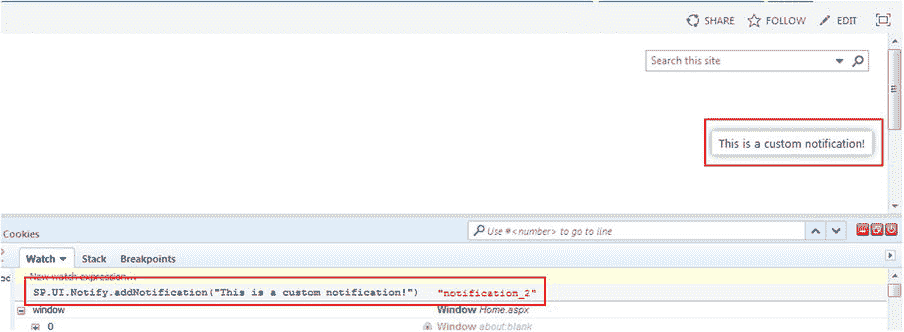
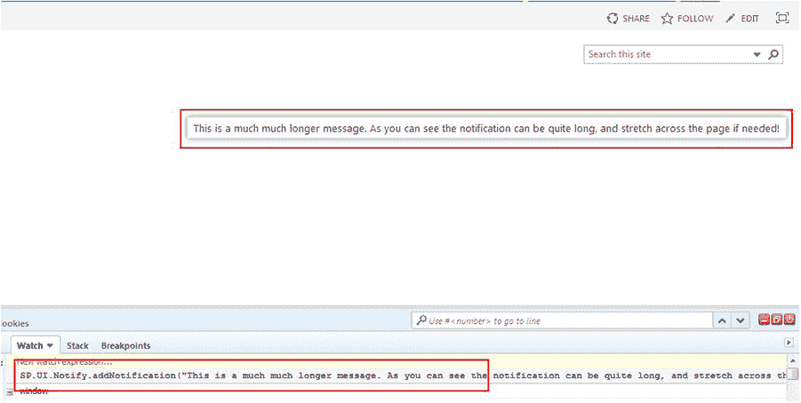
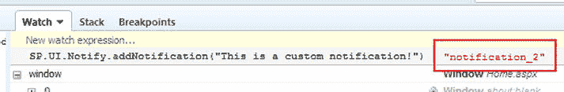
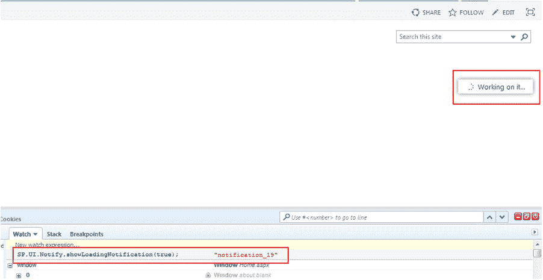

# 7. 使用 SharePoint 内置的 JavaScript 函数和属性

在使用 JavaScript 构建自定义解决方案时，通常需要其他库的帮助才能完成工作。我们已经看到了 jQuery 库的强大功能，以及它如何帮助我们定位页面上的 HTML 元素、更新它们的值，甚至进行 AJAX 调用以获取数据。在使用 SharePoint 时，你经常需要构建 URL、向用户显示通知等操作。幸运的是，微软提供了大量的 JavaScript 来帮助你完成这些任务。我不仅仅是在谈论 JavaScript 对象模型或 REST API。在本章中，我们将探索一些随时可用的内置 JavaScript 函数和属性，以帮助你构建自定义解决方案。

## 探索 JavaScript

SharePoint 附带一长串内置的 JavaScript 方法和属性，你可以在代码中使用它们。事实上，这个列表非常长，一旦深入其中，会让人感到不知所措。不过，在日常的编码工作中，你会很快熟悉其中的一小部分，并且可以放心，因为知道在需要时还有更多帮助。首先，让我们使用 Internet Explorer 11 的开发人员工具来探索一些文件。正如本书前面提到的，每个浏览器都有自己的一套开发工具，且每个工具都略有不同。你完全可以在每个浏览器中执行相同的任务，但 IE11（和 Chrome）在 JavaScript 控制台中输入时会显示一个便捷的可用函数列表，如图 7-1 所示。



图 7-1. IE11 中的开发人员工具。在控制台窗口中输入下划线将显示可用 JavaScript 函数的列表

按键盘上的 `F12` 键打开 IE11 中的开发人员工具。你也可以通过浏览器中的设置按钮访问它们。单击“控制台”选项卡，然后在底部的文本框中输入一个下划线。将会打开一个列表，显示所有以下划线开头的 JavaScript 函数。你可以使用箭头键在列表中上下移动。

花几分钟浏览一下你在这里看到的所有内容。这应该会让你很好地了解使用 JavaScript 操作 SharePoint 的可能性。你已经看到其中一些函数的实际应用；例如，在使用 JSLink 时，我们利用了 `SPClientTemplates` 功能来覆盖 Web 部件的呈现。

**注意**

可用的 JavaScript 方法和属性非常广泛。以至于无法在一章中充分涵盖；这需要整本书的篇幅。我们将学习一些功能并在示例代码中使用它们。你应该花些时间在开发人员工具中充分探索这些函数，并使用 Google 或 Bing 查找更多信息。

### `_spBodyOnLoadFunctions`

`_spBodyOnLoadFunctions` 是一个数组，其中包含一组应在页面加载时触发的 JavaScript 函数。我们在第 5 章中看到过它，当时需要连接一个函数以在页面加载时触发。该数组包含一个名为 `push` 的方法，你可以在其中传入一个应触发的函数名称：

```
_spBodyOnLoadFunctions.push(<FUNCTION_NAME>);
```

当你无法访问 jQuery 的 `Document.ready()` 函数时，这是一个非常有用的函数。还有一个等效函数叫做 `ExecuteOrDelayUntilBodyLoaded`，它执行相同的任务，甚至具有相同的签名：

```
ExecuteOrDelayUntilBodyLoaded(<FUNCTION_NAME>);
```

### `_spPageContextInfo`

在编写任何类型的代码时（无论是 JavaScript 还是 C# 之类的语言），总会有时候需要了解有关页面、位置或其他环境变量的信息。`_spPageContextInfo` 对象可以轻松提供大量有用的信息。在本书的大多数示例中，它用于提供位置信息，以构建请求数据的 URL。起初，这可能看起来不是特别重要的信息，但在进行 REST API 调用或通过 JavaScript 对象模型定位其他网站时，它变得极其重要。

**注意**

`_spPageContextInfo` 对象上的所有属性都可以在 Firebug 或开发人员工具中轻松访问。只需打开 JavaScript 控制台窗口，输入每个属性即可查看你环境的结果。

#### `_spPageContextInfo.siteAbsoluteUrl`

此属性提供用户当前所在网站集的绝对 URL。绝对 URL 是完全限定的 URL，包含协议（`http://` 或 `https://`）和域（`www.yoursite.com`）。由于 SharePoint 可以利用备用访问映射，允许你为相同内容使用不同的域，因此此函数提供了一种非常有用的方式来构建 URL，而无需担心用户从何处访问页面。

由于这是指向网站集的路径，因此生成的 URL 可能类似于以下任意一种：

*   `http://www.<DOMAIN>.com`

*   `http://www.<DOMAIN>.com/sites/<SITE_NAME>`

#### `_spPageContextInfo.siteServerRelativeUrl`

此属性提供用户当前所在网站集的服务器相对 URL。相对 URL 只是省略了 URL 中的协议和域。这是一个方便的工具，因为很多时候你需要网站集的相对 URL。如前所述，由于 SharePoint 内容可以在许多不同的域上访问，因此定位相对 URL 允许你在多个域上发布相同的代码，而无需担心代码将在何处运行。

例如，如果你在根网站集中调用此属性，则生成的 URL 将简化为 `/`。

#### `_spPageContextInfo.webAbsoluteUrl`

此属性提供用户当前所在 Web 或网站的绝对 URL。这是完全限定的 URL，包含协议和域。生成的 URL 代码如下所示：

*   `http://www.<DOMAIN>.com`

*   `http://www.<DOMAIN>.com/<SUBSITE>`

*   `http://www.<DOMAIN>.com/sites/<SITE_COLLECTION>/<SUBSITE>`

#### `_spPageContextInfo.webServerRelativeUrl`

此属性提供用户当前所在 Web 或网站的服务器相对 URL。与网站相对 URL 一样，它省略了 URL 中的协议和域。生成的 URL 代码如下所示：

*   `/`

*   `/<SUBSITE>`

*   `/sites/<SITE_COLLECTION>/<SUBSITE>`

### `ExecuteOrDelayUntilScriptLoaded`

此函数允许你指定一个 JavaScript 函数，使其延迟到另一个脚本完全加载后再执行。本质上，我们是在告诉 SharePoint：“我想运行这个特定函数，但我需要等到另一个脚本加载完毕。”它具有以下签名：

```
ExecuteOrDelayUntilScriptLoaded(<FUNCTION_NAME>, <SCRIPT_FILE>);
```

SharePoint 首先检查指定的 JavaScript 文件是否已加载；如果已加载，则立即执行指定的函数。如果文件尚未加载，它会将该函数调用放入队列中，稍后再执行。在下一章中，当使用 JavaScript 对象模型查询用户数据时，我们将使用此函数：

```
$(function () {
    ExecuteOrDelayUntilScriptLoaded(getUserProfileProperties, "sp.userprofiles.js");
});

function getUserProfileProperties() {
    var clientContext = new SP.ClientContext();
    ...
```

正如你在此代码片段中所见，我们有一个 jQuery `Document.ready()` 函数，其中放置了 `ExecuteOrDelayUntilScriptLoaded` 函数。我们传入了函数 `getUserProfileProperties` 和 JavaScript 文件 `sp.userprofiles.js`。我们需要在此处实现此函数，因为只有加载了 `sp.userprofiles.js` 文件，我们函数中包含的代码才能运行。SharePoint 提供了一种简单的方法来确保你代码中的功能正常运行！

**注意**

# SharePoint 2010 遗留功能

`ExecuteOrDelayUntilScriptLoaded` 功能是 SharePoint 2010 的遗留功能，当时它位于 `SP.SOD` 对象下。在 SharePoint 2013 中，某些情况下（通常是在发布门户页面上）较新的版本可能无法正常工作。如果你发现此函数不起作用，可以回退到 2010 年的实现。更多信息请参见 [`http://msdn.microsoft.com/en-us/library/office/ff408081%28v=office.14%29.aspx`](http://msdn.microsoft.com/en-us/library/office/ff408081%28v=office.14%29.aspx)。

## SP.UI.Notify

`SP.UI.Notify` 对象提供了多种方式来通知用户正在发生的事情。此功能允许您利用现成的 SharePoint 通知，使您的自定义解决方案能够无缝融入环境。尽管本书中的示例未使用此通知框架，但可以轻松重构以在创建或删除操作发生时包含通知。在可能的情况下，通知用户正在发生的事件始终是一个好习惯。

### SP.UI.Notify.showLoadingNotification

`SP.UI.Notify.showLoadingNotification` 函数是一种快速简便的方法，用于显示熟悉的“正在处理...”通知。如果您使用过 SharePoint 一段时间，一定见过这些从屏幕右侧弹出的消息之一。它包含一个“旋转”图标，如图 7-2 所示。



图 7-2. 通过 Firebug 启动的加载通知

您可以随时在代码中使用以下行启动此通知：

`SP.UI.Notify.showLoadingNotification();`

实际上，您也可以启动 Firebug 或开发者工具，直接在浏览器中调用它。图 7-2 显示通过 Firebug 控制台触发的通知。

这是一种快速方便的方法，用于通知用户您的代码正在执行某些操作。虽然这种通用通知在某些情况下可能足够，但您可能需要提供更多关于正在发生什么的解释。为此，您可以使用 `SP.UI.Notify.addNotification` 方法。

### SP.UI.Notify.addNotification

与之前的函数类似，`SP.UI.Notify.addNotification` 用于在同一位置向用户显示通知，但带有自定义消息。当您需要通知用户正在发生的操作，但需要比简单的“正在处理...”消息更具描述性时，这非常完美。图 7-3 显示了一条自定义消息。



图 7-3. 显示自定义消息以通知用户

您可以使用以下行启动此通知：

`SP.UI.Notify.addNotification("Your Custom Message");`

如您所见，通过 JavaScript 添加自定义通知非常简单。您显示的消息没有最大长度限制。然而，随着消息变长，最终会碰到屏幕的另一侧，文本开始换行。这有时可能布局不正确，因此最好保持消息简短。图 7-4 显示了一条较长的消息。



图 7-4. 可以通过通知显示较长的消息

通知仅在页面上停留约 6 秒。如果您只需要通知用户某个操作已发生，但不需要等待响应，这完全没问题。然而，有时您需要启动一个操作并等待结果。在这种情况下，您可能需要通知停留更长时间。您可以通过使用以下行包含一个 `Boolean` 值来指示通知应保留：

`SP.UI.Notify.addNotification("Your Custom Message", true);`

通过使用上述行，通知将一直保留，直到手动关闭。您可以通过调用 `SP.UI.Notify.removeNotification` 函数并传入 `addNotification` 函数调用返回的通知 ID 来实现。当您调用 `addNotification` 函数时，您将获得刚创建的通知的 ID，如图 7-5 所示。



图 7-5. 创建新通知时返回的通知 ID

如果我们在代码中使用它，该行将如下所示：

`var notifyId = SP.UI.Notify.addNotification("Hello World", true);`

当我们执行这一行时，`notifyId` 变量现在包含新创建的通知的 ID。我们稍后可以使用以下行关闭通知：

`SP.UI.Notify.removeNotification(notifyId);`

`SP.UI.Notify.removeNotification` 只需接受通知的 ID 并将其从屏幕上移除。您也可以在调用 `showLoadingNotification` 函数时使用 `Boolean` 标志：

`SP.UI.Notify.showLoadingNotification(true);`

传入 `Boolean` 会触发相同的通知 ID 返回，如图 7-6 所示。



图 7-6. 使用 Boolean 标志时返回的通知 ID

这些函数提供了一种通过 JavaScript 轻松通知用户正在发生的事情的方法。例如，如果您需要执行长时间运行的 AJAX 调用，您可以告知用户正在发生此操作，这样他们就不会对您的 Web 部件失去耐心。

## 摘要

微软不仅为开发者提供了通过 JavaScript 访问数据的方法，还让他们能够利用核心 SharePoint 功能。在本章中，我们探讨了可用的内置 JavaScript 函数和属性的一小部分。我们学习了如何访问位置数据以更轻松地为 REST API 调用和超链接构建 URL。我们了解了如何在 SharePoint 中向 body 的 onload 事件加载函数调用，以及如何确保在代码执行之前功能可用。最后，我们探讨了一些通知用户您的代码正在执行操作的不同方式，以提供更好的用户体验。