# 8. 使用 JavaScript 对象模型

到目前为止，您已经了解了使用 HTML 和 JavaScript 在 SharePoint 中创建自定义解决方案的几种不同方法。在本章中，我们将继续探索使用 Etherson 方法创建自定义 Web 部件以及 JavaScript 对象模型。我们在第 2 章中简要介绍了 JavaScript 对象模型（JSOM）。在本章中，我们将学习如何使用 JSOM 处理列表、库、文件、网站和社交数据。您将了解各种处理 SharePoint 数据的方法，并开始充分领略这项技术的强大之处。

JSOM 能够为您的开发需求提供广泛的选择。您可以创建新的列表和网站；您可以读取文件并与社交数据交互。到本章结束时，您将扎实掌握如何编写 JSOM 代码，并了解其能力范围。

注意

利用 JavaScript 对象模型的代码在登录用户的上下文中运行。这意味着代码只能执行用户权限级别允许的操作。例如，如果您的代码要在网站集中创建新的子网站，但登录用户没有该权限，代码将运行但会产生错误。在构建解决方案时请记住这一点，确保不要向用户显示他们无法使用的选项。


## 准备工作

在开始之前，我们需要为本书一直在使用的演示列表添加一些额外数据。添加更多数据可以让我们查询更多信息并应用筛选条件。导航至演示列表，添加若干不同状态的新列表项。更新后的列表如图 8-1 所示。

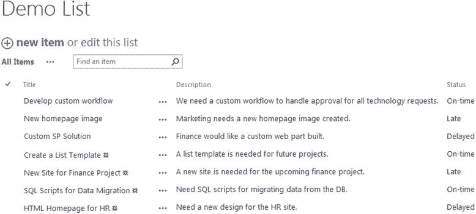

图 8-1. 添加了更多列表项的演示列表

现在列表中有更多数据了，我们开始研究如何使用 JSOM 查询数据。本章的示例将运用第 4 章中介绍的 Etherson 方法。导航至网站中的 `Webparts` 文件夹，新建一个名为 `Chapter 8` 的文件夹，如图 8-2 所示。

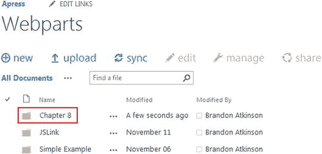

图 8-2. Webparts 文档库中的 Chapter 8 文件夹

本章所有示例均遵循相同模式：我们将依次查看内容编辑器 Web 部件中渲染的 HTML 文件、用于检索和渲染数据的 JavaScript 文件，以及最终结果。在此过程中，我们会深入分析每个文件并解释其工作原理。

## 处理列表

列表在 SharePoint 中无处不在！用户在 SharePoint 中交互的大部分内容都是列表。以下示例将演示通过代码与列表交互的多种方式。

### 获取列表数据

本示例将简单检索一些列表数据并展示给用户。

#### HTML

在 Visual Studio 中新建一个 HTML 文件，命名为 `JSOMGetListData.html`。本例的 HTML 代码非常简洁，仅包含以下几行：

```html
<script type="text/javascript" src="/_layouts/15/sp.runtime.js"></script>
<script type="text/javascript" src="/_layouts/15/sp.js"></script>
<script type="text/javascript" src="/apress/webparts/chapter 8/JSOMGetListData.js"></script>
<div id="divGetListData"></div>
```

首先，请注意我们需要加载两个 SharePoint JavaScript 文件：`sp.runtime.js` 和 `sp.js`。这两个文件至关重要，因为它们提供了正确运行 JSOM 代码所需的必要支持。在 SharePoint 2010 中，所有必需的 JavaScript 都会自动加载到每个页面。这使得 JavaScript 开发更为简单，开发者无需担心核心 SharePoint 脚本是否已加载。而在 SharePoint 2013 中，页面只加载满足需求的最简代码。这有助于提高页面加载速度，但也意味着如果需要特定库，必须确保其已加载。就本例而言，我们需要这两个文件。

接下来，我们加载自定义 JavaScript 文件 `JSOMGetListData`。该文件包含将数据加载到页面中 ID 为 `divGetListData` 的 DIV 元素所需的所有代码。总的来说，这个页面的内容并不多。

#### JavaScript

在 Visual Studio 中新建一个 JavaScript 文件，命名为 `JSOMGetListData.js`。相比之下，这个 JavaScript 文件更为复杂，包含以下代码：

```javascript
$(function () {
    getListData();
});

function getListData() {
    var clientContext = new SP.ClientContext();
    var oWebsite = clientContext.get_web();
    this.collList = oWebsite.get_lists();
    clientContext.load(collList);
    clientContext.executeQueryAsync(
        Function.createDelegate(this, this.onQuerySucceeded),
        Function.createDelegate(this, this.onQueryFailed)
    );
}

function onQuerySucceeded() {
    var listInfo = '';
    var listEnumerator = collList.getEnumerator();
    while (listEnumerator.moveNext()) {
        var oList = listEnumerator.get_current();
        listInfo += 'Title: ' + oList.get_title() + ' - Created: ' +
            oList.get_created().toString() + '<br />';
    }
    $("#divGetListData").html(listInfo);
}

function onQueryFailed(sender, args) {
    alert('Request failed. ' + args.get_message() +
        '\n' + args.get_stackTrace());
}
```

本书中大部分 JSOM 示例都遵循与本例相同的模式。下面我们逐行详细分析，以全面理解其工作原理。脚本从 jQuery 的 `Document.ready` 方法开始，该方法仅调用一个名为 `getListData` 的自定义函数，该函数执行 JSOM 调用，是核心代码所在。

首先，我们创建一个名为 `clientContext` 的新变量，并通过以下代码进行赋值：

```javascript
var clientContext = new SP.ClientContext();
```

客户端上下文是一个 SharePoint 对象，实际上是所有 JSOM 调用的入口点。它包含当前站点、用户、Web 等上下文的大量信息。在本例中，我们直接请求返回上下文，未传递任何参数，这样将自动返回当前站点的上下文。你也可以通过传入 URL 来请求其他站点的上下文，例如：`SP.ClientContext('http://www.site.com/')`。

接下来，我们创建另一个名为 `oWebsite` 的变量，并通过以下代码赋值：

```javascript
var oWebsite = clientContext.get_web();
```

这将返回用户执行代码所在的网站集内的当前网站（即 Web）。我们需要这个 Web 对象来获取所有列表。随后，通过以下代码创建名为 `collList` 的变量：

```javascript
this.collList = oWebsite.get_lists();
```

该变量用于存储从 `oWebsite` 变量中获取的所有列表。`collList` 的声明方式与其他变量略有不同，此处未使用 `var` 关键字，而是使用了 `this`。这样做的原因是，`this` 关键字会使该变量成为全局变量，以便后续处理数据的函数能够访问它。

接下来这一行代码，在初次使用 JSOM 时常常令人困惑：

```javascript
clientContext.load(collList);
```

这一行代码将查询“加载”到客户端上下文中，准备发送给 SharePoint。这意味着此时你实际上尚未向 SharePoint 发送任何数据请求。在大多数 JavaScript 开发中，你可能会认为像 `this.collList = oWebsite.get_lists();` 这样的代码会立即返回所有列表，然后就可以开始使用它们。但在 JSOM 中，情况并非如此。你必须先加载所有要发出的请求，然后通过以下代码提交：

```javascript
clientContext.executeQueryAsync(
    Function.createDelegate(this, this.onQuerySucceeded),
    Function.createDelegate(this, this.onQueryFailed)
);
```


只有在调用 `executeQueryAsync` 函数后，对 SharePoint 的请求才会实际发生。这一点在使用 JSOM 时至关重要，但很多开发者在刚开始接触时都会因此出错。之所以必须在提交请求前加载所有请求，是因为一项名为**批处理**的功能。简单来说，SharePoint 允许你加载多个数据请求，然后只需一次执行调用即可获取所有需要的数据。这有助于提升实际处理 JSOM 调用的服务器性能。本书中的示例虽未实际使用批处理，但了解这一概念依然很重要。

`executeQueryAsync` 方法允许你指定一个 `success` 函数和一个 `failure` 函数，这两个函数会在 SharePoint 返回查询结果后被调用。如前所述，这些函数是通过 `Function.createDelegate` 方法声明的。指定这些函数后，你需要创建实际的函数来处理结果。

```
function onQuerySucceeded() {
    var listInfo = '';
    var listEnumerator = collList.getEnumerator();
    while (listEnumerator.moveNext()) {
        var oList = listEnumerator.get_current();
        listInfo += '标题: ' + oList.get_title() + ' - 创建日期: ' + 
            oList.get_created().toString() + '<br />';
    }
    $("#divGetListData").html(listInfo);
}
```

此函数首先声明了一个名为 `listInfo` 的新变量，用于在页面显示之前保存所有查询结果。接着，我们通过 `collList.getEnumerator()` 方法从变量 `collList` 中获取一个枚举器，并将其存入名为 `listEnumerator` 的变量中。我们需要遍历返回的所有结果，而枚举器正好可以实现这一点。使用 `while` 循环，我们通过 `listEnumerator.get_current()` 方法遍历每个返回的条目。在每次循环中，我们从当前条目中获取标题和创建日期。我们还会添加更多 HTML 内容，并通过 `+=` 将内容追加到 `listInfo` 变量中。这样我们可以不断向 `listInfo` 变量添加内容，而不是每次都覆盖它。

最后，我们通过 `$("#divGetListData").html(listInfo);` 将 `listInfo` 变量的内容输出到 HTML 页面中的 DIV 元素里。

### 结果

将内容编辑器 Web 部件的“内容链接”属性设置为该 HTML 文件，并保存页面。结果将显示当前网站中的所有列表，如图 8-3 所示。

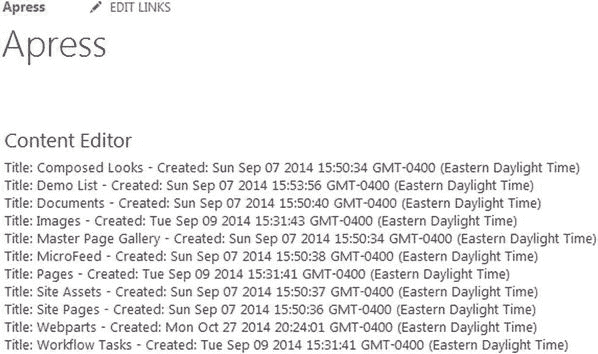

图 8-3. 内容编辑器 Web 部件中的“获取列表数据”结果

### 创建新列表

在本示例中，我们将创建一个新列表。我们不做任何复杂操作，只是创建一个新列表并设置其标题。

#### HTML

在 Visual Studio 中创建一个新的 HTML 文件，并将其命名为 `JSOMCreateList.html`。此示例的 HTML 比上一个示例稍微复杂一些，包含以下代码行：

```
<script type="text/javascript" src="/_layouts/15/sp.runtime.js"></script>
<script type="text/javascript" src="/_layouts/15/sp.js"></script>
<script type="text/javascript" src="/apress/webparts/chapter 8/JSOMCreateList.js"></script>
<div>
    <strong>输入列表名称:</strong>
    <input type="text" id="txtListName" />
    <input type="button" id="btnSubmitListName" value="提交" />
</div>
<div id="divCreateListResults"></div>
```

和之前一样，我们需要加载 `sp.runtime.js` 和 `sp.js` 文件，以及自定义 JavaScript 文件的引用。HTML 稍微复杂一些，页面上包含多个元素。首先，有一段简单的文本被包裹在 `<strong>` 标签中，使其在页面上显示为粗体。接下来，是一个类型为文本的 INPUT 元素，它是一个简单的文本框，供用户输入想要创建的列表名称。还有一个按钮，供用户提交新列表请求。最后，有一个 DIV 元素，用于输出列表创建的结果。每个元素都有一个 ID，以便我们可以通过 jQuery 轻松定位。

**注意：** 要通过 JSOM 创建新列表，执行代码的用户必须在 SharePoint 中至少拥有“管理列表”权限。无论权限级别如何，页面都会被呈现；但如果用户权限不足，SharePoint 将会抛出错误。


```markdown

#### JavaScript

Create a new JavaScript file in Visual Studio and name it `JSOMCreateList.js`. In comparison, the JavaScript file is more complex and contains the following lines of code:

```javascript
$(function () {

    bindButtonClick();

});

function bindButtonClick() {

    $("#btnSubmitListName").on("click", function () {

        var listName = $("#txtListName").val();

        createList(listName);

    });

}

function createList(listName) {

    var clientContext = new SP.ClientContext();

    var oWebsite = clientContext.get_web();

    var listCreationInfo = new SP.ListCreationInformation();

    listCreationInfo.set_title(listName);

    listCreationInfo.set_templateType(SP.ListTemplateType.genericList);

    this.oList = oWebsite.get_lists().add(listCreationInfo);

    clientContext.load(oList);

    clientContext.executeQueryAsync(

        Function.createDelegate(this, this.onQuerySucceeded),

        Function.createDelegate(this, this.onQueryFailed)

    );

}

function onQuerySucceeded() {

    var results = oList.get_title() + ' successfully created!';

    $("#divCreateListResults").html(results);

}

function onQueryFailed(sender, args) {

    alert('Request failed. ' + args.get_message() +

    '\n' + args.get_stackTrace());

}
```

In this example, we don’t need to trigger any action when the page loads, but we do need to bind the button's click event when the page loads. In the `Document.ready` function, we called the `bindButtonClick` function. In this function, we use jQuery's `on` operator to bind a click event to the `btnSubmitListName` button in the HTML. When the user clicks the button, we get the text from the text box on the page and pass it to the `createList()` function, as shown in the following code:

```javascript
function bindButtonClick() {

    $("#btnSubmitListName").on("click", function () {

        var listName = $("#txtListName").val();

        createList(listName);

    });

}
```

The `createList()` function receives a variable named `listName`, which is the text the user entered on the page. Next, we get a reference to the current client context and get the current website. Then, we create the list using the following code:

```javascript
var listCreationInfo = new SP.ListCreationInformation();

listCreationInfo.set_title(listName);

listCreationInfo.set_templateType(SP.ListTemplateType.genericList);

this.oList = oWebsite.get_lists().add(listCreationInfo);

clientContext.load(oList);
```

To create a new list, we use the `SP.ListCreationInformation()` object. We can instantiate a new `ListCreationInformation` object with the following code:

```javascript
var listCreationInfo = new SP.ListCreationInformation();
```

This line of code simply creates a new object and assigns it to a new variable named `listCreationInfo`. Next, we set the title and template using the following code:

```javascript
listCreationInfo.set_title(listName);

listCreationInfo.set_templateType(SP.ListTemplateType.genericList);
```

The `set_title` method receives the `listName` passed into the function. The `set_templateType` method receives a built-in `SP.ListTemplateType` value; in this case, we pass `genericList`. The available values here are the same as those expected when creating a list using the SharePoint UI in the browser, such as Announcements, Calendar, Tasks, etc. Next, we add the list to the website using the following code:

```javascript
this.oList = oWebsite.get_lists().add(listCreationInfo);

clientContext.load(oList);
```

As in the previous example, after adding the list to the website, we need to "load" the list into the client context. Finally, we call the `executeQueryAsync` function, which will actually make a call to SharePoint to create the list. After the call completes, we handle the results with the following function:

```javascript
function onQuerySucceeded() {

    var results = oList.get_title() + ' successfully created!';

    $("#divCreateListResults").html(results);

}
```

In this function, we use the `oList.get_title()` method to get the title of the list we just created. This is a good way to verify that the list was indeed created because we are getting the title from the list itself, rather than using the text the user input. After getting the list title, we use jQuery to add a success message to the `divCreateListResults` DIV element on the page.

### Results

Set the content link property of the Content Editor Web Part to this HTML file, and then save the page. The page will now display a text box and a button for the user to enter a new list name. Enter "My Custom List", then click the "Submit" button. The result will display a success message, as shown in Figure 8-4.

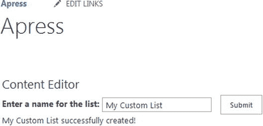

**Figure 8-4.** Result after running the code to create a new list

Since all this is done via JavaScript and AJAX, the list will be created, and the user will be notified as expected. However, the left navigation on the page will not be updated because the page is not refreshed. You could modify the code to refresh the page upon success, but in this example, we will simply manually refresh the browser page. Figure 8-5 shows the result of refreshing the page, displaying the new list in the left navigation.

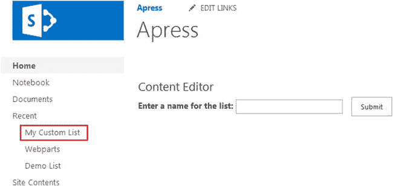

**Figure 8-5.** The new list displayed in the left navigation pane

### Deleting a List

In this example, we will delete the list we just created in the previous section.

#### HTML

Create a new HTML file in Visual Studio and name it `JSOMDeleteList.html`. The HTML for this example is almost identical to the previous example and contains the following lines of code:

```html
<script type="text/javascript" src="/_layouts/15/sp.runtime.js"></script>
<script type="text/javascript" src="/_layouts/15/sp.js"></script>
<script type="text/javascript" src="/apress/webparts/chapter 8/JSOMDeleteList.js"></script>

<div>
    <strong>输入要删除的列表名称：</strong>
    <input type="text" id="txtListName" />
    <input type="button" id="btnSubmitListName" value="提交" />
</div>

<div id="divDeleteListResults"></div>
```

The only difference is that we updated the text on the page to indicate this Web Part will be used to delete a list, and changed the ID of the results DIV to `divDeleteListResults`.

```


#### JavaScript

In Visual Studio, create a new JavaScript file and name it `JSOMDeleteList.js`. This JavaScript file contains the following lines of code:

```javascript
$(function () {
    bindButtonClick();
});

function bindButtonClick() {
    $("#btnSubmitListName").on("click", function () {
        var listName = $("#txtListName").val();
        deleteList(listName);
    });
}

function deleteList(listName) {
    var clientContext = new SP.ClientContext();
    var oWebsite = clientContext.get_web();
    this.oList = oWebsite.get_lists().getByTitle(listName);
    oList.deleteObject();
    clientContext.executeQueryAsync(
        Function.createDelegate(this, this.onQuerySucceeded),
        Function.createDelegate(this, this.onQueryFailed)
    );
}

function onQuerySucceeded() {
    $("#divDeleteListResults").html("List successfully deleted!");
}

function onQueryFailed(sender, args) {
    alert('Request failed. ' + args.get_message() +
        '\n' + args.get_stackTrace());
}
```

The script begins with the familiar jQuery `Document.ready` function, which binds a button click to a function:

```javascript
function bindButtonClick() {
    $("#btnSubmitListName").on("click", function () {
        var listName = $("#txtListName").val();
        deleteList(listName);
    });
}
```

This function is almost identical to the previous example—the only difference is the use of the new function name `deleteList` to delete the list. This function is more concise and straightforward, containing only a few relevant lines of code:

```javascript
this.oList = oWebsite.get_lists().getByTitle(listName);
oList.deleteObject();
```

After obtaining the client context and the current website, we use the website object's `getByTitle()` method to locate the list to delete and assign it to the variable `oList`. Next, we call the `oList.deleteObject()` method to actually perform the deletion. You will notice that the "load" method of the client context object is not called here. This step is not necessary when deleting a list. After the `deleteObject()` line, simply call the `executeQueryAsync()` method to execute the deletion.

### Result

Set the "Content Link" property of the Content Editor Web Part to this HTML file and save the page. The page will display a text box and a button for the user to input the name of the list to delete. Enter "My Custom List" and click the "Submit" button. The result will show a success message, as shown in Figure 8-6.

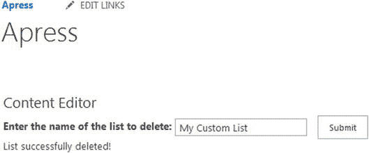

**Figure 8-6.** Result after the delete list code runs successfully

Since all of this is done using JavaScript and AJAX, the list will be deleted, and the user will be notified as expected. However, the navigation on the left side of the page will not update because the page has not been refreshed. As before, we could modify the code to refresh the page on success, but in this example, we will simply manually refresh the page in the browser. Figure 8-7 shows the page after refreshing, where the list is no longer displayed in the left navigation.

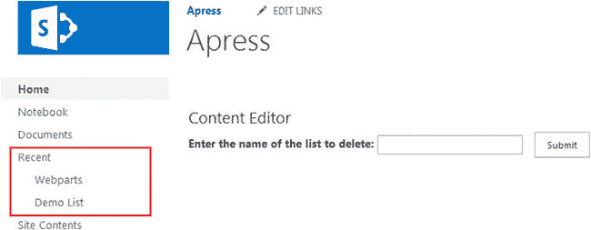

**Figure 8-7.** The deleted list has been removed from the left navigation

## Working with List Items

In SharePoint, the only thing more common than lists is list items. You will find that many of your interactions in SharePoint involve list items, and therefore, a lot of your code will too. In this section, we will explore some ways to handle list items through code.

### Getting List Items

In this example, we will simply retrieve some list items and display them to the user.

#### HTML

In Visual Studio, create a new HTML file and name it `JSOMGetListItems.html`. The HTML for this example continues the minimalist style of the previous examples and contains the following lines of code:

```html
<script type="text/javascript" src="/_layouts/15/sp.runtime.js"></script>
<script type="text/javascript" src="/_layouts/15/sp.js"></script>
<script type="text/javascript" src="/apress/webparts/chapter 8/JSOMGetListItems.js"></script>
<div id="divListItems"></div>
```

For this example, we will retrieve all list items from the "Demo List" and display them in the `divListItems` DIV on the page.


#### JavaScript

在 Visual Studio 中创建一个新的 JavaScript 文件，并将其命名为`JSOMGetListItems.js`。用于检索列表项的脚本与我们已经见过的其他脚本非常相似，它包含以下代码行：

```
$(function () {
    retrieveListItems();
});

function retrieveListItems() {
    var clientContext = new SP.ClientContext();
    var oList = clientContext.get_web().get_lists().getByTitle('Demo List');
    var camlQuery = new SP.CamlQuery();
    this.collListItem = oList.getItems(camlQuery);
    clientContext.load(collListItem);
    clientContext.executeQueryAsync(
        Function.createDelegate(this, this.onQuerySucceeded),
        Function.createDelegate(this, this.onQueryFailed)
    );
}

function onQuerySucceeded(sender, args) {
    var listItemInfo = '';
    var listItemEnumerator = collListItem.getEnumerator();
    while (listItemEnumerator.moveNext()) {
        var oListItem = listItemEnumerator.get_current();
        listItemInfo += '<strong>ID: </strong> ' + oListItem.get_id() +
            ' <strong>Title:</strong> ' + oListItem.get_item('Title') +
            '<br />';
    }
    $("#divListItems").html(listItemInfo);
}

function onQueryFailed(sender, args) {
    alert('Request failed. ' + args.get_message() +
        '\n' + args.get_stackTrace());
}
```

对于这个示例，由于我们只是要从列表中获取所有项，因此我们将使用 jQuery 的`Document.ready`函数调用`retrieveListItems()`函数。在获取到客户端上下文的引用后，我们通过以下代码行获取对“Demo List”的引用：

```
var oList = clientContext.get_web().get_lists().getByTitle('Demo List');
```

这一行乍一看可能令人生畏，因为它相当长。然而，它实际上非常容易理解。首先，我们获取当前网站，然后获取该网站中的所有列表，最后通过标题获取列表。`JSOM`和`REST`在查询对象时都遵循这种模式，使得代码易于理解。接下来，我们需要创建一个 CAML 查询，以告知 SharePoint 我们要查找哪些项：

```
var camlQuery = new SP.CamlQuery();
this.collListItem = oList.getItems(camlQuery);
```

CAML（协作应用程序标记语言）查询是 SharePoint 中用于定义列表项查询的一种查询语言。你可以像 SQL 查询一样根据条件指定要返回哪些项，尽管它们看起来完全不同。在本例中，我们仅使用新的`SP.CamlQuery()`方法创建了一个空查询。当你查询列表时，即使没有定义任何参数，也必须提供一个 CAML 查询。如果像本例一样传递一个空查询，实际上你是在请求返回所有项。在实际应用中，这不是一个好主意，因为许多列表包含成百上千个项。创建查询后，我们将其传递给`oList.getItems()`方法来执行查询。与其他示例一样，我们使用`this`关键字定义了一个名为`collListItems`的全局变量。最后，我们“加载”查询并执行它。

> **注意：**  
> CAML 查询是一个非常复杂且深入的课题。本书仅能触及 CAML 的皮毛，因为它确实很庞大。我们将在下一节中对 CAML 进行更深入的探讨，但你可以通过访问[`http://msdn.microsoft.com/en-us/library/ms467521(v=office.15).aspx`](http://msdn.microsoft.com/en-us/library/ms467521(v=office.15).aspx)了解更多关于如何构建这些查询的信息。

一旦我们检索到列表项，就在`onQuerySucceeded`函数中处理它们：

```
function onQuerySucceeded(sender, args) {
    var listItemInfo = '';
    var listItemEnumerator = collListItem.getEnumerator();
    while (listItemEnumerator.moveNext()) {
        var oListItem = listItemEnumerator.get_current();
        listItemInfo += '<strong>ID: </strong> ' + oListItem.get_id() +
            ' <strong>Title:</strong> ' + oListItem.get_item('Title') +
            '<br />';
    }
    $("#divListItems").html(listItemInfo);
}
```

该函数首先声明一个名为`listItemInfo`的空变量。该变量将保存要显示在页面上的整个 HTML。接下来，我们获取`collListItem`变量的枚举器，你可能还记得，这个变量在从 SharePoint 返回的任何项集合中都是可用的。我们使用`listItemEnumerator.moveNext()`方法遍历这些项。在循环内部，我们使用`listItemEnumerator.get_current()`方法获取每个项。然后，我们为结果集中的每一项构建一些 HTML，显示其 ID 和标题，并将其存入`listItemInfo`变量。最后，我们使用 jQuery 将 HTML 设置到页面上的`divListItems` DIV 中。

### 结果

将内容编辑器 Web 部件的“内容链接”属性设置为该 HTML 文件，然后保存页面。该页面现在将显示“Demo List”中的所有项，如图 8-8 所示。

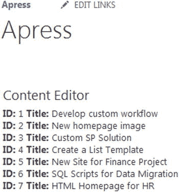

**图 8-8.** 内容编辑器 Web 部件中显示的 Demo List 列表项

### 使用 CAML 查询限制结果

正如我提到的，查询列表中的所有项通常不是一个好主意。当然，在某些情况下确实需要这样做或有意义；例如，你可能有一个项非常少的列表，或者你有一个需要查看所有项的管理员任务。如果你过去使用过 SharePoint，你肯定知道 SharePoint 会自动限制列表结果，默认查询结果限制为 2000 项。无论是哪种情况，大多数用户永远不需要查看列表中的所有项，查询应被限制为仅显示用户需要看到的项。

CAML 允许你基于各种参数限制结果，从而完全控制向用户显示的内容。在之前的示例中，我们通过创建一个新的`SP.CamlQuery`对象传递了一个空的 CAML 查询，该查询返回了所有列表项。你可以通过对`CamlQuery`对象使用`set_viewXml()`方法来传入一个 CAML 查询，如下面“JavaScript”部分所示。

#### JavaScript

更新上一个示例中的`JSOMGetListItems.js`，并使用以下代码行替换声明`SP.CamlQuery()`对象的部分：

```
var camlQuery = new SP.CamlQuery();
    camlQuery.set_viewXml(
        '<View><Query><Where><Geq><FieldRef Name=\'ID\'/>' +
        '<Value Type=\'Number\'>5</Value></Geq></Where></Query>' +
        '<RowLimit>10</RowLimit></View>'
    );
    this.collListItem = oList.getItems(camlQuery);
```

在此示例中，我们通过指定仅返回 ID 大于或等于 5 的项来限制结果。这是通过使用`GEQ`元素（代表“大于或等于”）实现的。在`GEQ`元素之前，我们使用了一个`Where`元素，并指定了 ID 的`FieldRef`，即列表项的 ID。如果这一切看起来像天书，别担心，有一些可以下载的工具来帮助你编写 CAML。我们不会深入探讨编写 CAML 查询的细节；在本节中，你应该了解到你可以非常精细地调整查询。

> **注意：**  
> 初看之下，CAML 可能会显得非常令人困惑且过于复杂。当你与 CAML 打交道一段时间后，你可能仍然会有同样的想法！幸运的是，有几个很棒的免费工具可以帮助你编制 CAML 语句。我个人喜欢 SharePoint CAML Query Helper，它是免费的，并可以在 CodePlex 上下载。请访问[`https://spcamlqueryhelper.codeplex.com`](https://spcamlqueryhelper.codeplex.com/) 下载一份副本。


### 结果

更新 JavaScript 文件并上传，覆盖之前的版本。用内容编辑器 Web 部件刷新页面，你会看到结果现在只显示 ID 大于或等于 5 的项，如图 8-9 所示。

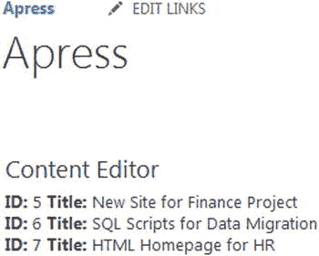

图 8-9. 通过 CAML 查询限制的示例列表查询结果

## 添加列表项

在这个例子中，我们将向示例列表中添加一个新项。

#### HTML

在 Visual Studio 中创建一个新的 HTML 文件，并将其命名为`JSOMAddListItems.html`。此页面的标记将允许用户向示例列表中添加项，提供标题和描述。它包含以下代码行：

```
<script type="text/javascript" src="/_layouts/15/sp.runtime.js"></script>
<script type="text/javascript" src="/_layouts/15/sp.js"></script>
<script type="text/javascript" src="/apress/Webparts/chapter 8/JSOMAddListItems.js"></script>
<div id="AddListData">
    <div>
        标题:
        <br />
        <input type="text" id="txtTitle" />
    </div>
    <div>
        描述:
        <br />
        <textarea cols="20" id="txtDesc"></textarea>
    </div>
    <br />
    <div>
        <input id="btnSubmit" type="button" value="提交" />
    </div>
</div>
<div id="divResult"></div>
```

我们为列表项标题提供了一个`TEXT`类型的`INPUT`，为描述提供了一个`TEXTAREA`。页面上的每个元素都有一个 ID，这样我们就可以用 jQuery 轻松定位它。

#### JavaScript

在 Visual Studio 中创建一个新的 JavaScript 文件，并将其命名为`JSOMADDListItems.js`。添加列表项的脚本与创建新列表的脚本类似。它包含以下代码行：

```
$(function () {
    bindButtonClick();
});
function bindButtonClick() {
    $("#btnSubmit").on("click", function () {
        addListItem();
    });
}
function addListItem() {
    var title = $("#txtTitle").val();
    var desc = $("#txtDesc").val();
    var clientContext = new SP.ClientContext();
    var oList = clientContext.get_web().get_lists().getByTitle('Demo List');
    var itemCreateInfo = new SP.ListItemCreationInformation();
    this.oListItem = oList.addItem(itemCreateInfo);
    oListItem.set_item('Title', title);
    oListItem.set_item('Description', desc);
    oListItem.set_item('Status', 'On-time');
    oListItem.update();
    clientContext.load(oListItem);
    clientContext.executeQueryAsync(
        Function.createDelegate(this, this.onAddSucceeded),
        Function.createDelegate(this, this.onAddFailed)
    );
}
function onAddSucceeded(sender, args) {
    $("#divResult").html("项添加成功！");
}
function onAddFailed(sender, args) {
    alert('请求失败。' + args.get_message() +
        '\n' + args.get_stackTrace());
}
```

用 jQuery 附加按钮点击事件后，我们在点击事件中做的第一件事就是获取用户提供的值，代码如下：

```
var title = $("#txtTitle").val();
var desc = $("#txtDesc").val();
```

接下来，我们获取当前客户端上下文的引用，以及`Demo List`的引用。然后，为了创建一个新的列表项，我们必须实例化一个`SP.ListItemCreationInformation`对象。该对象允许你为列表创建新的列表项并设置其属性。这是通过以下代码完成的：

```
var itemCreateInfo = new SP.ListItemCreationInformation();
this.oListItem = oList.addItem(itemCreateInfo);
oListItem.set_item('Title', title);
oListItem.set_item('Description', desc);
oListItem.set_item('Status', 'On-time');
oListItem.update();
```

创建新的`SP.ListItemCreationInformation`对象后，我们使用列表对象上的`addItem()`方法将其添加到列表中。接着，我们使用列表项对象上的`set_item()`方法设置各个属性。这个方法接受两个参数。第一个参数是你想要设置值的字段或列，第二个参数是值本身。对于`Title`（标题）和`Description`（描述），我们直接传入之前检索到的值。对于`Status`（状态）列，我们只硬编码一个值为`On-time`（准时）。最后，我们使用`update()`方法更新该项，然后将其加载到客户端上下文中并执行查询。在`success`（成功）函数中，我们只需在屏幕上输出列表项创建成功的信息。

### 结果

将内容编辑器 Web 部件的“内容链接”属性设置为 HTML 文件并保存页面。页面将显示供用户输入详细信息的文本框，并在添加项目时显示成功消息，如图 8-10 所示。

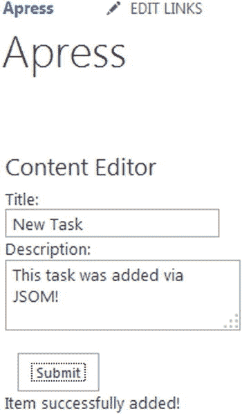

图 8-10. 向示例列表添加新项

然后我们可以导航到示例列表以确认新项已添加。图 8-11 显示了示例列表，其中添加了一个新的列表项，并包含了由 HTML 页面提供的值。

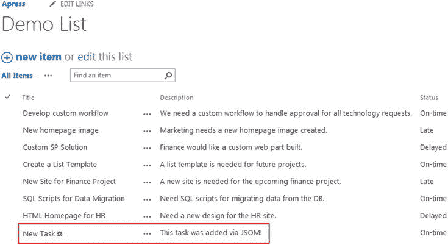

图 8-11. 向示例列表添加的新列表项

### 删除列表项

本示例将向你展示如何删除列表项，这里我们将删除上一个示例中添加的项。

#### HTML

在 Visual Studio 中创建一个新的 HTML 文件，并将其命名为`JSOMDeleteListItems.html`。这个文件的 HTML 要精简得多，因为我们只需要从用户那里获取一个 ID，对应他们想要删除的列表项。这通过以下代码行实现：

```
<script type="text/javascript" src="/_layouts/15/sp.runtime.js"></script>
<script type="text/javascript" src="/_layouts/15/sp.js"></script>
<script type="text/javascript" src="/apress/Webparts/chapter 8/JSOMDeleteListItems.js"></script>
<div>
    输入要删除的 ID: <input type="text" id="txtId" />
</div>
<div>
    <input id="btnSubmit" type="button" value="提交" />
</div>
<div id="divResult"></div>
```

这个示例过于简化了，因为用户很可能不知道要删除的某个列表项的 ID。更真实的示例很可能会向用户显示一个项目列表，并允许他们单击某个项目来删除它。在这种场景下，页面上会事先拥有列表项 ID，并且可以轻松访问。我们保留一个简单的文本框以保持示例的流畅性。


#### JavaScript

在 Visual Studio 中新建一个 JavaScript 文件，将其命名为 `JSOMDeleteListItems.js`，并包含以下代码：

```
$(function () {
    bindButtonClick();
});

function bindButtonClick() {
    $("#btnSubmit").on("click", function () {
        deleteListItem();
    });
}

function deleteListItem() {
    var id = $("#txtId").val();
    var clientContext = new SP.ClientContext();
    var oList = clientContext.get_web().get_lists().getByTitle('Demo List');
    this.oListItem = oList.getItemById(id);
    oListItem.deleteObject();
    clientContext.executeQueryAsync(
        Function.createDelegate(this, this.onQuerySucceeded),
        Function.createDelegate(this, this.onQueryFailed)
    );
}

function onQuerySucceeded(sender, args) {
    $("#divResult").html("项目已成功删除！");
}

function onQueryFailed(sender, args) {
    alert('请求失败。' + args.get_message() +
        '\n' + args.get_stackTrace());
}
```

`deleteListItem()` 函数将在页面的按钮点击事件中被调用。首先，我们通过以下代码获取用户在页面上输入的 ID：

```
var id = $("#txtId").val();
```

接着，我们获取当前的客户端上下文和对 `Demo List` 的引用。删除项目的操作通过以下代码完成：

```
this.oListItem = oList.getItemById(id);
oListItem.deleteObject();
```

我们在列表对象上使用 `getItemById()` 方法，传入用户提交的 ID。然后，调用 `deleteObject()` 方法实际执行删除。与本章前面删除列表类似，这就是删除列表项所需的全部操作。我们无需将删除调用加载到客户端上下文中，只需执行查询即可。`success` 函数会通知用户删除操作已成功。

### 结果

将 **内容编辑器 Web 部件** 的 `内容链接` 属性设置为该 HTML 文件，然后保存页面。页面将显示一个文本框供用户输入 ID，并在删除项目时显示一条成功消息，如图 8-12 所示。

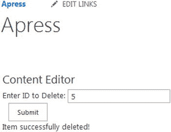

**图 8-12** 使用 JSOM 删除列表项

## 使用文档库

由于 SharePoint 的优势之一在于文档管理，因此你需要了解如何通过代码操作文档库。由于文档库实际上就是 SharePoint 中的列表，因此你已经具备了一定的经验！

### 创建新文件夹

在本示例中，我们将演示如何在现有文档库中创建新文件夹。

#### HTML

在 Visual Studio 中新建一个 HTML 文件，将其命名为 `JSOMCreateFolder.html`。该页面的标记非常简单，允许用户输入要创建的文件夹名称。它包含以下代码：

```
<script type="text/javascript" src="/_layouts/15/sp.runtime.js"></script>
<script type="text/javascript" src="/_layouts/15/sp.js"></script>
<script type="text/javascript" src="/apress/Webparts/chapter 8/JSOMCreateFolder.js"></script>
<div>
    <strong>输入文件夹名称：</strong>
    <input type="text" id="txtFolderName" />
    <input type="button" id="btnSubmit" value="提交" />
</div>
<div id="divResults"></div>
```

#### JavaScript

在 Visual Studio 中新建一个 JavaScript 文件，将其命名为 `JSOMCreateFolder.js`，并包含以下代码：

```
$(function () {
    bindButtonClick();
});

function bindButtonClick() {
    $("#btnSubmit").on("click", function () {
        createFolder();
    });
}

function createFolder() {
    var folderName = $("#txtFolderName").val();
    var clientContext = new SP.ClientContext();
    var oWebsite = clientContext.get_web();
    var oList = oWebsite.get_lists().getByTitle("Documents");
    var folderCreateInfo = new SP.ListItemCreationInformation();
    folderCreateInfo.set_underlyingObjectType(SP.FileSystemObjectType.folder);
    folderCreateInfo.set_leafName(folderName);
    this.oListItem = oList.addItem(folderCreateInfo);
    this.oListItem.update();
    clientContext.load(oList);
    clientContext.executeQueryAsync(
        Function.createDelegate(this, this.onQuerySucceeded),
        Function.createDelegate(this, this.onQueryFailed)
    );
}

function onQuerySucceeded() {
    $("#divResults").html("文件夹已成功创建！");
}

function onQueryFailed(sender, args) {
    alert('请求失败。' + args.get_message() +
        '\n' + args.get_stackTrace());
}
```

使用 jQuery 连接按钮点击事件后，`createFolder()` 函数首先获取用户在页面上输入的文件夹名称：

```
var folderName = $("#txtFolderName").val();
```

接下来，我们获取对当前客户端上下文和当前网站的引用，然后通过以下代码引用“共享文档”文件夹：

```
var oList = oWebsite.get_lists().getByTitle("Documents");
```

此示例将在“共享文档”库中创建一个新文件夹。由于所有文档库实际上都是 SharePoint 中的列表，因此我们可以使用 `getLists().getByTitle()` 方法来检索该库。然后，我们为文件夹创建一个新的 `SP.ListItemCreationInformation` 对象：

```
var folderCreateInfo = new SP.ListItemCreationInformation();
```

乍一看，这似乎有点奇怪，因为我们创建的是一个新文件夹，而非列表项。在 SharePoint 中，文件夹就是列表项，尽管它们的外观和行为与你对文件夹的预期完全一致。因此，我们使用了相同的 `SP.ListItemCreationInformation` 对象。创建对象后，我们需要使用以下代码设置一些属性：

```
folderCreateInfo.set_underlyingObjectType(SP.FileSystemObjectType.folder);
folderCreateInfo.set_leafName(folderName);
this.oListItem = oList.addItem(folderCreateInfo);
this.oListItem.update();
```

首先，由于这不是一个标准的列表项，我们需要使用 `set_underlyingObjectType()` 方法指定对象类型，并传入 `SP.FileSystemObjectType.folder` 作为参数。接着，我们使用 `set_leafName()` 方法设置文件夹名称，并传入用户从页面提交的名称。最后，我们将新文件夹添加到列表中并更新它，然后在客户端上下文上加载查询。`success` 函数将在屏幕上输出一条消息，通知用户文件夹已成功创建。

### 结果

将 **内容编辑器 Web 部件** 的 `内容链接` 属性设置为该 HTML 文件，然后保存页面。页面将显示一个文本框供用户输入要创建的文件夹名称，并在完成后显示一条成功消息，如图 8-13 所示。

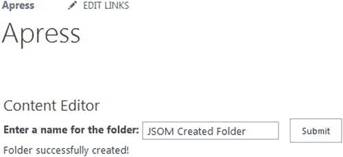

**图 8-13** 使用 JSOM 创建新文件夹

然后，我们可以导航到“文档”库，以直观地验证新文件夹是否已创建，如图 8-14 所示。

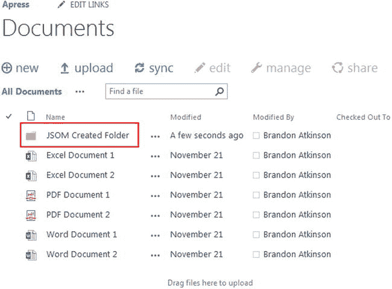

**图 8-14** 通过 JSOM 创建的新文件夹

## 使用文件

列表和库并非唯一需要你运用编码技能的地方。在本节中，我们将探讨如何通过代码操作文件。

### 创建新文件

在本示例中，我们将创建一个新的文本文件，并将其添加到文档库中。


#### HTML

在 Visual Studio 中新建一个 HTML 文件，并将其命名为 `JSOMCreateDocument.html`。此页面的标记允许用户为新建的文本文件输入文件名和内容，包含以下代码行：

```
<script type="text/javascript" src="/_layouts/15/sp.runtime.js"></script>
<script type="text/javascript" src="/_layouts/15/sp.js"></script>
<script type="text/javascript" src="/apress/Webparts/chapter 8/JSOMCreateDocument.js"></script>
<div id="CreateFile">
    <div>
        <strong>输入文档标题：</strong>
        <br />
        <input type="text" id="txtDocumentTitle" />
    </div>
    <div>
        <strong>输入文档内容：</strong>
        <br />
        <textarea cols="20" id="txtDocumentContent"></textarea>
    </div>
    <br />
    <input type="button" id="btnSubmit" value="提交" />
</div>
<div id="divResults"></div>
```

#### JavaScript

在 Visual Studio 中新建一个 JavaScript 文件，并将其命名为 `JSOMCreateDocument.js`，并添加以下代码：

```
$(function () {
    bindButtonClick();
});

function bindButtonClick() {
    $("#btnSubmit").on("click", function () {
        createDocument();
    });
}

function createDocument() {
    var docTitle = $("#txtDocumentTitle").val() + ".txt";
    var docContent = $("#txtDocumentContent").val();
    var clientContext = new SP.ClientContext();
    var oWebsite = clientContext.get_web();
    var oList = oWebsite.get_lists().getByTitle("Documents");
    var fileCreateInfo = new SP.FileCreationInformation();
    fileCreateInfo.set_url(docTitle);
    fileCreateInfo.set_content(new SP.Base64EncodedByteArray());
    for (var i = 0; i < docContent.length; i++) {
        fileCreateInfo.get_content().append(docContent.charCodeAt(i));
    }
    this.newFile = oList.get_rootFolder().get_files().add(fileCreateInfo);
    clientContext.load(this.newFile);
    clientContext.executeQueryAsync(
        Function.createDelegate(this, this.onQuerySucceeded),
        Function.createDelegate(this, this.onQueryFailed)
    );
}

function onQuerySucceeded() {
    $("#divResults").html("文档创建成功！");
}

function onQueryFailed(sender, args) {
    alert('请求失败。 ' + args.get_message() +
        '\n' + args.get_stackTrace());
}
```

首先，我们需要获取用户在页面上输入的文档标题和内容，通过以下代码实现：

```
var docTitle = $("#txtDocumentTitle").val() + ".txt";
var docContent = $("#txtDocumentContent").val();
```

请注意，我们在文档标题末尾添加了 `.txt`。这会让 SharePoint 知道我们打算创建一个文本文件，因为它会使用名称中的扩展名来确定文件类型。接下来，我们获取当前客户端上下文的引用，以及我们想要保存新文档的网站和文档库。现在，我们需要创建一个新的 `SP.FileCreationInformation` 对象并设置其属性：

```
var fileCreateInfo = new SP.FileCreationInformation();
fileCreateInfo.set_url(docTitle);
fileCreateInfo.set_content(new SP.Base64EncodedByteArray());
```

现在，您应该开始了解在 SharePoint 中使用 JavaScript 创建对象的模式。几乎所有您创建的内容都有一个关联的 `CreationInformation` 对象。创建对象后，我们使用 `set_url()` 方法设置文件的 URL。最后，我们使用 `SP.Base64EncodedByteArray()` 对象将文件的内容设置为一个空字节数组。您现在不需要过多担心此对象的细节，只需知道这是 JSOM 代码在设置新文件内容时所期望的即可。创建空数组后，我们需要使用以下代码填充它：

```
for (var i = 0; i < docContent.length; i++) {
    fileCreateInfo.get_content().append(docContent.charCodeAt(i));
}
```

这是一个简单的循环，它将获取用户提交的文本中的每个字符，并将其追加到文件内容中的空数组中。循环完成后，文本被输入到文档中，我们将其添加到库中：

```
this.newFile = oList.get_rootFolder().get_files().add(fileCreateInfo);
```

然后，我们在客户端上下文中加载查询并执行它。`success` 函数将简单地在屏幕上输出文件创建成功的消息。

**注意：** 在此示例中，我们创建的是一个简单的文本文件。在大多数实际场景中，目标结果可能不是文本文件，而是 Word 文件或 Excel 文件。您完全可以通过将 `.txt` 更改为 `.docx` 来修改此示例以生成 Word 文档。实际上，这一简单的更改将创建一个包含内容的新 Word 文档。但是，它只能在客户端机器上的 Word 中打开，而不能在 Office Web Apps 中打开。幸运的是，微软提供了 Office JavaScript 文件，允许您从浏览器创建和操作 Office 文件。您可以在 [`http://msdn.microsoft.com/en-us/library/office/fp160953%28v=office.15%29.aspx`](http://msdn.microsoft.com/en-us/library/office/fp160953%28v=office.15%29.aspx) 找到更多信息。

### 结果

将内容编辑器 Web 部件的“内容链接”属性设置为该 HTML 文件，然后保存页面。页面将显示文本框，供用户输入文档的标题和内容，并在新文档创建成功后显示一条成功消息，如图 8-15 所示。

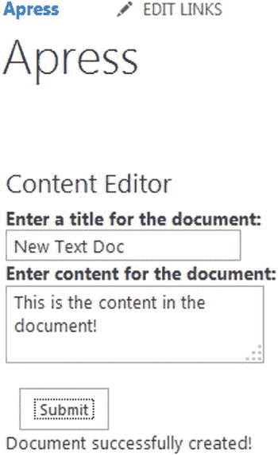

**图 8-15.** 从内容编辑器 Web 部件创建新文档

我们可以导航到“文档”文件夹，发现新的文本文档已创建。您可以单击该文档，它将在浏览器中打开并显示用户从页面输入的内容，如图 8-16 所示。

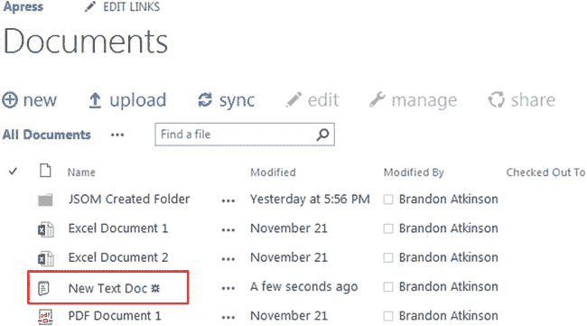

**图 8-16.** 在“文档”文件夹中创建的新文本文档

### 读取文件

在本节中，我们将了解如何读取我们在上一示例中创建的文件。

#### HTML

在 Visual Studio 中新建一个 HTML 文件，并将其命名为 `JSOMReadDocument.html`。此页面的标记非常简单，只包含对自定义 JavaScript 文件的引用和一个用于输出文档内容的 DIV。它包含以下代码行：

```
<script type="text/javascript" src="/apress/Webparts/chapter 8/JSOMReadDocument.js"></script>
<div id="divReadDocument" />
```


#### JavaScript

在 Visual Studio 中创建一个新的 JavaScript 文件，并将其命名为 `JSOMReadDocument.js`；然后包含以下代码：

```
$(function () {
    readDocument();
});

function readDocument() {
    var siteUrl = _spPageContextInfo.webAbsoluteUrl;
    var documentLibrary = "/Shared Documents/"
    var fileUrl = "New Text Doc.txt";
    var fullUrl = siteUrl + documentLibrary + fileUrl;
    $.ajax({
        url: fullUrl,
        type: "GET"
    })
    .done(function (data) {
        $("#divReadDocument").html(data);
    })
    .fail(function () {
        alert("error");
    });
}
```

乍一看，这段代码似乎很简洁，你会注意到其中根本没有用到任何 JSOM 代码。从 SharePoint 读取文本文件的美妙之处在于，你只需要 jQuery 即可。由于本章是关于 JSOM 的内容，这段代码或许应该放在别处，但我们既然创建了一个文档，你也应该了解如何读取它。这里有一个简单的 jQuery `Document.ready` 函数，它将触发读取文件的代码。我们有意让这段代码保持简单，并将我们刚刚创建的文档文件名硬编码进去：

```
var siteUrl = _spPageContextInfo.webAbsoluteUrl;
var documentLibrary = "/Shared Documents/"
var fileUrl = "New Text Doc.txt";
var fullUrl = siteUrl + documentLibrary + fileUrl;
```

我们首先要做的是通过 `_spPageContextInfo.webAbsoluteUrl` 获取当前网站的完整 URL。接下来，我们硬编码 URL 中的文档库部分和文件名。最后，我们将它们组合成一个名为 `fullUrl` 的新变量。你完全可以将所有这些操作放在一行代码中，但你会发现，如果将其拆分成较短的几行，后续调试代码会更容易。获得文件的 URL 后，我们使用 jQuery 的 AJAX 调用来获取文档：

```
$.ajax({
    url: fullUrl,
    type: "GET"
})
.done(function (data) {
    $("#divReadDocument").html(data);
})
.fail(function () {
    alert("error");
});
```

当通过 jQuery 中的 AJAX 检索文本文件时，文件内容将以文本形式返回，我们可以直接将其输出到页面，无需任何修改。我们使用 jQuery 的 `.done` 函数，将文件内容设置到一个名为 `data` 的新变量中。然后，我们将获取到的数据设置为页面上结果显示 DIV 的 HTML 内容。

> **注意**：与之前创建新文件时类似，我们通过使用文本文件来保持简单。本节关于读取文件的内容亦是如此。你**无法**使用上述方法读取 Office 文件。你需要利用 Office JavaScript 文件才能在浏览器中正确读取 Word 文件或 Excel 文件。你可以在 [`http://msdn.microsoft.com/en-us/library/office/fp160953%28v=office.15%29.aspx`](http://msdn.microsoft.com/en-us/library/office/fp160953%28v=office.15%29.aspx) 找到更多信息。

### 结果

将内容编辑器 Web 部件的**内容链接**属性设置为该 HTML 文件，然后保存页面。页面将显示文本文件的内容，如图 8-17 所示。

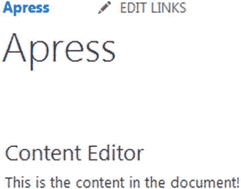

**图 8-17.** 页面上显示的文本文件内容

### 更新文件

你也可以使用 JSOM 轻松更新文件。实际上，更新文件的代码与创建文件的代码基本相同，只需添加一行代码：

```
fileCreateInfo.set_overwrite(true);
```

这行代码的作用是告诉 SharePoint 覆盖之前同名的文件。利用这一点，你可以轻松地将文本文件的内容读取到页面的文本框中，并允许用户修改内容。当用户希望保存文件时，使用与创建文件相同的代码，并包含覆盖命令。

### 删除文件

在本例中，我们将了解如何删除文件。

#### HTML

在 Visual Studio 中创建一个新的 HTML 文件，并将其命名为 `JSOMDeleteDocument.html`。此页面的标记包含一个文本框，供用户输入他们想要删除的文件名。它由以下几行代码组成：

```
<script type="text/javascript" src="/_layouts/15/sp.runtime.js"></script>
<script type="text/javascript" src="/_layouts/15/sp.js"></script>
<script type="text/javascript" src="/apress/Webparts/chapter 8/JSOMDeleteDocument.js"></script>
<div id="DeleteFile">
    <div>
        <strong>输入要删除的文档名称：</strong>
        <br />
        <input type="text" id="txtDocumentTitle" />
    </div>
    <br />
    <input type="button" id="btnSubmit" value="提交" />
</div>
<div id="divResults"></div>
```

#### JavaScript

在 Visual Studio 中创建一个新的 JavaScript 文件，并将其命名为 `JSOMDeleteDocument.js`；然后包含以下代码：

```
$(function () {
    bindButtonClick();
});

function bindButtonClick() {
    $("#btnSubmit").on("click", function () {
        deleteDocument();
    });
}

function deleteDocument() {
    var docTitle = $("#txtDocumentTitle").val() + ".txt";
    var clientContext = new SP.ClientContext();
    var oWebsite = clientContext.get_web();
    var fileUrl = _spPageContextInfo.webServerRelativeUrl +
            "/Shared Documents/" + docTitle;
    this.fileToDelete = oWebsite.getFileByServerRelativeUrl(fileUrl);
    this.fileToDelete.deleteObject();
    clientContext.executeQueryAsync(
        Function.createDelegate(this, this.onQuerySucceeded),
        Function.createDelegate(this, this.onQueryFailed)
    );
}

function onQuerySucceeded() {
    $("#divResults").html("文档已成功删除！");
}

function onQueryFailed(sender, args) {
    alert('请求失败。' + args.get_message() +
        '\n' + args.get_stackTrace());
}
```

在绑定按钮点击事件之后，我们首先要做的是获取用户想要删除的文档的标题：

```
var docTitle = $("#txtDocumentTitle").val() + ".txt";
```

我们将保持此示例的简洁性，删除之前创建的文本文件，因此将 `.txt` 扩展名硬编码到代码中。接下来，我们执行常规操作，引用当前的客户端上下文和网站，然后构建文档的路径：

```
var fileUrl = _spPageContextInfo.webServerRelativeUrl +
"/Shared Documents/" + docTitle;
```

对于此路径，我们只需要文档的相对路径，而不是完整 URL。我们可以通过使用 `_spPageContextInfo.webServerRelativeUrl` 来获取当前网站的相对路径。由于我们知道该文档位于“文档”文件夹中，我们将硬编码该路径，并添加用户提交的文档标题。与 SharePoint 中的其他删除操作一样，我们不需要在客户端上下文中加载此请求，只需直接调用 `deleteObject` 方法并执行查询即可。`success` 函数将向用户输出一条消息，告知他们文档已被删除。

与我们之前看到的创建、读取和更新文档函数不同，假设用户具有删除权限，你可以使用 JSOM 删除任何你想要的文件。SharePoint 在删除文档方面非常灵活。你可以轻松使用相同的代码删除 Office 文档，而不会出现任何问题，也无需额外的 JavaScript 库。

### 结果

将内容编辑器 Web 部件的**内容链接**属性设置为该 HTML 文件，然后保存页面。页面将显示一个文本框供用户输入文档标题，并显示一条结果消息，如图 8-18 所示。

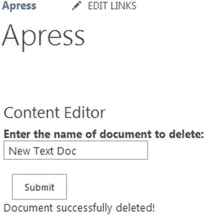

**图 8-18.** 通过 JSOM 删除文件


## 使用站点

此刻你可能会觉得 JSOM 相当强大！事实确实如此，为了证明这一点，我们将用它创建一个新站点！操作列表和库固然很酷，但能够通过 JavaScript 创建新站点才能真正展示 JSOM 的强大功能。

### 创建站点

在本例中，我们将创建一个新的团队站点。除了创建新站点外，我们还会设置其多项属性，包括标题、说明和网站模板。

#### HTML

在 Visual Studio 中创建一个新的 HTML 文件，并将其命名为 `JSOMCreateSite.html`。此页面的标记包含一个用于用户输入新站点名称的文本框，以及一个用于输入站点说明的文本框。它包括以下几行代码：

```
<script type="text/javascript" src="/_layouts/15/sp.runtime.js"></script>
<script type="text/javascript" src="/_layouts/15/sp.js"></script>
<script type="text/javascript" src="/apress/Webparts/chapter 8/JSOMCreateSite.js"></script>
<div id="DeleteFile">
    <div>
        <strong>输入站点名称：</strong>
        <br />
        <input type="text" id="txtSiteTitle" />
    </div>
    <br />
    <div>
        <strong>输入站点说明：</strong>
        <br />
        <textarea cols="20" id="txtSiteDescription"></textarea>
    </div>
    <br />
    <input type="button" id="btnSubmit" value="提交" />
</div>
<div id="divResults"></div>
```

#### JavaScript

在 Visual Studio 中创建一个新的 JavaScript 文件，并将其命名为 `JSOMCreateSite.js`；包含以下代码：

```
$(function () {
    bindButtonClick();
});
function bindButtonClick() {
    $("#btnSubmit").on("click", function () {
        createSite();
    });
}
function createSite() {
    var siteTitle = $("#txtSiteTitle").val();
    var siteDesc = $("#txtSiteDescription").val();
    var siteUrl = siteTitle.replace(/\s/g, "");
    var clientContext = new SP.ClientContext();
    var collWeb = clientContext.get_web().get_webs();
    var webCreationInfo = new SP.WebCreationInformation();
    webCreationInfo.set_title(siteTitle);
    webCreationInfo.set_description(siteDesc);
    webCreationInfo.set_language(1033);
    webCreationInfo.set_url(siteUrl);
    webCreationInfo.set_useSamePermissionsAsParentSite(true);
    webCreationInfo.set_webTemplate('STS#0');
    var oNewWebsite = collWeb.add(webCreationInfo);
    clientContext.executeQueryAsync(
        Function.createDelegate(this, this.onQuerySucceeded),
        Function.createDelegate(this, this.onQueryFailed)
    );
}
function onQuerySucceeded() {
    $("#divResults").html("站点创建成功！");
}
function onQueryFailed(sender, args) {
    alert('请求失败。' + args.get_message() +
        '\n' + args.get_stackTrace());
}
```

创建新站点需要多写一些代码，但到现在为止，这些代码应该都非常熟悉了。首先，我们通过以下几行代码获取用户提交的标题和说明：

```
var siteTitle = $("#txtSiteTitle").val();
var siteDesc = $("#txtSiteDescription").val();
var siteUrl = siteTitle.replace(/\s/g, "");
```

创建站点时，除了标题之外，还必须提供站点的 URL。在本例中，我们只需获取用户输入的标题文本，并移除所有空格来生成 URL。这是通过使用 JavaScript 的 `replace()` 方法完成的，第一个参数是我们正在搜索的内容，第二个参数是替换后的内容。`/\s/g` 文本表示一个空格，必须使用此表达式才能使函数正常工作。

一旦我们获得了创建站点所需的变量，我们就引用当前的客户端上下文，然后获取当前网站中的网站集：

```
var collWeb = clientContext.get_web().get_webs();
```

`get_web().get_webs()` 方法返回当前网站中所有子网站的集合。我们最终将把新站点添加到此集合中。接下来，我们创建一个 `SP.WebCreationInformation` 对象：

```
var webCreationInfo = new SP.WebCreationInformation();
webCreationInfo.set_title(siteTitle);
webCreationInfo.set_description(siteDesc);
webCreationInfo.set_language(1033);
webCreationInfo.set_url(siteUrl);
webCreationInfo.set_useSamePermissionsAsParentSite(true);
webCreationInfo.set_webTemplate('STS#0');
```

就像我们之前看到的其他 `CreationInformation` 对象一样，我们创建一个新的 `WebCreationInformation` 对象并设置其各种属性。幸运的是，在此对象上配置属性所需的所有方法几乎都是不言自明的；例如，`set_useSamePermissionsAsParentSite()` 决定此新站点是否应继承父站点的权限。有一些你可能不熟悉的棘手参数，例如 `1033`（在为站点设置语言时表示“英语”）和 `STS#0`（在设置站点模板时表示团队站点模板）。所有其他属性看起来应该很熟悉。

设置好属性后，我们只需将新站点添加到集合中：

```
var oNewWebsite = collWeb.add(webCreationInfo);
```

创建新站点也是一个不需要在客户端上下文上加载查询的领域。你可以直接执行查询来创建新站点。`success` 函数将简单地通知用户站点已创建。

**注意**

再次强调，这些示例中的代码在当前用户的权限级别下运行。由于这些示例中有许多执行高级功能，例如创建和删除 SharePoint 对象，用户需要具有适当的权限才能执行这些功能。这一点值得再次指出，因为创建站点将要求用户对创建新网站的区域拥有完全控制权限。

### 结果

将内容编辑器 Web 部件的“内容链接”属性设置为 HTML 文件并保存页面。页面将显示文本框，供用户输入新站点的标题和说明，并显示结果消息，如图 8-19 所示。

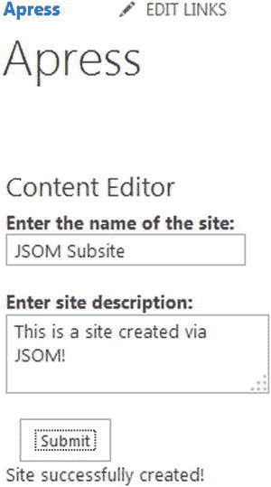

**图 8-19.** 通过 JSOM 创建新站点

然后，我们可以打开新站点所在的“网站内容”页面，并滚动到底部。在“子网站”部分，我们可以看到新站点已创建，如图 8-20 所示。

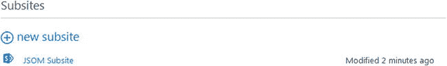

**图 8-20.** “网站内容”页面中新创建的子网站

### 删除站点

在本节中，我们将删除上一示例中创建的站点。

#### HTML

在 Visual Studio 中创建一个新的 HTML 文件，并将其命名为 `JSOMDeleteSite.html`。此页面的标记包含一个文本框，供用户输入他们想要删除的站点名称。它包括以下几行代码：

```
<script type="text/javascript" src="/_layouts/15/sp.runtime.js"></script>
<script type="text/javascript" src="/_layouts/15/sp.js"></script>
<script type="text/javascript" src="/apress/Webparts/chapter 8/JSOMDeleteSite.js"></script>
<div id="DeleteFile">
    <div>
        <strong>输入要删除的站点名称：</strong>
        <br />
        <input type="text" id="txtSiteTitle" />
    </div>
    <br />
    <input type="button" id="btnSubmit" value="提交" />
</div>
<div id="divResults"></div>
```


#### JavaScript

在 Visual Studio 中创建一个新的 JavaScript 文件，并将其命名为 `JSOMDeleteSite.js`；包含以下代码：

```
$(function () {
    bindButtonClick();
});

function bindButtonClick() {
    $("#btnSubmit").on("click", function () {
        deleteSite();
    });
}

function deleteSite() {
    var siteTitle = $("#txtSiteTitle").val();
    var siteTitleNoSpaces = siteTitle.replace(/\s/g, "");
    var siteUrl = _spPageContextInfo.webAbsoluteUrl + "/" + siteTitleNoSpaces;
    var clientContext = new SP.ClientContext(siteUrl);
    var oWebsite = clientContext.get_web();
    oWebsite.deleteObject();
    clientContext.executeQueryAsync(
        Function.createDelegate(this, this.onQuerySucceeded),
        Function.createDelegate(this, this.onQueryFailed)
    );
}

function onQuerySucceeded() {
    $("#divResults").html("Site successfully deleted!");
}

function onQueryFailed(sender, args) {
    alert('Request failed. ' + args.get_message() +
        '\n' + args.get_stackTrace());
}
```

与之前的示例一样，我们获取用户输入的网站标题，然后移除所有空格：

```
var siteTitle = $("#txtSiteTitle").val();
var siteTitleNoSpaces = siteTitle.replace(/\s/g, "");
var siteUrl = _spPageContextInfo.webAbsoluteUrl + "/" + siteTitleNoSpaces;
```

获取标题并移除空格后，我们需要构建网站的完整 URL。我们可以使用 `_spPageContextInfo.webAbsoluteUrl` 获取当前网站的完整 URL，然后在末尾简单地附加一个 `/` 和没有空格的网站标题。我们需要构建完整的 URL，以便可以请求要删除的目标网站的客户端上下文，而不是用户当前所在的网站：

```
var clientContext = new SP.ClientContext(siteUrl);
var oWebsite = clientContext.get_web();
```

到目前为止，我们一直使用用户查看页面时所在的当前网站的客户端上下文。但是，你可以通过将 URL 作为参数传递给 `SP.ClientContext()` 方法（正如本示例中所做的那样），来请求其他网站的上下文。获得该网站的上下文后，我们使用 `clientContext.get_web()` 获取对该网站根网站的引用。与所有其他删除操作一样，我们只需调用 `deleteObject()` 方法来请求删除操作：

```
oWebsite.deleteObject();
```

`success` 函数会向用户显示一条消息，告知他们删除已完成。

### 结果

将内容编辑器 Web 部件的“内容链接”属性设置为该 HTML 文件，然后保存页面。页面将显示一个文本框供用户输入网站标题，并显示一条结果消息，如图 8-21 所示。

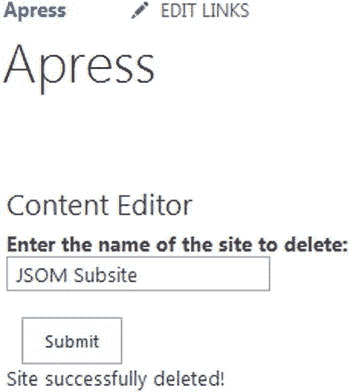

图 8-21. 通过 JSOM 删除子网站

在此示例中，我们将删除刚刚创建的网站。导航回网站内容页面将显示子网站已成功删除，如图 8-22 所示。

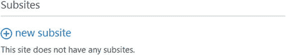

图 8-22. 该网站已从根网站中移除

## 使用社交数据

SharePoint 的一个重要新领域是社交数据。如果你要为 SharePoint 编写自定义解决方案，你肯定会在某个时候需要访问社交数据。本节将演示如何提取其中一些数据以用于你的解决方案中。

#### HTML

在 Visual Studio 中创建一个新的 HTML 文件，并将其命名为 `JSOMGetSocialData.html`。该页面的标记将包含几个 `DIV` 和一个 `SPAN`，用于输出数据。它包含以下行：

```
<script type="text/javascript" src="/_layouts/15/sp.runtime.js"></script>
<script type="text/javascript" src="/_layouts/15/sp.js"></script>
<script type="text/javascript" src="/_layouts/15/sp.userprofiles.js"></script>
<script type="text/javascript" src="/apress/Webparts/chapter 8/JSOMGetSocialData.js"></script>
<link rel="stylesheet" type="text/css" href="/apress/Webparts/chapter 8/JSOMGetSocialData.css" />
<div id="WelcomeMessage">
    Welcome back <span id="WelcomeMessageUserName"></span>
</div>
<div id="UserFollows" />
```

此示例的引用比迄今为止的任何其他示例都多。你会注意到，除了引用 `sp.js` 和 `sp.runtime.js` 之外，我们还包含了 `sp.userprofiles.js` 的引用。正如本章前面提到的，JSOM 功能分布在许多不同的文件中，这些文件服务于特定需求。在此示例中，由于我们想要获取用户的社交数据，因此我们必须包含对 `sp.userprofiles.js` 文件的引用，才能访问该功能。

我们还将包含一个名为 `JSOMGetSocialData.css` 的自定义 CSS 文件。该文件将用于设置脚本输出的样式。所有其他示例本可以轻松地包含用于样式的 CSS。你会发现在自定义开发工作中，样式在许多 Web 部件中起着重要作用；因此，此示例将向你展示包含样式是多么容易。


#### JavaScript

在 Visual Studio 中新建一个 JavaScript 文件，并将其命名为 `JSOMGetSocialData.js`，然后包含以下代码：

```js
$(function () {
    ExecuteOrDelayUntilScriptLoaded(getUserProfileProperties, "sp.userprofiles.js");
});

function getUserProfileProperties() {
    var clientContext = new SP.ClientContext();
    var peopleManager = new SP.UserProfiles.PeopleManager(clientContext);
    this.userProperties = peopleManager.getMyProperties();
    clientContext.load(userProperties);
    
    var followingManager = new SP.Social.SocialFollowingManager(clientContext);
    this.following = followingManager.getFollowed(15);
    
    clientContext.executeQueryAsync(
        Function.createDelegate(this, this.onQuerySucceeded),
        Function.createDelegate(this, this.onQueryFailed)
    );
}

function onQuerySucceeded() {
    $("#WelcomeMessageUserName").text(userProperties.get_displayName());
    
    var followedItems = "您关注的项目：<br />";
    $.each(following, function(index, value) {
        followedItems += "<a href='" + value.get_uri() + "'>" + value.get_name() + "</a><br />";
    });
    
    $("#UserFollows").append(followedItems);
}

function onQueryFailed(sender, args) {
    alert('请求失败。' + args.get_message() +
        '\n' + args.get_stackTrace());
}
```

在 jQuery 的 `Document.ready` 函数中，我们包含了一个内置函数 `ExecuteOrDelayUntilScriptLoaded`。之所以需要使用它，是因为我们的 JavaScript 代码依赖于 `sp.userprofiles.js` 中的功能，如果在加载该文件之前运行，会导致错误：

```js
ExecuteOrDelayUntilScriptLoaded(getUserProfileProperties, "sp.userprofiles.js");
```

一旦触发了 `getUserProfileProperties` 函数，我们就获取当前客户端上下文的引用，然后用以下代码创建一个新的 `PeopleManager` 对象：

```js
var peopleManager = new SP.UserProfiles.PeopleManager(clientContext);
this.userProperties = peopleManager.getMyProperties();
clientContext.load(userProperties);
```

我们可以通过 `SP.UserProfiles.PeopleManager()` 方法创建一个新的 `PeopleManager` 对象，并以客户端上下文作为其参数传入。`PeopleManager` 对象提供了访问用户数据的方法。在此例中，我们可以通过 `peopleManager.getMyProperties()` 方法获取当前用户的所有属性，然后在客户端上下文中加载 `userProperties` 变量。

接下来，我们将使用 `SocialFollowingManager()` 对象获取用户关注的所有项目：

```js
var followingManager = new SP.Social.SocialFollowingManager(clientContext);
this.following = followingManager.getFollowed(15);
```

我们可以通过 `SP.Social.SocialFollowingManager()` 方法创建一个新的 `SocialFollowingManager` 对象，并以客户端上下文作为其参数传入。然后，我们可以通过 `getFollowed()` 方法获取用户关注的所有“参与方”。一个“参与方”实际上就是用户关注的任何对象，可以是用户、文档、网站或标签。当您调用 `getFollowed()` 方法时，需要传入一个数字，该数字对应于您想要返回的参与方类型。在此示例中，我们使用 15，表示所有参与方。您可以在 [`http://msdn.microsoft.com/en-us/library/microsoft.sharepoint.client.social.socialactortypes(v=office.15).aspx`](http://msdn.microsoft.com/en-us/library/microsoft.sharepoint.client.social.socialactortypes(v=office.15).aspx) 上查看完整的取值列表。

此示例中的 `success` 方法目前是最复杂的，因为我们需要比其它示例显示更多的数据。首先，我们将获取当前用户的用户名以便在页面上显示：

```js
$("#WelcomeMessageUserName").text(userProperties.get_displayName());
```

`userProperties` 对象有许多检索数据的方法；要获取用户名，我们可以调用 `get_displayName()` 方法。接下来，我们将遍历所有关注的项目，构建一个列表展示给用户：

```js
var followedItems = "您关注的项目：<br />";
$.each(following, function(index, value) {
    followedItems += "<a href='" + value.get_uri() + "'>" + value.get_name() + "</a><br />";
});
```

首先，我们创建一个新变量来保存所有关注的项目。接着，我们使用 jQuery 的 `each` 循环遍历每个项目。对于每个项目，我们调用 `get_uri()` 和 `get_name()` 方法来构造一个链接，以便用户可以从页面直接跳转到该项目。最后，我们通过下面这一行将所有 HTML 附加到页面上：

```js
$("#UserFollows").append(followedItems);
```

#### CSS

在 Visual Studio 中新建一个 CSS 文件，并将其命名为 `JSOMGetSocialData.css`，然后包含以下代码：

```css
#WelcomeMessage {
    margin-bottom: 20px;
}
#WelcomeMessageUserName {
    font-weight: bold;
}
#UserFollows {
    border:dashed 1px #C0C0C0;
    width:240px;
    padding: 6px;
}
```

这段 CSS 非常简单，仅用于提供一个基本的样式示例。我们将为欢迎消息添加底部外边距，并将用户名加粗。关注的项目将被包裹在一个虚线边框内以作强调。

### 结果

将内容编辑器 Web 部件的“内容链接”属性设置为指向 HTML 文件，然后保存页面。页面将向用户显示一条“欢迎回来”的消息，同时用户名以粗体显示。正下方是他们关注的所有项目的列表，以超链接形式呈现，如图 8-23 所示。

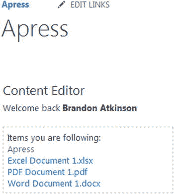

**图 8-23.** 通过 JSOM 检索社交数据

