# 9. 使用 REST API

在上一章中，我们了解了如何使用 JavaScript 对象模型（JSOM）和 Etherson 方法执行大量任务。本章将探讨相同的任务，但侧重于如何使用 REST API 来执行。为此，上一章中的许多 HTML 代码将类似，最终结果也将相同。不过，JavaScript 代码将完全不同。如果你跳过了 JSOM 章节，也不必担心；本章会对代码进行完整解释，因此你不会对任何示例感到困惑。

REST 全称为 Representational State Transfer（表征状态转移），这是一种略显花哨的说法，实际含义是“允许任何事物通过 Web 连接的 Web 服务”。任何能够通过互联网发起 HTTP 请求的设备都可以调用 REST 服务。这类服务近来非常流行，因为它是一种让数据能被任何系统访问的简单方法。SharePoint 2013 引入了一套新的 REST API，用于向应用程序公开数据。幸运的是，这套 API 也可以通过 HTML 和 JavaScript 轻松使用。

> **注意：** 使用 REST API 的代码会在当前登录用户的上下文中运行。这意味着代码只能执行该用户权限级别所允许的操作。例如，如果你的代码用于在网站集中创建新的子网站，但当前登录用户没有该权限，则代码会运行但会产生错误。在构建解决方案时请牢记这一点，并确保不要向用户展示他们无法使用的选项。

## 准备工作

本章的示例将继续使用第 4 章中介绍的 Etherson 方法。导航到网站中的 `Webparts` 文件夹，创建一个名为 `Chapter 9` 的新文件夹，如图 9-1 所示。

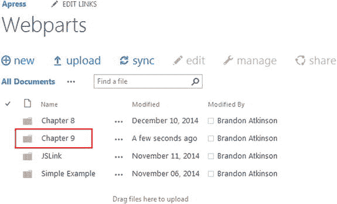

**图 9-1.** `Webparts` 文档库中的 `Chapter 9` 文件夹

本章中的每个示例都将遵循相同的模式。我们先看在内容编辑器 Web 部件中呈现的 HTML 文件，然后是用于检索和呈现数据的 JavaScript 文件，最后是结果。我们会详细分析每个文件，并在此过程中解释每个文件中的具体操作。

## 使用列表

正如上一章所述，SharePoint 中列表无处不在！在你的开发工作中，几乎不可能不接触到列表。在本节中，我们将探讨如何使用 REST API 与列表进行交互的一些方法。

### 获取列表数据

在这个示例中，我们将简单地检索一些列表数据并显示给用户。

#### HTML

在 Visual Studio 中创建一个新的 HTML 文件，并命名为 `RESTGetListData.html`。本示例中的 HTML 非常简单，仅包含以下几行代码：

```html
<script type="text/javascript" src="/apress/webparts/chapter 9/RESTGetListData.js"></script>
<div id="divGetListData"></div>
```

如果你已经学习过 JSOM 的示例，会注意到这里的 HTML 更加简洁，引用的 JavaScript 也更少。主要原因是使用 REST API 时，你不需要加载任何 SharePoint JavaScript 文件（如 JSOM）。所有对 REST API 的调用都是通过 JavaScript AJAX 调用完成的。在我们的示例中将使用 jQuery 的 AJAX 方法。

接下来，我们加载自定义的 JavaScript 文件 `RESTGetListData`。该文件包含了将所有数据加载到页面上 ID 为 `divGetListData` 的 DIV 元素中的所有代码。总的来说，这个页面上内容不多。

#### JavaScript

在 Visual Studio 中创建一个新的 JavaScript 文件，并命名为 `RESTGetListData.js`。与 HTML 相比，JavaScript 文件更为复杂，包含以下代码：

```javascript
$(function () {
    getListData();
});

function getListData() {
    var siteUrl = _spPageContextInfo.webAbsoluteUrl;
    var fullUrl = siteUrl + "/_api/web/lists";

    $.ajax({
        url: fullUrl,
        type: "GET",
        headers: {
            "accept": "application/json;odata=verbose",
            "content-type": "application/json;odata=verbose",
        },
        success: onQuerySucceeded,
        error: onQueryFailed
    });
}

function onQuerySucceeded(data) {
    var listItemInfo = '';
    $.each(data.d.results, function (key, value) {
        listItemInfo += 'Title: ' + value.Title + ' - Created: ' +
        value.Created + '<br />';
    });
    $("#divGetListData").html(listItemInfo);
}

function onQueryFailed() {
    alert('Error!');
}
```

首先你会注意到，这个文件中 SharePoint 相关的代码非常少。绝大多数代码都是 JavaScript 和 jQuery，只有 `_spPageContextInfo.webAbsoluteUrl` 这一处调用了 SharePoint JavaScript。对于那些刚接触 SharePoint 前端开发、但具有 jQuery 经验的开发者来说，这似乎是一条捷径！如果你熟悉 jQuery 和 AJAX 调用，这确实提供了一种更快速创建自定义解决方案的方法。

本书中的大部分 REST 示例都遵循与本示例相同的模式。让我们逐行详细分析，以完全理解其工作原理。脚本以 jQuery 的 `Document.ready` 方法开始，该方法简单地调用了一个名为 `getListData` 的自定义函数。在函数中，我们首先构建 REST API 的 URL：

```javascript
var siteUrl = _spPageContextInfo.webAbsoluteUrl;
var fullUrl = siteUrl + "/_api/web/lists";
```

我们使用 `_spPageContextInfo.webAbsoluteUrl` 方法来获取用户当前所在网站的完整 URL。接着，通过 `/_api/web/lists` 添加上此 Web 中列表的 REST API 路径。这将生成一个类似于以下格式的 URL：

```
http://<DOMAIN>/<SITE>/_api/web/lists
```

这是所有 REST URL 的基本结构。`_api` 表示这是对 REST API 的调用。当 SharePoint 在 AJAX 调用的 URL 中看到此部分时，它知道将请求路由到 REST API 进行处理。在这个特定示例中，我们请求的是当前 Web 上的列表集合。如果你将其与 JSOM 请求进行比较，可以看到一些相似之处：

```javascript
var collList = clientContext.get_web().get_lists();
```

如你所见，REST API 遵循“获取 Web，然后获取列表”的类似模式。本模式将在本章中重复出现。接下来，我们发起一个标准的 jQuery AJAX 调用来获取 Web 中的列表：

```javascript
$.ajax({
    url: fullUrl,
    type: "GET",
    headers: {
        "accept": "application/json;odata=verbose",
        "content-type": "application/json;odata=verbose",
    },
    success: onQuerySucceeded,
    error: onQueryFailed
});
```

对于此 AJAX 调用，我们首先传入的是调用的 URL，即之前创建的 `fullUrl` 变量，它保存了 REST API 的完整 URL。接着，我们指定调用的“类型”，这里是 `GET`。我们必须在调用中提供一些“标头”，以便 SharePoint 知道我们期望返回 JSON 格式的结果。为此，我们在 `accept` 和 `content-type` 标头中都传递了 `application/json;odata=verbose`。几乎所有的 REST 调用中都会用到这两个标头。最后，我们指定了调用完成时应触发的 `success` 和 `failure` 函数。`success` 函数简单地显示每个列表及其创建时间戳：

```javascript
function onQuerySucceeded(data) {
    var listItemInfo = '';
    $.each(data.d.results, function (key, value) {
        listItemInfo += 'Title: ' + value.Title + ' - Created: ' +
        value.Created + '<br />';
    });
    $("#divGetListData").html(listItemInfo);
}
```

### REST 调用数据的结构

REST 调用返回的数据结构起初可能会让人感到困惑。如果你打开 Firebug 并查看返回的对象，你会发现返回了大量的数据，远超向用户展示所需的量。此外，你想要向用户展示的数据嵌套在一个名为 `d` 的属性中。例如，在这个示例中，列表集合位于名为 `data.d.results` 的属性中。如果你要查询单个列表，则不会存在 `results` 属性，你可以直接从 `d` 属性访问数据，例如 `data.d.Title`。你将在本章中看到更多类似的实例。

### 结果

将内容编辑器 Web 部件的内容链接属性设置为 HTML 文件，然后保存页面。结果将显示当前网站中的所有列表，如图 9-2 所示。

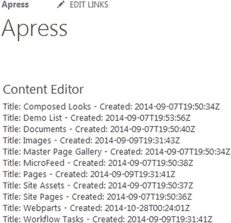

图 9-2. 内容编辑器 Web 部件中的获取列表数据结果

### 创建新列表

如本例所示，我们可以使用 REST 轻松创建新列表。

#### HTML

在 Visual Studio 中创建一个新的 HTML 文件并将其命名为 `RESTCreateList.html`。此示例的 HTML 比上一个示例稍复杂一些。它包含以下行：

```html
<script type="text/javascript" src="/apress/webparts/chapter 9/RESTCreateList.js"></script>

<div>
    <strong>输入列表名称：</strong>
    <input type="text" id="txtListName" />
    <input type="button" id="btnSubmitListName" value="提交" />
</div>
<div id="divCreateListResults"></div>
```

HTML 稍微复杂一些，页面上有几个元素。首先，有一些简单的文本包裹在 `<strong>` 标签中，使其在页面上显示为粗体。接下来，有一个类型为 Text 的 `INPUT`，它是一个简单的文本框，供用户输入想要创建的列表名称。有一个按钮供用户提交新的列表请求，最后，还有一个 `DIV` 用于输出列表创建的结果。每个元素都有一个 ID，以便我们可以使用 jQuery 轻松定位它。

> **注意**
>
> 要通过 REST 创建新列表，执行代码的用户必须在 SharePoint 中至少拥有“管理列表”权限。无论权限级别如何，页面都会呈现；但是，如果用户没有足够的权限，SharePoint 将抛出错误。

#### JavaScript

在 Visual Studio 中创建一个新的 JavaScript 文件并将其命名为 `RESTCreateList.js`。相比之下，JavaScript 文件更复杂。它包含以下行：

```javascript
$(function () {
    bindButtonClick();
});

function bindButtonClick() {
    $("#btnSubmitListName").on("click", function () {
        var listName = $("#txtListName").val();
        createList(listName);
    });
}

function createList(listName) {
    var siteUrl = _spPageContextInfo.webAbsoluteUrl;
    var fullUrl = siteUrl + "/_api/web/lists";

    $.ajax({
        url: fullUrl,
        type: "POST",
        data: JSON.stringify({
            '__metadata': { 'type': 'SP.List' },
            'BaseTemplate': 100,
            'Title': listName
        }),
        headers: {
            "accept": "application/json;odata=verbose",
            "content-type": "application/json;odata=verbose",
            "X-RequestDigest": $("#__REQUESTDIGEST").val()
        },
        success: onQuerySucceeded,
        error: onQueryFailed
    });
}

function onQuerySucceeded(data) {
    $("#divCreateListResults").html(data.d.Title + " 创建成功！");
}

function onQueryFailed() {
    alert('错误！');
}
```

在此示例中，我们不需要在页面加载时触发任何操作；但是，我们确实需要在页面加载时连接一个按钮点击事件。在 `Document.ready` 函数中，我们触发 `bindButtonClick` 函数，该函数使用 jQuery 的 `on` 运算符为 HTML 中的 `btnSubmitListName` 按钮连接一个点击事件。当用户单击按钮时，我们从页面上的文本框中获取文本，并将其传递给 `createList()` 函数。这是通过以下行实现的：

```javascript
function bindButtonClick() {
    $("#btnSubmitListName").on("click", function () {
        var listName = $("#txtListName").val();
        createList(listName);
    });
}
```

`createList()` 函数接收一个名为 `listName` 的变量，即用户在页面上输入的文本。接下来，我们使用以下代码构建 REST 调用的 URL：

```javascript
var siteUrl = _spPageContextInfo.webAbsoluteUrl;
var fullUrl = siteUrl + "/_api/web/lists";
```

你会注意到，这与上一个示例中的 URL 相同，因为我们针对的是 Web 中的列表集合。然而，AJAX 看起来则大不相同：

```javascript
$.ajax({
    url: fullUrl,
    type: "POST",
    data: JSON.stringify({
        '__metadata': { 'type': 'SP.List' },
        'BaseTemplate': 100,
        'Title': listName
    }),
    headers: {
        "accept": "application/json;odata=verbose",
        "content-type": "application/json;odata=verbose",
        "X-RequestDigest": $("#__REQUESTDIGEST").val()
    },
    success: onQuerySucceeded,
    error: onQueryFailed
});
```

与上一个示例一样，我们将 `fullUrl` 变量作为要调用的 URL 传递，而现在的类型是 `POST`。由于在此示例中我们要创建一个新列表，因此使用 `POST` 来向 SharePoint 指示这是一个创建操作。接下来，我们使用以下行传递新列表的数据：

```
data: JSON.stringify({
    '__metadata': { 'type': 'SP.List' },
    'BaseTemplate': 100,
    'Title': listName
})
```

当我们使用 REST API 执行除 `GET` 之外的任何类型的操作时，我们都在向 SharePoint 传递数据。这些数据采用 JSON 格式。`JSON.stringify` 方法是一种标准的 JavaScript 方法，用于将 JavaScript 数据结构转换为 JSON 文本。这有助于确保我们传递给 SharePoint 的数据采用正确的格式。我们首先要做的是将“type”设置为 `SP.List`，并将 `BaseTemplate` 设置为 `100`，这是一个通用列表。最后，我们传递 `listName` 变量作为标题。接下来，我们添加标头，并包含一个名为 `X-RequestDigest` 的新标头：

```
"X-RequestDigest": $("#__REQUESTDIGEST").val()
```

此标头允许我们传递页面上表单摘要控件的值。此控件在 SharePoint 中用作安全措施，以确保 `POST` 请求确实来自有效的 SharePoint 页面。你无需了解此控件的所有细节，只需知道可以使用 jQuery 行 `$("#__REQUESTDIGEST").val()` 获取其值即可。标头设置好后，我们指定成功和失败函数。`success` 函数仅显示列表名称以及一条成功消息：

```
function onQuerySucceeded(data) {
    $("#divGetListData").html(data.d.Title + " 创建成功！");
}
```

此函数接收一个名为 `data` 的参数。此变量将填充刚刚创建的列表中的数据。此变量的命名没有什么特别之处；我们可以将其命名为 `list` 或 `myCoolData`。如果愿意，你甚至可以不指定参数，只显示一条成功消息！

### 结果

将内容编辑器 Web 部件的“内容链接”属性设置为该 HTML 文件，然后保存页面。页面现在将显示文本框和按钮，供用户输入新的列表名称。输入 `My Custom REST List`，然后单击“提交”按钮。结果将显示成功消息，如图 9-3 所示。

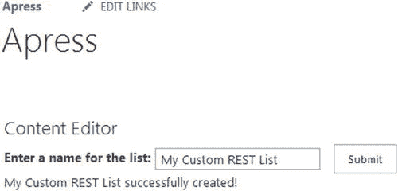

*图 9-3. 运行后的创建新列表代码*

由于这一切都是使用 JavaScript 和 AJAX 完成的，列表将会被创建，并且用户会按预期收到通知。但是，页面左侧的导航不会更新，因为页面尚未刷新。你完全可以修改这段代码，使其在成功时刷新页面，但在此示例中，我们只需在浏览器中手动刷新页面。图 9-4 显示了刷新后的页面，其中新列表显示在左侧导航中。

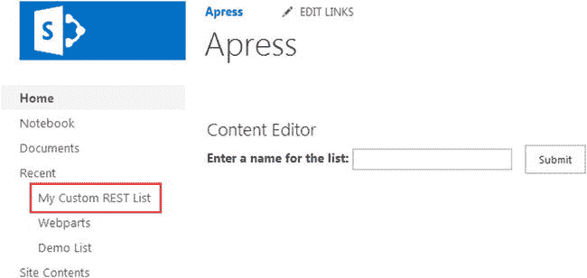

*图 9-4. 新列表显示在左侧导航窗格中*

### 删除列表

在此示例中，我们将简单地删除刚刚创建的列表。

#### HTML

在 Visual Studio 中创建一个新的 HTML 文件，并将其命名为 `RESTDeleteList.html`。此示例的 HTML 代码与前一个示例几乎相同。它包含以下代码行：

```
<script type="text/javascript" src="/apress/webparts/chapter 9/RESTDeleteList.js"></script>
<div>
    <strong>输入要删除的列表名称：</strong>
    <input type="text" id="txtListName" />
    <input type="button" id="btnSubmitListName" value="提交" />
</div>
<div id="divDeleteListResults"></div>
```

这里唯一的区别是，我们更新了页面上的文本，以指示此 Web 部件将删除一个列表，并将结果显示的 DIV 的 ID 更改为 `divDeleteListResults`。

#### JavaScript

在 Visual Studio 中创建一个新的 JavaScript 文件，并将其命名为 `RESTDeleteList.js`。该 JavaScript 文件包含以下代码行：

```
$(function () {
    bindButtonClick();
});

function bindButtonClick() {
    $("#btnSubmitListName").on("click", function () {
        var listName = $("#txtListName").val();
        deleteList(listName);
    });
}

function deleteList(listName) {
    var siteUrl = _spPageContextInfo.webAbsoluteUrl;
    var fullUrl = siteUrl + "/_api/web/lists/GetByTitle('" + listName + "')";
    $.ajax({
        url: fullUrl,
        type: "POST",
        headers: {
            "accept": "application/json;odata=verbose",
            "content-type": "application/json;odata=verbose",
            "X-RequestDigest": $("#__REQUESTDIGEST").val(),
            "X-HTTP-Method": "DELETE",
            "IF-MATCH": "*"
        },
        success: onQuerySucceeded,
        error: onQueryFailed
    });
}

function onQuerySucceeded() {
    $("#divDeleteListResults").html("列表已成功删除！");
}

function onQueryFailed(sender, args) {
    alert('错误！');
}
```

jQuery 按钮绑定与前一个示例相同。接下来，我们需要构建 REST 调用的 URL，这次是请求一个特定的列表：

```
var siteUrl = _spPageContextInfo.webAbsoluteUrl;
var fullUrl = siteUrl + "/_api/web/lists/GetByTitle('" + listName + "')";
```

此 URL 添加了额外的 `GetByTitle` 命令，并传入我们要查找的列表名称。最终的 URL 如下所示：

```
http://<DOMAIN>/<SITE>/_api/web/lists/GetByTitle('<LISTNAME>')
```

接下来，我们需要添加几个额外的标头：

```
"X-HTTP-Method": "DELETE",
"IF-MATCH": "*"
```

你会注意到，请求类型是 `POST`，就像我们创建新列表时一样。但是，这里我们想发起一个“删除”请求，因此需要包含 `X-HTTP-Method` 标头，以告知 SharePoint 我们要删除该列表，而不是对其执行其他操作。接下来，我们包含 `IF-MATCH` 标头。使用 REST 进行更新和删除操作时需要此标头。此标头有助于防止并发更新。例如，如果你尝试更新一个列表项，可以传入一个 `etag` 属性，如下所示：

```
"If-Match": data.d.__metadata.etag
```

在此标头中传递 `*` 基本上是在告诉 SharePoint 不必担心并发问题，直接执行更新即可。在此示例中，我们正在删除列表，因此无需担心这个检查。`success` 函数仅通知用户删除已成功。

### 结果

将内容编辑器 Web 部件的“内容链接”属性设置为该 HTML 文件，然后保存页面。页面现在将显示文本框和按钮，供用户输入要删除的列表名称。输入 `My Custom REST List`，然后单击“提交”按钮。结果将显示成功消息，如图 9-5 所示。

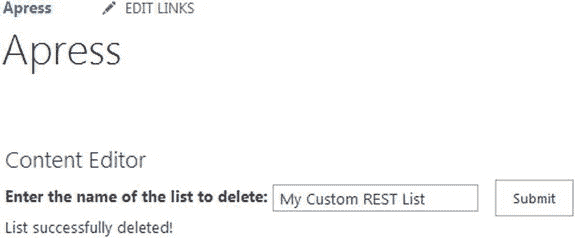

图 9-5. 成功运行后的删除列表代码

由于这一切都是使用 `JavaScript` 和 `AJAX` 完成的，列表将会被删除，并且用户会按预期收到通知。但是，页面左侧的导航不会更新，因为页面尚未刷新。与之前一样，你可以修改这段代码，使其在成功时刷新页面，但在此示例中，我们只需在浏览器中手动刷新页面。图 9-6 显示了刷新后的页面，此时该列表已不再显示在左侧导航中。

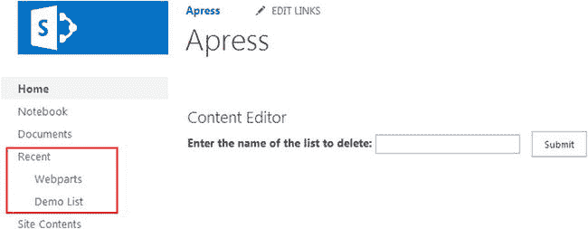

图 9-6. 已删除的列表已从左侧导航中移除

## 处理列表项

由于处理列表是 `SharePoint` 开发中非常常见的任务，因此处理列表项更为常见。在本节中，我们将探讨一些使用 `REST API` 与列表项交互的方法。

### 获取列表项

此示例将向你展示如何使用 `REST` 检索列表项。

#### HTML

在 `Visual Studio` 中创建一个新的 `HTML` 文件，并将其命名为 `RESTGetListItems.html`。此示例的 `HTML` 代码延续了前几个示例的极简模式。它包含以下代码行：

```html
<script type="text/javascript" src="/apress/webparts/chapter 9/RESTGetListItems.js"></script>
<div id="divListItems"></div>
```

在此示例中，我们将简单地获取演示列表中的所有列表项，并将其显示在页面上的 `divListItems` `DIV` 中。

#### JavaScript

在 `Visual Studio` 中创建一个新的 `JavaScript` 文件，并将其命名为 `RESTGetListItems.js`。用于检索列表项的脚本与我们目前看到的其他脚本非常相似。它由以下几行代码组成：

```javascript
$(function () {
    retrieveListItems();
});

function retrieveListItems() {
    var siteUrl = _spPageContextInfo.webAbsoluteUrl;
    var fullUrl = siteUrl + "/_api/web/lists/GetByTitle('Demo List')/items";
    $.ajax({
        url: fullUrl,
        type: "GET",
        headers: {
            "accept": "application/json;odata=verbose",
            "content-type": "application/json;odata=verbose",
        },
        success: onQuerySucceeded,
        error: onQueryFailed
    });
}

function onQuerySucceeded(data) {
    var listItemInfo = '';
    $.each(data.d.results, function (key, value) {
        listItemInfo += '<strong>ID: </strong> ' + value.Id +
            ' <strong>Title:</strong> ' + value.Title +
            '<br />';
    });
    $("#divListItems").html(listItemInfo);
}

function onQueryFailed(sender, args) {
    alert('Error!');
}
```

用于获取列表项的 `REST` 调用 `URL`，现在看起来应该非常熟悉：

```javascript
var siteUrl = _spPageContextInfo.webAbsoluteUrl;
var fullUrl = siteUrl + "/_api/web/lists/GetByTitle('Demo List')/items";
```

与删除 `URL` 类似，我们使用 `GetByTitle` 命令获取列表的标题，然后添加 `items` 命令，该命令指示 `SharePoint` 返回列表中的所有项。`AJAX` 调用是一个简单的 `GET` 请求，其中包含了我们熟悉的 `JSON` 标头。`success` 函数使用 `jQuery` 遍历结果：

```javascript
$.each(data.d.results, function (key, value) {
    listItemInfo += '<strong>ID: </strong> ' + value.Id +
        ' <strong>Title:</strong> ' + value.Title +
        '<br />';
});
```

就像访问网站中的列表时一样，我们使用 `data.d.results` 集合来访问查询结果。在 `jQuery` 的 `each` 循环中，我们提取每个列表项的 `ID` 和 `Title`，并将这些结果显示在页面上。

### 结果

将内容编辑器 `Web` 部件的 `Content Link` 属性设置为该 `HTML` 文件，然后保存页面。该页面现在将显示 `Demo List` 中的所有项目，如图 9-7 所示。

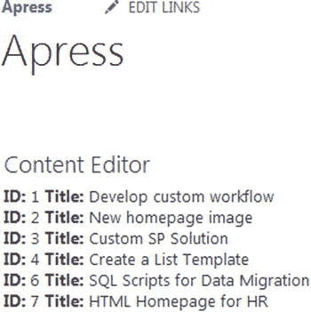

图 9-7. 在内容编辑器 `Web` 部件中显示的 `Demo List` 列表项

### 使用查询运算符限制结果

在前一章中，我们讨论过在大多数情况下，你不应请求列表中的所有项；无论是使用 `JSOM` 还是 `REST`，这都不是一个好主意。我们看到了如何使用 `CAML` 查询在 `JSOM` 中限制结果。使用 `REST API` 时，你可以使用查询运算符来限制返回的结果。查询运算符本质上是在 `AJAX` 调用中附加到 `REST URL` 末尾的查询字符串参数。

#### JavaScript

更新上一个示例中的 `RESTGetListItems.js`，并用以下代码行更新声明 `REST URL` 的部分：

```javascript
var siteUrl = _spPageContextInfo.webAbsoluteUrl;
var fullUrl = siteUrl + "/_api/web/lists/GetByTitle('Demo List')/items?$filter=Id ge 4";
```

此处唯一的添加项是在 `URL` 的末尾，带有以下查询字符串：`$filter=Id ge 4`。我们使用了 `filter` 运算符来过滤结果。我们指定要过滤 `ID` 大于或等于 (`ge`) 4 的项。这是一个非常简单的添加，但它是对查询运算符的一个很好的介绍。

**注意：** 查询运算符是一个庞大的主题——本书无法详尽涵盖。这些运算符允许你进行选择、过滤、排序、排序等操作。你甚至可以通过使用这些运算符，告诉 `SharePoint` 仅返回关于 `SharePoint` 中项目的特定数据。有关使用查询运算符的更深入信息，请访问 [`msdn.microsoft.com/en-us/library/office/fp142385%28v=office.15%29.aspx`](http://msdn.microsoft.com/en-us/library/office/fp142385%28v=office.15%29.aspx)。

### 结果

更新 `JavaScript` 文件并上传，覆盖之前的版本。刷新包含内容编辑器 `Web` 部件的页面，你将看到结果现在只显示 `ID` 大于或等于 4 的项，如图 9-8 所示。

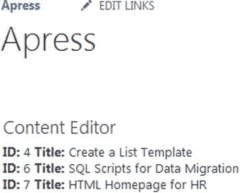

图 9-8. 由查询运算符限制的 `Demo List` 查询结果

## 添加列表项

在这个示例中，我们将探讨如何向列表中添加新的列表项。

#### HTML

在 `Visual Studio` 中创建一个新的 `HTML` 文件，并将其命名为 `RESTAddListItems.html`。此页面的标记将允许用户向 `Demo List` 添加一个项目，提供 `Title` 和 `Description`。它由以下代码行组成：

# 使用 REST API 添加和删除列表项

我们为列表项的 `Title` 提供了一个类型为 `TEXT` 的 `INPUT`，并为 `Description` 提供了一个 `TEXTAREA`。页面上的每个元素都有一个 `ID`，因此我们可以轻松地使用 `jQuery` 定位它。

## JavaScript

在 `Visual Studio` 中创建一个新的 `JavaScript` 文件，并将其命名为 `RESTADDListItems.js`。用于添加列表项的脚本与创建新列表的脚本类似。它包含以下几行代码：

```javascript
$(function () {
    bindButtonClick();
});

function bindButtonClick() {
    $("#btnSubmit").on("click", function () {
        addListItem();
    });
}

function addListItem() {
    var title = $("#txtTitle").val();
    var desc = $("#txtDesc").val();
    var siteUrl = _spPageContextInfo.webAbsoluteUrl;
    var fullUrl = siteUrl + "/_api/web/lists/GetByTitle('Demo List')/items";
    $.ajax({
        url: fullUrl,
        type: "POST",
        data: JSON.stringify({
            '__metadata': { 'type': 'SP.Data.Demo_x0020_ListListItem' },
            'Title': title,
            'Description': desc,
            'Status':'On-time'
        }),
        headers: {
            "accept": "application/json;odata=verbose",
            "content-type": "application/json;odata=verbose",
            "X-RequestDigest": $("#__REQUESTDIGEST").val()
        },
        success: onQuerySucceeded,
        error: onQueryFailed
    });
}

function onQuerySucceeded(sender, args) {
    $("#divResult").html("Item successfully added!");
}

function onQueryFailed() {
    alert('Error!');
}
```

通过 `jQuery` 绑定按钮点击事件后，我们在点击事件中首先获取用户提供的值。这通过以下代码实现：

```javascript
var title = $("#txtTitle").val();
var desc = $("#txtDesc").val();
```

接下来，我们构建 `REST` `URL`，目标是 `Demo List` 及其列表中的列表项：

```javascript
var siteUrl = _spPageContextInfo.webAbsoluteUrl;
var fullUrl = siteUrl + "/_api/web/lists/GetByTitle('Demo List')/items";
```

然后，我们创建一个 `jQuery` `AJAX` `POST` 调用，传入新列表项的数据：

```javascript
data: JSON.stringify({
    '__metadata': { 'type': 'SP.Data.Demo_x0020_ListListItem' },
    'Title': title,
    'Description': desc,
    'Status':'On-time'
})
```

这段代码与本章前面看到的“创建列表”代码非常相似。我们首先要指定所创建项的类型；在本例中，类型是 `SP.Data.Demo_x0020_ListListItem`。项的类型始终包含其所属列表的名称，并遵循以下模式：

`SP.Data.<列表名称>ListItem`

在此示例中，由于我们的列表名为 `Demo List`，因此我们必须包含 `_x0020_`，`SharePoint` 使用它来表示空格。对于 `Title` 和 `Description`，我们只需传入之前获取的值。对于 `Status` 列，我们直接硬编码值为 `On-time`。由于我们执行的是 `POST` 操作，因此需要包含 `X-RequestDigest` 标头。`success` 函数将向用户显示一条消息，告知项目已添加到列表中。

### 结果

将内容编辑器 Web 部件的 `Content Link` 属性设置为该 `HTML` 文件，然后保存页面。页面将显示文本框，供用户输入详细信息。当添加项目时，页面会显示一条成功消息，如图 9-9 所示。

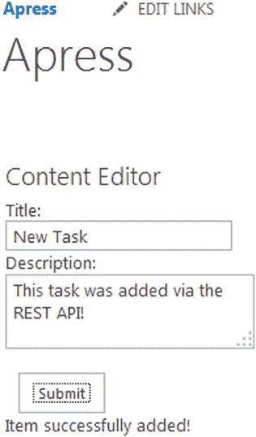

**图 9-9.** 向 `Demo List` 添加新项目

然后，我们可以导航到 `Demo List` 以确认新项目已添加。图 9-10 显示了已添加新列表项并包含 `HTML` 页面提供值的 `Demo List`。

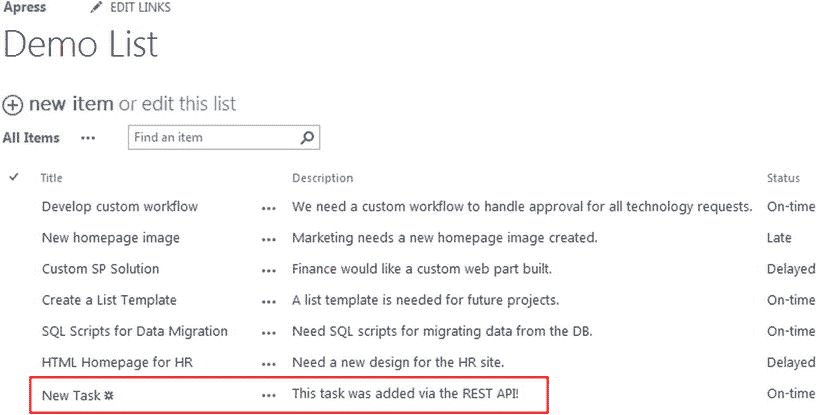

**图 9-10.** 向 `Demo List` 添加的新列表项

### 删除列表项

在此示例中，我们将简单地删除上一节中创建的新列表项。

#### HTML

在 `Visual Studio` 中创建一个新的 `HTML` 文件，并将其命名为 `RESTDeleteListItems.html`。此文件的 `HTML` 内容将更简洁，因为我们只需要从用户那里获取他们要删除的列表项对应的 `ID`。这通过以下代码实现：

```html
<script type="text/javascript" src="/apress/Webparts/chapter 9/RESTDeleteListItems.js"></script>
<div>
    Enter ID to Delete: <input type="text" id="txtId" />
</div>
<div>
    <input id="btnSubmit" type="button" value="Submit" />
</div>
<div id="divResult"></div>
```

这个示例过于简化，因为用户通常不太可能知道要删除的特定列表项的 `ID`。更实际的示例通常会向用户显示一个项目列表，并允许他们点击某个项目将其删除。在这种场景下，页面上会有列表项的 `ID`，您可以轻松访问它们。为了简化示例，我们将只使用一个简单的文本框。

#### JavaScript

在 `Visual Studio` 中创建一个新的 `JavaScript` 文件，并将其命名为 `RESTDeleteListItems.js`。包含以下代码：

```markdown
# 使用 REST API 处理列表项和文档库

## 删除列表项

`deleteListItem()` 函数将在页面上的按钮点击事件中被调用。我们首先获取用户在页面上输入的 ID。这通过以下代码实现：

```javascript
var id = $("#txtId").val();
```

接下来，我们构建 REST URL，通过 ID 定位到特定的列表项：

```javascript
var siteUrl = _spPageContextInfo.webAbsoluteUrl;
var fullUrl = siteUrl + "/_api/web/lists/GetByTitle('Demo List')/items(" + id + ")";
```

您可以通过在 URL 末尾的括号中包含其 ID 来请求或定位单个列表项。完整的 URL 如下所示：

`http://<DOMAIN>/<SITE>/_api/web/lists/GetByTitle('<列表名称>')/items(<ID>)`

与之前删除列表时一样，我们在发出 AJAX 调用时包含 `"X-HTTP-Method": "DELETE"` 和 `"IF-MATCH": "*"` 标头。`success` 方法将向用户显示一条消息，告知删除操作已完成。

### 结果

将内容编辑器 Web 部件的 `Content Link` 属性设置为该 HTML 文件，然后保存页面。页面将显示文本框供用户输入 ID，并在删除项目后显示一条成功消息，如图 9-11 所示。

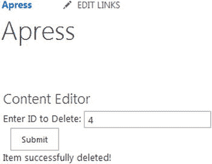

**图 9-11.** 使用 REST 删除列表项

## 处理文档库

SharePoint 的主要优势之一在于文档管理及其文档库。您肯定会遇到需要通过代码处理文档库的需求。在本节中，我们将介绍一些使用 REST API 与文档库交互的方法。

### 创建新文件夹

文件夹是 SharePoint 用户喜欢创建的东西，在本示例中，我们将了解如何通过代码创建文件夹。

#### HTML

在 Visual Studio 中新建一个 HTML 文件，并将其命名为 `RESTCreateFolder.html`。此页面的标记非常简单，允许用户输入要创建的文件夹名称。它包含以下代码：

```html
<script type="text/javascript" src="/apress/Webparts/chapter 9/RESTCreateFolder.js"></script>
<div>
    <strong>输入文件夹名称：</strong>
    <input type="text" id="txtFolderName" />
    <input type="button" id="btnSubmit" value="提交" />
</div>
<div id="divResults"></div>
```

#### JavaScript

在 Visual Studio 中新建一个 JavaScript 文件，并将其命名为 `RESTCreateFolder.js`。包含以下代码：

```javascript
$(function () {
    bindButtonClick();
});

function bindButtonClick() {
    $("#btnSubmit").on("click", function () {
        createFolder();
    });
}

function createFolder() {
    var folderName = $("#txtFolderName").val();
    var siteUrl = _spPageContextInfo.webAbsoluteUrl;
    var fullUrl = siteUrl + "/_api/web/folders";

    $.ajax({
        url: fullUrl,
        type: "POST",
        data: JSON.stringify({
            '__metadata': { 'type': 'SP.Folder' },
            'ServerRelativeUrl': 'Shared Documents/' + folderName
        }),
        headers: {
            "accept": "application/json;odata=verbose",
            "content-type": "application/json;odata=verbose",
            "X-RequestDigest": $("#__REQUESTDIGEST").val()
        },
        success: onQuerySucceeded,
        error: onQueryFailed
    });
}

function onQuerySucceeded() {
    $("#divResults").html("文件夹创建成功！");
}

function onQueryFailed() {
    alert('错误！');
}
```

使用 jQuery 绑定按钮单击事件后，`createFolder()` 函数首先获取用户在页面上输入的文件夹名称：

```javascript
var folderName = $("#txtFolderName").val();
```

接下来，我们创建 REST URL，但这次的目标是网站的文件夹集合：

```javascript
var siteUrl = _spPageContextInfo.webAbsoluteUrl;
var fullUrl = siteUrl + "/_api/web/folders";
```

这与我们之前看到的常见模式有所不同，因为我们请求的 URL 并非专门用于创建文件夹的位置。我们在 `data` 属性中指定文件夹应存放的位置：

```javascript
data: JSON.stringify({
    '__metadata': { 'type': 'SP.Folder' },
    'ServerRelativeUrl': 'Shared Documents/' + folderName
})
```

`ServerRelativeUrl` 属性用于告知 SharePoint 应在何处创建文件夹。在此示例中，我们将在“Shared Documents”文件夹中创建它，并追加用户在页面上输入的文件夹名称。与前面的示例一样，我们为项目指定了一个 `type`，此处为 `SP.Folder`。我们包含常见的请求头，并在 `success` 方法中通知用户文件夹已创建。

### 结果
```

将内容编辑器 Web 部件的“内容链接”属性设置为该 HTML 文件，然后保存页面。页面将显示一个文本框，供用户输入要创建的文件夹名称，完成后将显示成功消息，如图 9-12 所示。

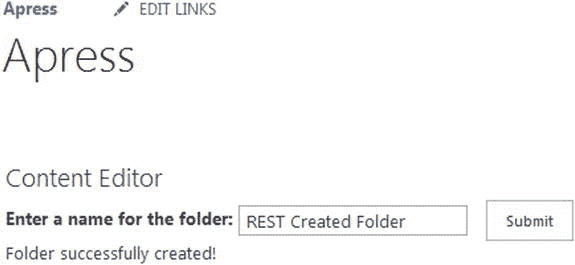
**图 9-12.** 使用 REST 创建新文件夹

然后，我们可以导航到文档库以直观地验证新文件夹是否已创建，如图 9-13 所示。

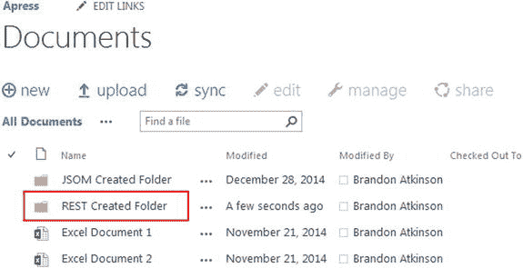
**图 9-13.** 通过 REST 创建的新文件夹

## 操作文件

在自定义解决方案中，有时需要操作文件。在本节中，我们将了解如何使用 REST 创建、读取和删除文本文件。

### 创建新文件

在此示例中，我们将了解如何通过代码创建新的文本文件。

#### HTML

在 Visual Studio 中新建一个 HTML 文件，并将其命名为 `RESTCreateDocument.html`。此页面的标记将允许用户输入新文本文件的名称以及文件本身的内容。它包含以下代码：

```html
<script type="text/javascript" src="/apress/Webparts/chapter 9/RESTCreateDocument.js"></script>
<div id="CreateFile">
    <div>
        <strong>输入文档标题：</strong>
        <br />
        <input type="text" id="txtDocumentTitle" />
    </div>
    <div>
        <strong>输入文档内容：</strong>
        <br />
        <textarea cols="20" id="txtDocumentContent"></textarea>
    </div>
    <br />
    <input type="button" id="btnSubmit" value="提交" />
</div>
<div id="divResults"></div>
```

#### JavaScript

在 Visual Studio 中创建一个新的 JavaScript 文件，并将其命名为 `RESTCreateDocument.js`。包含以下代码：

```javascript
$(function () {

    bindButtonClick();

});

function bindButtonClick() {

    $("#btnSubmit").on("click", function () {

        createDocument();

    });

}

function createDocument() {

    var docTitle = $("#txtDocumentTitle").val() + ".txt";

    var docContent = $("#txtDocumentContent").val();

    var siteUrl = _spPageContextInfo.webAbsoluteUrl;

    var fullUrl = siteUrl + "/_api/web/GetFolderByServerRelativeUrl('Shared Documents')/Files/add(url='" + docTitle + "',overwrite=true)";

    $.ajax({

        url: fullUrl,

        type: "POST",

        data: docContent,

        headers: {

            "accept": "application/json;odata=verbose",

            "content-type": "application/json;odata=verbose",

            "X-RequestDigest": $("#__REQUESTDIGEST").val()

        },

        success: onQuerySucceeded,

        error: onQueryFailed

    });

}

function onQuerySucceeded() {

    $("#divResults").html("Document successfully created!");

}

function onQueryFailed() {

    alert('Error!');

}
```

首先，我们需要获取用户在页面上输入的文档标题和内容。这通过以下代码行实现：

```javascript
var docTitle = $("#txtDocumentTitle").val() + ".txt";
var docContent = $("#txtDocumentContent").val();
```

注意，我们在文档标题末尾附加了`.txt`。这将让 SharePoint 知道我们打算创建一个文本文件，因为它会根据名称中的扩展名来确定文件类型。接下来，我们构建 REST URL：

```javascript
var siteUrl = _spPageContextInfo.webAbsoluteUrl;
var fullUrl = siteUrl + "/_api/web/GetFolderByServerRelativeUrl('Shared Documents')/Files/add(url='" + docTitle + "',overwrite=true)";
```

这是迄今为止我们构建过的最复杂的 REST URL。为了引用要创建文件的文件夹，我们需要包含 `GetFolderByServerRelativeUrl` 命令，并传入文件夹名称；在本例中为 `Shared Documents`。然后，我们定位文件夹中的 Files 集合，并使用 `add` 命令来实际创建文件。我们可以为文件传入属性；在本例中，传入了 URL 和覆盖标志。文件内容通过 AJAX 调用中的 `data` 属性传入：

```javascript
$.ajax({

        url: fullUrl,

        type: "POST",

        data: docContent,

        headers: {

            "accept": "application/json;odata=verbose",

            "content-type": "application/json;odata=verbose",

            "X-RequestDigest": $("#__REQUESTDIGEST").val()

        }
```

`success` 函数会向用户显示一条消息，告知文件已创建。

**注意**

在本示例中，我们创建了一个简单的文本文件。在大多数实际场景中，文本文件并不是预期结果，而可能是 Word 文件或 Excel 文件。你完全可以修改此示例以生成 Word 文档，只需将 `.txt` 改为 `.docx` 即可。这个简单的更改实际上会创建一个包含其中内容的新 Word 文档。但是，它只能在客户端机器上的 Word 中打开，而不能在 Office Web Apps 中打开。幸运的是，Microsoft 提供了 Office JavaScript 文件，允许你在浏览器中创建和操作 Office 文件。更多信息请访问 [`http://msdn.microsoft.com/en-us/library/office/fp160953%28v=office.15%29.aspx`](http://msdn.microsoft.com/en-us/library/office/fp160953%28v=office.15%29.aspx)。

### 结果

将内容编辑器 Web 部件的内容链接属性设置为该 HTML 文件，然后保存页面。页面将显示文本框，供用户输入文档标题和内容，然后在新文档创建成功后显示成功消息，如图 9-14 所示。

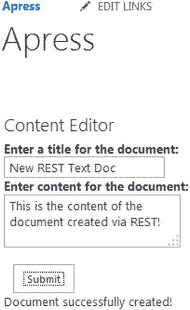
**图 9-14.** 从内容编辑器 Web 部件创建新文档

我们可以导航到 Documents 文件夹，发现新文本文件已经创建，如图 9-15 所示。你可以点击该文档，它将在浏览器中打开并显示用户从页面输入的内容。

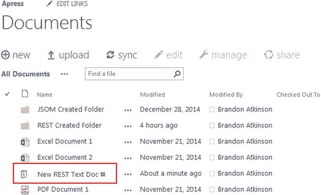

**图 9-15.** 在 Documents 文件夹中创建的新文本文件

## 读取文件

在本示例中，我们将了解如何读取刚才创建的文本文件，并将其内容显示给用户。

### HTML

在 Visual Studio 中创建一个新的 HTML 文件，并将其命名为 `RESTReadDocument.html`。它包含以下代码行：

```html
<script type="text/javascript" src="/apress/Webparts/chapter 9/RESTReadDocument.js"></script>
<div id="divReadDocument" />
```

### JavaScript

在 Visual Studio 中创建一个新的 JavaScript 文件，并将其命名为 `RESTReadDocument.js`。包含以下代码：

```javascript
$(function () {

    readDocument();

});

function readDocument() {

    var siteUrl = _spPageContextInfo.webAbsoluteUrl;

    var documentLibrary = "/Shared Documents/";

    var fileUrl = "New Text Doc.txt";

    var fullUrl = siteUrl + documentLibrary + fileUrl;

    $.ajax({

        url: fullUrl,

        type: "GET"

    })

    .done(function (data) {

        $("#divReadDocument").html(data);

    })

    .fail(function () {

        alert("error");

    });

}
```

这与上一章中的代码示例相同，因为它不需要 JSOM 或 REST！如果你跳过了 JSOM 章节，请继续阅读；否则，唯一更改的是文件引用。

从 SharePoint 读取文本文件的美妙之处在于，你只需要 jQuery。有一个简单的 jQuery `Document.ready` 函数将触发读取文件的代码。我们特意保持此代码简单，并硬编码我们刚才创建的文档的文件名：

```javascript
var siteUrl = _spPageContextInfo.webAbsoluteUrl;
var documentLibrary = "/Shared Documents/";
var fileUrl = "New REST Text Doc.txt";
var fullUrl = siteUrl + documentLibrary + fileUrl;
```

我们首先使用 `_spPageContextInfo.webAbsoluteUrl` 获取当前网站的完整 URL。接下来，硬编码 URL 的文档库部分和文件名。最后，我们将它们组合成一个名为 `fullUrl` 的新变量。你完全可以将所有这些操作放在一行中完成，但你会发现，将它们分解成较小的行，以后调试代码会更方便。一旦我们有了文件的 URL，我们就使用 jQuery AJAX 调用来获取文档：

```javascript
$.ajax({

        url: fullUrl,

        type: "GET"

    })

    .done(function (data) {

        $("#divReadDocument").html(data);

    })

    .fail(function () {

        alert("error");

    });
```

当通过 jQuery 中的 AJAX 检索文本文件时，内容将以文本形式返回，我们可以直接将其输出到页面，无需任何修改。我们使用 jQuery 的 `.done` 函数，将文件内容设置到一个名为 `data` 的新变量中。然后，我们将数据设置为页面上结果 DIV 的 HTML。

**注意**

与之前一样，在创建新文件时，我们通过使用文本文件来保持简单。本节和读取文件也是如此。你无法使用前面描述的方法读取 Office 文件。你需要利用 Office JavaScript 文件才能在浏览器中正确读取 Word 文件或 Excel 文件。更多信息请访问 [`http://msdn.microsoft.com/en-us/library/office/fp160953%28v=office.15%29.aspx`](http://msdn.microsoft.com/en-us/library/office/fp160953%28v=office.15%29.aspx)。

## 结果

设置内容编辑器 Web 部件的“内容链接”属性为 HTML 文件，然后保存页面。页面将显示文本文件的内容，如图 9-16 所示。

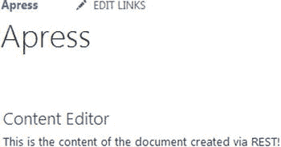

图 9-16. 页面上显示的文本文件内容

## 删除文件

在本示例中，我们将简单地删除新创建的文本文件。

### HTML

在 Visual Studio 中创建一个新的 HTML 文件，并将其命名为 `RESTDeleteDocument.html`。此页面的标记包含一个文本框，供用户输入要删除文件的名称。它包含以下代码行：

```html
<script type="text/javascript" src="/apress/Webparts/chapter 9/RESTDeleteDocument.js"></script>
```

```html
<div id="DeleteFile">
    <div>
        <strong>输入要删除的文档名称：</strong>
        <br />
        <input type="text" id="txtDocumentTitle" />
    </div>
    <br />
    <input type="button" id="btnSubmit" value="提交" />
</div>
```

```html
<div id="divResults"></div>
```

### JavaScript

在 Visual Studio 中创建一个新的 JavaScript 文件，并将其命名为 `RESTDeleteDocument.js`。包含以下代码：

# 使用 REST API 删除文件和创建网站

## 删除文件

在连接按钮点击事件后，我们首先要做的是获取用户希望删除的文档标题：

```javascript
var docTitle = $("#txtDocumentTitle").val() + ".txt";
```

为了让示例保持简单，我们删除之前创建的文本文件，因此在代码中硬编码了 `.txt` 扩展名。接下来，按照之前所有示例的方式构建 REST URL：

```javascript
var siteUrl = _spPageContextInfo.webAbsoluteUrl;
var webRelUrl = _spPageContextInfo.webServerRelativeUrl;
var fullUrl = siteUrl + "/_api/web/GetFileByServerRelativeUrl('" + webRelUrl + "/Shared Documents/" + docTitle + "')";
```

在这个示例中，除了获取网站的绝对 URL `webAbsoluteUrl` 之外，我们还需要获取服务器相对 URL `webServerRelativeUrl`。绝对 URL 的格式类似于 `http://<DOMAIN>/<SITE>`，而网站的服务器相对 URL 格式类似于 `/<SITE>`。我们需要这个值来在 REST URL 中正确定位文件。为了删除文件，我们需要使用 `GetFileByServerRelativeUrl` 命令，并传入文件的相对 URL。在此案例中，我们将服务器相对 URL、`/Shared Documents/` 以及用户传入的文档标题组合起来。

与其他删除操作一样，我们包含 `"X-HTTP-Method": "DELETE"` 和 `"IF-MATCH": "*"` 标头。`success` 函数将简单地通知用户删除已完成。

### 结果

设置内容编辑器 Web 部件的“内容链接”属性为 HTML 文件，然后保存页面。页面将显示一个文本框，供用户输入文档标题，并显示一条结果消息，如图 9-17 所示。

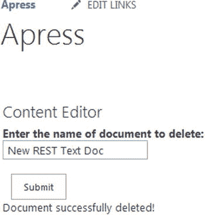

图 9-17. 通过 REST 删除文件

## 使用网站

在 SharePoint 中创建新网站是一项常见任务。在本节中，我们将了解如何使用 REST API 创建和删除网站。前面的示例已经充分展示了 REST API 的强大功能，而本节将进一步强调它在开发工作中为您提供的巨大潜力。

### 创建网站

在本示例中，我们将创建一个新网站并设置其多个属性。

#### HTML

在 Visual Studio 中创建一个新的 HTML 文件，并将其命名为 `RESTCreateSite.html`。此页面的标记包含一个文本框，供用户输入新网站的名称，以及一个用于输入网站描述的文本框。它包含以下代码行：

```html
<script type="text/javascript" src="/apress/Webparts/chapter 9/RESTCreateSite.js"></script>
```

```html
<div id="DeleteFile">
    <div>
        <strong>输入网站名称：</strong>
        <br />
        <input type="text" id="txtSiteTitle" />
    </div>
    <br />
    <div>
        <strong>输入网站描述：</strong>
        <br />
        <textarea cols="20" id="txtSiteDescription"></textarea>
    </div>
    <br />
    <input type="button" id="btnSubmit" value="提交" />
</div>
```

```html
<div id="divResults"></div>
```

#### JavaScript

在 Visual Studio 中创建一个新的 JavaScript 文件，命名为 `RESTCreateSite.js`。包含以下代码：

```javascript
$(function () {
    bindButtonClick();
});

function bindButtonClick() {
    $("#btnSubmit").on("click", function () {
        deleteDocument();
    });
}

function deleteDocument() {
    var docTitle = $("#txtDocumentTitle").val() + ".txt";
    var siteUrl = _spPageContextInfo.webAbsoluteUrl;
    var webRelUrl = _spPageContextInfo.webServerRelativeUrl;
    var fullUrl = siteUrl + "/_api/web/GetFileByServerRelativeUrl('" + webRelUrl + "/Shared Documents/" + docTitle + "')";

    $.ajax({
        url: fullUrl,
        type: "POST",
        headers: {
            "accept": "application/json;odata=verbose",
            "content-type": "application/json;odata=verbose",
            "X-RequestDigest": $("#__REQUESTDIGEST").val(),
            "X-HTTP-Method": "DELETE",
            "IF-MATCH": "*"
        },
        success: onQuerySucceeded,
        error: onQueryFailed
    });
}

function onQuerySucceeded() {
    $("#divResults").html("文档删除成功！");
}

function onQueryFailed(sender, args) {
    alert('错误！');
}
```

```markdown
# 使用 REST API 创建和删除站点

```javascript
$(function () {
    bindButtonClick();
});

function bindButtonClick() {
    $("#btnSubmit").on("click", function () {
        createSite();
    });
}

function createSite() {
    var newSiteTitle = $("#txtSiteTitle").val();
    var newSiteDesc = $("#txtSiteDescription").val();
    var newSiteUrl = newSiteTitle.replace(/\s/g, "");
    var siteUrl = _spPageContextInfo.webAbsoluteUrl;
    var fullUrl = siteUrl + "/_api/web/webinfos/add";
    $.ajax({
        url: fullUrl,
        type: "POST",
        data: JSON.stringify({
            'parameters': {
                '__metadata':  {'type': 'SP.WebInfoCreationInformation' },
                'Url': newSiteUrl,
                'Title': newSiteTitle,
                'Description': newSiteDesc,
                'Language':1033,
                'WebTemplate':'sts#0',
                'UseUniquePermissions': false
            }
        }),
        headers: {
            "accept": "application/json;odata=verbose",
            "content-type": "application/json;odata=verbose",
            "X-RequestDigest": $("#__REQUESTDIGEST").val()
        },
        success: onQuerySucceeded,
        error: onQueryFailed
    });
}

function onQuerySucceeded() {
    $("#divResults").html("Site successfully created!");
}

function onQueryFailed(sender, args) {
    alert('Error!');
}
```

创建一个新站点需要更多的代码，但到如今这些代码对于您来说应该已经很熟悉了。首先，我们获取用户提交的标题和描述。这通过以下几行代码完成：

```javascript
var newSiteTitle = $("#txtSiteTitle").val();
var newSiteDesc = $("#txtSiteDescription").val();
var newSiteUrl = newSiteTitle.replace(/\s/g, "");
```

创建站点时，除了标题以外，还必须为站点提供 URL。在本例中，我们只需使用用户为标题输入的文本，并移除所有空格以构成 URL。这是通过 JavaScript 中的 `replace()` 方法完成的，第一个参数是我们要搜索的内容，第二个参数是要替换成的文本。`/\s/g` 表示一个空格，必须使用此表达式才能使此函数正常工作。

获取站点创建所需的变量后，我们创建 REST URL，但这次我们针对站点的 `Webinfos` 集合：

```javascript
var siteUrl = _spPageContextInfo.webAbsoluteUrl;
var fullUrl = siteUrl + "/_api/web/webinfos/add";
```

与创建新文件夹时类似，我们针对的是与站点最终所在位置不同的位置。我们还在 URL 中包含了 `add` 命令；这与之前其他的创建脚本不同。接下来，我们在 jQuery 中创建 AJAX 调用：

```javascript
$.ajax({
    url: fullUrl,
    type: "POST",
    data: JSON.stringify({
        'parameters': {
            '__metadata':  {'type': 'SP.WebInfoCreationInformation' },
            'Url': newSiteUrl,
            'Title': newSiteTitle,
            'Description': newSiteDesc,
            'Language':1033,
            'WebTemplate':'sts#0',
            'UseUniquePermissions': false
        }
    })
})
```

此示例与之前使用 `JSON.stringify()` 方法传递数据的示例不同。您会注意到我们必须创建一个 `parameters` 对象，该对象包含创建新站点的所有信息。而其他示例则不需要这样做。这个对象没有什么特别之处，它只是作为内部数据的包装；但是，SharePoint 期望这种结构，否则它不会创建一个站点。

首先，我们指定 `type`，在本例中为 `SP.WebInfoCreationInformation` 类型。如果您处理过上一章中的 JSOM 示例，您会认出这是用于使用 JSOM 创建站点的同一个对象。其余的属性相当直接：我们传入之前创建的站点标题、URL 和描述变量。我们还传入了一个语言设置（`1033` 代表英语），以及 `WebTemplate`（`sts#0`，这是一个团队网站模板）。`success` 函数将在站点创建成功后显示一条成功消息。

**注意**：同样，这些示例中的代码在当前用户的权限级别下运行。由于这些示例中有许多执行创建和删除 SharePoint 对象等高级功能，因此用户需要具有适当的权限才能执行这些功能。再次指出这一点是值得的，因为创建站点要求用户对正在创建新网站的父站点具有完全控制权限。

## 结果

将内容编辑器 Web 部件的“内容链接”属性设置为 HTML 文件，然后保存页面。页面将显示文本框供用户输入新站点的标题和描述，并显示结果消息，如图 9-18 所示。

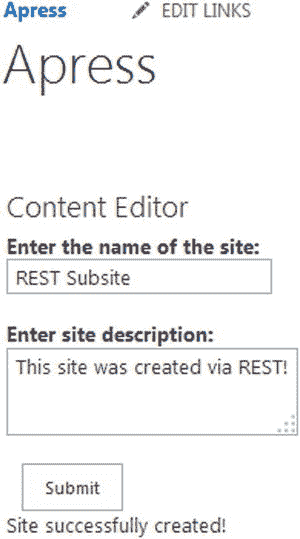

**图 9-18.** 通过 REST 创建新站点

然后我们可以打开新站点创建所在的“网站内容”页面，并滚动到底部。在“子网站”部分，我们可以看到新站点已创建，如图 9-19 所示。

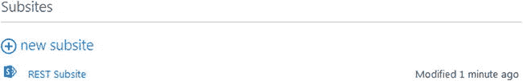

**图 9-19.** 在“网站内容”页面中新创建的子网站

## 删除站点

在此示例中，我们将删除上一节中创建的站点。

### HTML

在 Visual Studio 中创建一个新的 HTML 文件，命名为 `RESTDeleteSite.html`。此页面的标记包含一个文本框，供用户输入他们想要删除的站点名称。它包含以下几行：

```html
<script type="text/javascript" src="/apress/Webparts/chapter 9/RESTDeleteSite.js"></script>
<div id="DeleteFile">
    <div>
        <strong>Enter the name of the site to delete:</strong>
        <br />
        <input type="text" id="txtSiteTitle" />
    </div>
    <br />
    <input type="button" id="btnSubmit" value="Submit" />
</div>
<div id="divResults"></div>
```

### JavaScript

在 Visual Studio 中创建一个新的 JavaScript 文件，命名为 `RESTDeleteSite.js`。包含以下代码：
```

# 使用 REST 删除子网站

就像在前一个示例中一样，我们获取用户输入的站点标题，然后移除所有空格：

```javascript
var siteTitle = $("#txtSiteTitle").val();
var siteTitleNoSpaces = siteTitle.replace(/\s/g, "");
```

获取标题并移除空格后，我们需要构造指向该站点的 REST URL：

```javascript
var siteUrl = _spPageContextInfo.webAbsoluteUrl;
var fullUrl = siteUrl + "/" + siteTitleNoSpaces + "/_api/web";
```

删除站点与到目前为止执行的其他删除操作并无不同。我们需要做的就是包含 `"X-HTTP-Method": "DELETE"` 和 `"IF-MATCH": "*"` 标头。`success` 函数将向用户显示一条消息，告知他们删除操作已完成。

```javascript
$(function () {
    bindButtonClick();
});

function bindButtonClick() {
    $("#btnSubmit").on("click", function () {
        deleteSite();
    });
}

function deleteSite() {
    var siteTitle = $("#txtSiteTitle").val();
    var siteTitleNoSpaces = siteTitle.replace(/\s/g, "");
    var siteUrl = _spPageContextInfo.webAbsoluteUrl;
    var fullUrl = siteUrl + "/" + siteTitleNoSpaces + "/_api/web";
    $.ajax({
        url: fullUrl,
        type: "POST",
        headers: {
            "accept": "application/json;odata=verbose",
            "content-type": "application/json;odata=verbose",
            "X-RequestDigest": $("#__REQUESTDIGEST").val(),
            "X-HTTP-Method": "DELETE",
            "IF-MATCH": "*"
        },
        success: onQuerySucceeded,
        error: onQueryFailed
    });
}

function onQuerySucceeded() {
    $("#divResults").html("Site successfully deleted!");
}

function onQueryFailed(sender, args) {
    alert('Error!');
}
```

### 结果

将内容编辑器 Web 部件的 `Content Link` 属性设置为 HTML 文件并保存页面。页面将显示一个文本框，供用户输入网站标题，并显示一条结果消息，如图 9-20 所示。

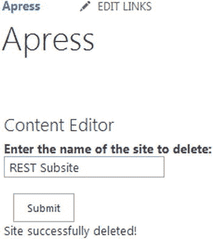

图 9-20. 通过 REST 删除子网站

在本示例中，我们将删除刚刚创建的网站。导航回到“网站内容”页面后，将显示子网站已被成功删除，如图 9-21 所示。

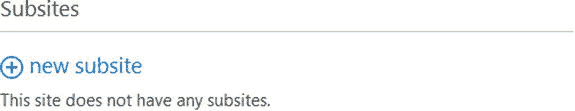

图 9-21. 网站已从根网站中移除

## 使用社交数据

社交数据是 SharePoint 2013 中的一个热门话题，随着您开始创建自定义解决方案，您应该对其有所了解。在本节中，我们将了解如何检索一些社交数据并将其显示给当前登录的用户。

### HTML

在 Visual Studio 中创建一个新的 HTML 文件，并将其命名为 `RESTGetSocialData.html`。此页面的标记将包含几个 `DIV` 和一个用于输出数据的 `SPAN`。它包含以下代码行：

```html
<script type="text/javascript" src="/apress/Webparts/chapter 9/RESTGetSocialData.js"></script>
<link rel="stylesheet" type="text/css" href="/apress/Webparts/chapter 9/RESTGetSocialData.css" />
<div id="WelcomeMessage">
    欢迎回来 <span id="WelcomeMessageUserName"></span>
</div>
<div id="UserFollows" />
```

我们将包含一个名为 `RESTGetSocialData.css` 的自定义 CSS 文件。它将用于样式化脚本的输出。其他所有示例本可以轻松地包含用于样式化的 CSS。您会在自定义开发工作中发现，样式化将在您的许多 Web 部件中扮演重要角色，因此本示例将向您展示包含样式化是多么简单。

### JavaScript

在 Visual Studio 中创建一个新的 JavaScript 文件，并将其命名为 `RESTGetSocialData.js`。包含以下代码：

```javascript
$(function () {
    getUserProfileInfo();
    getUserFollows();
});

function getUserProfileInfo() {
    var siteUrl = _spPageContextInfo.webAbsoluteUrl;
    var fullUrl = siteUrl + "/_api/social.feed/my";
    $.ajax({
        url: fullUrl,
        type: "GET",
        headers: {
            "accept": "application/json;odata=verbose",
            "content-type": "application/json;odata=verbose",
        },
        success: onUserInfoQuerySucceeded,
        error: onQueryFailed
    });
}

function getUserFollows() {
    var siteUrl = _spPageContextInfo.webAbsoluteUrl;
    var fullUrl = siteUrl + "/_api/social.following/my/followed(types=15)";
    $.ajax({
        url: fullUrl,
        type: "GET",
        headers: {
            "accept": "application/json;odata=verbose",
            "content-type": "application/json;odata=verbose",
        },
        success: onFollowQuerySucceeded,
        error: onQueryFailed
    });
}

function onUserInfoQuerySucceeded(data) {
    $("#WelcomeMessageUserName").text(data.d.Me.Name);
}

function onFollowQuerySucceeded(data) {
    var following = data.d.Followed.results;
    var followedItems = "您正在关注的项目：<br />";
    $.each(following, function (index, value) {
        followedItems += "<a href='" + value.Uri + "'>" + value.Name + "</a><br />";
    });
    $("#UserFollows").append(followedItems);
}

function onQueryFailed(sender, args) {
    alert("错误");
}
```

# 关于此示例

首先应该引起您注意的是引入了第二个函数来检索数据。我们有一个函数用于检索用户配置文件信息，另一个用于检索“关注”信息。这是因为这些数据的 REST 端点不同，因此需要两次调用才能检索我们希望在页面上显示的所有内容。

**注意**

在上一章中，我们讨论了如何使用批处理来“批量处理”JSOM 请求。这允许您将对数据的所有不同请求合并到一次调用中，从而提高性能。SharePoint Online 和 Office 365 支持在使用 REST API 时通过 `$batch` 查询运算符进行批处理。使用它，您可以优化此示例的性能。但是，使用 REST API 进行批处理是一个深入的话题，超出了本书的范围。重要的是您知道有这种可能性。您可以在 [`http://msdn.microsoft.com/EN-US/library/office/dn903506%28v=office.15%29.aspx`](http://msdn.microsoft.com/EN-US/library/office/dn903506%28v=office.15%29.aspx) 上阅读更多相关信息。

第一个函数 `getUserProfileInfo` 用于检索用户的显示名称。要获取此信息，我们将使用社交源 REST API：

```javascript
var siteUrl = _spPageContextInfo.webAbsoluteUrl;
var fullUrl = siteUrl + "/_api/social.feed/my";
```

此 URL 看起来与 REST API 中的所有其他端点有些不同，因为其 URL 中包含 `social.feed`。社交源包含两个组件：Feed（源）和 Following（关注），这种格式正是我们定位每个组件的方式。用户信息可以在 `my` 端点下找到，并且您可以为每个用户找到其他信息，例如新闻、赞等。

**注意**

社交源公开了大量关于用户的数据。在此示例中，我们只显示用户的显示名称，但您可以访问更多信息。您可以在 [`http://msdn.microsoft.com/EN-US/library/office/dn155789%28v=office.15%29.aspx`](http://msdn.microsoft.com/EN-US/library/office/dn155789%28v=office.15%29.aspx) 上找到关于可用信息的更多信息。

`success` 函数从结果中提取显示名称：

```javascript
$("#WelcomeMessageUserName").text(data.d.Me.Name);
```

社交源返回的结果也与之前的示例略有不同。正如您所见，我们仍然有熟悉的 `data.d` 对象，但用户数据进一步嵌套在一个名为 `Me` 的对象下，我们可以从中获取 `Name` 属性。

第二个函数 `getUserFollows()` 用于检索用户关注的所有项目。要获取此信息，我们将使用 `social.following` 内容源：

```javascript
var siteUrl = _spPageContextInfo.webAbsoluteUrl;
var fullUrl = siteUrl + "/_api/social.following/my/followed(types=15)";
```

然后，我们可以使用 `followed` 端点获取用户关注的所有目标（actor）。目标实际上就是用户关注的任何内容，可以是用户、文档、网站或标签。调用 `followed` 端点时，需要传入一个数字，该数字对应你想要返回的目标类型。在此示例中，我们使用 15，这表示所有目标。

你可以在 [`http://msdn.microsoft.com/en-us/library/microsoft.sharepoint.client.social.socialactortypes(v=office.15).aspx`](http://msdn.microsoft.com/en-us/library/microsoft.sharepoint.client.social.socialactortypes(v=office.15).aspx) 查看完整的数值列表。

**注意**

以下内容源还会公开大量关于用户的数据。你可以在 [`http://msdn.microsoft.com/EN-US/library/office/dn194080%28v=office.15%29.aspx`](http://msdn.microsoft.com/EN-US/library/office/dn194080%28v=office.15%29.aspx) 找到更多信息。

`success` 函数包含一个 jQuery 循环，用于构建 HTML 以显示用户关注的所有项目：

```javascript
var following = data.d.Followed.results;
var followedItems = "Items you are following:<br />";
$.each(following, function (index, value) {
    followedItems += "<a href='" + value.Uri + "'>" + value.Name + "</a><br />";
});
$("#UserFollows").append(followedItems);
```

与用户信息类似，关注数据嵌套在 `data.d` 对象中一个名为 `Followed` 的对象内。该对象包含熟悉的 `results` 对象，其中保存了所有项目。我们创建一个新变量来保存所有关注的项目。接着，使用 jQuery `each` 循环遍历每个项目。对于每个项目，我们获取 `Uri`（项目的 URL）和 `Name`（名称），以构造一个链接，方便用户从页面直接跳转到该项目。最后，使用以下代码将所有 HTML 追加到页面：

```javascript
$("#UserFollows").append(followedItems);
```

## CSS

在 Visual Studio 中创建一个新的 CSS 文件，并将其命名为 `RESTGetSocialData.css`。包含以下代码：

```css
#WelcomeMessage {
    margin-bottom: 20px;
}
#WelcomeMessageUserName {
    font-weight: bold;
}
#UserFollows {
    border:dashed 1px #C0C0C0;
    width:240px;
    padding: 6px;
}
```

这段 CSS 非常基础，仅用于简单演示样式。我们为欢迎用户的提示信息设置底部外边距，并将用户名设为粗体。关注的项目将用虚线边框包裹以突出显示。

## 结果

将内容编辑器 Web 部件的“内容链接”属性设置为指向该 HTML 文件，然后保存页面。页面将向用户显示一条“欢迎回来”的消息，用户名以粗体显示。正下方是一个列表，包含他们关注的所有项目，以超链接形式显示，如图 9-22 所示。

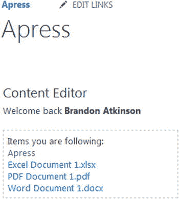

图 9-22. 通过 REST 检索到的社交数据

## 总结

在本章中，我们深入探讨了 REST API，并研究了如何使用 Etherson 方法通过它创建自定义 Web 部件。我们查看了各种示例：查询列表数据、创建新列表和网站，以及查询关于用户的社交数据。尽管与本书其他章节相比，本章篇幅较长，但它仅触及了 SharePoint 中 REST 可能实现的表层。然而，通过完成此处给出的所有示例，你应已牢固掌握如何使用 REST API，以及 HTML、JavaScript 和 CSS 如何在自定义 Web 部件中协同工作。现在，你应该可以自如地开始使用 REST 构建自己的自定义解决方案了。