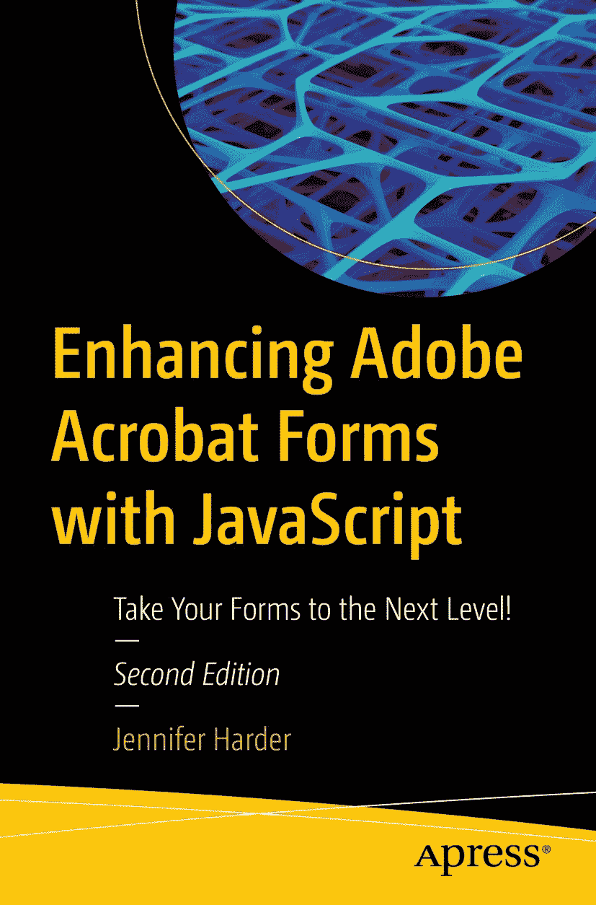

ISBN 978-1-4842-9469-7 电子书 ISBN 978-1-4842-9470-3 [`doi.org/10.1007/978-1-4842-9470-3`](https://doi.org/10.1007/978-1-4842-9470-3) © Jennifer Harder 2017, 2023 Standard Apress

本书中可能出现商标名称、标识和图像。我们并未在每次出现商标名称、标识或图像时都使用商标符号，而是仅在编辑性场景中使用这些名称、标识和图像，以维护商标所有者的权益，并无意侵犯商标权。本书中使用的商品名、商标、服务标记及类似术语，即使未被明确标识，也不应被视为对其是否受专有权利保护的表达。

出版商、作者及编者认为，本书出版时的建议和信息是真实准确的。但出版商、作者及编者不对本书所含材料或可能存在的任何错误或疏漏提供明示或暗示的担保。出版商对书中地图及机构归属的管辖权主张保持中立。

本 Apress 印记由斯普林格旗下的注册公司 APress Media, LLC 出版。

注册公司地址为：1 New York Plaza, New York, NY 10004, U.S.A.