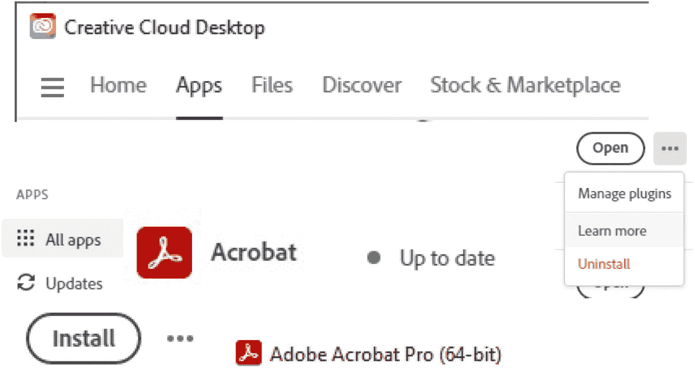
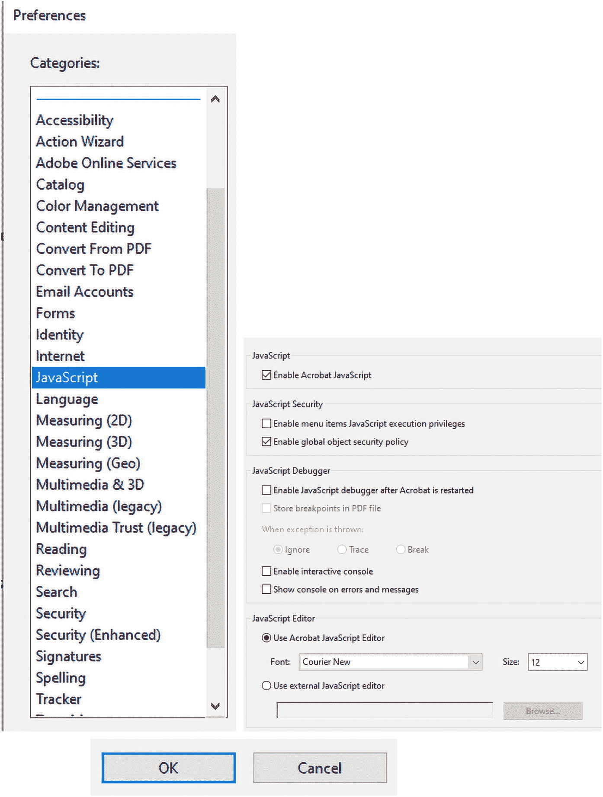

# 引言

欢迎踏上这段激动人心的旅程的第一步，本书名为《用 JavaScript 增强 Adobe Acrobat 表单》。

我学习 Adobe 软件的旅程始于 20 多年前上大学时。当时我在不列颠哥伦比亚省温哥华参加了一个为期两年的平面传播课程。在学习使用 `QuarkXPress` 以及后来的 `Adobe InDesign` 设置文档进行打印排版的过程中，我创建了 PDF 文件。那时，我只把 PDF 看作是文件格式转换中的一个过渡环节，从排版到印刷机的下一步工序。我从未想过，在 `Adobe Acrobat` 中还能用 PDF 文件做其他事情。

毕业几年后，在为一位客户做自由职业工作时，我开始研究 `Acrobat` 的功能，以发现该程序还能提供什么。2008 年，我决定学习更多关于网页设计的知识，并提高我在 Adobe 软件中的排版技能。在兰加拉学院继续教育部完成了三个网页设计证书课程后，我意识到自己想帮助学生更多地了解 Adobe 软件。在旅途中，我曾多次阅读不同的计算机书籍，并感到：“好吧，我完成了这个教程或项目，但这与我的现实世界以及我试图实现的目标有什么关系呢？”2011 年，我成为兰加拉学院的一名助教，这让我有机会编写自己的课程，向学生介绍 `Adobe Acrobat`。在编写过程中，我意识到关于 `Acrobat` 可以讲的内容远比我在三个晚上的课程中能呈现的多得多。那时，我看着 `Acrobat` 菜单中一个让我困惑的图标，它叫 `JavaScript`。

`Acrobat` 里的 `JavaScript`？它在那里做什么？那时我所知道的唯一 `JavaScript` 是通过构建网站了解的。在那之前，我曾使用 `LiveCycle Designer`、`MS Word` 和 `Acrobat` 构建过一些基本的模板表单，但我从未在 `Acrobat` 程序中使用过 `JavaScript`。我开始思考 `JavaScript` 如何能改善我的表单。

这就是我开始为学生们编写一本关于 `Acrobat` 和 `JavaScript` 的书的想法的起源和过程。经过多年的研究，查看 Adobe 和 `Acrobat` 论坛，并研究用户在尝试将 `JavaScript` 添加到 `Acrobat` 时所提出的问题和关切，我得出了以下结论：

- 用户正在寻找简单的解决方案来编程他们将在现实世界中使用的 `Acrobat` 表单。许多人都在寻找相同的答案。

- 当文档不以简化的方式编写时，普通用户就会感到畏惧。他们会回避使用 `JavaScript` 菜单，最终放弃并忽略这个工具。对他们来说，`JavaScript` 编码就像一门外语，而没学过网页设计课程的普通人完全不知道它是什么意思，也不知道代码应该插入到哪里，因为表单字段的属性对话框看起来一点也不像一个网页。

- 在某个时候，与他人分享你关于 `Acrobat` 和 `JavaScript` 所学到的东西是很重要的，不要把你的想法留给自己。这正是产生创新想法的原因。然而，这些想法需要被组织起来，以便用户能够快速找到解决方案并理解它。而且这些想法需要保持更新。

在我为本书第一版整理笔记后不久，Adobe 推出了最新版本：`Acrobat DC`。我看到程序的布局发生了变化，并且没有一本书来指导用户如何在这种新格式中添加 `JavaScript`。我完成了我的高级 Adobe 课程初稿，并得到了学院课程协调员的批准。2016 年，我意识到如果这本书出版，我就能接触到更广泛的读者，于是我联系了 `Apress`。他们看到了我的愿景，这就是这本书如何到你手中的原因。

2022 年 10 月，`Acrobat` 在最新版本中从其名称中移除了对 Document Cloud（DC）的引用；请参阅 `https://helpx.adobe.com/acrobat/using/whats-new.html`。这就是第二版标题中删除“DC”的原因。

较新版本的 `Adobe Acrobat` 也依赖于 Web 表单，这是我们在第 `20` 章中将讨论的一个新主题。

## 理解 Acrobat 及其表单如何与 JavaScript 协作

如果您当前正在使用 `Adobe Acrobat Pro DC` 或更早版本，是时候升级到新版 `Adobe Acrobat Pro` 了，本书将全程使用该版本。您既可以通过 Adobe 单独购买 `Adobe Acrobat Pro` 作为独立程序，也可以订阅 `Creative Cloud` 并每月付费，享受所有令人激动的 Adobe 程序。请参考以下链接，检查您计算机的操作系统是否满足升级所需的系统要求：

*   [`https://helpx.adobe.com/creative-cloud/system-requirements.html`](https://helpx.adobe.com/creative-cloud/system-requirements.html)

*   [`https://helpx.adobe.com/acrobat/system-requirements.html`](https://helpx.adobe.com/acrobat/system-requirements.html)

请务必遵循在线说明和教程来安装和使用 `Acrobat` 及 `Creative Cloud`。

如果您已通过 `Creative Cloud` 订阅在机器上安装了 `Adobe Acrobat Pro`，您可能会注意到 `Acrobat Pro` 窗口左上角显示的是“32 位”，即使版本号是 22.0 或更高，而最新版本实际上是 64 位。即使定期更新，您的版本也可能不会自动切换。

我发现将此应用程序从 32 位改为 64 位的最佳方法是从 `Creative Cloud Desktop` 卸载该应用程序，然后重新安装。参见图 I-1。

Creative Cloud 桌面窗口的截图。在“应用程序”页面下，显示已安装的最新版 `Acrobat` 应用程序，接着是带有 `Adobe Acrobat Pro 64 位` 的已禁用安装选项。右侧是包含“管理插件”、“了解更多”和“卸载”选项的下拉菜单。

**图 I-1** 重新安装 `Acrobat` 将使其更改为 64 位版本

更改为 64 位版本的好处是，如果您使用较新的计算机，在打开较大文件时可以确保更好的性能、安全性和内存使用。自 2023 年 1 月起，Adobe 已逐步停止对 32 位系统的支持；参见 [`https://helpx.adobe.com/acrobat/kb/end-of-support-acrobat-reader-32-bit-os.html`](https://helpx.adobe.com/acrobat/kb/end-of-support-acrobat-reader-32-bit-os.html)。

如果您是 `Adobe Acrobat` 的新手，我建议您首先阅读 Lisa Fridsma 所著的 *Adobe Acrobat Classroom in a Book*。她的书会让您对新版 `Acrobat` 的功能以及一些表单基础知识有一个基本了解。不过，那本书并未详细讲解与 `JavaScript` 协作时的表单内容。我认为我的书是它的续篇，面向中高级用户，帮助他们将表单提升到新水平。

`Adobe Acrobat Pro` 允许您在任何 PDF 文件中添加表单字段，我将在第 1 章中进一步说明。它甚至能与之前在 `Adobe InDesign CC` 中将文件导出为交互式 PDF 时创建的现有表单字段配合使用。然而，重要的是您的客户要在 `Acrobat Pro`、`Standard` 或 `Acrobat Reader` 中查看并交互这些表单。其他 PDF 阅读器以及一些较旧版本的浏览器，在保存文档时可能会损坏 `JavaScript` 程序，因此在向客户发送表单时请牢记这一点。请确保您的客户拥有最新版本的免费 `Acrobat Reader`，并且他们的浏览器也是最新的。

某些用户可能无法与 `JavaScript` 交互的另一个原因是，他们可能已在 `Acrobat` 应用程序中通过 `编辑 ➤ 首选项 ➤ 类别 ➤ JavaScript` 禁用了 `JavaScript` 的使用。

参见图 I-2，了解您的 `JavaScript` 首选项在 `Adobe Acrobat Pro` 中应如何显示。

窗口截图中，首选项下有一系列类别，其中 `JavaScript` 选项被选中。`JavaScript` 页面在 `JavaScript`、安全性、调试器和编辑器下有启用和禁用选项。下方是“确定”和“取消”按钮。

**图 I-2** `Acrobat Pro`“首选项”菜单，用于启用和禁用 `JavaScript` 及安全功能

以下是对某些设置的 Adobe 网站解释。更多信息请参见 [`https://helpx.adobe.com/acrobat/using/javascripts-pdfs-security-risk.html`](https://helpx.adobe.com/acrobat/using/javascripts-pdfs-security-risk.html)。

# 启用 Acrobat JavaScript

*   **启用 Acrobat JavaScript**：取消选中可完全禁用 JavaScript，或通过 API 限制 JavaScript。此设置默认已启用。
*   **启用菜单项 JavaScript 执行特权**：此项允许通过单击菜单项执行 JavaScript。关闭时，可以通过菜单执行特权 JavaScript 调用。无论此框是否选中，通过菜单项执行非特权 JavaScript 调用都不会被阻止。此设置默认已禁用。
*   **启用全局对象安全策略**：此项允许通过 API 全局使用 JavaScript，或信任包含 JavaScript 的特定文档。此设置默认已启用。

请注意，您不会使用任何可能造成安全风险的 JavaScript，因此在使用您下载的文件时，对于这些章节，您可以将“JavaScript 安全性”区域保留为默认设置。不过，我将在第 5 章中向您展示如何使用“首选项”对话框启用 JavaScript 调试器。

在大多数情况下，Adobe Acrobat 会在 PDF 中自动检测大多数表单字段可以添加的位置，但这并非一门完美的科学。作为作者，您需要自行编辑和测试表单，在构建表单并添加 JavaScript 代码时排查错误。

## 本书内容概览

*《用 JavaScript 增强 Adobe Acrobat 表单》*涵盖了最新、真实的工作示例，您可以轻松下载、练习并根据自己的项目进行编辑。本书使用的截图来自 `Adobe Acrobat Pro`，因此以前版本的用户也能运用这些技巧。本书还展示了您可能遇到的各种表单问题的解决方法和替代方案。JavaScript 并不可怕。善用它将使您充满力量，改进您的 PDF 文档！

## 学习内容

你将学习如何在本书中完成以下操作：

- 使用表单元素创建计算、评分表单和二维码印章
- 理解用于 Acrobat 的简化字段标记和基础 JavaScript
- 使用按钮进行导航
- 创建包含下拉列表和列表框，并与复选框和单选按钮等其他表单字段相结合的复杂表单
- 使用“动作向导”和 JavaScript
- 改进表单导航和表单打印
- 实现多种类型的提示和自定义验证，以改善客户端输入的数据并避免错误
- 获取关于 Adobe Sign 及其与在线 Acrobat 表单关系的新信息

**注意**
你可以在 [`www.apress.com/9781484228920`](http://www.apress.com/9781484228920) 找到本书的项目文件。

## 致谢

由于他们的耐心和建议，我要感谢以下人员，因为没有他们，我永远无法写出这本书：

- 我的父母，他们鼓励我阅读厚重的计算机教材，这些书最终激励我编写自己的书籍
- 我的父亲，在我提交提案之前审阅了初稿
- 我在兰加拉学院的课程协调员 Raymond Chow，他给了我教授晚间课程的机会，并让我能够找到新颖且富有创意的方法来教授软件
- 我的各位自由职业客户，我通过他们的项目学到了很多，并对表单及表单布局进行了更深入的研究

我还要感谢 Apress 的 Spandana Chatterjee 和 Mark Powers，他们向我展示了如何编排一本专业的教材，并指出即使你认为已经写完了所有内容，也仍有更多内容需要补充。同时，感谢技术审稿人给予的鼓励评价，以及 Apress 团队的其他成员参与本书的出版，让我的梦想再次成为现实。我深感感激与幸运。

## 关于作者 | 关于技术审稿人