# 1. 表单基础入门

**章节目标：** 在向 PDF 字段添加 JavaScript 之前，创建正确的表单需要花费时间和仔细规划。因此，熟悉每个表单工具及其相关属性非常重要。本章将快速概述表单、字段、属性和选项卡，为后续章节奠定基础。如果你对这些主题已经驾轻就熟，可以直接跳到第 2 章。

## 表单回顾

每个表单字段都包含其属性，可以通过右键点击表单字段来访问。这些属性按选项卡进行组织。每个表单字段的属性略有不同，因此选项卡也不同。

在本书中，你将通过多种不同的 PDF 表单和文档进行学习，这些文档都来自一家虚构的公司——Tourmaline Mining Corporation。

除了第 1 章和第 5 章，其余每章都附带一个 `.txt` 文件中的 JavaScript 代码以及可供打开和对比的 PDF 文件。你可以查看最终的 PDF 文件，也可以使用起始的 PDF 文件并跟随章节中的注释进行操作。你可以在引言中找到这些文件的链接，然后找到对应的章节项目文件夹。

**注意**  
请注意，本书使用的 PDF 文件应仅在 Adobe Acrobat Pro、Acrobat Reader 或更早版本的 Acrobat DC 中打开，不要在网页浏览器或任何其他 PDF 创建/阅读程序中打开。已知其他 PDF 阅读器会损坏 Acrobat PDF 文件中的 JavaScript 代码，从而导致计算功能失效。

打开 Acrobat Pro 后，请务必检查 **编辑** ➤ **首选项** ➤ **表单** 中的设置。参考图 1-1。它们应设置为图 1-2 所示的默认设置。

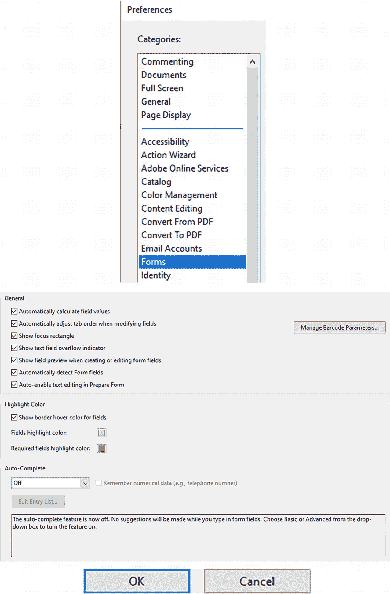

截图显示了一个首选项侧面板，列出了“类别”下的选项，其中“表单”被高亮显示。下方的对话框包含带有复选框的常规设置、高亮颜色选项以及设置为“关闭”的自动完成功能。底部有一个“确定”按钮。

**图 1-2**  
在首选项中找到的“表单”工具的默认设置

截图左侧显示 Acrobat 图标，右侧显示带有省略号的“打开”按钮。

**图 1-1**  
通过你的 Creative Cloud 桌面应用打开 Acrobat Pro

在这种情况下，所有 **常规** 复选框均已启用。

- 自动计算字段值
- 修改字段时自动调整 Tab 键顺序
- 显示焦点矩形
- 显示文本字段溢出指示器
- 创建或编辑表单字段时显示字段预览
- 自动检测表单字段
- 在“准备表单”中自动启用文本编辑

**高亮颜色** 的复选框已启用，用于显示字段的边框悬停颜色。浅蓝色是高亮字段的颜色，红色是必填字段的高亮颜色。

**自动完成** 设置为 `关闭`，下方有一段说明文字解释该设置的含义。列表中的其他选项为 `基本` 或 `高级`。

此时，如果这些是你的设置，你可以点击 **取消** 并 **退出**，或者将你的设置调整为与我的一致并点击 **确定**。这些首选项不会随表单保存，但将有助于你在工作中与表单进行交互。

如果你正在使用 `管理条码参数`，请在本章稍后的内容以及第 19 章中参考此主题。

本书假定你熟悉如何填写基本表单，或者过去曾使用过 PDF 表单。如果你不确定如何在 Acrobat Pro 中使用 `准备表单` 工具及其字段自动检测功能，本节将提供一个复习指导。

先在纸上手绘你的表单，或者在 MS Word、Adobe Illustrator 或 Adobe InDesign 中创建基本结构，然后确定你希望表单执行和完成哪些步骤。接着规划如何实现你的目标。你希望表单执行的操作是否可行？你是否需要简化表单？或者你是否需要进一步学习表单主题来创建你想要的内容？在开始添加交互性之前，请务必在构建表单时与你的团队或客户进行协商。

## 创建交互式 PDF 表单

除了 Adobe InDesign 程序外，你无法在 Acrobat 之外组装表单的交互式字段，因此你需要制作一个 PDF 来完成此操作。在准备制作 PDF 之前，请继续在布局程序（如 MS Word）中组装表单，直到它看起来符合要求。然后保存 MS Word 文件（`.doc` 或 `.docx`）。接着创建 PDF。例如，在 MS Word 的情况下，我可以使用`Acrobat`选项卡快速创建 PDF，或使用`文件 > 打印`选项卡。请参考图 1-3。

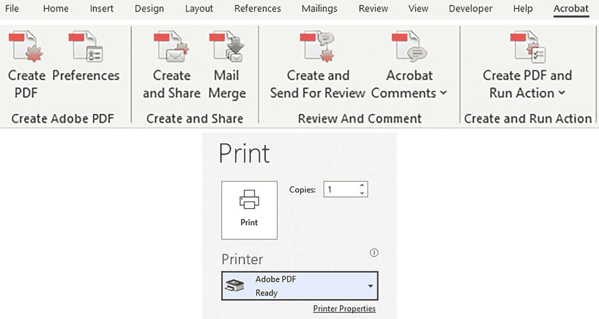

*图 1-3 使用 MS Word 功能区的 Acrobat 选项卡或打印设置创建您的 PDF*

一张 MS Word 窗口的截图，列出了`Acrobat`选项卡下的选项以及打印对话框。它包括：份数为 1，打印机选择了 Adobe PDF，以及其他打印机属性。

---

## 使用 Acrobat Pro 添加交互性

一旦你有了最终的 PDF，请在 Acrobat Pro 中打开它，并按照以下步骤添加交互性：

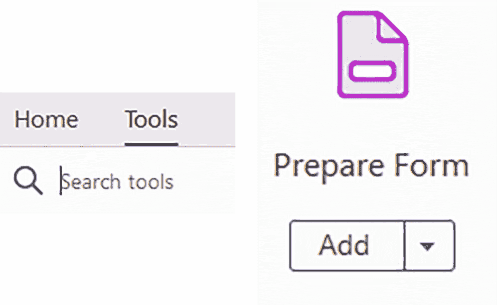

*图 1-4 准备表单工具的位置*

一张 Acrobat 页面的截图，高亮显示了左侧带有搜索栏的工具选项卡，以及右侧的“准备表单”工具，其中包括一个带下拉菜单的“添加”选项卡。

### 步骤一：启动准备表单工具

1.  单击`工具`选项卡，然后点击`准备表单`工具，该工具位于`表单与签名`部分（见图 1-4）。

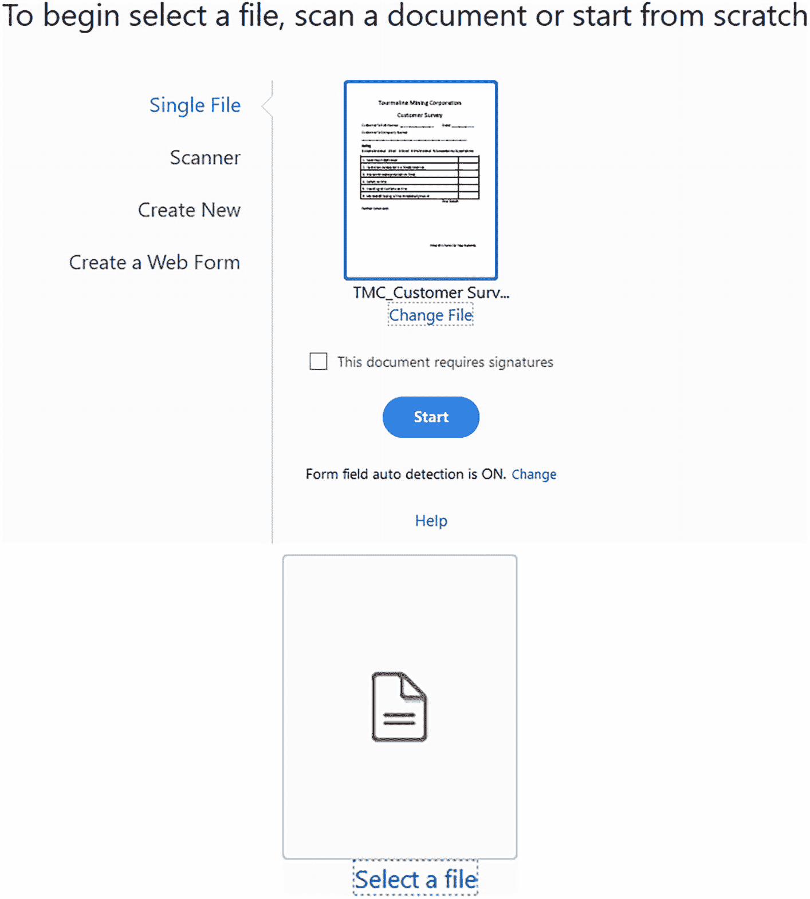

*图 1-5 首次创建新表单时的“准备表单”工具*

一张截图展示了一个页面，左侧面板高亮显示“单个文件”，右侧显示一个标题为“TMC 客户调查”的文档，下方有“更改文件”选项和一个“开始”按钮。底部还有一个“新文件”图标，并带有“选择文件”选项。

### 步骤二：选择源文件并设置选项

1.  无论是否已打开 PDF 表单，你都可以使用此工具。在该工具中，选择（本例中）`单个文件`，找到你的文件（如果缩略图不正确，你可以更改文件），并确保`表单字段自动检测`功能已开启。**不要**选择“此文档需要签名”，我们将在第 20 章更详细地探讨该选项（图 1-5）。

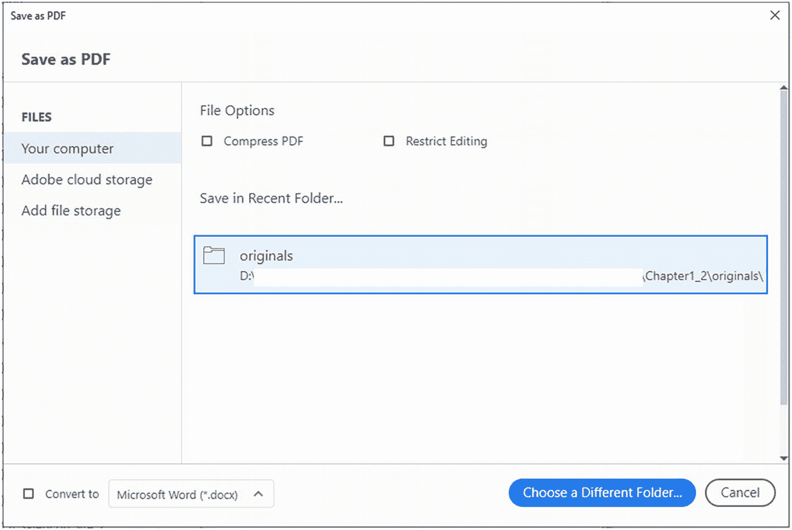

*图 1-6 自动检测完成后将新的 PDF 表单保存到文件夹中*

一张“另存为 PDF”对话框的截图，列出了“文件”下的选项，并选中了“您的计算机”。它包括文件选项、保存在“最近文件夹”中，以及一个高亮显示的用于选择不同文件夹的按钮。

### 步骤三：开始检测并保存

1.  单击`开始`。Acrobat 将扫描文件中的字段；如果检测到任何字段，它将创建这些字段。然而，其检测并非完美，因此你可能需要在之后添加、删除或编辑某些字段。

2.  添加完字段后，将文件另存为一个新的 PDF（`Ctrl/Cmd + S`）。选择将文件保存到你的计算机上，然后选择一个文件夹来保存该文件。确保`转换为`选项处于禁用状态。新的 PDF 现在就是一个交互式表单。请参考图 1-6。

> **注意**
>
> 现在，使用“准备表单”工具，你还可以通过另外三种方式创建 PDF 表单；请参考图 1-5：直接通过扫描仪、使用`创建新文档`选项创建一个空白新文档，或者使用`创建 Web 表单`。我们将在第 20 章探讨该选项。

## 后续操作

现在，你可以开始为每个字段的属性添加格式和操作。在对表单进行测试，并请他人在其电脑上测试后，再通过电子邮件发送给你的客户。始终在主磁盘或 USB 驱动器上保留备份，以防主计算机出现故障。此外，制作一份 PDF 及所有代码的打印件，以便日后在其他项目中参考。在本书中，我在每章的`.txt`文件中放置了一份代码副本以供参考。

一旦字段被保存到表单中，你可以随时使用`准备表单`工具打开这些字段；你无需对该表单再次运行自动检测。请参考图 1-7。

你可以通过切换右上角的`预览/编辑`按钮（图 1-7）部分退出`准备表单`区域。要完全退出`准备表单`工具，你必须点击右上角的`关闭`按钮（图 1-7）。

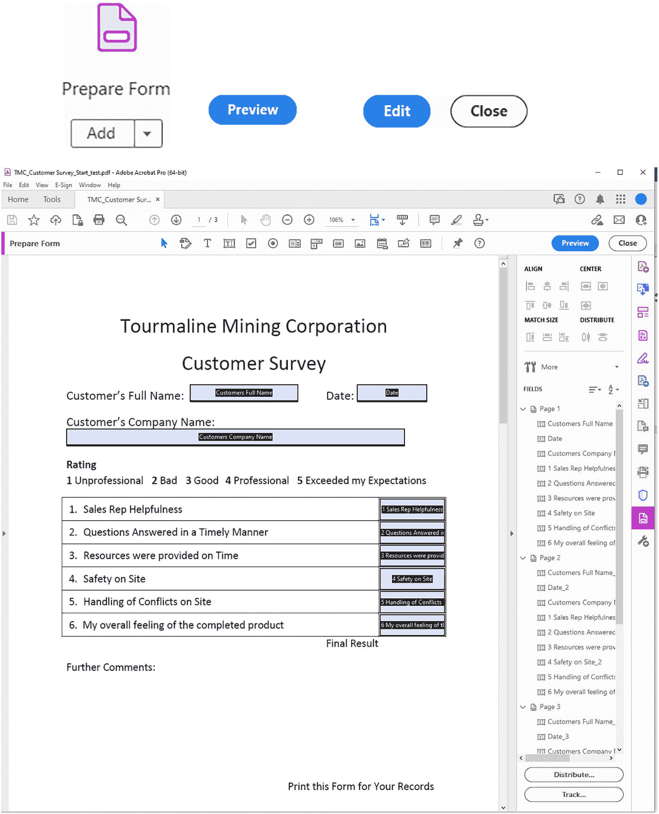

*图 1-7 “准备表单”工具及用于添加和处理字段的工具。注意右上角的`预览/编辑`切换按钮和`退出`（关闭）按钮。同时注意在切换到预览模式之前，表单在编辑模式下的视图*

一张 Adobe Acrobat 文件页面的截图，显示了一份已准备的表单，标题为“Tourmaline Mining Corporation Customer Survey”，包含客户全名、日期、公司名称字段以及一个 6 行的评级表。

## 更多信息和参考资源

在继续阅读本书之前，请先查看以下关于基本表单或基本表单创建的链接：

-   [`helpx.adobe.com/acrobat/using/pdf-forms-basics.html`](https://helpx.adobe.com/acrobat/using/pdf-forms-basics.html)
-   [`helpx.adobe.com/acrobat/using/create-form.html`](https://helpx.adobe.com/acrobat/using/create-form.html)
-   [`helpx.adobe.com/acrobat/using/creating-distributing-pdf-forms.html`](https://helpx.adobe.com/acrobat/using/creating-distributing-pdf-forms.html)
-   [`helpx.adobe.com/acrobat/using/filling-pdf-forms.html`](https://helpx.adobe.com/acrobat/using/filling-pdf-forms.html)
-   [`helpx.adobe.com/acrobat/using/pdf-form-field-properties.html`](https://helpx.adobe.com/acrobat/using/pdf-form-field-properties.html)

Adobe 的 HelpX 表单区域还提供其他链接，我们稍后会探讨其中的一些选项。但当你需要处理基本表单时，可以将此区域作为一个资源。

在`准备表单工具`区域工作时，你会在右侧面板中遇到其他表单工具，例如`对齐和分布`选项，以及`更多`下拉菜单中的选项（图 1-7）。我将在本书后面更详细地介绍这个区域和 JavaScript 区域。然而，你也可以参考之前的网页链接以获取更具体的细节。请参考图 1-8。

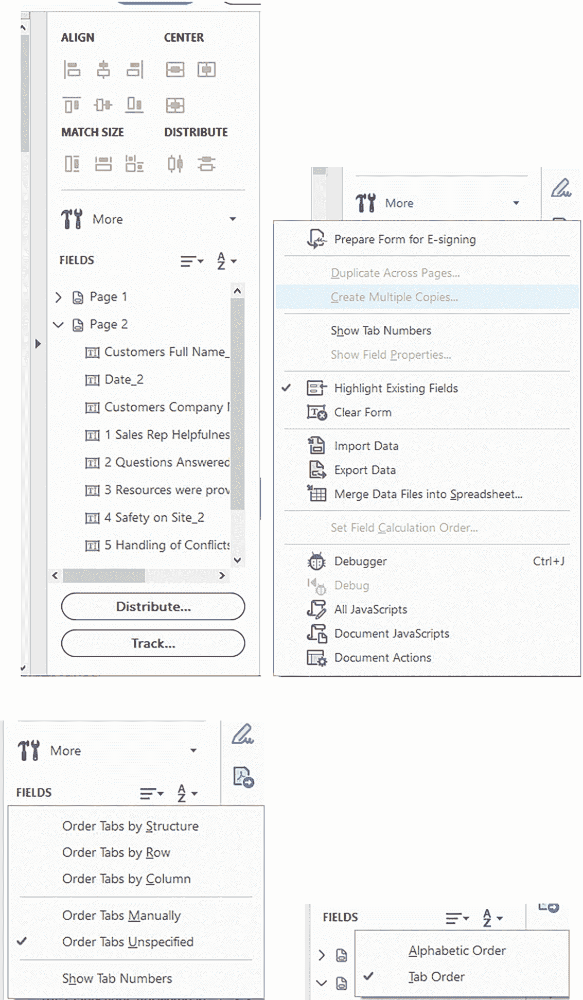

*图 1-8 “准备表单”工具右侧面板中的其他选项*

一张“准备表单”工具右侧面板的截图，具有对齐、居中、匹配大小和分布选项，以及“更多”下的下拉菜单，“字段”下的选项包括第 1 页、第 2 页，以及分布和跟踪、高亮字段、排序选项卡和 Tab 键顺序。

## 字段刷新

字段可以留空且不激活，也可以包含脚本，在进入字段或点击触发器时启动相应操作。例如，字段可以执行菜单项或导入表单数据。在 Acrobat Pro 中，`准备表单` 菜单工具区域包含下列所有字段选项，此外还有 `选择` 工具以及较新的 `编辑文本和图像` 与 `添加文本` 选项。

字段可用于任何表单，而 `选择` 工具只是一个箭头，用于选择、调整大小和移动这些字段。让我们从左到右更仔细地查看此部分的工具选项；请参考图 1-9。

一张截图展示了一个包含 15 个工具图标的工具栏。其中一些工具包括选择工具、编辑文本、添加文本、文本字段、复选框、下拉列表和图像字段。`选择` 工具处于激活状态。

图 1-9

表单的编辑与字段选项

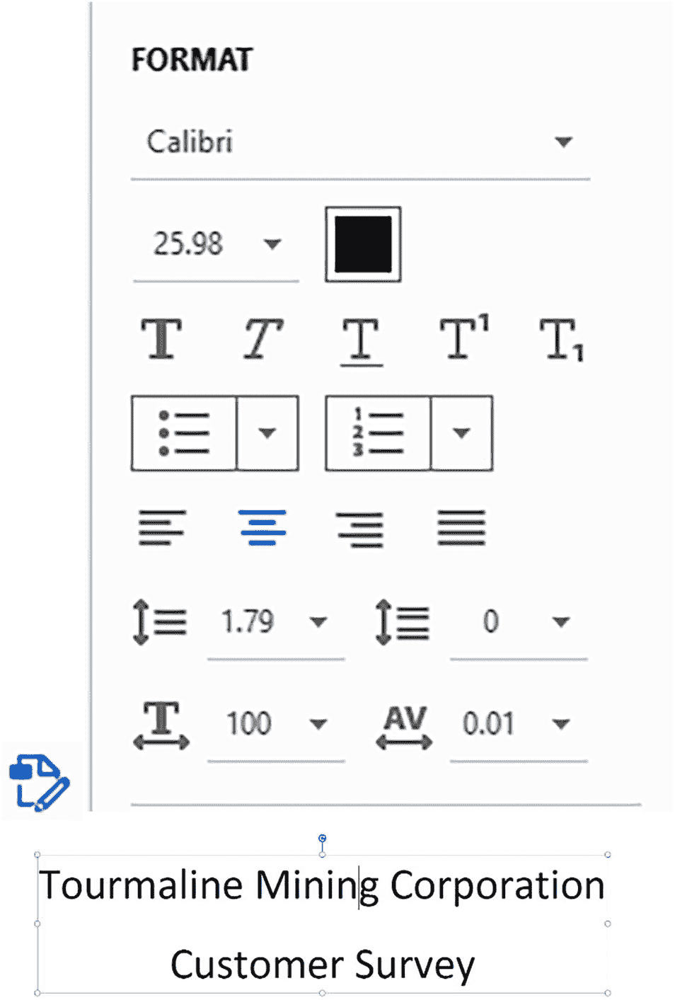

一张截图展示了格式设置，包括字体样式、字体大小、对齐方式、项目符号、编号和间距。它有一个对话框，其中文本显示为“Tourmaline Mining Corporation Customer Survey”。

图 1-10

`准备表单` 工具中的文本更改设置以及带有边框的选中文本

- **选择工具**：此箭头允许您选择、调整大小和移动字段。当添加文本框时，也可用于编辑文本框；只需用箭头双击文本框即可。请参考图 1-9 中的箭头。

- **编辑文本和图像**：这不是一个字段选项，但它允许您在保持使用 `准备表单` 工具的同时编辑字段周围的文本或图像，从而节省您关闭该工具并使用 `编辑 PDF` 工具的时间。选中文本后，右侧窗格的格式区域会发生变化，以便您可以编辑被边框包围的选中文本或图像。图像也可以缩放和旋转。请参考图 1-10。

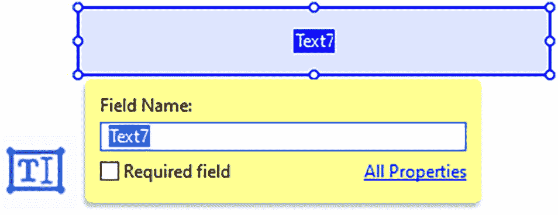

一张截图展示了包含消息 “text 7” 的文本字段。它有一个对话框，字段名为 “text 7”，包含“必填字段”复选框以及高亮的“所有属性”选项。文本字段图标位于左下角。

图 1-12

添加文本字段

- **添加文本**：这不是一个字段选项，但它允许您在保持使用 `准备表单` 工具的同时添加新的文本框，从而节省您关闭该工具并使用 `编辑 PDF` 工具的时间。

选择该工具，在页面上希望文本出现的位置单击并开始键入；或者，在选择该工具后，拖出一个矩形边框作为段落区域，然后开始键入。同样，文本周围会出现边框，您可以缩放、旋转以及编辑右侧文本的格式。请参考图 1-10 和图 1-11。

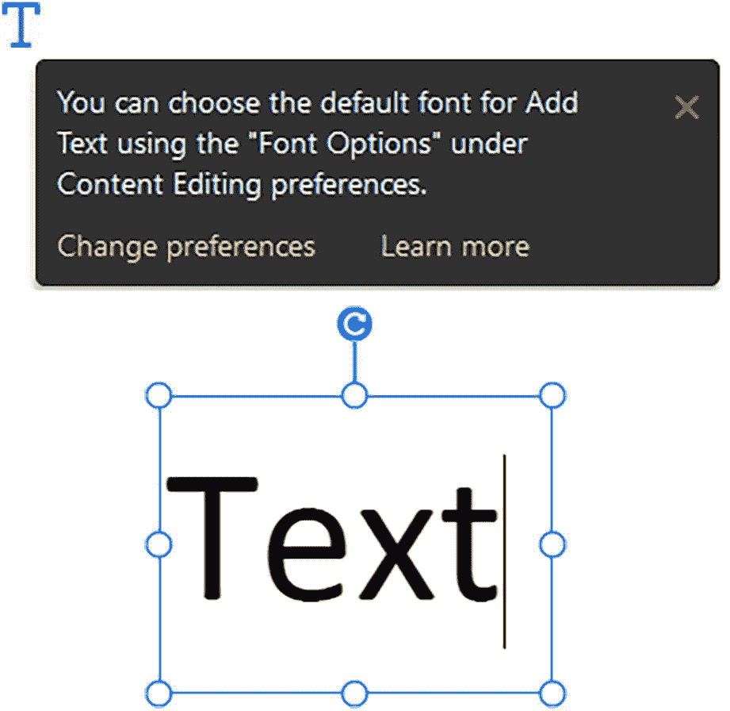

一张截图展示了一个包含消息 “Text” 的文本字段。左上角的文本字段图标有一个工具提示，指示内容编辑偏好下的字体选项，并高亮了“更改偏好”和“了解更多”标签。

图 1-11

在 `准备表单` 工具中向页面添加文本及提示消息

如果要退出编辑选项，请单击 `选择` 工具箭头。

现在来看表单字段。您可以先选择这些字段，然后单击页面，即可将其添加到表单中。将鼠标悬停在每个字段上，可以读取其描述和相关名称。

- **文本字段**：在字段中输入文本、单词或数字。请参考图 1-12。

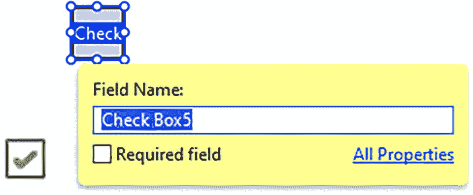

一张截图展示了包含消息 “check” 的文本字段。它包含一个对话框，字段名为 “Check Box 5”，包含“必填字段”复选框以及高亮的“所有属性”选项。复选框图标位于左下角。

图 1-13

添加复选框

- **复选框**：选择某个项目的一个或多个选项。请参考图 1-13。

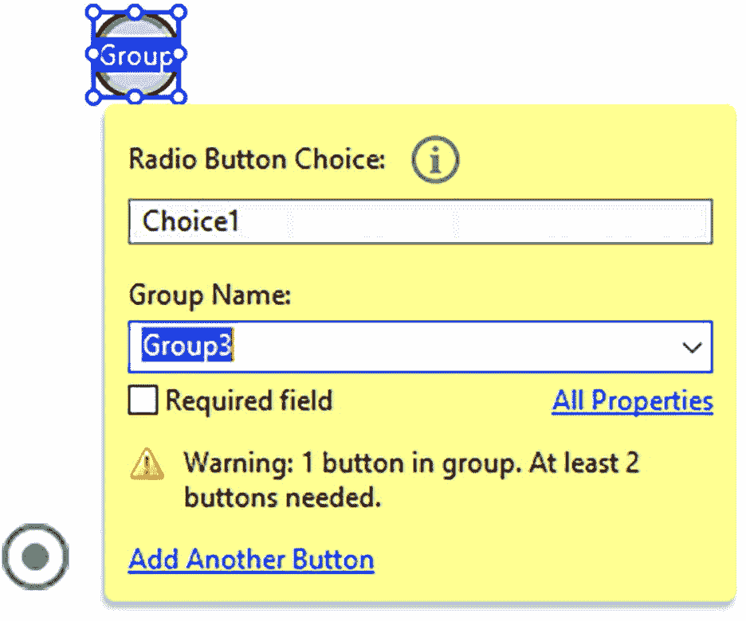

一张截图展示了包含消息 “group” 的文本字段。它有一个对话框，用于单选按钮选项，显示为 “Choice 1”，组名为 “Group 3”，包含“必填字段”、“所有属性”以及高亮的“添加另一个选项”按钮。单选按钮图标位于左下角。

图 1-14

添加单选按钮

- **单选按钮**：从一个组中选择一个选项：是或否。这些选项可以是互斥的，并且一个表单中可以有多个组。您必须至少有两个单选按钮，如果首次提示，可以添加第二个。请参考图 1-14。

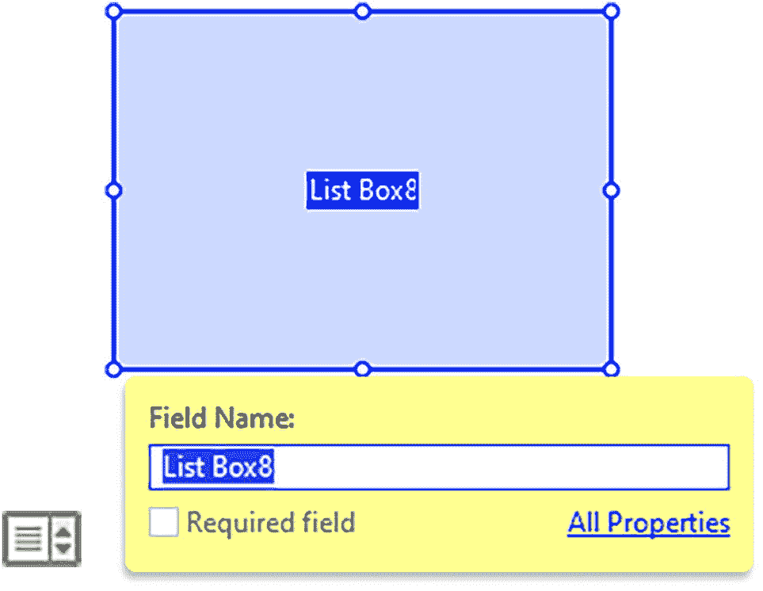

一张截图展示了包含消息 “list box 8” 的文本字段。它包含一个对话框，字段名为 “list box 8”，包含“必填字段”复选框以及高亮的“所有属性”选项。列表框图标位于左下角。

图 1-15

添加列表框

- **列表框**：从选项列表中选择一个或多个项目。请参考图 1-15。

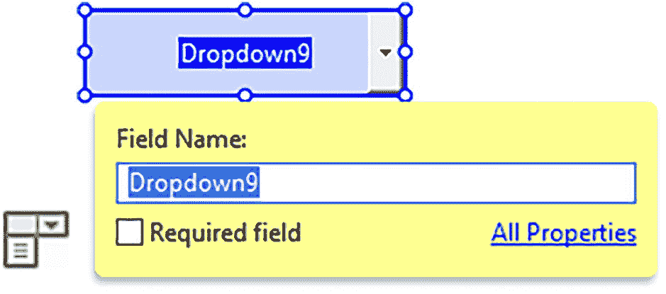

一张截图展示了包含消息 “dropdown 9” 的文本字段。它有一个对话框，字段名为 “dropdown 9”，包含“必填字段”复选框以及高亮的“所有属性”选项。下拉列表图标位于左下角。

图 1-16

添加下拉列表

- **下拉列表**：从列表中选择一个选项或选择。请参考图 1-16。

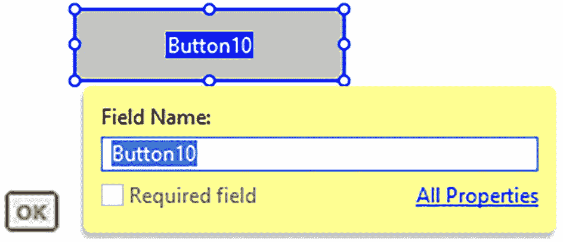

一张截图展示了包含消息 “button 10” 的文本字段。它包含一个对话框，字段名为 “button 10”，包含“必填字段”复选框以及“所有属性”选项。`确定` 按钮图标位于左下角。

图 1-17

添加按钮字段

- **按钮**：用于启动重置（清除）、提交和打印等操作。请参考图 1-17。

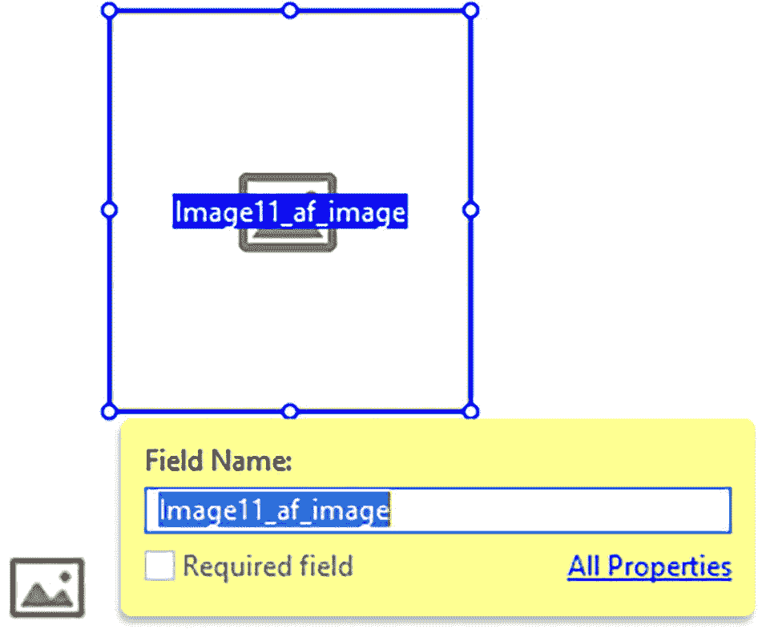

一张截图展示了包含消息 “image 11 underscore a f underscore image” 的字段。它包含一个对话框，字段名为 “image 11 underscore a f underscore image”，包含“必填字段”复选框以及“所有属性”选项。图像字段图标位于左下角。

图 1-18

添加图像字段

- **图像字段**：与按钮字段相同，只是添加了一些 JavaScript（更多相关内容请参见第 17 章）。请参考图 1-18。

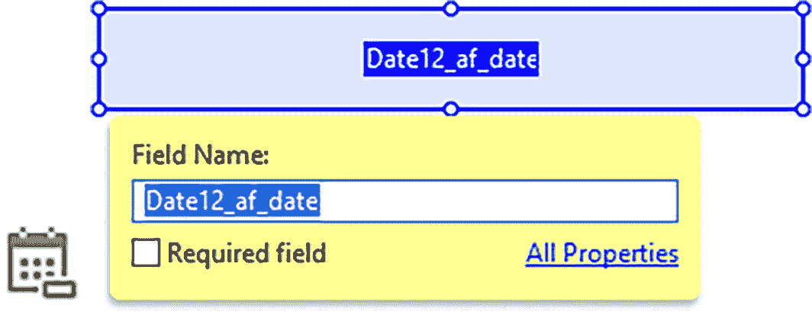

一张截图展示了包含消息 “date 12 underscore a f underscore date” 的字段。它有一个对话框，字段名为 “date 12 underscore a f underscore date”，包含“必填字段”复选框以及高亮的“所有属性”选项。日期字段图标位于左下角。

图 1-19

添加日期字段

- **日期字段**：与文本字段相同，但预格式化为日期格式。它可以作为日期选择器使用。请参考图 1-19。

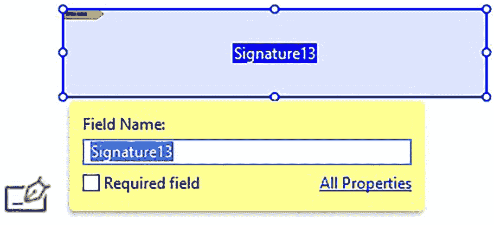

一张截图展示了包含消息 “signature 13” 的字段。它有一个对话框，字段名为 “signature 13”，包含“必填字段”复选框以及高亮的“所有属性”选项。数字签名图标位于左下角。

图 1-20

添加数字签名

## 数字签名与表单字段属性

-   **数字签名**: 使用您的签名进行电子签署。其他 Acrobat 表单和签名工具也可以与此字段交互。我们将在第 19 章详细探讨此字段。请参见图 1-20。

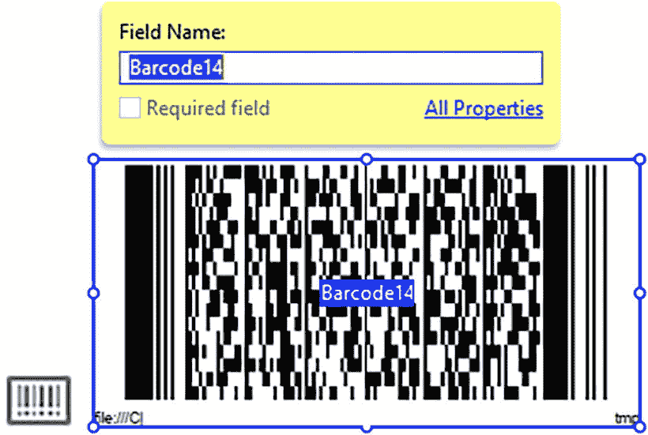

**图 1-21** 添加条形码

-   **条形码**: 用于产品条形码读取器。您可以对用户在此表单中输入的数据进行编码。请参见图 1-21。（有关此字段的更多详细信息，请参阅第 19 章。）

此区域中的另外两个图标分别是名为“保持工具选中（关闭）或（开启）”的图钉，以便您可以继续应用相同的字段，以及字段类型帮助，它将带您访问我们之前讨论过的 Adobe 帮助表单链接（[`https://helpx.adobe.com/acrobat/using/creating-distributing-pdf-forms.html`](https://helpx.adobe.com/acrobat/using/creating-distributing-pdf-forms.html)）。请参见图 1-22。

**图 1-22** “准备表单”工具中字段右侧的额外工具

请记住按照图 1-23 所示访问这些字段。选择**工具** ➤ **准备表单**，然后选择一个 PDF 文档。点击**开始**，或者如果字段已存在，则图标将出现在顶部导航图标下方。

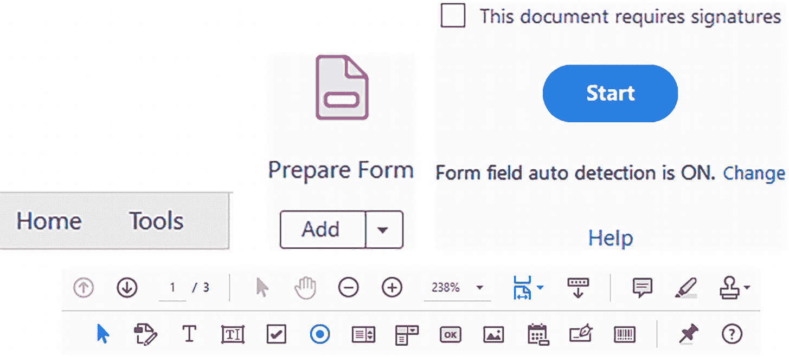

**图 1-23** 在 Adobe Acrobat Pro 中处理 PDF 表单时可用的表单工具。您可以通过转到“工具”选项卡并选择“准备表单”工具来访问它们

> **注意:** 如果您需要自定义二维码而不是条形码字段，您可以在 Adobe InDesign Creative Cloud 中生成一个。二维码类似于条形码，我们将在第 3 章中更详细地介绍它们。

### 属性回顾

每个表单字段都包含可在表单编辑模式下轻松访问的属性。只需右键单击要编辑的字段，然后从弹出列表中选择**属性**（图 1-24）。然后在对话框中将出现的各个选项卡中选择要处理的属性。

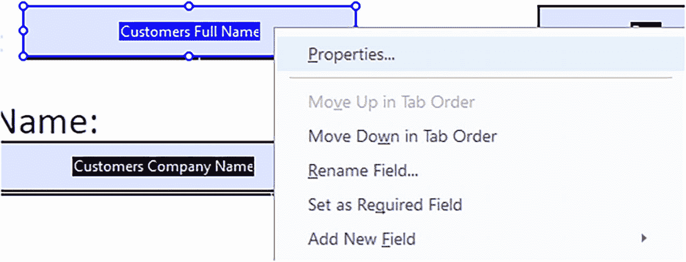

**图 1-24** 右键单击字段以显示其属性

可以为每个字段设置各种属性，具体取决于选择的字段，因为属性的数量会有所不同。这些属性使用选项卡组织成不同的部分。请参见图 1-25 至 1-32。属性可以输入文本、勾选或取消勾选。当您退出该字段并移动到“属性”对话框中的另一个字段时，或当您单击**关闭**按钮时，设置会立即应用。但是，在您保存 PDF 文件之前，这些设置不会完全保存。

回顾一下，要处理表单字段，您必须处于“准备表单”工具的编辑模式。您可以通过右上角的**预览**按钮切换开关以及每个字段名称的显示来判断您是否处于编辑模式。现在，您可以一次编辑单个字段或多个字段。

使用选择工具，单击一个字段，按住 `Shift` 键单击多个字段，或拖出一个选框环绕多个字段，然后右键单击并从菜单中选择**属性**。

> **注意:** 如果您一次选择了多个字段，则根据所选字段的类型，您可能无法访问所有选项卡。如果您选择了多个字段，您在选项卡属性中输入的内容将应用于所有选中的字段。

现在您将进入表单的“属性”对话框。您可以在每个选项卡内更改属性；完成后，单击**关闭**按钮关闭对话框，并保存您的 PDF 文件以确认更改。

以下各节简要介绍了本章前面列出的与表单字段相关的属性。

#### 文本框字段属性和日期字段属性对话框

文本字段和日期字段有八个选项卡来组织其属性。文本字段和日期字段之间的唯一区别在于，日期字段的格式类别预设为**日期**，而文本字段的格式类别预设为**无**。请注意，两者的对话框标题都是“文本字段属性”。请参见图 1-25。

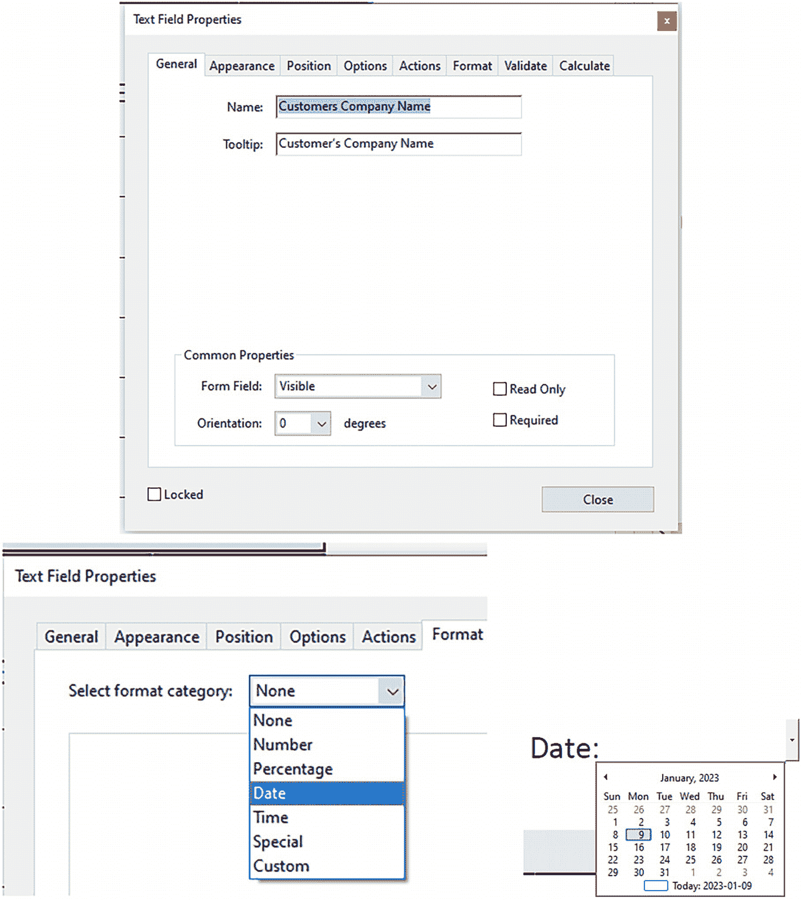

**图 1-25** 文本字段和日期属性

#### 下拉列表属性对话框

“下拉列表属性”对话框也有八个选项卡来组织属性。这些选项卡的名称与文本字段属性相同，并包含许多等效属性；但是，如果您将“文本字段属性”对话框中的**选项**选项卡与“下拉列表属性”对话框中的**选项**选项卡进行比较，它们看起来会有所不同，因为下拉菜单旨在容纳带有导出值的多个项目，而文本字段只能容纳一个默认值。

虽然这是一个选项，但**计算**选项卡很少与下拉列表一起使用。请参见图 1-26。

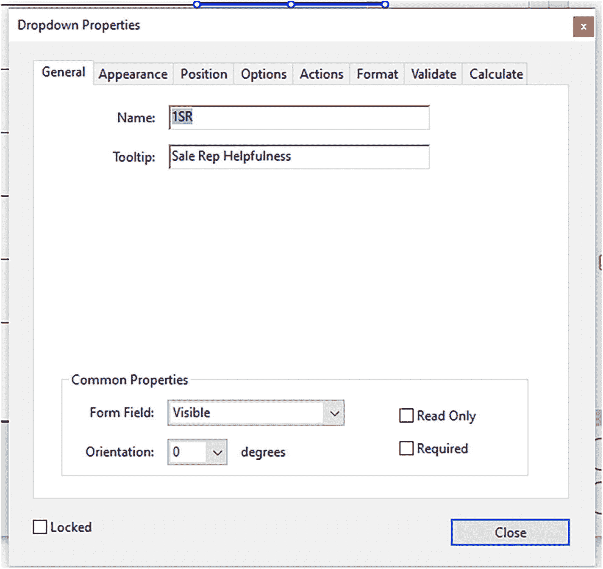

**图 1-26** “下拉列表属性”对话框

#### 列表框属性对话框

列表框属性的作用类似于下拉列表。但是，只有六个选项卡来组织属性。与下拉列表一样，它们可以有多个导出值。与下拉列表不同，您可以一次选择多个值。请参见图 1-27。

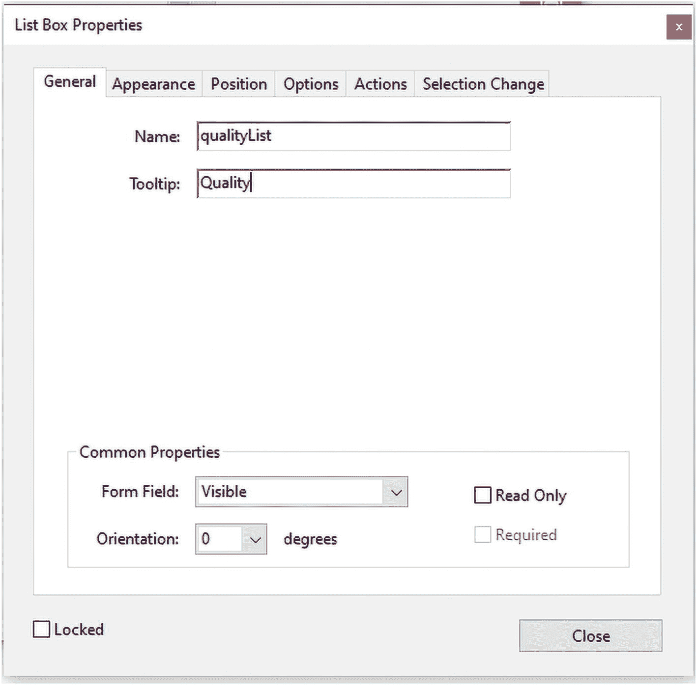

**图 1-27** “列表框属性”对话框

好的，作为高级文档工程师和翻译员，我将严格按照您提供的注意事项和示例格式，将给定的英文文本翻译成中文。

#### 复选框属性对话框

“复选框属性”对话框包含五个选项卡用于组织其属性。复选框可以设置为选中或未选中状态。您无法在复选框中输入文本，但可以为其分配一个词语或数值。与其他所有属性一样，您可以通过“外观”和“选项”选项卡更改其外观和颜色。复选框可以单独使用，也可以成组使用。请参考图 1-28。

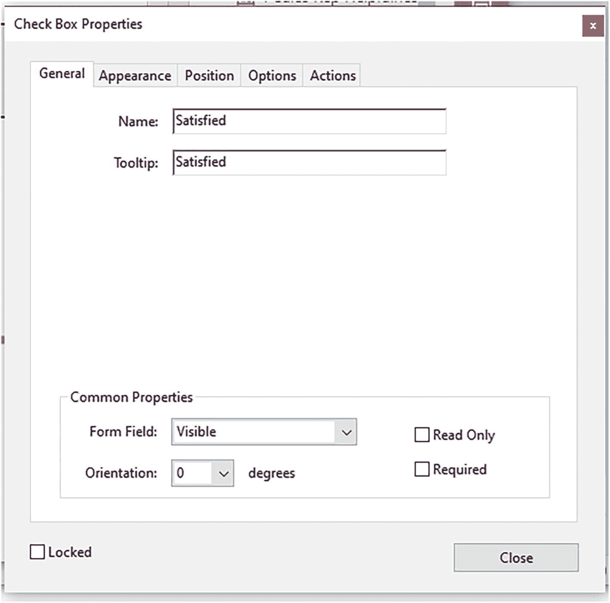

一张标题为“复选框属性”的截图，列出了“常规”选项卡下的选项，其中名称为“已满足”，工具提示为“已满足”，通用属性为表单字段可见，方向为 0 度。

图 1-28 — 复选框属性对话框

#### 单选按钮属性对话框

“单选按钮属性”对话框与“复选框属性”对话框类似，包含五个选项卡用于组织其属性。单选按钮必须成对、成组或超过两个以上出现，且可以设置为选中或未选中状态。当一个被选中时，其他所有按钮都处于未选中状态。您无法在单选按钮中输入文本，但可以为其分配一个词语或数值。与其他所有属性一样，您可以通过“外观”和“选项”选项卡更改其外观和颜色。您可以拥有多个单选按钮组，但每个组中必须始终至少有两个按钮。请参考图 1-29。

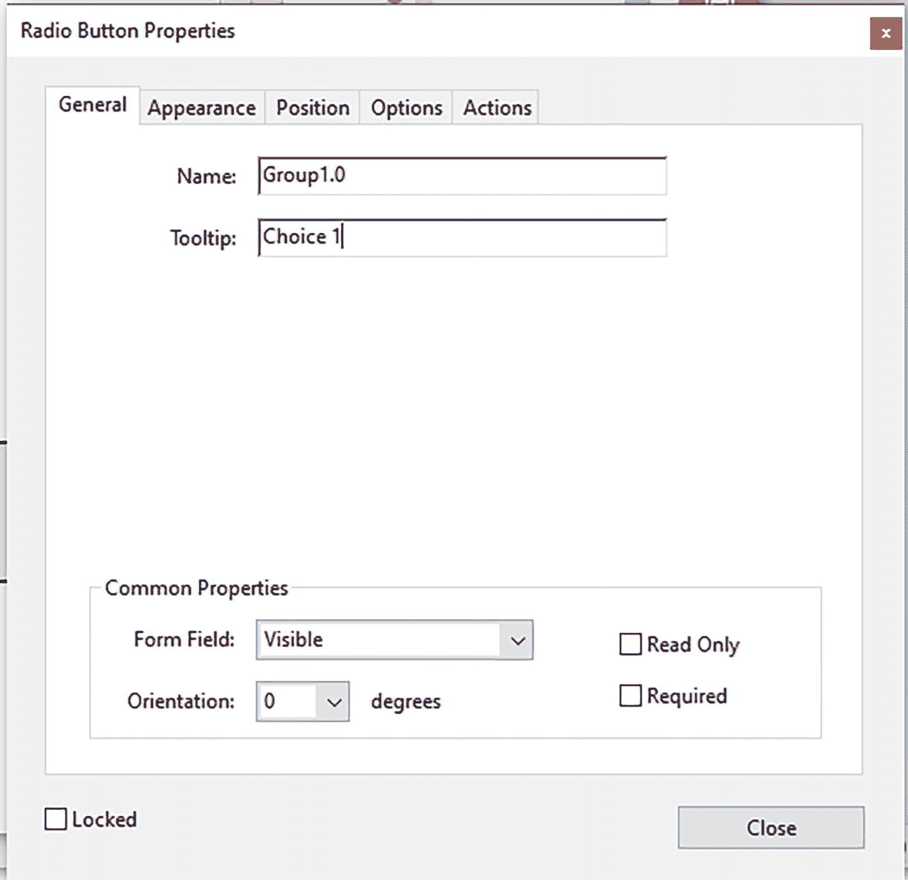

一张标题为“单选按钮属性”的截图，列出了“常规”选项卡下的选项，其中名称为“组 1.0”，工具提示为“选项 1”，通用属性为表单字段可见，方向为 0 度。

图 1-29 — 单选按钮属性对话框

#### 按钮属性和图像属性对话框

按钮属性和图像属性完全相同，唯一的区别在于图像属性在“操作”选项卡中有一段用于允许导入图像的小代码。详细信息请参见第 17 章。两者都包含五个选项卡，并且每个选项卡中的属性都相同。按钮可以有两个以上的状态；然而，一旦应用了 JavaScript，图像按钮的操作就独立于常规按钮属性。请参考图 1-30。

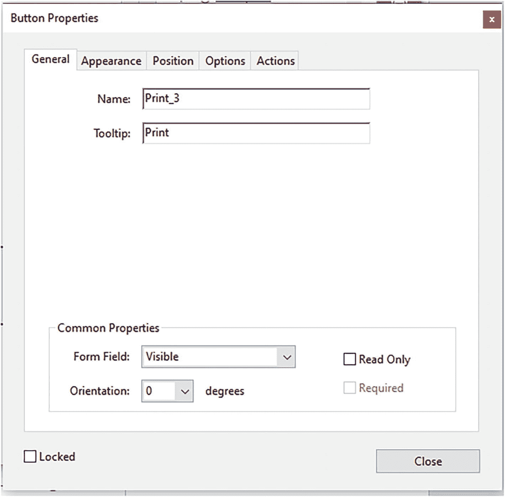

一张标题为“按钮属性”的截图，列出了“常规”选项卡下的选项，其中名称为“打印 3”，工具提示为“打印”，通用属性为表单字段可见，方向为 0 度。

图 1-30 — 按钮属性对话框

#### 数字签名属性对话框

数字签名用于使用存储在客户计算机上的数字签名签署电子 PDF 表单。数字签名字段看起来类似于文本字段，但它只有五个选项卡来组织其属性，并且专门指定用于签名。第 19 章提供了关于数字签名及其配套工具的更多详细信息。请参考图 1-31。

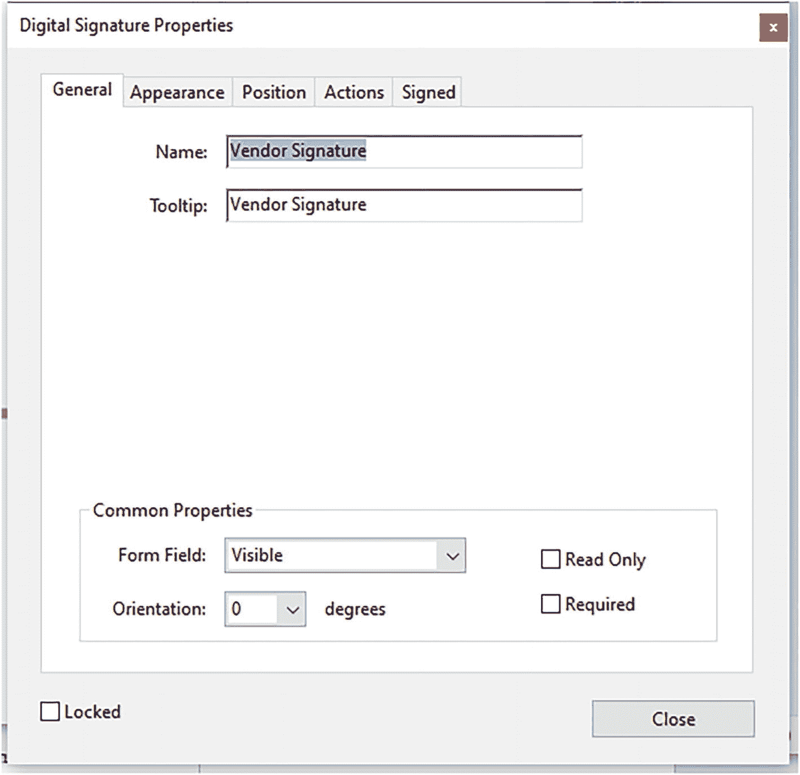

一张标题为“数字签名属性”的截图，列出了“常规”选项卡下的选项，其中名称为“供应商签名”，工具提示为“供应商签名”，以及通用属性。

图 1-31 — 数字签名属性对话框

#### 条形码属性对话框

条形码字段属性被组织在五个选项卡中。条形码的主要目的是创建一个可扫描的条形码，该条形码与输入其周围各个字段中的信息相关联。第 19 章提供了关于条形码的更多详细信息。请参考图 1-32。

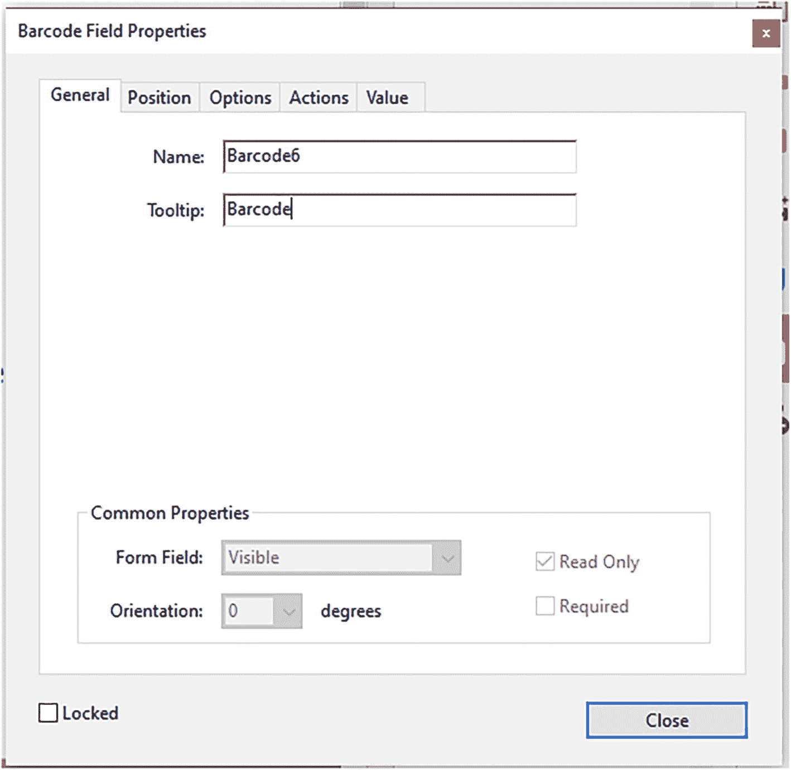

一张标题为“条形码字段属性”的截图，列出了“常规”选项卡下的选项，其中名称为“条形码 6”，工具提示为“条形码”，以及通用属性。

图 1-32 — 条形码字段属性对话框

### 选项卡复习

如前所述，所有表单字段都有相似的选项卡，如下所列。

以下是“常规”选项卡中的选项：

-   **名称**：这是字段的名称。
-   **工具提示**：这为字段添加了一种辅助功能文本，以便有视觉障碍的用户可以扫描该字段并了解其用途。它也是一种为那些不知道在该字段中输入文本目的的用户提供有用提示的方式。
-   **通用属性**：此表单字段指示它是可见、隐藏、可见但不打印，还是隐藏但可打印。此属性不适用于条形码。
-   **方向**：此设置将字段的角度调整为 0、90、180 或 270 度。此属性不适用于条形码。
-   **只读**：您可以阅读其中的文本，但无法修改它。此属性不适用于条形码；默认情况下条形码是只读的。
-   **必填**：此字段为填写表单所必需。如果该字段未填写，可能会出现错误消息。此属性不适用于按钮、列表框、图像字段和条形码。

以下是“外观”选项卡中的选项（不适用于条形码）：

-   **边框和颜色**：以下是具体设置：
    -   **边框颜色**：这是字段周围边框的颜色。可将其设置为某种颜色或无颜色。
-   **线条粗细**：这是边框的粗细：细、中或粗。
-   **填充颜色**：这是字段的填充颜色。可将其设置为某种颜色或无颜色。设置颜色会遮挡字段后面的背景。
-   **线条样式**：这是字段周围线条的样式：实线、虚线、浮雕、内陷或下划线。
-   **文本**：这是字体大小（不适用于签名）、文本颜色和字体（不适用于复选框或单选按钮）。设置为 `Auto` 大小将根据用户键入的内容自动调整字体大小以适合文本框。

以下是“位置”选项卡中的选项（适用于所有字段）：

-   **单位**：以下是字段大小和位置的度量单位：点、派卡、毫米、厘米和英寸。
-   **位置单位**：选项包括左、右、上、下、宽度和高度。
-   如果您不希望在对属性对话框中的其他位置设置进行调整时改变框的大小，请勾选“更改位置时不更改高度和宽度”。在对话框中输入宽度和高度的数字将被禁用。取消勾选该复选框可能会导致表单字段在随其他位置设置移动时发生缩放。

以下是“选项”选项卡中的选项（不适用于数字签名；这些选项仅用于文本和日期字段）：

-   **对齐**：这将文本左对齐、居中对齐或右对齐。
-   **默认值**：这提供了用户在字段中键入之前在该字段中显示的临时或默认文本。
-   **字段用于文件选择**：这允许用户输入文件的文本链接信息。它不适用于日期字段。当禁用“检查拼写”和“多行”，并启用“滚动长文本”时，此选项可用。
-   **密码**：这将创建 `***` 以遮盖实际文本。它不适用于日期字段。当禁用“检查拼写”和“多行”时，此选项可用。
-   **检查拼写**：选中后，这将指示用户输入的数据中是否存在拼写错误。
-   **多行**：这允许您在字段中输入多行文本。它不适用于日期字段。
-   **滚动长文本**：如果文本内容超出字段的处理能力，将出现滚动条。
-   **允许富文本格式**：这允许用户将文本设为粗体或斜体。它不适用于日期字段。
-   **字符限制**：启用后，这通过设置一个具体数字来限制字段中允许的字符数。

*   **字符梳（Comb）**：启用后，可在字符间创建分隔线，便于后续阅读和比对（参见第 4 章）。字符会分散排列。输入数字时此功能尤为实用。但必须先禁用此选项卡中的其他设置，才能调整字符梳的数量。

以下仅适用于列表框和下拉列表的选项：

*   **项目（Item）**：输入列表中要显示的项目名称或选项。
*   **导出值（Export value）**：输入导出值的字母或数字。可填写也可留空。
*   **项目列表（Item List）**：列出所有项目。高亮显示的项目为列表默认选中项。
*   **添加、删除、上移、下移按钮（Add, Delete, Up, Down buttons）**：未选中“排序项目”时，用于添加、删除或调整项目在列表中的顺序。
*   **排序项目（Sort items）**：按字母或数字顺序排序。
*   **允许用户输入自定义文本（Allow user to enter custom text）**：允许用户自行输入文本。此选项不适用于列表框。
*   **检查拼写（Check spelling）**：用户输入文本时，指示是否存在拼写错误。此选项不适用于列表框。
*   **立即提交选中值（Commit selected value immediately）**：选中后，该值可能与另一个字段的值交互。否则，用户必须等到焦点移出该字段并点击另一个表单字段后才能生效。此功能不适用于多选列表框。
*   **多选（Multiple selection）**：仅允许在列表框中选择多个项目。

以下仅适用于复选框和单选按钮的选项：

*   **样式（Style）**：样式包括勾选、圆圈、十字、菱形、方形和星形。大小在“外观”面板中由文本区域决定。
*   **导出值（Export value）**：字段的值。仅适用于复选框。
*   **单选按钮选项（Radio button choice）**：与导出值相同。组中的单选按钮在“常规”选项卡中必须同名，但在“选项”选项卡中可以有不同的导出值。
*   **复选框默认选中（Check box is checked by default）**：设置表单打开时该复选框为选中状态。
*   **（单选）按钮默认选中（(Radio) button is checked by default）**：表单打开时，该按钮显示为填充状态。
*   **具有相同名称和选项的（单选）按钮同时选中（(Radio) buttons with the same name and choice are selected in unison）**：这是使同一组中的两个或多个单选按钮同时显示为选中状态的唯一方法。

以下仅适用于按钮和图像字段的选项：

*   **布局（Layout）**：为图标和标签添加布局（参见第 4 章）。
*   **高级按钮（Advanced button）**：为图标按钮创建更高级的布局（参见第 4 章）。
*   **行为（Behavior）**：改变按钮的状态。选项包括无、推入、轮廓和反色（参见第 4 章）。
*   **图标和标签状态（Icon and label state）**：
    *   **状态（State）**：设置按钮在向上、向下和悬停状态下的外观。
*   **标签（Label）**：设置按钮上的文本名称。
*   **图标（Icon）**：所选图标的缩略图。
    *   **选择图标（Choose icon）**：允许您选择一个图标。
*   **清除（Clear）**：从字段中清除图标。

以下仅适用于条形码的选项：

*   **编码类型（Symbology）**：有不同类型的条形码可用。
*   **压缩编码条形码的数据（Compress data encoding barcode）**：数据在编码前进行压缩。
*   **解码条件（Decode condition）**：自定义设置，用于管理条形码参数（参见图 1-2 中的“首选项”），例如条形码如何被扫描器等设备解码。
*   **设置（Settings）**：该条形码的设置。

以下是“动作”选项卡中的选项（适用于所有表单字段；更多信息见第 4 和第 5 章）：

*   **添加动作（Add an action）**：选择进入字段时触发动作的事件。
*   **选择动作（Select action）**：选择触发何种动作或事件。
*   **添加按钮（Add button）**：添加动作并打开多个对话框，用于编辑动作，提交后这些动作将显示在“动作”区域中。

- **上移按钮**：用于调整操作的顺序。
- **下移按钮**：用于调整操作的顺序。
- **编辑按钮**：在原始对话框或 JavaScript 编辑器中编辑该操作。
- **删除按钮**：删除触发器下的选定操作或多个操作。

以下是“格式”选项卡中的选项（适用于文本字段、日期字段和下拉列表；详细说明请参考第 6 章和第 7 章）：

- **无**：适用于无实际数值的文本和数字。
- **数字**：设置数字格式，包括是否显示小数位数、分隔符样式、货币符号、符号位置，以及使用括号和红色文本表示的负数样式。
- **百分比**：设置百分比格式，包括小数位数和分隔符样式。
- **日期**：设置日期选项的格式。
- **时间**：设置时间选项的格式。
- **特殊**：设置邮政编码、电话号码、社会保险号和任意掩码选项的格式。
- **自定义**：创建可编辑的自定义选项脚本，称为“格式”和“按键”。

以下是“验证”选项卡中的选项（适用于文本字段、日期字段和下拉列表）：

- **不验证字段值**：该字段不需要验证。
- **字段值在范围内**：选项包括“从数字”和“到数字”，例如数字 1–5。
- **运行自定义验证脚本**：可编辑 JavaScript 脚本。

以下是“计算”选项卡中的选项（适用于文本字段、日期字段和下拉列表）：

- **不计算值**：仅在用户需要输入默认文本时使用此选项。
- **值是以下字段的（总和、乘积、平均值、最小值、最大值）**：使用“选取”按钮选择字段。
- **简化字段表示法**：点击“编辑”按钮可在 JavaScript 编辑器中输入脚本。
- **自定义计算脚本**：点击“编辑”按钮可在 JavaScript 编辑器中输入脚本。

以下是“选择更改”选项卡中的选项（仅适用于列表框）：

- **不执行任何操作（如果无需操作）**：此选项允许不执行任何操作。不会触发任何脚本，仅进行选择。
- **执行此脚本**：添加自定义脚本。点击“编辑”可在 JavaScript 编辑器中输入脚本。

以下是“签名”选项卡中的选项（仅适用于数字签名字段；请参考第 19 章）：

- **签名时不发生任何操作**：不执行任何操作。

以下设置或选项仅兼容 Acrobat 6.0 及更高版本。

- **标记为只读**：可以选择所有字段或特定字段，以在签名填写时触发或防止某些字段变为只读，从而避免对已签名文档的进一步更改。使用“选取”按钮选择字段。
- **在字段被签名时执行此脚本**：点击“编辑”可在 JavaScript 编辑器中输入脚本。

以下是“值”选项卡中的选项（仅适用于条形码字段；更多信息请参考第 19 章）：

- **使用制表符分隔或 XML 编码**：此选项与“选取”按钮配合使用，用于选择字段。
- **包含字段名称**：当编码设置为制表符分隔时可用。
- **自定义计算脚本**：点击“编辑”可在 JavaScript 编辑器中输入脚本。
- **“已发布表单的引用”将作为链接显示在对话框的字段中**：例如，它可能类似于“File//C/Users”这样的文本行，指向计算机上的某个位置。

以下是在所有选项卡和字段中都存在的选项：

- **锁定**：选中后，将阻止对任何表单字段属性进行进一步更改，直至解锁。这包括位置和缩放。
- **关闭**：此按钮关闭表单字段的“属性”对话框。如果你正在更改多个字段的属性，可以保持“属性”对话框打开。依次单击每个字段以更改其属性，完成后单击“关闭”按钮。

以下是在大多数字段中都会看到的选项卡。图 1-33 显示了文本字段属性对话框中的选项卡。

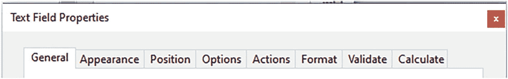
一张屏幕截图，展示了文本字段属性对话框的顶部区域，其中包含常规、外观、位置、选项、操作、格式、验证和计算选项卡。其中“常规”选项卡处于选中状态。
图 1-33
包含属性的选项卡

请记住，属性可能因所选字段的类型而异。例如，文本字段的“选项”选项卡属性与条形码或单选按钮的完全不同（图 1-34 和 1-35）。

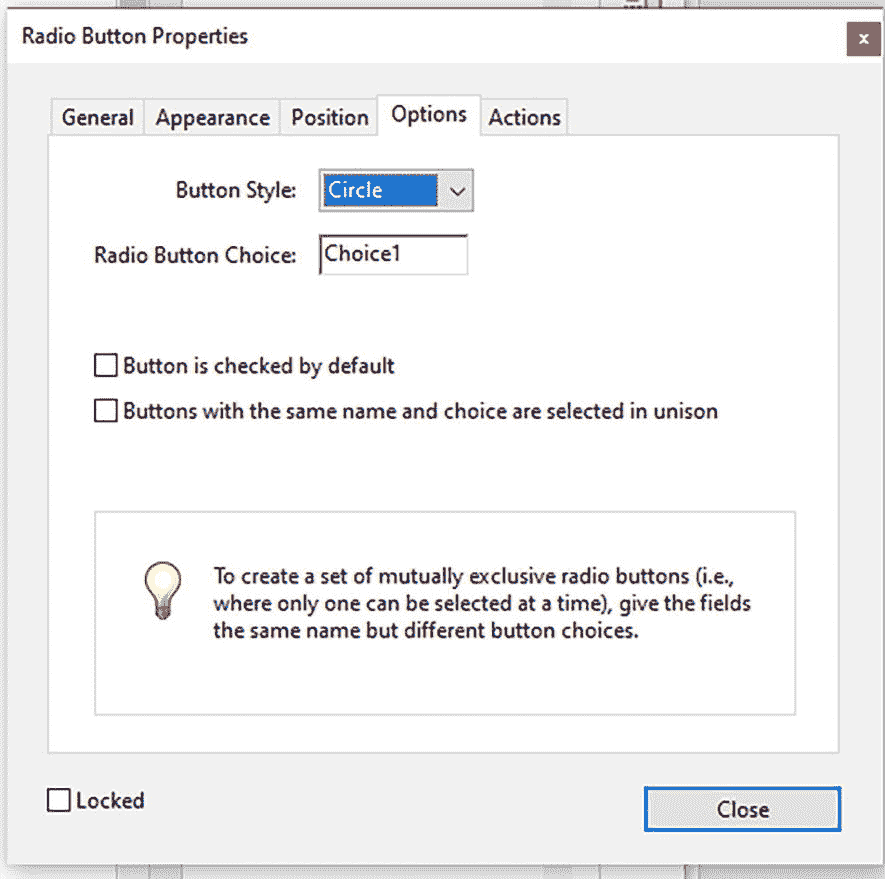
一张标题为“单选按钮属性”的对话框截图，列出了按钮样式、单选按钮选项以及高亮显示的“关闭”按钮等选项。
图 1-35
“单选按钮属性”对话框的“选项”选项卡属性

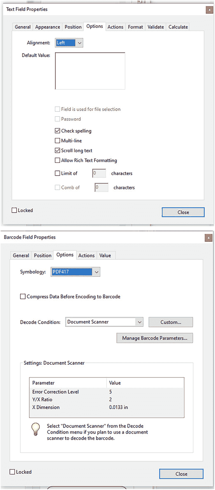
两张屏幕截图。上面一张是文本字段属性对话框，在“选项”选项卡下，列出了对齐方式、默认值以及用于更多选项的复选框。下面一张是条形码字段属性对话框，列出了符号体系、解码条件和设置等选项。
图 1-34
文本字段和条形码字段对话框的“选项”选项卡属性

### 使用“更多”菜单和右侧窗格编辑表单

在右侧窗格中，还有一些设置需要在本章结束前简要了解。为了确保能清晰看到字段，请确保在“更多”菜单中启用了“高亮显示现有字段”。请参考图 1-36。

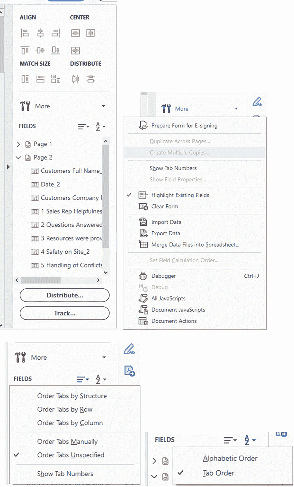
一张屏幕截图展示了“准备表单”工具的右侧窗格，其中列出了对齐、居中、匹配大小和分布选项，以及包含字段部分的“更多”下拉菜单。其中包括第 1 页、第 2 页（含展开的字段名称列表）、高亮显示现有字段、排序选项卡和 Tab 键顺序选项。
图 1-36
右侧窗格中的“准备表单”工具选项

## 使用菜单选项设置字段 Tab 键顺序

右侧窗格中的 `More` 下拉菜单，与页面上的字段以及以列表形式显示的相同字段协同工作。这些字段各自可被选中以访问其属性。这些字段及其选择选项出现在 `More` 菜单下方。你可以使用列表中的字段来更好地选择页面上重叠的字段。

你可以在一个页面上放置或复制多个字段，并且当选中一个字段时，可以使用 `More` 菜单及相关对话框创建该字段的多个副本。请参考图 1-37 和图 1-38。

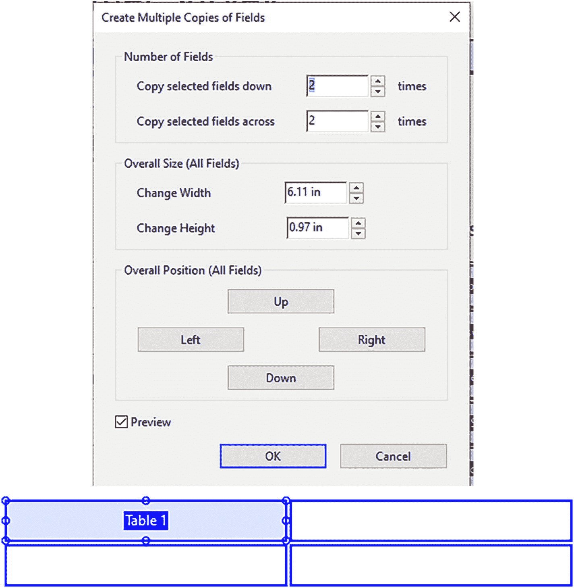

一张 `创建多个字段副本` 对话框的截图，显示有字段数量、整体尺寸、整体位置以及一个高亮的“确定”按钮。该对话框有 2 行共 4 个包含文本的字段框，第一个框中包含表格 1。

**图 1-38**  
`创建多个字段副本` 对话框以及使用默认设置预览所选字段。

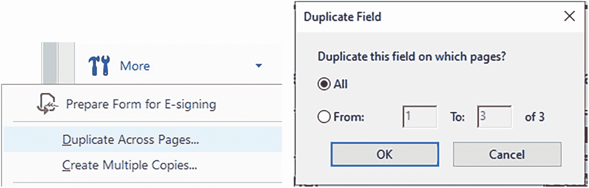

一张截图展示了一个 `More` 菜单，其中 `跨页面复制` 选项高亮显示。该菜单包含一个标题为 `复制字段` 的对话框，其选项可用于在所有页面或部分文件页面上复制字段，底部有一个“确定”按钮。

**图 1-37**  
用于复制所选字段的 `More` 菜单选项。

在表单中移动时，当你从一个页面切换到另一个页面时，这些字段的顺序可能会变得混乱或失序。

在某个时刻，当你检查完字段属性并预览表单后，使用 `Tab` 键（就像客户填写表单时那样）在字段间切换，你可能会发现，你在字段间的跳转是随机的，并非你预期的顺序。此时，你需要检查并编辑 tab 键顺序。

为此，请从 `More` 下拉菜单中选择 `显示 Tab 编号`。请参考图 1-39。

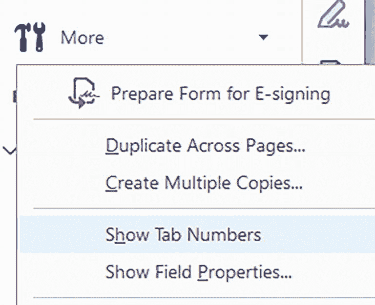

一张截图展示了一个 `More` 菜单，其子菜单包括 `准备用于电子签名的表单`、`跨页面复制`、`创建多个副本`、高亮的 `显示 Tab 编号` 以及 `显示字段属性`。

**图 1-39**  
从 `More` 菜单中选择 `显示 Tab 编号`。

选择此选项后，你将收到一条信息提示，解释如何更改 tab 键顺序。你可以通过拖放右侧下方列表中的字段来手动完成此操作。点击 `确定`。现在你将能够在字段上看到 tab 编号；该选项在菜单中已被勾选为激活状态。请参考图 1-40 和图 1-41。

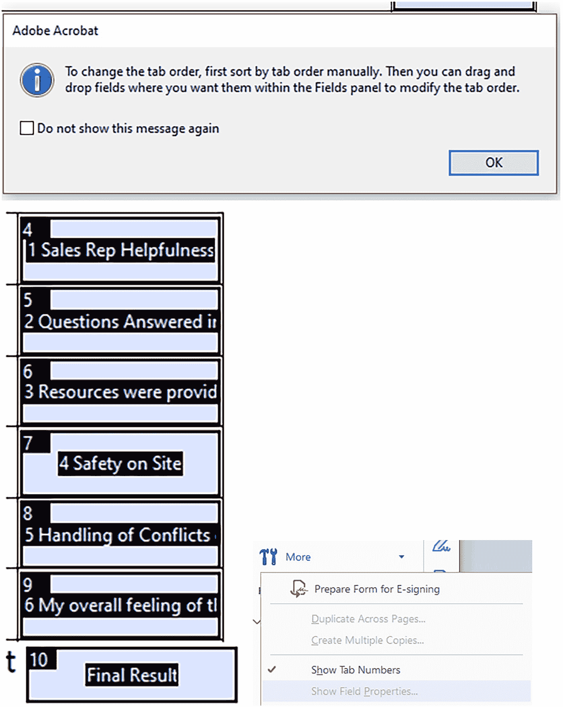

一张截图描绘了一个 Adobe Acrobat 弹出对话框，其中包含一个关于更改 tab 键顺序的信息提示，以及一个高亮的“确定”按钮。对话框侧面有一个面板，显示有 10 个 tab 编号和说明。

**图 1-40**  
激活 `显示 Tab 编号` 设置。

现在查看右侧窗格中的字段列表。

这将向你展示各个页面上字段的当前顺序。请参考图 1-41。

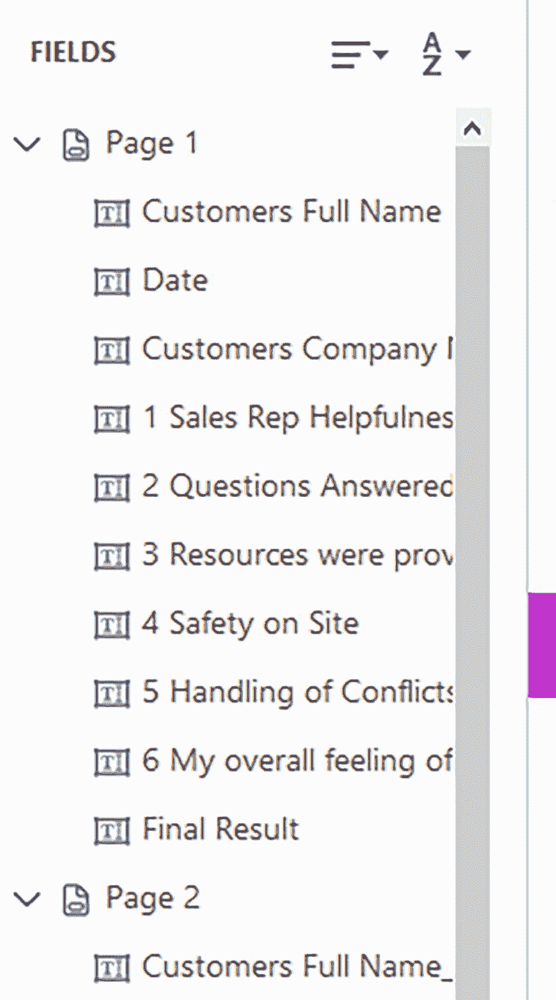

一张截图展示了 `字段` 菜单，该菜单列出了页面 1 和页面 2 下的名称，并带有多个标签。其中一些是客户全名、日期、客户公司名称和最终结果。

**图 1-41**  
按页面设置字段顺序。

不过，在这里你可以通过几种方式更改 tab 键顺序。

字段名称旁边的第一个菜单允许你选择以下选项：`按结构排序标签`、`按行排序`、`按列排序`、`手动排序`、`未指定排序` 和 `显示 Tab 编号`。请参考图 1-42。

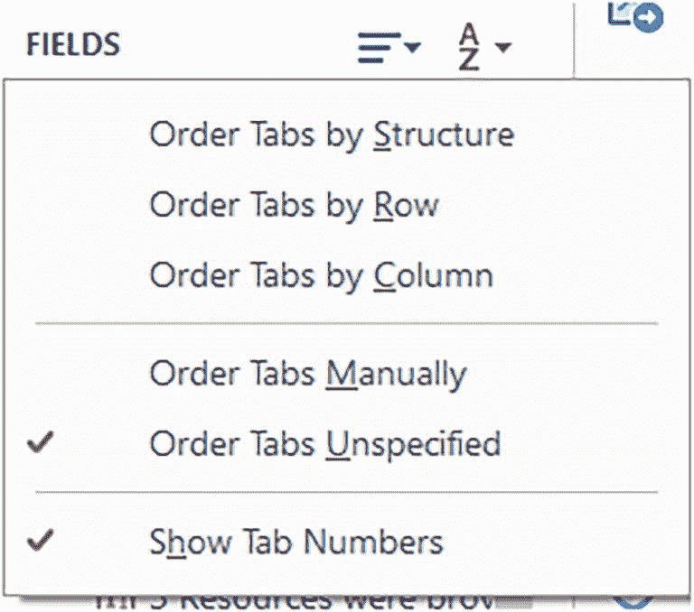

一张截图展示了字段菜单及其多个子菜单。它们分别是：`按结构排序标签`、`按行排序标签`、`按列排序标签`、`手动排序标签`、`未指定排序标签` 和 `显示 Tab 编号`。最后两个选项已启用。

**图 1-42**  
用于设置 tab 键顺序的字段配置。

在我当前的示例中，默认设置为 `未指定排序标签`，并显示了 tab 编号；不过，在点击警告消息中的 `确定` 后，我可以将其更改为 `手动排序`。请参考图 1-43。

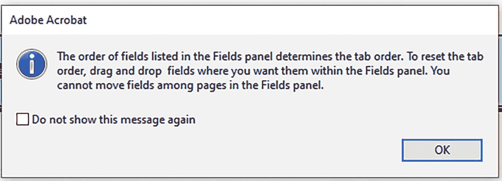

一张截图展示了一个 Adobe Acrobat 弹出对话框，其中包含一条信息提示。提示内容说明：字段面板中列出的字段顺序决定了 tab 键顺序，并给出了重置 tab 键顺序的说明，底部有一个高亮的“确定”按钮。

**图 1-43**  
当从 `未指定排序标签` 更改为 `手动排序标签` 时，会显示一条信息提示消息，并给出关于标签的说明。

然后，我可以在“字段”面板中拖动一个字段，将其顺序更改为我想要的 tab 键顺序。请参考图 1-44。

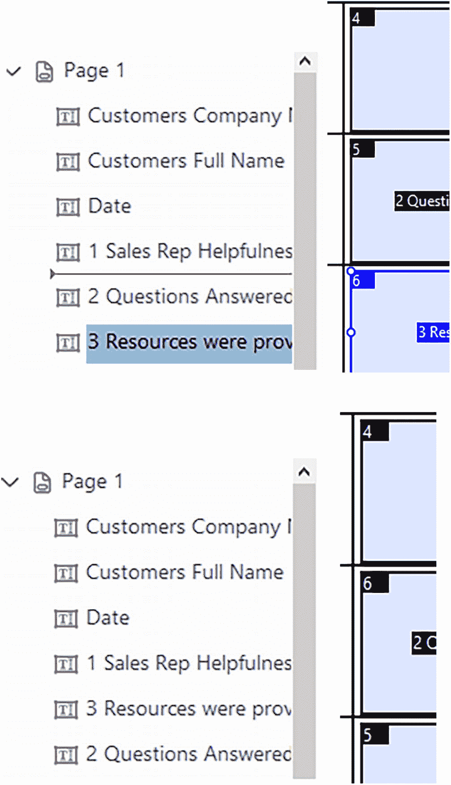

两张截图展示了字段菜单，该菜单列出了页面 1 下的选项，并带有多个标签。其中包括高亮的 3 个资源标签以及右侧的三个字段面板。

**图 1-44**  
在“字段”面板中更改 tab 键顺序。

如果我发现顺序不对，我可以将字段拖回字段列表中的正确位置，或者从菜单中选择标签列表中的其他选项，例如 `按行排序标签` 来重置顺序。请参考图 1-42。最终，在将表单提交给客户之前，预览 tab 键顺序并保存文件是一个好习惯。

如果在处理表单时，你注意到字段窗格中的字段未按 tab 键顺序显示，请检查你的下一个菜单（`AZ`），确保 `Tab 键顺序` 选项被选中，而不是 `字母顺序`（后者不显示页码）。此项设置不会更改页面上的 tab 键顺序，并且在此设置下你可能无法对字段重新排序。请参考图 1-45。

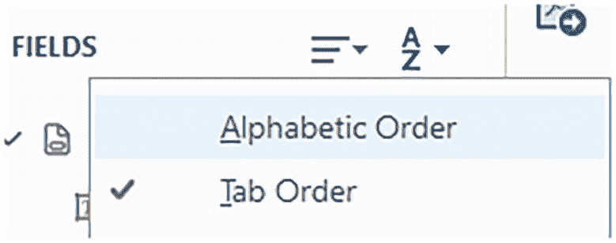

一张截图展示了字段菜单，其右键单击面板中高亮了 `字母顺序`，并勾选了 `Tab 键顺序`。

**图 1-45**  
确保在列表中选择了 `Tab 键顺序`。

无论如何，你不能将字段从一个页面移动到另一个页面，除非你选中一个字段，然后在新页面上选择 `编辑` > `剪切` 和 `编辑` > `粘贴`。

同样地，你也可以右键单击一个字段，然后从弹出菜单中上下移动特定字段的 tab 键顺序。其他操作包括删除字段。请参考图 1-46。

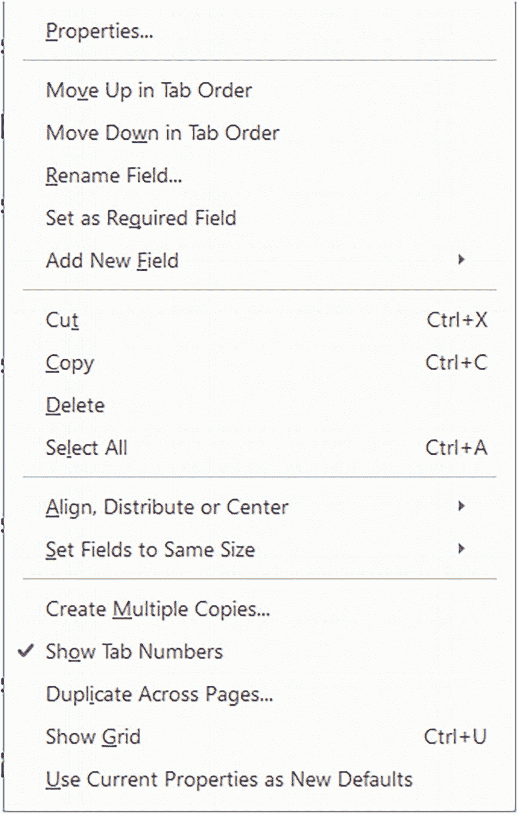

一张截图展示了右键单击选项，包含多个标签。其中一些是 `属性`、`剪切`、`复制`、`删除`、`全选`、`将字段设为相同大小`，并且 `显示 Tab 编号` 已启用。

**图 1-46**  
右键单击字段会显示其他表单编辑选项。

你可以在此处了解有关这些设置的更多信息：

[`https://helpx.adobe.com/cn/acrobat/using/pdf-form-field-basics.html`](https://helpx.adobe.com/cn/acrobat/using/pdf-form-field-basics.html)

当你按下键盘上的 `Delete` 键时，可以删除选中的一个或多个字段，并使用 `编辑` > `撤销` 来恢复该字段。

### 工作期间清除表单

在编辑和预览表单时，您可能需要重置或清除字段内容，以便进行修改或向客户呈现最终表单。请记住，在保存并关闭最终文件之前，要经常使用`更多`菜单中的`清除表单`选项。请参考图 1-47。

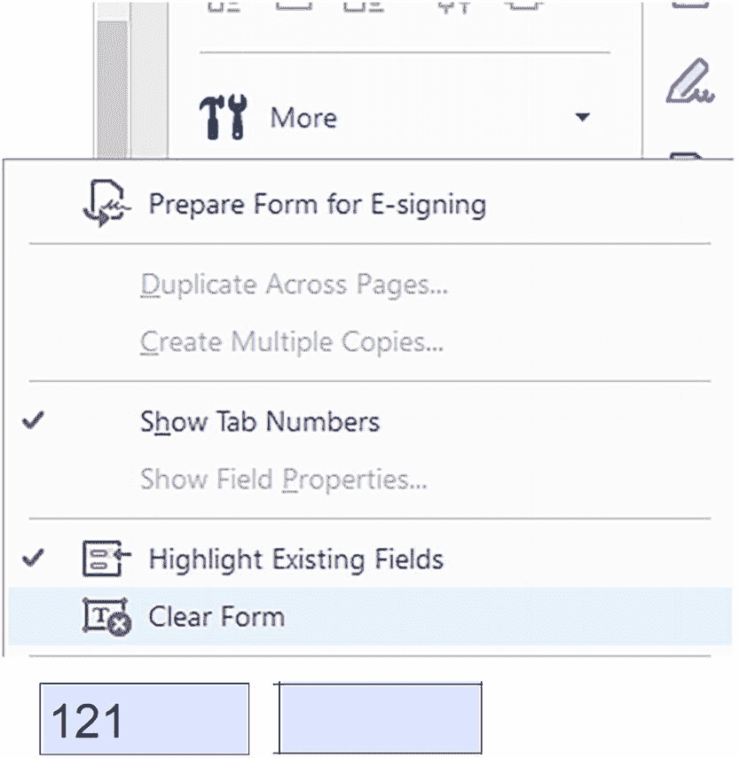

*图 1-47 — 使用“更多”菜单清除表单字段*

然而，请记住，此选项仅适用于您在`Acrobat Pro`中构建表单时。使用`Reader`的用户将无法像这样重置表单。因此，最好添加一个按钮字段，以便在客户需要重置或清除字段时，能够对所有或选定字段执行此操作。我们将在第 2 章中探讨如何实现这一点。

根据表单工作的类型，`更多`菜单中还有一些其他有用的项目。例如，我们将在第 19 章和第 20 章中探讨电子签名。请参考图 1-48。

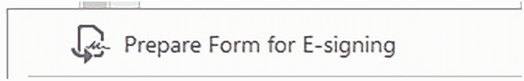

*图 1-48 — 准备用于电子签名的表单*

虽然这不是本书的主题，但如果您需要将数据导入字段，或导出数据为其他文件格式以供数据库使用，请参考图 1-49。

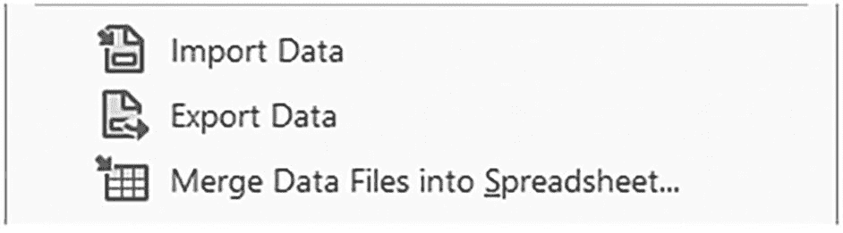

*图 1-49 — 用于处理表单数据的更多菜单选项*

以下链接可能对该主题有所帮助：

*   [`helpx.adobe.com/acrobat/using/collecting-pdf-form-data.html`](https://helpx.adobe.com/acrobat/using/collecting-pdf-form-data.html)
*   [`helpx.adobe.com/acrobat/using/creating-distributing-pdf-forms.html`](https://helpx.adobe.com/acrobat/using/creating-distributing-pdf-forms.html)

这些链接还提供了一些关于`分发`和`跟踪器`的信息，这些内容不在本书的讨论范围内。在表单首次打开但未进入`准备表单`工具之前，您也可以在`编辑`→`表单选项`子菜单中找到这些相同项。请参考图 1-50。

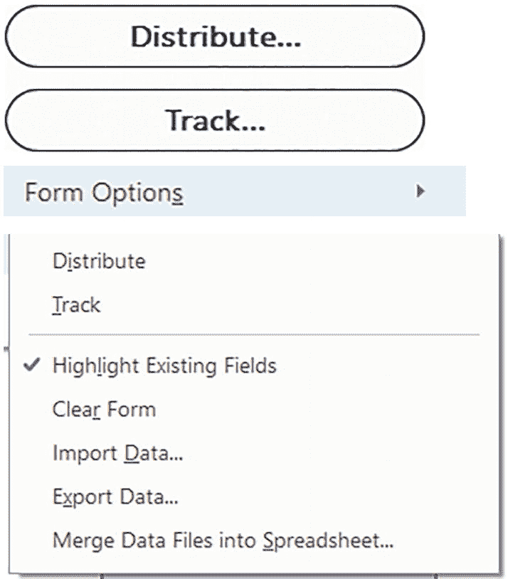

*图 1-50 — “分发”和“跟踪”按钮的表单选项*

`更多`选项卡区域中的另一个选项是`设置字段计算顺序`，这将在第 6 章中提及。请参考图 1-51。

*图 1-51 — “设置字段计算顺序”的更多菜单选项*

稍后在第 8 章及后续章节中，我们将探讨`更多`菜单中与 JavaScript 相关的最后几个选项，包括`调试器`、`调试`、`所有 JavaScript`、`文档 JavaScript`和`文档动作`。请参考图 1-52。

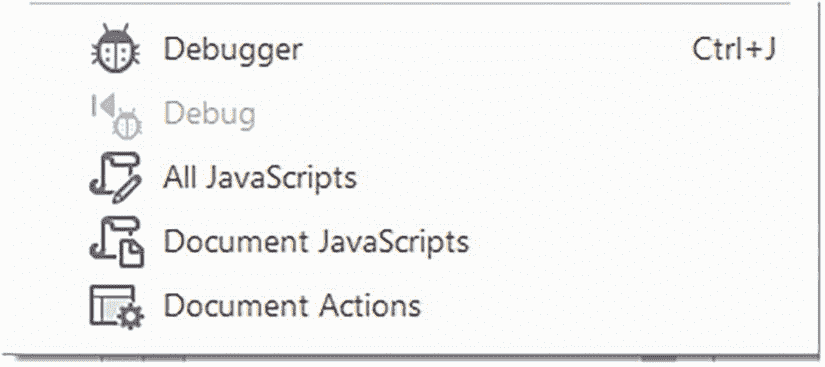

*图 1-52 — 更多菜单中的 JavaScript 选项*

## 本章小结

本章介绍了表单字段的基础知识、其选项卡以及各个选项卡中的属性，还介绍了如何排列选项卡顺序以及在`准备表单`工具右侧面板中找到的其他设置。下一章将介绍可以应用于字段的基本动作。

