# 2. 动作入门

**章节目标：** 在回顾了基本表单属性之后，您将通过仔细研究可以在每个字段的各个选项卡中应用的几种自动或预编程动作类型，来开始学习 JavaScript。在本章中，您将处理表单，并了解如何应用动作。

## 开始

如果您想在本课中跟着操作或查看最终结果，请从引言中提到的链接下载第 2 章的文件。标有“开始”的文件是不包含代码的文件，标有“结束”的文件是最终结果。您还会找到一个包含原始 MS Word 和 PDF 文件的文件夹（如果您想编辑它们），以及一个包含原始脚本（`.txt`）的文件夹（如果您想将它们添加到自己的 PDF 表单中）。

> **注意**
> 要查看字段的属性，您必须选择`准备表单`工具。只有这样您才能右键单击或双击某个字段以查看其属性。如果您是从一个不包含表单字段的原始 PDF 创建表单，请参阅第 1 章的“表单回顾”部分。

您可以将动作应用于所有表单字段。正如您将在第 4 章及后续章节中更详细地看到的那样，动作可以触发各种事件，例如警告框，或使字段显示最终计算结果，或使按钮重置表单中的字段。然而，某些动作在某些表单字段上比其他字段效果更好。例如，将动作应用于单选按钮可能会产生一些非常特定的计算，但如果您想对这些值进行求和，使用复选框或文本框可能是更好的选择。

如果页面上有字段，您可以通过单击`准备表单`工具，然后在编辑模式下右键单击该字段并从菜单中选择`属性`，或直接双击该字段来打开并查看其属性。这些示例中的文本框在`动作`选项卡上不包含任何信息，并且是空白的。但是，您很快会看到，字段内的其他选项卡和其他字段类型确实包含会导致事件发生的信息。请参见图 2-1。

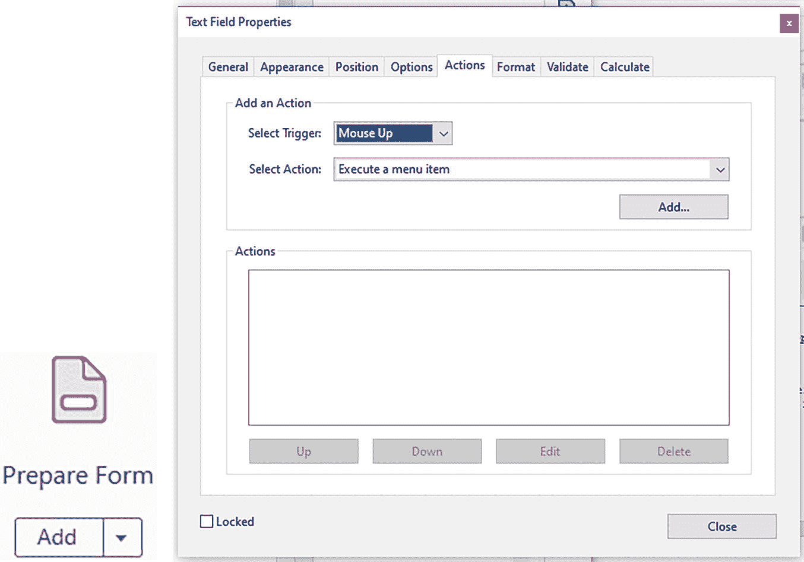

*图 2-1 — 文本字段属性对话框中的“动作”选项卡*

在这里，您可以看到可以添加动作和触发器的众多区域之一，我将在稍后更详细地讨论它。

## 评分表单值平均与求和：处理文本字段

我们来看看几种结合使用文本框、单选按钮和复选框进行平均与求和计算的方法。

假设您想创建一个调查问卷，了解客户对您的客服或互动是否有任何疑虑。您可以创建一个评分表单来帮助确定需要改进的地方。在 PDF 表单 `TMC_Customer Survey_Start.pdf`（如图 [2-2] 所示）的第 1 页上，您可以看到该表单未设置格式的外观。然而，在最终的“End”表单中，此调查中的评分字段是文本字段，其格式设置为“数字”而非“无”，以确保客户只能输入数字，不能输入字母。

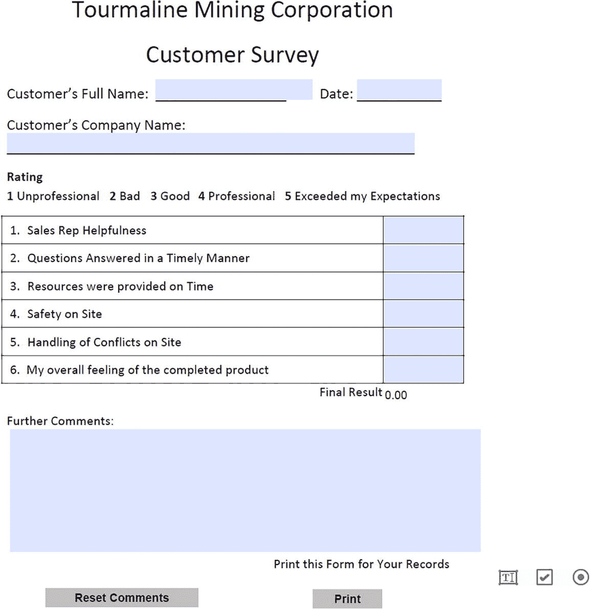

电气石矿业公司的一页。客户的完整姓名、日期以及客户公司名称是表单中的必填信息。有 6 个评分因素和进一步的评论区域。`重置评论` 和 `打印` 是评论区域下方表单上的两个按钮。

**图 2-2** 客户调查表示例以及本页和其他页面使用的表单工具（文本字段、复选框和单选按钮）

为确保客户在字段中输入正确的信息，限制其选项非常重要。您可以通过从“选择格式类别”下拉菜单中选择来更改格式。

图 [2-3] 提供了“文本字段属性”对话框中“格式”选项卡所使用的格式示例。在此示例中，我右键单击了一个名为“1 Sales Rep Helpfulness”的文本字段，并在“格式”选项卡的“选择格式类别”列表中将其从“无”设置为“数字”。默认情况下，“小数位数”将设置为 2。但是，如果您需要数字不含小数（如此示例所示），则将其设置为 0。否则，我将其他列表保留在默认设置：分隔符样式（`1,234.56`）、货币符号（无）和符号位置（禁用），以及“负数样式”选项中的“显示括号”和“使用红色文本”保持禁用。请参考图 [2-3]。

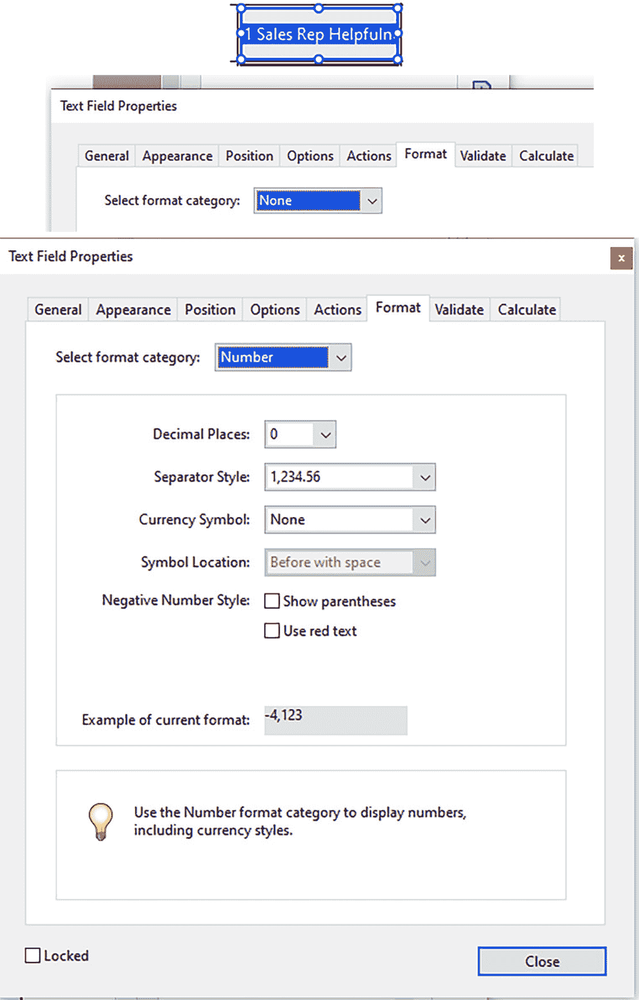

一个文本字段属性对话框。格式类别选择了“无”选项。相比之下，分隔符样式为 `1,234.56`，下方对话框中的格式类别为“数字”，小数位数设置为 0。

**图 2-3** 客户调查文件第 1 页上每个评分文本字段的格式设置

我们将在第 [7] 章更详细地讨论此“格式”选项卡。但是，在构建第 1 页上的表单时，请注意，在“文本字段属性”对话框中，您可以单击或选择该列中的下一个文本字段，再次将其格式化为相同的“数字”设置，或者对于列中的最后一个字段，可以将小数位数设置为 1 到 10 作为变体。在此示例中，我将其保留为 2。请参考图 [2-4]。

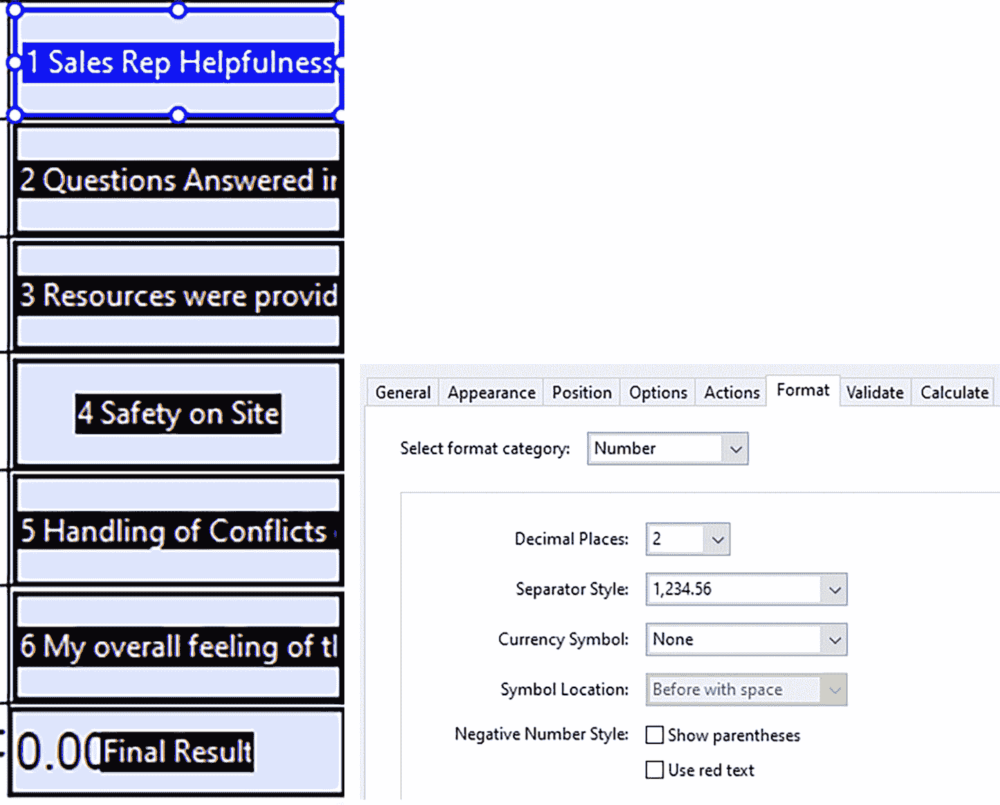

页面从上到下的格式样式片段依次描绘了：1 销售代表帮助度、2 问题解答情况、3 资源提供情况、4 现场安全、5 冲突处理、6 我的总体感受以及 7 最终结果。选中了“格式”选项卡，格式类别为“数字”。

**图 2-4** 客户调查文件第 1 页上每个文本评分字段的格式设置

### 验证选项卡

在第 1 页的评分文本字段示例中，您可以通过在“验证”选项卡的“字段值范围”字段中设置一个数字范围来进一步限制客户的选择。现在，客户只能输入 1 到 5 之间的数字。如果他们输入 6 或更高，或者 0 或更低，将会出现警告，如图 [2-5] 所示。

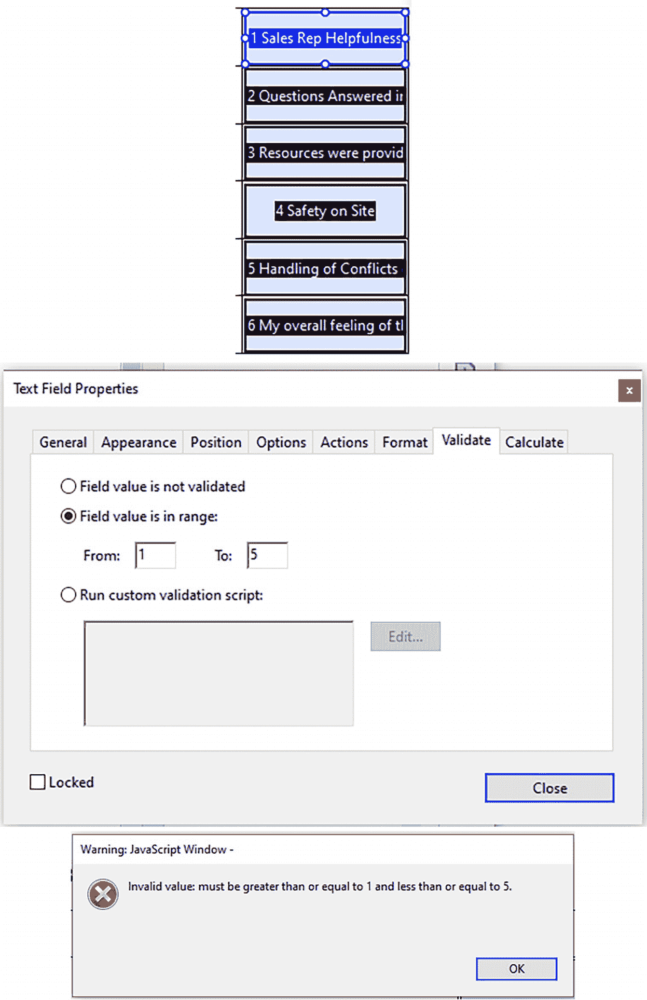

页面从上到下的格式样式片段依次描绘了：1 销售代表帮助度、2 问题解答情况、3 资源提供情况、4 现场安全、5 冲突处理以及 6 我的总体感受。选中了“验证”选项卡，字段值范围设置为 1 到 5。

**图 2-5** 第 1 页上每个后续文本字段的“验证”选项卡，值设置为 1-5 以限制输入范围，并在输入超出范围的数字时发出警告

然后，用户必须单击消息框中的“确定”，并输入正确的数字才能继续填写表单。在此示例中，“最终结果”字段设置为无验证，因为用户不能在此处输入数字（最终结果值可能高于 5），并且该字段在“常规”选项卡中被设置为`只读`。请参考图 [2-6]。

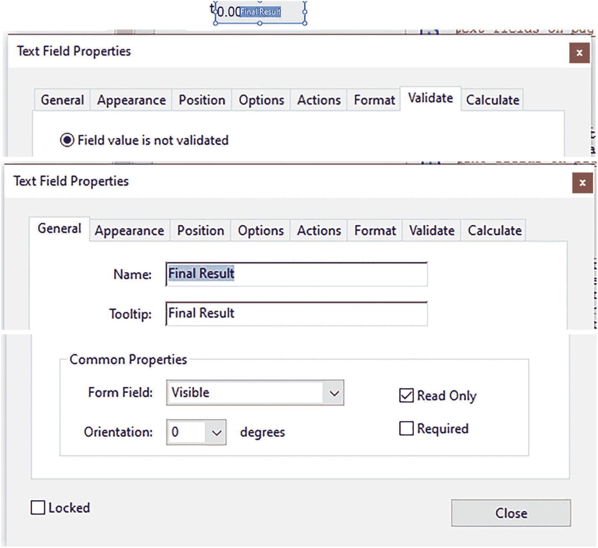

一个文本字段属性对话框。选中了“未验证字段值”单选按钮。文本字段属性中的名称和工具提示均设为“最终结果”。表单字段可见，方向为 0 度。

**图 2-6** “最终结果”字段设置为无验证且只读

如果您检查项目中第 1 页上“总计”或“最终结果”字段的“计算”选项卡（如图 [2-7] 和 [2-8] 所示），您会看到该字段如何使用“数值是下列字段的 _______”来接收来自其他字段的数据，从列表中选择`平均值`，然后单击`拾取`按钮来选择此字段将从中收集信息的各种文本字段。

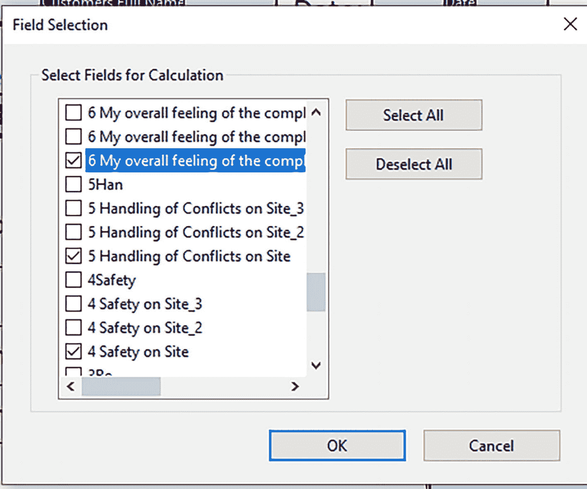

一个字段选择对话框。其中有一个用于计算的字段列表。列表中可用的各种选项包括：我的总体感受、现场冲突处理以及现场安全。

**图 2-8** “字段选择”对话框

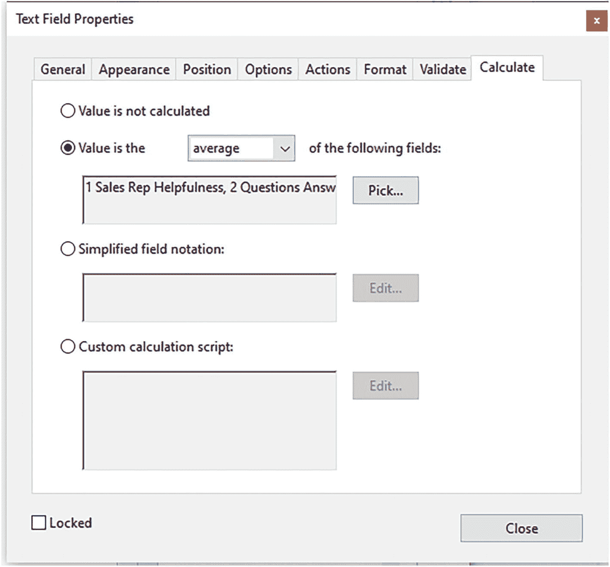

一个选中了“计算”选项卡的“文本字段属性”对话框。选中了“数值是下列字段的平均值”选项。其他选项“简化字段表示法”和“自定义计算脚本”被禁用。

**图 2-7** “最终结果”的“计算”选项卡

在您自己的工作中，要访问其他字段及其数据以供此最终字段使用，请单击`拾取`按钮以访问字段选择。只选择您想要计算的字段。请注意当前页面上的字段名称，以免错误地从其他页面上的字段获取计算结果。完成后，单击“确定”。您还可以“全选”或“全部取消选择”所有字段。这将使您能够更快地进行选择，而不是逐一勾选或取消所有字段。在此示例中，我只想计算该列中的前六个字段。请参考图 [2-5]。

**提示：** 如果难以勾选复选框，您可以将其高亮显示，然后按键盘上的空格键。这将切换复选框的选中或未选中状态。

请记住，“最终结果”文本字段在“常规”选项卡中被设置为`只读`，以便客户无法更改最终结果。请参考图 [2-6]。

### 使用求和功能计算总分的“计算”选项卡

在进行表单计算时，你可能会更倾向于将所有数值累加得到一个总和（例如，对 1、2、3、4、5、5 求和得到 20），而不是使用平均值（例如，这些数字的平均值是 3.33）。不同的调查可能需要不同的累积评分。

在名为 `TMC_Customer Survey_End.pdf` 的最终参考表单中，如果你翻到第 2 页，会发现此表单与第 1 页表单的唯一区别在于，“计算”选项卡中的“最终结果”值已改为求和（`+`），并且我使用了该页上的评级文本字段来累加计算结果。请参考图 2-9。

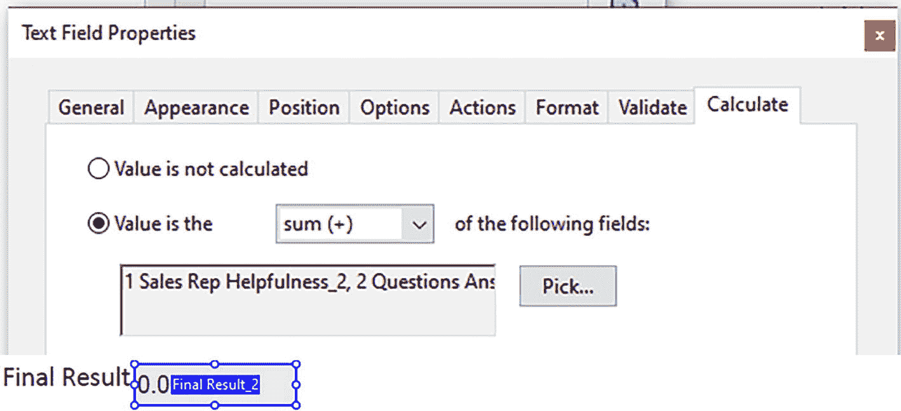

文本字段属性对话框。选中了“计算”选项卡。选中了“值为以下字段之和”的单选按钮。最终结果是 0 点 0。

图 2-9：第 2 页最终结果的“计算”选项卡

**注意：** 我只选择了第 2 页的字段。如果完成计算需要用到其他页面（如第 1 页或第 3 页）的字段，我也会选择这些字段。表单计算可以涉及 PDF 文档中所需的任意多个页面。在此示例中，第 2 页上的那些字段可以通过其名称末尾的 `_2` 来识别。不过，在你自己的项目中，文本字段的名称可能与我使用的不同。

## 替代的下拉评分

# 使用表单控件进行评分与计算

如果你跳过示例“End”文档中的第 3 页，直接看第 4 页，可以看到如何使用相同的表单，将部分评级文本字段替换为下拉列表进行评分。虽然这种方法与文本字段类似，但如果你希望客户使用非常具体的值，我认为这是一个合适的替代方案。此外，它无需为每个下拉列表设置“格式”和“验证”选项卡，因为值已经预设好了。要为下拉列表设置导出值，你需要在“选项”选项卡上为每个菜单项设置“导出值”。我还启用了“拼写检查”和“选择后立即提交所选值”，以便在从列表中选择时计算值会发生变化。请参考图 2-10 和 2-11。

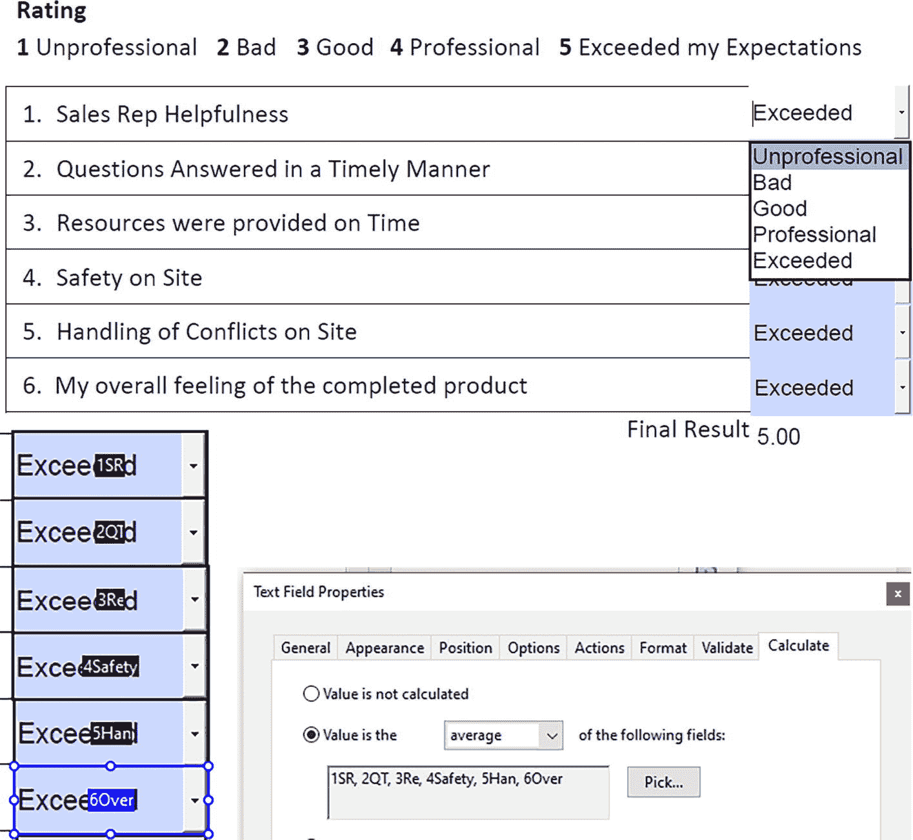

图 2-11：第 4 页上展开的一个下拉字段。评分页面。有 6 个评分项，每个都有一个包含 5 个评分选项的下拉菜单。最终结果为 5。文本字段属性对话框显示了“计算”选项卡，并选中了“计算表格选项的平均值”。

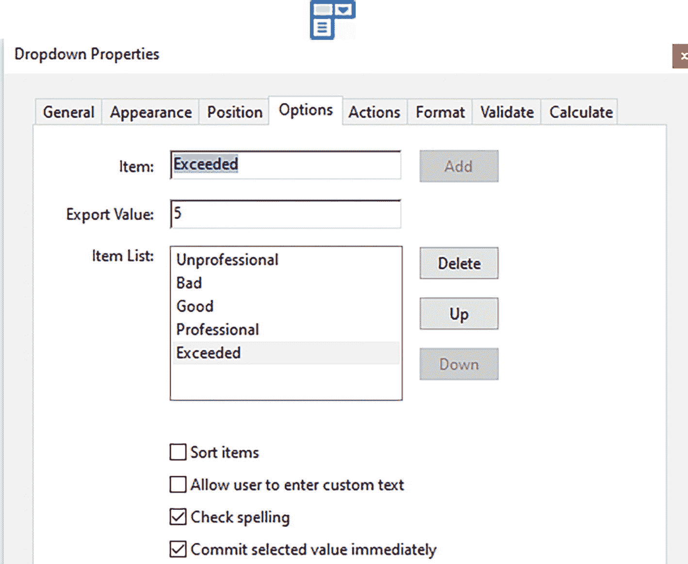

图 2-10：客户调查第 4 页选项的“下拉列表属性”对话框。下拉列表属性对话框，选中了“选项”选项卡。选中了“超出预期”作为菜单项，导出值为 5，菜单项列表包括“不专业”、“差”、“好”、“专业”和“超出预期”。已勾选“拼写检查”和“选择后立即提交所选值”。

在第 4 页，你可以看到通过选择一个具有数字值的单词，“最终结果”文本字段会获取该信息，并将其与已计算的值相加或求平均值。

## 结合文本字段使用复选框或单选按钮进行求和与求平均值

虽然文本字段和下拉列表在第 1、2、4 页的调查中很有用，但有时单选按钮和复选框效率更高。查看“Start”和“End”文件中的 PDF 文件的第 3 页，如图 2-12 所示。

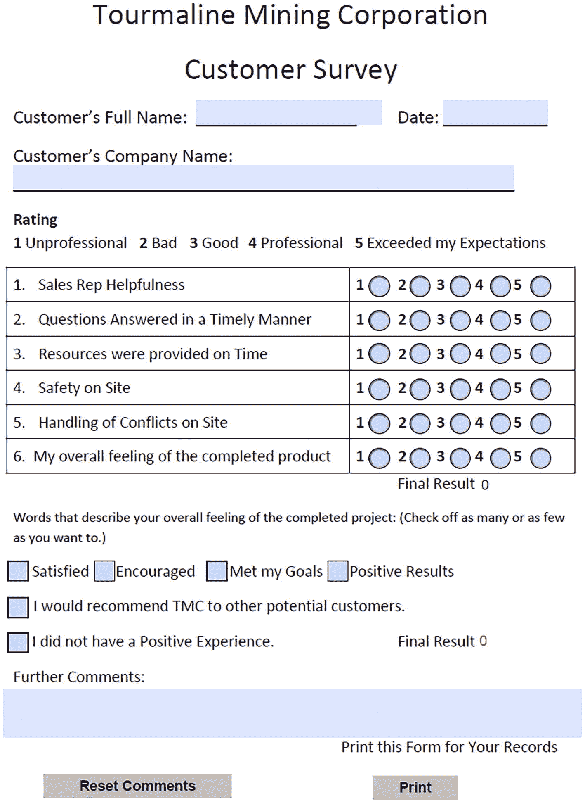

图 2-12：使用单选按钮和复选框的客户调查第 3 页。电气石矿业公司页面。客户的完整姓名、日期和客户公司名称是表单中的必要信息。有 6 个评分因素和进一步的评论区域。“重置评论”和“打印”是评论区域下方的两个按钮。

### 在项目第 3 页使用单选按钮

在“选项”选项卡上，可以将选择项设置为任意数值（1, 2, 3，如果需要，甚至可以是负数）。图 2-13 展示了如何在对话框中输入这些值。

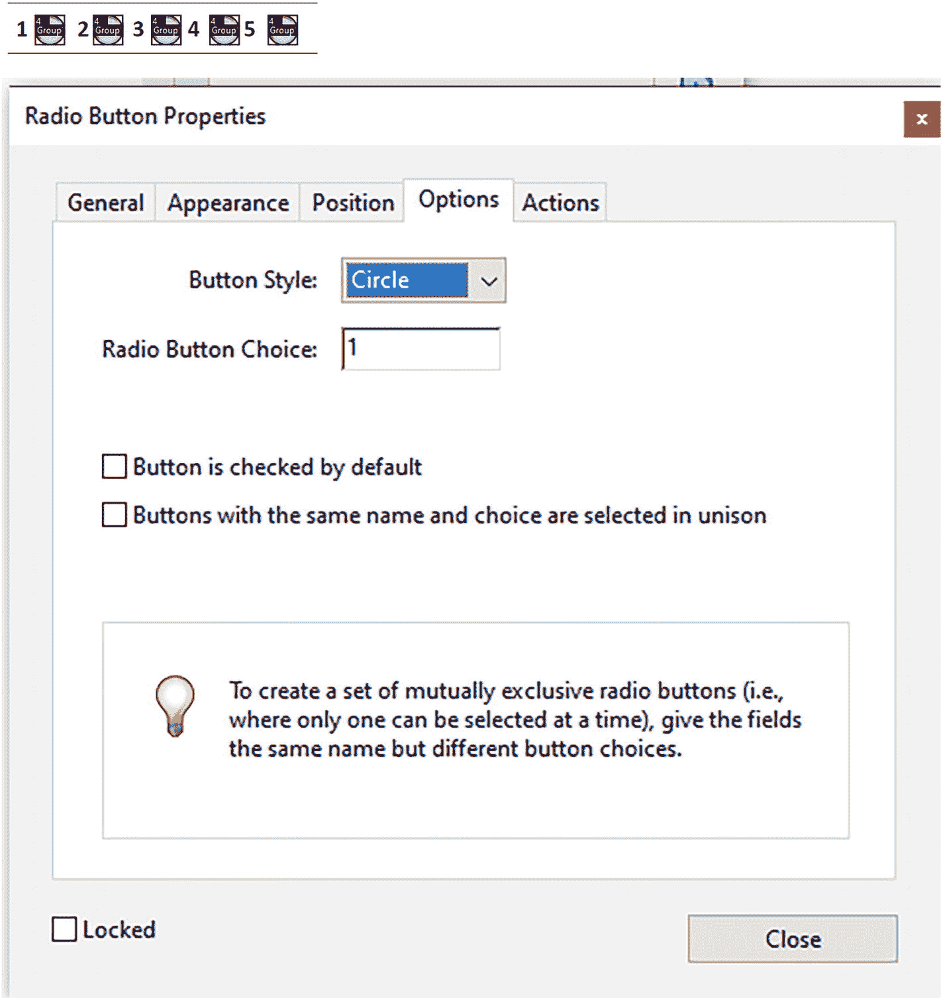

图 2-13：客户调查第 3 页的“单选按钮属性”对话框的“选项”选项卡。单选按钮属性对话框，选中了“选项”选项卡。按钮样式为圆形，选中的单选按钮选择值为 1。底部的提示写道：“要创建一组互斥的单选按钮，请给这些字段相同的名称，但不同的按钮选择值”。

如第 1 章所述，单选按钮可以属于同一组，因此它们的名称必须相同才能作为一个组运行，但每个按钮的单选按钮选择值可以不同。请参考图 2-13 和图 2-14。

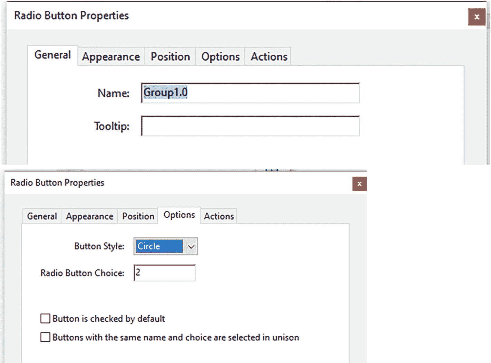

图 2-14：客户调查第 3 页的“单选按钮属性”对话框的“选项”选项卡。两个“单选按钮属性”对话框，分别选中了“常规”和“选项”选项卡。名称为 group 1，按钮样式为圆形，单选按钮选择值为 2。

但是，要完成计算，你需要在组行的末尾放置一个隐藏的文本字段，用于接收该组的计算字段，你可以在“计算”字段中设置其值为求和。请参考图 2-15 和图 2-16。

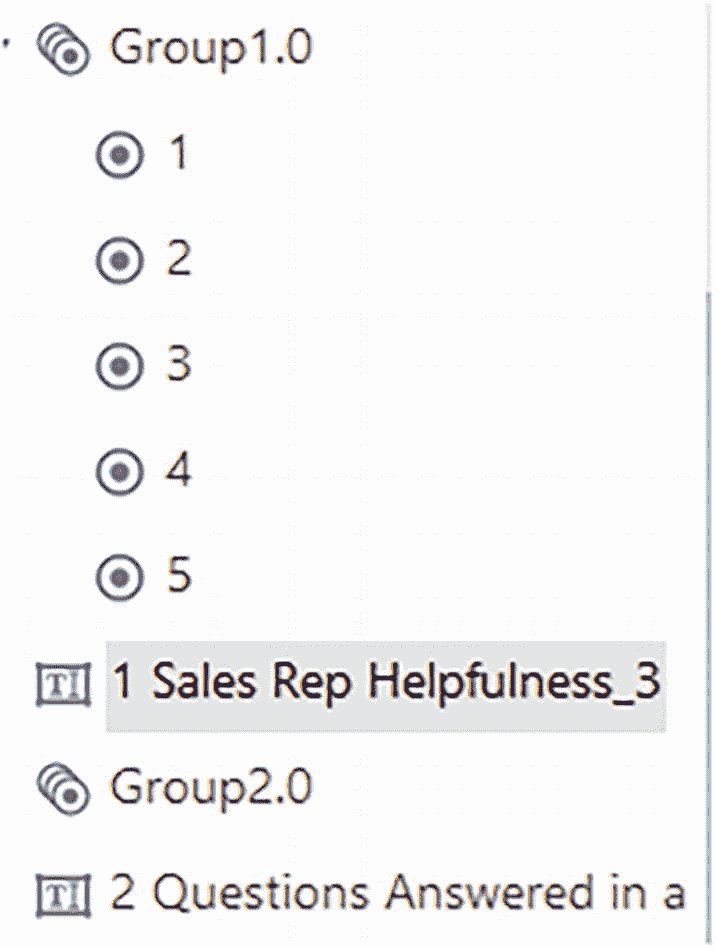

图 2-16：按钮组在右侧“准备表单预览”字段中的显示方式。组的下拉菜单截图，范围从 1 到 5。高亮了“1 销售代表 helpfulness underscore 3”选项。选项包括“Group 2 dot 0”和菜单中的最后一个选项“2 questions answered”。

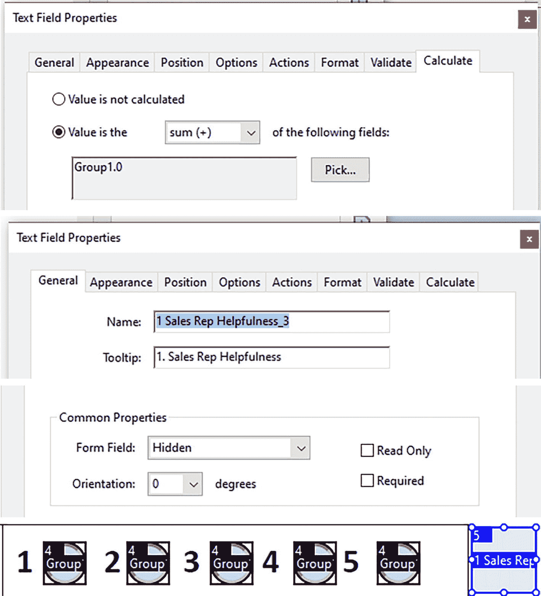

图 2-15：客户调查第 3 页上选中了单选按钮组的“文本字段属性”对话框的“常规”和“计算”选项卡。两个“文本字段属性”对话框，分别选中了“计算”和“常规”选项卡。值为 group 1 中选项的总和。表单字段设为隐藏，方向为 0 度。名称和工具提示为 sales rep helpfulness。

每个单选按钮组都应有一个隐藏的文本字段。在这个例子中，共有六个组。记住，为了正常运行，单选按钮必须始终以两个或更多为一组。请参考图 2-17。

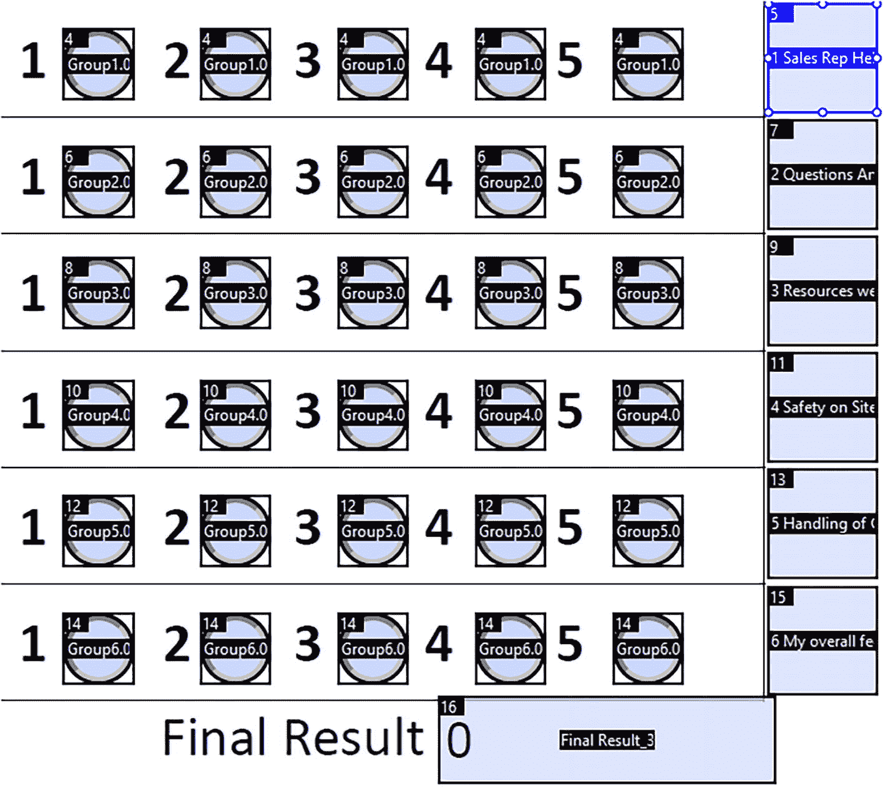

图 2-17：带有选项卡编号的单选按钮示例和隐藏文本字段。一个由 5 个圆形字段类别组成的矩阵，用于 6 个组来评估向客户提供的 6 项服务。最终结果为 0。

然后在“计算”选项卡上，通过选择这些隐藏文本框，使用这些文本字段来计算 `Final Result_3` 文本字段中单选按钮组的总和。最终结果字段也设置为“只读”，如图 2-18 所示。

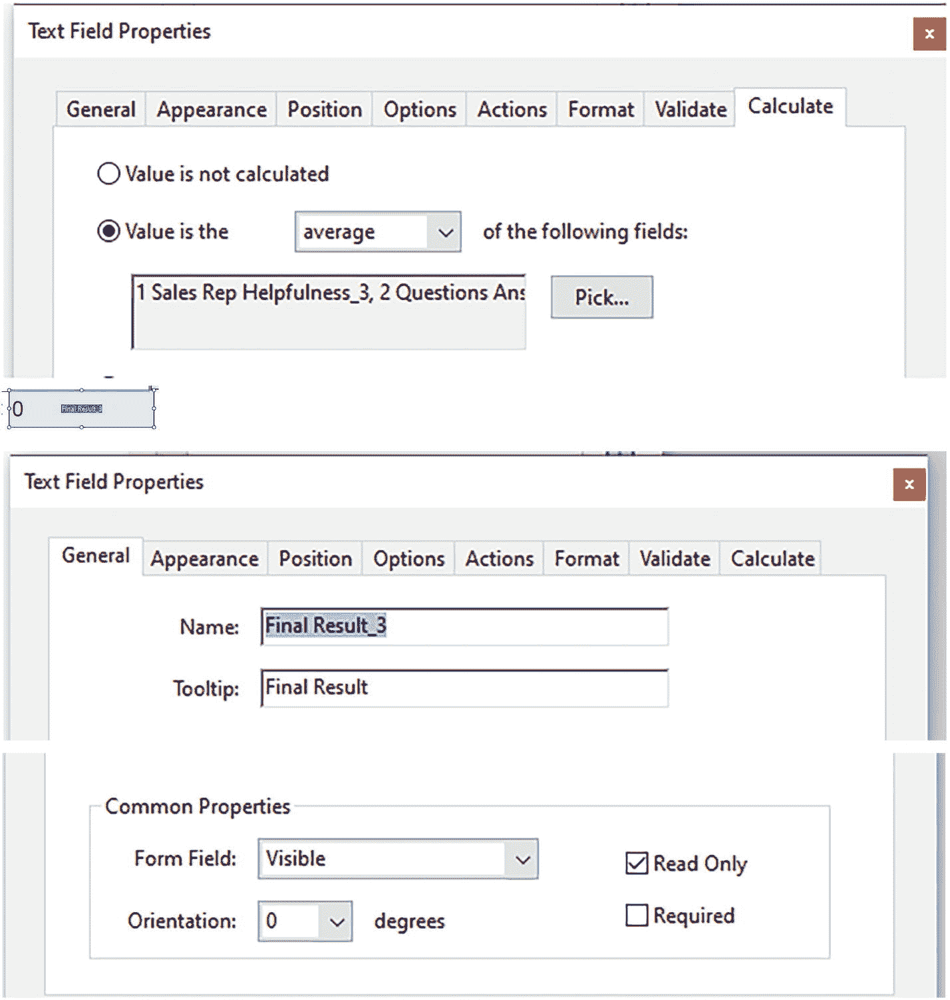

图 2-18：客户调查第 3 页的“文本字段属性”对话框的“计算”和“常规”选项卡。两个“文本字段属性”对话框，分别选中了“计算”和“常规”选项卡。计算出字段的平均值。名称和工具提示输入为 final result。表单字段可见，方向为 0 度。勾选了“只读”选项。

`Final Result` 文本框用于计算与单选按钮组关联的其他隐藏文本框中评分的平均值。

在单选按钮的计算中，与其让它们保持未选中状态，你可以在每个组中将一个按钮设置为“默认选中”（位于`选项`选项卡下），这样就能在最终的文本字段中看到数字自动变化。例如，在这种情况下，在选中更多单选按钮之前，平均值可能会暂时保持为`0`。你还可以使用“同名同选项的按钮统一选择”选项，来选取两个或更多具有相同值的单选按钮。但请注意，这可能会产生意外结果，并且无法正确累加。通常，在大多数情况下，单选按钮应独立操作，每个按钮都有各自的值，因此请保持该属性为未选中状态。请参阅图 2-14。

### 在项目的第 3 页使用复选框

图 2-19 演示了如何在`复选框属性`对话框的`选项`选项卡中输入相似的值。

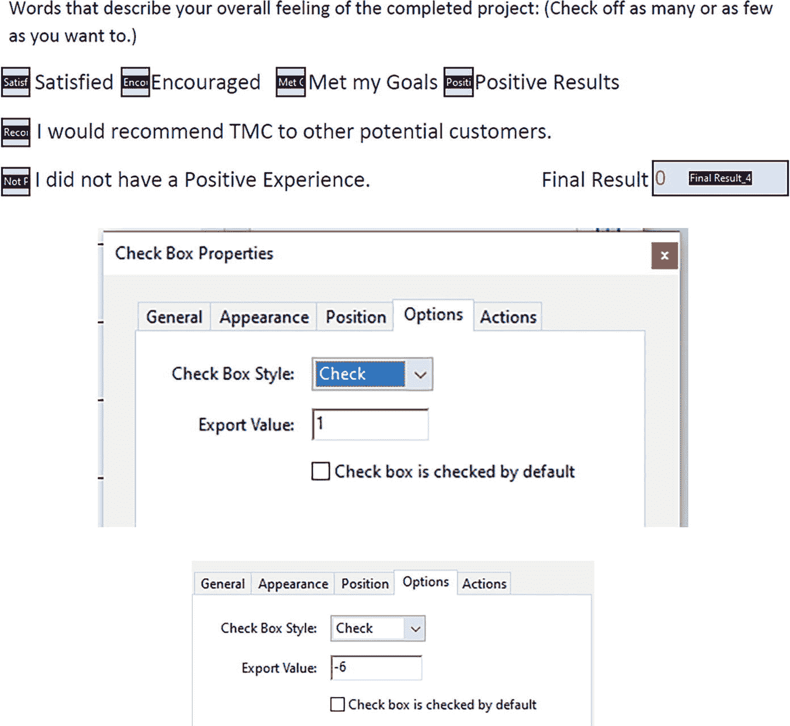

图 2-19：客户调查第 3 页中`复选框属性`对话框的`选项`选项卡。已选中一个带有`选项`选项卡的复选框属性对话框。选择的框样式是`打勾`，导出值为`1`。对话框上方显示了最终确定各个选项之前的复选框样式。

复选框可以在`选项`选项卡中以类似方式使用，并赋予导出值为`1`、`2`、`3`……甚至对于负评价可以使用负数。

在此示例中，你不需要任何隐藏文本框，`最终结果`文本字段（只读）可以直接对复选框的值进行求和。请参阅图 2-20。

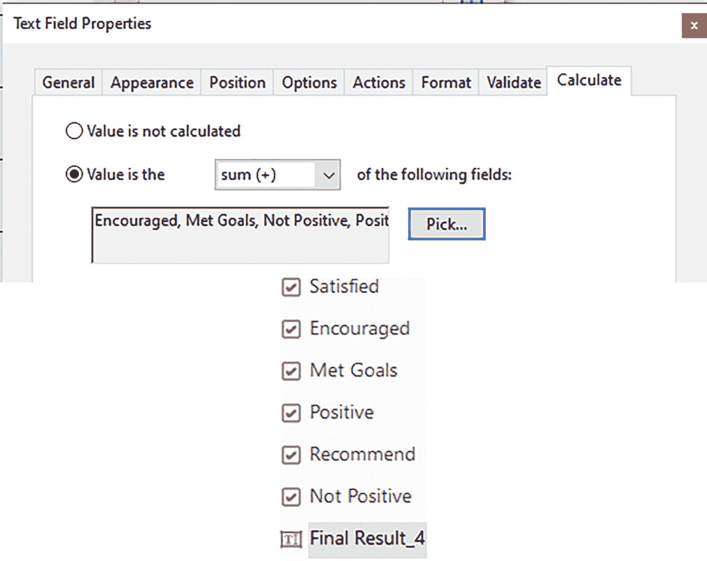

图 2-20：PDF 第 3 页中选中复选框的`计算`选项卡示例，以及右侧字段列表中`准备表单`预览字段内复选框未分组的显示方式。已选中带有`计算`选项卡的文本字段属性对话框。计算的是以下字段值的总和。已选中代表评分的`6`个复选框。

> **注意**
> 此文本字段还包含自定义验证脚本，我们将在第 10 章中更详细地讨论。

### 将复选框转换为单选按钮

正如我们在本例中所见，复选框可以独立操作，并且不需要分组。

然而，复选框也可以转换为单选按钮，在某些情况下，当你希望使用方形样式时，可能会更倾向于这种方法。

要将复选框编程为显示为单选按钮，可以执行以下步骤。在页面上放置两个或更多复选框字段。请参阅图 2-21。

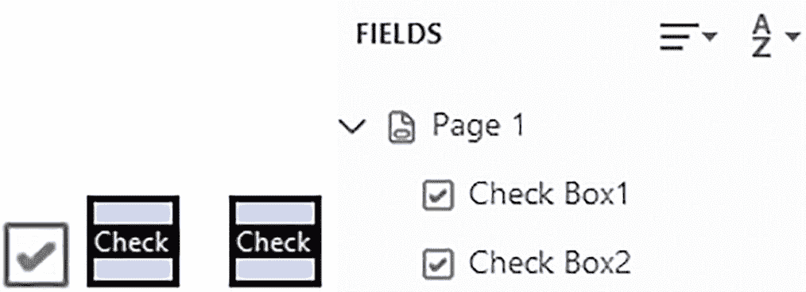

图 2-21：向页面添加复选框。展示了一部分常规复选框样式。第 1 页上的字段中，复选框 1 和 2 已被勾选。

现在，在`复选框属性`对话框中，请确保在`常规`选项卡上将框的名称设置为完全相同。当你这样做时，名称末尾会自动添加一个`#`和数字。你自己无需添加此符号。不过，如果`选项`选项卡中的导出值相同，它们就会分组并作为一个整体运行。请参阅图 2-22。

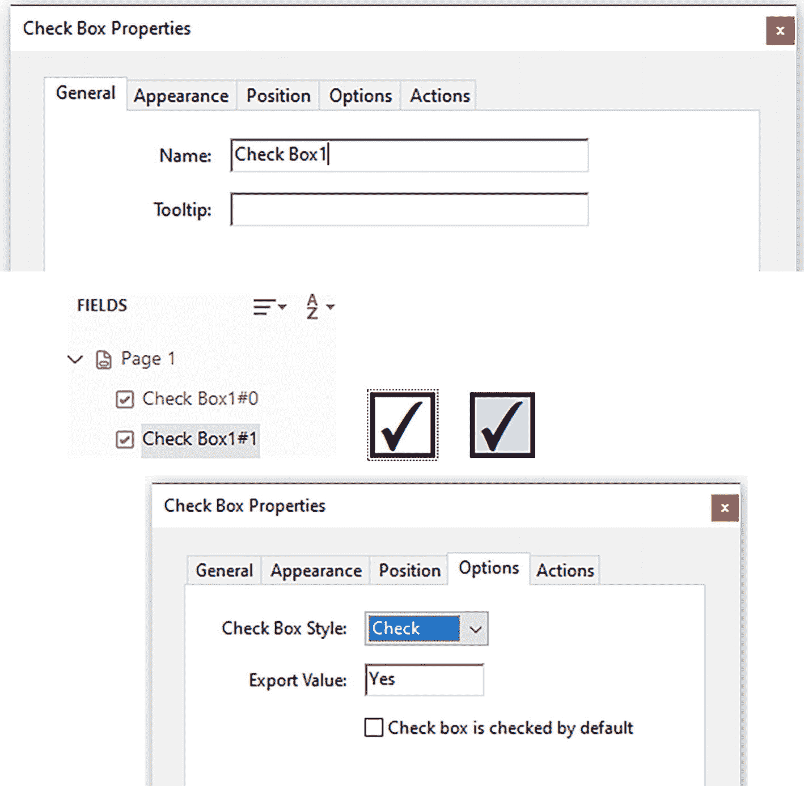

图 2-22：确保`常规`选项卡上的复选框名称相同，且`选项`选项卡上的导出值相同。两个复选框属性对话框。名称设置为`Check Box 1`，选择的框样式是`打勾`。导出值为`Yes`。

但是，要将复选框转换为单选按钮，你需要更改其中一个复选框的`导出值`字段。现在，当你使用这些框时，点击其中一个，它们就会相互切换开启或关闭。你也可以选择将其中一个设置为默认选中。请参阅图 2-23。

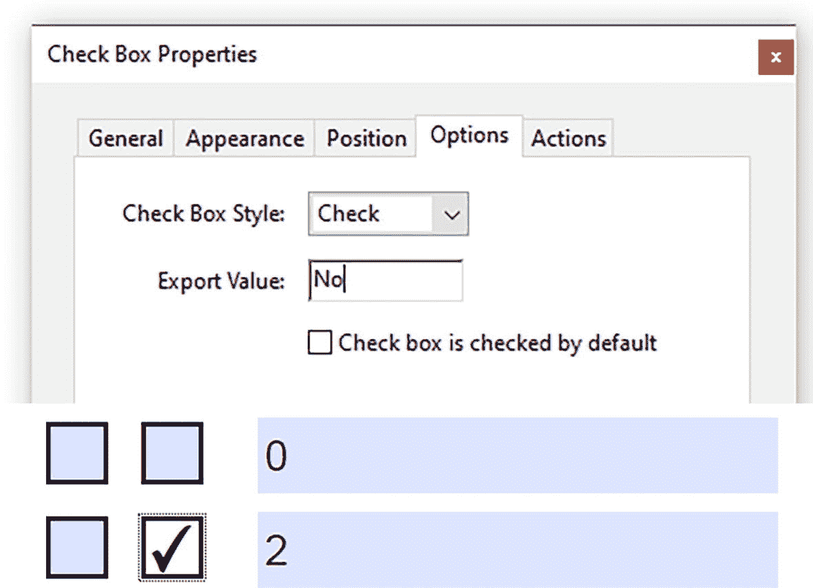

图 2-23：为其中一个复选框设置不同的导出值，以将其转换为单选按钮。一个复选框属性对话框。为复选框样式选择了`打勾`选项，导出值为`No`。第二行的第二个框已被选中。

你可以自己尝试使用数字计算，看看通过将复选框中的导出值改为数字，如何用一个文本字段完成简单计算。请参阅我的示例文件`CheckBox_RadioButton.pdf`，在文本字段中将`计算`选项卡设置为“值是以下字段的总和 (+)” ，然后选择`Check Box 1`组，并在`常规`选项卡上将文本字段设置为只读。关于`计算`选项卡的设置，请参阅图 2-24。

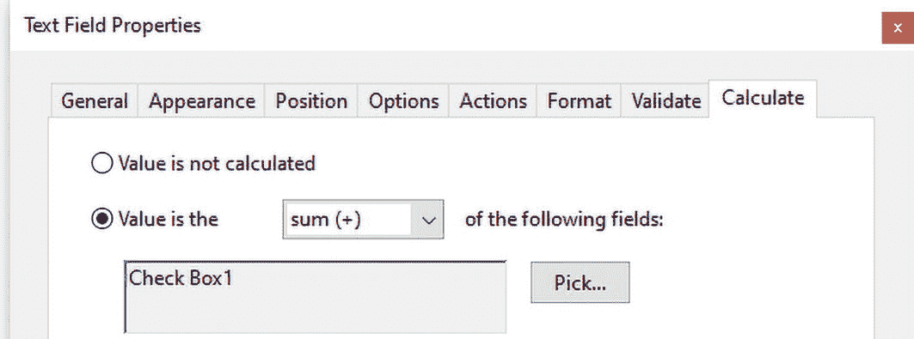

一个文本字段属性对话框。`计算`选项卡已被选中。计算的是`Check Box 1`的总和值。

`图 2-24`

为你的文本字段设置`计算`选项卡

提示

如果需要更靠近你的复选框或任何表单字段，请记得使用导航图标`-`和`+`。你也可以使用快捷键`Ctrl/Cmd++`或`Ctrl/Cmd+-`，以及`视图 ➤ 缩放`菜单。

## 重置按钮和打印按钮的基本操作触发器

按钮可以添加许多基本操作，你将在第 4 章及后续章节中看到。不过，本节课我们重点介绍表单中常用的两个操作：`重置`和`打印`操作。如果需要跟着操作，请查看`TMC_Customer Survey_End.pdf`文件的第 1 页。

### 重置按钮

如果客户在多个字段中填错了信息，或者希望清除整个表单，而不必逐个选中每个字段再按下`Delete`或`Backspace`键，那么在表单中添加一个`清除`或`重置`按钮会很有帮助。图 2-25 展示了重置按钮在“`操作`”选项卡上的表现。

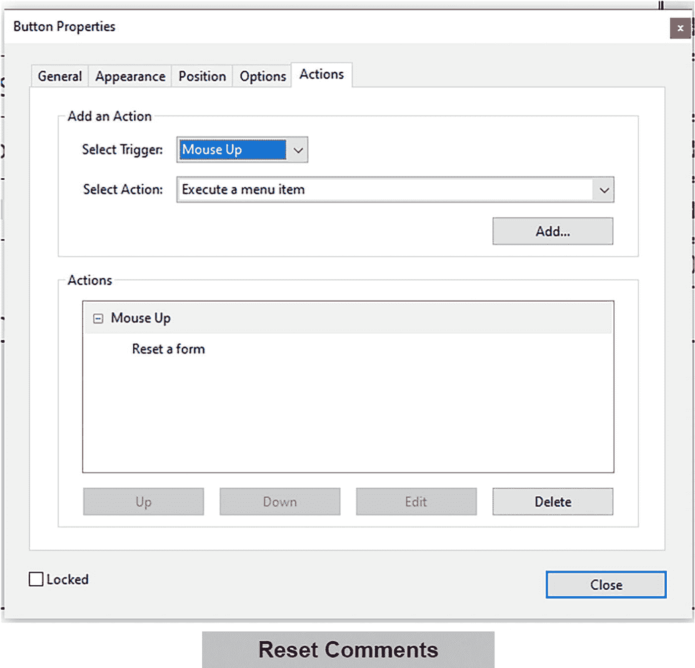

一个按钮属性对话框。已选中“`操作`”选项卡。“`鼠标释放`”选项被触发，且操作选择为“执行菜单项”。该操作为使用“`鼠标释放`”选项重置表单。“`重置注释`”按钮位于对话框下方。

`图 2-25` – “`操作`”选项卡上的按钮属性

按钮可以重置所有字段或仅重置注释；这由您决定。请在您自己的表单上尝试此操作。

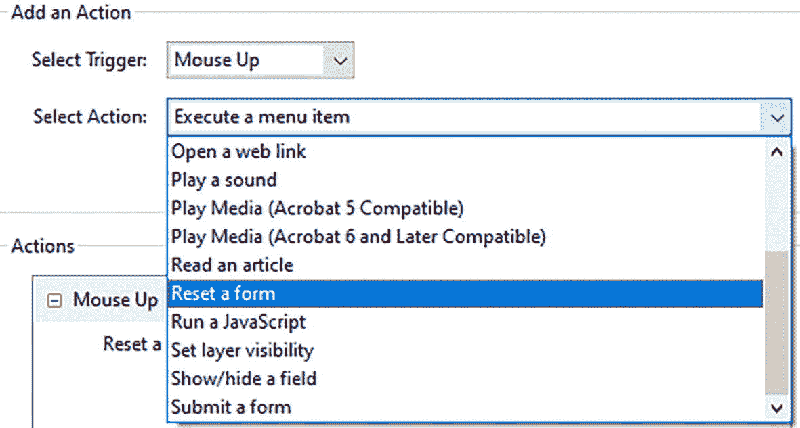

操作按钮的选项列表片段。下拉菜单中的各种选项如下：打开网页链接、播放声音、播放媒体、阅读文章、重置表单、运行 JavaScript、设置图层可见性、显示或隐藏字段以及提交表单。

`图 2-26` – 选择“重置表单”操作

1.  确保选择的触发器设置为`鼠标释放`。

2.  从“选择操作”菜单列表中选择“重置表单”操作。请参考图 2-26。

一个高亮显示的矩形框，上方带有文本`添加`。

`图 2-27` – 将操作添加到“`操作`”选项卡

1.  点击`添加`按钮来添加操作。对于新操作，这将打开“重置表单”对话框。请参考图 2-27 和图 2-28。

2.  或者，如果您已选中了重置操作，请点击属性框底部的`编辑`按钮，打开“重置表单”对话框，以选择您想要重置的字段，如图 2-28 所示。

    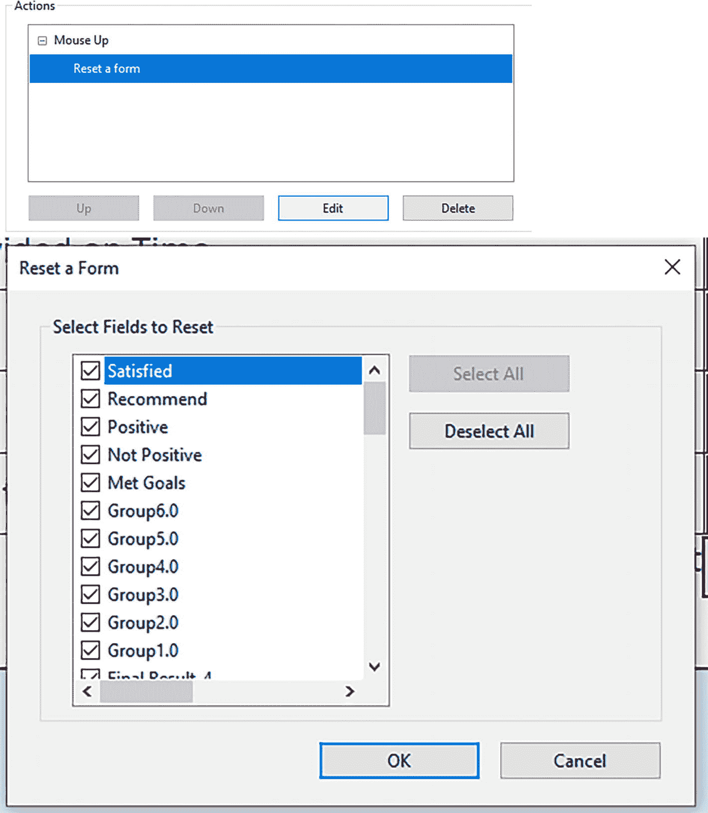

    一个用于重置表单的操作对话框。它列出了满意、推荐、正面、非正面选项、达成目标以及已勾选的组 1 至组 6。“`全部取消选择`”选项处于激活状态，而“`全选`”选项则被禁用。

    `图 2-28` – 在“重置表单”对话框中编辑操作

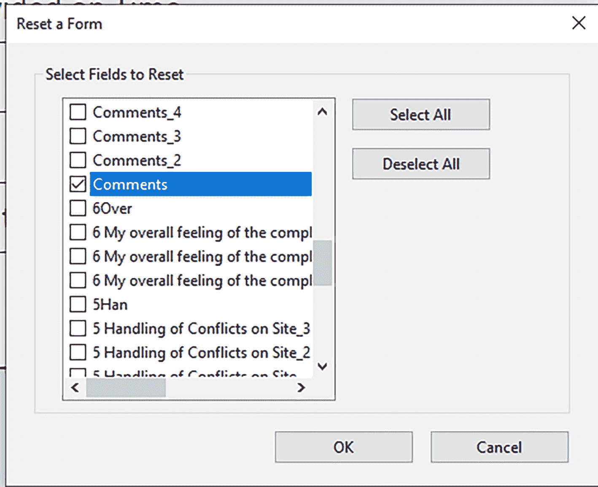

一个用于重置表单的对话框。可重置的字段列表包括：注释、结束、现场冲突处理、以及我的整体感受。“`注释`”选项已被勾选。“`全选`”和“`全部取消选择`”按钮位于字段框旁边。

`图 2-29` – “`操作`”选项卡上的“重置表单”选项

1.  在此示例中，我选择了`全部取消选择`，只勾选了`注释`字段，然后点击`确定`并关闭了属性对话框。请参考图 2-29。

> **注：** `按钮`字段的标签名称位于“`选项`”选项卡上。

### 打印表单按钮

同样地，您也可以创建一个`打印`按钮，如第 1 页所示。在“按钮属性”对话框中，执行与重置按钮相同的步骤，但这次，从“选择操作”列表中，您可以选择“执行菜单项”并点击`添加`。请参考图 2-30。

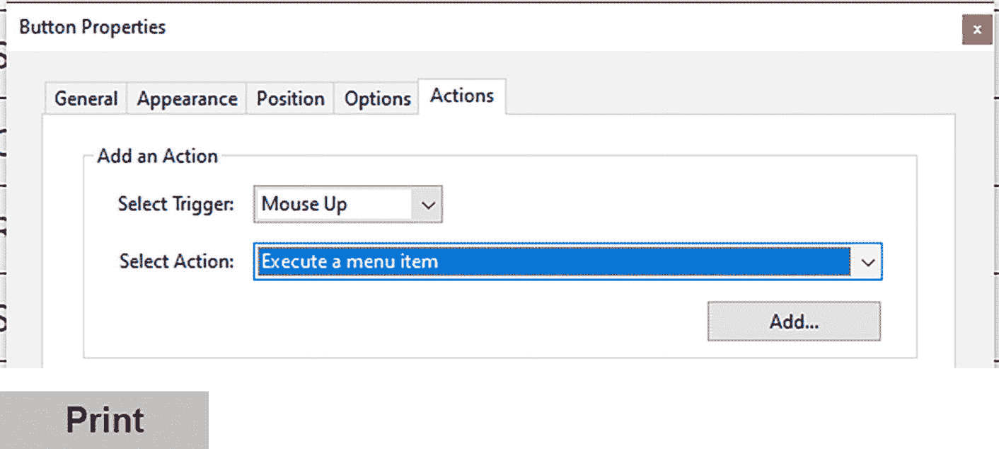

一个按钮属性对话框。在可见的“`操作`”选项卡下，选择了`鼠标释放`触发器。已选择执行一个菜单项操作。对话框下方有一个`打印`按钮。

`图 2-30` – “`操作`”选项卡上的“打印表单”选项

从“菜单项”对话框中，如果要为整个文档创建一个`打印`按钮，请选择`文件` ➤ `打印`操作。然后点击`确定`。请参考图 2-31 以及项目“最终版”PDF 文件的第 1 页来回顾此操作。

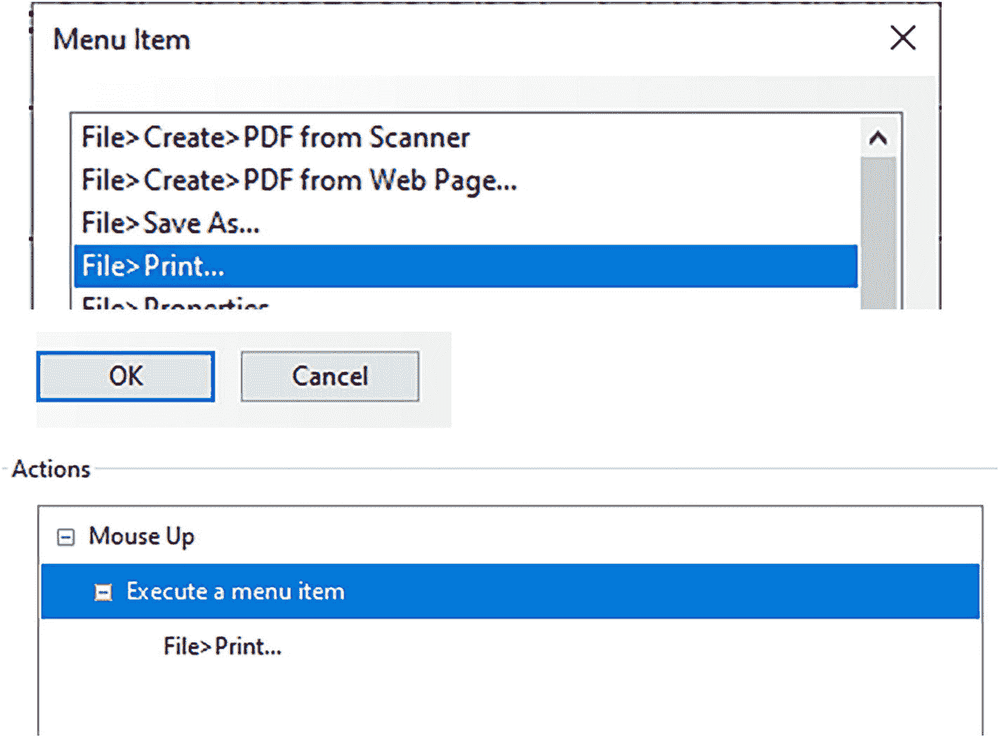

一个菜单项下拉菜单。被强调的路径顺序是：`文件`，然后是`打印`。`确定`按钮的边框被高亮显示。在操作框中，`鼠标释放`操作后依次是菜单项、`文件`命令和`打印`命令。

`图 2-31` – “`操作`”选项卡上的`文件` ➤ `打印`选项

当您点击该按钮时，这将打开`打印`对话框。如果需要，您可以`编辑`或`删除`此操作。

然而，如果您只需要打印某个范围内的特定一页或几页，则需要改用 JavaScript。要预览此效果，请参考“最终版”PDF 文件的第 2 页和第 4 页以及图 2-32。我将在后续章节中对此进行更多讨论。尽管脚本放置位置会影响文档是否能成功打印。在此示例中，第 2 页的脚本允许我们打印，但如果打印操作脚本放置在最后一页，文档将无法打印并会显示错误。

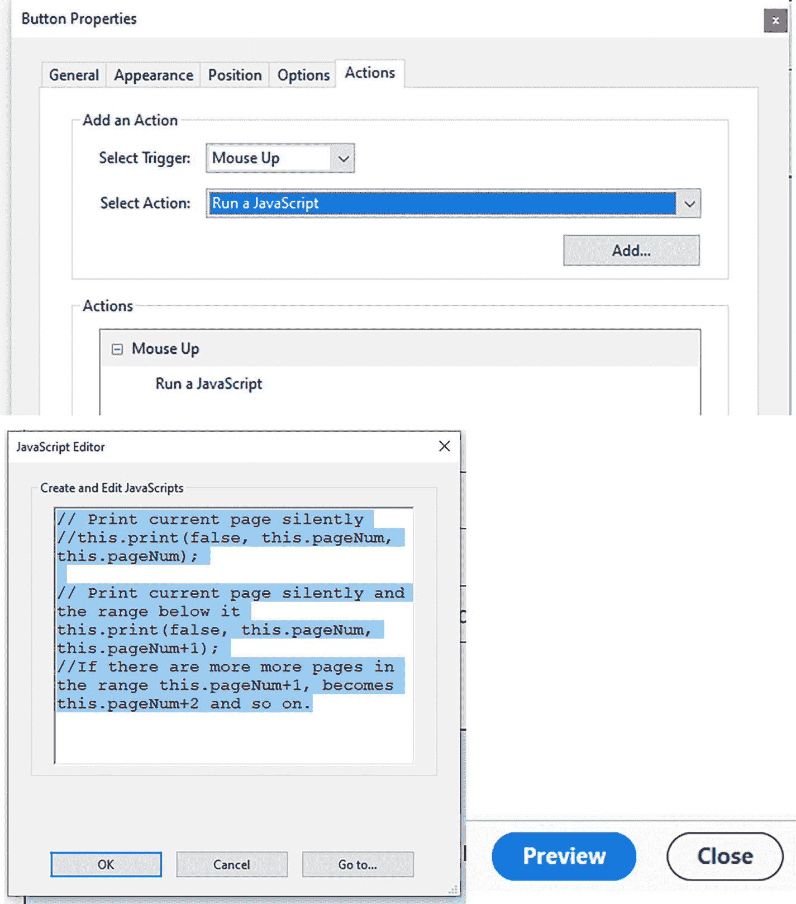

按钮属性和 JavaScript 编辑器的两个对话框。已选中“操作”选项卡。通过选择`鼠标释放`触发选项来启动 JavaScript 操作。这是一个可供您修改和编写 JavaScript 代码以打印正确页面以及添加打印页数的框。

`图 2-32` – 在“`操作`”选项卡上添加 JavaScript 并关闭表单

当您完成表单的预览和编辑后，点击预览窗口右上角的`关闭`按钮，以关闭`准备表单`工具。

## 总结

如您在本章所见，您可以以多种方式使用`准备表单`工具及其相应属性，来创建满足您需求的客户评级调查。通过查看各个选项卡，您还可以发现许多表单字段具有相似的属性，而另一些字段则仅具有与该特定字段相关的属性。然而，正如您在单选按钮和复选框中所见，有一种方法可以使它们为特定项目而表现得像对方一样。您现在也开始为按钮添加操作了。随着课程的深入，您将发现在表单变得越来越复杂时，了解使用哪些类型的字段和属性至关重要。