# 3. 创建二维码自定义图章

**章节目标：** 在本章中，您将使用 Adobe Acrobat 的图章工具创建一个自定义的二维码图章。

您可能已经打开并查看过包含图章、批注以及客户修改和批准的 PDF 文件。实现这些批注查看功能的应用程序很可能是 Adobe Acrobat Reader 或 Acrobat Pro。对许多计算机用户而言，Reader 已成为行业标准，仅仅因为它是一个任何人都可以在 macOS 或 Windows 平台上下载的免费软件。

当您与客户一起审阅文件时，Acrobat Pro 允许您查看 PDF 文档并添加批注。

如第 1 章所述，Acrobat Pro 还允许您使用“准备表单”工具创建条形码和二维码。但是，条形码和二维码中生成的信息仅适用于周围的表单字段，而不适用于文档中其他地方的特定文本（参见图 3-1）。目前，使用“批注”工具，您无法生成可能想要用作批注或图章的自定义二维码，因此本章将向您介绍一种解决此问题的方法。

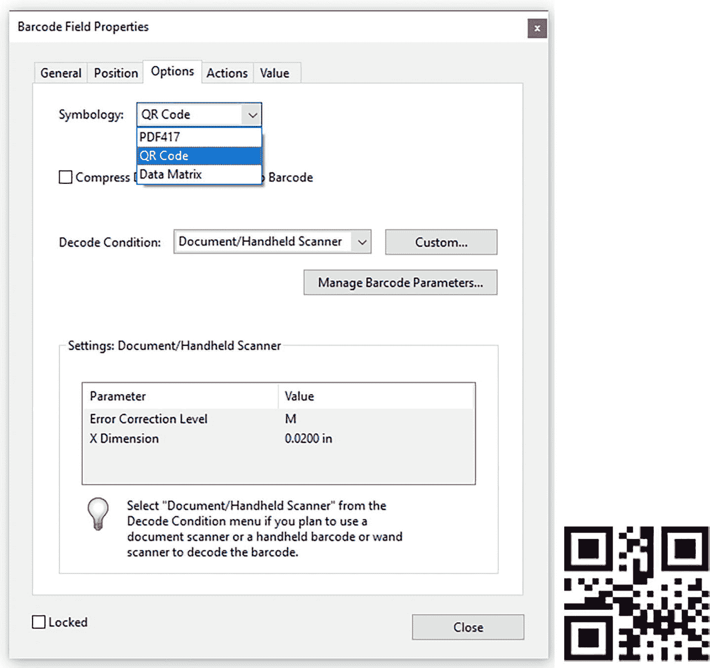
图 3-1 “条形码字段属性”对话框，其中显示了从“选项”选项卡的“符号体系”列表创建的 QR 码示例

注意
如果您想在本课中同步操作或查看最终结果，请从引言中提到的链接下载第 3 章的文件。如果您想编辑，您会找到原始的 Adobe InDesign 文件、QR 图片和 PDF 文件。有关此主题的更多详细信息，请参阅本章后面的“创建 QR 码”部分。

请记住，要查看字段的属性，您必须选择“准备表单”工具。只有这样，您才能右键单击或双击字段来查看其属性。

## 自定义您的 QR 码图章

将 QR 码放在名片、简历和新闻简报上已变得流行；这些代码可以被智能手机读取。然而，Acrobat 只允许您创建适用于表单的 QR 码。对于您的简历或信笺抬头，您可能希望 QR 码包含您公司网站的 URL 或只是一些文本。解决方案是构建您自己的自定义 QR 码图章，您可以将其放置在在线 PDF 中供客户查看。以下练习将向您展示如何操作。

注意
如果您计划将 QR 码用于专业印刷材料，请始终将其放入原始文档（MS Word 或 Adobe InDesign Creative Cloud 2014 或更高版本）中，而不是像我接下来将要演示的那样使用 Acrobat 图章工具。虽然图章图像在您的家用电脑上打印效果良好，但当发送给某些专业打印机时，根据布局是否需要更改，它可能无法正常打印。有关如何在 MS Word 中执行此操作的详细信息，请参阅本章末尾的“最后思考”部分。您也可以在本章中参考文件 `QRCode_Resume_Chapter3_End.pdf`。

## 创建 QR 码

要么使用 InDesign CC 2014 或更高版本（一种允许您生成 QR 码的设计软件）创建 QR 码，要么请贵公司的平面设计师为您创建一个。要处理图像，请使用诸如 Adobe Photoshop 之类的程序创建一个新文档，该文档为灰度模式，宽度为 200px，高度为 200px，分辨率为 72 像素/英寸，并且是 8 位的。如果您要在 InDesign 中制作彩色图章，该图形也可以采用 RGB 颜色模式。有关在 InDesign 中生成 QR 码的步骤链接，请参阅“摘要”部分。

从 InDesign 中选择“编辑” ➤ “复制”，然后在 Photoshop 中选择“编辑” ➤ “粘贴”，如果代码在画布上显得太小或太大，请使用该应用程序缩放您的代码。通过单击“选项”面板中的复选标记来确认更改。确保使用“图层”面板菜单拼合图像；然后将文件以 JPEG 格式保存到您的计算机并单击“确定”。之后，使用智能手机的“相机”应用对其进行测试，以确保其正常工作。参见图 3-2。

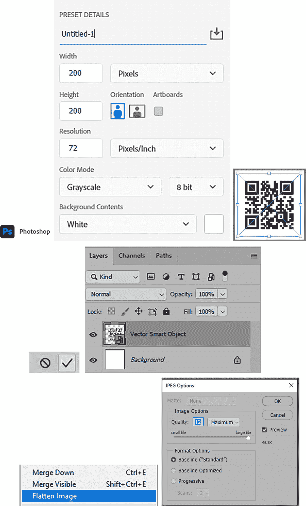
图 3-2 生成的 QR 码从 InDesign 添加到 Photoshop，进行缩放并保存，以用作 Acrobat 图章

通过“文件” ➤ “打开”，在 Acrobat Reader 或 Acrobat Pro 中打开您计划在其中添加 QR 码的 PDF 文件。参考图 3-3。

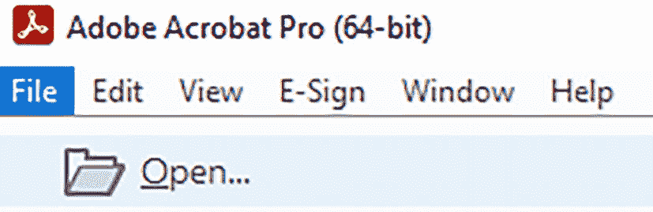
图 3-3 “文件”菜单中的“打开”项

定位并选择您要打开的 PDF 文件。

在“工具”菜单的“共享与审阅”部分中，单击“图章”按钮。参考图 3-4。

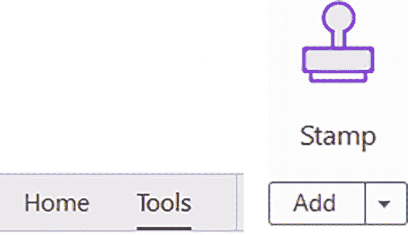
图 3-4 “图章”工具

选择“自定义图章”选项。从下拉菜单中选择“创建”。参考图 3-5。

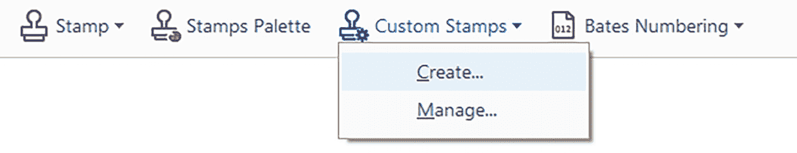
图 3-5 “图章”工具菜单

创建自定义图章。当您选择此选项时，将会出现“为自定义图章选择图像”对话框。单击“浏览”按钮以定位您的文件。参考图 3-6。

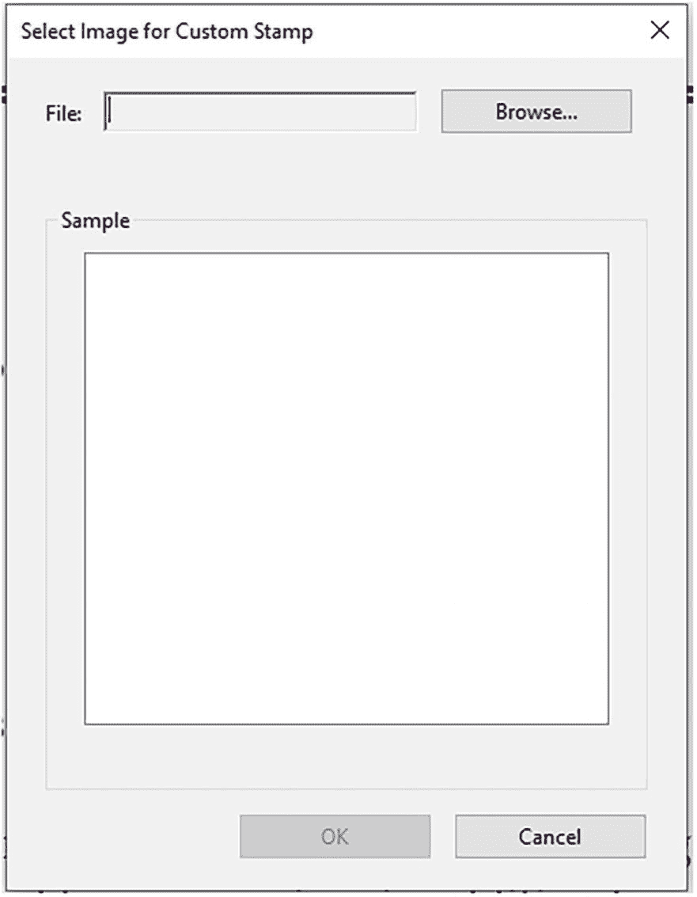
图 3-6 “为自定义图章选择图像”对话框

在 Acrobat Pro 中，您可以浏览并使用多种不同的文件格式，包括 JPEG、TIFF、GIF 和 PNG。查看“所有支持的格式”列表以了解您的选项。参考图 3-7。

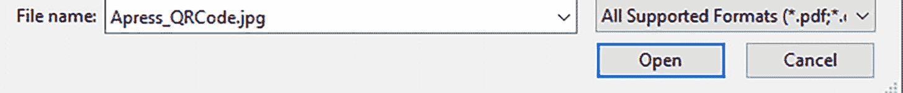
图 3-7 浏览并选择 QR 码

在这种情况下，请选择您或您的平面设计师已创建的二维码的 JPEG 图片。如果您没有文件，可以使用我的文件 `Apress_QRCode.jpg`。

点击 `Open` 按钮，您将返回到上一个对话框，此时会显示文件链接。请参考图 3-8。

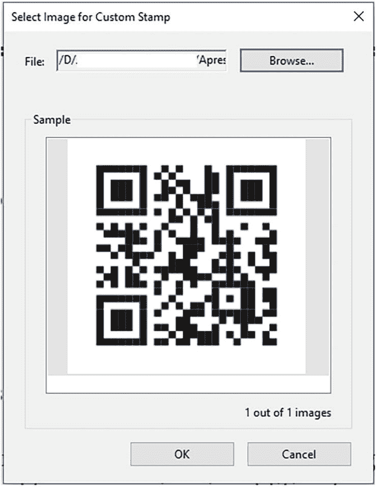
图 3-8 显示二维码的 `Select Image for Custom Stamp`（选择自定义图章图像）对话框

如果您对图像的外观满意，请点击 `OK`。否则，请浏览以选择另一张图像。您可能需要在 Photoshop 等程序中进行微调，以调整间距，减小或增大尺寸。如果这样做，请确保保持形状为方形，并且不要扭曲二维码。例如，在新版 Photoshop 中，缩放时按住 `Shift` 键可能会导致变形。现在，请使用我的图像并点击 `OK` 以继续下一个对话框。

在可以使用自定义图章之前，Acrobat 需要您为图章选择一个文件夹类别并为其命名。您可以通过在 `Category`（类别）下拉列表中输入名称来创建一个新文件夹，或者从当前可用的文件夹中选择。请在此处参考图 3-9。

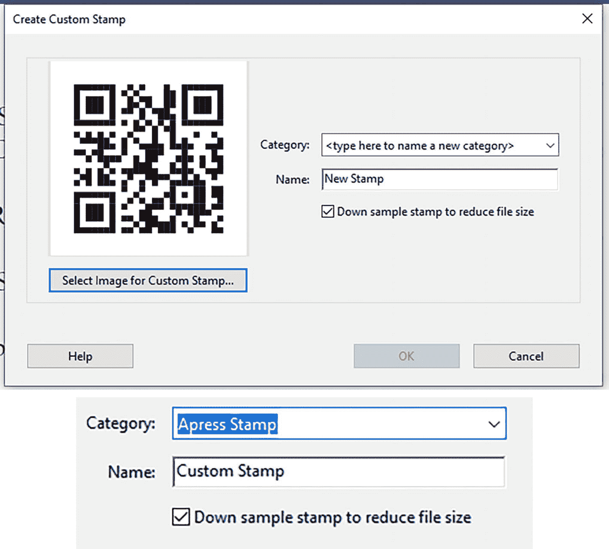
图 3-9 `Create Custom Stamp`（创建自定义图章）对话框

您可以选择对图章进行降采样以减小文件大小。对于二维码，为了保持质量，我可能会取消勾选此选项。在这种情况下，文件大约只有 45KB，并不大。完成后，点击 `OK` 将该图章添加到您的收藏中。

> **注意：** 如果您对创建图章还有其他疑问，`Help Button`（帮助按钮）链接可以为您提供指导，并将带您转到以下页面：

[`https://helpx.adobe.com/acrobat/using/adding-stamp-pdf.html#create_a_custom_stamp`](https://helpx.adobe.com/acrobat/using/adding-stamp-pdf.html#create_a_custom_stamp)

## 使用图章工具

图章已创建。当您仍在 `Stamp`（图章）工具中时，可以转到 `Stamp` 下拉菜单中的文件文件夹，然后选择您的新自定义图章。请参考图 3-10。

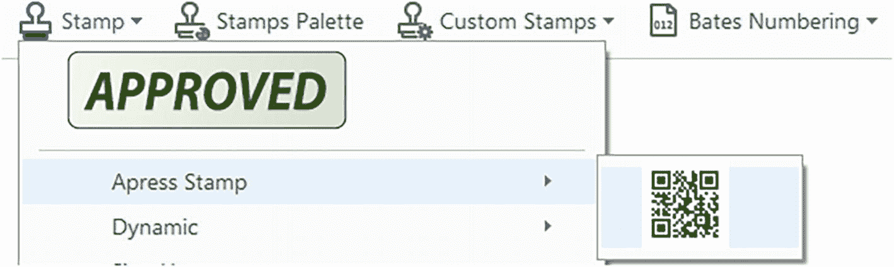

一张截图显示了图章、图章面板、自定义图章以及 Bates 编号的三个图章图标，后面是一个 `Approved`（已批准）按钮。它有一个选项列表，其中选择了 `Apress stamp` 选项，页面右侧有一个二维码。

**图 3-10** 在 `Stamp`（图章）菜单中创建的二维码图章

此时，可能会弹出一个对话框，要求进行初始身份设置。这样做是为了让客户知道出于安全考虑是谁进行了此批准图章的盖章。您不必填写所有框。完成后，点击 `Complete`（完成）按钮。您只需为您的新图章进行一次身份设置。如果您没有看到此框，则可能意味着您或其他人已经设置好了此项。您可以在 `Edit`（编辑）➤ `Preferences`（首选项）➤ `Categories: Identity`（类别：身份）下进行检查，并在此处调整您的信息。如果需要检查设置，请参考图 3-11。

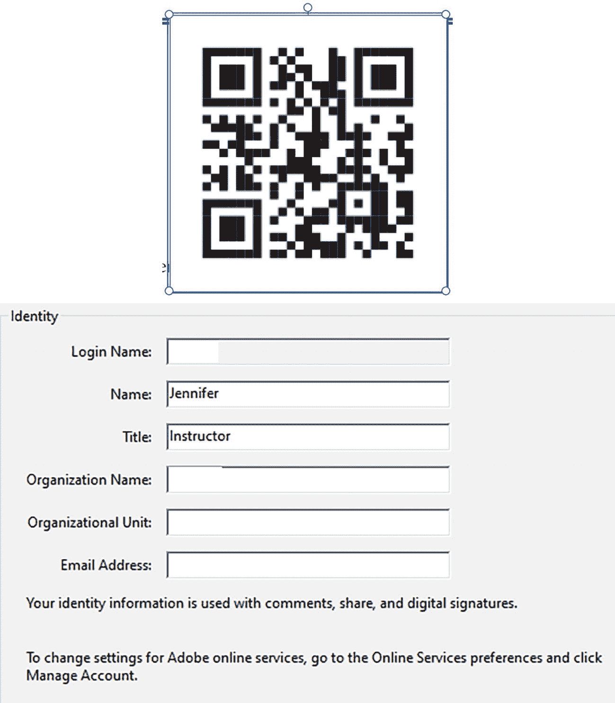

一张页面截图显示了一个选中的二维码，后面是一个身份设置框。它有用于输入登录名、姓名、头衔、组织名称、组织单位和电子邮件地址的文本框。

**图 3-11** 在 `Preferences`（首选项）中找到的新图章身份设置

此时，鼠标光标将变为图章形状。您可以在页面上移动它，直到找到您想要放置图章的位置。单击鼠标按钮，图章即被放置。如果您不喜欢放置的位置，可以移动它。鼠标将变为四个箭头。如果在图章上按住鼠标图标，您可以使用边界框手柄来移动图章、旋转（上方的圆形）或缩放它。使用 `Edit`（编辑）➤ `Undo`（撤销）或 `Ctrl/Cmd+Z` 来撤销缩放或旋转。

如果稍后因某种原因需要删除图章，请在 `Stamp`（图章）工具中，转到 `Custom Stamps`（自定义图章）➤ `Manage`（管理）对话框，然后点击 `Delete`（删除）以从您的自定义列表中移除选中的图章。请参考图 3-12。

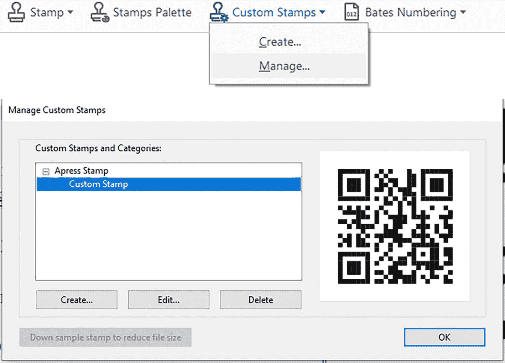

一张截图显示了选中了 `custom stamps`（自定义图章）选项，该选项带有“创建”和“管理”两个选项，其中选择了 `manage`（管理）选项。它有一个用于自定义图章和类别的框，底部有“创建”、“编辑”和“删除”三个按钮，页面右侧有一个二维码。

**图 3-12** `Stamp Tool`（图章工具）菜单和 `Manage Custom Stamps`（管理自定义图章）对话框

> **注意：** 在此对话框中删除自定义图章是没有撤销设置的。如果您误删了，请点击 `OK`，然后再次添加自定义图章以及被删除的文件夹。此对话框还允许您创建和编辑当前选中的图章类别。请参考图 3-9。`Stamps Palette`（图章面板）子工具也可以帮助您访问自定义图章。请参考图 3-12。

如图 3-13 所示，自定义二维码图章也可以附加评论。您可以在 `Comment`（评论）工具部分附加评论。

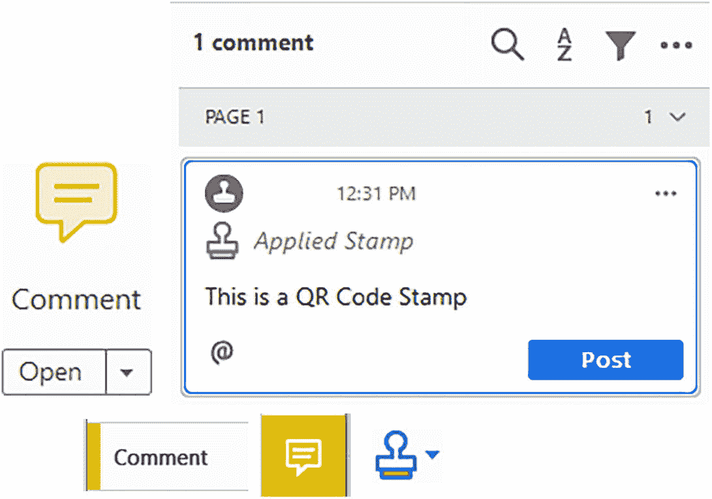

一张截图在页面右侧有一个评论图标和一个打开的框。它有一个带有应用图章图标的评论，文字为“这是一个二维码图章”，后面有一个“发布”按钮。页面底部有一个带有图章图标的评论图标。

**图 3-13** 带有 `Add Stamp`（添加图章）子工具的 `Comment`（评论）工具

现在您的评论列表中有一个图章评论。您可以在此处通过双击评论，为评论添加更多关于图章的信息，然后点击 `Post`（发布）。如果需要删除页面上的二维码图章，只需选中它，然后按键盘上的 `Delete` 按钮，或者右键单击并从弹出列表中选择 `Delete`。如果需要撤销删除，也可以使用 `Ctrl/Cmd+Z`。

您可以按需要将此二维码图章添加到文档中的多个位置。完成后，点击 `Close`（关闭）按钮退出 `Stamp`（图章）或 `Comment`（评论）工具。请参考图 3-14。

一张椭圆形按钮的截图，上面写着“关闭”。

**图 3-14** 关闭当前工具以退出

> **提示：** `Comment Tool`（评论工具）也有一个 `Add Stamp`（添加图章）子工具，带有一个下拉菜单，可以让您访问自定义图章，而无需再次进入 `Stamp`（图章）工具。请参考图 3-13。

然后保存文件，并通过电子邮件将文件发送给客户端，或者将其发布在您的网站上。

如果您需要打印文档（`File`（文件）➤ `Print`（打印）），请在 `Print`（打印）对话框中的 `Comments & Forms`（注释和表单）下选择 `Document and Stamps`（文档和图章）或 `Document and Markups`（文档和标记）选项。如果您只选择 `Document`（文档）或 `Form fields only`（仅表单域）选项，二维码图章将不会被打印。请参考图 3-15。

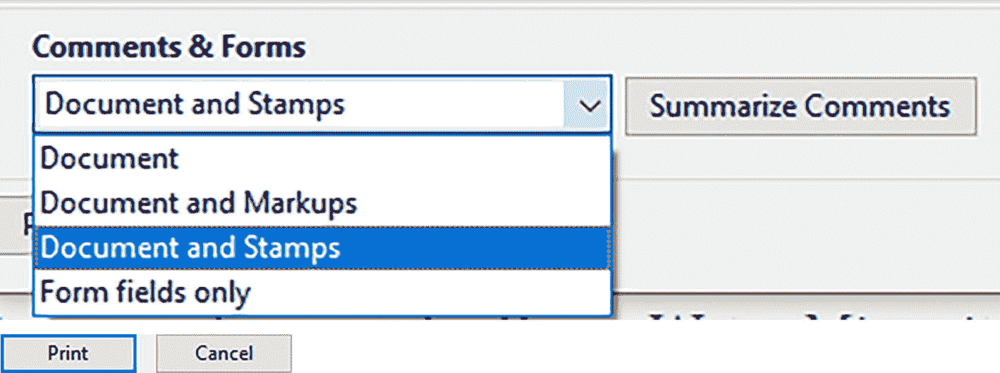

一张关于“注释和表单”的框的截图，其下拉菜单被选为“文档和图章”。它有一个位于框右侧的“汇总注释”选项卡，以及页面底部的“打印”和“取消”两个选项，其中“打印”被选中。

**图 3-15** 图章的打印设置。选择 `Document and Stamps`（文档和图章）将确保二维码图章被打印出来

## 最终思考：用于专业打印的二维码

如果你计划向公司发送简历或简报，并希望确保无论打印文档设置如何二维码都能正常打印，我建议你在 MS Word 这样的程序中输入你的简历/简报，然后选择要放置二维码的位置。接着在菜单中，依次选择 **插入** ➤ **图片** ➤ **此设备**，然后在电脑上找到、选中并插入该文件。请参考图 3-16。

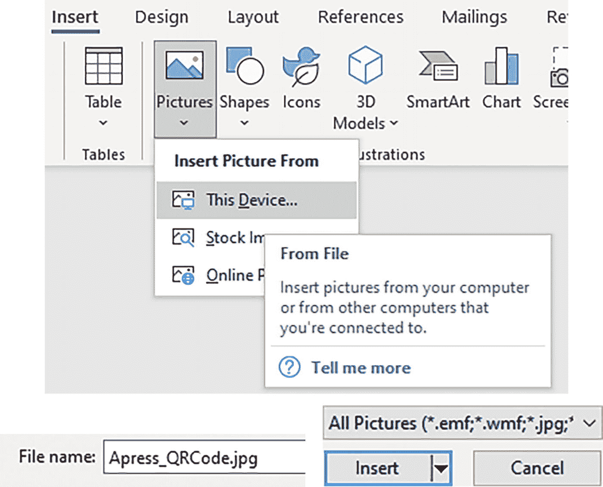

Word 主菜单截图显示“插入”选项已被选中。其中有多个插入选项，“图片”被选中，接着是图片位置的 3 个选项，“此设备”被选中。页面底部有一个用于输入文件名的文本框，其后是“插入”按钮。

**图 3-16** – 在 MS Word 中插入图片

找到你的 JPEG 图片，然后点击 **插入** 按钮。图片将被插入。最后，保存文件并将文件打印为 PDF，或使用第 1 章中提到的 **Acrobat** 选项卡。这将确保二维码嵌入文档中，并与简历的其余部分一起打印。

## 本章小结

在本章中，你学习了如何将二维码转换为自定义图章，以便在任何 PDF 文档的表单中使用。该图章还可以修改和缩放，并且可以添加注释。

通过这种方式创建二维码，而不仅仅作为表单字段，可以实现更广泛的应用。

有关如何在 Adobe InDesign 中创建二维码的更多信息，请访问 [`https://helpx.adobe.com/indesign/using/generate-qr-code.html`](https://helpx.adobe.com/indesign/using/generate-qr-code.html)。
