# 4. 按钮、导航、表单与非表单操作

**章节目标：** 你将学习如何为按钮创建适用于表单和非表单活动的操作，以及如何通过基础操作改进文档内的导航。

在第 2 章中，你看到了一些使用按钮创建操作的简单示例。现在你将重点关注更多操作。本章将完成以下内容：

- 审查各种字段和非表单项目中的“操作”选项卡属性
- 研究无需编码的内置触发器和操作
- 将所学内容应用于页面导航的按钮
- 使用按钮图标而不仅仅是文本
- 理解按钮如何成为帮助图标，以在订单表单中显示或隐藏信息
- 理解复选框如何与重置按钮结合以显示或隐藏信息
- 使用 PDF 图层、书签和按钮

> **注意：** 如果你想跟随本课程实操或查看最终结果，请从引言中的链接下载第 4 章的文件。标签为“开始”的文件是不含代码的文件，标签为“结束”的文件是最终结果。你还会找到包含原始 MS Word、PDF 及相关 InDesign/Illustrator 文件的文件夹（如果你想进行编辑），以及一个包含按钮图标原始图片的文件夹（如果你想将它们添加到自己的 PDF 表单中）。

要查看字段的属性，必须选择 **准备表单** 工具。只有这样，才能右键单击或双击某个字段来查看其属性。

如果你是从不包含表单字段的原始 PDF 创建表单，请参考第 1 章中的“表单回顾”部分。

## 创建按钮图标

并非所有按钮都必须是文本；你也可以使用文本和图像，或者仅使用你在 Adobe Photoshop 或 GIMP 等程序中创建的图像。与第 3 章中的二维码图章示例一样，文件可以是多种格式，包括 JPEG、GIF 或 PNG。

在本示例中，你可以参考 `Newsletter_1_Navigation` 的“开始”和“结束”PDF 文件。在结束文件的第 1 页，查看 **下一页** 按钮以了解其属性。当前，在 **选项** 选项卡的 **布局** 部分，它被设置为“仅标签”，因此只能在 **标签** 字段中输入标签名称。**图标** 和 **高级** 区域已禁用，尽管你可以将 **行为** 设置从 **反转** 更改为 **无**、**按下** 或 **轮廓**。我们将在本章后面讨论 **行为** 设置如何影响图标和标签状态。请参考图 4-1。

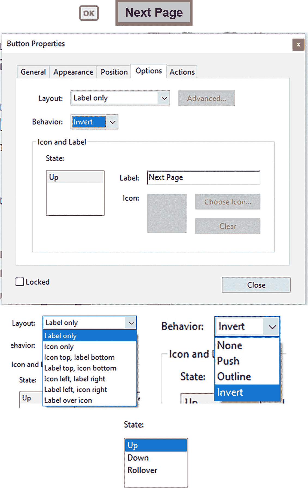

按钮属性页面截图显示了用于常规、外观、位置、选项和操作的 5 个选项卡，其中“选项”选项卡被高亮显示。它有一个下拉菜单用于布局（仅标签），行为设置为反转，状态为向上。页面底部放大了三个选项。

**图 4-1** – **选项** 选项卡，**选择图标** 按钮处于禁用状态

但是，如果在 **选项** 选项卡中将布局更改为包含 *图标* 一词的其他选项，那么你可以访问 **选择图标** 按钮，通过 **选择图像** 对话框定位图像。选择图像后，图标将显示其属性。本章后面你将看到一个 `TMC_Order Form` “结束”PDF 的示例。请参考图 4-2。

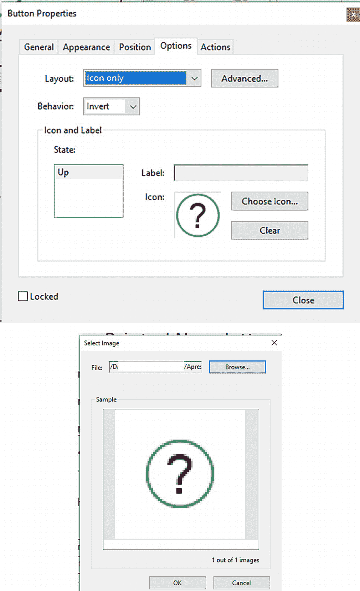

按钮属性页面截图显示了 5 个选项卡，其中“选项”选项卡被高亮显示。它有一个下拉菜单用于布局（仅图标），以及一个显示问号图标的图标框。它还有一个用于选择图像的弹出窗口，带有文件浏览选项和一个问号样本。

**图 4-2** – **选项** 选项卡，**选择图标** 按钮已启用，以及 **选择图像** 对话框

**布局** 列表允许你选择仅图标的布局设置，或者如果你想将图标与文本结合使用，也可以选择图标带标签的显示方式。

回顾一下，布局选项如下：

- 仅标签（此设置不允许添加图标）
- 仅图标（不能添加标签）
- 图标在上，标签在下
- 标签在上，图标在下
- 图标在左，标签在右
- 标签在左，图标在右
- 标签覆盖图标

选择图标布局后，可以点击 **高级** 按钮。点击 **高级** 按钮将打开 **图标放置** 对话框，你可以在其中精确调整图标在按钮内的位置。你可以设置 **缩放时机**（始终、从不、图标太大时、图标太小时）、**缩放方式**（按比例或非按比例）以及 **适合边界**。你还可以移动两个滑块来调整图标的放置位置，并将所有内容重置为原始设置（参考图 4-3）。点击 **确定** 以提交设置，或点击 **取消** 退出而不保存更改。

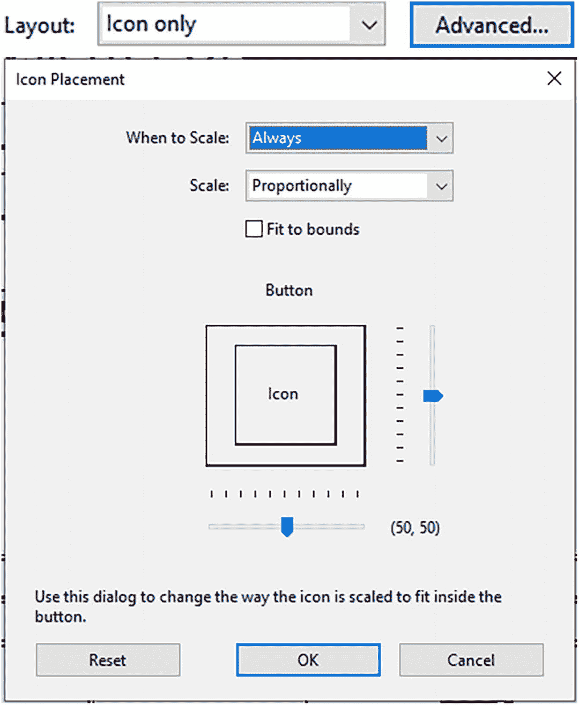

图标放置窗口截图显示了一个用于缩放时间的下拉菜单（已选“始终”）和一个用于缩放方式的选项（已选“按比例”）。它有一个按钮和图标两个方块，带有滑块，页面底部有一个“确定”按钮。

**图 4-3** – 在 **选项** 选项卡中点击 **高级** 按钮将打开 **图标放置** 对话框

### 仅作为标签的按钮示例

图 4-4 展示了在“Newsletter 1 Navigation”PDF 文件的“结束”文件第 1 页中，一个仅应用了标签的按钮示例。该按钮的标签显示“Next Page”，因为您希望用户在单击按钮时跳转到下一页。该标签是一个有用的提示，让用户知道单击按钮后会发生什么。此类按钮可用于任何包含三页或更多页面的文档中。

一张按钮截图，其中包含文字“next page”。

**图 4-4** 仅含标签的按钮

> **注意**  
> 当前状态为`Up`，这取决于按钮的行为，即`Invert`，或者单击时颜色会反转。`None`不产生颜色变化，而`Outline`仅反转按钮边缘的颜色。这些都有`Up`状态。

像`Push`这样的行为会提供其他状态选项，例如`Up`、`Down`和`Rollover`；您现在可以添加三个图标或标签，而不是一个。这将导致按钮在您激活每个状态时发生变化。某些选项见图 4-5。虽然标签和图标会改变，但您无法使用`Appearance`选项卡为每个状态设置不同的填充颜色。

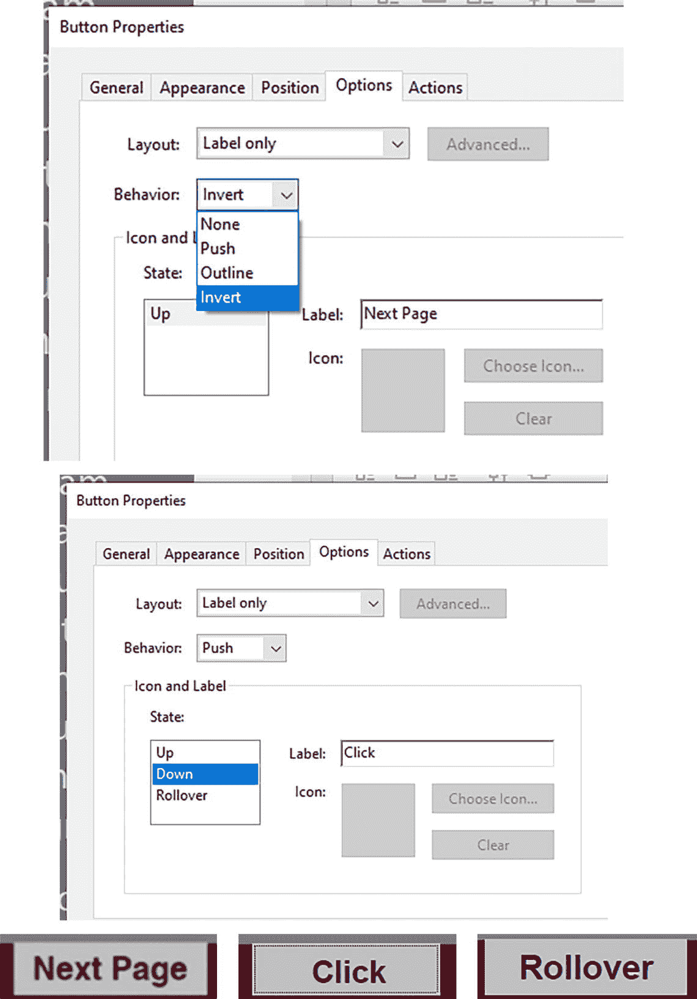

两张按钮属性截图，选中了`Options`选项卡。第一张图的行为下拉菜单为`Invert`，状态为`Up`，标签为“Next Page”。第二张图的行为为`Push`，状态为`Down`，标签为“Click”。页面底部有三个按钮，分别对应下一页、单击和悬停。

**图 4-5** 应用于按钮的各种行为和状态示例

### 仅含图标组合的按钮示例

图 4-6 展示了一个由三个按钮组成的按钮组示例，该按钮组包含图标图像并应用了一些操作。我们将在本章后面更详细地讨论这一点。然而，如果没有操作，这些按钮将独立运作，彼此之间不会交互。

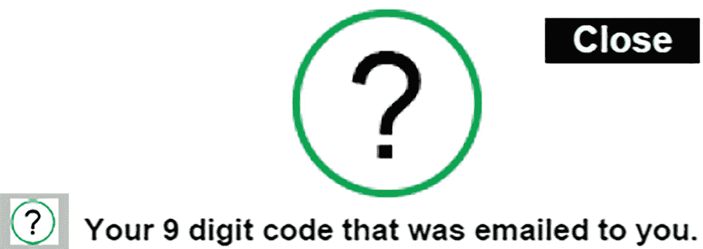

一张截图包含三个元素：一个问号图标、一个关闭按钮，以及一个由按钮和图标组成的组合，其后跟着一行文字：“寄送给您的 9 位数字代码”。

**图 4-6** 应用于 TMC 订单表单“结束”PDF 文件中每个按钮的显示和隐藏字段按钮组示例

如果您进入每个按钮的属性，您会看到，如图 4-7 所示，在`Actions`选项卡上设置了各种隐藏和显示操作，我们将在本章后面详细探讨。

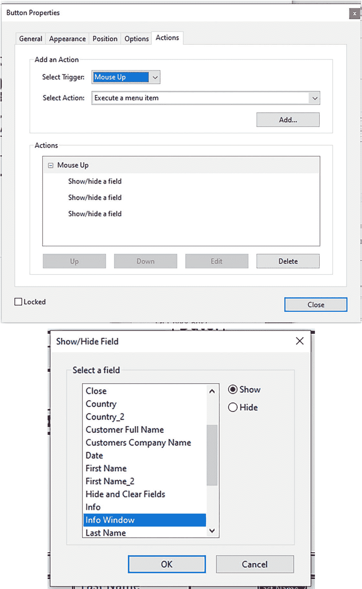

两张页面截图。第 1 页为按钮属性，有 5 个选项卡，其中选中了`Actions`选项卡。它有一个下拉菜单用于选择触发器为`Mouse Up`，操作为`Menu Item Execution`。第 2 页为`Show/Hide Field`对话框，显示了一个字段列表，其中选中了`Info Window`。

**图 4-7** 应用了显示和隐藏字段的按钮组示例

一旦选定，`Actions`选项卡中的所有操作可以如下进行：

- 使用`Add`按钮添加
- 使用`Up`和`Down`按钮重新排列
- 使用`Edit`按钮编辑
- 使用`Delete`按钮删除

> **注意**  
> 对于`Show/Hide`操作，您需要一次对一个字段应用该操作。某些操作，如`Reset`，允许您将操作应用于多个字段或集体应用。请参阅第 2 章的图 2-28。

## 非表单属性操作

以下各节简要介绍您可以应用操作且不属于表单的属性类型。

### 页面

对于此示例，请参考“Newsletter 1 Navigation”PDF 文件的“结束”文件，或使用“开始”文件进行练习；见图 4-8。

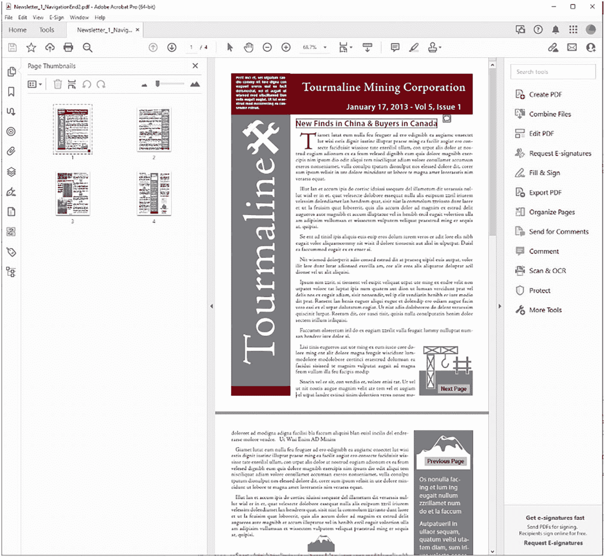

一张 PDF 简报截图，有 3 个选项卡，其中选中了`Navigation`选项卡。窗口左侧有 4 个页面缩略图选项。中间面板是简报的布局格式，页面右侧有 PDF 文件的不同选项。

**图 4-8** 访问页面缩略图

在`View` ➤ `Show/Hide` ➤ `Navigation Panes` ➤ `Page Thumbnails`下，您会在 Acrobat 左侧找到当前文档的所有页面缩略图。

在缩略图区域中选择一个页面（例如第 1 页），然后从`Options`下拉菜单底部选择`Page Properties`以访问此对话框。接着单击`Actions`选项卡（参见图 4-9）。

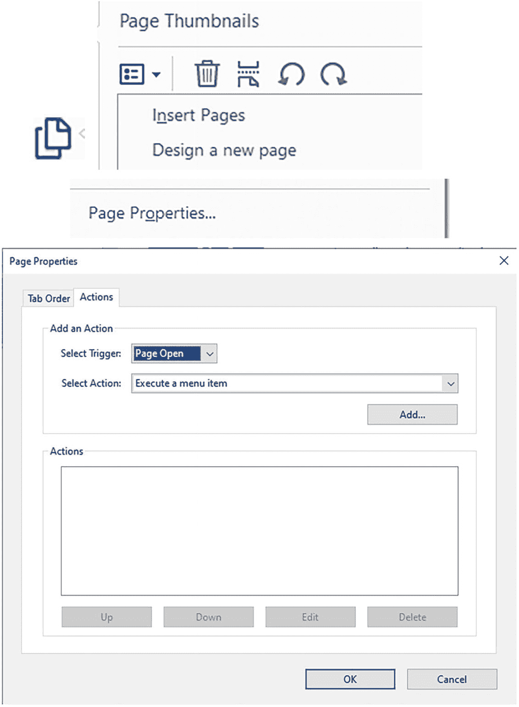

一张页面属性截图，有`Tab Order`和`Actions`两个选项卡，其中选中了`Actions`选项卡。它有两个下拉菜单，用于选择触发器为`Page Opens`，操作为`Execute a Menu Item`，随后是一个操作文本框，页面底部有一个“确定”按钮。

**图 4-9** `Actions`选项卡上的`Page Properties`选项

页面可以应用操作以改进导航。我们稍后将在表单中更详细地查看触发器，它可以是`Page Open`或`Page Close`。但是，并非我们即将回顾的所有选定操作都与页面属性兼容，因此您可能需要花些时间规划哪种操作是合适的，例如在到达该页面时执行`Edit` ➤ `Find`对话框或播放声音。请记住，您可以在 Acrobat 左侧的`Page Thumbnail`部分访问此区域。或者，当没有其他菜单项处于活动状态时，您可以右键单击缩略图并从列表中选择`Page Properties`。参见图 4-10。

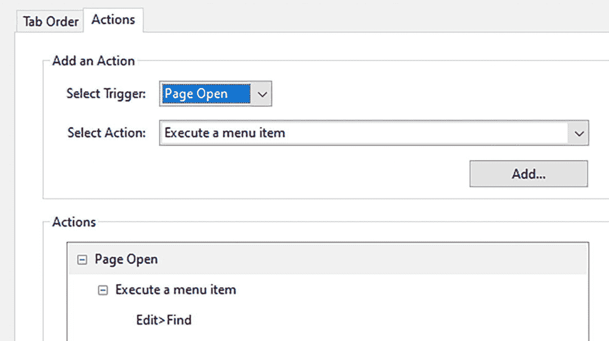

一张页面截图，有`Tab Order`和`Actions`两个选项卡，其中选中了`Actions`选项卡。它有两个下拉菜单，用于选择触发器为`Page Opens`，操作为`Execute a Menu Item`，随后是一个包含操作文本框的选项列表。

**图 4-10** `Actions`选项卡上的`Page Properties`选项，显示了针对该特定选定页面可能应用的操作

一旦您选择了操作，便可以单击`OK`确认或退出取消。参见图 4-9。

## 书签

在本示例中，请参考 `Newsletter 1 Navigation End PDF` 文件。

在 `视图 ➤ 显示/隐藏 ➤ 导航面板 ➤ 书签` 下，你会在 Acrobat 左侧找到当前文档的所有书签（参考图 4-11）。

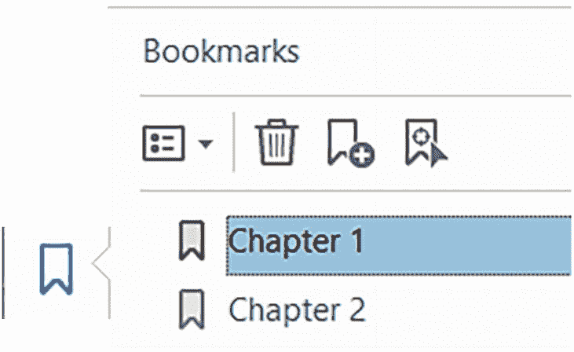

**图 4-11** – 导航面板区域中 Newsletter 文件内的书签

在 Acrobat Pro 中，当你选定文档中的文本，然后点击 `添加新书签` 图标时，即可轻松创建书签。

在此示例中，选择一个书签，然后从列表底部的 `选项` 菜单中选择 `属性`。当你点击 `动作` 选项卡时，这将允许你添加或查看该书签的动作（参考图 4-12）。

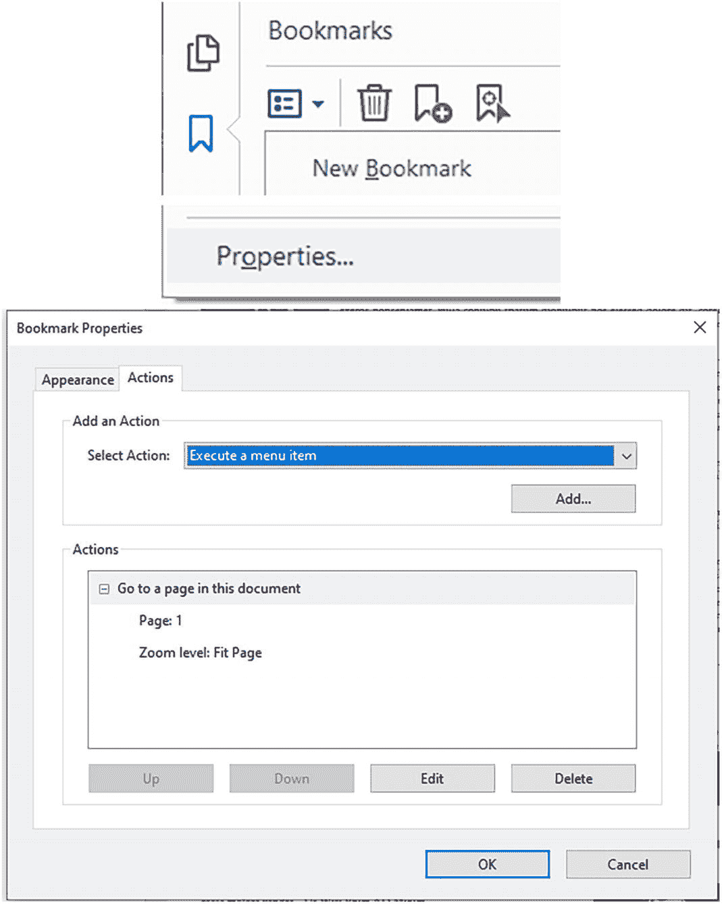

**图 4-12** – `动作` 选项卡上的书签属性

请记住，你可以在 Acrobat 左侧的 `书签缩略图` 区域访问此界面。或者，你可以右键点击一个书签，然后从列表中选择 `属性`。

在此示例中，`添加动作` 区域显示该书签没有触发器。假设点击书签即为触发器。书签的主要目的是导航到某个页面。在这种情况下，创建书签时，它被设置为默认的选择动作 “转到此文档中的页面”，目标为第 1 页。`缩放` 级别通过对话框设置为 `适合页面`。选择该动作并点击 `编辑` 按钮即可查看选项，并在需要时编辑 `缩放` 选项。参考图 4-13。

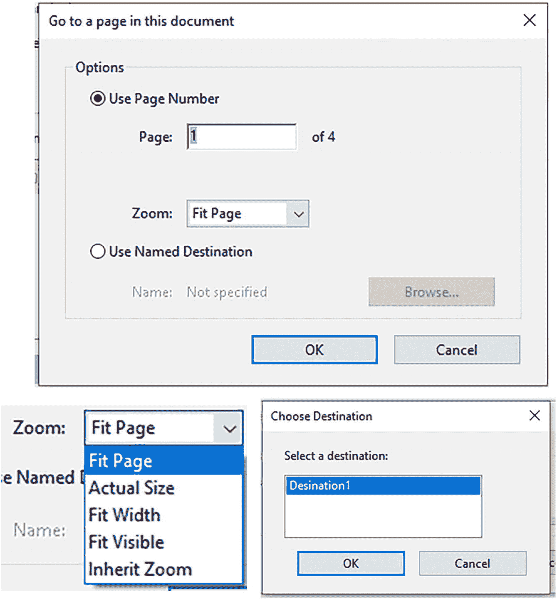

**图 4-13** – “转到此文档中的页面”对话框

或者，你可以设置一个命名目标。你会在文件的第 3 页找到一个示例，可以通过点击 `浏览` 按钮来选择它。然后选择一个并点击 `确定` 确认。如果需要找到此选项，请查看左侧的 `目标` 区域。选择 `视图 ➤ 显示/隐藏 ➤ 导航面板 ➤ 目标`。详情请参考图 4-13 和图 4-14。

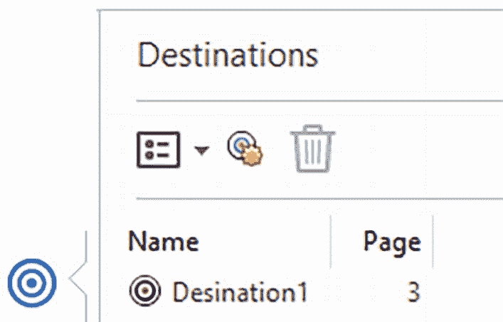

**图 4-14** – 缩略图区域中设置了一个页面的命名目标

目标可以像书签一样被创建和命名。当选定某些文本后，你可以点击 `创建新目标` 按钮。它们本身不包含任何动作或属性，因此必须与书签结合使用以实现更好的导航。

## 网页和自定义超链接

在本示例中，请参考 `Newsletter 1 Navigation PDF End PDF` 文件。

你可以在 `工具 ➤ 编辑 PDF ➤ 链接 ➤ 添加/编辑网页或文档链接` 下访问此区域。如果某个特定页面上已存在高亮链接，它将显示在一个框内。如果没有，你可以从菜单中选择此选项，然后拖拽以高亮选定一段文本，以便对其应用超链接。例如，尝试在 `“开始”` 文件的第 4 页，使用此工具并设置时，高亮显示公司名称（参考图 4-15）。

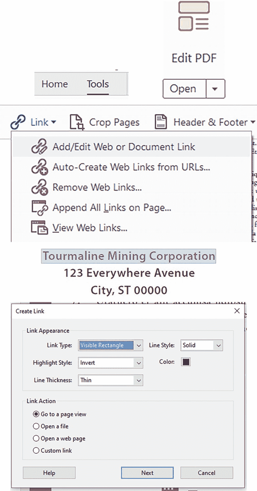

**图 4-15** – 选择自定义链接时访问链接属性

在 `创建链接` 对话框中，你可以选择链接外观，以便用户看到应用的 `链接类型`、`高亮样式`、`线条粗细`、`线条样式` 和 `颜色` 设置。然后设置一个链接动作，可选类型有：`转到页面视图`、`打开文件`、`打开网页` 或 `自定义链接`。然后点击 `下一步`（见图 4-15）。根据所选动作，链接对话框将为你呈现不同的选项。对于自定义链接，你将被带到 `链接属性`，在那里你可以从 `动作` 选项卡上的菜单中选择一个自定义动作，该动作将在你点击链接时触发。参考图 4-16。

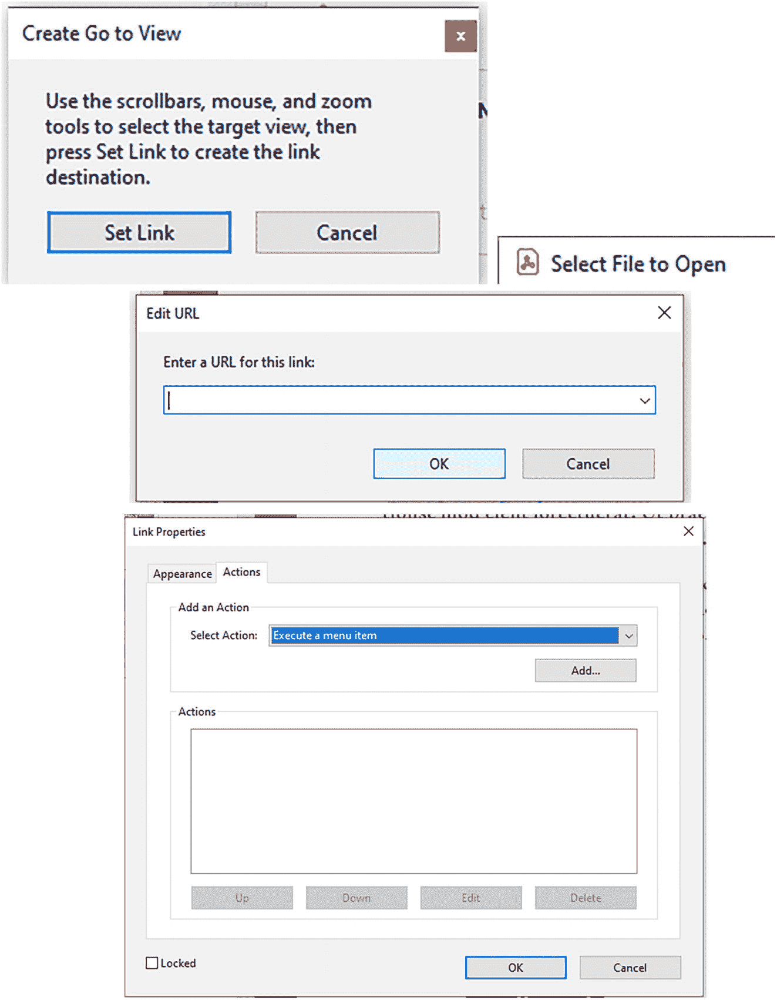

**图 4-16** – 在 `动作` 选项卡上访问链接动作和属性

在这里，我设置了一个自定义链接来执行一个菜单项，点击 `添加` 以显示附件的缩略图（`视图 ➤ 显示/隐藏 ➤ 导航面板 ➤ 附件`），然后点击 `确定`。动作现已应用。参考图 4-17。

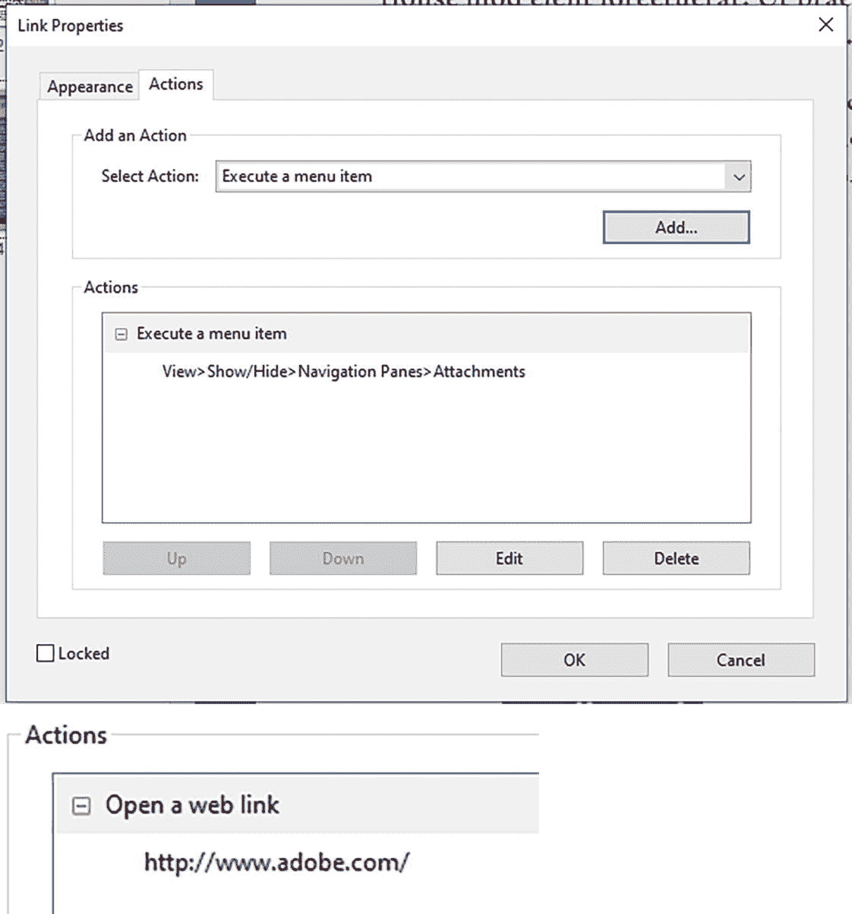

**图 4-17** – 在 `动作` 选项卡上访问链接动作和属性

或者选择一个动作，比如“打开一个网页链接”，如第 1 页所示。参考图 4-17。

如果我在 `编辑 PDF 工具` 的 `添加/编辑链接` 选项下需要编辑此自定义链接，我可以右键点击该链接，从列表中选择 `属性`，选择要编辑的动作，然后删除旧动作。参考图 4-17 和图 4-18。

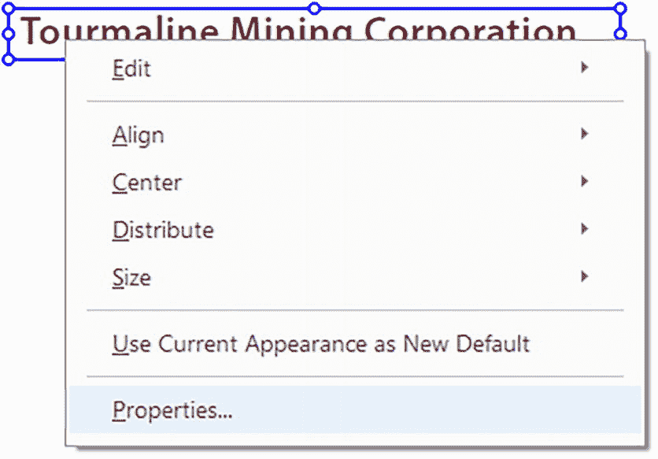

**图 4-18** – 通过右键点击链接来访问链接动作和属性

然后你可以在右上角点击 `关闭` 按钮退出 `编辑 PDF` 工具并保存文档。

或者，在 `编辑 PDF` 工具之外，你可以通过右键点击链接并选择 `编辑链接` 来选定该链接（参考图 4-19）。

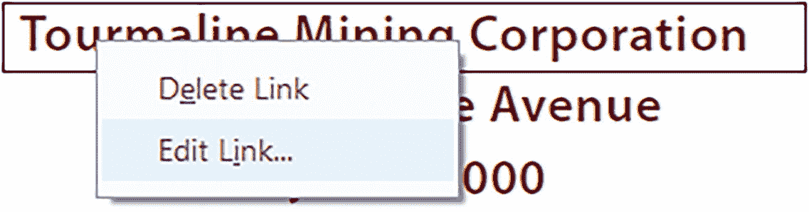

