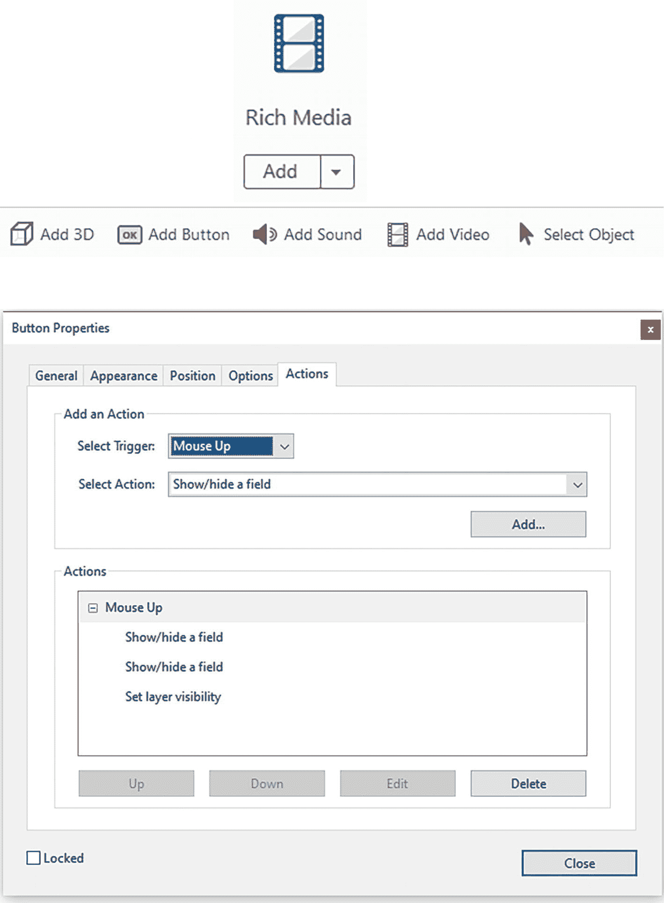

# 截图中有一个被选中的地图，附带一个问号地图图标，紧接着是一条注释，内容为“在附件中查找另一张地图”。页面左下角有一个附件列表，其中地图 1 被选中，右侧有一个选项列表，其中 `open attachment` 选项被选中。

**图 4-20**  

为图形添加自定义超链接操作，以便在 PDF 文件中定位附件

**提示**  

如果在某些链接操作上需要更清晰的说明，可以点击“创建链接”对话框中的 `Help` 按钮（`https://helpx.adobe.com/acrobat/using/links-attachments-pdfs.html`）。请参考图 4-15。

## 富媒体非表单导航按钮

此示例请参考名为“Floor Plan Layout 'End'”的 PDF 文件。

按钮可以通过 `Prepare Form` 工具或 `Rich Media` 工具添加（请参考图 4-21）。

