# 5. 简化字段符号和 JavaScript 简介

**本章目标：** 在本章及第二部分的下一章中，您将首先探索 Excel 中使用的简化字段符号 (`SFN`)，并将其与 `JavaScript` 进行比较。这将为您后续学习奠定基础。

本章将首先介绍在 Acrobat Pro 表单域的哪些位置可以输入 `SFN` 和 `JavaScript`。

在后续章节中将使用的 `JavaScript` 仅用于表单或文档内的导航，其复杂程度远不及程序员用于软件或 Web 开发的 `JavaScript`。那是本书未涉及的另一个主题。您主要将关注可用于在 Acrobat Pro 中改进表单的简单数学公式，以及客户会在 Reader 中使用的公式。

> **注意：** 本章不涉及任何文件，因此无需为本课程下载任何文件。

## 入门

在后续课程中，您将提供的文本文件（`.txt`）中复制代码，并将其粘贴到正确的对话框区域，然后对代码进行少量修改。

以下是 Acrobat Pro 中 `JavaScript` 的一些常见用途：

- 交互与添加水印、书签、链接和注释
- 自动填写表单域
- 当用户在其他域中输入导致信息本身发生变化时，更改文本域中信息的显示外观
- 文档导航，例如缩放和转到特定页面
- 文档打印
- 控制安全设置、签名和自定义验证
- 协助“动作向导”以加速任务

可以在以下域的属性选项卡和工具中找到 `JavaScript` 输入位置：

- **文本、日期和下拉列表**：操作（运行 `JavaScript`）、格式自定义（自定义格式脚本和自定义按键脚本）、验证（运行自定义验证脚本）、计算（自定义计算脚本）。
- **复选框、单选按钮、图像域和按钮**：操作。
- **列表框**：操作和选项更改（执行此脚本）。
- **数字签名**：操作和已签名（此脚本在签署域时执行）。
- **条形码**：操作和值（自定义计算脚本）。
- **`JavaScript` 工具**：所有 `JavaScripts` (全局)、文档 `JavaScripts` 和文档操作。
- **动作向导**：将在第 15 章中介绍“新建动作”和“新建自定义命令”子工具。
- 请记住，“操作”选项卡也可用于页面、书签和超链接，但本书剩余部分将主要关注表单域和按钮。

## 文本域、日期和下拉列表属性

以下各节提供了向这些域选项卡添加 `JavaScript` 的示例。

### “操作”选项卡

操作在进入或退出域时发生，如图 5-1 所示。

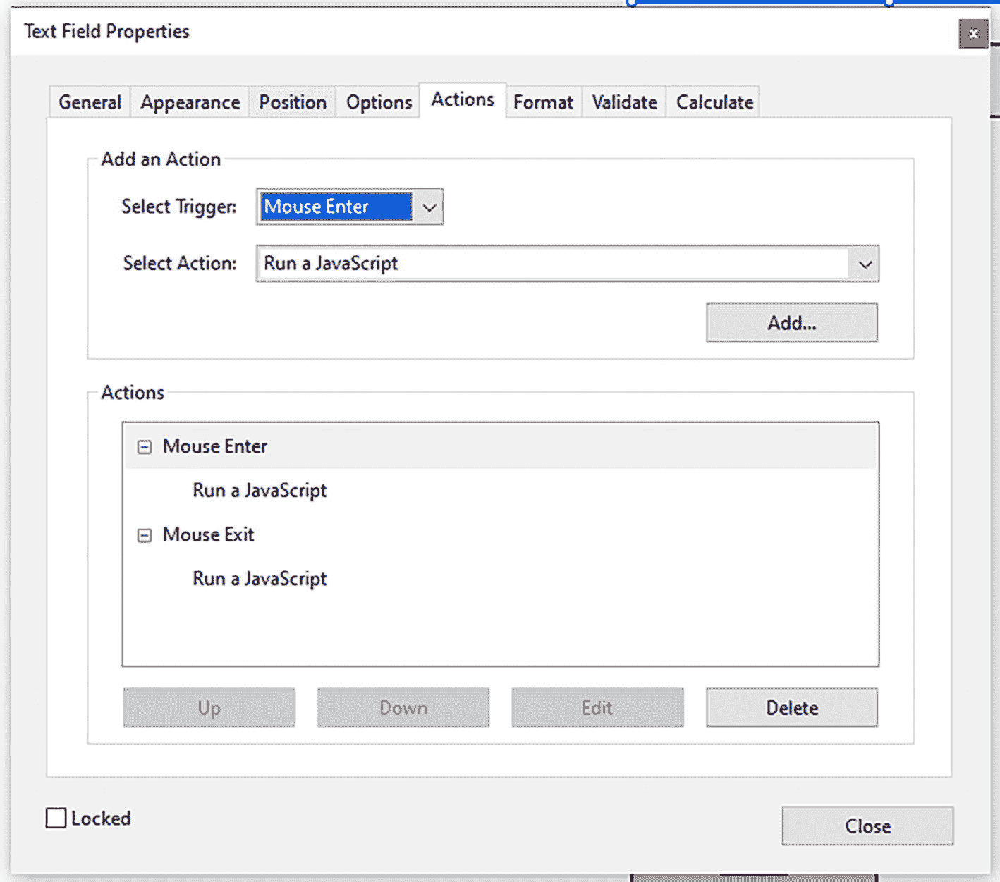

文本域属性对话框的截图，列出了“操作”下的选项，其中包含“添加操作”（包括选择触发器和操作）以及已有的操作。

**图 5-1** “文本域属性”对话框中的“操作”选项卡

### “格式”选项卡

自定义格式允许更改文本颜色，如图 5-2 所示。自定义按键允许在达到特定条件时，域内发生的事件发生变化。

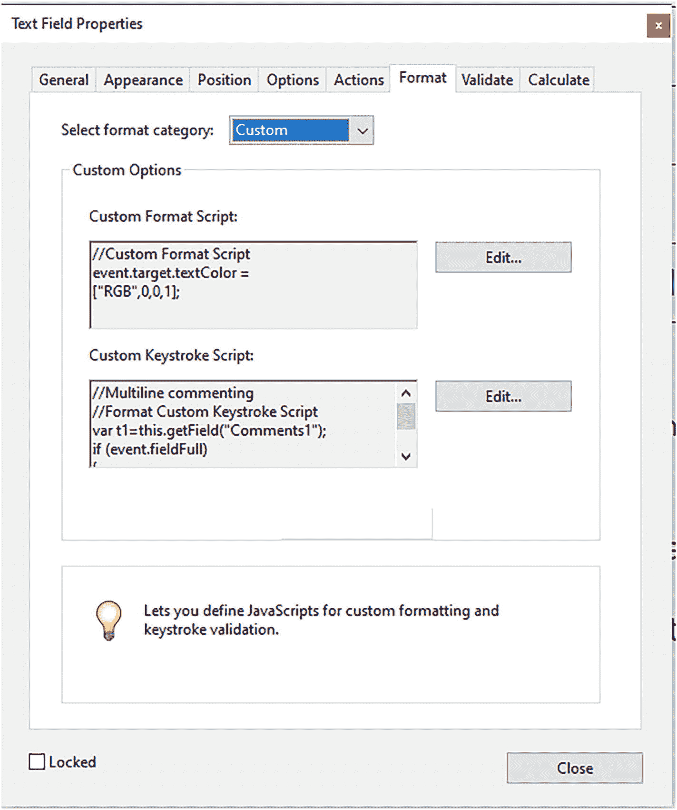

文本域属性对话框的截图，列出了“格式”下的选项，其中“选择格式类别”为“自定义”，并包含“自定义格式脚本”和“自定义按键脚本”。

**图 5-2** “文本域属性”对话框中的“格式”选项卡

### “验证”选项卡

与自定义格式类似，在“验证”选项卡上，会检查某些特定条件，并且必须满足这些条件才能继续，如图 5-3 所示。

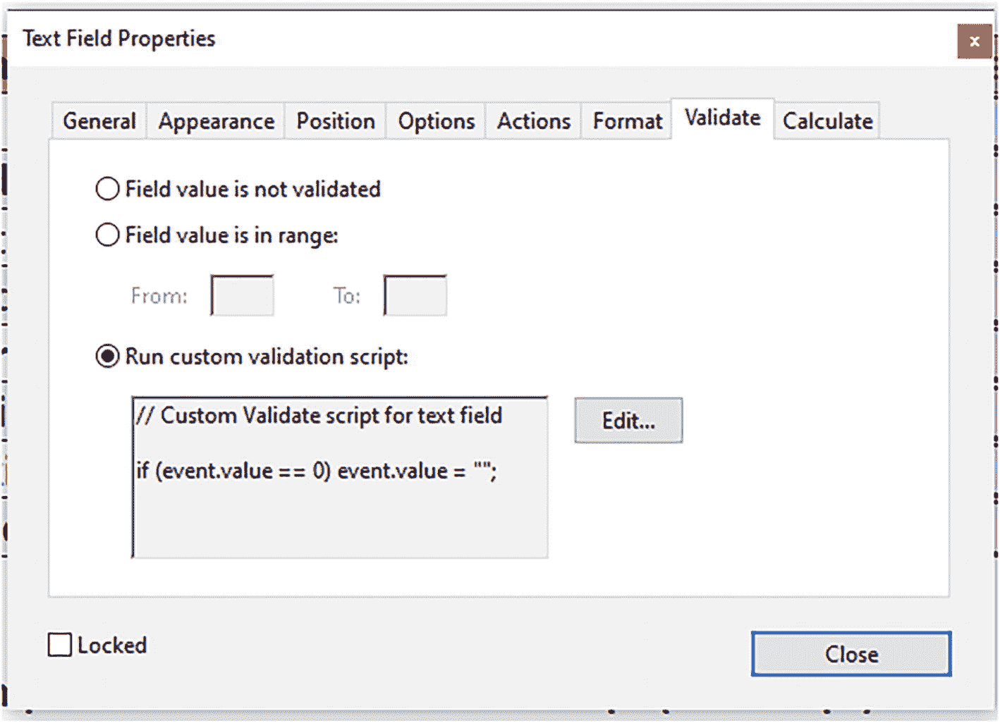

文本域属性对话框的截图，列出了“验证”下的选项，包含三个单选按钮：“域值未被验证”、“域值在范围内”以及选中的“运行自定义验证脚本”。

**图 5-3** “文本域属性”对话框中的“验证”选项卡

### 计算选项卡

“计算”（`Calculate`）选项卡提供了无法通过 `SFN` 或 `Value` 实现的`自定义计算`，如图 5-4 所示。这是唯一可以输入 `SFN` 的选项卡。

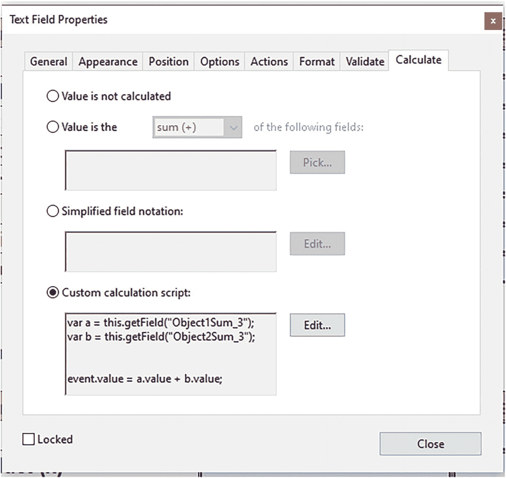

文本字段属性对话框的截图，列出了“计算”（`calculate`）下的选项，包含四个单选按钮：“值不计算”、“字段的值”、“简化字段表示法”和一个被选中的“自定义计算脚本”。

**图 5-4** “文本字段属性”对话框中的“计算”（`Calculate`）选项卡

### 复选框、单选按钮、图像字段和按钮属性

包含图像字段的复选框、单选按钮和常规按钮，如果需要，可以用作可见或隐藏字段来触发计算，如图 5-5 所示。

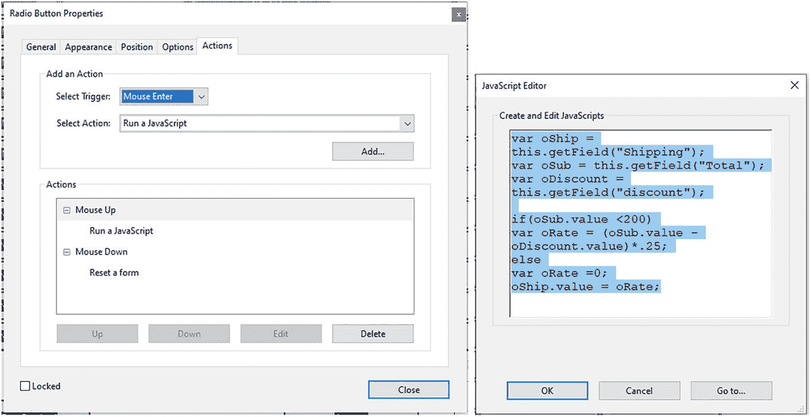

两张截图。左侧是“单选按钮属性”对话框，列出了“操作”下的选项，包含“添加操作”和“操作”。右侧是“`JavaScript` 编辑器”对话框，包含“创建和编辑 `JavaScript`”字段。

**图 5-5** “单选按钮属性”对话框中的“操作”（`Actions`）选项卡是唯一可以添加操作的选项卡。复选框和常规按钮也是如此。

### 列表框属性

除了“操作”（`Actions`）选项卡之外，“选项更改”（`Selection Change`）选项卡是当您想要更改正在选择的字段时，用于添加脚本的区域。在此示例中，从“列表框”（`List Box`）中选择的项目引用了表单中其他位置的另一个字段。请参考图 5-6。

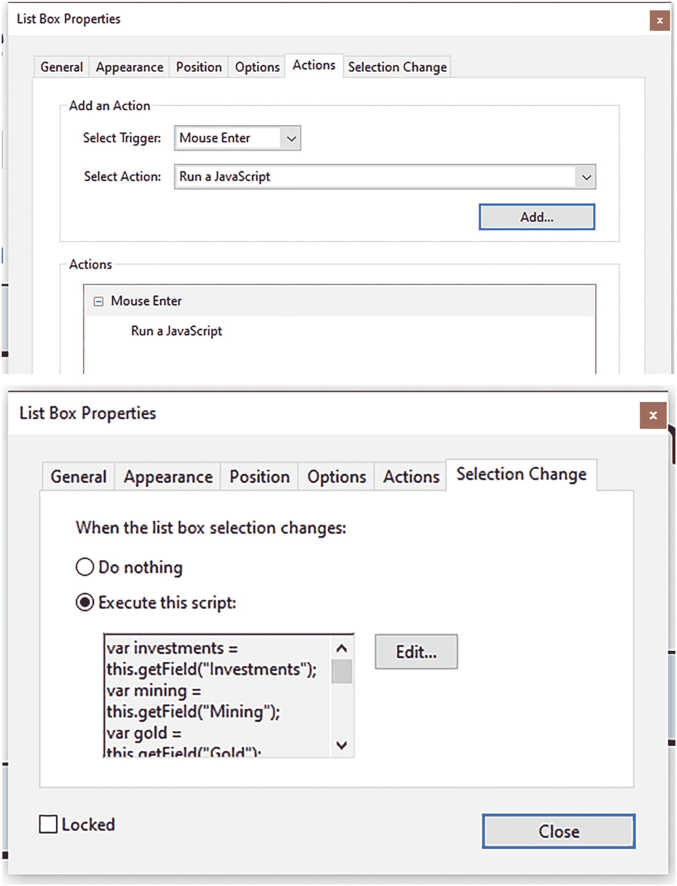

“列表框属性”对话框的两张截图。上方列出了“操作”下的选项，包含“添加操作”和“操作”选项卡。下方列出了“选项更改”下的选项，包含单选按钮“不执行任何操作”和一个被选中的“执行脚本”选项。

**图 5-6** “操作”（`Actions`）和“选项更改”（`Selection Change`）选项卡

### 数字签名属性

您可以在“操作”（`Actions`）或“已签名”（`Signed`）选项卡上为数字签名的属性添加操作。“已签名”（`Signed`）选项卡类似于其他字段中的“验证”（`Validate`）选项卡。当满足某些条件时会触发验证，然后执行脚本。请参考图 5-7。

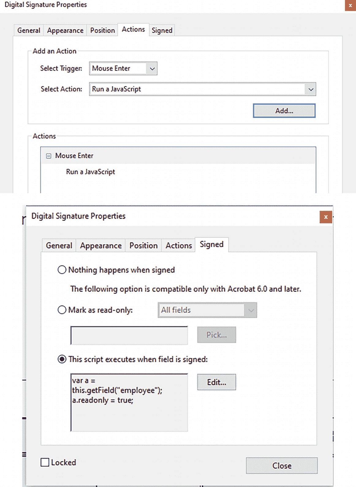

“数字签名属性”对话框的两张截图。上方列出了“操作”下的选项，包含“添加操作”和“操作”选项卡。下方列出了“已签名”下的选项，其中高亮显示了“当字段签名时执行的此脚本”。

**图 5-7** “数字签名属性”对话框中的“操作”（`Actions`）和“已签名”（`Signed`）选项卡

### 条码属性

与其他字段一样，您可以为条码添加操作。但是，条码会在“值”（`Value`）选项卡上创建自己的`值脚本`。其值取决于整个表单中字段类型及其输入值的情况。请参考图 5-8。

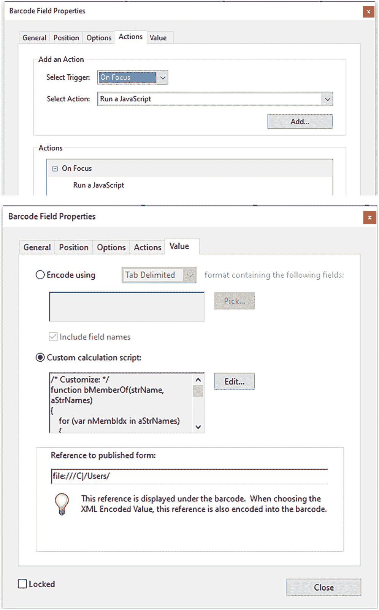

“条码属性”对话框的两张截图。上方列出了“操作”下的选项，包含“添加操作”和“操作”选项卡。下方列出了“值”下的选项，其中高亮显示了“自定义计算脚本”。

**图 5-8** “条码字段属性”对话框中的“操作”（`Actions`）和“值”（`Value`）选项卡

无论您计划使用何种类型的字段，所有操作及其编辑功能都通过包含脚本的“`JavaScript` 编辑器”（`JavaScript Editor`）框访问。当您单击“编辑”（`Edit`）或“添加”（`Add`）按钮时，即可进入此编辑区域。“添加”（`Add`）按钮通常位于“操作”（`Actions`）选项卡上，如图 5-9 所示。“编辑”（`Edit`）按钮也可在“操作”（`Actions`）选项卡上找到，但也在其他一些选项卡上，如“格式”（`Format`）、“验证”（`Validate`）和“计算”（`Calculate`）；它们都会导向“`JavaScript` 编辑器”（`JavaScript Editor`）。

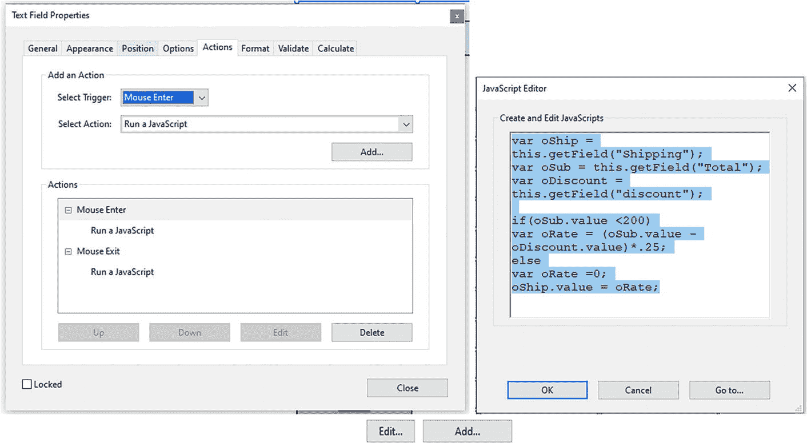

两张截图。左侧是“单选按钮属性”对话框，列出了“操作”下的选项，包含“添加操作”和“操作”。右侧是“`JavaScript` 编辑器”对话框，包含“创建和编辑 `JavaScript`”字段。

**图 5-9** 通过位于“操作”（`Actions`）、“格式”（`Format`）、“验证”（`Validate`）和“计算”（`Calculate`）选项卡上的“编辑”（`Edit`）或“添加”（`Add`）按钮访问“`JavaScript` 编辑器”（`JavaScript Editor`）

### 全局文档 `JavaScript`

现在让我们看看全局文档 `JavaScript`。如果您已打开文档，请转到“工具”（`Tools`）选项卡并选择“自定义”（`Customize`）部分中的“`JavaScript`”工具。您现在将能够查看所有子工具，如图 5-10 所示。

## JavaScript 工具概述

一张截图展示了“JavaScript”图标，顶部有一个“添加”按钮。底部包含一个工具栏，其中有“调试”（`debug`）、“调试器”（`debugger`）、“文档 JavaScript”（`document JavaScripts`）、“所有 JavaScript”（`all JavaScripts`）和“文档操作”（`document actions`）工具。

**图 5-10** “JavaScript”工具及其子菜单项

### 文档 JavaScript

全局发生的操作可能影响多个字段。这可能包括诸如更改字段颜色或输入到字段中的文本等格式化操作。这些类型的操作将影响整个文件中访问“文档 JavaScript”（`Document JavaScripts`）对话框的许多字段，该对话框位于本章提到的某个字段属性选项卡位置。字段可以调用单个全局函数，以减少输入和文档大小，如图 5-11 所示。您将在后面的章节中更详细地了解这个区域。

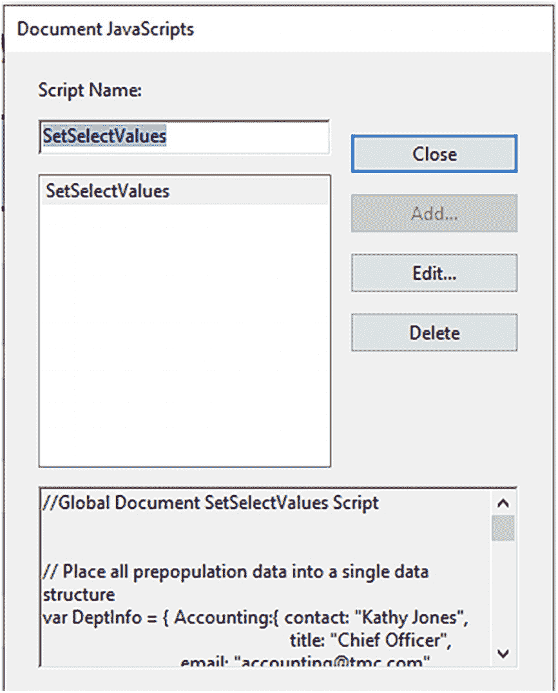

一张截图展示了“文档 JavaScript”（`Document JavaScript`）对话框，包含“脚本名称”和“设置选择值”字段，以及一个被选中的“关闭”按钮。

**图 5-11** “文档 JavaScript”（`Document JavaScripts`）对话框

### 文档操作

可以使用“文档操作”（`Document Actions`）工具添加针对文档的其他特定操作，如图 5-12 所示。

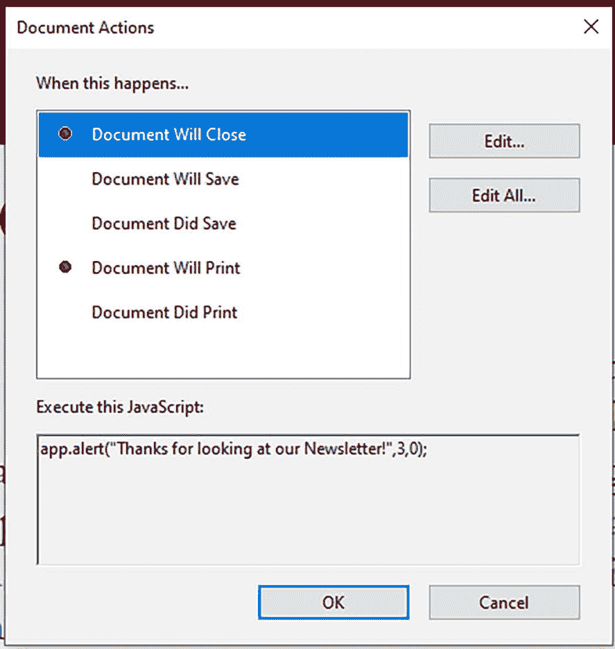

“文档操作”（`Document Actions`）对话框的截图，包含文档的“关闭”、“保存”和“打印”选项、“执行此 JavaScript”字段以及一个被选中的“确定”按钮。

**图 5-12** “文档操作”（`Document Actions`）对话框

当发生以下事件时，可以在此处放置警报，我们将在第 8 章中介绍。

**注意：** 如果没有高级脚本编写知识，您无法在此处添加更多文档操作。

### 查看与调试

您还可以在“所有 JavaScript”（`All JavaScripts`）子工具下一次查看所有 JavaScript，这将打开“JavaScript 编辑器”（`JavaScript Editor`）。请参考图 5-10。

如果有错误，您可以使用“调试”（`Debug`）和“调试器”（`Debugger`）子工具来帮助您。但是，我发现了解一些 JavaScript 结构并在诸如 `Notepad++` 或 `Adobe Dreamweaver` 等有更大输入空间的程序中进行编辑会有所帮助。像 `Dreamweaver` 这样的编辑程序还会通过左侧的编号清楚地显示您在代码中所处的行。`Acrobat` 没有这些视觉提示，仅在编辑器的右下角有一个文本引用，我认为这对于详细的代码编辑作用不大。请参考图 5-13 和图 5-15。

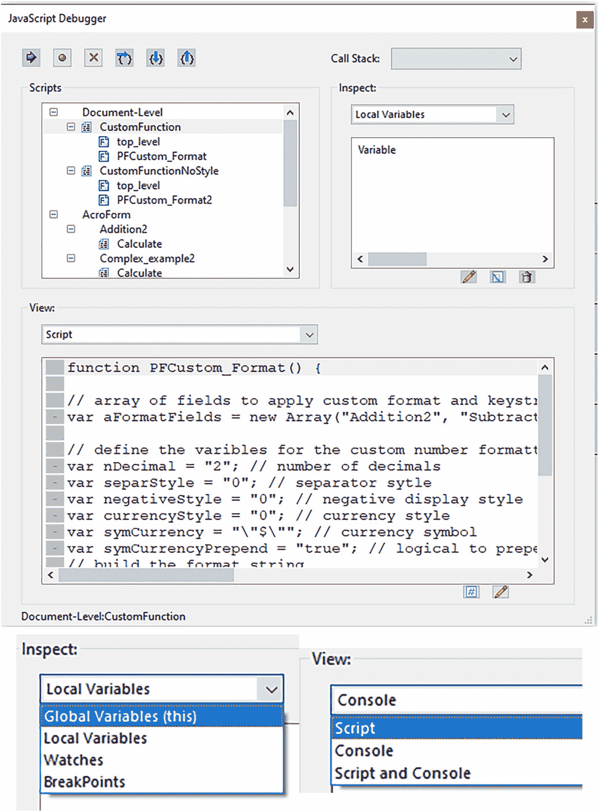

“JavaScript 调试器”（`JavaScript Debugger`）对话框的截图，其中包含文档的脚本以及“检查”（`inspect`）和“查看”（`view`）选项。“检查和查看”（`inspect and view`）下拉菜单列出了工具，其中选择了“全局变量”（`global variables`）和“脚本”（`scripts`）。

**图 5-13** “JavaScript 调试器”（`JavaScript Debugger`）对话框，包含查看和检查的设置

如果您发现调试器无法正常工作，可以检查并重置相关设置：选择“编辑” ➤ “首选项” ➤ “JavaScript”，然后在 Acrobat 重新启动后勾选“启用 JavaScript 调试器”。此外，还需检查“启用交互式控制台”和“出错和消息时显示控制台”的设置。默认情况下，这些设置处于禁用状态。请参考图 5-14，如果您选择激活这些选项，请单击“确定”。然后关闭 Acrobat Pro 应用程序并重新打开。确保在关闭应用程序之前已退出文件的 JavaScript 工具，否则对话框可能在文档本身打开前突然弹出。否则，单击“取消”退出并保持调试器禁用——如果您处理大量不包含 JavaScript 的文档，这可能是更合适的选择。请参考图 5-14 查看首选项设置。就我而言，我在编辑表单之前已启用了这些首选项设置。

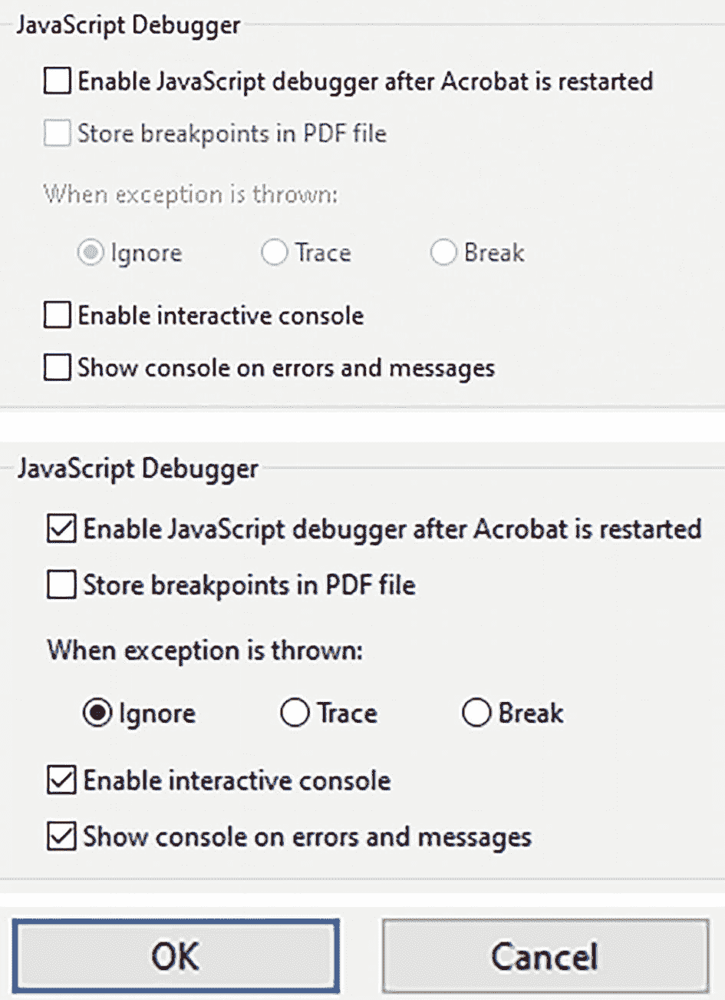

JavaScript 调试器对话框的两个截图。上方显示了已禁用的交互式控制台以及出错和消息时显示控制台。下方显示了已启用的 JavaScript 调试器、交互式控制台以及出错和消息时显示控制台。

**图 5-14** 启用调试器对话框的 JavaScript 调试器首选项

虽然本书不会使用`Debugger`，但以下链接可以为您提供关于使用`Debugger`的限制以及其他 JavaScript 首选项设置的进一步指导：

[`https://opensource.adobe.com/dc-acrobat-sdk-docs/library/jsdevguide/JS_Dev_Tools.html#using-the-javascript-debugger-console`](https://opensource.adobe.com/dc-acrobat-sdk-docs/library/jsdevguide/JS_Dev_Tools.html#using-the-javascript-debugger-console)

### 编辑器设置

当您在编辑程序中完成输入后，将代码复制并粘贴到 Acrobat 的 JavaScript 编辑器中，运行调试器并进行测试（图 5-15）。

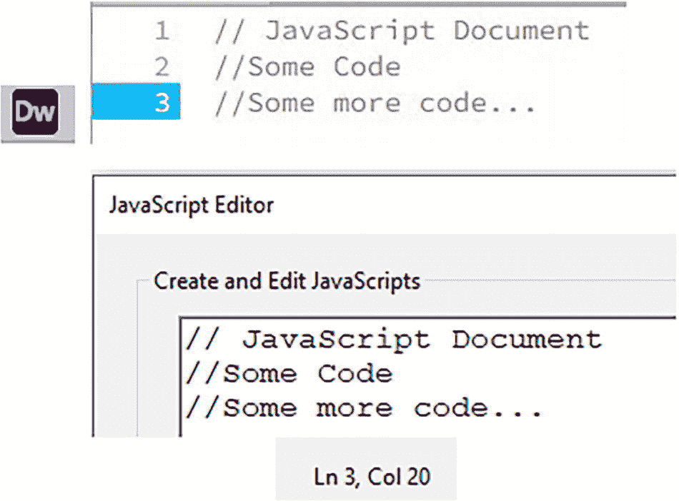

上方截图展示了包含 JavaScript 文档脚本和代码的记事本，下方是带有“创建和编辑 JavaScript”字段的 JavaScript 编辑器对话框。

**图 5-15** JavaScript 在 Dreamweaver 或 Notepad++等应用程序中的显示方式，与在 Acrobat Pro JavaScript 编辑器中的显示方式对比（无双编号行）

> **注意**
> “编辑” ➤ “首选项” ➤ “JavaScript”区域还允许您更改 Acrobat JavaScript 编辑器的字体类型和字体大小。如果需要，您也可以链接到不同的外部编辑器。但是，对于本书，请选择“使用 Acrobat JavaScript 编辑器”选项，如图 5-16 所示。

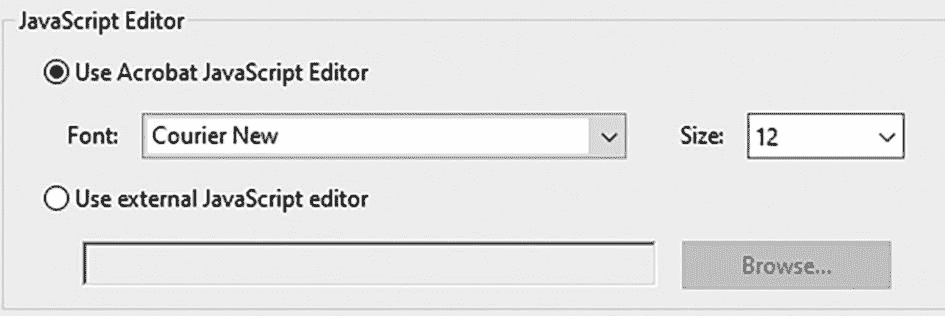

一个 JavaScript 编辑器对话框的截图，其中启用了 Acrobat JavaScript 编辑器，禁用了外部 JavaScript 编辑器。

**图 5-16** JavaScript 编辑器设置

### 常规表单与电子签名表单

电子签名表单工具是 Acrobat Pro 中较新的功能，包含用于 Adobe Sign 的数字签名字段，最终用于创建 Web 表单。虽然它们看起来相似，但操作方式与常规电子表单字段不同，并且不允许添加 JavaScript。出于这些原因，我们将在第 20 章中才对其深入探讨，届时我将简要介绍这些字段以及更新的表单相关 Acrobat 工具的使用方法和资源。现在，请参考图 5-17。

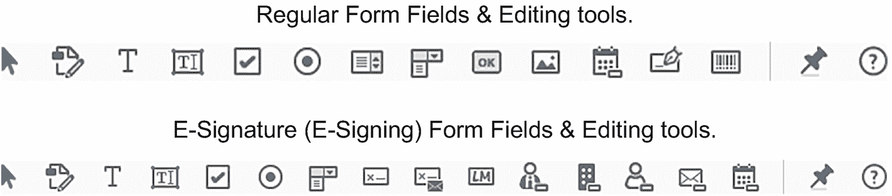

截图展示了常规和电子签名表单字段及编辑工具。每种都有多个工具图标，包括选择、文本字段、复选框、单选按钮和图钉。

**图 5-17** Acrobat Pro 中的两种表单字段工具

如果您打开“准备表单”工具，勾选“此文档需要签名”（图 5-18），然后单击“开始”，即可访问图 5-17 中所示的电子签名字段。对于本书中的表单，此选项应始终保持未选中状态；仅在第 20 章中才选中此选项。

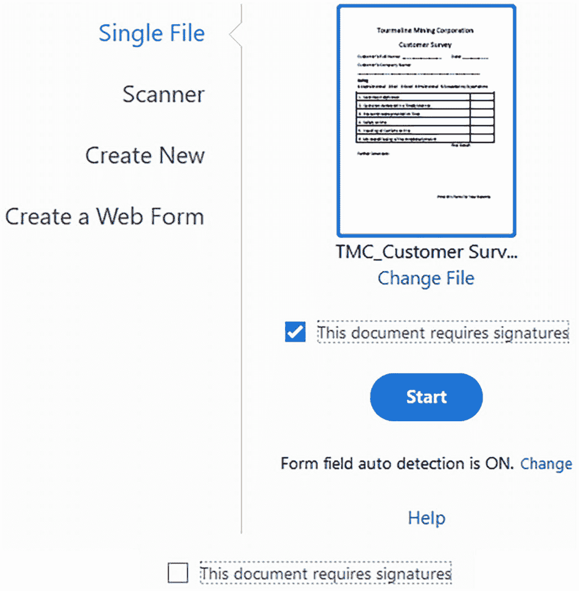

该截图展示了一个页面，其中包含名为“T M C customer survey”的单个文件预览以及一个高亮的“开始”按钮。

**图 5-18** 如何创建电子签名表单。对于您正在处理的表单，请保持此项未选中

## JavaScript 与 Acrobat 文档级操作

在 Acrobat Pro 中，要使表单中的某个字段产生事件或动作，需要遵循以下公式：

触发器 + 选择动作 = 结果

除了知道触发的内容，您还需要知道结果将流向何处。对于表单、数据或需要从字段（文本、下拉列表、复选框、单选按钮等）获取的值，这些数据的集合将被存入最终字段作为所需的结果。无论使用值、简化字段表示法还是 JavaScript，了解这些字段的确切名称都至关重要。如果您不知道确切名称，将无法获得结果，表单也会失效。为避免字段混淆，每个字段都必须具有唯一的名称。

命名规则的例外是单选按钮组，它们作为一个整体工作；但是，它们的组必须具有不同的名称。对于所有其他字段，一个表单中不能有两个或多个名为`Sum1`的字段才能独立运行；它们应该命名为`Sum1`、`Sum2`等。

请按照提供的表单示例完成后续章节的课程。名称中包含“End”的 PDF 文件是最终结果。

## 总结

JavaScript 可以添加到多个区域；这完全取决于您计划使用哪种表单字段，或者您打算将 JavaScript 添加到整个文档。在下一章中，您将看到如何利用 SFN 和 JavaScript 的知识来改进用于创建计算的表单。
