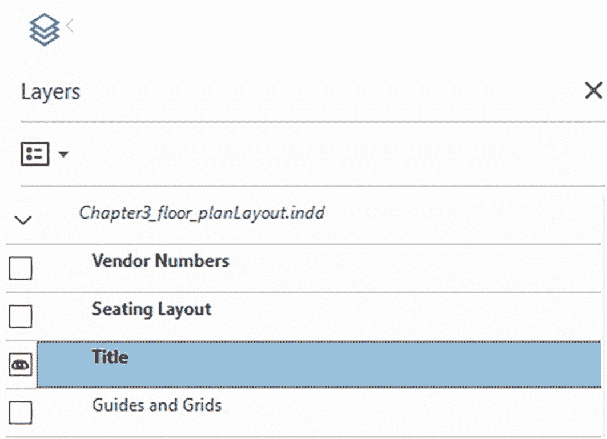

# 页面截图中有一个富媒体图标，其后跟着一个用于添加 3D、按钮、声音、视频和对象的选项。另有一张按钮属性截图，包含 5 个选项卡，其中“操作”选项卡被选中。该截图下方有两个下拉菜单用于选择触发器和操作，其后是一个操作列表。

**图 4-21**  
“操作”选项卡上的“富媒体”工具的“按钮属性”对话框

在使用 `Rich Media` 工具时，非表单按钮操作可用于视频媒体、3D 模型、导航，或者稍后用于表单。你可以使用 `Select object` 工具选中一个按钮，然后右键点击该按钮以访问其属性。但是，在关闭文件并重新打开后，若要访问按钮属性，你需要进入 `Prepare Form` 工具来编辑按钮操作，因为退出 `Rich Media` 工具后，你可能会修改或失去访问权限，尤其是在你后续添加了其他表单元素的情况下。富媒体的按钮属性与表单的按钮属性相同。

## 图层基本操作

此示例请参考名为“Floor Plan Layout”的 PDF 文件。

在 `View ➤ Show/Hide ➤ Navigation Panes ➤ Layers` 下，你会在 Acrobat 的左侧找到当前文档的所有图层（请参考图 4-22）。

