# 6. 基本与复杂计算

`章节目标：` 在 JavaScript 计算的第一个示例中，我们将比较三种方法：值、简化字段表示法（SFN）和 JavaScript，这些方法可以在文本字段和下拉列表表单字段的“计算”选项卡中找到，如图 6-1 所示。

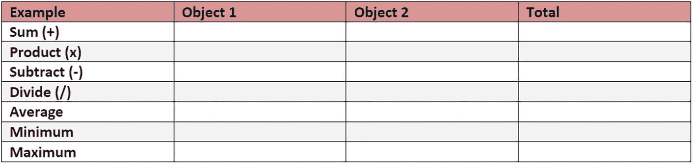

表格截图，包含 4 列，例如对象 1、对象 2 和总计。它有 7 行，分别用于求和、乘积、减法、除法、平均值、最小值和最大值。

**图 6-1** Acrobat 计算选项卡示例 PDF 文件内部

虽然对于表单创建新手来说，使用`value`通常是处理计算最直接的方法，但您很快就会发现`value`存在局限性，因此`SFN`和`JavaScript`可能是更好的选择。本章将展示每种方法的优缺点。

> **注意**
> 如果您想跟着本课练习或查看最终结果，请从引言中的链接下载第 6 章的文件。标有“Start”的文件是未添加代码的文件，标有“End”的文件是最终结果。您还会找到包含原始 MS Word、Excel 和 PDF 文件的文件夹（方便您编辑），以及一个包含原始脚本的文件夹（如果您想将它们添加到自己的 PDF 表单中）。

如果您是从原始的 PDF 创建表单，请参考第 1 章中的“表单回顾”部分。

请记住，要查看字段的属性，必须先选择“准备表单”工具；之后，您可以右键单击或双击字段来查看其属性。

## 入门指南

让我们以加法或求和示例开始，无论您在`Calculate`（计算）选项卡中选择哪种方法或选项，此示例都是通用的。请参考本章文件夹中的 Acrobat 计算选项卡示例 PDF 的“Start”（开始）和“End”（结束）文件。参见图 6-2。

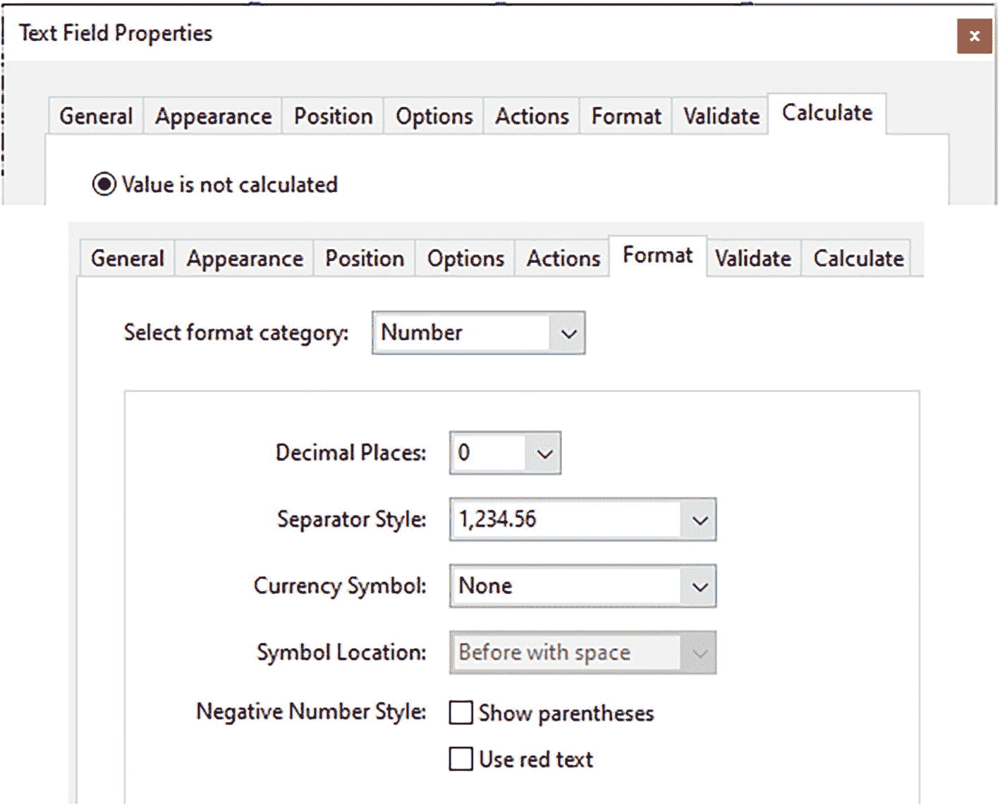

文本字段属性页面的截图显示了选中的`Calculate`（计算）选项卡，其中有一个“数值未计算”复选框。另一张`Format`（格式）选项卡的截图显示类别为数字，并详细列出了小数位数、分隔符和负数样式、货币符号以及位置。

**图 6-2**

`Calculate`（计算）选项卡是我们接下来将要讨论的所有三种方法的通用入口，对于数字，您可以使用`Format`（格式）选项卡，并将“选择格式类别”设置为`Number`（数字）。

**注意**

如果尚未在`Calculate`（计算）选项卡中为某个字段应用任何值，则将选中“数值未计算”选项。这对于文本字段或那些将包含数字但不参与最终计算的字段来说，是没问题的。在这种情况下，字段在`Format`（格式）选项卡中格式化为`Number`（数字），小数位为`0`，但如果您不希望四舍五入，可以将其设置为`1`、`2`或更高。我们将在第 7 章中进一步了解此选项卡。参见图 6-2。

## 求和值

在此示例中，我在`TotalSum`字段中设置了计算属性，并在`General`（常规）选项卡中将其设置为“只读”，以防止用户在此字段中输入计算。

在`Calculate`（计算）选项卡中，选择“数值是……”按钮，并从下拉列表中选择`sum (+)`（求和）。请注意，在“End”（结束）文件中，灰色区域中列出了表单中某些字段的字段名称（图 6-3）。

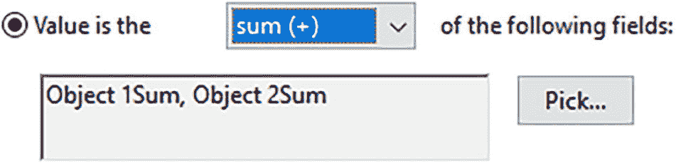

一个复选框的截图，用于将数值计算为以下字段的总和。它有一个文本框，文本内容为`object 1 sum`和`object 2 sum`，文本框右侧有一个选择按钮。

**图 6-3** 在`Calculate`（计算）选项卡中输入求和值

在此示例中，我随后单击了`Pick`（选择）按钮，并从`Field Selection`（字段选择）对话框中选择了我想要从中提取计算值的表单字段，本例中为`Object 1Sum`和`Object 2Sum`。然后我单击`OK`（确定）将它们添加到列表中。参见图 6-4。

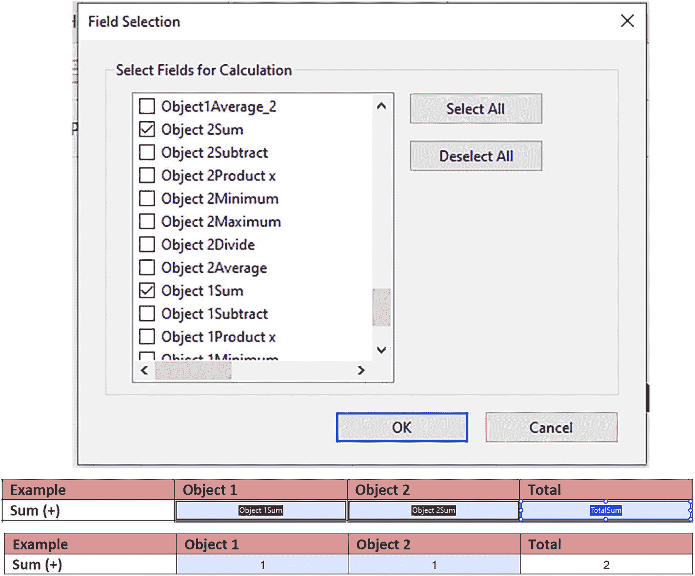

字段选择对话框的截图，其中有一个滚动列表用于选择要计算的字段，以及一个`OK`（确定）按钮。页面底部有两个表格，各有 4 列，例如`object 1`、`object 2`和`total`。表格 1 的第 1 到 3 列的条目已被选中。

**图 6-4** 从`Field Selection`（字段选择）对话框在`Calculate`（计算）选项卡中输入求和值

在此示例和图 6-4 中，您从两个字段（`Object 1Sum`和`Object 2Sum`）获取数据或值。它们在`TotalSum`字段中相加并得出结果。

这种方法对于列表中的其他基本计算类型也效果很好，例如`product (x)`（乘积）、数值平均值、以及数值的最大值和最小值。但是，其他基本的数值计算，例如减法或除法，则无法使用此方法实现。参见图 6-5。

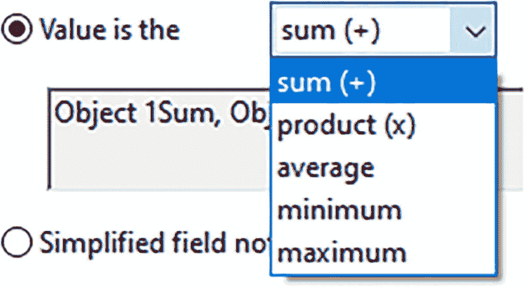

两个复选框的截图，其中第一个（用于数值的）复选框被选中。它有一个选项列表，其中`sum`（求和）选项被选中。

**图 6-5** 字段值选项受限于列表中可用的选项

在“属性”面板中单击`Close`（关闭）按钮后，您可以在预览模式下测试您的表单字段。如果您想查看其他字段，则可以返回编辑模式。

要执行更复杂的计算，我们需要查看下一个选项。

## 简化域表示法

现在让我们来看看简化域表示法。请注意图 6-6 中`Calculate`（计算）选项卡上，名为`Simplified Field Notation`（简化域表示法）的按钮已被选中。

这些示例可以在 Acrobat 计算选项卡示例 PDF 文件中以“End”（结束）命名的下一页中找到。

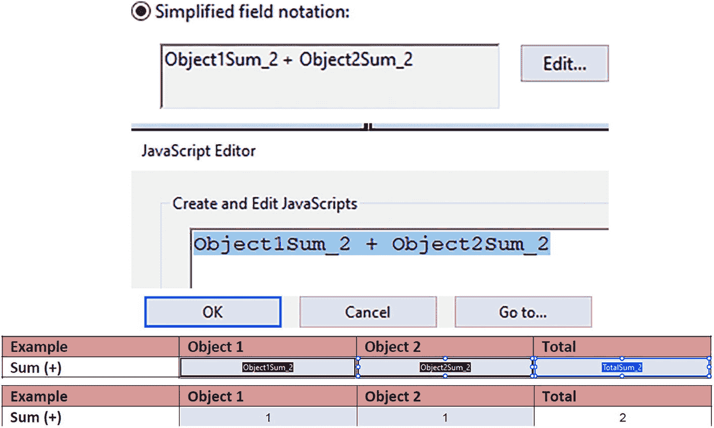

一个页面的截图，其中选中了“简化域表示法”的复选框。它有一个用于 Java Script 编辑器的对话框，其中包含一个用于创建和编辑 Java Script 的方程式。还有 2 个表格，各有 4 列，例如`objects 1`和`2`以及一个总计值，表格 1 的第 2 到 4 列的条目被选中。

**图 6-6** 在`Calculate`（计算）选项卡和 Java Script 编辑器中输入 SFN 代码以及在表单上的结果

**注意**

对于 SFN 和 Java Script，您无法拾取或选择字段；您必须直接将信息键入 Java Script 编辑器中。参见图 6-6 和图 6-8。

第二种实现方法是使用 SFN，这在 Microsoft Excel 等程序中很常见。虽然这与前面的求和值示例类似，但也存在差异。在前面的求和示例中，字段中的单词之间可以有空格。但是，SFN 中的`Object 1Sum`必须写成`Object1Sum`。使用 SFN 时不能有间隔。这个规则非常严格。字段名称中的任何间隔都会导致计算失败。如果需要间隔，请使用下划线 (`_`)，例如`Object1Sum_2`，或者使用所谓的*驼峰*方法，即每个新单词首字母大写但无间隔（`ObjectSum`）。

在此示例中，对于字段`TotalSum_2`，我将两个字段`Object1Sum_2`和`Object2Sum_2`相加。当我单击图 6-6 中的`Edit`（编辑）按钮后，然后在 Java Script 编辑器中输入了此文本，接着单击`OK`（确定）退出。

SFN 的另一个不同之处在于添加加号 (`+`) 来表示在`TotalSum_2`字段内将这两个字段值相加。使用星号 (`*`) 进行乘法，减号 (`-`) 进行减法，斜杠 (`/`) 进行除法。如果您学过代数，您会对括号 `()` 很熟悉。括号内的运算优先于后续计算。您可以在`TotalAverage_2`和`TotalMoreComplex`字段中看到这样的示例。参见图 6-7。

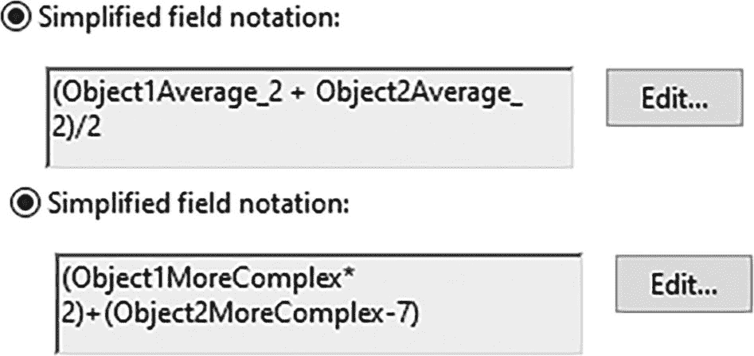

两个选中了“简化域表示法”复选框的截图，每个复选框对应`object 1`和`object 2`的不同复杂方程。每个复选框右侧都有一个编辑按钮。

**图 6-7** 为更复杂的计算在`Calculate`（计算）选项卡中输入 SFN

要将此代码键入编辑器，您必须首先单击`Edit`（编辑）按钮。输入代码完成后，单击`OK`（确定）退出。

在这里您可以看到`(Object1MoreComplex*2) + (Object2MoreComplex-7)`现在将在`TotalMoreComplex`字段中计算出最终结果。然后单击`Close`（关闭）退出“属性”对话框，再单击`Preview`（预览）测试您的字段。

如果您将诸如 `5` 和 `10` 这样的数字输入到 `Object1MoreComplex` 和 `Object2MoreComplex` 字段中，那么在 `TotalMoreComplex` 字段中应该得到以下答案：

* `(5*2) + (10-7) = 13`

请注意，当您已经在一个文本字段中输入了数字时，除法运算效果最好。

但是，您可能会注意到，使用 SFN 来计算最小值或最大值这样的运算要复杂一些，因此我让这些字段保留了未计算的状态。

### JavaScript 自定义计算脚本

我们将介绍的最后一种方法是自定义计算脚本，它位于 Acrobat 计算选项卡示例页面的第三部分。图 6-8 显示了选中 `TotalSum_3` 字段的“编辑”按钮后的“自定义计算脚本”。

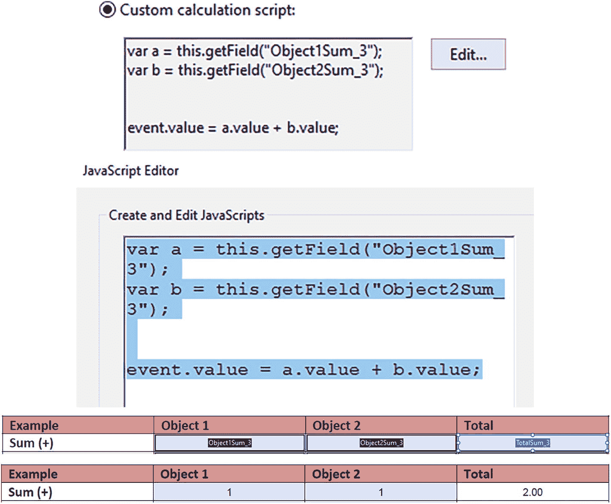

自定义计算脚本复选框的屏幕截图，其中包含几行代码，后面跟着一个用于创建和编辑 JavaScript 的“JavaScript 编辑器”对话框。该对话框包含两个表格，其列分别为“示例”、“对象 1”和“对象 2”以及“总计”，并且表格 1 的第 2 到第 4 列条目已被选中。

**图 6-8** 在“计算”选项卡中输入自定义计算脚本

要将此代码输入编辑器，必须首先单击**编辑**按钮。然后即可输入代码。完成后，单击**确定**退出。随后，单击“属性”对话框上的**关闭**按钮，接着单击**预览**按钮并测试表单。

就 JavaScript 而言，你会再次看到代码设置方式上的相似之处和不同之处。要将字段转换成 JavaScript 语言，你需要使用变量来保存这些字段。变量充当信息容器。在 JavaScript 中，`variable` 这个词使用其缩写形式 `var`。在 `var` 后面添加一个名称。

在本例中，为简单起见，我们使用名称 `a`。这个名为 `a` 的变量将保存输入到文本字段 `Object1Sum_3` 中的任何值。变量首次命名后，就不需要再附带 `var` 这个词，并且可以在脚本中的任何位置直接使用 `a`。为了确保输入的数字能正确传递，需要添加 `this.getField`，它的意思是“获取此字段中的数据”，在本例中是从字段 `Object1Sum_3` 中获取。将字段名称放在圆括号 `()` 和直引号 `""` 中。在变量的末尾，使用分号 (`;`) 表示该变量语句的结束。

对第二个变量 `b` 重复相同的步骤，它使用字段 `Object2Sum_3`。它们是你要用来为当前字段 `TotalSum_3` 计算最终输入值的两个字段。

```javascript
var a = this.getField("Object1Sum_3");
var b = this.getField("Object2Sum_3");
```

这是脚本的最后一部分：

```javascript
event.value = a.value + b.value;
```

这与 SFN 示例类似。但是，你需要在每个变量的末尾添加 `.value`，以提醒 Acrobat 你希望获取每个字段的值，并将最终值相加得到最终字段的结果。在最终字段 `TotalSum_3` 中，加法运算发生的事件结果就是最终值。需要注意的是，最终字段不需要变量名，因为 Acrobat 将脚本包含在了最终字段的内部。同样，用分号结束这一行。

同一个脚本的另一种变体是，如果你不想分别编写变量，可以将它们合并起来，写成这样：

```javascript
event.value = this.getField("Object1Sum_3").value + this.getField("Object2Sum_3").value;
```

然而，当涉及更多变量，或者你在计算中多次使用某个字段时，这是编写代码的最佳方式吗？或者，更好的做法是将所有变量集中放在一处，以便在需要快速更改代码中表单字段的名称时能够方便地访问？

例如，哪一个更易于修改？

```javascript
event.value = ((this.getField("Object1Sum_3").value + this.getField("Object2Sum_3").value)) * ((this.getField("Object1Sum_3").value - this.getField("Object2Sum_3").value));
```

或者写成这样：

```javascript
var a = this.getField("Object1Sum_3");
var b = this.getField("Object2Sum_3");
event.value = (a.value + b.value) * (a.value - b.value);
```

就变量的命名而言，变量名可以长于一个字母（比如 `a`）。你可以赋予它们更具含义的名称，例如 `age` 或 `sum`。在最终示例中，可以这样写：

```javascript
event.value = age.value + sum.value;
```

但是，请确保将代码前面部分的变量改为 `var age` 和 `var sum`，以便代码能够正常运行。

以下是在 Acrobat Pro 中使用变量时需要记住的其他几点：

- 所有 JavaScript 变量必须使用唯一的名称进行标识。

- 字段名称可以包含字母、数字和下划线。

- 变量名必须以字母开头，但你引用的字段以数字开头是可以的。

- 名称区分大小写（`y` 和 `Y` 是不同的变量）。

- 保留字（如 JavaScript 关键字）不能用作名称。最好不要创建像 `var event` 这样的变量，因为 `event` 是在最终事件中使用的 JavaScript 关键字。例如，`event.value = age.value + event.value;` 可能无法正常工作，因为 `event.value` 已经被使用过一次。

- 如前所述，与 SFN 一样，确保你的变量以及通常的字段名保持为一个单词，而不是多个分开的单词。但是，只要字段名放在直引号内，包含空格也是可以的。

- 如果你使用的是现代 JavaScript，请注意不能将声明 `var` 替换为 `let`，否则会遇到错误。请仅使用 `var`。

- 在 `value`、`SFN` 和“自定义计算脚本”按钮选项之间切换时需要谨慎。当你选择其他选项时，将会清除你刚刚输入的代码，因此工作时要始终将 JavaScript 代码备份在 `.txt` 文件中。此外，如果不小心删除了代码，请不要保存我的“End”文件；只需不保存更改直接关闭即可。

> **注意：** 另外请记住，在编写包围字段名的引号时，如果你需要更大的空间，可以使用 Notepad++ 或 Dreamweaver 之类的程序来编写代码，如第 5 章所述。像 MS Word 这样的程序可能会尝试将双引号替换成对话中使用的引号（也称为*弯引号*），而你应该使用“中性”或直引号。这可能会混淆 Acrobat JavaScript 编辑器，导致错误并使你无法退出对话框。

至此，如果你需要一些关于“计算”选项卡的基础知识，可以参考此页面：

[`helpx.adobe.com/acrobat/using/manage-form-field-properties.html`](https://helpx.adobe.com/acrobat/using/manage-form-field-properties.html)

### 关于“计算”选项卡的最终思考

让我们回顾一下。您已经了解了三种加法运算方式：`value`、`SFN` 以及 JavaScript 自定义计算脚本。那么，哪一种适合您的项目呢？您是否在所有情况下都需要使用 Acrobat JavaScript？

在大多数简单的计算项目中，我建议在表单的不同部分使用 `value` 或 `SFN`。但是，如果您已经查看了文件 “Acrobat Calculate Tab Examples ”中的“End”示例，您会发现 `value` 和 `SFN` 并不能同等地解决所有问题。`value` 不能进行减法或除法运算。`SFN` 无法找出最小值或最大值。在这种情况下，您可能必须在表单中组合使用这两种计算方法。

**注意**

JavaScript 可以完成所有这些计算以及许多其他计算。此外，正如您将在第 12 章中看到的，当 JavaScript 变得更复杂时，将 `value` 和 `SFN` 与 JavaScript 混用并不总是一个好主意，因为这可能导致某些字段无法正确响应。一致的编码方法对于表单计算的顺畅运行至关重要。另请参阅本章后面的“设置字段计算顺序”部分。

例如，在 `FieldTotalMinimum_3` 字段中，我使用了以下自定义计算脚本：

```javascript
var q = this.getField("Object1Minimum_3");
var r = this.getField("Object2Minimum_3");
event.value=Math.min(q.value,r.value);
```

# JavaScript 数学公式

您可以使用 JavaScript 数学公式 `Math.min` 来获取最小值，这与使用 `value` 的示例类似。您可以使用 `Math.max` 来获取最大值。还有一些其他数学公式无法通过 `value` 或 `SFN` 使用，但可以通过 JavaScript 实现：

*   `Math.abs(x)`：返回 `x` 的绝对值。
*   `Math.acos(x)`：返回 `x` 的反余弦值（以弧度为单位）。但是，您应输入一个介于 -1 和 1 之间的数字以避免引发错误。在本书的后续部分，您可能会希望进一步探索使用“验证”选项卡设置限制的方法。
*   `Math.asin(x)`：返回 `x` 的反正弦值（以弧度为单位）。但是，您应输入一个介于 -1 和 1 之间的数字以避免引发错误。
*   `Math.atan(x)`：返回 `x` 的反正切值，其数值介于 -PI/2 和 PI/2 弧度之间。
*   `Math.atan2(y,x)`：返回其参数商的反正切值。
*   `Math.ceil(x)`：返回 `x` 向上取整后的最接近整数。
*   `Math.cos(x)`：返回 `x` 的余弦值（`x` 以弧度为单位）。
*   `Math.exp(x)`：返回 `E`^`x` 的值，其中 `E` 是欧拉数。
*   `Math.floor(x)`：返回 `x` 向下取整后的最接近整数。
*   `Math.log(x)`：返回 `x` 的自然对数（底数为 `E`）。
*   `Math.PI`：给出圆周率 ∏ 的公式。
*   `Math.pow(x,y)`：返回 `x` 的 `y` 次幂的值。
*   `Math.random()`：返回一个介于 0 和 1 之间的随机数。
*   `Math.round(x)`：将 `x` 四舍五入到最接近的整数。示例：向上舍入小计金额。
*   `Math.sin(x)`：返回 `x` 的正弦值（`x` 以弧度为单位）。
*   `Math.sqrt(x)`：返回 `x` 的平方根。
*   `Math.tan(x)`：返回一个角度的正切值。

您可以在以下页面查看和测试许多其他 `Math` 对象：

```
https://www.w3schools.com/jsref/jsref_obj_math.asp
https://developer.mozilla.org/en-US/docs/Web/JavaScript/Reference/Global_Objects/Math
```

在这种情况下，`x` 或 `y` 应写为 `(x.value)` 或 `(x.value,y.value)`。

## 用于显示零的 JavaScript 脚本验证

没有 JavaScript，您在表单中无法做到的最后一件事是格式化数字 0。有时在表单上，如果前两个字段没有添加任何计算，您不希望显示 0，而希望它保持空白。请参见图 6-9。

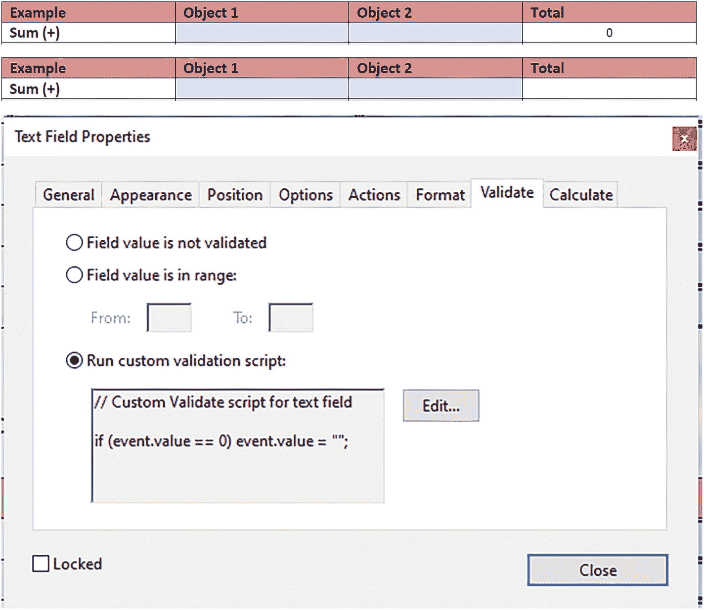

一张包含两列表格的截图，示例列为对象 1、对象 2 和总计。其中包含选中了“验证”选项卡的文本字段属性页面的截图，随后是 3 个复选框，其中“运行自定义验证脚本”复选框被选中，并附有几行代码。

**图 6-9** — 在“总计”字段的“验证”选项卡中添加验证脚本。添加脚本前后的对比。

这样看起来更好。如果需要参考，请查看 `TotalSum_3` 字段的“验证”选项卡，并参见图 6-9。

除了“计算”选项卡脚本之外，您还可以在“验证”选项卡中输入以下内容：

```javascript
// 文本字段的自定义验证脚本
if (event.value == 0) event.value = "";
```

在文本字段 `TotalSum_3` 中，这个脚本以一条注释开头，解释了我们正在做什么。

双斜杠（`//`）始终用于开始注释。注释可以写在 JavaScript 的任何位置，并且不会影响计算。可以将它们视为有用的提醒。

这是另一种可用于编写较长、段落式注释的方法：

```javascript
/* 这种类型的注释适用于大段文本 */
```

不过，由于 Acrobat 提供的空间较小，我通常更喜欢使用 `//`。

### 最后一行代码

这就是所谓的*条件语句*，稍后你将详细了解它。本质上它表示：“如果另外两个字段未输入任何值或只输入了零（两者均为空或都包含零），则最终值字段也留空。”

```
if (event.value == 0) event.value = "";
```

**最后一点：** 如果在减法或带负数的加法中使用了此脚本，并且需要看到 0（例如：`5-5=0`），你可能看不到这个 `0`。如果只有在字段填写完整时才需要显示 0，你可以使用更复杂且更严格的验证。

`==` 并非严格相等运算符比较。像 `5-5=0` 这样的结果可能无法正常显示，`0-0=0` 或 `0x5=0` 也可能无法正常工作，因为该验证将 `0` 和空白字段视为相同。

`===` 是严格相等运算符比较，因此现在像 `5-5=0`、`0-0=0` 或 `0x5=0` 这样的结果都能正常工作，因为验证将 `0` 和空白字段视为*不*相同，并会在结果字段中放入一个 `0`。你可以编写以下代码来保留这个 `0`：

```
if (event.value === 0) event.value = "";
```

然而，Acrobat 似乎表现怪异，无法达到预期的效果，即当一个值字段已添加但另一个尚未输入值时，最终字段保持空白。请参考图 6-10。


三个文本框的截图。框 1 的值为 0.00，框 2 无输入，框 3 的值为 0.00。

**图 6-10** 验证在这些字段中未能按预期工作

因此，这是你可以在我的文件 `AcrobatCalculateTabExamples_End_option2validate.pdf` 中看到的替代代码：

```
//求和验证，确保实际计算结果中的 0 不会缺失
if (a.value !== a.defaultValue && b.value !== b.defaultValue) {
event.value = a.value*1 + b.value*1 ;
} else {
event.value ="" ;
}
```

这段代码允许你在其他字段没有数值时将字段留空。但是，如果两个字段都输入了零值（`&&`），即使最终结果为 `0`，它也会保留这个 `0`。在此例中，你使用了 `!==`（严格不等于），它与严格相等运算符比较 `===` 类似，但作用相反，它将当前值与默认值进行比较。如果最初在其他两个值字段中均未找到值（即默认值），则 `event.value` 将保持空白。此示例中的数值先各自乘以 1，然后再相加。注意你使用了另一个条件语句 `if/else`。请参考图 6-11。

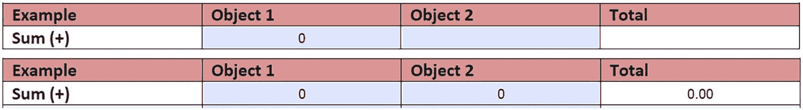

两个包含 4 列表格的截图，例如对象 1、对象 2 和总计，两表的第 1 列输入均为求和。表 1 的第 2 列输入为 0，其他列为空。表 2 的第 2 列和第 3 列值为 0，第 4 列值为 0.00。

**图 6-11** 当两个字段都有值时，验证在这些字段中按预期工作

有关其他相等与不等运算符及比较，请参考以下页面：

[`https://www.w3schools.com/js/js_comparisons.asp`](https://www.w3schools.com/js/js_comparisons.asp)

[`https://developer.mozilla.org/en-US/docs/Web/JavaScript/Reference/Operators`](https://developer.mozilla.org/en-US/docs/Web/JavaScript/Reference/Operators)

**注意**

在减法示例中，请转到“验证”选项卡，将名为 `TotalSubtract_3` 的 PDF 字段中的以下代码：

`event.value = a.value*1 + b.value*1;`

更改为：

`event.value = f.value*1 - g.value*1;`

为了使代码正确运行，“验证”选项卡上的变量值必须与整个代码中“计算”选项卡上的变量值匹配，因此请参考该字段的选项卡进行比较。例如，在代码中，必须将 `a.value` 变量替换为 `f.value`，将 `b.value` 变量替换为 `g.value`。对于以 `a.defaultValue` 或 `b.defaultValue` 结尾的变量，同样的变量替换也适用。

查看完表单后，点击预览右上角的“关闭”按钮以关闭“准备表单”工具。如果不确定此按钮的样子，请参考第 1 章的“表单审查”部分。仅当你进行了编辑时，才保存“开始”文件的副本。

### 下拉列表替代方案

如第 2 章所述，在此示例中，你可以将一些文本字段替换为下拉列表用于计算。虽然它们与文本字段类似，但我发现如果你希望客户使用非常特定的值，这种方法是一个很好的替代方案；它消除了对每个下拉列表进行验证的需要，因为值已经预设好了。你不应将最后的文本字段（只读）替换为下拉列表。尽管“验证”和“计算”选项卡确实适用于下拉列表，但最终结果实际上只有一个值。在第 12 章中，你将看到如何在需要时使用 JavaScript 将多个结果放入一个下拉列表中。请参考图 6-12。

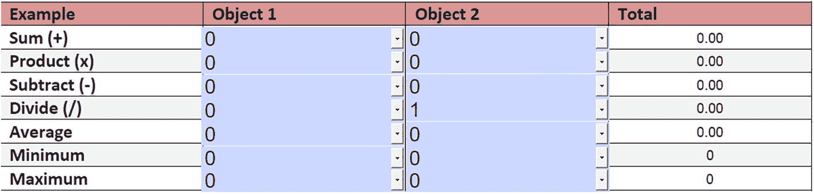

一个包含 4 列表格的截图，例如对象 1、对象 2 和总计。它有 7 行，分别用于和、积、差、商、平均值、最小值和最大值。对象 1、对象 2 和总计的列输入均为 0。

图 6-12

使用下拉列表填充字段进行计算

注意

对于下拉列表，我将“验证”选项卡上的“字段值未经验证”字段留空，因为我使用的是特定数值。与文本字段不同，下拉列表始终有值，绝不会出现空值。请参考本章文件夹中包含下拉列表的文件 `AcrobatCalculateTabExamples_End_option2DDown.pdf`。

#### 设置字段计算顺序

稍后，当你使用多个需要进行计算的字段时，可以使用“准备表单”工具右侧的选项，从“更多”列表中设置字段计算顺序。请参考图 6-13。

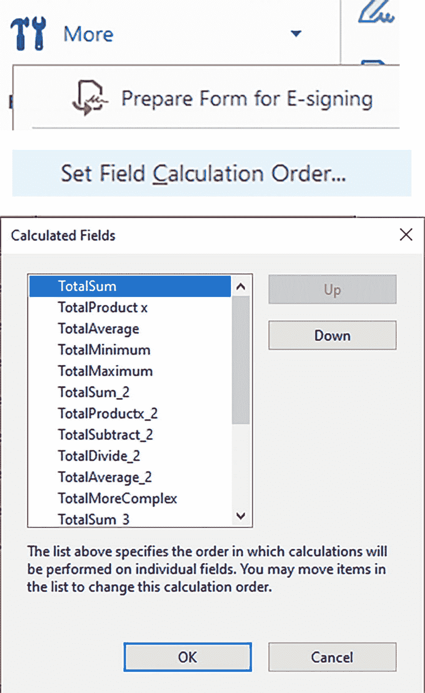

一个显示“更多”工具图标、随后是“准备表单进行电子签名”图标以及“设置字段计算顺序”选项卡的截图。它有一个对话框，其中包含计算字段的选项列表，当前选中了“总和计算”。

图 6-13

从“更多”菜单打开的“计算字段”对话框

当更多字段包含计算或被其他字段访问时，如果你发现某个计算未按你期望的顺序出现，能够通过在列表中向上或向下移动字段来设置顺序至关重要。这也是检查是否遗漏了某些本应使用“计算”选项卡的字段的好方法。在后续章节中构建更复杂的表单时，请将这一点与“显示选项卡编号顺序”功能牢记在心。

## 重置焦点字段

在表单或任何一组表单字段中进行计算时，可能会遇到需要重置字段的情况。此外，您可能希望表单用户点击重置按钮后，能返回到特定字段；通常这是表单中的第一个字段。这可以通过 JavaScript 实现。重置后，光标会被放置在活动字段中，用户就可以开始再次输入，而无需面对所有字段都处于非激活状态、不知从哪个字段开始输入的困扰。

我们可以在 `AcrobatResetField_Focus_End.pdf` 文件中看到一个基本示例。请参考图 6-14。

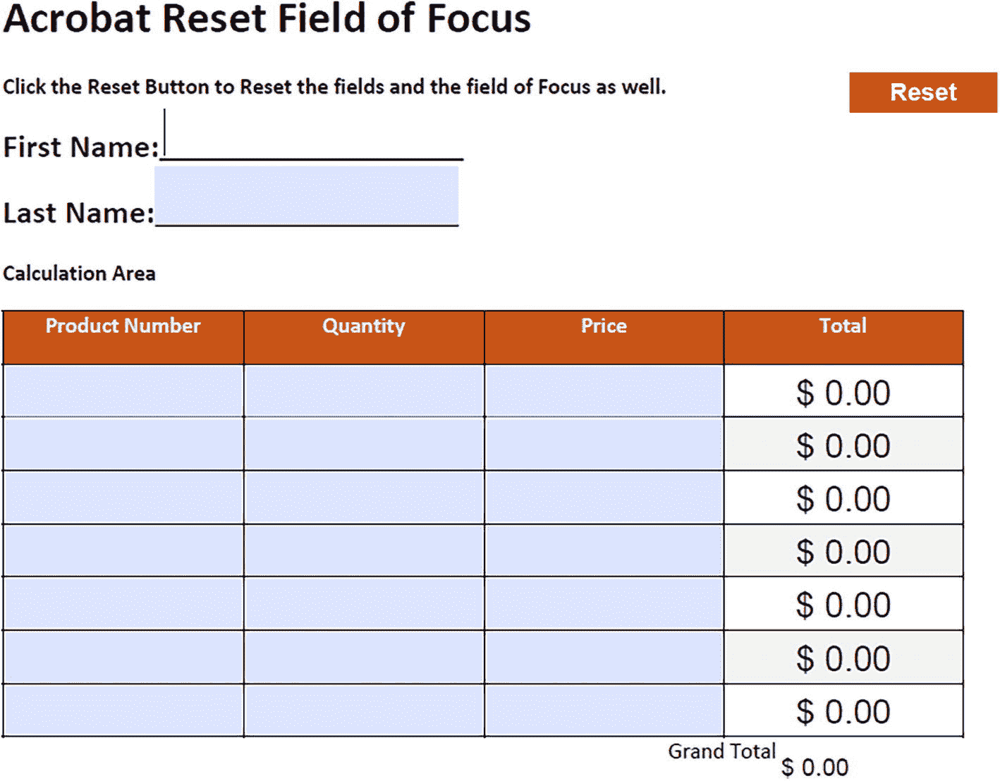

*Acrobat 焦点重置字段的截图，包含一个重置按钮，其后是用于输入名和姓的选项卡，以及一个计算区域表格。该表格有 4 列，分别用于产品编号、数量、价格和总计，以及 7 行。*

**图 6-14** 在表单中重置焦点字段

在这个例子中，我本可以使用 JavaScript 进行计算；但在这个案例中，我只是使用值。这与创建焦点字段无关；相反，请参考“操作”选项卡上的重置按钮属性。请参考图 6-15。

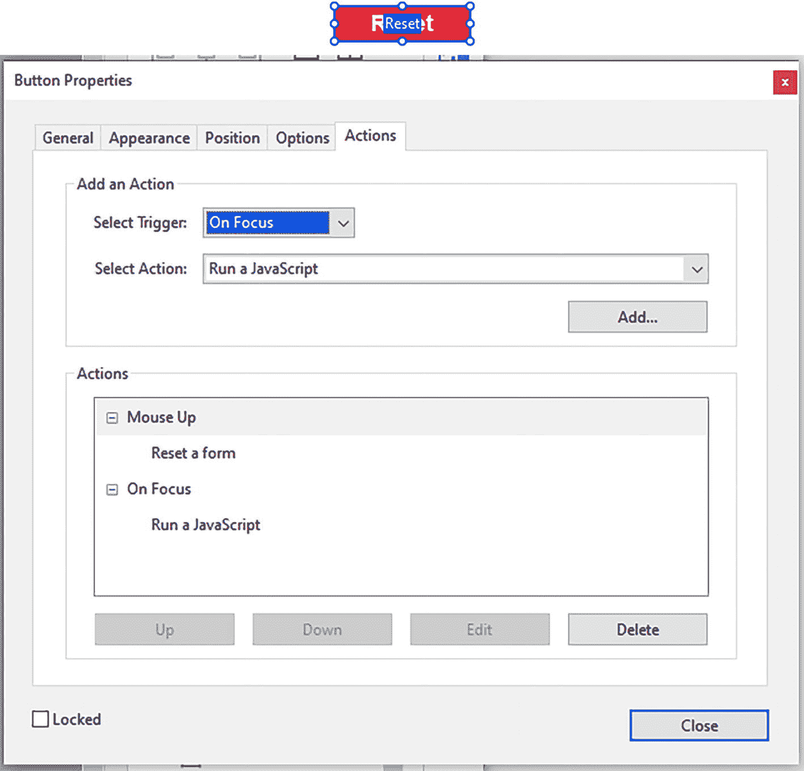

*截图显示已选中重置按钮，随后是按钮属性对话框，并选中了“操作”选项卡。它有两个下拉菜单，触发器选择为“获得焦点”，操作为“运行 JavaScript”。它有一个操作列表，后跟一个关闭按钮。*

**图 6-15** 在“按钮属性”对话框的“操作”选项卡上重置表单中的焦点字段

这里，我最初选择了“鼠标释放 - 重置表单”操作，你可以在第 2 章和第 4 章中了解如何执行此操作。但是，没有预设的方法来设置字段焦点，因此改为将触发器设置为“获得焦点”，然后选择“运行 JavaScript”操作并单击“添加”按钮。在此示例中，您可以选择该操作并单击“编辑”按钮来查看我的代码。请参考图 6-16。

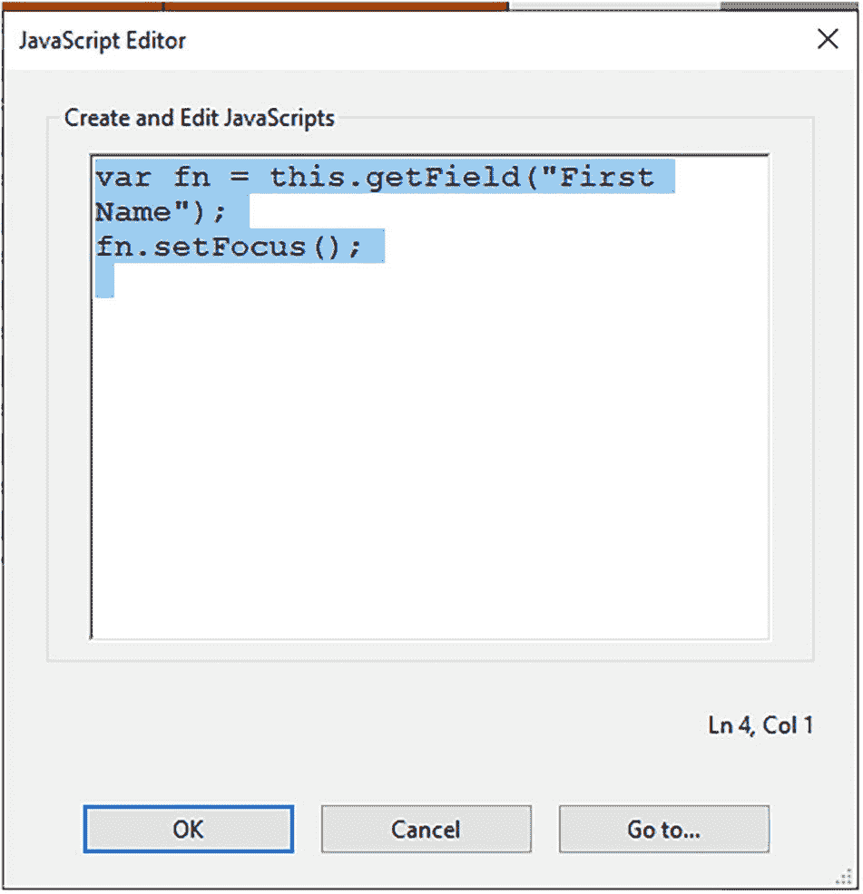

*JavaScript 编辑器对话框的截图，其中有几行代码用于创建和编辑 JavaScript。它有一个从字段中获取名字的函数，页面底部有一个确定按钮。*

**图 6-16** 焦点字段的 JavaScript 编辑器中的代码

```
var fn = this.getField("First Name");
fn.setFocus();
```

单击“确定”并退出 JavaScript 编辑器后，您可以关闭“属性”面板，然后单击“预览”按钮测试字段。然后点击“重置”按钮，焦点字段将变为名为“First Name”的文本字段。

对于您自己的项目，请尝试更改 JavaScript 代码中的字段名称，以设置新的焦点字段。

我们将在第 10 章中看到另一个 `setFocus();` 的示例，届时文本框内容过满时，您需要使用另一个字段来继续输入文本。

## 本章小结

在本章中，您了解了使用“计算”选项卡向表单字段添加计算的三种方法。

*   值

*   简化域表示法 (SFN)

*   自定义计算脚本 (JavaScript)

虽然每个示例都逐渐变得更加复杂，但随着您向 JavaScript 迈进，更广泛的可能性也随之打开。

您还了解了将 JavaScript 添加到“验证”选项卡如何使我们能够查看“总计”字段何时被使用以及何时未被使用。为客户提供准确的表单信息更新非常重要。

最后，您了解了如何添加焦点字段，这样当表单被重置时，用户就知道从哪里开始重新输入。

在下一章中，您将探索自定义 JavaScript 如何影响“格式”选项卡，具体涉及以下方面：

*   数字

*   百分比

*   日期

*   时间
