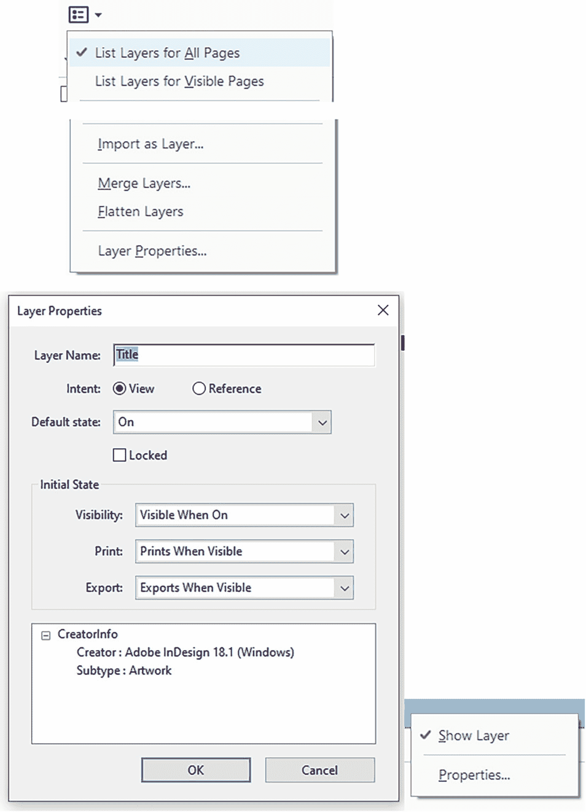

# 页面截图中有一个图层图标。它展示了第 3 章平面图布局的展开视图，包含 4 个选项：供应商编号、座位布局、标题、参考线和网格，其中标题选项高亮显示。

**图 4-22**  
在“导航面板”区域访问图层

要访问图层属性，你可以选择一个图层，然后从 `Options` 菜单中，选择列表底部的 `Layer Properties`。或者，你可以右键点击一个图层并选择 `Properties`（请参考图 4-23）。

