# 图层属性

图层属性页面的截图中，有一个用于输入图层名称的文本框、两个关于“用途”的选项、一个用于“默认状态”的下拉菜单、关于“初始状态”的详细信息（包含“可见性”、“打印”和“导出”三个下拉菜单），以及一个用于“创建者信息”的框。

**图 4-23** 在平面图示例中，当你选择一个图层并从 `Options` 菜单中选择，或在导航面板中右键点击该图层时，所看到的图层属性

与某些按钮导航设置相比，图层操作的构建可能稍微复杂一些。我建议使用像 InDesign 这样的程序来创建你的初始图层布局，并将其导出为交互式 PDF，正如你在 `Creator Info` 区域所看到的那样。不过，以下是一些帮助你开始使用 `Layer Properties` 对话框的技巧：

*   图层操作与 Acrobat 页面过渡效果有一些相似之处。
*   图层有名称，并且具有“视图”或“参考”的用途。
*   图层可以具有“开”或“关”的默认状态。
*   它们可以被锁定或解锁。
*   你可以设置图层的初始状态，用于以下方面：
    *   可见性（“开”、“从不”或“始终可见”）
    *   打印（“可见时”、“从不”或“始终”）
    *   导出（“可见时”、“从不”或“始终”）
*   图层非常适合用于覆盖图，例如显示房间或楼层的可选布局。当你创建交互式 PDF 时，可以从诸如 Adobe InDesign 之类的程序分离并导出图层。
*   与其他操作不同，图层操作可能设置起来比较棘手，最好只保留一两个图层。

稍后，我将展示如何添加一些按钮，以使图层在 PDF 中更具交互性，从而显示和隐藏图层的可见性。

如你所见，这些非表单属性大部分都可以在 Acrobat 的“导航面板”/“缩略图”区域访问。图层也是如此。

## 可能间接影响便签或标记工具的其他非表单操作

最后，我要在这里以及稍后的第 8 章（关于时间戳）中指出的一个问题是，非表单或表单按钮，当用自定义 JavaScript 进行编程时，可以设置为更改已放置注释或图章的外观。但是，虽然图章、注释、标记工具和测量工具在右键点击时确实具有你可以访问的属性，但它们没有 `Actions` 选项卡。因此，如果没有先通过按钮或表单字段应用某个间接触发器，它们本身无法应用任何操作。

## 动作触发器

在从“动作”选项卡选择动作之前，首先要选择一个触发器。

`触发器 + 选择动作 = 你想要的结果`

数字表单中最常用的触发器是 `鼠标弹起`，如图 4-24 所示。

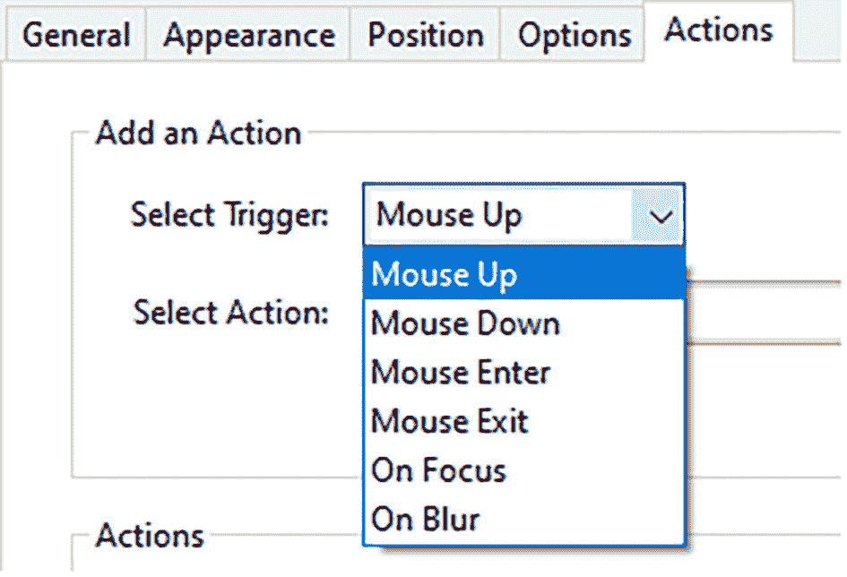

页面截图显示有五个选项卡，分别为常规、外观、位置、选项和动作，其中动作选项卡已被选中。其中包含一个添加动作的区块，带有一个用于选择触发器的下拉菜单。该菜单有多个选项，其中“鼠标弹起”选项被选中。

**图 4-24** 可选择的各类动作触发器

以下是对此触发器的说明，以及您可能会遇到的几个其他动作：

- `鼠标弹起`：当鼠标单击后释放按钮时触发。这是最常用的按钮触发器，因为它让用户有最后一次机会将指针拖离按钮，从而不会激活该动作。
- `鼠标按下`：当鼠标按钮被按下（未释放）时触发。在大多数情况下，`鼠标弹起`是首选的触发器，因为按下时不给用户任何改变主意的机会。虽然对于带有复选框的按钮来说这可能不太明显，但此触发器可能反应过快。
- `鼠标进入`：当指针进入字段或播放区域时触发。
- `鼠标退出`：当指针离开字段或播放区域时触发。
- `接收焦点时（仅限媒体剪辑）`：当链接区域通过鼠标操作或按 Tab 键获得焦点时触发。这也称为 `获得焦点`。
- `失去焦点时（仅限媒体剪辑）`：当焦点移动到另一个链接区域时触发。这也称为 `失去焦点`。

书签和超链接是例外情况；它们没有可用的触发器。假设您会用鼠标或手指点击链接，并执行跳转到该页面或 URL 的动作。然而，如前所述，页面确实具有页面打开时或页面关闭时的可选触发器。

有关其他媒体剪辑触发器的更多详细信息，请参考以下 Adobe 页面：[`https://helpx.adobe.com/acrobat/using/applying-actions-scripts-pdfs.html`](https://helpx.adobe.com/acrobat/using/applying-actions-scripts-pdfs.html)。

## 选择无需编码的动作

有许多动作可供您选择。如图 4-25 所示，一旦您选择了触发器，就可以设定当您单击 `添加` 按钮时执行所选动作。退出对话框后，应用于该按钮的动作将使您能够跳转到另一个页面或打印文档中的所有页面等。

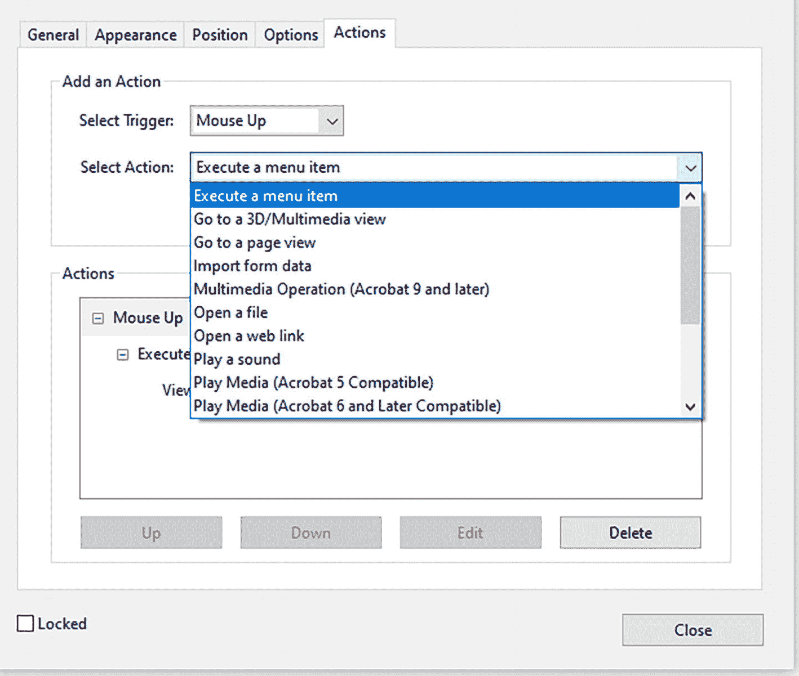

页面截图显示有五个选项卡，其中动作选项卡被选中。其中包含一个添加动作的区块，带有两个下拉菜单，一个用于选择触发器（已选中“鼠标弹起”选项），另一个用于选择动作（已选中“执行菜单项”选项）。

**图 4-25** 可选择的各类动作

稍后您将了解一些特定动作。不过，请先花点时间回顾一下一些可选动作，如下所列：

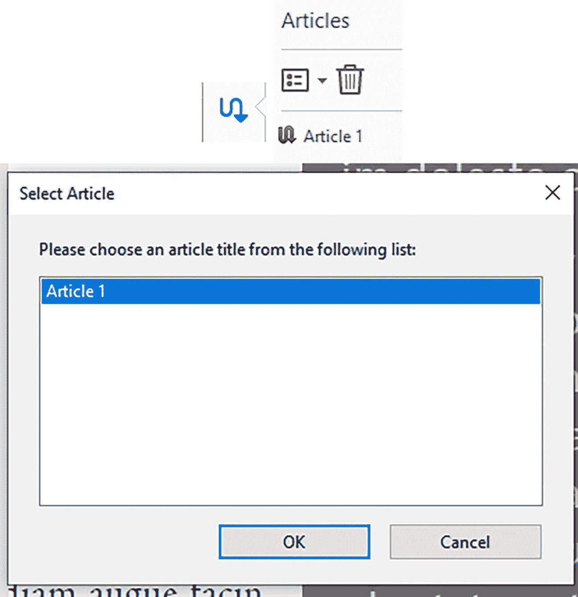

页面截图显示“文章”下方的选项以及文章 1 的图标。它有一个弹出窗口，用于选择文章，其中包含一个文章标题列表，文章 1 已被选中。弹出窗口底部有一个“确定”按钮。

**图 4-26** “选择文章”对话框及 PDF 中的文章缩略图

- `执行菜单项`：执行指定的菜单命令作为动作。此区域至少有 50 个菜单项选项。
- `转到 3D/多媒体视图`：跳转到指定的 3D 视图。这些 3D 注释视图必须已存在于文档中。这更适用于处理非表单按钮。
- `转到页面视图`：跳转到当前文档中指定的目标位置。使用滚动条、鼠标和缩放工具选择目标视图，然后按对话框中的 `设置链接` 按钮来创建链接目标。
- `导入表单数据`：从另一个文件导入表单数据，并将其放入当前活动表单中。所选文件为 `FDF` 格式。
- `多媒体操作（Acrobat 9 及更高版本）`：对文件中的多媒体对象或注释执行指定动作（例如播放声音文件）。必须先向文件中添加多媒体对象，然后才能在对话框中为其指定动作。
- `打开文件`：启动并打开与 PDF 位于同一文件夹中的链接文件。如果您分发的 PDF 文件包含指向另一个文件的链接，读者需要拥有该链接文件的原生应用程序才能成功打开它。您可能需要以注释等形式添加关于目标文件打开首选项的信息。
- `打开 Web 链接`：跳转到互联网上指定的 URL 目标。您可以使用 `HTTP`、`HTTPS`、`FTP` 和 `mailto` 协议来定义链接。
- `播放声音`：播放指定的 `WAV` 或 `AIFF` 格式的声音文件。该声音以跨平台格式嵌入到 PDF 文档中。
- `播放媒体（兼容 Acrobat 5、Acrobat 6 及更高版本）`：播放指定以 Acrobat 5 或 6 兼容格式创建的 `QuickTime` 或 `AVI` 影片。指定的影片必须嵌入在 PDF 文档中。如果文档中没有此类媒体，则不会创建该动作。
- `阅读文章`：遵循活动文档中的文章线索或文章框。它们使用 `编辑 PDF` 工具创建。要执行此动作，左侧窗格的文章缩略图中必须存在一篇文章。选择 `视图 ➤ 显示/隐藏 ➤ 导航窗格 ➤ 文章`。请参考图 4-26。

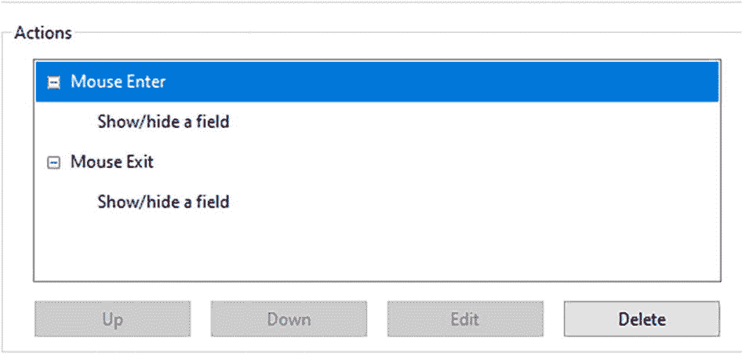

动作页面截图显示有鼠标进入和鼠标退出两个选项，每个选项都有显示或隐藏字段的操作。鼠标进入的第一个选项被选中。页面底部有四个按钮，其中“删除”按钮被选中。

**图 4-27** 设置显示和隐藏字段动作顺序的示例

- `重置表单`：清除表单中先前输入的数据。您可以通过“选择要重置的字段”对话框来控制要重置的字段，如第 2 章所示。
- `运行 JavaScript`：运行指定的 JavaScript。这需要 JavaScript 执行一些自定义操作，这些操作需在“JavaScript 编辑器”中输入。
- `设置图层可见性`：确定哪些图层设置处于活动状态。在添加此操作之前，请为当前状态指定适当的图层设置。这将与图层属性配合使用，我们将在本章后面看到。
- `显示/隐藏字段`：在 PDF 文档中切换显示或隐藏某个字段。此选项在表单字段中特别有用。例如，如果您希望鼠标指针悬停在按钮上时弹出一个对象，您可以设置一个操作，在 `鼠标进入` 触发器上显示一个字段，并在 `鼠标离开` 时隐藏该字段。请注意，在这种情况下，您的“操作”选项卡上将存在两个操作。然后，您需要将操作在列表中上下移动，如果需要更正，还需要逐一编辑它们。请参考图 4-27。

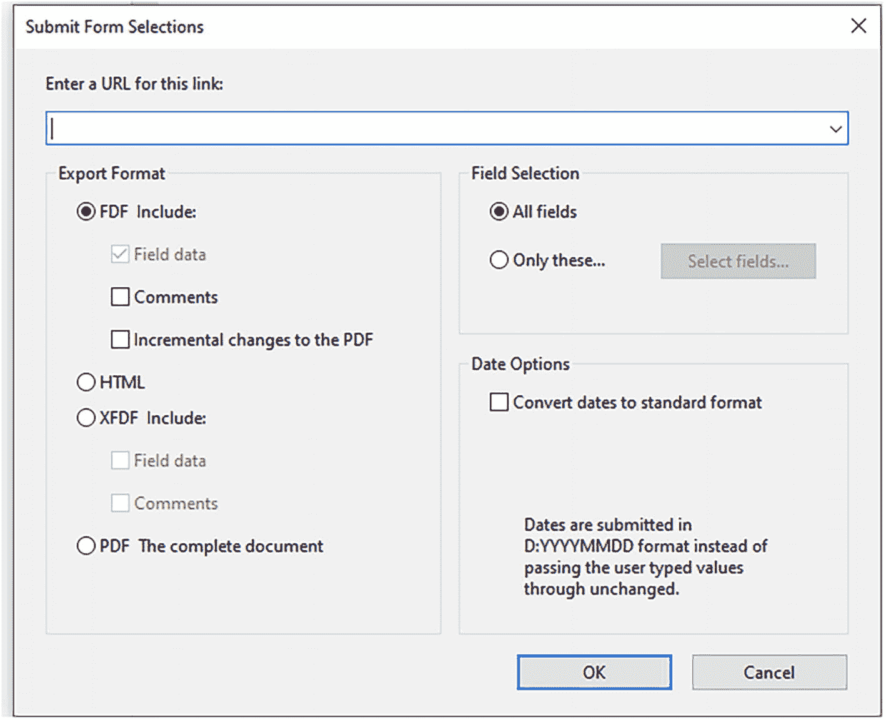

“提交表单选择”页面的截图。它有一个用于输入链接 URL 的框，其后是导出格式（选择为 PDF）、字段选择（所有字段）和数据选项。页面右下角有一个“确定”按钮。

**图 4-28** “提交表单选择”对话框

# 表单操作与导航

## 提交表单
将表单数据发送到指定的 URL 或电子邮件。您可能需要让 IT 部门的人先帮忙测试，并选择正确的导出格式、字段选择和数据选项（参见图 4-28）。

需要注意的是，对于第一个选项“执行菜单项”，当单击“添加”按钮时，将会出现另外 50 多种可能的操作变体。这些包括用于页面和文档导航的各种选项。其中包括`视图 ➤ 页面导航 ➤ 转到页面`，这是一个与书签类似的设置。菜单项分为几类，主要位于主菜单中：`文件`、`编辑`、`视图`、`书签`、`杂项`和`工具`。

图 4-29 和 4-30 说明了可用的选项。

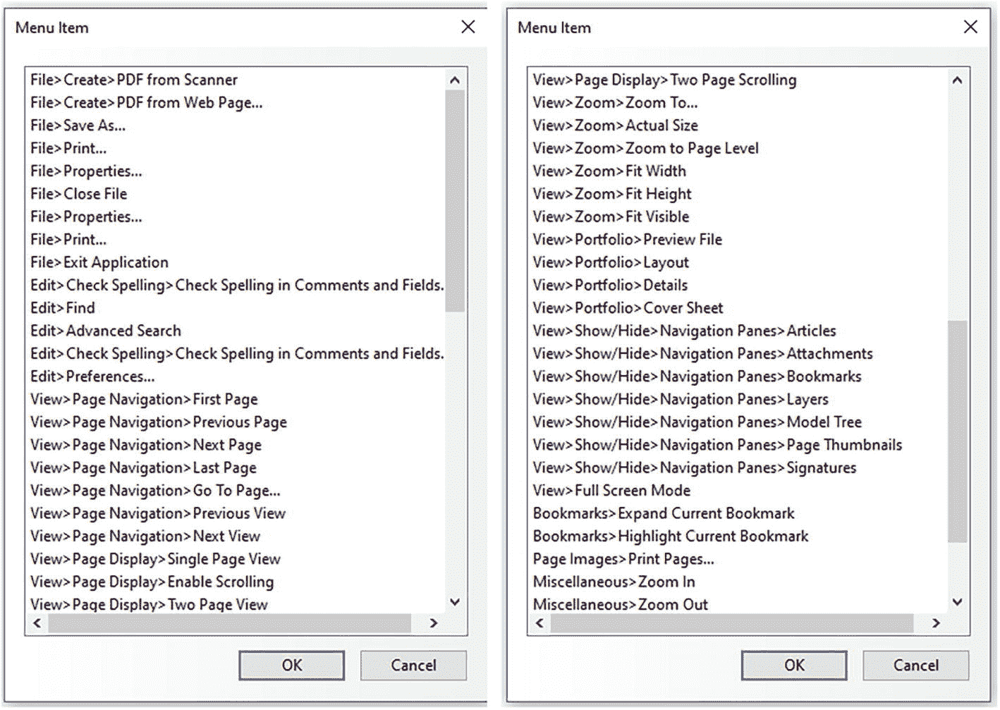

菜单项页面的两张截图。每个页面都有一个选项列表，页面底部有“确定”和“取消”两个按钮，其中“确定”按钮被选中。

**图 4-30** 众多可用的不同菜单选项

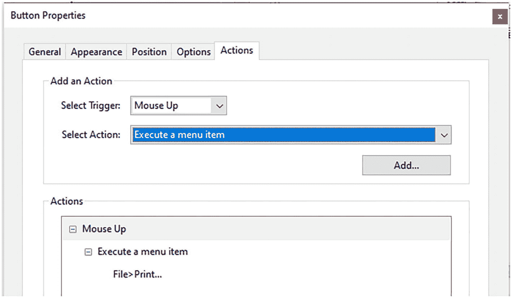

按钮属性页面的截图，它有 5 个选项卡：`常规`、`外观`、`位置`、`选项`和`操作`，其中`操作`选项卡被选中。它有两个下拉菜单，用于选择触发器为`鼠标松开`和操作为执行菜单项。它有一个用于操作的动作框，其中包含一个操作列表。

**图 4-29** 从所选操作“执行菜单项”添加到“操作”选项卡的操作示例

如前所述，在“操作”选项卡上，可以为单个触发器添加多个操作。此外，还可以为每个字段添加具有不同操作的独立触发器；只需选择它们并单击“添加”按钮即可。一个例子是显示和隐藏表单上的项目；请根据字段的选择，参考图 4-27 和图 4-31。应用了这些操作的字段或按钮会显示一些字段，然后隐藏其他字段。

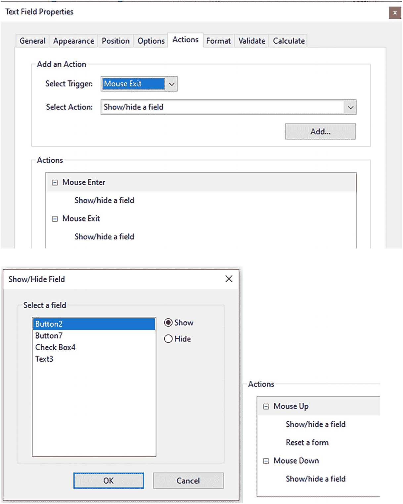

文本字段属性页面的截图，它有 8 个选项卡，其中`操作`选项卡被选中。它有一个下拉菜单，用于选择触发器为`鼠标离开`和操作为`显示/隐藏字段`。它有一个用于“显示/隐藏字段”的对话框，其中包含一个字段列表，并且选中了`button 2`。

**图 4-31** 应用于一个字段的多个触发器和操作

## 使用按钮的通讯稿导航
打开第 4 章文件夹中的“Newsletter 1 Navigation End”文件。测试这些按钮。您可以使用带或不带图像的标签来增强导航体验。请参见图 4-32，查看应用了导航操作示例的按钮。

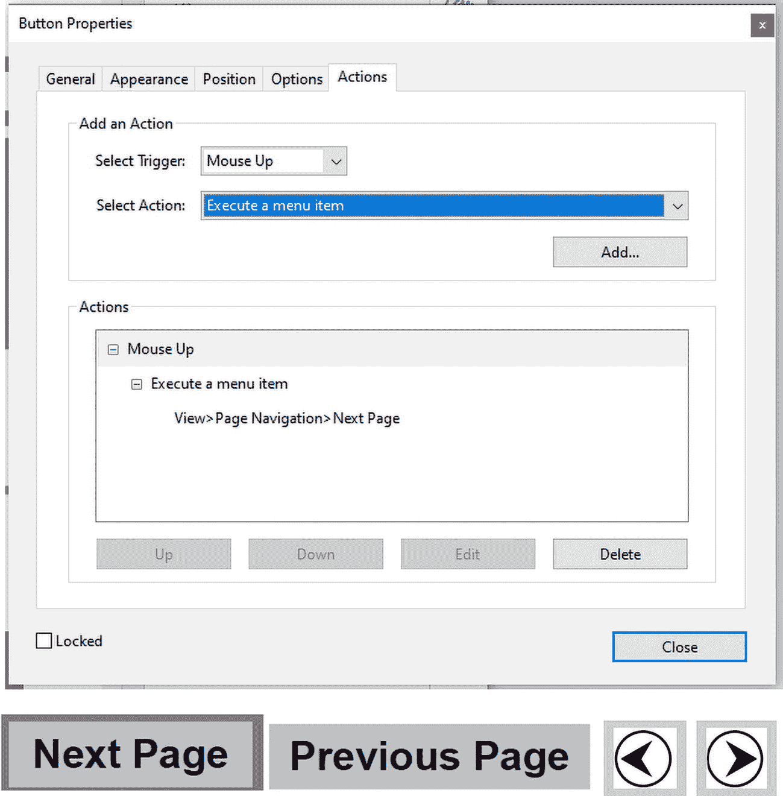

按钮属性页面的截图，它有 5 个选项卡，其中`操作`选项卡被选中。它有一个下拉菜单，用于选择触发器为`鼠标松开`和操作为执行菜单项。它有“下一页”和“上一页”两个按钮，其中“下一页”按钮被选中。

**图 4-32** 对按钮应用操作以导航到其他页面（请参阅“Newsletter 1 Navigation End”文件的第 1-3 页）

在您自己的项目中，选择一个“执行菜单项”的操作，并将以下一种导航类型应用于您的按钮：

`视图 ➤ 页面导航 ➤`

- `第一页`
- `上一页`
- `下一页`
- `最后一页`
- `转到页面`
- `上一视图`
- `下一视图`

如图 4-30 所示，其他查看类型包括：

- `页面显示`
- `缩放`
- `作品集`
- `显示/隐藏导航窗格`
- `全屏模式`

通讯稿文档中的“下一页”按钮和右箭头图标按钮已应用了操作`视图 ➤ 页面导航 ➤ 下一页`。“上一页”按钮和左箭头按钮已应用了操作`视图 ➤ 页面导航 ➤ 上一页`。请参考图 4-32。

要导航到同一文件夹中的文件或 PDF 文档内的附件，请参见图 4-33，其中第 4 页上有一个“转到表单”按钮，查看已应用的操作。

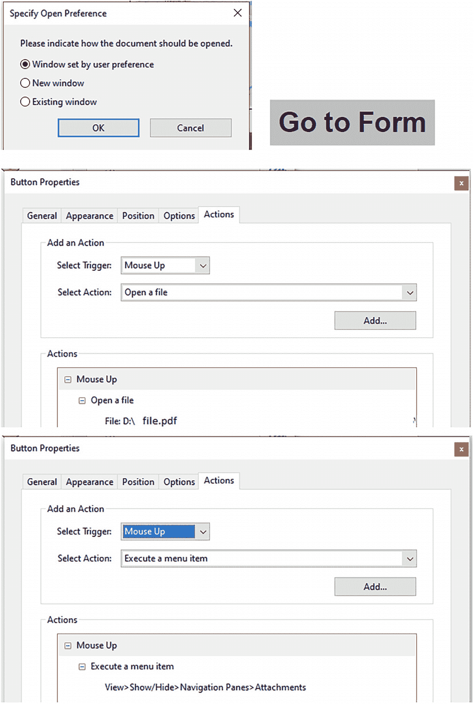

三张截图。第 1 页指定打开首选项，有 3 个选项，其中`用户偏好`被选中。第 2 页为按钮属性，触发器为`鼠标松开`，操作为`打开文件`。第 3 页为按钮属性，触发器为`鼠标松开`，操作为执行菜单项。

**图 4-33** 导航到硬盘驱动器上的某个文件或 PDF 文件“附件”窗格内的文件。请参阅“Newsletter 1 Navigation End”PDF 的第 4 页

创建了“转到表单”按钮后，您可以执行以下选择操作之一来打开表单：

- `打开一个文件`。
- `执行视图 ➤ 显示/隐藏 ➤ 导航窗格 ➤ 附件`。

如前所述，类似的导航可以是超链接甚至书签。

在“Newsletter 1 Navigation End”PDF 中，您可以更改第 1 页上带有文本“中国的新发现”的 URL 链接。此链接可以指向一个网站，或者如果文本被高亮显示，则可以将其添加为新的书签，点击时该书签将锚定或跳转到该页面。但是，如果您因为更改了“属性操作”选项卡上的链接，导致书签名称与章节标题不再相同，您可以通过双击书签来重命名它，如图 4-34 所示。书签现已重命名，并与它跳转到的 URL 或章节相匹配。

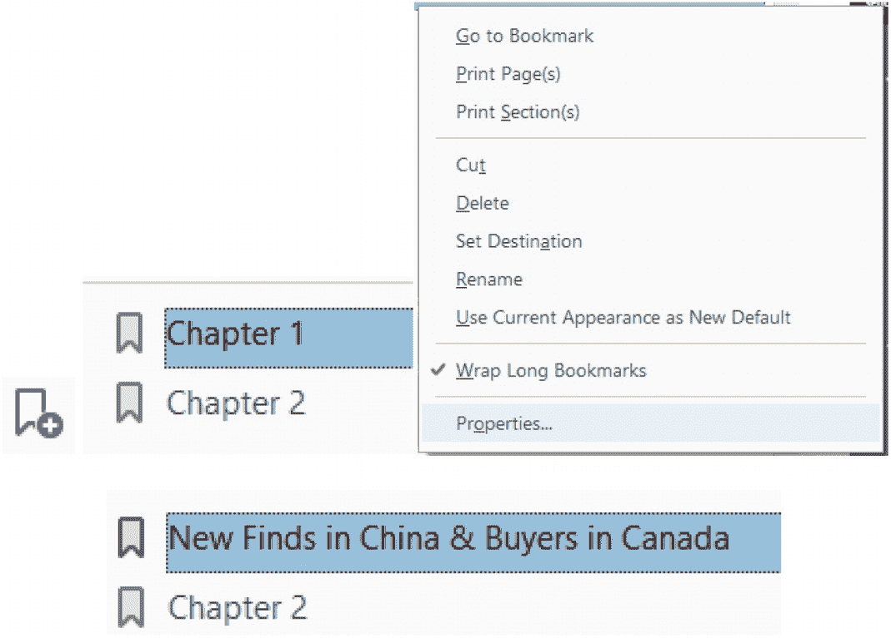

书签页面的截图，它有 2 个书签，分别对应`第 1 章`和`中国的新发现`，并且选中了`加拿大的买家`。页面右侧有一个包含多个选项的对话框，并选中了`属性`选项。

**图 4-34** 书签可用作书籍内部章节的链接，或用于导航到 URL

### 使用按钮进行表单导航作为帮助提示
如果客户不确定在某字段中输入什么，可以创建一个提示来提供信息。打开 TMC 订单表单“结束”PDF 示例了解具体实现。

此示例使用“显示/隐藏字段”来实现。请参考文本“客户订单代码”旁边的按钮，以及图 4-35。

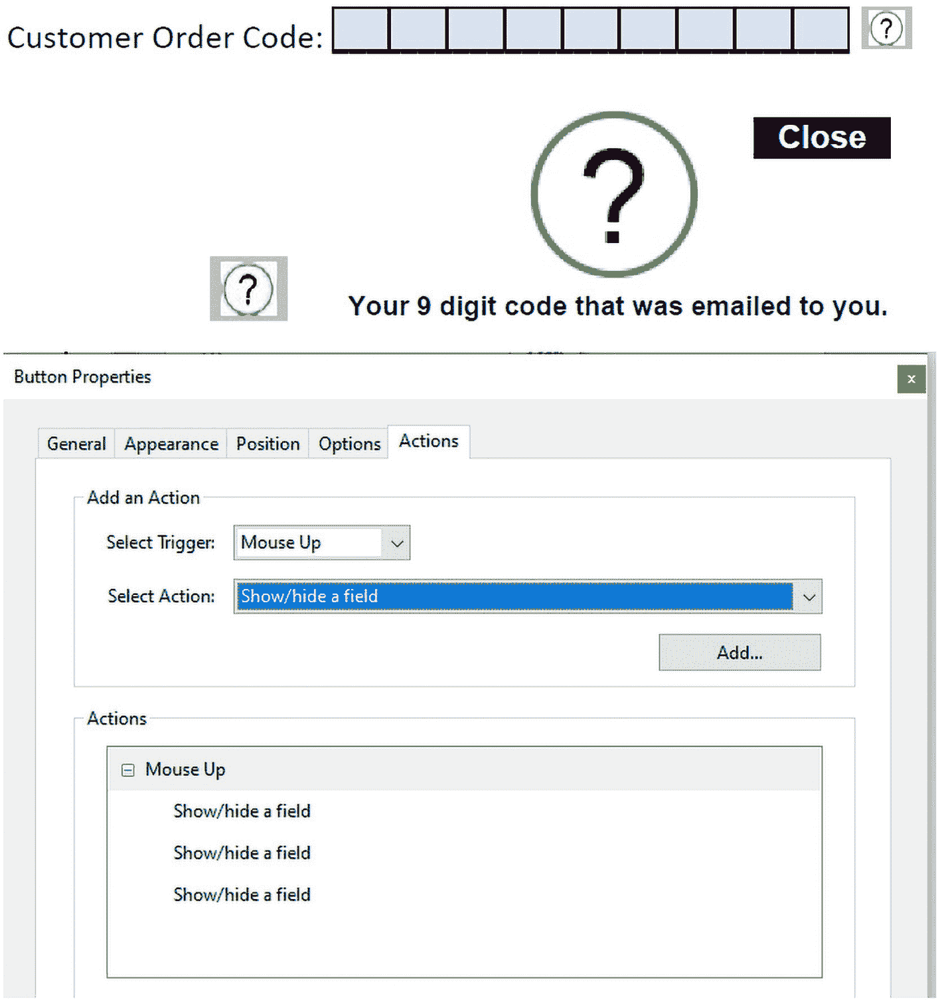

页面截图：有一个输入客户订单代码的框，右侧有一个问号图标和一个关闭按钮。该截图还显示了按钮属性，其中选中了“动作”选项卡，触发器为“鼠标松开”，动作为“显示或隐藏字段”。

**图 4-35** 包含“动作”选项卡的显示与隐藏示例

以下是各个按钮的说明：

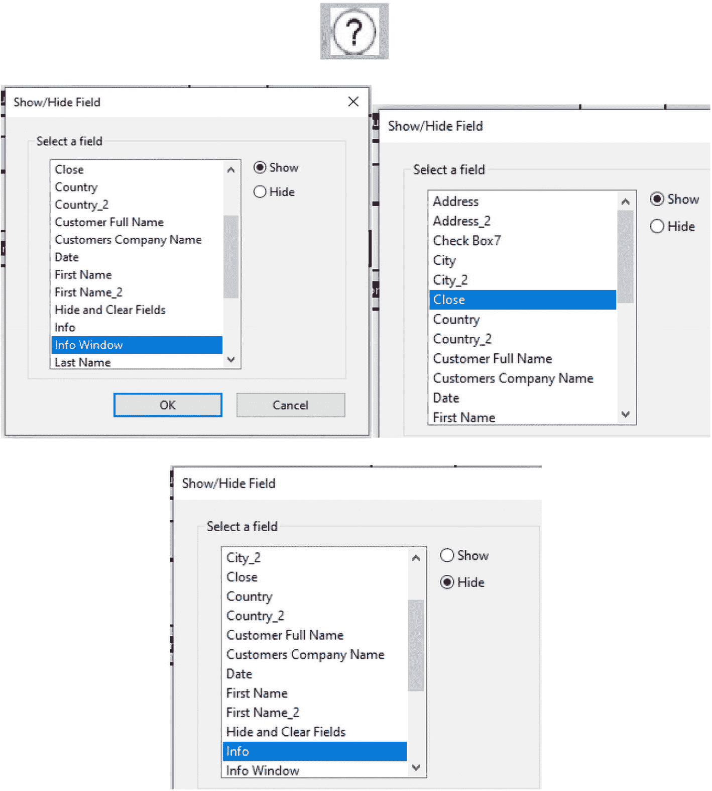

页面截图：顶部有一个带问号的按钮。下方有三个显示/隐藏字段的对话框，包含多个选项。框 1 选中了“信息窗口”，框 2 选中了“关闭”，框 3 选中了“信息”选项。

**图 4-36** “信息”按钮最初可见，其他按钮设置为隐藏

- **信息按钮**：显示-关闭，显示-信息窗口，隐藏-信息（图 4-36）。

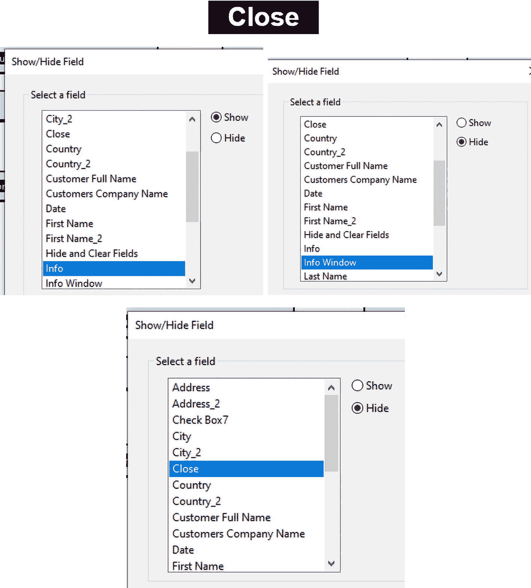

三个显示/隐藏字段对话框的截图：框 1 选中了“信息”选项，框 2 选中了“信息窗口”选项，框 3 选中了“关闭”选项。

**图 4-37** “关闭”按钮显示在“信息窗口”按钮之上

- **关闭按钮**：隐藏-关闭，隐藏-信息窗口，显示-信息（图 4-37）。

页面截图：右上角有一个问号图标和一个关闭按钮。下方有一行文本，内容为“通过电子邮件发送给您的 9 位代码”。

**图 4-38** “信息窗口”按钮显示在“关闭”按钮之下

- **信息窗口按钮**：不应用任何动作。将“动作”选项卡留空，并在顶部保持“关闭”按钮可见（图 4-38）。

---

### 添加字符组合框
**字符组合框**会将用户输入的文本均匀分布在整个文本字段的宽度上。如果在“外观”选项卡中指定了边框颜色，则字段中输入的每个字符都会被该颜色的线条分隔。此选项仅在“选项”选项卡上未选中任何其他复选框时可用；请参考图 4-39。

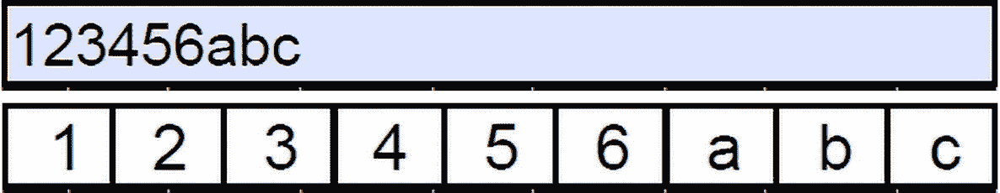

页面截图：有两个框。框 1 中的文本显示为“1、2、3、4、5、6、a、b、c”。框 2 中有 9 个格子，每个格子内分别显示“1、2、3、4、5、6、a、b、c”。

**图 4-39** 未使用与使用了字符组合框的对比

> **注意**：当输入代码时，添加字符组合框属性会很有帮助，这样客户就知道他们输入了正确数量的字母或数字。请记住，这是一个单一字段，因此不能在字符组合的不同部分之间使用制表符跳转。

#### 应用字符组合框之前与之后
图 4-40 展示了在应用字符组合框之前，“选项”选项卡上的文本字段外观。当你取消选中所有其他选项时，字符组合框选项才会可用，从而可以更改其中的字符数量。你可以指定 1 到 999 之间的数字。

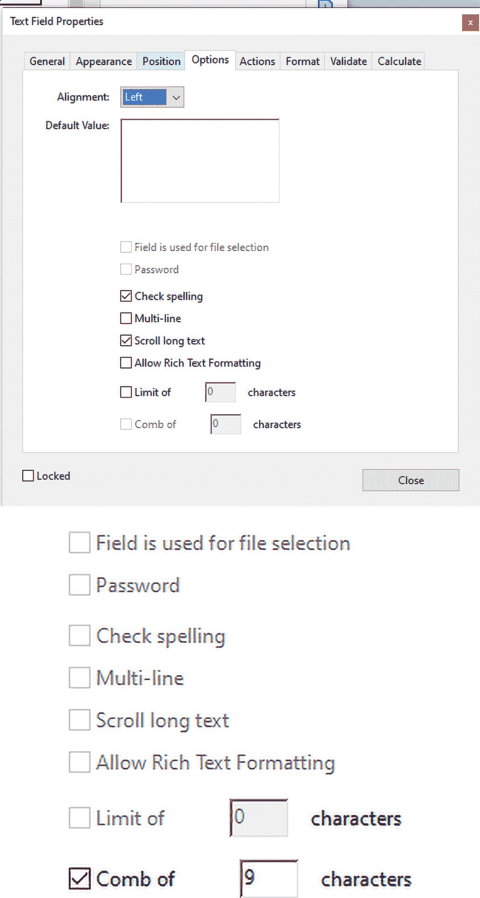

文本字段属性截图：选中了“选项”选项卡，对齐方式为“左”，并有几个复选框，其中“拼写检查”和“滚动长文本”被选中。页面底部有几个复选框，其中“组合”选项被选中，字符数设置为 9。

**图 4-40** 在“选项”选项卡上为文本字段添加字符组合框

为了正确显示字符组合框，请转到“外观”选项卡，添加边框颜色、线条粗细和线条样式；请参考图 4-41。

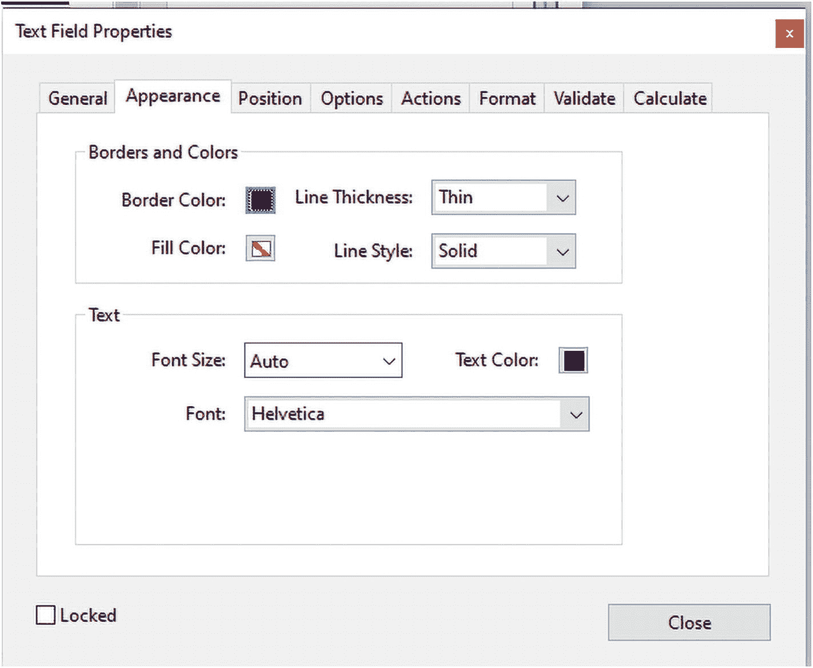

文本字段属性页面截图：选中了“外观”选项卡。其中包含边框和颜色的详细信息，包括边框颜色、线条粗细、填充颜色和线条样式。还包含文本的详细信息，包括字体大小、文本颜色和字体。

图 4-41 在“外观”选项卡上调整字符组合框的外观

如果你觉得某种字体大小和颜色更易于查看，你也可以调整文本选项；在这里，我保留了黑色。在第 7 章中，我将展示如何使用带有“格式”选项卡的字符组合框。

还有其他方法可以在客户不确定输入什么时帮助他们，我们将在后续章节中介绍。

---

### 更多用于显示和隐藏的动作触发器

可以结合使用复选框和按钮来创建显示或隐藏字段。请参考 TMC 订单表单结束文件，查看启用复选框时的最终示例，如图 4-42 和图 4-43 所示。

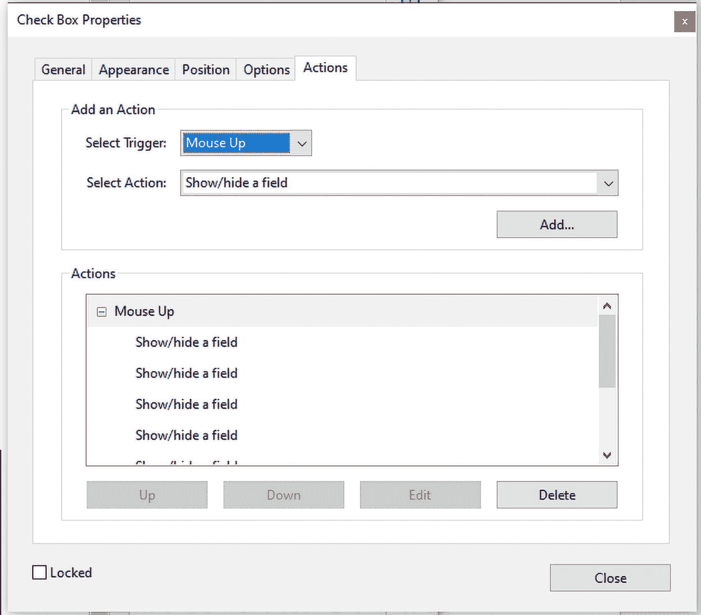

复选框属性页面截图：有 5 个选项卡，其中选中了“动作”选项卡。有一个下拉菜单，触发器为“鼠标松开”，动作为“显示或隐藏字段”。下方有一个动作列表，随后是 4 个按钮，其中“删除”按钮被选中。

图 4-43 使用复选框和“动作”选项卡显示/隐藏送货地址

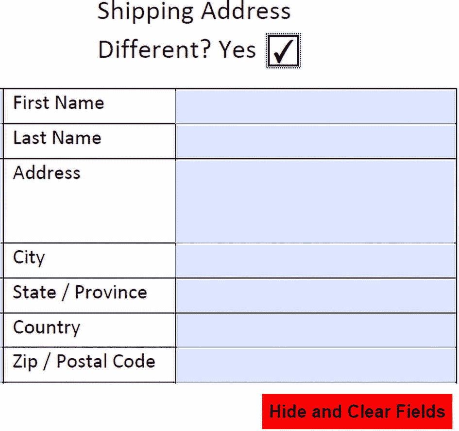

页面截图：有一个“不同送货地址”复选框，标记为“是”。下方是一个包含 7 行的表格，包括名、姓、地址、城市、州/省、国家和邮政编码。页面右下角有一个亮色的“隐藏并清除字段”按钮。

图 4-42 使用复选框显示/隐藏送货地址

复选框`Check Box7`的动作设置是在鼠标松开时触发。

对于每个“显示/隐藏文本和按钮”字段，请一次显示一个字段（图 4-44）。

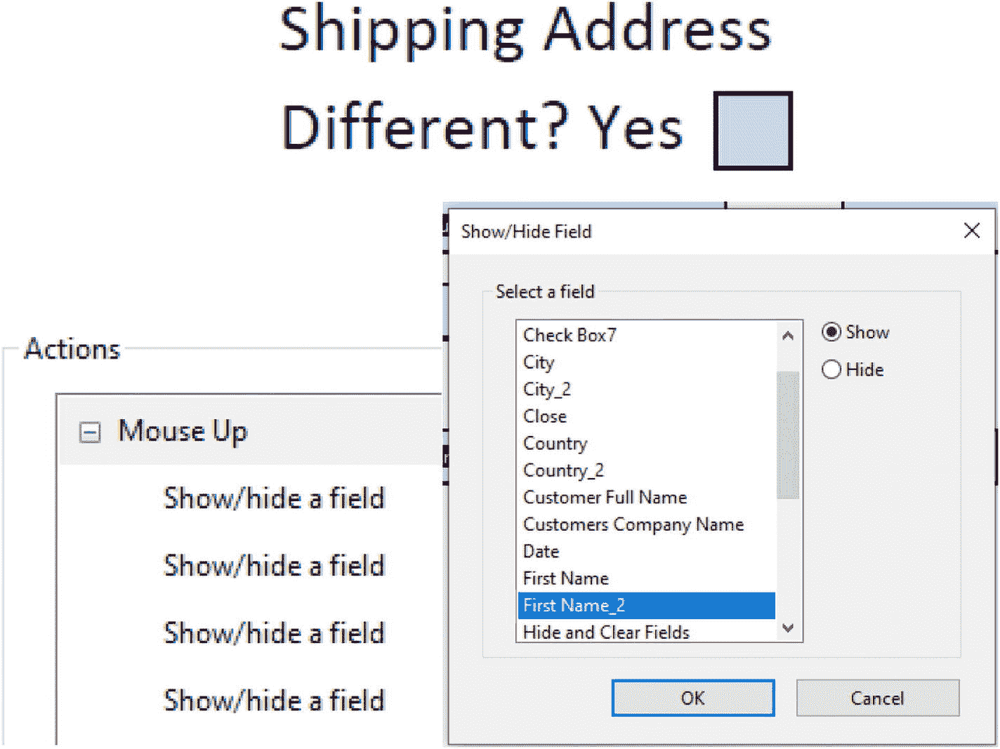

页面截图：有一个“不同送货地址”复选框，未选中。还有一个显示/隐藏字段的对话框，其中包含一个字段列表，列表中选中了`First Name_2`选项，旁边有一个确定按钮。

图 4-44 单击复选框时，表单中的某些字段将显示（它们之前是隐藏的）

由于必须一次设置一个显示字段，请参考以下列表，查看哪些字段应设置为“显示”：

- `First Name_2`
- `Last Name_2`
- `Address_2`
- `City_2`
- `Province_2`
- `Country_2`
- `Postal Code_2`
- `Hide and Clear Fields Button`

### 隐藏并清除字段按钮

此按钮结合使用了`重置`和`显示/隐藏`功能。如果收货地址相同，则无需存储重复数据，因此可以清除勾选复选框时显示的字段，然后再次隐藏它们以及该按钮。请参考图 4-45。

一张亮色按钮的截图，按钮上带有文字、隐藏和清除字段。

图 4-45 重置按钮

图 4-46 显示了按钮操作的设置。

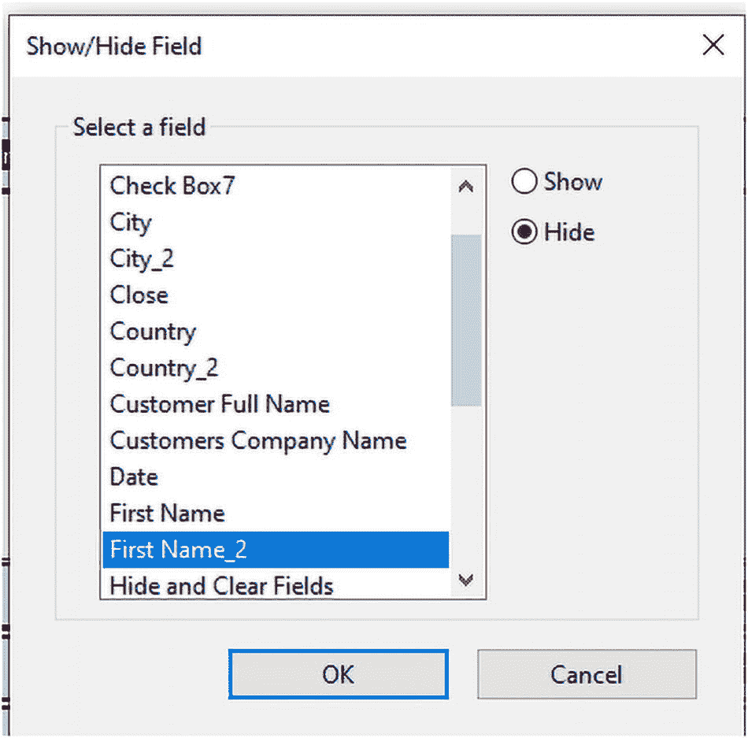

一张显示或隐藏字段页面的截图，右侧有一个字段列表，并带有显示和隐藏的复选框。已选中隐藏选项，并从字段列表中选择了`first name underscore 2`。页面底部有一个确定按钮。

图 4-46 点击该按钮时，表单中的某些字段将被隐藏

由于必须逐一设置隐藏字段，请参考以下列表以确定哪些字段应设置为`隐藏`：

- `First Name_2`
- `Last Name_2`
- `Address_2`
- `City_2`
- `Province_2`
- `Country_2`
- `Postal Code_2`
- `隐藏并清除字段按钮`

最后，将所有之前变为可见的字段（包括`Check Box7`）重置为之前的空白状态。唯一无法重置的字段是按钮；你只能将其隐藏。此重置操作已移至该列表的顶部。请参考图 4-47 和图 4-48。

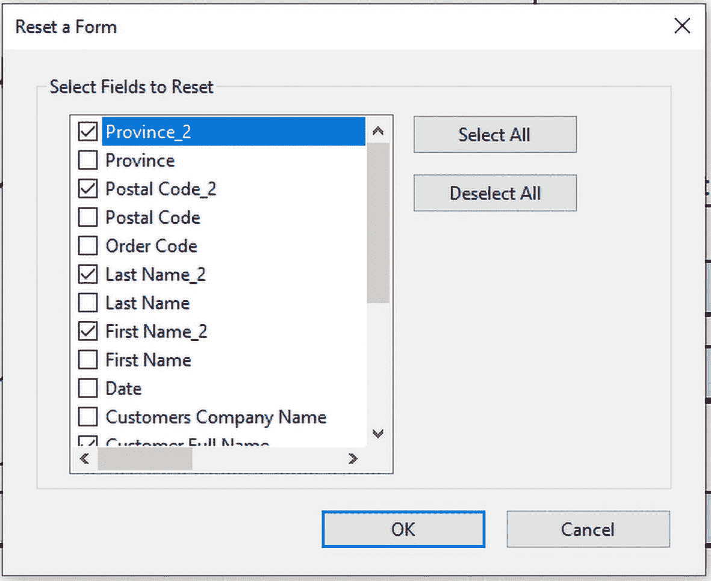

一张表单重置页面的截图，字段列表带有一个滚动条，其中选中了`province 2`、`postal code 2`、`last name 2`和`first name 2`。页面底部有一个确定按钮。

图 4-48 使用对话框重置选定字段，包括使用`重置表单`对话框重置复选框

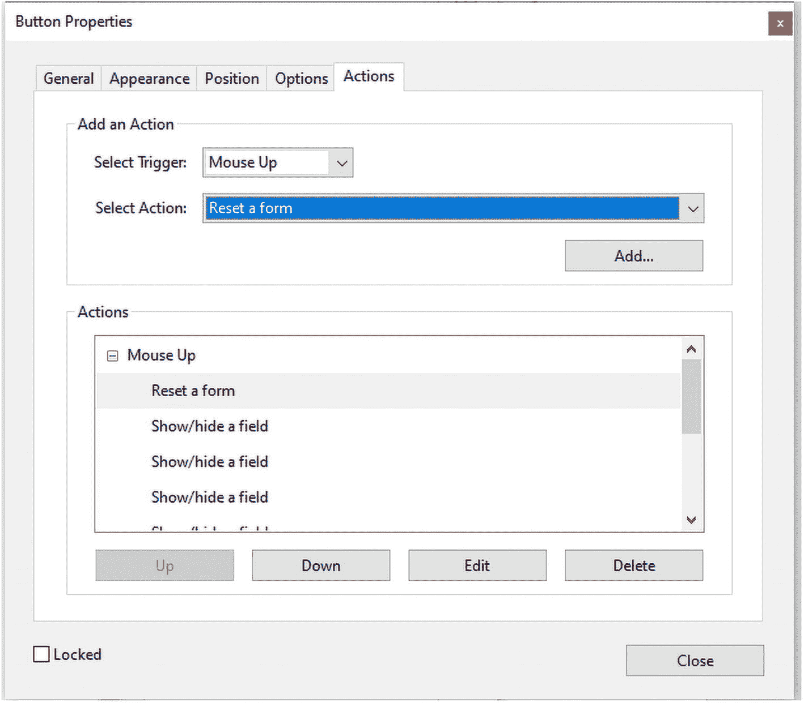

一张按钮属性页面的截图，有 5 个选项卡，其中“动作”选项卡被选中。有一个下拉菜单用于选择触发器为`鼠标释放`，动作为`重置表单`。它有一个动作框，里面包含一个动作列表，并且选择了`重置表单`选项。

图 4-47 `重置`按钮的“动作”选项卡，用于清除字段中的信息并再次隐藏它们

## 设置图层可见性

如前所述，在文档中添加和设置图层可见性可能比较棘手。本章的示例之一是一个楼层平面布局文件，展示了如果你的文档包含一个或多个图层，如何实现这一功能。你可以使用书签或按钮来显示和隐藏图层。请参考图 4-49。

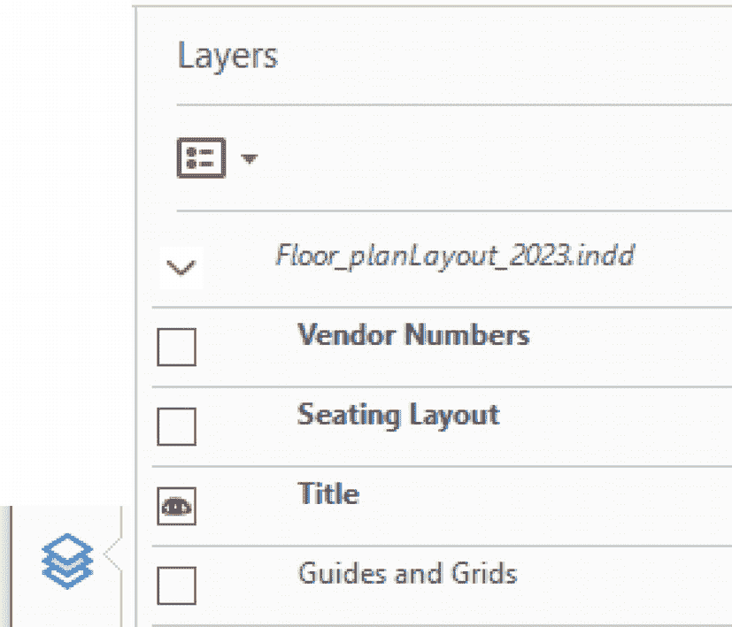

一张页面的截图，有一个图层图标，并展开了楼层平面布局视图。它有 4 个复选框，分别对应供应商编号、座位布局、标题以及辅助线和网格，其中标题选项被选中。

图 4-49 楼层平面 PDF 中的图层

**注意**

在每个图层的属性中，我只将`标题`图层的默认模式设置为文档打开时“开启”；其他图层均设置为“关闭”。请记住，要访问图层的属性，需要右键单击该图层并选择“属性”。

你可以在`https://helpx.adobe.com/cn/acrobat/using/pdf-layers.html`找到关于添加和处理图层的更多详细信息。

### 使用书签

如果你不想使用按钮，也可以使用书签来显示和隐藏图层。请参见图 4-50。

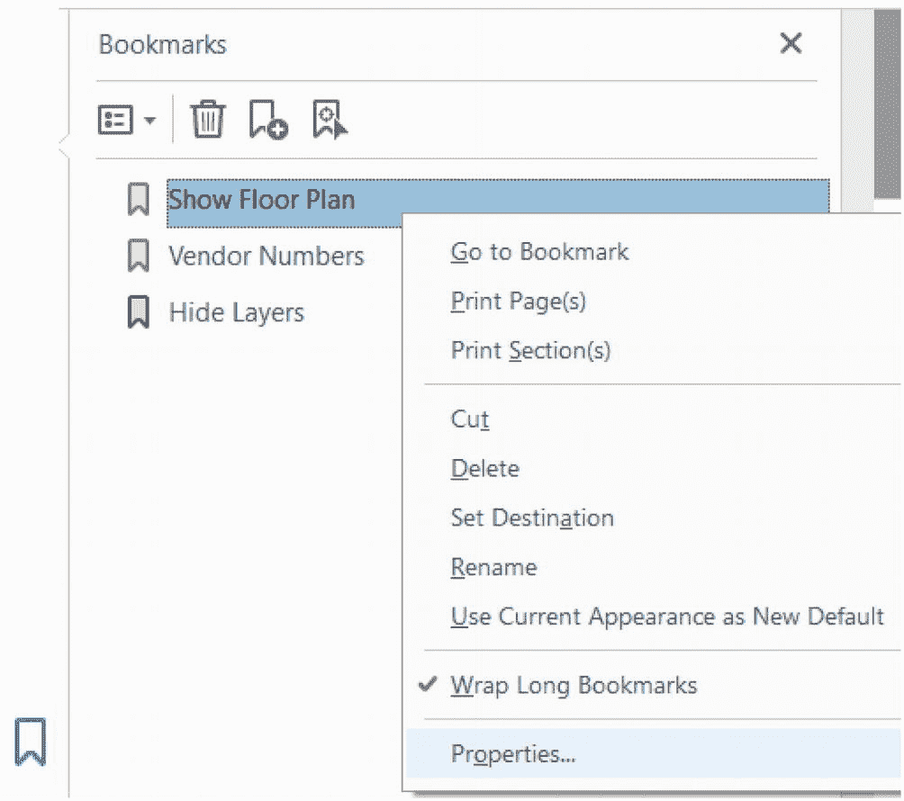

一张书签页面的截图，包含多个选项。它有 3 个书签，分别用于`显示楼层平面`、`供应商编号`和`隐藏图层`，其中`楼层平面`书签被选中。它有一个包含多个选项的框，其中`属性`选项被选中。

图 4-50 设置书签属性

首先，确保你想要可见或隐藏的图层处于开启或关闭状态，以便为你的书签创建正确的视图。

创建书签后，你可以右键单击它并从菜单中选择`属性`。属性窗口将出现。然后选择`动作`选项卡，如图 4-51 所示。

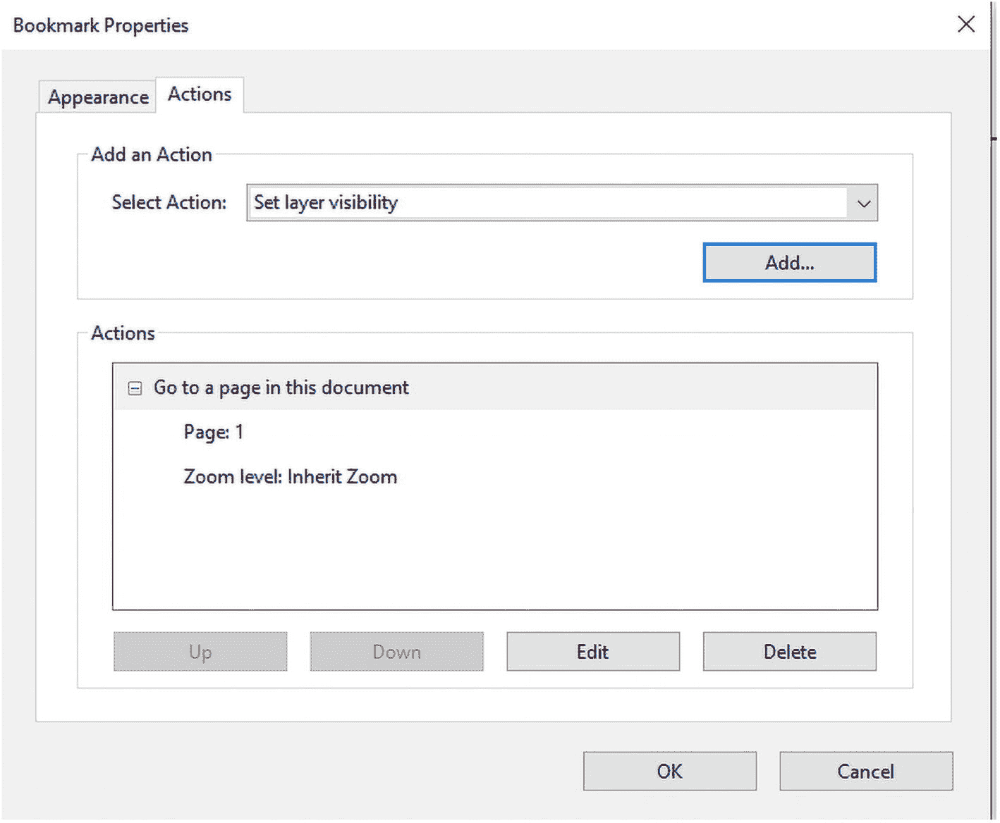

一张书签属性页面的截图，有“外观”和“动作”两个选项卡，其中“动作”选项卡被选中。有一个下拉菜单用于选择动作为`设置图层可见性`，后面跟着一个“添加”按钮。它有一个动作框，后面跟着“编辑”和“删除”两个按钮。

图 4-51 书签动作属性

请注意，动作`转到本文档中的页面`已经添加。但是，你还需要添加`设置图层可见性`动作。点击`添加`后，会出现一个信息警告，提醒你图层的当前状态将成为此书签显示的状态。如果你对图层可见性不满意，请点击`取消`，并在应用动作并选择`确定`之前将图层设置为正确的状态。请参考图 4-52。

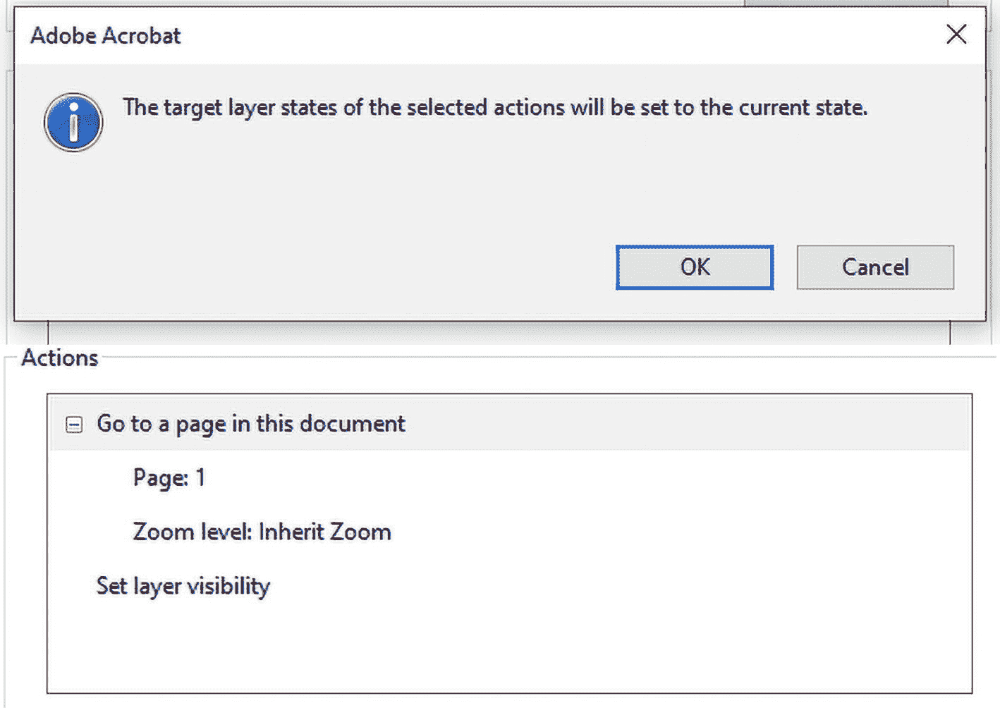

一张页面的截图，显示来自 Adobe Acrobat 的警告消息，内容为：所选动作的目标图层状态将设置为当前状态，后面跟着一个“确定”按钮和一个“取消”按钮。页面底部有一个动作框，其中包含一个`设置图层可见性`的动作。

图 4-52 在`动作`选项卡上为设置图层可见性显示的书签动作警告属性

现在，你的书签应该能够根据设置的状态显示或隐藏图层。与任何动作一样，可以选中它，然后点击`动作`选项卡上的`删除`按钮将其移除。你也可以对其他书签重复此操作。

### 使用按钮

与书签类似，您也可以使用按钮。请参考图 4-53。不过，当其他图层可见时，您可能希望隐藏某些按钮和图层以减少杂乱。此外，您可能还希望通过一个按钮将所有图层重置为关闭或隐藏状态。您可以查看文件，了解最终效果。以下列表显示了在“鼠标释放”触发器上应用于每个按钮的设置。与书签一样，在设置每个按钮的图层可见性之前，请确保图层处于您想要的状态。完成后，务必测试您的文件。

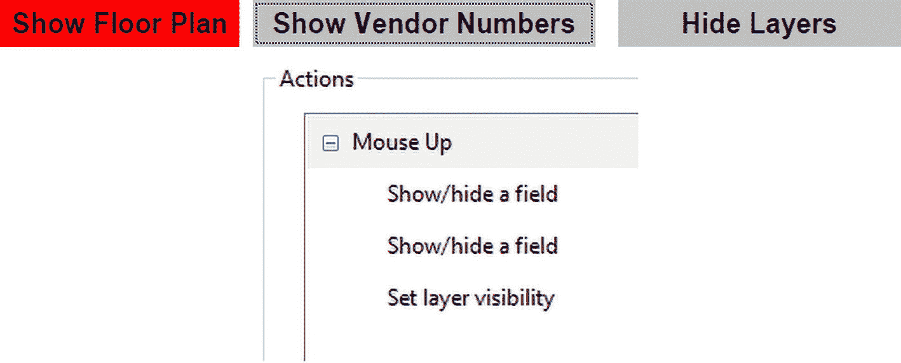

一个页面的截图显示了三个按钮，用于显示平面图、供应商编号和隐藏图层，其中显示平面图的第一个按钮已被选中。它包含一个操作列表，并且“鼠标释放”操作已被选中。

图 4-53 应用于按钮的设置示例

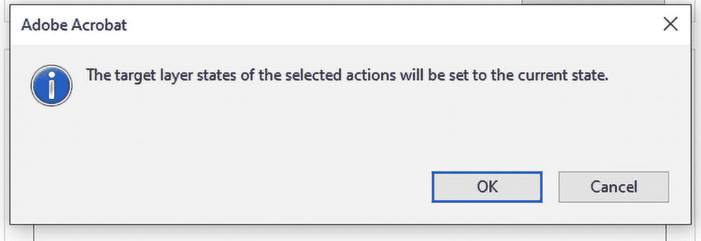

一个页面的截图显示了来自 Adobe Acrobat 的警告消息，内容为：所选操作的目标图层将被设置为当前状态，随后是两个按钮（确定和取消），其中“确定”按钮已被选中。

图 4-54 这是在设置图层可见性时出现的信息提示

## 按钮与图层操作设置

- **显示平面图按钮**：设置图层可见性。您可以选择：`显示 – 显示供应商编号` 和 `显示 – 隐藏图层按钮`。

- **显示供应商编号按钮**：设置图层可见性。

- **隐藏图层按钮**：设置图层可见性。您可以选择：`隐藏 – 显示供应商编号` 和 `隐藏 – 隐藏图层按钮`。

- 在初始状态下，“常规”选项卡上的“显示平面图按钮”设置为`表单域可见`，而其他两个按钮设置为`隐藏`。

- 在“图层”窗格中，只有标题图层设置为`打开`；所有其他图层都设置为`关闭`。

- 在将图层可见性操作添加到每个按钮之前，仅打开您希望显示的图层。单击“确定”以确认设置。请参考图 4-54。

之后，如果您想重新排列操作顺序，可以使用“按钮属性”对话框中的`向上和向下按钮`，将`设置图层可见性`操作置于最后。您可以在文件 `Floor_planLayout_2023_End.pdf` 中查看我的顺序。

在您自己的项目中，完成按钮的设置后，请将图层恢复为默认设置，保存文件并关闭。

## 总结

本章涵盖了大量与可应用于表单域和非表单项目（如图层、书签、按钮、页面和超链接）的操作相关的主题。如您所见，Acrobat Pro 在导航以及控制如何查看或隐藏域方面提供了诸多选项。

目前为止，您尚未添加任何自定义 `JavaScript`，仅使用了 Acrobat“操作”选项卡自带的设置。不过，在本书的下一部分，您将学习如何运行自己的 `JavaScript`，以及这对您在表单域中输入的内容有何影响。

在继续学习本书后续内容之前，请花些时间自行练习这些操作，并尝试将它们应用到自己的一些项目中。