# 9. 使用悬停文本和警报为客户创建帮助

**章节目标：** 你将学习一些有用的方法，为客户端的表单添加警报，以便他们知道何时输入了正确的信息，从而避免错误。

在第 4 章中，你学会了如何使用按钮创建一个小型帮助菜单，该菜单可以隐藏和显示关于客户订单代码的提示。但是，如果你需要更详细的文本，这种方法可能并非总是最佳解决方案。幸运的是，在 Acrobat 中，还有几种其他方法可以帮助你为客户创建帮助。此外，我们还将探讨如何使用 JavaScript 隐藏和显示文件、在其他字段中复制输入文本，以及使用复选框以便客户端可以将一个或多个字段设置为只读，并且也能重置字段。

> **注意：** 如果你想在本课中同步操作或查看最终结果，请从引言中的链接下载第 9 章的文件。标有“开始”的文件是未包含代码的文件，标有“结束”的文件是最终结果。如果你想将这些文件添加到自己的 PDF 表单中，你还会找到包含原始文件和脚本的文件夹。

如果你是从原始 PDF 创建表单，请参考第 1 章中的“表单审查”部分。

请记住，要查看字段的属性，你必须选择“准备表单”工具；只有这样，你才能右键单击或双击某个字段来查看其属性。

如果你想练习接下来的三个示例，可以复制一份 `TMC_OrderForm_Start.pdf` 文件。

## 悬停方法

我们先来看一下悬停方法。请参考图 9-1。

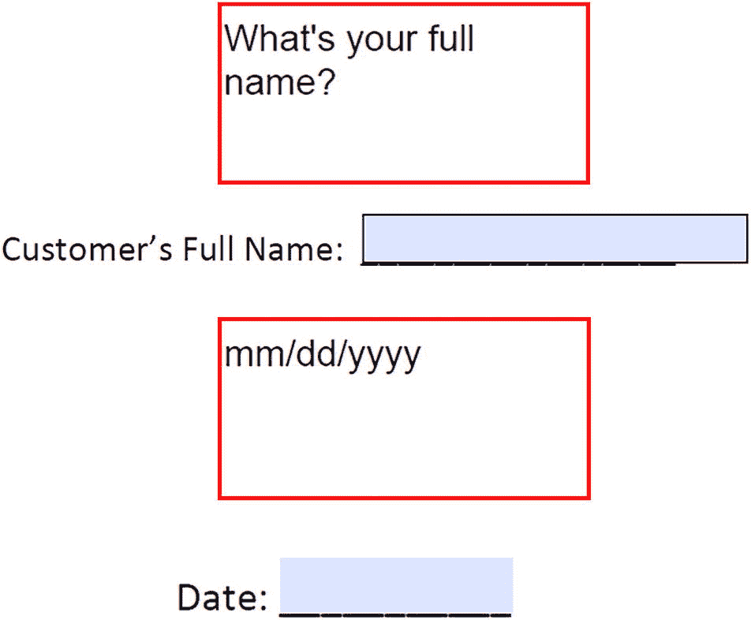

> **图 9-1：** 当鼠标悬停在文本字段上时，上方红色文本框中会显示不同的信息，为客户提供提示。

在此示例中（参见文件 `TMC_OrderForm_End_rollover.pdf`），你可以看到，当客户将鼠标移动到某个字段上时，表单右上角的红色框会显示一个有用的提示，以便他们在不确定时知道该输入什么。当客户需要知道如何输入正确的日期格式时，这非常有用。提示总是受欢迎的。

当客户将鼠标移出该字段时，它又会变为空白，直到下一个字段被悬停。客户现在知道该输入什么了，这样当表单返回给你时，错误就可以避免。

在此示例中，当你检查以下字段时，它们都通过一个文档级 JavaScript 在全局范围内以及在这些字段内部被控制：

- 客户全名

- 日期

- 订单代码

- 客户公司名称

红色帮助框 `txtHelp` 内部没有 JavaScript；但是，所有字段都在全局范围内引用了它。然而，在“常规”选项卡中，它被设置为（只读），以便用户无法更改文本。

首先，让我们看一下全局或文档级 JavaScript。在 JavaScript 工具中，选择“文档级 JavaScript”。请参考图 9-2 和图 9-3。

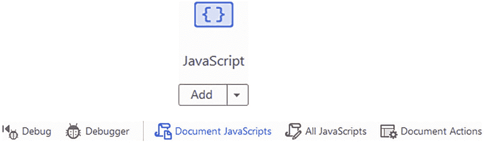

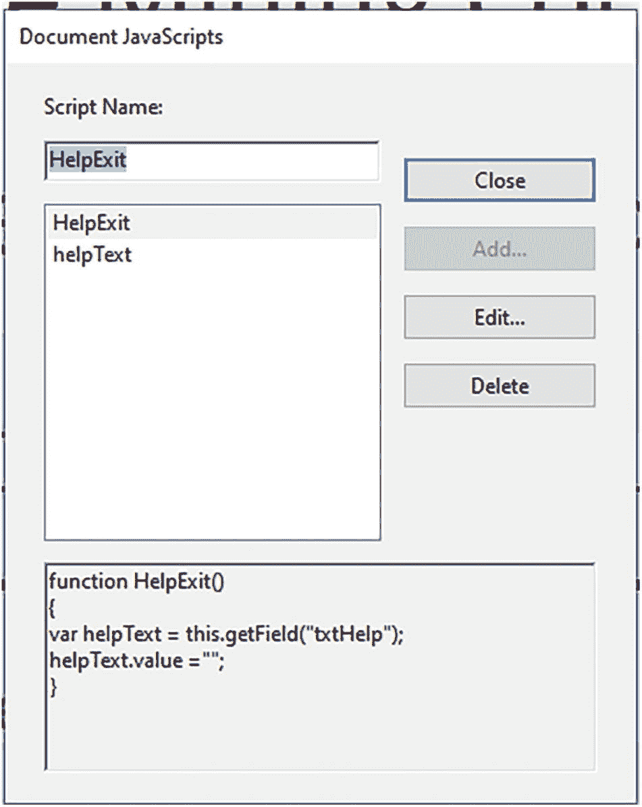

> **图 9-3：** 文档级 JavaScript 对话框的屏幕截图，包含一个用于输入脚本名称的文本框，后面跟着关闭、添加、编辑和删除四个选项。对话框底部有几行代码，包含函数 `HelpExit`。

你可以看到这里有两个文档级 JavaScript。

`HelpExit` 是一个全局函数，用于控制那些将访问红色帮助字段 `txtHelp` 的字段。

当用户离开该字段时，它会返回为空白状态。

```javascript
function HelpExit()
{
var helpText = this.getField("txtHelp");
helpText.value ="";
}
```

另一个 JavaScript 是 `helpText`；此函数包含一个数组。

```javascript
var gHelpText = [ // 创建一个变量，gHelpText
"您的全名是什么？", //字符串#0
"mm/dd/yyyy", //字符串#1
"您的客户代码在通过电子邮件发送给您的表格上。", //字符串#2
"请问您的公司名称是什么？" //字符串#3
]
```

数组用方括号 `[]` 编写，稍后你会看到更多。它包含自身内部的多个变量或字符串，每个之间用逗号分隔。然后，此表单中的其他字段可以访问这些变量字符串。在前面的代码示例中，我使用了注释（`//`）将它们从 0 到 3 进行了编号，以便我知道它们的顺序。

JavaScript 似乎主要支持索引型的类列表对象，而非关联数组。这些索引数组可以嵌套（即数组中可包含数组）。本章中，你学习了基本索引类型（数组字面量），尽管数组中不包含实际数字，但根据顺序你仍可以通过 0 到 3 的数字或字符串引用进行调用。在第 12 章和第 13 章中，你将看到更复杂的嵌套数组或列表对象及其语法示例，这些示例使用单词而非数字进行索引；这些数组/对象字面量将被嵌套，以便信息能够流入其他字段。更多详情请参考此页面：

[`https://developer.mozilla.org/en-US/docs/Web/JavaScript/Reference/Global_Objects/Array`](https://developer.mozilla.org/en-US/docs/Web/JavaScript/Reference/Global_Objects/Array)

现在，我们来看一个需要帮助的字段：`Customer Full Name`。

以红色方框中显示“帮助信息”的四个字段为例，它们都包含以下两个`JavaScript`。请参考图 9-4。

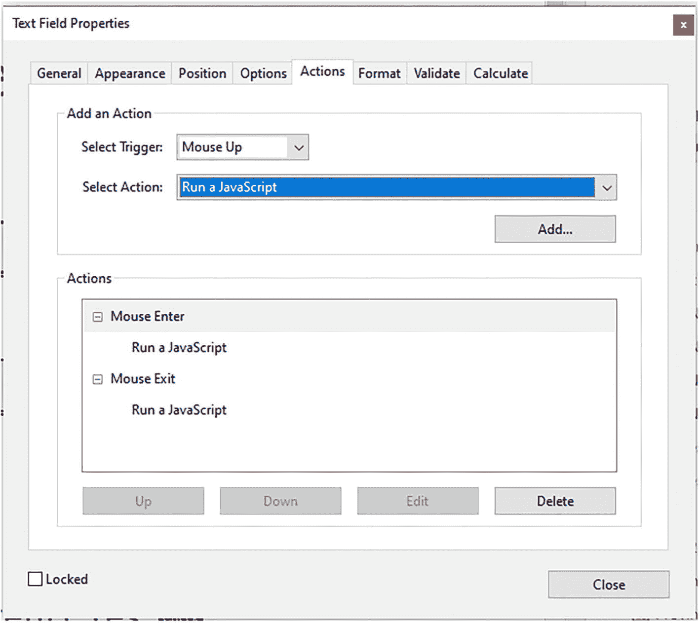

一个标题为“文本字段属性”的对话框截图。它包含 8 个选项卡，其中“动作”选项卡被选中。它有两个下拉菜单，分别用于选择触发条件（鼠标释放）和动作（运行一个 JavaScript）。它指出了在鼠标进入和离开时的两个动作。

**图 9-4**

在“动作”选项卡中选择“鼠标进入时运行 JavaScript”和“鼠标离开时运行 JavaScript”

-   当鼠标或光标进入时，运行一个 JavaScript。

-   当鼠标或光标离开时，运行一个 JavaScript。

### 鼠标进入

鼠标进入设置的 JavaScript 如下：

```javascript
var helpText = this.getField("txtHelp");
helpText.value = gHelpText[0];
```

当鼠标进入`Customer Full Name`字段时，JavaScript 被要求从文档级 JavaScript `helpText`函数数组`gHelpText`中获取一些文本。对于数组，数字 0 始终代表数组中的第一个项，例如：

```
0 = "What's your full name?"
1 = "mm/dd/yyyy"
2 = "Your customer code is on the form that was emailed to you."
3 = "What's your Company Name?"
```

以此类推，如果数组中有更多项的话。

对于`[0]`，它将获取字符串“What's your full name?”并将此文本放入`txtHelp`字段。

对于日期字段，你可以看到代码相同，只是访问的数组索引号不同。这次的鼠标进入设置是`[1]`。订单代码字段是`[2]`，客户公司名称字段是`[3]`。

```javascript
var helpText = this.getField("txtHelp");
helpText.value = gHelpText[1];
```

在你自己的项目中，如果有一个额外的字段，你可以向文档级 JavaScript 中添加另一个字符串，但在调用时，你需要为其指定索引号`[4]`。这就是为什么我在之前的代码中添加了注释，以便当我有大量文本字符串时能够进行追踪。

### 鼠标离开

鼠标离开的 JavaScript 代码对于四个字段都是相同的。

```javascript
HelpExit();
```

当鼠标或光标离开红色帮助框时，它变为空白。

如果出于某种原因你需要更改此函数内部的某些代码，像这样编写全局文档级 JavaScript 会很有帮助。任何附加了此函数的字段现在都会执行新的动作，而无需你手动逐个更改。

在这种情况下，它们离开时都遵循之前的代码，红色的`txtHelp`框恢复到空白状态。

```javascript
function HelpExit()
{
    var helpText = this.getField("txtHelp");
    helpText.value = "";
}
```

### 更长的数组示例（可选）

前面示例中的代码对于此表单的需求来说简洁高效。但是，如果你想要将数组的实际字符串分解为文档级 JavaScript 中`gHelpText`的对象，可以输入以下内容：

```
var gHelpText = new Array();
//spans
//String#0
gHelpText[0] = new Object();
gHelpText[0].text = "What's your full name?";
//String#1
gHelpText[1] = new Object();
gHelpText[1].text = "mm/dd/yyyy";
//String#2
gHelpText[2] = new Object();
gHelpText[2].text = "Your customer code is on the form that was emailed to you.";
//String#3
gHelpText[3] = new Object();
gHelpText[3].text = "What's your Company Name?";
```

这种方法虽然更长，但如果你计划使用 JavaScript 为字体添加特定的颜色或对齐格式（我们将在第 10 章中详细讨论），它会很有用。但是，在每个字段的鼠标进入事件中，你需要在代码最后一行末尾添加`.text`属性。请参见粗体部分。

```
var helpText = this.getField("txtHelp");
helpText.value = gHelpText[0].text;
```

这可以确保文本显示在红色框`txtHelp`中。否则，所有示例都将显示单词`[Object]`。你还需要确保索引号与字符串匹配。如果需要查看示例，请参考文件`TMC_OrderForm_End_rollover_longArray.pdf`。

### 额外的非自定义 JavaScript 复选框示例

如同第 4 章中的表单一样，有关于“收货地址”隐藏和显示文本字段的示例。如果你不记得其工作原理，请回顾此区域。

### 如何使用 JavaScript 显示和隐藏字段

不过，如果你愿意，也可以改用 JavaScript 来控制这一区域。请参考文件 `TMC_OrderForm_End_rollover.pdf`、复选框字段 `Check Box7` 以及名为 `Hide and Clear Fields` 的按钮。请参见图 9-5。

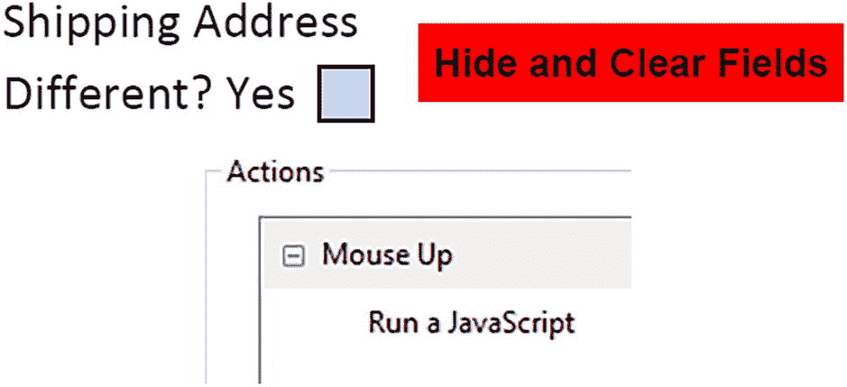

截图中显示一个用于“不同送货地址”的未选中复选框，其后跟着一个用于隐藏和清除字段的按钮。鼠标松开时所触发的动作表明将运行一个 JavaScript 脚本。

**图 9-5** 送货地址复选框与按钮示例查看

对于复选框，你可以进入“动作”选项卡，添加“鼠标松开”触发器，并运行包含以下代码的 JavaScript：

```
//Show Fields and button
this.getField("First Name_2").display = display.visible;
this.getField("Last Name_2").display = display.visible;
this.getField("Address_2").display = display.visible;
this.getField("City_2").display = display.visible;
this.getField("Province_2").display = display.visible;
this.getField("Country_2").display = display.visible;
this.getField("Postal Code_2").display = display.visible;
this.getField("Hide and Clear Fields").display = display.visible;
```

通过将 `display` 属性设置为 `display.visible`，你希望显示的每个字段（包括按钮）都会出现。

然后，对于按钮“Hide and Clear Fields”，在“动作”选项卡的“鼠标松开”事件中，你可以运行包含以下代码的 JavaScript：

```
//Reset Fields
this.resetForm(["Check Box7","First Name_2", "Last Name_2", "Address_2", "City_2", "Province_2", "Country_2", "Postal Code_2"]);
// Hide Fields and Button
this.getField("First Name_2").display = display.hidden;
this.getField("Last Name_2").display = display.hidden;
this.getField("Address_2").display = display.hidden;
this.getField("City_2").display = display.hidden;
this.getField("Province_2").display = display.hidden;
this.getField("Country_2").display = display.hidden;
this.getField("Postal Code_2").display = display.hidden;
this.getField("Hide and Clear Fields").display = display.hidden;
```

你之前已经见过重置代码，在此例中，我还确保将复选框重置回初始状态。不过，这次在代码中，我将要隐藏的每个字段（包括按钮）的 `display` 属性设置为 `display.hidden`。这是一种保持代码条理清晰的好方法。

或者，你也可以完全移除按钮，仅使用复选框，在取消选中时隐藏并重置这些字段。你可以在我的文件 `TMC_OrderForm_End_rollover_2.pdf` 中看到这种替代方案。

如果只使用复选框，你可以键入以下 JavaScript 代码。请注意，在本例中，我将所有变量组织在代码顶部，以避免重复输入字段名称，从而保持代码整洁。在 `if` 分支中，我使字段可见；在 `else` 分支中，重置后，我隐藏了字段。

```
var checkbox = this.getField("Check Box7");
var fn= this.getField("First Name_2");
var ln = this.getField("Last Name_2");
var address = this.getField("Address_2");
var city = this.getField("City_2");
var province = this.getField("Province_2");
var country = this.getField("Country_2");
var postalCode = this.getField("Postal Code_2");
if (event.target.value !="Off"){
//Show the fields and button
fn.display = display.visible;
ln.display = display.visible;
address.display = display.visible;
city.display = display.visible;
province.display = display.visible;
country.display = display.visible;
postalCode.display = display.visible;
}
else{
//Reset Fields
this.resetForm(["Check Box7","First Name_2", "Last Name_2", "Address_2", "City_2", "Province_2", "Country_2", "Postal Code_2"]);
// Hide Fields and Button
fn.display = display.hidden;
ln.display = display.hidden;
address.display = display.hidden;
city.display = display.hidden;
province.display = display.hidden;
country.display = display.hidden;
postalCode.display = display.hidden;
}
```

注意，这里不再需要额外的按钮。取而代之的是，复选框的“运行 JavaScript”动作中包含了重置代码。请参见图 9-5。在 `else` 条件下，我先重置表单字段，然后再隐藏它们。在这种情况下，重置时不能仅对字段变量调用，因此必须确保你的代码拼写正确。请记住，在你自己的项目中，退出编辑器后要点击“确定”。关闭属性面板，预览并测试你的表单，以确保正确的字段被重置。然后保存文件。

## 默认文本方法

对于某些表单来说，悬停提示是个好方法，但在其他情况下可能效果不佳，例如字段位于页面底部或表单跨越多页时。与网络表单类似，有时默认文本会直接显示在实际字段内。你可以在“选项”选项卡中为字段添加默认文本。然而，当用户点击该字段时，文本并不会消失；它会保留下来。用户必须先选中文本，然后手动删除。这对于只想直接开始输入的用户来说，可能会变得笨拙且令人沮丧。请参考图 9-6。请自行在“选项”选项卡中，将这段文本添加到一个空白文本字段并进行测试。

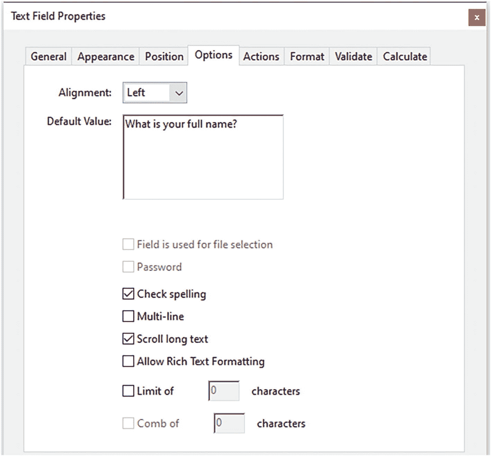

文本字段属性页面的截图显示了 8 个选项卡，其中“选项”选项卡被选中。它有一个下拉菜单用于选择左对齐，一个用于输入默认值的方框，后跟几个复选框，其中“拼写检查”和“滚动长文本”复选框被选中。

**图 9-6** 在“选项”选项卡中为文本字段添加默认文本

除了添加默认文本，你还可以在“格式”选项卡中使用此脚本创建自定义格式。请参考图 9-7 和图 9-8 以及文件 `TMC_OrderForm_End _default_text.pdf`。

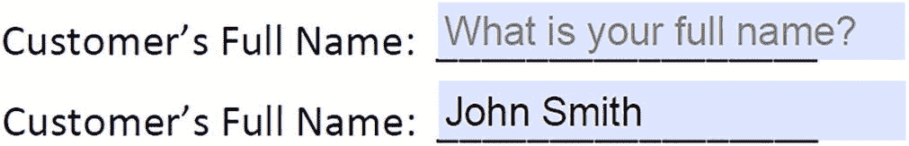

截图显示了两个用于输入客户全名的文本框。方框 1 显示了文本“您的全名是什么？”。方框 2 中有一个条目“John Smith”。

**图 9-8** 自定义默认文本（顶部）与输入的文本（底部）

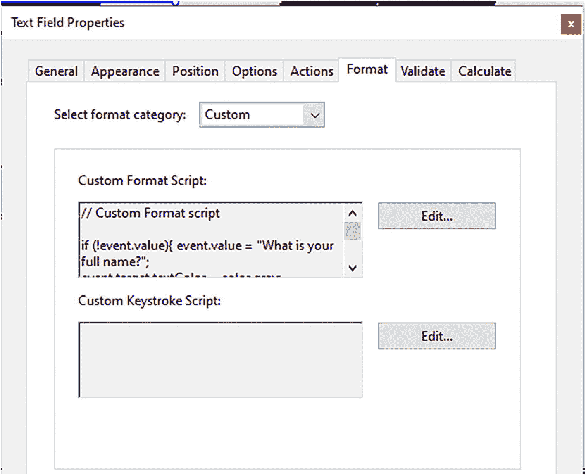

文本字段属性页面的截图显示了 8 个选项卡，其中“格式”选项卡被选中。它有一个下拉菜单用于选择“自定义”格式类别，后跟几行自定义格式脚本，以及一个位于方框右侧的“编辑”按钮。

**图 9-7** 在“格式”选项卡中添加自定义脚本

在本练习中，你可以参考“客户全名”字段。

```
// 自定义格式脚本
if (!event.value){
event.value = "您的全名是什么？";
event.target.textColor = color.gray;
}
else{
event.target.textColor = color.black;
}
```

图 9-8 展示了其差异。

在此示例中，只要字段中为空，默认文本就会显示为灰色，当字段被点击并输入新文本时，默认文本会消失。新输入的文本将显示为黑色。我将同样的代码应用到了“客户公司名称”字段，并修改了 `event.value` 以反映该字段的默认文本。

```
// 自定义格式脚本
if (!event.value){
event.value = "您的公司名称是什么？";
event.target.textColor = color.gray;
}
else{
event.target.textColor = color.black;
}
```

无需对这些字段应用任何其他 JavaScript 操作或文档操作。

对于某些文本框来说，这是一个好方法。然而，对于其他一些框，比如说明文本比字段长，或者必须格式化为日期、数字或字符组合的框，使用这种自定义格式可能并非理想选择。在这些情况下，你或许仍希望像之前介绍的悬停提示方法那样，使用文档操作。在此文件中，我保留了这些字段的原样。现在，让我们看看针对这些情况的其他选项。

**注意**

当添加感叹号时，`if (!event.value)` 变为布尔类型，即一个真/假判断语句（如果否定）。在默认文本的这种情况中，如果文本字段中没有输入任何值，这就是你当前应填充的内容。如果没有这个感叹号，默认文本将不会被填充。

## 提示框方法

是否还有其他方法可以让提示信息随着用户在表单中填写字段而移动？是的，可以通过提示框来实现。提示框的另一个很酷的特性是，如果你正确设置它们，你可以在其中输入文本，然后该文本将被传输到正确的表单字段。请参考图 9-9 以及文件 `TMC_OrderForm_End_alert.pdf`。

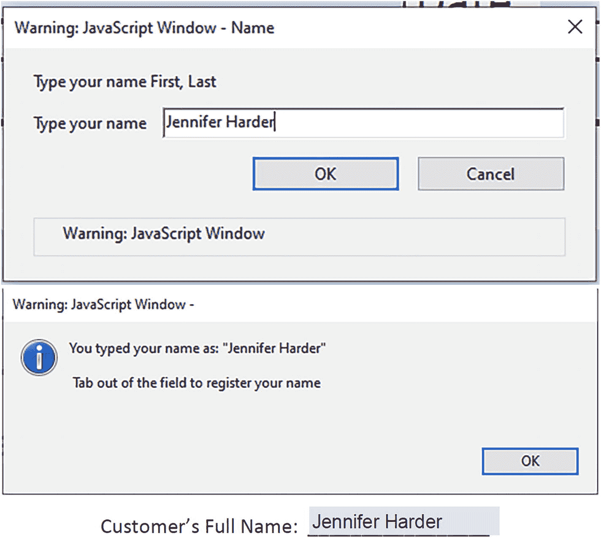

截图显示了两个 JavaScript 窗口警告消息。1：一行文字“输入您的名字和姓氏”，后跟一个输入姓名的方框和一个“确定”按钮。2：一条包含已输入姓名和注册说明的消息。

**图 9-9** 在提示框中输入文本，当用户点击“确定”然后跳出该字段时，文本便会输入到字段中

在此示例中（请参阅“提示结束版 PDF”文件），没有全局文档 JavaScript，因此我们可以暂时跳过该部分。

同样，这里有四个文本字段：

*   客户全名
*   日期
*   订单代码
*   客户公司名称

这次没有红色的 `txtHelp` 字段；你将使用提示框来完成这项工作，因为在表单下方看到一个红色框会显得很奇怪。现在，我们将逐一查看每个字段，并进一步探索其代码。

### 客户全名

这次你将仅在每个字段运行一个 JavaScript。无需担心退出函数，因为警告框会替你处理，稍后你就会看到。在本例中，使用“获得焦点”（On Focus）触发器，当任何人点击进入文本字段时便会激活。请参考图 9-10。

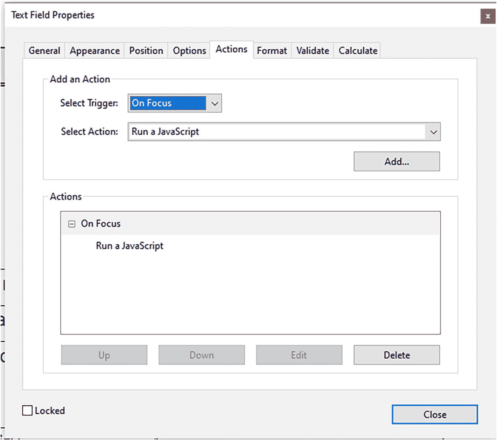

一张文本字段属性的截图，共有 8 个选项卡，其中“动作”选项卡被选中。它有两个下拉菜单，用于选择触发器为“获得焦点”以及动作“运行 JavaScript”，其后是一个动作列表、一个删除按钮和一个关闭按钮。

**图 9-10** 在“动作”选项卡中运行 JavaScript 动作

以下是在 JavaScript 编辑器中添加到“运行 JavaScript”动作的代码，如图 9-10 所示：

```
var t = event.target; // 目标字段
var cResponse = app.response({
cQuestion: "输入您的姓名，先名后姓",
cTitle: "姓名",
cDefault: "未添加姓名",
cLabel: "输入您的姓名"});
{
if (cResponse == null){ // 如果选择了“取消”
app.alert ("您已取消添加姓名。");
cResponse = "";
}
else{
app.alert("您输入的姓名是：\""+cResponse+"\" \n\n 跳出该字段以注册您的姓名",3);
}
}
t.value = cResponse; // 将对话框中的数据放置到目标字段
```

在图 9-11 中，你可以看到 alert 或 `app.response` 创建了一条描述信息，其中包含问题（`cQuestion`）、标题（`cTitle`）、默认文本（`cDefault`）和标签（`cLabel`）等属性或参数，以及一个供用户按提示输入姓名的空格，并替换掉默认文本。

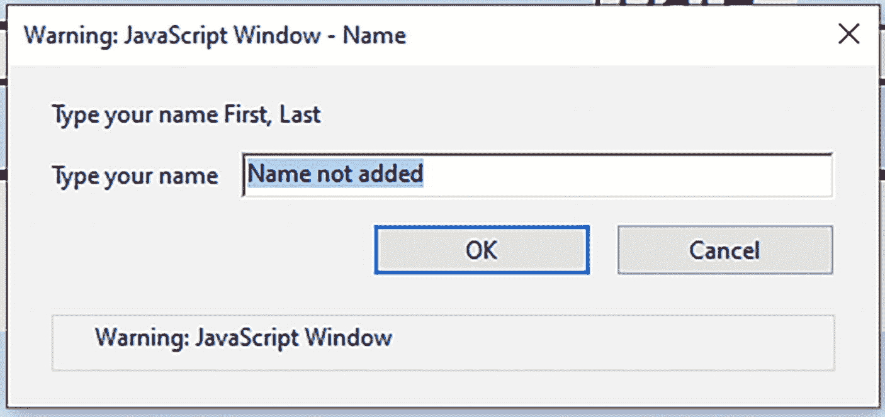

一张 JavaScript 窗口名称警告信息的截图。它包含一行提示文字“输入您的名和姓”，其后是一个用于输入姓名的框和一个确定按钮。

**图 9-11** JavaScript 帮助响应消息窗口

> **说明：** 你也可以选择设置密码（`bPassword`）参数，如果设为 true，则会显示 * 或圆点来遮盖用户的响应。默认情况下，该参数是关闭的或设为 false。

如果用户点击“取消”按钮，会出现一条内容如下的警告或应用提示：“您已取消添加姓名。”点击该消息的“确定”后，文本字段将恢复为空白。请参考图 9-12。

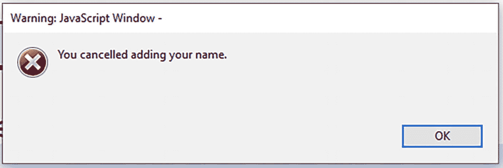

一张 JavaScript 窗口警告信息的截图，显示一条消息：“您已取消添加姓名。”页面右下角有一个“确定”按钮。

**图 9-12** 用户在前一个窗口中点击“取消”时的 JavaScript 警告

如果用户输入姓名并点击“确定”，他们会看到以下应用提示：“您输入的姓名是：[客户姓名]” 或代码行 `\"+cResponse+\"`。如图 9-13 所示，他们点击该消息的“确定”。一旦客户跳出该字段进入下一个字段，他们的姓名即被确认，如代码行 `t.value = cResponse` 所示。

本例代码中的 `3` 指的是图标更改为状态/信息图标，而在之前的 alert 中未添加该参数或使用的是默认值 0。另外，本例和之前的示例中代码里都没有为按钮指定数字，但在这两种情况下，按钮默认都是 0 或“确定”按钮。因此，在本例中，你也可以写成 `3,0`，结果相同。你可以在第 8 章的“警告类型”一节中查看这些设置。请参考图 9-13。

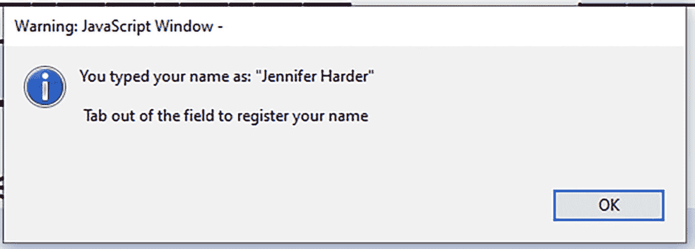

一张 JavaScript 窗口警告信息的截图，显示一条消息：“您输入的姓名是：Jennifer Harder，跳出该字段以注册您的姓名。”页面右下角有一个“确定”按钮。

**图 9-13** 用户在前一个窗口中点击“确定”后的 JavaScript 确认信息

如果您的 Tab 键顺序设置正确，您应该会继续进入下一个字段以处理该流程。

请注意，`app.response` 的显示方式与 `app.alert` 略有不同。使用 `app.response` 时，本例中的默认按钮是“确定”和“取消”，没有警告图标。然而，它可以与 `app.alert` 协同工作，为用户创建一连串的提示。

让我们进入下一个字段。请注意，您再次使用了 `if/else` 条件来获得两种可能的应答。

## 日期

“日期”字段的行为方式类似。但是，请务必确保该字段的格式已设置为与本例中的文本匹配，例如：“mm/dd/yyyy”。请参考图 9-14。

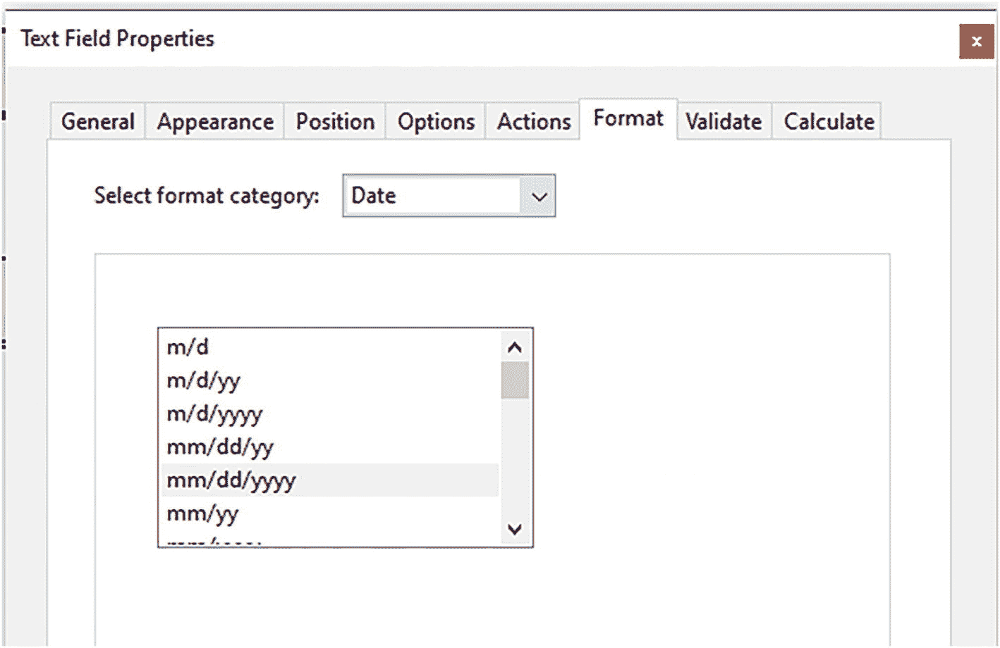

一张标题为“文本字段属性”的对话框截图。它有 8 个选项卡，其中“格式”选项卡被选中。日期的格式类别被选择为“月/日/年”格式。

**图 9-14** “格式”选项卡上的“日期选项”菜单

现在转到“动作”选项卡，你会看到我使用了与“客户全名”字段相同的设置，只是根据需求修改了文本。请参考图 9-15 和图 9-16。

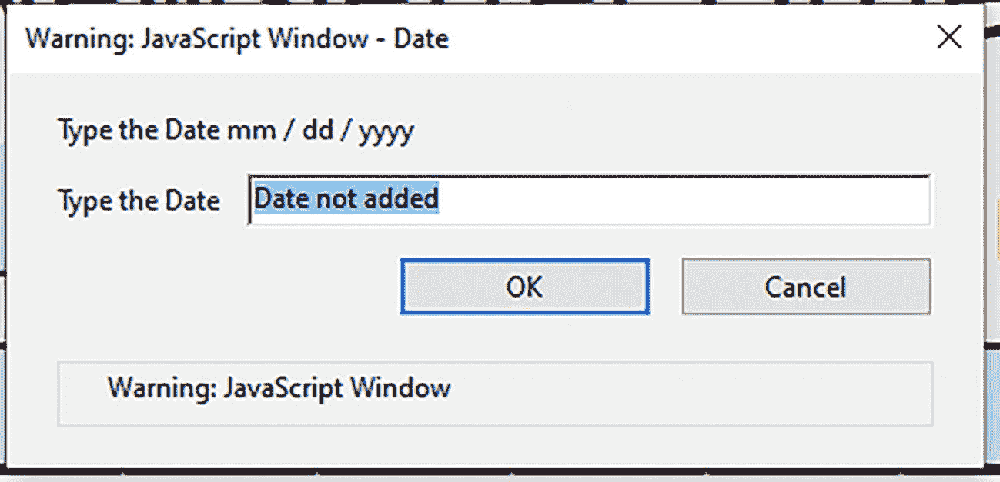

一张对话框截图，显示 JavaScript 窗口日期的警告信息。消息内容为：“按月份、日期和年份格式输入日期”，其后是一个用于输入日期的框。页面底部有一个“确定”按钮。

**图 9-16** 日期字段的 JavaScript 帮助消息

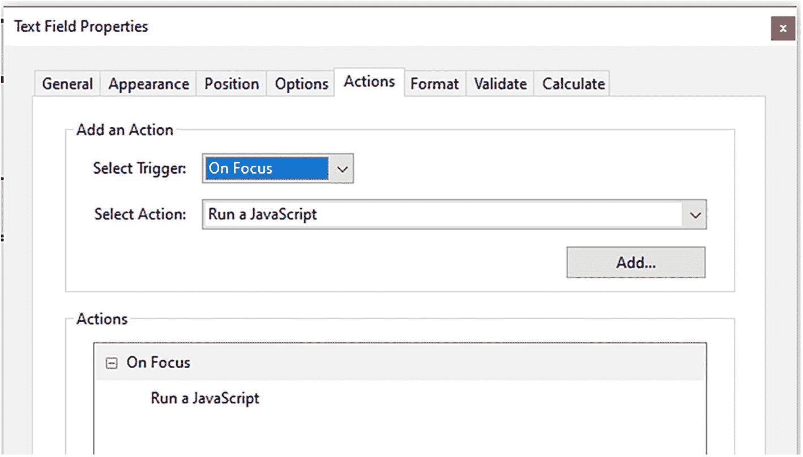

一张标题为“文本字段属性”的对话框截图。它有 8 个选项卡，其中“动作”选项卡被选中。触发器被选择为“获得焦点”，用于运行 JavaScript 动作。右侧有一个“添加”按钮。

**图 9-15** 在“动作”选项卡上为“日期”字段运行 JavaScript 动作

以下是代码：

```javascript
var t = event.target; // 目标字段
var cResponse = app.response({
cQuestion: "输入日期，格式为 mm / dd / yyyy",
cTitle: "日期",
cDefault: "未添加日期",
cLabel: "输入日期"});
{
if ( cResponse == null){ // 如果选择了“取消”
app.alert ("您已取消添加日期。");
cResponse = "";
}
else{
app.alert("您输入的日期是：\""+cResponse+"\" \n\n 跳出该字段以注册日期",3);
}
}
t.value = cResponse; // 将对话框中的数据放置到目标字段
```

我们可以看到类似的事件模式如何展开。在这个字段中，必须添加一个日期。您点击提示框的“确定”，然后按 Tab 键进入下一个字段以确认响应。但请记住，近年来 Acrobat 通过“日期选择器”使输入日期变得更加容易，因此您可以选择使用或不使用此提示。无论如何，如果您未输入正确的日期格式，仍然会出现额外的提示，并且即使您跳出该字段，该字段也会保持空白，直到您输入正确的日期格式。关于这一点，您可以在本章稍后的“最终思考”部分看到我的评论。

## 客户订单代码

客户订单代码的构建方式与日期相同，只是代码略有不同。请参考图 9-17 查看结果。

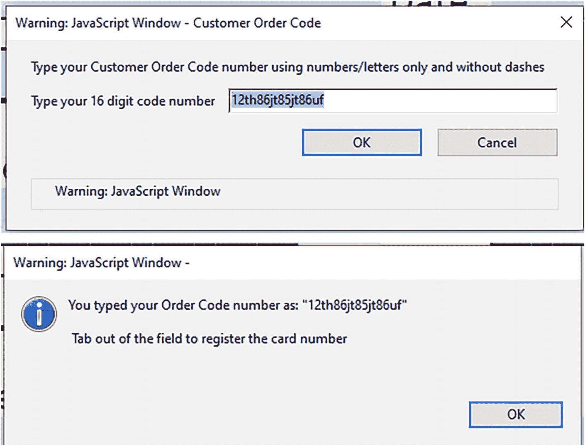

**图 9-17** 客户订单代码的 JavaScript 帮助消息以及确认消息

客户订单代码的功能类似，您本可以将格式设置为 `Number`。但是，由于您可能希望在代码中包含字母和数字，因此在“格式”选项卡上将格式设置保留为 `None`。在“动作”选项卡上，将“触发器”设置为 `On Focus`，然后选择“运行 JavaScript”。请参考图 9-15。

```javascript
// Customer Code or Credit Card Example
var t = event.target; // the target field
var cResponse = app.response({
cQuestion: "Type your Customer Order Code number using numbers/letters only and without dashes",
cTitle: "Customer Order Code",
cLabel: "Type your 16 digit code number"});
{
if ( cResponse == null){ // if Cancel is selected
app.alert ("You cancelled adding your code.");
cResponse = "";
}
else {
if (cResponse.length != 16){
app.alert("Type the complete number/letters without dashes or there may be more or less than 16 digits.");
cResponse = "";}
else{
app.alert("You typed your Order Code number as: \""+cResponse+"\" \n\n Tab out of the field to register the card number",3);}
}
}
t.value = cResponse; // places the data from the dialog to the target field
```

请注意外层的 `else` 条件语句是如何执行其自身的 `if/else` 条件检查，以确保字段中包含 16 个字符。如果不符合，则警报会提醒您输入时不带破折号，或者输入的字符不是 16 个，并且该字段将变为空白。对于您自己的项目，您可以决定调整消息内容。否则，如果正好有 16 个字符，则当您跳出该字段时，这些字符将在字段中得到确认。

## 客户公司名称

此代码与客户的“全名”字段类似，也添加到“动作”选项卡中。请参考图 9-10。请参考图 9-18 查看警报应该如何显示。

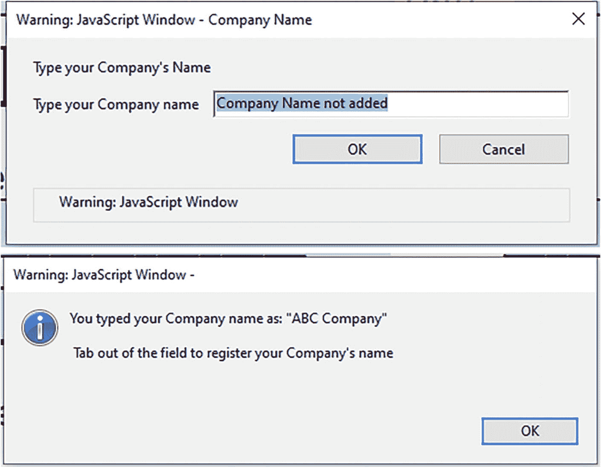

**图 9-18** 公司名称的 JavaScript 帮助消息以及确认消息

```javascript
// Company name
var t = event.target; // the target field
var cResponse = app.response({
cQuestion: "Type your Company’s Name",
cTitle: "Company Name",
cDefault: "Company Name not added",
cLabel: "Type your Company name"});
{
if ( cResponse == null){ // if Cancel is selected
app.alert ("You cancelled adding your Company’s name.");
cResponse = "";
}
else{
app.alert("You typed your Company name as: \""+cResponse+"\" \n\n Tab out of the field to register your Company’s name",3);}
}
t.value = cResponse; // places the data from the dialog to the target field
```

有关 `app.response` 及其与 `app.alert` 配合使用的更多详细信息，请参考以下页面：[`https://opensource.adobe.com/dc-acrobat-sdk-docs/library/jsapiref/JS_API_AcroJS.html?highlight=response#response`](https://opensource.adobe.com/dc-acrobat-sdk-docs/library/jsapiref/JS_API_AcroJS.html?highlight=response#response)

## 如何将文本复制到多个字段并将字段设为只读

# 文本复制与字段只读设置

在某些情况下，您可能希望在一个字段中输入的文本在其他字段中重复出现，或者您希望允许客户自行将某个字段设置为只读。这可能包括文本、日期，甚至是计算结果。让我们首先看看如何实现文本复制。请参考文件 `TMC_PartOrderForm_Duplicate_End.pdf` 和图 9-19。

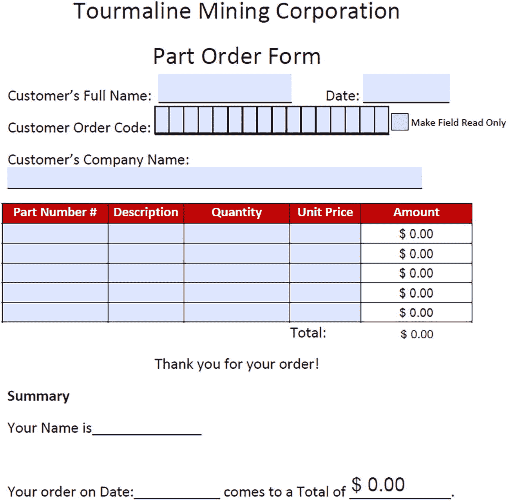

**图 9-19** 一个包含可将文本复制到父字段中的字段的表单

在此示例中，如果我在 `Customers Full Name` 字段中键入内容，则第 1 页和第 2 页下方设置为只读的其他字段将填入我键入的任何文本。有时，当您创建两个同名的文本字段时，这可能会起作用，这样当您在一个字段中键入内容时，另一个字段会接收相同的文本。请参考图 9-20。

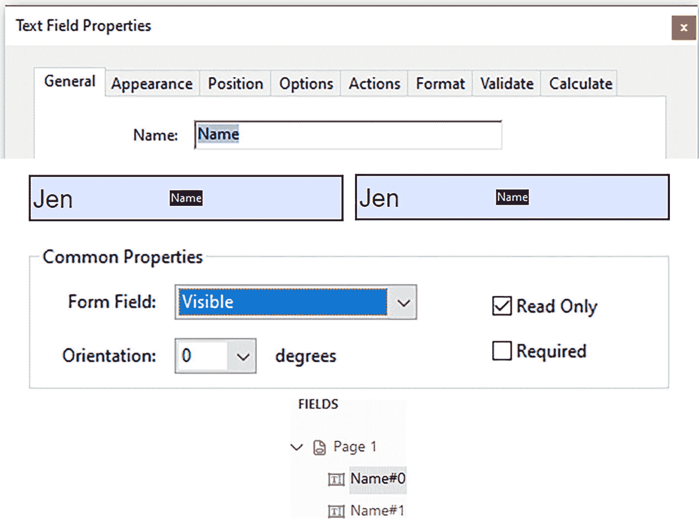

**图 9-20** 两个字段在“常规”选项卡上具有相同的名称。但在字段面板中，它们的名称会略有不同以进行区分。但是，它们现在都设置为只读

我发现，像这样创建文本字段绝不是一个好主意，因为它可能导致错误，尤其是因为一个字段不能设置为只读；由于它们是链接的，它们要么都是只读的，要么都不是。请参考图 9-20。

要使一个字段为只读而另一个字段用于输入，字段必须具有不同的名称。您可以像我做的那样重命名一个字段来实现这一点。我将一个字段从 `Customers Full Name` 更改为 `Customers Full Name#1`。请参考图 9-21。

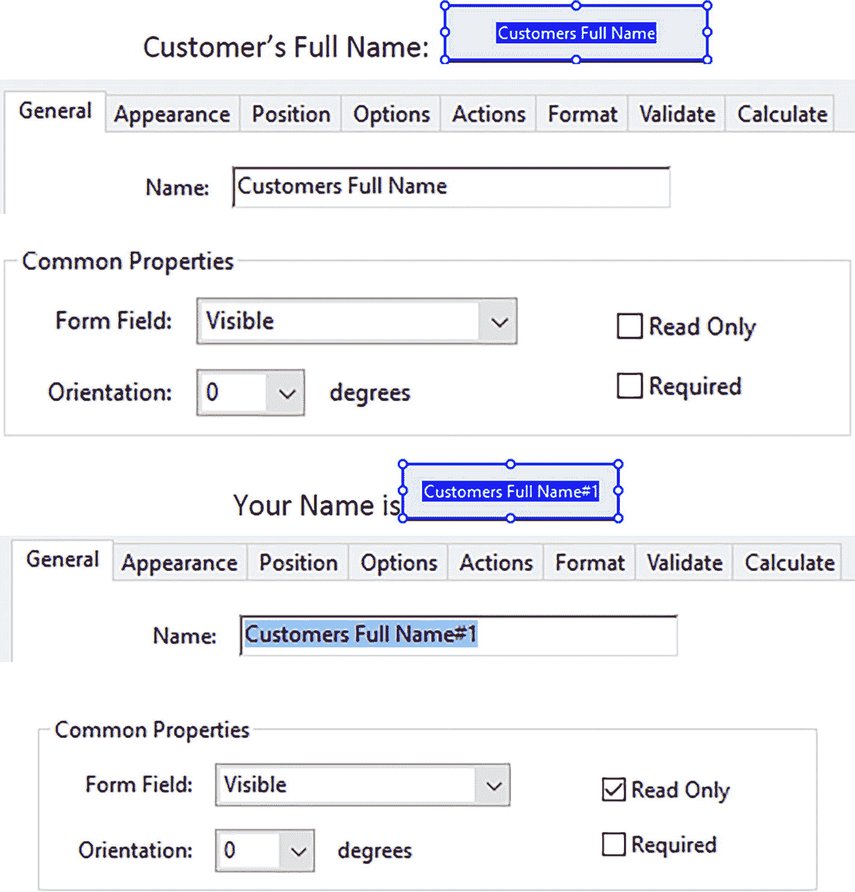

**图 9-21** 当两个字段在“常规”选项卡上具有不同的名称时，它们可以独立运行，您可以将其中一个设置为只读

然而，我们仍然希望 `Customers Full Name` 字段中的文本流向 `Customers Full Name#1`。

在这种情况下，对于 `Customers Full Name#1`，您可以将“格式”选项卡上的“格式”设置保留为 `None`，因为它实际上不是一个数字，但它会有一个值。然后，您可以转到“计算”选项卡，查看添加的以下代码或自定义计算脚本。请参考图 9-22。

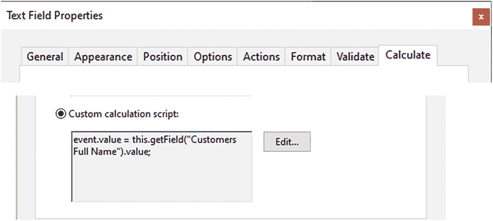

**图 9-22** “计算”选项卡上的自定义计算脚本

在 JavaScript 编辑器中，我键入了以下内容：

```
event.value = this.getField("Customers Full Name").value;
```

现在，原始字段的值将等于设置为只读字段的值，从而防止客户在链接或重复字段中键入内容。

您可以按照以下方式对链接的日期甚至数学计算进行处理。这些链接的只读字段也可以位于其他页面上，例如 `Customers Full Name#2` 字段，它也通过 `Calculate` 选项卡引用相同的代码。

您可以在 `Date#1` 和 `Date#2` 字段中看到这一点；它们的代码引用了 `Date` 字段。只需确保所有字段的格式设置为相同的日期格式。

```
event.value = this.getField("Date").value;
```

或者，对于 `Total#1` 和 `Total#2` 字段，您可以链接到 `Total` 字段，以实时重复该计算输入。在这种情况下，这些字段的格式已设置为 `Number`。

```
event.value = this.getField("Total").value;
```

# 使用 JavaScript 将字段设置为只读

最后，如果您有一个希望客户端通过复选框锁定或设置为只读的字段，您可以使用之前用于显示和隐藏字段的代码。我以 `Customer Order Code` 字段为例进行说明。请参考图 9-23。

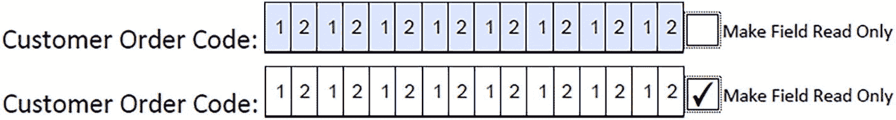

截图包含两个用于输入客户订单代码的区域。两者都有 16 个格子，内容为相同的订单代码。底部的订单代码已勾选，设置为只读。

**图 9-23** 使用复选框将字段设置为只读

对于 `Actions` 选项卡上的 `Check Box2` 复选框，使用 `Mouse Up` 触发器和 `Run a JavaScript` 设置，您可以输入以下内容：

```
if(event.target.value !="Off"){
this.getField("Customer Order Code").readonly=true;
}
else{
this.getField("Customer Order Code").readonly=false;
}
```

这再次设置了一个真假条件语句。如果 `event.target.value` 不等于 `"Off"`（即选中或开启状态），条件为真，字段被设置为只读。否则，条件为假，字段不是只读，客户端可以编辑该字段。

在您自己的项目中，如果您希望在启用复选框时也将更多字段设置为只读，可以在 `if` 和 `else` 条件中引用更多字段。只需确保将它们分别设置为 `true` 和 `false` 即可。

# 最终思考

如您所见，有多种方法可以帮助客户填写表单。并非所有字段都需要提供帮助。有些字段是明确且不言自明的。然而，如果您的客户不熟悉某个词语，或者由于英语水平有限需要翻译，这可能是一种可行的解决方法。如果表单只有一页，使用滚动提示可能就足够了。但是，对于两页或更多页且帮助信息分布在不同位置的表单，我建议使用警报方法。虽然这些表单提供了多种警报，但找到最适合客户需求的平衡点至关重要，这样既能提供信息，又不会让他们感到不知所措。

**注意**

Adobe Acrobat 现在（自 2017 年起）提供了一个日期弹出菜单。当文本字段格式设置为日期，或者您添加了一个日期字段时，可以使用日期选择器。由于用户选择日期后会自动格式化，因此为日期添加警报方法是可选的。在这种情况下，如果您发现警报代码干扰了表单的流程，可以选择修改或完全移除它。请参考图 9-24。但是，如果字段格式设置为时间，由于没有实际的“时间选择器”，此时使用此警报来提示格式将会很有用。

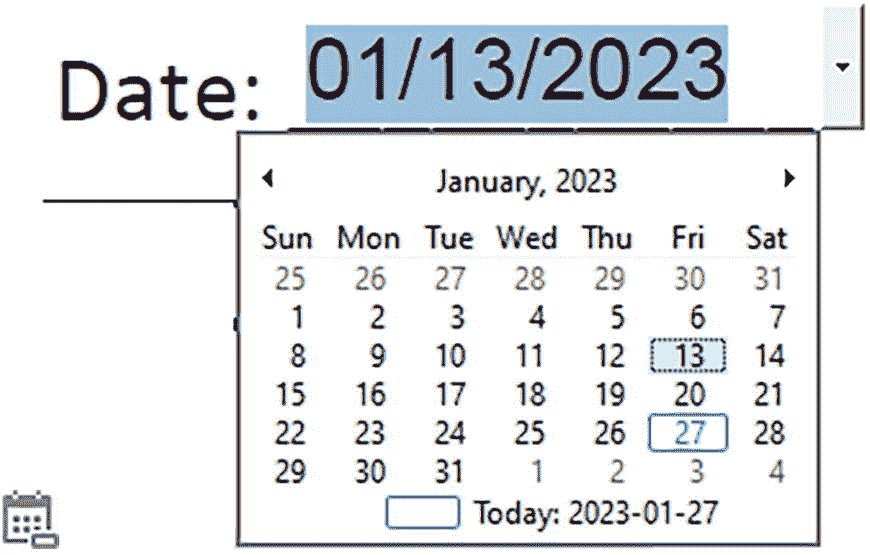

截图显示了一个从日历中选择日期的下拉菜单。它有一个日历弹出窗口，日期显示为 01、斜杠、13、斜杠、2023。

**图 9-24** 在 Acrobat 中添加日期字段时出现的日期选择器弹出菜单

# 总结

在本章中，您学习了三种可能的方法，用于在客户处理文本字段时创建帮助信息。您了解了如何修改代码以隐藏、显示和重置字段。您还了解了如何在多个字段中重用文档 JavaScript，以及如何对文本字段应用自定义格式。

最后，我们探讨了如何为多个字段复制文本，以及如何使用 JavaScript 使字段变为只读。

在下一章中，您将了解根据输入的数字或用户输入，有哪些其他选项可用于修改字段内的文本。
