# 7. 格式计算

**本章目标：** 在本章中，您将主要使用值、简化域表示法 (`SFN`) 和一些自定义 JavaScript 来处理数字、百分比、日期和时间格式。让我们看看它在哪些情况下有效，哪些情况下无效。您还将使用一些 JavaScript 来辅助您。

就像在 Microsoft Excel 中（见图 7-1）一样，有时您必须处理不同格式的数字；您并不总是处理简单的 `1+1`。以下是您可能遇到的其他格式：

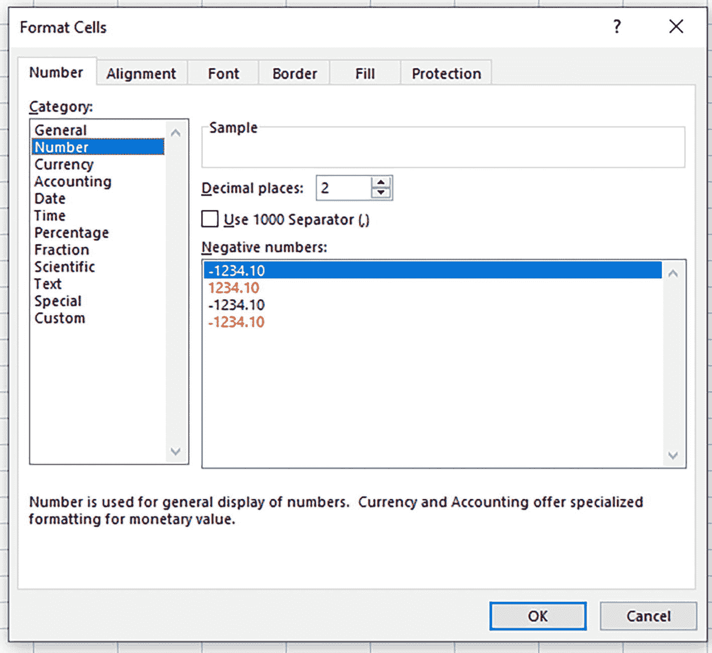

**图 7-1** 在 MS Excel 中设置单元格格式

*   百分比 (`98%`)
*   日期 (`2023 年 6 月 25 日`)
*   时间 (`上午 8:30`)

在 Acrobat Pro 中工作时也是如此。文本字段和下拉列表提供如图 7-2 所示的选项。

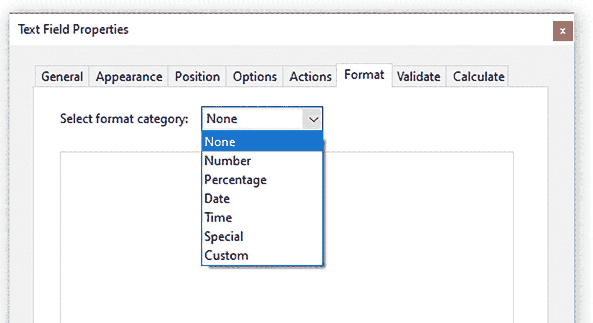

**图 7-2** 在 Acrobat Pro 的属性对话框中设置单元格格式

表 7-1 比较了 Acrobat 和 Excel 中的格式设置。

**表 7-1** Acrobat 与 Excel 格式选项对比

| Acrobat | Excel |
| --- | --- |
| 无 | 常规, 文本 |
| 数字 | 数字, 货币, 会计专用, 科学记数 |
| 百分比 | 百分比 |
| 日期 | 日期 |
| 时间 | 时间 |
| 特殊 | 特殊 |
| 自定义 | 自定义 |
| 可能通过自定义或使用两个单独的格式化数字字段实现 | 分数 |

正如你所见，大多数格式是相似的。“无”或“常规”被视为默认设置；字段可以包含普通数字或文本。但是，它们不会用于计算中。

**注意**

如果您想在本课中边学边练或查看最终结果，请从引言中提到的链接下载第 7 章的文件。标签为“Start”的文件是未包含代码的文件，标签为“End”的文件是最终结果。您还会找到一个包含原始 MS Word 和 PDF 文件的文件夹（以便您进行编辑），以及一个包含原始脚本的文件夹（以便您将其添加到自己的 PDF 表单中）。

请记住，要查看字段的属性，您必须选择“准备表单”工具；只有这样，您才能右键单击或双击一个字段来查看其属性。

## 数字格式

通过结合使用 `value` 和 `SFN`，你可以完成大部分计算。如需查看，请参考 PDF 文件 `Acrobat Format` 和 `Calculate Tab Examples`。请查看本章文件夹中的文件 `AcrobatFormatCalcTabExamples_End.pdf`，并查看用于加法的字段 `TotalNumber` 和用于减法的字段 `TotalNumber_2`。请参考图 7-3 以及图 7-4 和图 7-5 中的设置。之后，如需更多示例，请参考文件 `InvoiceForm_Example_End.pdf`。

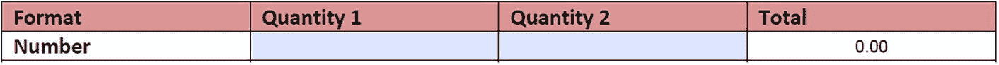

如前所述，当 `格式` 选项卡设置为 `选择格式类别` 中的 `数字` 时，你将拥有`小数位数`（0–10）的数字选项。

`分隔符样式`可以是逗号和十进制点的组合。示例包括 `1,234.56`、`1234.56`、`1.234,56`、`1234,56` 和 `1’234.56`。请参考图 7-4。

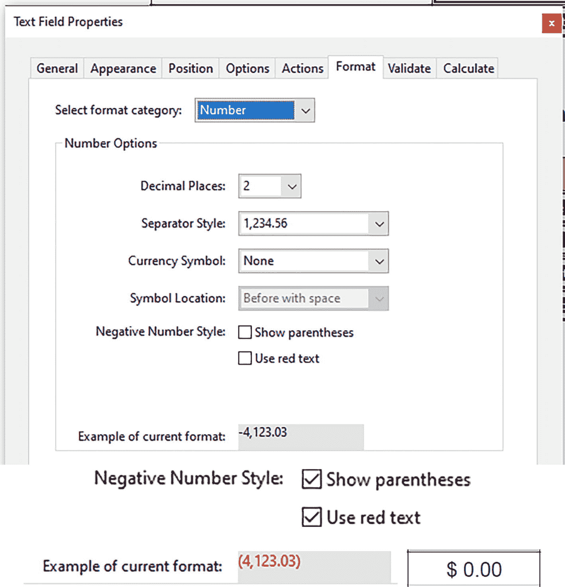

`货币符号`默认设置为 `无`。但是，你可以从列表中选择美元 (`$`)、欧元 (`€`)、英镑 (`₤`) 和其他货币符号选项，这些符号可以显示在货币金额之前或之后（图 7-4）。但是，如果你需要的货币符号或非货币符号没有出现在列表中，则可能需要使用自定义 JavaScript 来实现。我们将在第 18 章中讨论这一点。

`符号位置`列表用于设置符号将出现在数字之前还是之后，以及是否带空格。

两个`负数样式`选项是 `"显示括号"` 和 `"使用红色文本"`。默认情况下这些选项处于未选中状态，你可以看到当前格式的示例在属性对话框中的显示方式。但是，当启用 `"显示括号"` 时，数字将使用括号显示，而不是负数 (`-`) 符号。`"使用红色文本"` 也会移除负号，并且仅在数字为负数时，将文本颜色从 `外观` 选项卡中设置的任何颜色（如黑色）更改为红色。请参考图 7-4。

然后，在 `计算` 选项卡上，正如你在第 6 章和图 7-5 中看到的，你可以决定是使用 `value`、`SFN`，还是 JavaScript（自定义计算脚本）来执行计算。


请记住，关于 JavaScript 的示例，正如你在第 6 章的数学示例中看到的，有时在进行更科学的计算（例如 `Math.tan(x)`）时，你可以使用自定义计算脚本或 JavaScript 来辅助。

## 百分比格式

与数字格式一样，百分比与 `计算` 选项卡的 `value` 和 `SFN` 配合得很好。如需查看示例，请参考名为 `AcrobatFormatCalcTabExamples` 的“最终”文件，并查看用于加法的字段 `Quantity 1Percentage` 和 `Quantity 2Percentage`。请参考图 7-6。之后，如需更多示例，请参考文件 `InvoiceForm_Example_End.pdf` 和 `_End2_customPercent.pdf`。

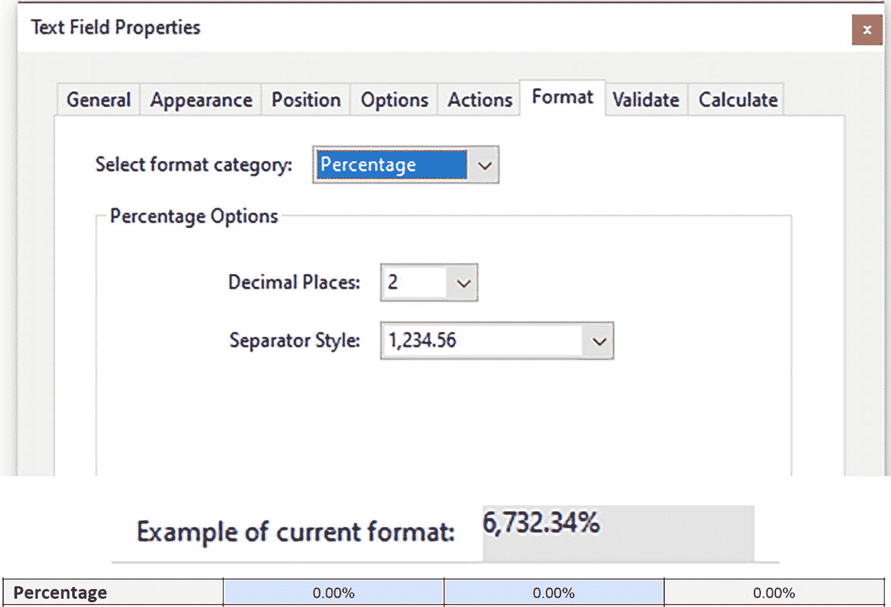

与数字格式一样，你可以设置小数位数和分隔符样式。`%` 符号将始终出现在数字之后。如果需要复习，请参阅本章中的“数字格式”部分。

在此示例中，我将字段 `TotalPercentage`（只读）的格式也设置为百分比，但如果你愿意，也可以将其格式保留为数字。但是，如果你希望数字保持在 0–100 的范围内，则需要设置 `验证` 选项卡（`字段值在范围内`）以匹配此范围，并防止用户在其它字段中输入时数字超过 100%。请参考图 7-7。


你也可以将负数设置为范围的一部分，例如 `自：-100 至：100`。

但是，请记住，当用户输入 `1` 时，Acrobat 会将其解释为 100%，因此如果你想要 1%，则需要输入 `0.01`，并且 `"1%"` 会显示为你输入的数字。当你尝试在一个字段中输入 `100%` 并在另一个字段中也输入 `100%` 时，即使设置了验证，你也可能会得到 `"200%"` 且没有任何警告信息。只有当你向某个字段输入 `101`，它可能会显示为 `"10,100.00%"` 时，`TotalPercentage` 字段才可能会给出警告。

### 百分比的变通方法

如果你担心客户无法理解这种格式，可以借助 JavaScript 添加一个实用提示，稍后你将对此进行探索。如果你不想添加提示，另一种方法是改进这种格式。让我们创建一个自定义格式，使得当按下 1 时，只输入 1%，而不是 100%。

为此，你需要为每个将要输入百分比的字段创建一个自定义格式。请参考图 7-8。对于不会输入数据的字段（例如在“常规”选项卡中已设置为只读的“总计”字段），可以保留百分比格式。你可以查看我的文件 `AcrobatFormatCalcTabExamples_End_CustomFormat.pdf` 中的示例，这些字段 `数量 1 百分比` 和 `数量 2 百分比` 已应用了此处的更改。

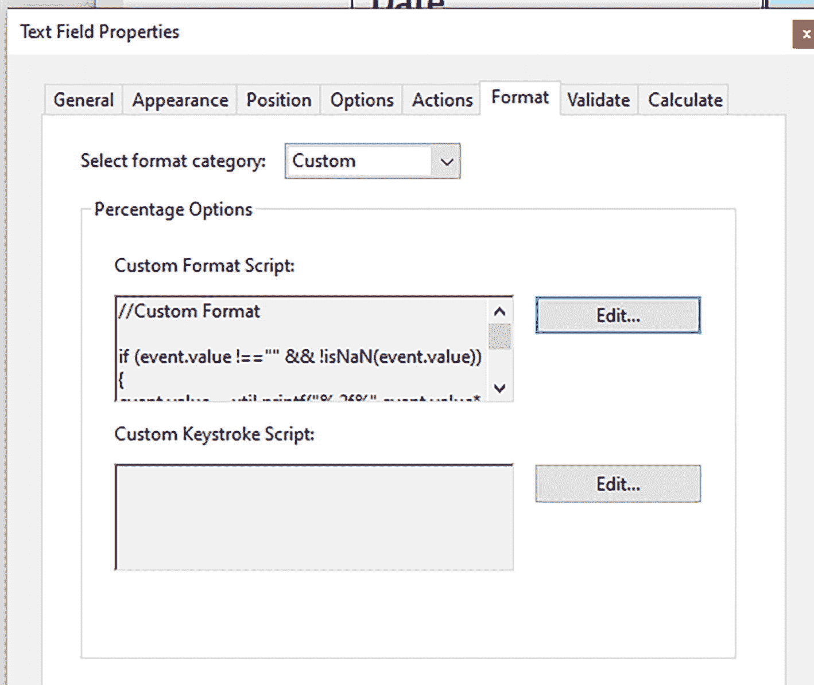

**图 7-8** 在“格式”选项卡中添加自定义格式脚本以代替百分比

> **注意**
> 你的版本在标签区域可能显示为“数字”、“百分比”或“自定义”选项，但这不影响计算。请参考图 7-8。

在“格式”选项卡中，为“选择格式类别”选择了“自定义”。在“自定义格式脚本”下，点击“编辑”按钮，在 JavaScript 编辑器中输入以下代码（图 7-8）：

```javascript
// 代码内容
```

# JavaScript 在 PDF 表单中的应用

## 验证与格式设置

```javascript
if (event.value !=="" && !isNaN(event.value)){
event.value = util.printf("%.2f%",event.value*100);
}else{
event.value = "";
}
```

然后点击“确定”退出。

接着，在“验证”选项卡中添加自定义验证。请参考图 7-9。

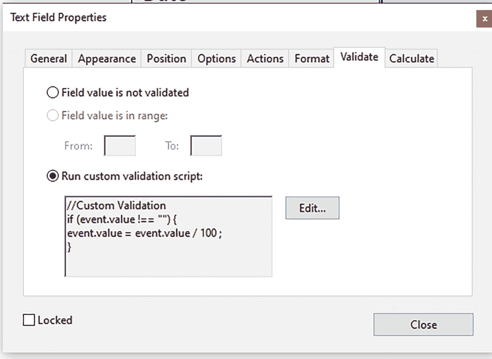

一张文本字段属性的截图，共有 8 个选项卡，其中“验证”选项卡被选中。它包含两个复选框：“不验证字段值”和“运行自定义验证脚本”，其中第二个选项被选中，后面跟着几行脚本代码。

**图 7-9** 在“验证”选项卡中添加验证脚本

```javascript
if (event.value !== "") {
event.value = event.value / 100;
}
```

在“格式”选项卡中，本例所做的是告知字段的验证：如果未输入任何内容，则保持空白。然后告知自定义格式忽略非数字项（`NaN`）。接着，要求它使用先前的字段计算，按以下方式显示：它将数学计算的小数点移动 2 位，使代码后有两位零，并乘以 100。在代码中紧接`f`后添加第二个`%`，确保数字后会显示百分号。如果漏掉`.2f`前的第一个`%`，会导致错误。由于我们正在创建自定义格式，请不要这样做。如果你在代码中`f`之后漏掉这第二个`%`，则数字后不会显示百分号。

```javascript
event.value = util.printf("%.2f%",event.value*100);
```

然后设置“验证”选项卡（图 7-9），使其在两个 JavaScript 版本之间理解：1 代表 1%，而不是 100%。

当字段不为空时，“验证”选项卡的自定义脚本还确保将数字除以 100，以获得正确的小数百分比。请参考图 7-9。

以下是输入数字后得到的结果：

```
百分比相加： 1.00%  + 1.00% =  2.00%
```

如前所述，对于最终的求和字段`总计百分比`，你不需要创建任何自定义脚本。你可以将其保留为百分比格式，并在“计算”区域中使用“值”或`SFN`。请参考图 7-10。

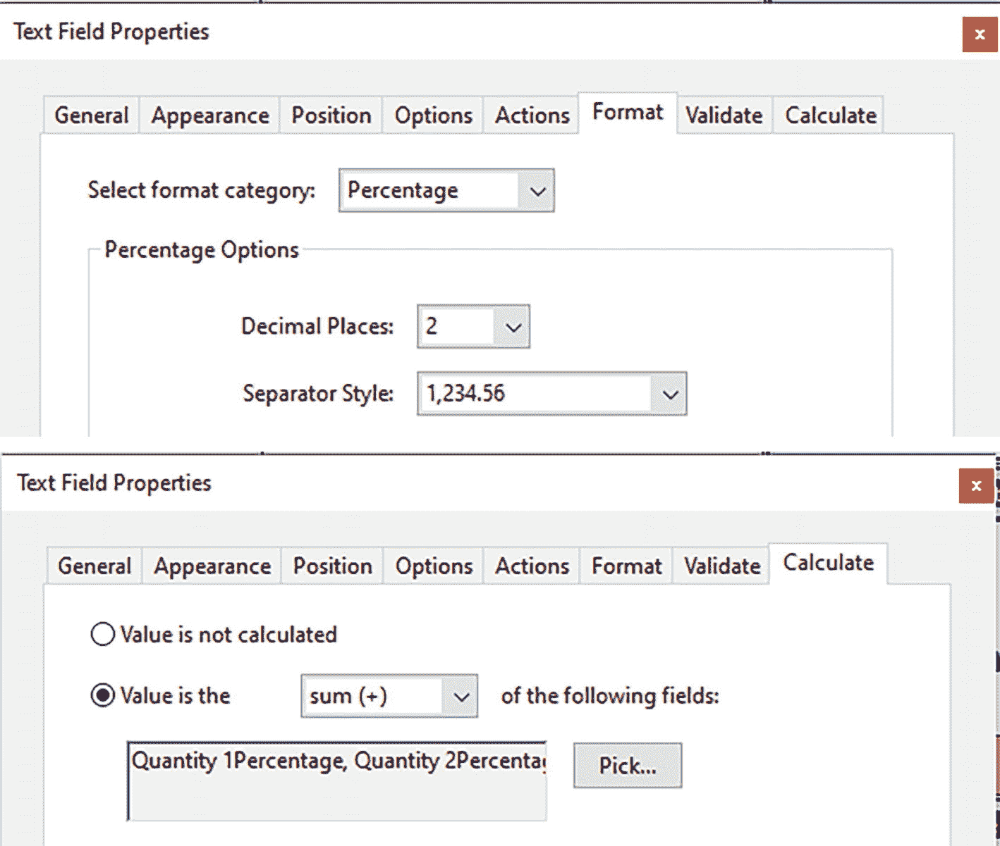

文本字段属性页面的 2 张截图，共有 8 个选项卡，其中“格式”和“计算”选项卡被选中。第 1 页包含一个用于将格式类别选择为百分比的下拉菜单和 2 个百分比选项。第 2 页显示该值被计算为以下字段的和。

**图 7-10** “总计”字段的“格式”选项卡和“计算”选项卡

> **注意**
>
> 在“自定义格式”设置和“验证”选项卡中，是条件语句即`if/else`语句的另一个示例（图 7-8 和图 7-9）。`if/else`语句设定了一个条件。如果满足“if”后面的条件，则执行花括号（`{ }`）内的操作。代码中另一个选项`else`提供了备选方案。如果`if`不成立，则执行`else`，即其花括号内的内容。如你将看到的，对于更长的条件，当你有超过两个选项时，你还会在`if`和`else`之间添加条件`else if`。条件内部也可以嵌套条件，稍后在本章中你会看到。
>
> 有关小数位和分隔符样式格式的更多信息，请参见本章后面的“最终思考”部分。

在本例中，你还可以设置一个验证范围，以进一步防止在输入字段中输入 0 到 100 范围之外的数字。以下是该代码可以如何扩展的示例。请参见粗体显示的新增部分。

```javascript
//自定义验证
if (event.value !== "") {
event.value = event.value / 100 ;
if (event.value < 0 || event.value > 1){
app.alert("你必须输入一个介于 0%和 100%之间的百分比");
event.value="";
}
}
```

这段代码被添加到字段`数量 1 百分比`和`数量 2 百分比`中。我们将在第 8 章中讨论`app.alert`，但本质上，这段代码通过验证阻止输入超出 0%到 100%范围的数字，如果输入了这样的数字，字段将被重置。这是通过逻辑或运算符（`||`）实现的，在本例中，只有当输入值之一为真或超出范围（即小于 0 或大于 100）时，它才生效。由于验证和格式已经设置，这里表示为 0 和 1。这段代码被放置在当前`if`语句内部。

### 使用 JavaScript 重置字段

然而，你仍然可以在最终字段中累加出像 200%这样的数字；如果你确实想这样做，那也没问题。或者，你也可以转到该字段的“验证”选项卡，像我处理`总计百分比`字段那样，添加类似的部分代码：

```javascript
if (event.value < 0 || event.value > 1){
app.alert("你输入的百分比总和不在 0%到 100%之间。字段将被重置");
this.resetForm(["数量 1 百分比","数量 2 百分比"]);
event.value="";
}
```

我还添加了另一行新代码：`this.resetForm();`。这里不是像第 2 章和第 4 章中为重置按钮使用“操作”选项卡的“重置表单”，而是使用 JavaScript 重置放在方括号（`[]`）内并用引号括起来的选定字段。引号内的字段名可以包含空格，只要它们像这样放在引号内即可：`"字段名称"`。每个字段用逗号分隔。当你不想在发出警告后重置整个表单时，这段代码非常有用。这确保了用户这次必须输入正确的数字。

如果你希望比较有无此类验证的结果，我已将减法示例中的字段`数字输入百分比`、`数字输出百分比`和`总计百分比 _2`保留为未添加此额外格式的状态。在这两个示例中，总计的“计算”选项卡都使用了`SFN`，但也可以使用 JavaScript。

## 日期格式化

单个字段的日期格式化很容易实现。要查看示例，请参考 `AcrobatFormatCalcTabExamples` 文件的“End”选项卡，并查看设置为 (`mmm d, yyyy`) 格式的 `Quantity_1Date` 字段。你可以将日期设置为多种选项，包括月份 (`mm`)、日期 (`dd`) 和年份 (`yyyy`) 的各种组合，并可通过短横线添加小时 (`hh`)、分钟 (`MM`)、上午/下午 (`tt`) 和冒号 (`:`) 等其他选项，此外还支持自定义设置。格式将显示在示例区域中。请参考图 7-11。

请访问以下页面了解 `cFormat` 字符串模式：

[`https://opensource.adobe.com/dc-acrobat-sdk-docs/library/jsapiref/JS_API_AcroJS.html`](https://opensource.adobe.com/dc-acrobat-sdk-docs/library/jsapiref/JS_API_AcroJS.html)

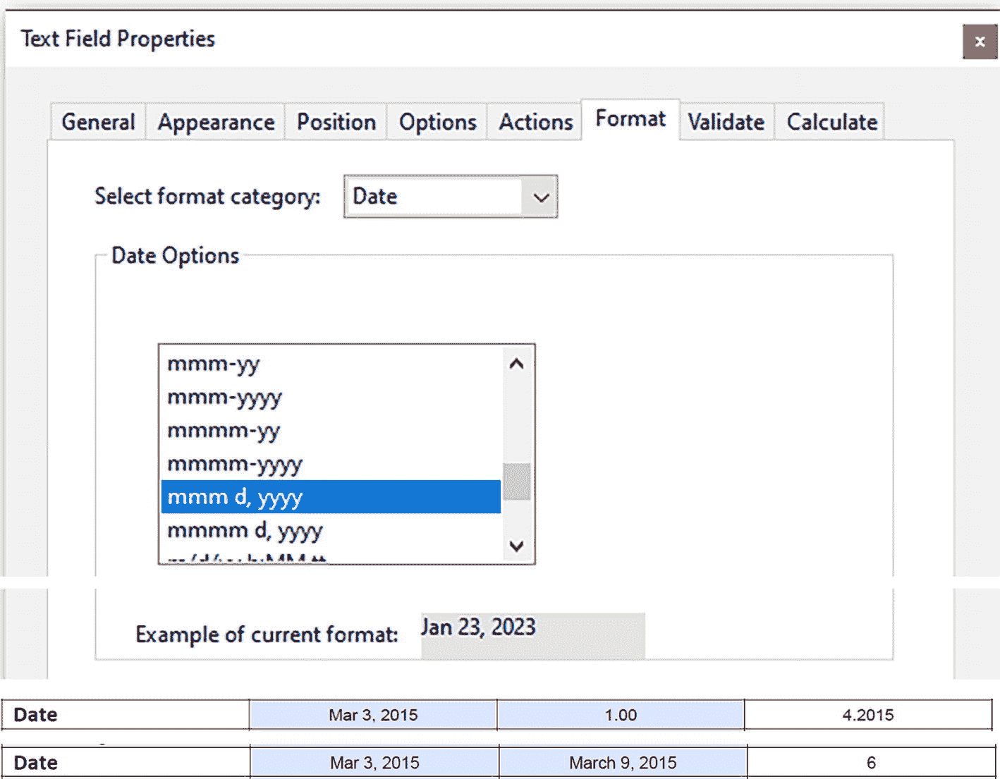

文本字段属性页面的截图显示有 8 个选项卡，其中“格式”选项卡被选中。它有一个下拉菜单用于选择格式类别为“日期”，一个日期格式选项列表，以及当前格式的示例。

**图 7-11** 在“格式”选项卡上选择日期格式及一个选项

然而，当涉及到日期之间的相加或相减时，`value` 和 `SFN` 就不太好用了。请参考 `Quantity_1Date`、`Quantity_2Date` 和 `TotalDate` 这些字段。

```
fDate:    March 3, 2015     + 1.00 =    4.2015
```

如你所见，这种算术毫无意义，而且尝试使用两个格式化为日期的字段向最终格式化为数字的文本字段输入数值时，常常会在使用 `value` 和 `SFN` 时导致错误；请参考图 7-12。

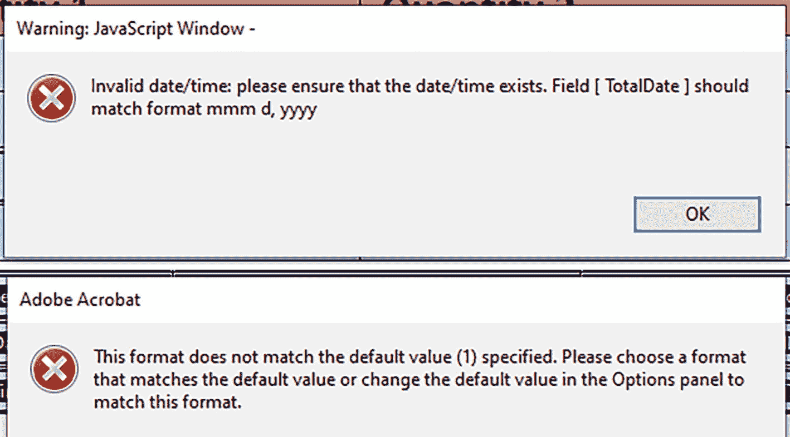

警告消息的 2 张截图。第一张显示警告消息：“无效的日期或时间，请确保存在该日期或时间且与格式匹配。”第二张显示消息：“此格式与默认值不匹配，请在选项面板中选择或更改默认值以匹配格式。”

**图 7-12** 当你尝试使用“计算值”或 `SFN` 将两个格式化为日期或其他格式的字段相加时出现的错误警告示例。

同样，你需要借助 JavaScript 来完成。

### 使用 JavaScript 进行日期格式化

假设你想创建一个酒店或考勤表，用于处理半天或全天入住与退房日期。请参考表 7-2 查看示例。你也可以查看三个字段：`DateStart`、`DateEnd` 和 `TotalDate_2`。

**表 7-2** 格式化日期表

| 格式 | 入住数量 | 退房数量 | 总计 |
| --- | --- | --- | --- |
| 日期： | 2015 年 3 月 3 日 | 2015 年 3 月 9 日 | 6 |

# 日期与时间字段格式化

## 日期格式化

“入住数量”或 `DateStart` 字段格式化为日期。请参考图 7-11。“退房数量”或 `DateEnd` 字段也格式化为日期，以便保持一致，并可以使用日期选择器轻松输入日期字段。借助 JavaScript，你可以使用两个日期字段进行计算。格式选项应保持一致，例如“mmm d, yyyy”。但是，最终的事件字段应为数字格式。请参考图 7-13 和图 7-14。

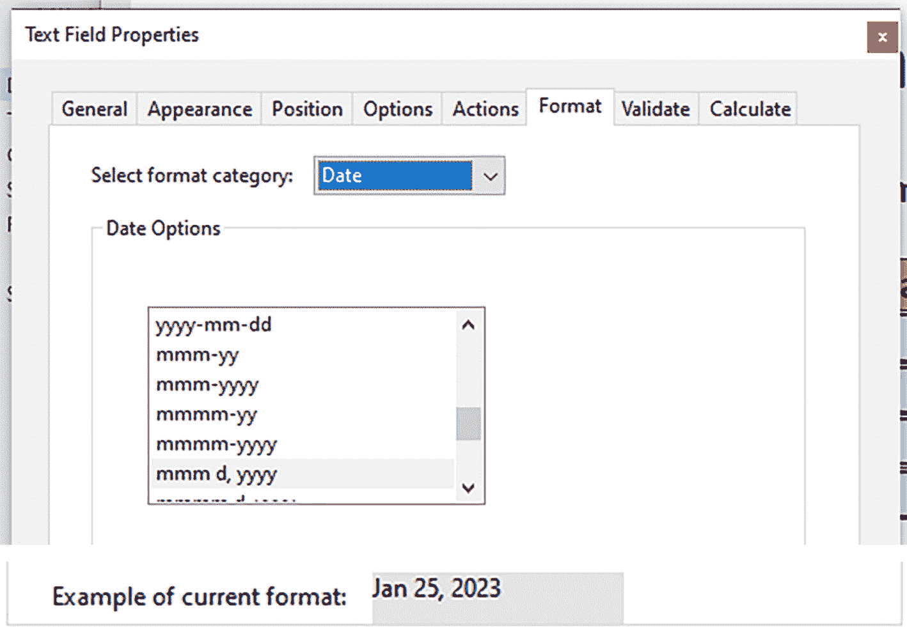

文本字段属性页面的截图显示有 8 个选项卡，其中“格式”选项卡被选中。它有一个下拉菜单用于选择格式类别为“日期”，后面跟着一个日期格式选项列表。页面底部有当前格式的示例。

图 7-13 — `DateEnd` 字段在“格式”选项卡上的设置与 `DateStart` 字段相同

总计字段 `TotalDate_2` 格式化为数字；通过在“计算”选项卡上设置自定义计算来完成公式。请参考图 7-14 和图 7-15。

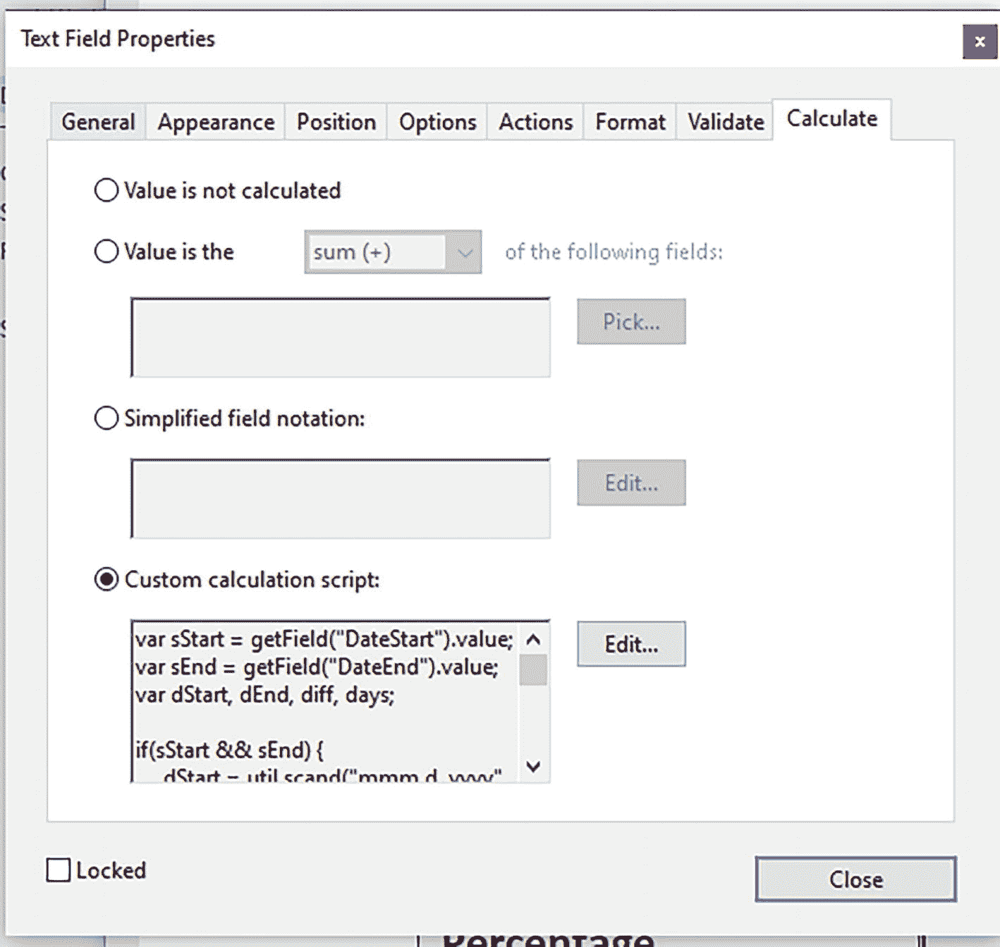

文本字段属性页面的截图显示有 8 个选项卡，其中“计算”选项卡被选中。它有 4 个复选框，其中第四个自定义计算脚本复选框被选中，后面是一个计算脚本的几行代码。

图 7-15 — 总计字段在“计算”选项卡上的设置

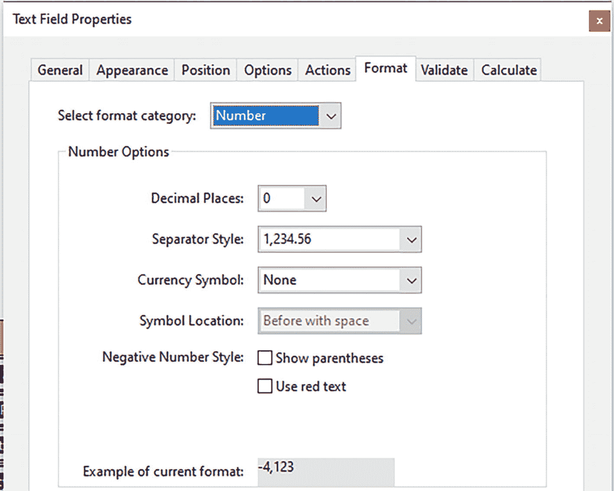

文本字段属性页面的截图显示有 8 个选项卡，其中“格式”选项卡被选中。它有一个下拉菜单用于选择格式类别为“数字”，后面跟着数字选项中的小数位数、分隔符样式、货币符号、符号位置和负数样式。

图 7-14 — 总计字段在“格式”选项卡上的设置

代码如下：

```javascript
var sStart = getField("DateStart").value;
var sEnd = getField("DateEnd").value;
var dStart, dEnd, diff, days;
if(sStart.length && sEnd.length) {
dStart = util.scand("mmm d, yyyy", sStart);
dEnd = util.scand("mmm d, yyyy", sEnd);
if ( dEnd < dStart)  {
app.alert ( "结束日期必须在开始日期之后，不能在此之前。");
event.value = "";
this.resetForm(["DateStart"]);
}
else{
//一天等于 24 小时* 60 分钟*60 秒* 1000 毫秒 = 86,400,000
var oneDay = 86400000;
diff = (dEnd.getTime() - dStart.getTime())/oneDay;
//var days = Math.floor(diff)+1;
var days = Math.round(diff)+1;
event.value = days;
}
}
else
{
event.value = "";
}
```

在这个示例中，我添加了一些注释来帮助计算。此代码位于“计算”选项卡上，从变量 `sStart` 和 `sEnd` 中获取开始日期和结束日期字段，并从每个字段获取输入值。然后这些值被放入一个条件语句中，该语句内部又包含另一个条件 `if`/`else` 语句。外部的条件语句 `if` 表明结果将是一个数字，否则（“else”）它将为空。

然而，在外层的 `if` 语句中，计算被进一步分解。我们看到 `if` 确保开始日期和结束日期的值确实是数字。`Length` 可以帮助你获取一个数字，并且每个变量（`var sStart` 和 `var sEnd`）的长度都会对照格式 “mmm d, yyyy” 进行检查。重要的是，此格式必须与 `Number In` 和 `Number Out` 或 `DateStart` 和 `DateEnd` 字段中的格式一致，否则该计算将无法生效。现在，这些值被保存在名为 `dStart` 和 `dEnd` 的新变量中。

代码中的 `util.scand()` 部分是一个函数或方法，它可以使用日期符号转换任何日期字符串，但必须知道日期的确切格式才能正常工作。

在内层的 `if`/`else` 条件语句中，首先会通过另一个提示框进行验证检查。这是为了确保你不会错误地输入一个晚于结束日期的开始日期。这种情况会被视为不正确的值，并且你会收到警报。当你点击警告信息中的“确定”后，`DateStart` 字段会重置为上次保存的默认状态，并将 `TotalDate_2` 字段清空，然后你必须重新设置开始日期或结束日期，以便 `TotalDate_2` 字段再次被填充。同样地，在你自己的项目中，可以添加一个单独的“重置”按钮来刷新整个表单。我们在本章前面部分已经看到过 `this.resetForm()` 的示例。

然而，当两个日期都正确时，你就可以继续执行内层的 `else` 条件了。

一旦两个字段都处理完毕，结束日期和开始日期会通过 JavaScript 的 `.getTime()` 方法被识别为时间。更多信息，请访问此页面：

[`https://developer.mozilla.org/zh-CN/docs/Web/JavaScript/Reference/Global_Objects/Date/getTime`](https://developer.mozilla.org/en-US/docs/Web/JavaScript/Reference/Global_Objects/Date/getTime)

在 JavaScript 中，有许多与 `Date` 相关的方法可用，但在本例中，我们想要获取的是毫秒数，而不仅仅是日期的某一部分。

这会返回一个毫秒数（例如：`1432672724073`），这个数字可能相当长。但这并非你想要的精确答案。你想知道的是有多少天。当从 `dateEnd` 的 `getTime` 中减去 `dateStart` 的 `getTime` 后，你需要计算一天有多长。在这种情况下，一天等于 `24 小时 * 60 分钟 * 60 秒 * 1000 毫秒 = 86,400,000` 毫秒。

然后，我们用一天的毫秒数除以两个日期相减的结果，得到变量 `diff` 或差值。

此时，我们可以在两个不同的静态方法之间做出选择。

*   `Math.floor()` 将差值向下舍入到最接近的天数。

*   `Math.round()` 将差值向上舍入到最接近的天数。

如果你按半天来计费，这两个数字对于日期来说都适用；例如在酒店，你晚上到达，早上离开。因此，你实际上并没有住满整整两天。但是，如果你需要计算完整的天数，那么你应该这样写：

```
var days = Math.round(diff)+1;
```

否则，你可以从代码中删除 “+1”，这样就会得到 6 天，如上文表 7-2 中的示例所示，而不是完整的 7 天。

然后，我用以下代码完成内层的 `else` 语句：

```
event.value = days;
```

结果现在显示在表单的 `TotalDate_2` 字段中。文件 `AcrobatFormatCalcTabExamples_End.pdf` 和 `Custom Format.pdf` 中提供了示例。

如果没有 JavaScript，你根本无法在 Acrobat 中完成此项计算。

请注意，在代码示例中，我将两个变量编写如下：

```
var sStart = getField("DateStart").value;
var sEnd = getField("DateEnd").value;
```

同样地，我也可以这样编写：

```
var sStart = this.getField("DateStart").value;
var sEnd = this.getField("DateEnd").value;
```

代码的运行效果是相同的。如果你想使代码更严格，可以在 `getField` 前添加 `this`。然而，在冗长的示例中，如果你需要在文档的其他地方再次引用变量和字段，可能希望节省空间而省略 `this`。如果你发现代码运行不正常，可以添加 `this`。

## 时间格式化

时间格式化的许多方面与日期格式化类似。根据字段的用途，你甚至可以将时间添加到日期中。不过，与日期字段不同，时间字段没有“时间选择器”，你必须手动输入数字。因此，从列表中选择正确的时间选项非常重要。如需查看，请参阅“End”文件 `AcrobatFormatCalcTabExamples`，并参考 `Quantity 1Time` 字段。另请参考图 7-16。

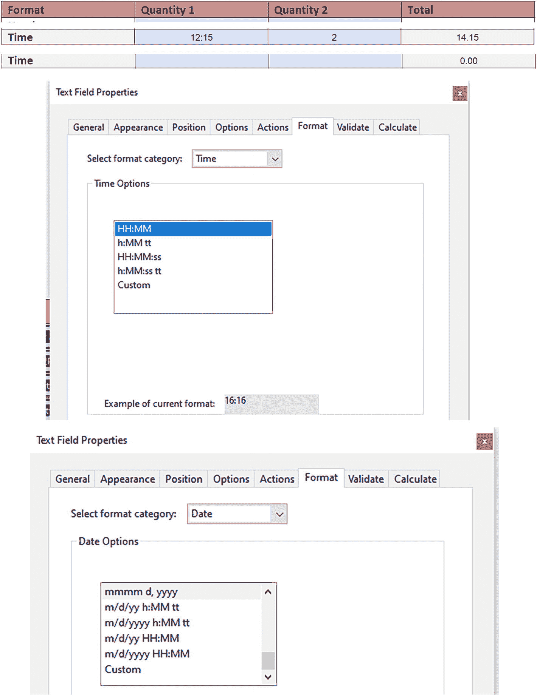

一张截图显示了一个包含 4 列的表格，列标题分别为格式、数量 1、数量 2 和总计。它包含两张文本字段属性对话框的截图，并选中了“格式”选项卡。第一张截图中，格式类别选为“时间”，随后显示时间选项。第二张截图中，格式类别选为“日期”，随后显示日期选项。

图 7-16 — “格式”选项卡上的时间与日期格式对比

两者都可以接受自定义的日期或时间格式，其中可以包含小时（`HH`）、分钟（`MM`）、秒（`SS`）以及上/下午指示符（`tt`）。

然而，尽管它们很相似，你可以使用一些简化字段表示法（SFN）而不用 JavaScript 来进行简单的时间减法，不过我最终还是推荐使用 JavaScript，稍后我们将复用之前的“日期”格式化代码来探讨。

例如，要了解在计算区域直接使用某个值为何效果不佳，请参考表 7-3 和 7-4。

**表 7-3** 在“计算”选项卡上使用值对总计进行格式化

| 格式 | 输入数值 | 输出数值 | 总计 |
| --- | --- | --- | --- |
| 日期: | 12:15 | 27 | 39.15 |

在第一个示例中，你可以参考 `Quality 1Time`、`Quality 2Time` 和 `TotalTime` 这些文本字段，其结果就像日期格式化示例一样，没什么意义。

在下一个表中，我们尝试用一个时间减去另一个时间，通过使用 `NumberInTime`、`NumberOutTime` 字段和 `TotalTime_2` 字段来获取总小时数。

**表 7-4** 在“计算”选项卡上使用 SFN 对总计进行格式化

| 格式 | 输入数值 | 输出数值 | 总计 |
| --- | --- | --- | --- |
| 日期: | 04:30 | 15:30 | 11:00 |

现在我们来使用 SFN。

为了使其正确工作，假设 Joe 在早上 4:30 上班，下午 3:30（格式化为 15:30）下班。因此，他总共工作了 11 个小时。

`NumberInTime` 和 `NumberOutTime` 字段都按以下方式格式化：`HH:MM`。请参考图 7-17。

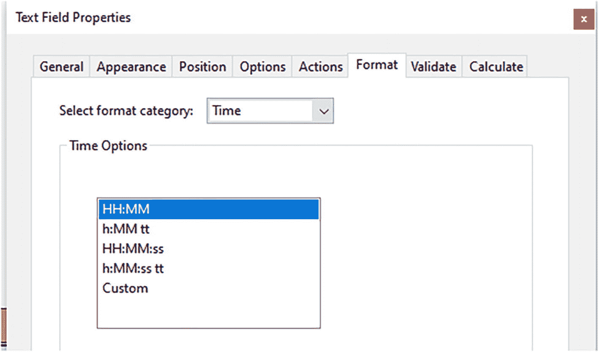

一张文本字段属性对话框的截图，显示有 8 个选项卡，其中“格式”选项卡被选中。它有一个下拉菜单，用于选择格式类别为“时间”，随后是一个用于时间选项的格式列表。

**图 7-17** 在“格式”选项卡上对“上班”和“下班”字段进行时间格式化

然后，将 `TotalTime_2` 字段格式化为数字。请参考图 7-18。

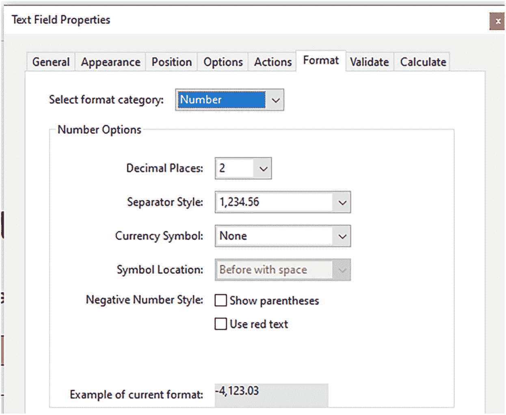

一张文本字段属性对话框的截图，显示有 8 个选项卡，其中“格式”选项卡被选中。它有一个下拉菜单，用于选择格式类别为“数字”，并在数字选项内提供了小数位数、分隔符样式、货币符号、符号位置和负数样式等选项。

**图 7-18** 在“格式”选项卡上对“总计”字段设置数字格式

最后一步是在“计算”选项卡上使用 SFN。请参考图 7-19。

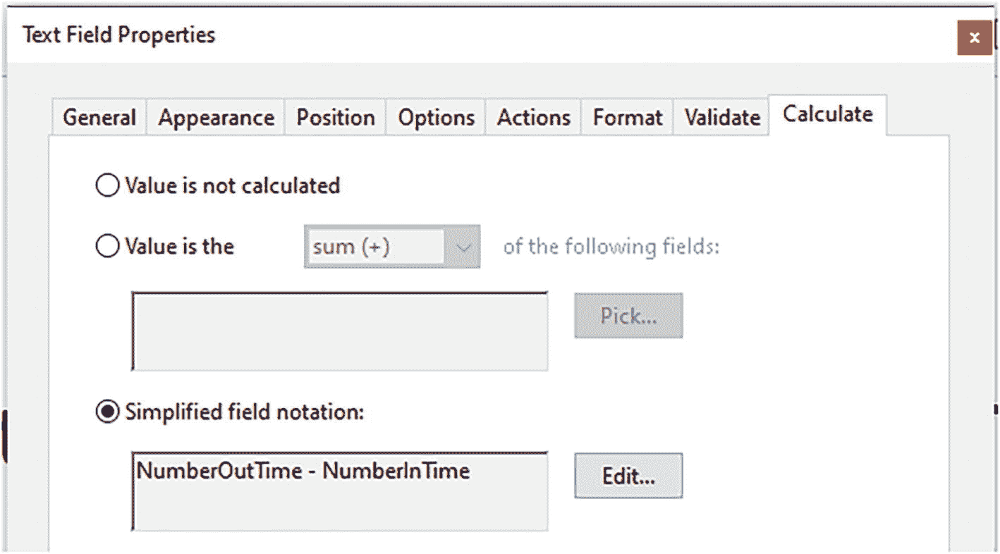

一张文本字段属性对话框的截图，显示有 8 个选项卡，其中“计算”选项卡被选中。它有 3 个复选框，其中第三个（简化字段表示法）被选中，框的右侧有一个编辑按钮。

**图 7-19** 在“计算”选项卡上对“总计”字段使用 SFN

`NumberOutTime - NumberInTime` 即可得出当天的工作小时数。

这种方法适用于整小时或半小时递增的简单数字格式，例如从 4:30 到 15:30，这些时间加起来正好是整小时。但是，当处理某些特定时间（例如用中午 12 点减去凌晨 1:30）时，这种计算方式并不精确。你可以看到使用 SFN 处理时间会发生什么情况。现在，我们来看一个示例，看看如何复用我们之前创建的日期代码来处理时间。

### 使用 JavaScript 进行时间格式化，自定义示例

这次，我们将使用代码来重写部分代码。不过，首先我要指出我发现的几个问题。我即将向您展示的代码不能直接与时间格式化一起工作，当我尝试修改时还会抛出一些错误。但是，您可以绕过这个问题，通过使用日期格式创建自定义的时间和日期，然后只修改代码的特定部分。

在这个例子中，确保你的 `NumberInTime` 和 `NumberOutTime` 字段被格式化为自定义日期格式“`mm/dd/yyyy HH:MM tt`”。请参考图 7-20。

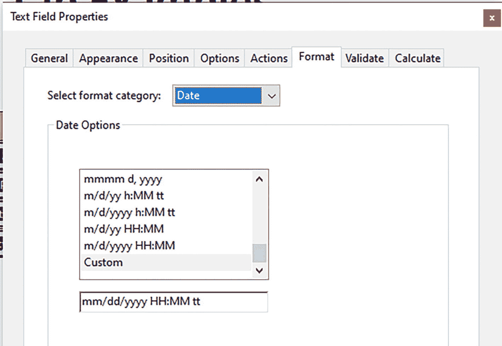

一张文本字段属性对话框的截图，显示有 8 个选项卡，其中“格式”选项卡被选中。它有一个下拉菜单，用于选择格式类别为“日期”，随后是一个用于日期选项的格式列表。

**图 7-20** 使用日期格式设置自定义时间

值得庆幸的是，日期格式允许我们添加 `HH` 表示小时，`MM` 表示分钟，`ss` 表示秒，以及 `tt` 表示上/下午指示。

确保你的 `TotalTime_2` 字段格式化为数字。这次，在“计算”选项卡上，输入以下代码。请参考图 7-21。

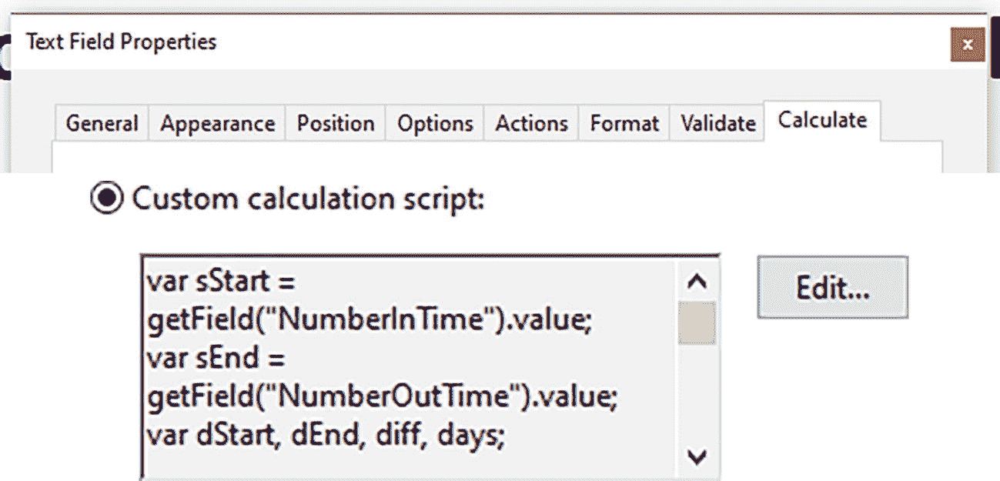

一张文本字段属性对话框的截图，显示“计算”选项卡被选中。它选中了“自定义计算脚本”复选框，随后是几行计算脚本代码，框的右侧有一个编辑按钮。

**图 7-21** 使用日期格式设置自定义时间

以下是时间脚本：

```
//Time Script
var sStart = getField("NumberInTime").value;
var sEnd = getField("NumberOutTime").value;
var dStart, dEnd, diff, hours;
if(sStart.length && sEnd.length) {
dStart = util.scand("mm/dd/yyyy HH:MM tt", sStart);
dEnd = util.scand("mm/dd/yyyy HH:MM tt", sEnd);
if ( dEnd < dStart)  {
app.alert ( "The end date must be after start date and not before.");
event.value = "";
this.resetForm(["NumberInTime","NumberOutTime"]);
}
else{
//one day is equal to 24hours* 60minutes*60 seconds* 1000 milliseconds = 86,400,000
// hours is 3,600,000
var oneHour = 3600000;
diff = (dEnd.getTime() - dStart.getTime())/oneHour;
//var hours = Math.floor(diff);
var hours = Math.round(diff);
event.value = hours;
}
}
else
{
event.value = "";
}
```

在这个例子中，我只是对数字（这里是小时数）进行了四舍五入。我将数字从 86,400,000 改为 3,600,000，这也有助于我计算出一天或可能几天内有多少小时，因为使用日期我可以使用日期选择器。有关此效果示例，请参考图 7-22。


一张数据字段的截图显示了 4 个时间条目、2 个带有日期和时间的条目，最后一个条目为 11。第二个和第三个条目具有相同的日期和不同时间，并且格式相同。

**图 7-22** 设置了自定义日期和时间的字段

如果你在处理半小时或其他非整点时间时需要更精确的时间数值，你也可以使用不带 `Math.round` 的 `hours` 变量。

```
var hours = diff;
```

或者，如果你想四舍五入到最近的半小时，可以这样写：

```
var hours = Math.round(diff*2)/2;
```

你可以在我提供的文件 `AcrobatFormatCalcTabExamples_End_CustomFormat.pdf` 中参考这段代码。

#### 日期格式的字符组合

你也可以使用字符组合来设置日期格式，这在 `选项` 选项卡中可以看到。当你需要在日期甚至时间下设置自定义选项时，这会非常有用。但请注意，根据你选择或创建的格式，你需要考虑连字符以及任何间距。在此例中，我在 `外观` 选项卡中添加了边框，并在 `选项` 选项卡中将字符组合设置为 10。请参考图 7-23 和图 7-24。

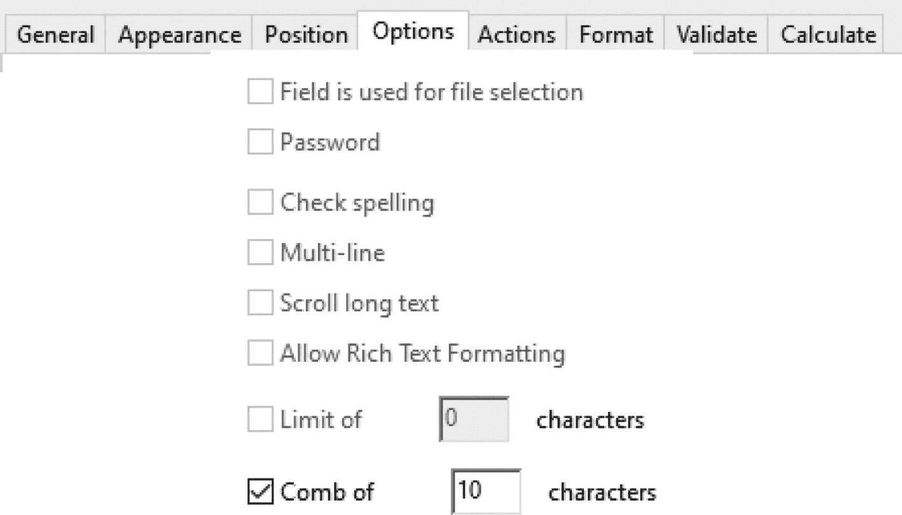

**图 7-24** 使用 `选项` 选项卡为日期格式设置字符组合

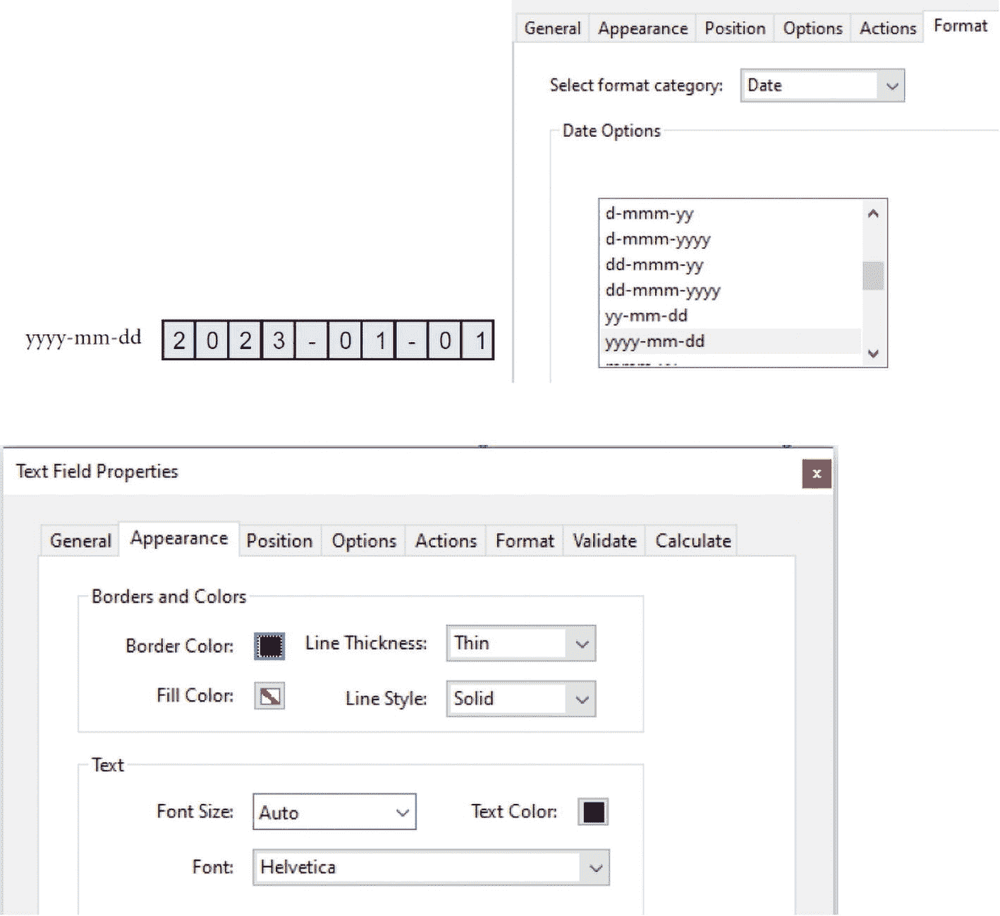

**图 7-23** 使用 `格式` 和 `外观` 选项卡为日期格式设置字符组合

#### 特殊格式化

你可以使用 `特殊格式化` 选项来设置你的邮政编码、电话号码、社会保险号以及任意掩码（但不包含附加 JavaScript）；我们将在第 11 章再次探讨这个领域。请参考图 7-25。

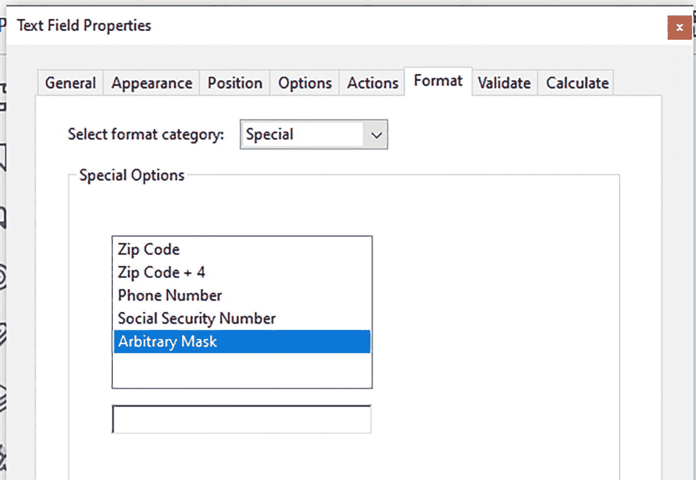

**图 7-25** `特殊格式化` 的设置

## 最终思考

正如你从本章涵盖的格式化示例中看到的，有时你会使用值（`value`）和 `SFN`。然而，在某些情况下，它们不会给你想要的结果。如果计算变得复杂或具有科学性，你可能需要寻找一个自定义 `JavaScript` 来帮助你，或者考虑当一种格式化类型不起作用时，如何重用代码来解决其他领域的问题。

## 下拉列表替代方案

如同第 2 章和第 6 章一样，如果你的客户需要输入非常特定的值，本章文件夹中也提供了一个下拉列表替代方案。我提供了一个示例，其中包含一些修改后的代码，用于处理下拉列表和 `总计` 文本字段的 `计算` 选项卡。请参考文件 `AcrobatFormatCalcTabExamples_End_DDown.pdf`。

## 关于添加小数位和前导零的更多信息

在本章前面部分，我们看了一些在处理百分比时添加小数位的代码。

```
if (event.value !=="" && !isNaN(event.value)){
event.value = util.printf("%.2f%",event.value*100);
}else{
event.value = "";
}
```

在那个例子中，我们只使用了那个格式代码而没有进行验证，并将小数点移到了小数点后两位，写成 `(%.2f%)`。这段代码本身会给出数字 `100.00%`。通过修改以下代码部分：

```
event.value = util.printf("%.1f%",event.value*100);
```

你将会得到 `100.0%` 或只有一位小数。

最后，如果你在小数点前添加数字，像这样：

```
event.value = util.printf("%08.0f%",event.value*100);
```

当你输入 `1` 时，你会得到 `00000100%`。这会将数字移动到小数点前的八位，本例中没有小数点。用类似的代码行尝试一下，并观察前导零如何变化。请在使用 `格式` 和 `验证` 选项卡代码进行当前百分比计算时牢记这一点。

```
event.value = event.value / 100 ;
```

因此，当你创建自己的计算时，就不会遇到不寻常的格式错误。

如果你需要使用逗号或下拉百分比分隔符样式列表中的其他分隔符作为分隔符，你可以通过在第一百分比后添加一个逗号，然后在点之前添加一个数字（例如 `2`）来编写代码。你会得到 `100,00%` 或者对于更长的数字得到 `120.000,00%`。第二个例子使用了一个 `0`，并会先添加逗号，例如 `100,000.00%`。

```
event.value = util.printf("%,2.2f%",event.value*100);
或
event.value = util.printf("%,0.2f%",event.value*100);
```

你可以使用数字 `0` 到 `4` 来访问数字或百分比格式列表中的分隔符选项。只需确保在数字选择前面添加逗号，如前面几行所示。如果你没有像前面的百分比示例那样添加这段代码，`1`（仅小数位）似乎是默认格式。

## 总结

在本章中，你主要学习了如何在文本字段或下拉列表中使用 `格式` 选项卡。

你研究了使用以下内容的格式化：

*   无

*   数字

*   百分比

*   日期

*   时间

*   特殊

*   自定义

虽然 `Acrobat` 对某些格式有一些自动解决方案，但在本例中，你需要使用值、`SFN` 或 `JavaScript` 创建计算来获得你想要的结果。有时你必须结合使用多种格式。

你还研究了自定义格式化如何与 `验证` 选项卡上的代码进行交互。在第三部分，你将更详细地研究 `验证` 选项卡。

在下一章，你将学习如何使用 `JavaScript` 向文档添加各种警报，并向按钮添加一些 `JavaScript` 来创建注释和时间戳。