# 11. 文本框、提示框和单选按钮的验证

第三部分的 JavaScript 变得更加复杂，因为多个表单字段需要协同工作。

正如您在之前的示例中所看到的，为避免错误，您需要创建警告或提示，以便客户输入正确的信息。

**本章目标：** 文本框并非唯一可以应用提示或选项的字段项。您也可以使用单选按钮。在本章中，您将学习如何操作。

> **注意**
> 如果您想跟着本课练习或查看最终结果，请从引言中的链接下载第 11 章的文件。标有“开始”的文件是未包含代码的文件，标有“结束”的文件是最终结果。如果您想编辑它们，您还会找到包含原始 MS Word 和 PDF 文件的文件夹，以及一个包含原始脚本的文件夹（如果您想将它们添加到您自己的 PDF 表单中）。
> 如果您是从原始 PDF 创建表单，请参考第 1 章中的“表单回顾”部分。
> 请记住，要查看字段的属性，必须选择“准备表单”工具；只有这样才能右键单击或双击字段以查看其属性。

## 转账示例

转账示例是验证如何应用于其属性对话框中没有`Validate`选项卡的字段的一个绝佳示例。请参考图 11-1。

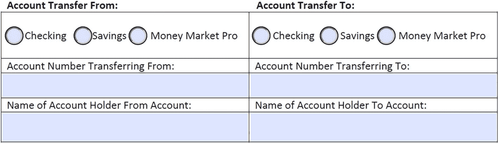

一个页面的截图包含一张表格，该表格有 2 列，分别用于显示转出账户和转入账户的详细信息。表格有 3 行。第 1 行有 3 个复选框，分别对应支票账户、储蓄账户和货币市场专业账户。第 2 行显示转出和转入账户的账号详细信息。第 3 行显示两个账户的持有人姓名。

图 11-1

在此转账示例中，您可以选择将资金转入另一个账户。

有时您可能希望将一定金额转入另一种类型的账户。请参阅文件 `TMC Account Transfer End .pdf`。并参考图 11-2 和图 11-3。

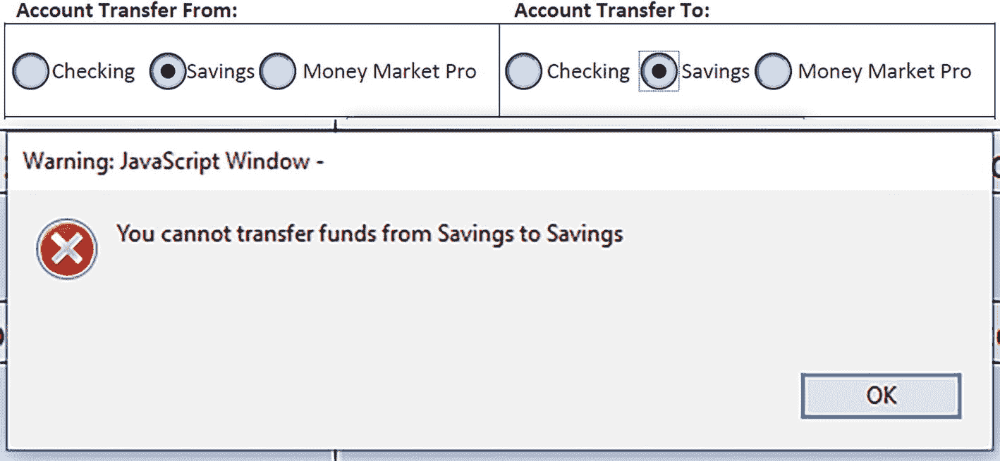

一个页面的截图包含一张表格，该表格有 2 列，分别用于显示发送方和接收方账户的详细信息，每个账户有 3 个复选框，并且储蓄账户的复选框处于选中状态。页面上有一个弹出窗口，显示一条消息，提示无法将资金从储蓄账户转至储蓄账户。

图 11-3

储蓄账户转储蓄账户（带警告）

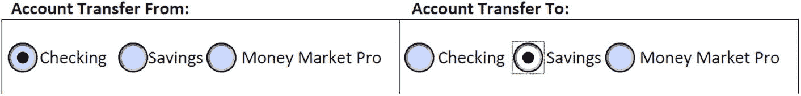

一个页面的截图包含 2 列，分别用于显示发送方和接收方账户的详细信息。其中有一行，每个账户各包含 3 个复选框（分别对应支票、储蓄和货币市场专业账户），并且支票账户的复选框处于选中状态。

图 11-2

支票账户转储蓄账户或货币市场专业账户是可实现的转账操作

在图 11-2 中的选择不会触发警告，因为您是将资金从支票账户转至储蓄账户。但是，如果您尝试从储蓄账户转至储蓄账户，则会收到一条警告。

这种类型的转账会触发警告提示。您必须单击`OK`，然后单选按钮将自动重置为空白状态。

如果您尝试从支票账户转至支票账户，或从货币市场专业账户转至货币市场专业账户，也会收到警告。

图 11-4 展示了按钮在表单编辑模式下的设置方式。

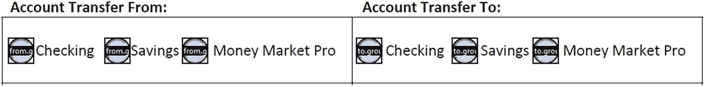

一个页面的截图包含一张表格，该表格有 2 列，分别用于显示发送方和接收方账户的详细信息，每个账户各包含 3 个单选按钮（分别对应支票、储蓄和货币市场专业账户）。

图 11-4

单选按钮布局：左侧是`发件人`组，右侧是`收件人`组

如前所述，单选按钮必须始终分组才能正常工作；它们在`常规`选项卡上需要具有相同的名称。它们可以在`选项`选项卡上具有不同的值或单选按钮选项，但它们必须属于同一个组。请参考图 11-5。

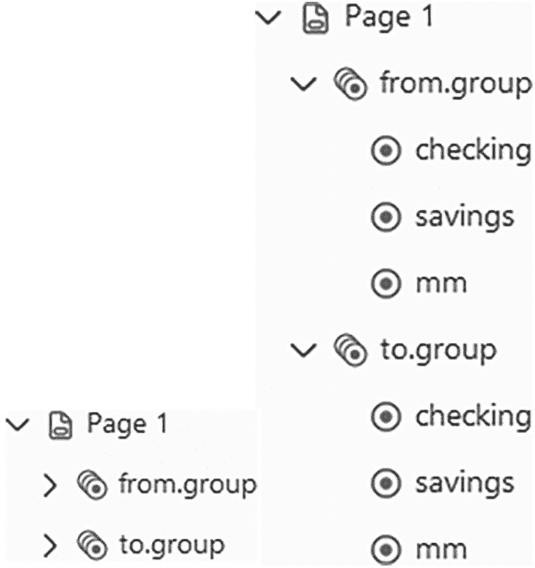

一张截图左侧显示了第 1 页的展开视图。其中包含`发件人`和`收件人`的单选按钮组。右侧显示了第 1 页的展开视图，并进一步展开了`发件人`和`收件人`组，其中包含了用于支票、储蓄和`货币市场`的选项。

图 11-5

`准备表单`工具展示了单选按钮组在折叠和展开时的状态，正如`字段`面板右侧所示。

这里您可以看到`from.group`单选按钮的设置。在此例中，我仅选择了对应支票账户的那个按钮，以便您查看其属性。如果您选择储蓄或`mm`（货币市场专业账户），唯一的不同将是`选项`选项卡上的单选按钮选择。请参考图 11-6。

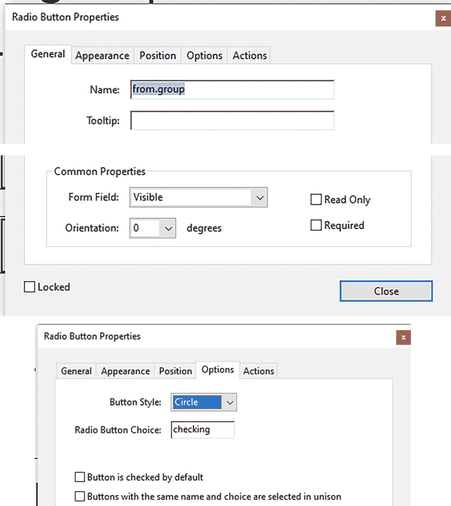

2 个单选按钮属性页面的截图，每个页面都有 5 个选项卡：`常规`、`外观`、`位置`、`选项`和`动作`。第一个截图包含用于名称、工具提示和通用属性的输入框。第二个截图包含用于按钮样式的下拉菜单和用于单选按钮选项的输入框。

### 图 11-6

“常规”和“选项”选项卡中 `from.group` 内单选按钮的设置。唯一的区别是单选按钮的选择。

在左侧，`from.group` 单选按钮不包含任何操作。请参考图 11-7。

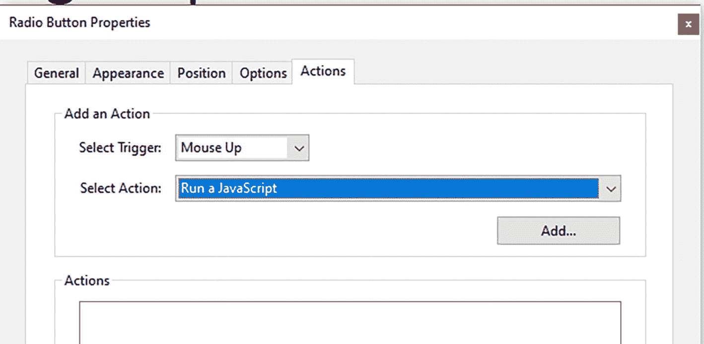

这是一个单选按钮属性页面的截图，包含“常规”、“外观”、“位置”、“选项”和“操作”共 5 个选项卡，其中“操作”选项卡处于选中状态。页面上有一个用于添加操作的框，其中包含下拉菜单，用于选择触发器和操作。

### 图 11-7

“操作”选项卡中 `from.group` 内单选按钮的设置。未应用任何操作。

然而，`to.group` 单选按钮包含一个操作，因为它们是第二个选择，当该选择与第一个选择匹配时，可能会触发警告，也可能不会触发警告。在“鼠标释放”时，我选择了“运行 JavaScript”。请参考图 11-8。

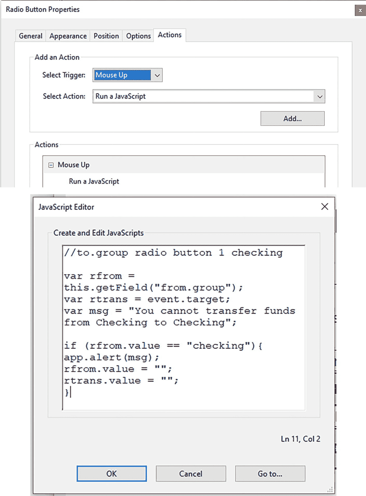

这是一个单选按钮属性页面的截图，包含 5 个选项卡，“操作”选项卡处于选中状态。页面上有一个用于添加操作的框，其中包含下拉菜单，用于选择触发器和操作。还有一个用于 JavaScript 编辑器的弹出窗口，其中包含几行代码，用于创建和编辑 JavaScript。

### 图 11-8

“操作”选项卡中 `to.group` 内单选按钮的设置。该代码用于从 Checking 账户向 Checking 账户转账。

在我的“结束”示例中，我在 JavaScript 编辑器中键入了以下代码：

```
//to.group radio button 1 checking
var rfrom = this.getField("from.group");
var rtrans = event.target;
var msg = "You cannot transfer funds from Checking to Checking";
if (rfrom.value == "checking"){
app.alert(msg);
rfrom.value = "";
rtrans.value = "";
}
```

这里有两个变量：`rfrom` 和 `rtrans`。第一个变量 `var rfrom` 代表整个单选按钮组 `from.group`。第二个变量 `var rtrans` 代表当前字段，该字段是 `to.group` 的一部分，并且选项为 checking。编写了一个警告消息变量，当两个选择完全匹配时，该消息会显示：

```
var msg = "You cannot transfer funds from Checking to Checking";
```

一旦点击警告的“确定”按钮，`if` 语句还会重置这两个变量：

```
rfrom.value = "";
rtrans.value = "";
```

它们会重置为空白，就像从未被选中一样。

> **注意：** 我在警告中使用了错误图标和“确定”按钮（图 11-3），如第 8 章所示。两者的代码都是 `0`，因此作为默认值，它们被省略在代码之外，但你可以编写 `app.alert(msg,0,0);`，效果是一样的。

可以为 `to.group` 中的 Savings 和 Money Market Pro 单选按钮编写类似的代码，如下所示：

### Savings 代码

```
//to.group radio button 2 savings
var rfrom = this.getField("from.group");
var rtrans = event.target;
var msg = "You cannot transfer funds from Savings to Savings";
if (rfrom.value == "savings"){
app.alert(msg);
rfrom.value = "";
rtrans.value = "";
}
```

### Money Market Pro 代码

```
//to.group radio button 3 mm
var rfrom = this.getField("from.group");
var rtrans = event.target;
var msg = "You cannot transfer funds from Money Market Pro to Money Market Pro";
if (rfrom.value == "mm"){
app.alert(msg);
rfrom.value = "";
rtrans.value = "";
}
```

在这种情况下，只有消息和 `rfrom` 的值发生了改变。

如您所见，当两个字段的选择匹配时，可以触发一个警告。

但是请注意，在此文件中，如果您意外地先选择了与 `from.group` 同名的 `to.group` 单选按钮，则不会触发警告。如果您不确定客户将按什么顺序输入数据，这一点需要考虑。在这种情况下，为 `from.group` 中的每个单选按钮的“操作”选项卡（图 11-7）添加类似的 JavaScript 代码将是一个好主意。

以下是 Checking 的代码可能的样子；您可以通过更改变量名、字段、值和消息，将其改编为 Savings 和 Money Market Pro 单选按钮。请参考文件 `TMC_AccountTansfer_End_2.pdf`。

### 对于 Checking 单选按钮：

```
//from.group radio button 1 checking
var rto = this.getField("to.group");
var rtrans = event.target;
var msg = "You cannot transfer funds from Checking to Checking";
if (rto.value == "checking"){
app.alert(msg);
rto.value = "";
rtrans.value = "";
}
```

### 对于 Savings 单选按钮：

```
//from.group radio button 2 savings
var rto = this.getField("to.group");
var rtrans = event.target;
var msg = "You cannot transfer funds from Savings to Savings";
if (rto.value == "savings"){
app.alert(msg);
rto.value = "";
rtrans.value = "";
}
```

### 对于 Money Market Pro 单选按钮：

```
//from.group radio button 3 mm
var rto = this.getField("to.group");
var rtrans = event.target;
var msg = "You cannot transfer funds from Money Market Pro to Money Market Pro";
if (rto.value == "mm"){
app.alert(msg);
rto.value = "";
rtrans.value = "";
}
```

## 使用单选按钮的另一种方式（无警告弹窗）

除了弹出警告窗口外，另一种防止客户误点错误单选按钮的方法是将某个单选按钮在其对立选项被选中时设为只读。这样做的问题在于，单选按钮是成组操作的，因此如果其中一个被设置为只读，组内的其他按钮也会同样变为只读，这并非你期望的结果。次优的选择是显示或隐藏选中的单选按钮，使客户没有机会点击它。该按钮会被完全移除，客户必须从剩下的两个转账选项中选择一个。此示例同样假设你的客户会按从左到右的顺序填写表单。请参考图 11-9。

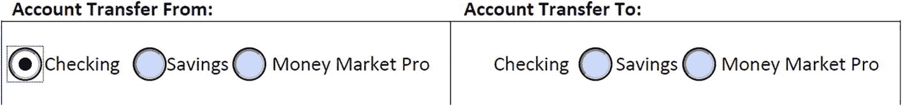

一张页面截图，显示了一个包含两列的表格，用于填写发送方和接收方账户的详细信息。发送方账户有 3 个按钮，分别对应支票账户、储蓄账户和货币市场专业账户，其中支票账户被选中。接收方账户有 3 个选项，但没有支票账户按钮。

**图 11-9** 从可用选项中移除一个单选按钮

请参考文件 `TMC_AccountTransfer_End_show_hide.pdf` 查看实际效果。

在本示例中，我从“操作”选项卡上名为 `to.group` 的组中的所有单选按钮中移除了所有 JavaScript 代码，然后为 `from.group` 中的每个单选按钮应用了一段代码。

对于“支票账户”按钮的“鼠标释放”事件，我选择了“运行 JavaScript”。

```
//checking
var checkingTo = this.getField("to.group.0");
var savingsTo = this.getField("to.group.1");
var mmTo = this.getField("to.group.2");
if(event.target.value !="Off"){
checkingTo.display = display.hidden;
savingsTo.display = display.visible;
mmTo.display = display.visible;
}
```

你在第 9 章使用复选框来控制字段显示和隐藏时，见过类似的代码。然而，控制单选按钮的显示和隐藏操作起来要更棘手一些。它们喜欢使用 `if` 条件语句，但不使用 `else`，因为它们在一个组内联动，并非独立地进行显示和隐藏。另一个单选按钮需要设置下一个条件。

因此，在这段针对“支票账户”单选按钮的代码中，我设置了每个按钮的所有变量。你可以通过在每个单选按钮的字段名后添加一个点和一个数字（类似于数组）来区分它们，此处数字为 0 到 2。

然后，在 `if` 条件语句中（当单选按钮被激活或不是“关”状态时），设置你想要显示或隐藏的字段。在此例中，我想隐藏其他“支票账户”单选按钮 `checkingTo`，因此我将其 `display` 属性设置为 `hidden`。

接着，我将相同的代码添加到了 `from.group` 中的其他每个单选按钮上，并修改了代码中关于 `display` 的行。例如，对于 `savingsTo`，请查看以下代码中加粗的更改部分：

```
//savings
var checkingTo = this.getField("to.group.0");
var savingsTo = this.getField("to.group.1");
var mmTo = this.getField("to.group.2");
if(event.target.value !="Off"){
checkingTo.display = display.visible;
savingsTo.display = display.hidden;
mmTo.display = display.visible;
}
```

然后，对于“货币市场专业账户”，当你在编辑器中粘贴代码时，只需更改前一段代码的如下部分：

```
if(event.target.value !="Off"){
checkingTo.display = display.visible;
savingsTo.display = display.visible;
mmTo.display = display.hidden;
}
```

最后，为了将所有单选按钮重置为可见状态，我在表单上使用了一个“重置”按钮，并选择了“重置表单”操作来重置所有字段。同时，我确保添加了“显示/隐藏字段”操作，并在“显示/隐藏字段”对话框中确保 `to.group` 单选按钮被设置为“显示”。请参考图 11-10。

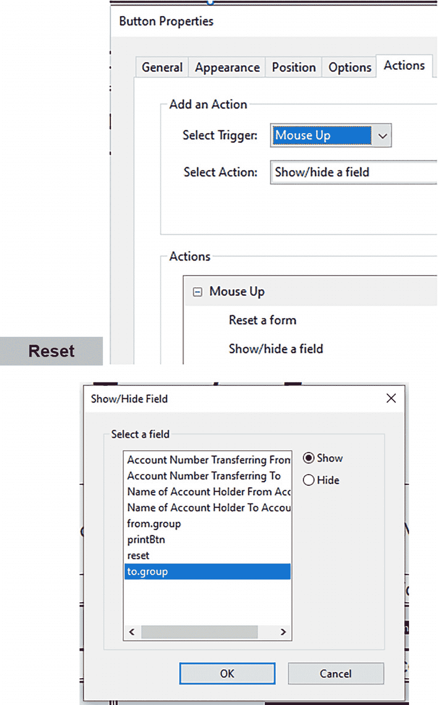

一张按钮属性页面的截图，其中“操作”选项卡被选中，包含两个下拉菜单用于选择触发器和操作。它显示了一个“显示或隐藏字段”页面，包含“显示”和“隐藏”两个选项，其中“显示”被选中。页面左侧有若干选项，其中 `to.group` 被选中。

**图 11-10** 使用“操作”选项卡和“显示/隐藏”对话框在重置时显示所有单选按钮

请记住，在此示例中，如果你的客户在 `from.group` 之前先对 `to.group` 做出了选择，那么隐藏的单选按钮仍然会被选中。不过，字段的隐藏应该会促使你的客户在看到错误的选择消失后，选择其他可见的选项。或者，对于 `from.group` 中的每个单选按钮，你可以在底部的 `if` 条件语句中添加 `this.resetForm([“to.group”]);`。

```
if(event.target.value !="Off"){
checkingTo.display = display.visible;
savingsTo.display = display.visible;
mmTo.display = display.hidden;
this.resetForm(["to.group"]);
}
```

这样会重置或清空 `to.group`，以便你现在可以首先在 `from.group` 中输入正确的选项。如果你想查看此操作的示例，请参考文件 `TMC_AccountTransfer_End_show_hide_2.pdf`。

## 使用单选按钮更改运费

正如你在之前的项目中所见，复选框和单选按钮可用于调整文本框中的数值。我们来看另一个如何将其应用于价格的例子。请参阅文件 `InvoiceForm_Shipping_Change_End.pdf`，并参考图 11-11。

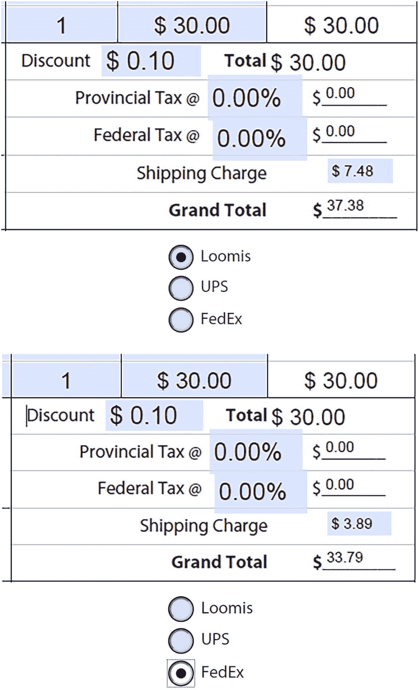

两张发票截图，每张截图上的折扣、总额、省税、联邦税、运费和总计数值均相同。第一页有 Loomis、UPS 和 FedEx 三个按钮，其中 Loomis 被选中。第二页选中了 FedEx 选项。

图 11-11 — 使用单选按钮调整运费的发票表单

这些数值会根据你的输入而变化。如果你选择不同的公司，比如 FedEx，运费会再次改变。请注意本节后面关于刷新字段的说明。

这是如何实现的？

该表单的大部分设置与大多数发票表单类似，字段结合使用了数值和简化的字段表示法 (SFN)，很少用到 JavaScript。但是，此示例包含一个名为 `discount` 的新字段，以及左下角分组为 `shipChoice` 的单选按钮。

`discount` 字段仅格式化为带有货币符号美元符号的数字，并未对其应用任何操作。请参考图 11-12。

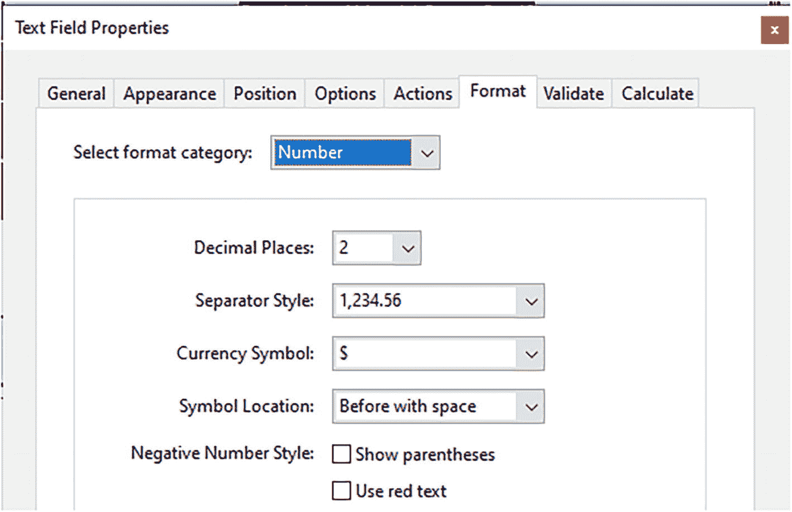

文本框属性页面的截图，共有 8 个选项卡，其中“格式”选项卡被选中。它包含一个用于选择格式类别、小数位数、分隔符样式、货币符号、符号位置和负数样式的下拉菜单。

图 11-12 — `discount` 字段在“格式”选项卡上被格式化为数字

然而，一旦你开始使用单选按钮，你将调用 `discount`、`Total` 和 `Shipping` 字段。这些单选按钮构成一个组，每个按钮在“选项”选项卡上都有自己的选择。请参考图 11-13。

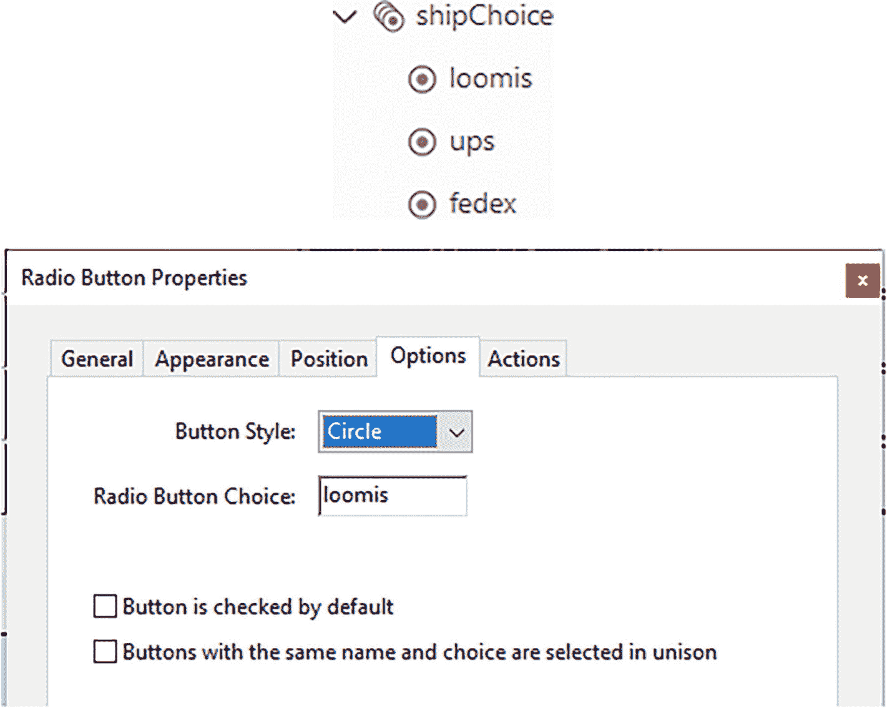

页面截图显示 `shipChoice` 的展开视图。它有 Loomis、UPS 和 FedEx 三个按钮。还有一个包含 5 个选项卡的单选按钮属性页面，其中“选项”选项卡被突出显示。它包括一个用于选择按钮样式的下拉菜单和一个用于输入单选按钮选项的框。

图 11-13 — 单选组 `shipChoice` 以及“选项”选项卡上的单选按钮属性

“准备表单”工具右侧的“字段”面板显示了单选按钮的分组方式。然后，你在“操作”选项卡的“鼠标松开”触发器上为每个单选按钮添加 JavaScript。请参考图 11-14。

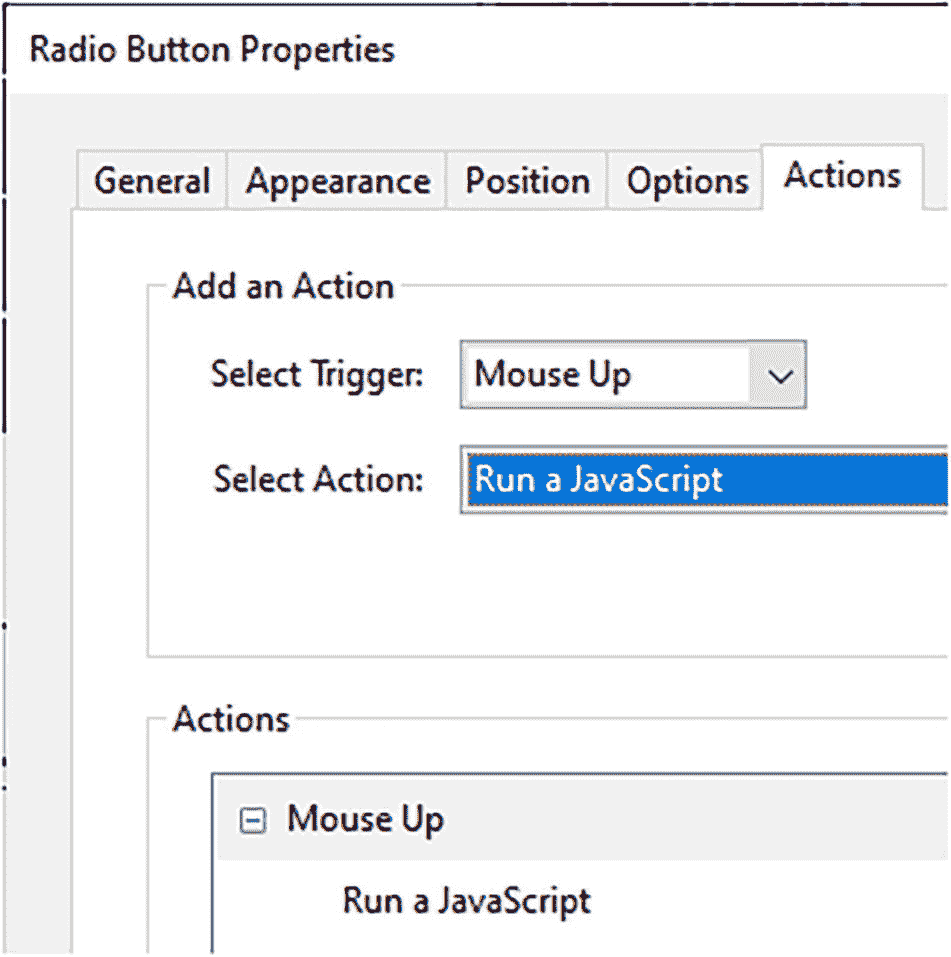

单选按钮属性截图，包含“常规”、“外观”、“位置”、“选项”和“操作”5 个选项卡，其中“操作”选项卡被选中。它有一个用于添加操作的框、一个用于选择触发器的下拉菜单，以及一个用于选择操作的框。

图 11-14 — “操作”选项卡上的“单选按钮属性”对话框，其中操作为“运行 JavaScript”

每个单选按钮都有类似的代码，如下所示：

```
//运费价格
var oShip = this.getField("Shipping");
var oSub = this.getField("Total");
var oDiscount = this.getField("discount");
if(oSub.value <200)
var oRate = (oSub.value - oDiscount.value)*.25;
else
var oRate =0;
oShip.value = oRate;
```

该代码的含义是：如果折扣前或折扣后的 `Total` 字段值小于 200 美元，则添加运费（即 `Total * .25`）以得出运费价格。但是，如果价格超过 200 美元，或者即使有折扣（`else` 语句），运费也为 0 美元，即免运费。

请注意，`Total` 字段自身有一个计算，关联到一个名为“Sub total”的隐藏字段。添加此隐藏字段是为了在刷新单选按钮时，能够准确地将折扣计入运费和总计金额。请参考图 11-15。

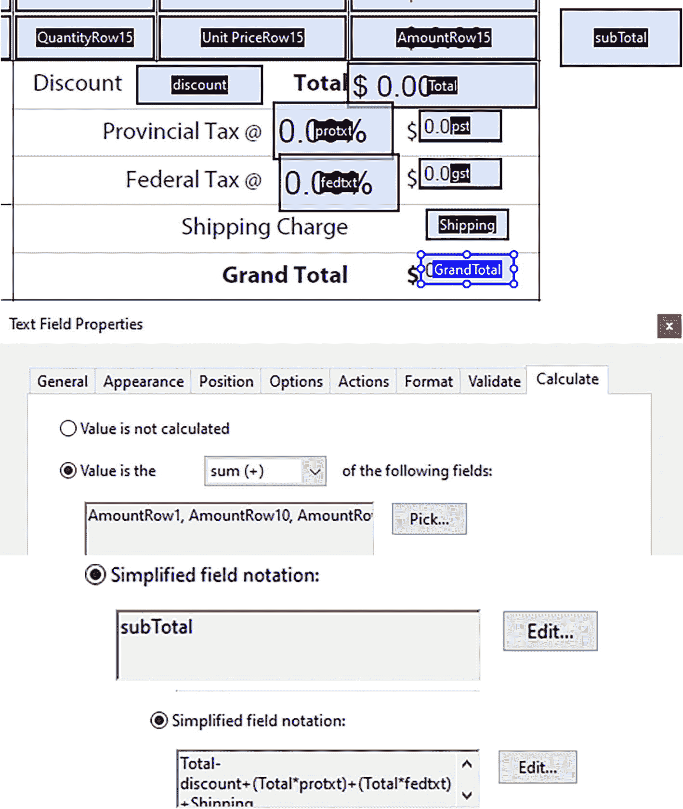

一张发票截图，包含数量、价格、小计、折扣、税费、运费属性，以及一个隐藏的总计列。还有一个用于计算数值的文本框属性页面，后面跟着一个用于小计的简化字段表示法公式。

图 11-15 — 隐藏的 `subTotal` 文本框使用数值求和 (+) 来累加所有字段。然后 `Total` 字段在后面使用这些值，并通过单选按钮计算折扣，以得出实际的总计金额

如你所见，你可以像这样将这段 JavaScript 应用于“操作”选项卡上其他快递公司的单选按钮：

```
var oShip = this.getField("Shipping");
var oSub = this.getField("Total");
var oDiscount = this.getField("discount");
if(oSub.value <200)
var oRate = (oSub.value - oDiscount.value)*.17;
else
var oRate =0;
oShip.value = oRate;
```

你可以将价格从这样：

```
var oRate = (oSub.value - oDiscount.value)*.17;
```

更改为这样：

```
var oRate = (oSub.value - oDiscount.value)*.13;
```

或者，你可以将金额限制从这样：

```
if (oSub.value <200)
```

更改为这样：

```
if (oSub.value <300)
```

这取决于快递公司的偏好。

注意

你也可以在代码的条件部分添加花括号（`{ }`）。

```
if(oSub.value <200){
var oRate = (oSub.value - oDiscount.value)*.17;
}
else{
var oRate =0;
}
oShip.value = oRate;
```

注意

在这个例子中，这是一个简单且不复杂的条件脚本，我省略了一些花括号对。JavaScript 有时允许你这样做以简化代码。但是，在其他情况下，如果你省略了它们，可能会收到错误警告，或者脚本将无法正常运行。如果你不确定，或者希望保持代码的准确性，我建议在复杂的示例中保留花括号以避免混淆。正如你所见，`oShip.value =oRate;` 这行代码位于条件语句之外，但如果没有花括号，你可能无法意识到这一点。如果你需要查看这段代码在每个单选按钮中是怎样的，请参考我的文件 `InvoiceForm_Shipping_Change_End_2.pdf`。

你为每个单选按钮添加的最后一个功能是，允许用户再次点击同一个单选按钮时重置/刷新运费，而不是必须点击另一个单选按钮（鼠标按下 ➤ 重置表单）。请仅为 `Shipping` 字段勾选此选项。此外，在此示例中，我还为用户添加了一个便签注释，以便他们在填写表单时知道可以刷新运费。请参考图 11-16。

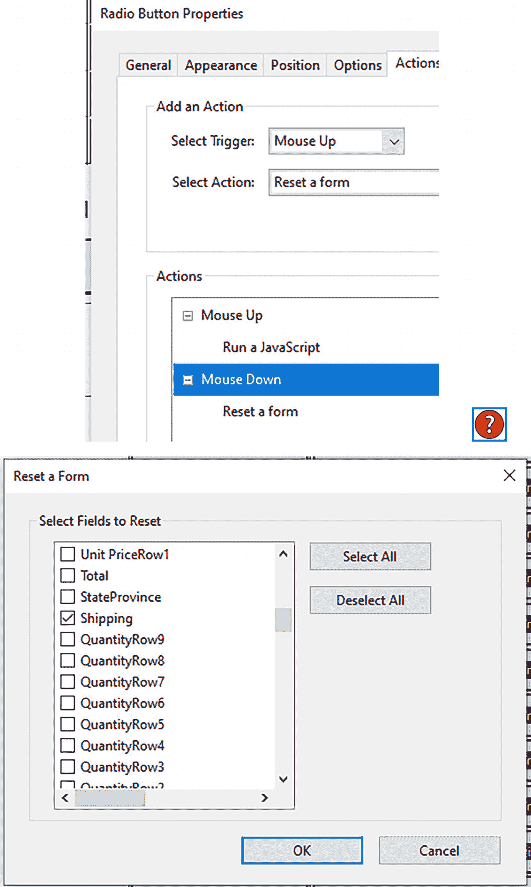

单选按钮属性截图，包含用于选择触发器和操作的下拉菜单，其后是一个操作列表，其中“鼠标按下”被选中。还有一个用于重置表单的弹出窗口，其中包含字段列表的复选框，并且“shipping”已被选中。

图 11-16 — “操作”选项卡中用于刷新运费的单选按钮设置，以及一个提示用户可以使用单选按钮刷新数值的便签

## 结合文本框和 JavaScript 的单选按钮示例，以及如何更改时间数据

单选按钮和文本框也可以用于另一个类似的示例，你可能需要切换时间计算方式，特别是针对两个日期之间时间的毫秒转换做出某些更改。关于时间格式和日期格式，你可以参考第 7 章。但是，在本示例中，请查看文件 `Acrobat Format Time_Date_radio_End.pdf` 和 图 11-17。

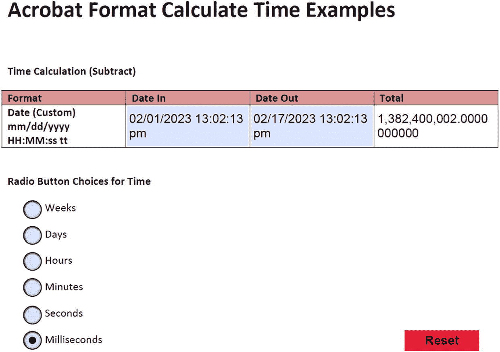

一张标题为“Acrobat 格式计算时间示例”的页面的屏幕截图，其中包含一个用于时间计算的表格，有 4 列，分别为格式、开始日期、结束日期和总计。它有几个用于选择时间单位的单选按钮，其中毫秒选项已被选中。

图 11-17 — 使用单选按钮更改右侧 `TotalDate` 字段中的时间转换

本文档使用了一个全局文档级 JavaScript，以便我能够通过引用两个字段 `StartingDate` 和 `EndingDate` 的输入值的单选按钮来控制更改，然后总和会被添加到 `TotalDate` 字段中。

在这个文档级 JavaScript 的示例中，我创建了一个名为 `TimeDateDiff` 的函数。请参考图 11-18。

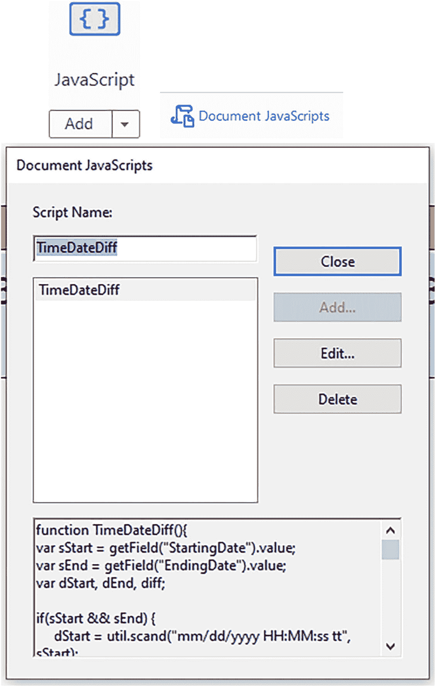

一张屏幕截图显示了“文档 JavaScript”的添加选项。它有一个用于“文档 JavaScript”的弹出窗口，其中包含一个输入脚本名称的框，标记为“时间日期差”，后面跟着一组代码。页面右侧有几个选项，并且“关闭”选项已被选中。

**图 11-18** 将文档级 JavaScript 添加到文件中

JavaScript 代码如下：

```
function TimeDateDiff(){
var sStart = getField("StartingDate").value;
var sEnd = getField("EndingDate").value;
var dStart, dEnd, diff;
if(sStart && sEnd) {
dStart = util.scand("mm/dd/yyyy HH:MM:ss tt", sStart);
dEnd = util.scand("mm/dd/yyyy HH:MM:ss tt", sEnd);
if ( dEnd < dStart)  {
app.alert ( "结束日期必须在开始日期之后，不能在此之前。");
event.value = "";
this.resetForm(["StartingDate", "EndingDate"]);
}
else{
var TimeCov = getField("Time").value;
//diff = (dEnd.getTime() - dStart.getTime())/86400000;
diff = (dEnd.getTime() - dStart.getTime())/TimeCov;
event.value = diff;
}
}
else
{
event.value = "";
}
}
```

这段代码与第 7 章中的代码类似。但是，这次我是从一个名为 `Time` 的单选按钮组中获取我的时间计算值。请参考图 11-19。

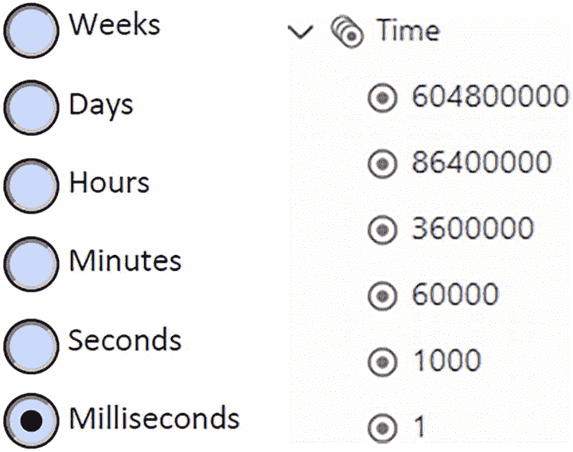

一张页面的屏幕截图，其中有 6 个用于选择时间单位的单选按钮，包括周、天、小时、分钟、秒和毫秒，并且毫秒选项已被选中。页面右侧是时间按钮的展开视图，带有 6 个不同的数值。

**图 11-19** 单选按钮组 `Time` 及其值

这些按钮不包含任何 JavaScript；但是，我已在“选项”选项卡上为单选按钮选项设置了它们的值。请参考图 11-20。

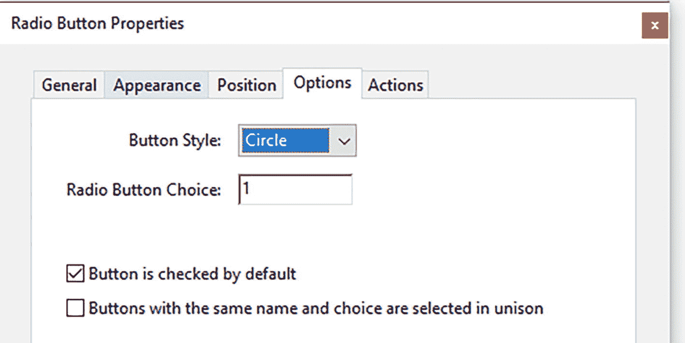

一张单选按钮属性页面的屏幕截图，其中有 5 个选项卡：常规、外观、位置、选项和操作，其中“选项”选项卡已被选中。它有一个用于选择按钮样式的下拉菜单、一个用于输入单选按钮选项的框，以及两个用于按钮的复选框。

**图 11-20** 单选按钮属性对话框，带有一个单选按钮选项；对于毫秒，设置为“默认选中按钮”

对于毫秒选项，设置为“默认选中按钮”，但对于所有其他单选按钮，我保留了未选中的设置。

毫秒的值设置为 1。当我们计算时间差时，将除以 1 以得到所有毫秒数。

同样，其他单选按钮也有其自身的单选按钮选项，它们将分别除以秒 (1000)、分钟 (60000)、小时 (3600000)、天 (86400000) 和周 (604800000)。

## 设置文本字段

在此示例中，文本框 `StartingDate` 和 `EndingDate` 在“格式”选项卡上设置了一个自定义日期，以匹配文档级 JavaScript 代码 `mm/dd/yyyy HH:MM:ss tt` 中的日期设置。请参考图 11-21。

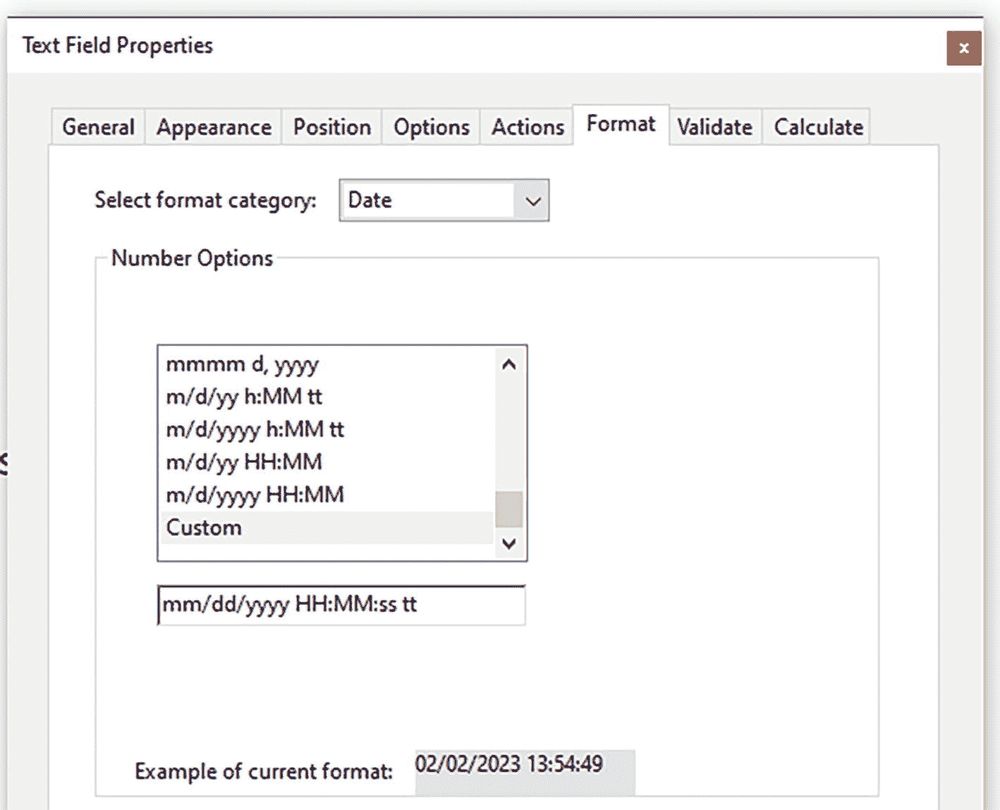

一张文本字段属性页面的屏幕截图，其中有 8 个选项卡，其中“格式”选项卡被选中。它有一个用于选择日期格式类别的下拉菜单，后面跟着数字选项，以及一个显示当前格式示例的框。

**图 11-21** 文本字段属性对话框，在“格式”选项卡上自定义日期格式

最后一个字段 `TotalDate`，被设置为只读，其格式设置为数字，并保留 10 位小数。但是，对于“计算”选项卡上的自定义计算脚本，我引用了文档级 JavaScript 函数 `TimeDateDiff();`。请参考图 11-22。

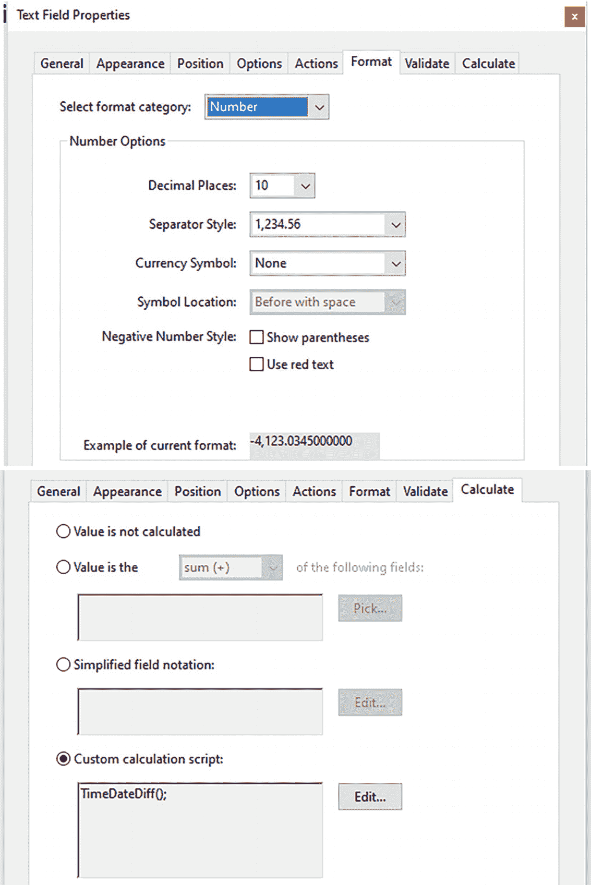

两张关于文本字段属性的屏幕截图，分别选择了“格式”和“计算”选项卡。第一页的格式类别被选为数字，后面跟着 5 个用于数字选项的下拉菜单。第二页有 4 个复选框，其中为时间日期差选择了自定义计算脚本。

**图 11-22** 文本字段属性对话框，用于“格式”和“计算”选项卡

一旦字段引用了函数 `TimeDateDiff();`，你就可以开始更改两个日期以及单选按钮了。

**注意**

除了文档级 JavaScript 中防止开始日期在结束日期之前添加的警告之外，如果你的毫秒数对于天或周来说太低，你可能还会收到一个额外的警告，但无论如何它仍会计算毫秒数。在你自己的项目中，你可能希望减少小数位数，或者像第 7 章中提到的那样对数字进行向上或向下取整。

## 使用日期文本字段的复选框变体

如第 2 章所述，如果复选框在“常规”选项卡上被赋予相同的名称，它们可以充当单选按钮。然后必须在“选项”选项卡上更改值。

如果你因为个人偏好而选择使用复选框，那么请确保按如下方式设置“选项”选项卡，并参考文件 `Acrobat Format Time_Date_checkbox_End.pdf`。这次，在你的“导出值”中设置数字。请参考图 11-23。

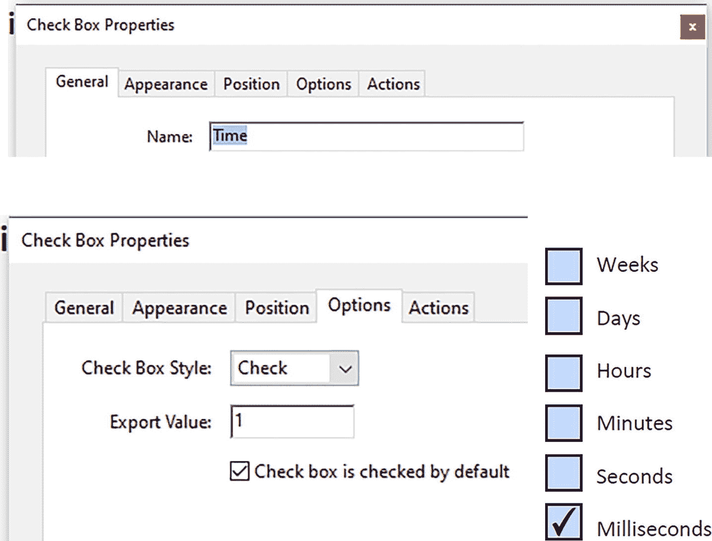

两张关于复选框属性页面的屏幕截图，分别选择了“常规”和“选项”选项卡。第一页有一个名为 `time` 的框。第二页有一个用于复选框样式的下拉菜单，样式为“勾选”，导出值为 1。页面右侧有 6 个复选框，其中“毫秒”被选中。

**图 11-23** 用于“格式”和“计算”选项卡的文本字段属性

请记住，只需要将一个复选框设置为“默认选中复选框”。否则，代码不会改变。如果你的复选框名称与文档级 JavaScript 中的名称相同，它们将像单选按钮一样运行。

## 格式选项说明

在第 9 章中，你已经了解了如何使用 JavaScript 设置文本字段的格式。通过文档 JavaScript 或使用“格式”选项卡设置自定义格式，都非常简单。“格式”选项卡仅适用于文本字段和下拉列表，因此不能用于其他字段，包括我将在第 13 章讲述的列表框。你可以使用“外观”选项卡或“选项”选项卡逐一设置按钮、单选按钮和复选框的格式，或者像你在第 10 章中看到的那样，使用文档 JavaScript 一次性设置所有同类字段的格式。请参见图 11-24。

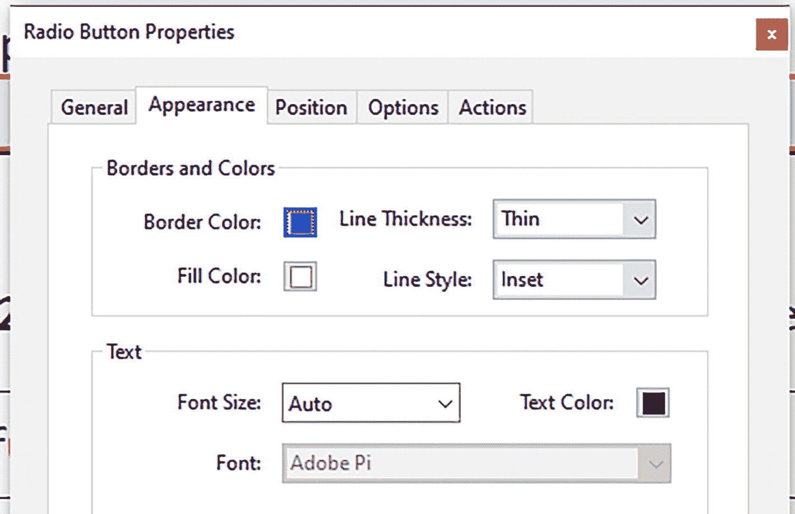

这是一个单选按钮属性页面的截图，包含 5 个选项卡，其中“外观”选项卡已被选中。该页面提供了边框和颜色的详细设置，包括边框颜色、线条粗细、填充颜色和线条样式，以及文本的详细设置，包括字体大小、文本颜色和字体。

图 11-24：单选按钮属性对话框的“外观”选项卡

### 按钮的格式设置及以下属性如何受影响

有关确切的编码说明，请参阅第 10 章。与文本框一样，你可以设置 `strokeColor`、`fillColor`、`lineWidth`、`borderStyle`、`textSize`、`textFont` 和 `textColor`。但是，不能使用任何富文本格式。

以下是使用文档 JavaScript 的示例：

```
for (var i = 0; i < numFields; i++) {
// 获取当前字段的引用
var f = getField(getNthFieldName(i));
// 如果是按钮字段，则设置字体和字号，或其他属性
if (f.type == "button") {
f.strokeColor = color.blue;
f.fillColor = color.red;
f.textColor = color.black;
}
}
```

或者，在“动作”选项卡中针对单个字段，可以编写如下代码：

```
var f = this.getField("myButton");
f.strokeColor = color.blue;
f.fillColor = color.red;
f.textColor = color.black;
```

在这种情况下，一旦点击按钮（鼠标释放），就会应用此格式。

关于旋转、文本对齐和高亮属性的其他格式选项，可在此处找到：

```
https://opensource.adobe.com/dc-acrobat-sdk-docs/library/jsdevguide/JS_Dev_AcrobatForms.html#28613
```

### 单选按钮和复选框的格式设置

# 复选框与单选按钮的样式设置

有关确切的编码说明，请参阅第 10 章。与文本框一样，你可以设置 `strokeColor`、`fillColor`、`lineWidth`、`borderStyle`、`textSize` 和 `textColor`。但是，不能使用任何富文本格式，也不能设置 `textFont`，因为它已设置为默认的 Adobe Pi 字体。不过，你可以使用文档 JavaScript 更改复选框或单选按钮的样式。请参见图 11-25，了解这些选项在“选项”选项卡上是如何显示的。

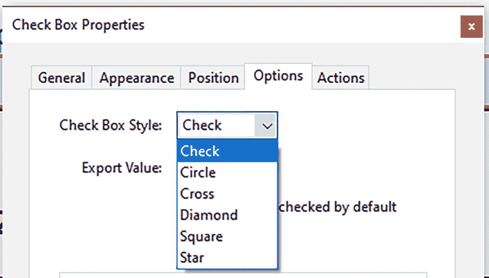

这是一个复选框属性页面的截图，包含常规、外观、位置、选项和动作 5 个选项卡，其中“选项”选项卡已被选中。它有一个下拉菜单用于选择复选框样式，当前已选择“勾选”。

图 11-25：复选框属性对话框的“选项”选项卡

以下是针对勾选、圆形、交叉、菱形、方形和星形样式的样式格式代码示例：

```
//勾选
f.style = style.ch;
//交叉
f.style = style.cr;
//菱形
f.style = style.di;
//圆形
f.style = style.ci;
//方形
f.style = style.sq;
//星形
f.style = style.st;
```

例如，在创建文档 JavaScript 时，将 `f.type` 替换为 `"radiobutton"` 或 `"checkbox"`。

```
for (var i = 0; i < numFields; i++) {
// 获取当前字段的引用
var f = getField(getNthFieldName(i));
// 如果是复选框字段，则设置字体和字号，或其他属性
if (f.type == "checkbox") {
f.strokeColor = color.blue;
f.fillColor = color.red;
f.textColor = color.black;
f.style = style.ch;
}
}
```

请注意，只有圆形单选按钮是圆形的，而所有其他样式都使其成为方形。

同样，与按钮一样，当此代码应用于“动作”选项卡时，你可以针对组内的单个单选按钮或复选框进行操作。这假设你已在“常规”选项卡上正确命名了它们。当你点击它们时，它们将在鼠标释放触发事件时更改格式。

```
//myGroup 组中的单个单选按钮
var f = this.getField("myGroup.0");
f.strokeColor = color.blue;
f.fillColor = color.red;
f.textColor = color.black;
f.style = style.di;
```

```
//单个复选框
var f = this.getField("myCheckbox");
f.strokeColor = color.blue;
f.fillColor = color.red;
f.textColor = color.black;
f.style = style.di;
```

关于格式设置的更多参考资料，请参见以下链接：

[`https://opensource.adobe.com/dc-acrobat-sdk-docs/library/jsdevguide/JS_Dev_AcrobatForms.html#85887`](https://opensource.adobe.com/dc-acrobat-sdk-docs/library/jsdevguide/JS_Dev_AcrobatForms.html#85887)

[`https://opensource.adobe.com/dc-acrobat-sdk-docs/library/jsdevguide/JS_Dev_AcrobatForms.html#34428`](https://opensource.adobe.com/dc-acrobat-sdk-docs/library/jsdevguide/JS_Dev_AcrobatForms.html#34428)

## 使用正则表达式进行文本字段验证

在此表单（参见文件 `InvoiceForm_Shipping_Change_End_defaulttext.pdf`）中，另一个可以尝试的功能是电话验证脚本。请参见图 11-26 和“电话号码”文本字段。

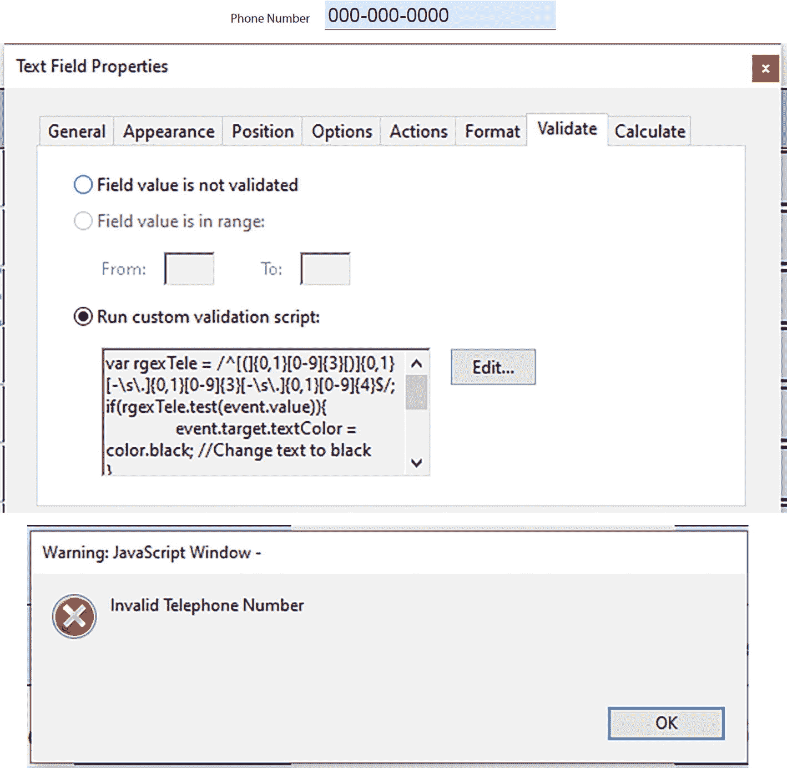

这是一个测试字段属性的截图，包含 8 个选项卡，其中“验证”选项卡已被选中。它已选择“不验证字段值”选项，随后是自定义验证脚本的几行代码。页面底部有一个窗口，显示“无效的电话号码”。

图 11-26：在“验证”选项卡上进行电话文本字段验证，以及输入错误时产生的警告

如果客户未以正确方式在文本字段中键入内容，则会发出警告，并且文本将显示为红色。正确的格式在图 11-27 中以黑色文本显示。

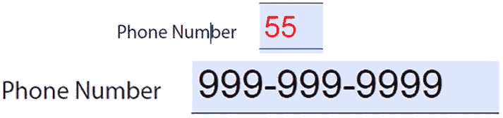

一个页面截图包含一个用于输入电话号码的框，数字为 55，后面是一个用于输入 10 位数字 999 999 999 的电话号码框。

图 11-27：上方：错误输入的信息显示为红色。下方：电话文本字段中正确输入的信息显示为黑色

点击警告中的“确定”按钮后，文本字段中的文本变为红色，并且直到用户输入正确格式后，才会恢复为黑色。

### 电话验证

以下 JavaScript 代码需添加到字段的“验证”选项卡下的“运行自定义验证脚本”中（如图 11-26 所示）：

```
var rgexTele = /^[(]{0,1}[0-9]{3}[)]{0,1}[-\s\.]{0,1}[0-9]{3}[-\s\.]{0,1}[0-9]{4}$/;
if(rgexTele.test(event.value)){
event.target.textColor = color.black; //将文本颜色改为黑色
{
else{
event.target.textColor = ["RGB",1,0,0]; //将文本颜色改为红色
app.alert("无效的电话号码");
}
```

为了实现这一功能，你将使用一种称为*正则表达式*的 JavaScript 形式。在创建多行按钮时，你已经见过一个简单的例子，即使用 `\n`（换行符），并且在第 10 章中创建了一个元字符。当你将多个元字符组合在一起时，就创建了一个模式，而字符的这种组合就构成了正则表达式。这一次，你将使用一个更复杂的正则表达式。

```
/^[(]{0,1}[0-9]{3}[)]{0,1}[-\s\.]{0,1}[0-9]{3}[-\s\.]{0,1}[0-9]{4}$/
```

表达式的这一部分表示，`{0,1}` 量词后面的代码必须匹配以下内容：

-   第一部分中，括号内的三位数字，范围从 0 到 9，这些数字可以用短横线（`-`）、空格（`\s`）或点号（`.`）分隔。这些数字可以包含在括号内。

-   第二部分中，三位数字，范围从 0 到 9，这些数字可以用短横线、空格或点号分隔。

-   最后一部分中，四位数字，范围从 0 到 9。

-   脱字符（`/^`）表示数据的开始，而美元符号（`$/`）表示数据的结束。

以下示例是可接受的：

-   `(123) 456-7890`

-   `123-456-7890`

-   `123.456.7890`

-   `123 456 7890`

-   `1234567890`

这段代码甚至允许没有空格的情况。但是，任何多于或少于 10 位数字的情况都是不可接受的，并且不能使用字母。

如果你不想编写这段代码，可以使用“特殊电话号码”或“任意掩码”格式。请参考图 11-28。

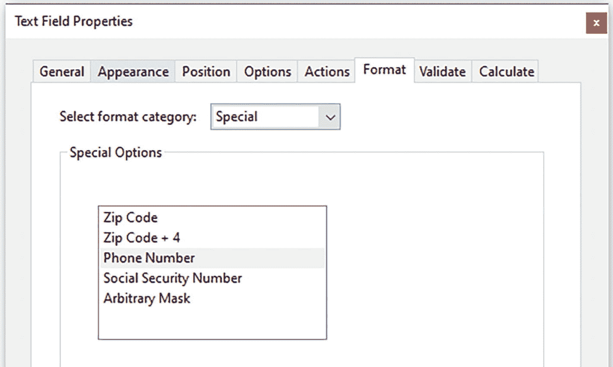

文本字段属性页面的截图，显示了 8 个选项卡，其中“格式”选项卡被选中。它有一个下拉菜单用于选择格式类别为“特殊”，随后是一个特殊选项列表，包含邮政编码、邮政编码+4、电话号码、社会安全号码和任意掩码。

图 11-28

可以使用“特殊电话号码”格式

然而，这样做将无法获得自定义的数字和颜色格式，这些格式用于区分正确和错误的输入。因此，请将格式设置为“无”，并在“验证”选项卡（图 11-26）中输入以下代码：

```
var rgexTele = /^[(]{0,1}[0-9]{3}[)]{0,1}[-\s\.]{0,1}[0-9]{3}[-\s\.]{0,1}[0-9]{4}$/;
if(rgexTele.test(event.value)){
event.target.textColor = color.black; //将文本颜色改为黑色
{
else{
event.target.textColor = ["RGB",1,0,0]; //将文本颜色改为红色
app.alert("无效的电话号码");
}
```

如果输入的文本经过测试与正则表达式格式匹配，则保持为黑色。如果不匹配（`else`），则发出警告提示，并将文本颜色改为红色，直到输入被更正并匹配正则表达式。

有很多好用的正则表达式，我建议你去探索一下；我将在本章后面提供一些链接。

注意

# Adobe 表单字段验证与正则表达式

根据 Adobe 文档，格式设置“特殊 > 任意掩码”允许你使用一些基本的正则表达式，例如：

- `A`：仅接受字母（A–Z，a–z）
- `X`：接受空格和可打印字符，包括标准键盘上的所有字符，以及范围在 32–126 和 128–255 内的 ANSI 字符
- `O`：接受字母数字字符（A–Z，a–z 和 0–9）
- `9`：仅接受数字字符（0–9）

例如，掩码设置 `AAA-–q#999` 接受输入 `BRT--q#123`。这里的 `q#` 不会改变，并且必须完全一致。或者，如果设置 `OOO@XXX`，则接受输入 `v12@2up`。但是，正如你将看到的，结合 JavaScript 的正则表达式提供了更广泛的可能性。

更多示例，你可以查看文件 `TMC_FieldValidationsEnd.pdf`。请参考图 11-29。

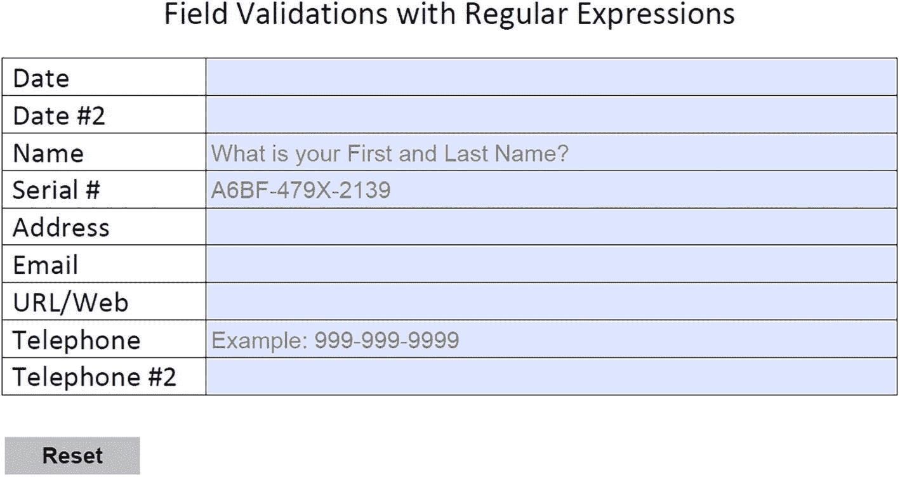

一个标题为“带有正则表达式的字段验证”的页面截图。它有一个包含 9 行的表格，分别用于日期、日期哈希 2、姓名、序列哈希、地址、电子邮件、URL 或网址、电话和电话哈希 2。其中姓名、序列哈希和电话的行有输入项。

**图 11-29** 可以添加正则表达式的文本字段示例

## 姓名验证

如果你想在同一个字段中输入名字和姓氏，请使用此脚本。请参考名为“姓名”的字段。代码输入到“验证”选项卡中。请参考图 11-30。

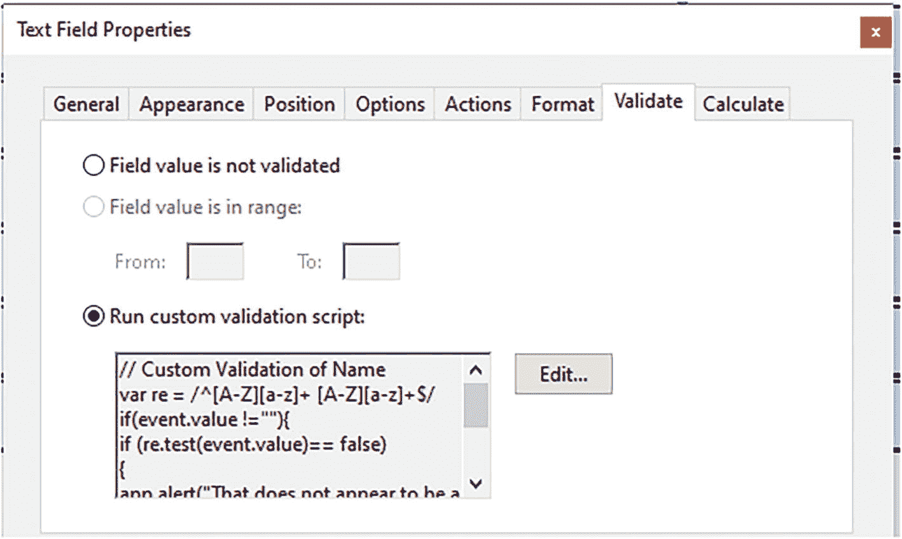

文本字段属性页面的截图，显示了 8 个选项卡，其中“验证”选项卡被选中。它有 3 个复选框，分别对应“不验证字段值”、“字段值范围”和“验证脚本”。第三个选项“运行自定义验证脚本”被选中，其下方显示了几行代码。

**图 11-30** 在“验证”选项卡上运行自定义验证脚本

```javascript
// 自定义姓名验证
var re = /^[A-Z][a-z]+ [A-Z][a-z]+$/;
if(event.value !=""){
if (re.test(event.value)== false){
app.alert("这看起来不是有效的姓名。我需要输入名字和姓氏。");
event.rc = false;
}
}
```

**注意**

以下是正则表达式元字符的基本示例：

- `[abc]`：查找括号之间的任何字符。
- `[A-Z]`：查找从大写 A 到大写 Z 的任何字符。
- `[a-z]`：查找从小写 a 到小写 z 的任何字符。
- `[A-z]`：查找从大写 A 到小写 z 的任何字符。
- `[0-9]`：查找括号之间的任何数字。
- `.`：查找单个字符，除了换行符或行终止符。
- `\d`：查找一个数字。
- `\n`：查找一个换行符。
- `\s`：查找一个空白字符。
- `\w`：查找一个单词字符。

有关正则表达式的更详细信息，请访问以下任一网站：

- [`www.w3schools.com/jsref/jsref_obj_regexp.asp`](http://www.w3schools.com/jsref/jsref_obj_regexp.asp)
- [`https://developer.mozilla.org/zh-CN/docs/Web/JavaScript/Guide/Regular_Expressions`](https://developer.mozilla.org/zh-CN/docs/Web/JavaScript/Guide/Regular_Expressions)
- [`https://developer.mozilla.org/zh-CN/docs/Web/JavaScript/Guide/Regular_Expressions/Quantifiers`](https://developer.mozilla.org/zh-CN/docs/Web/JavaScript/Guide/Regular_Expressions/Quantifiers)

在这个“姓名”字段中，名称需要一个包含大写字母后跟小写字母的名字和姓氏，以及名字之间的空格，就像 John Smith 一样，正如你在代码中分隔名字的（`+`）后面看到的空白。如果用户输入 JS 或仅输入 J，他们将收到错误提示“这看起来不是有效的姓名。我需要输入名字和姓氏。”当他们在错误提示上点击“确定”按钮时，该字段将恢复为空白（`event.rc = false;`）并重置验证。他们必须重试，并且不会处理进一步的信息。或者，如果之前输入了正确格式的文本，它将在提示后恢复为该文本。

代码 `event.rc` 用作一种重置方式，可与正则表达式的验证配合使用。在这种情况下，因为它被设置为 `false`，输入数据被拒绝，因为格式不正确。如果字段中没有用户输入的文本，则不会发生错误。

请注意，我们将在本章后面查看添加到该字段的“格式”选项卡上的一些额外格式；请参考“关于字段格式的最终思考”部分。

## 账号编号验证

如果你想创建一个字段，要求用户必须输入特定的账号或序列号，可使用此脚本。请参考图 11-29 和图 11-30，了解应在哪里输入名为 `Serial` 的字段代码。

```javascript
//账号编号
//A6BF-479X-2139
var re = /^[A-Z]\d[A-Z]{2}-\d{3}[A-Z]-\d{4}$/;
//如果字段为空，则阻止提示
if(event.value !=""){
if (re.test(event.value)== false){
app.alert("抱歉，这不是有效的账号编号。\n 示例：A6BF-479X-2139");
event.rc = false;
}
}
```

在此字段中，代码必须包含一个大写字母、一个数字、两个大写字母，然后是连字符、三位数字、一个大写字母、另一个连字符，最后是四位数字。该格式必须正确，否则将出现错误提示，该字段将返回空白。

## 电子邮件与 URL 验证

如果你想创建一个字段，要求用户必须输入电子邮件或 URL，并搜索单词字符（`\w`）和字面量（`*`），请使用以下脚本。请参考图 11-29 和图 11-30，了解应在哪里为 `Email` 和 `URLWeb` 字段输入代码。

```javascript
//电子邮件
var re = /^\w+([\.-]?\w+)*@\w+([\.-]?\w+)*(\.\w{2,3})+$/;
//如果字段为空，则阻止提示
if(event.value !=""){
if (re.test(event.value)== false){
app.alert("抱歉，这不是有效的电子邮件地址。");
event.rc = false;
}
}
```

如你所见，此代码与其他代码类似，但这次你需要使用以下格式来检查电子邮件名称和 `@` 符号。因此，`jennifer@email.com` 是有效的，但如果缺少 `@` 符号，则会触发提示。如果要创建针对 URL 网站的验证，你需要将代码调整为类似以下内容，并在花括号 `{}` 中添加额外的量词，全部写在一行：

```javascript
var re = /^(http:\/\/www\.|https:\/\/www\.|http:\/\/|https:\/\/)[a-z0-9]+
([\-\.]{1}[a-z0-9]+)*\.[a-z]{2,5}(:[0-9]{1,5})?(\/.*)?$/;
```

然后，你可以添加一个提示来反映是否出现错误。例如，`http://www.mysite.com` 是有效的，但如果 URL 的某一部分缺失，则会收到警告。

```javascript
app.alert("抱歉，这不是有效的 URL 地址。");
```

在这两个示例中，使用了诸如 `{2,3}`、`{2,5}` 和 `{1,5}` 之类的量词来帮助表达式验证和匹配。此示例允许你排除 `www`，但不能排除 `http://` 或 `https://`。

## 另一个包含两个变量的电话和日期示例

如果你想创建一个字段，要求用户输入有两种格式选项的电话号码或日期，请使用此脚本。请参考图 11-29 和图 11-30 了解代码输入位置。字段 `Telephone` 使用了我们之前讨论过的正则表达式。而字段 `Telephone 2` 具有新的警告提示消息和验证，如图 11-31 所示。

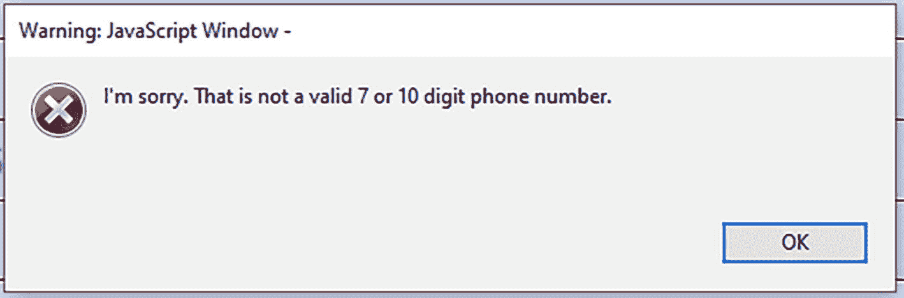

截图显示一个警告窗口，消息内容为：“抱歉，这不是有效的 7 位或 10 位电话号码”，下方有一个“确定”按钮。

**图 11-31** 电话号码输入错误时显示的警告提示

```javascript
//电话号码验证提示
var re7Digits = /^(\d{3})-(\d{4})$/;
var re10Digits = /^(\d{3})-(\d{3})-(\d{4})$/;
//如果字段为空，则阻止提示
if(event.value !=""){
if (re7Digits.test(event.value)== false && re10Digits.test(event.value)== false){
app.alert("抱歉，这不是有效的 7 位或 10 位电话号码。");
event.rc = false;
}
}
```

# 表单验证与格式化

最后一个示例处理了输入带有连字符分隔的 7 位或 10 位代码的选项。虽然不如第一个电话示例复杂，但它展示了如何在一个验证中包含两个格式选项。通过使用`&&`（逻辑与），你要求判断两个条件是否为假或真。如果为真，则不会出现警告提示；如果为假，则会发出警告，并且字段将重置为空白。

你也可以将此示例用于日期文本字段。你可以将变量设置为类似如下格式，对应`mm/dd/yyyy`或`mm/dd/yy`：

```
var re6Date = /^(\d{1,2})\/(\d{1,2})\/(\d{2})$/;
var re8Date = /^(\d{1,2})\/(\d{1,2})\/(\d{4})$/;
```

对条件语句中的变量名稍作调整，使其匹配，并同时修改`app.alert`中的文本。请参考`Date 2`字段。用户输入日期时会有两个选项（`12/31/05`或`12/31/2005`）。但是请注意，如果这些数据要进入数据库，可能会引起错误，因此在设置替代日期输入之前，请先与数据库管理人员核实。此选项也不会对数字限制进行验证检查，例如不能处理输入第 13 个月或检查闰年等特定月份的准确天数。使用相同格式的更精确的示例如下，将变量限制为 12 个月和 31 天，以及 1900 年代到 2000 年代：

```
var re6Date = /^(0[1-9]|1[012])\/(0[1-9]|[12][0-9]|3[01])\/(\d{2})$/;
var re8Date = /^(0[1-9]|1[012])\/(0[1-9]|[12][0-9]|3[01])\/(19|20)\d\d$/;
```

但是，请记住，你仍然可以输入`02/30/2023`这样的内容，这并非实际存在的日期。因此，对于这种复杂情况以及其他复杂案例，可能需要考虑在脚本中进行超出本书范围的进一步复杂验证。如果你希望自行探索此日期的示例及进一步的修改建议，可以参考我的文件`Complex_Validation_Dates.pdf`。

**注意：**

随着 Acrobat Pro 的更新，你也可以将日期字段的格式设置为`Date`，以访问弹出菜单。如果需要查看此表单中的`Date`字段，请参考第 1 章。但是，当你有两个备选日期选项时，请参考`Date 2`字段。你必须将“格式”选项卡设置为`None`，并将代码放在“验证”选项卡上。这样做将无法访问弹出菜单。此外，正如刚才提到的，为日期创建准确的正则表达式以避免错误可能很复杂，因此这是需要首先考虑的事项。

你可能会在一些代码示例中遇到的最后一个正则表达式是`(g)`，在进行全局搜索时，它有时会作为标志附加到表达式末尾。在前面的示例中，代码在没有它的情况下也能工作，因为我们只处理一个字段，而这个附加属性指示是否应针对字符串中的所有可能匹配项测试该正则表达式。文件`TMC_FieldValidationsEnd_2.pdf`展示了将`(g)`应用于代码的相同示例，供参考。

以下是用于名字和姓氏的示例：

```
var re = /^[A-Z][a-z]+ [A-Z][a-z]+$/g;
```

## 格式化字段的最终思考

如你所见，如果设置了正确的警告和验证，就可以避免输入和选择中的错误。当你消除了表单中的不确定性，无论对自己还是对客户都能提供帮助。

如果你计划使用第 9 章中的灰色默认文本方法，并将其与本例中介绍的正则表达式示例结合使用，只需在"格式"选项卡上添加此自定义格式即可轻松实现。（请参见文件`InvoiceForm_Shipping_Change_End_defaulttext.pdf`和`TMC_FieldValidationsEnd.pdf`中的示例。）请参考图 11-32；在此示例中，我使用的是"姓名"字段。

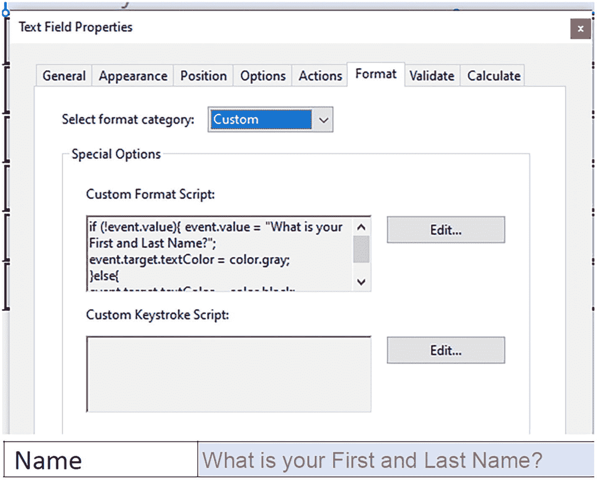

文本字段属性页面截图显示有 8 个选项卡，其中选择了"格式"选项卡。它有一个下拉菜单，可将格式类别选为"自定义"，后面是特殊选项，包括用于自定义格式脚本和自定义按键脚本的几行代码。

**图 11-32**

如果你想使用"格式"选项卡添加默认文本，可以添加自定义格式脚本

```
if (!event.value){ event.value = "What is your First and Last Name?";
event.target.textColor = color.gray;
}else{
event.target.textColor = color.black;
}
```

如果尚未应用本章前面介绍的每个字段的验证代码，请务必使用。请参考图 11-33；在此示例中，我使用的是"姓名"字段。

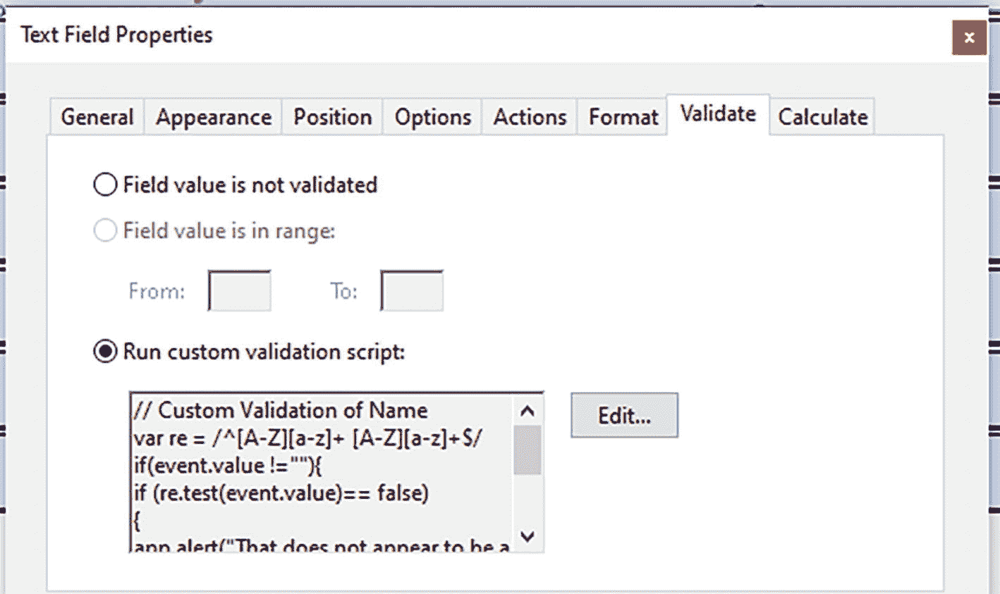

文本字段属性页面截图显示有 8 个选项卡，其中选择了"验证"选项卡。它有 3 个复选框，分别用于"字段值未验证"、"字段值范围"和"自定义验证脚本"。第三个选项"运行自定义验证脚本"已被选中，后面跟着几行代码。

**图 11-33**

在"验证"选项卡上运行自定义验证脚本

但是，对于该字段中的电话号码验证，需要对自定义格式脚本进行小幅调整，使其能够处理三种颜色而非两种颜色，并且仍然可以显示警报消息。请参考图 11-34。

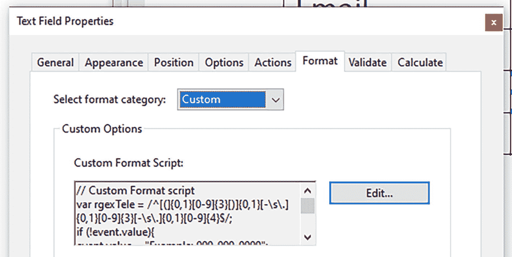

文本字段属性页面截图显示有 8 个选项卡，其中选择了"格式"选项卡。它有一个下拉菜单，可将格式类别选为"自定义"，后面是自定义选项，包括用于自定义格式脚本的几行代码。页面右侧有一个"编辑"按钮。

**图 11-34**

在"格式"选项卡上更改自定义格式脚本

以下是自定义格式代码：

```
var rgexTele = /^[(]{0,1}[0-9]{3}[)]{0,1}[-\s\.]{0,1}[0-9]{3}[-\s\.]{0,1}[0-9]{4}$/;
if (!event.value){
event.value = "示例: 999-999-9999";
event.target.textColor = color.gray;
}
else if(rgexTele.test(event.value)){
event.target.textColor = color.black;
}
else{
event.target.textColor = ["RGB",1,0,0]; //将文本更改为红色
}
```

> **注意：** 对包含两个变量的电话号码使用此方法时要谨慎，因为它可能导致问题，并且可能无法正确显示。另外，当字段格式设置为"日期"时，不要使用默认文本，以避免在 Acrobat 中出现错误和警告；当字段格式设置为"日期"时，它无法接受任何其他文本。

## 总结

在本章中，你学习了为单选按钮和文本字段添加验证的几种方法。你还了解了将验证与格式化结合使用的多种方式，从而创建出能够在客户选择或输入错误信息时发出警报的字段，以及如何隐藏指定的单选按钮。

除了向客户发出警告外，单选按钮还可以在发票或订单表单中用于调整运费。它们还可以用于刷新或重置值，以便客户看到正确的信息。

然后，你了解了一些可以应用于按钮、单选按钮和复选框的额外格式化方法，这些方法是通过文档级 JavaScript 实现的。

最后，你还探索了多种正则表达式，它们可以在"文本字段属性"对话框的"格式"和"验证"选项卡中使用，而不仅仅是依赖 Acrobat 自带的格式化选项（例如"特殊"）。

在下一章中，你将学习如何处理下拉列表。你将看到它们如何与文本字段以及其他下拉列表进行交互。
