# 8. 各种 JavaScript 警报、注释和时间戳

**章节目标：** 在本章中，你将使用可能属于表单也可能不属于表单的警报。你还会创建注释笔记，并添加签名和时间戳。

正如你在前面章节中看到的，当你想要进行计算时，JavaScript 在表单中非常有用。

但是，有时你想要完成一些与表单无关的事情。

在本章中，你将创建一个警报，当某人打开你的 PDF 简报或目录时，该警报会向他们表示欢迎，类似于图 8-1 中的那样。

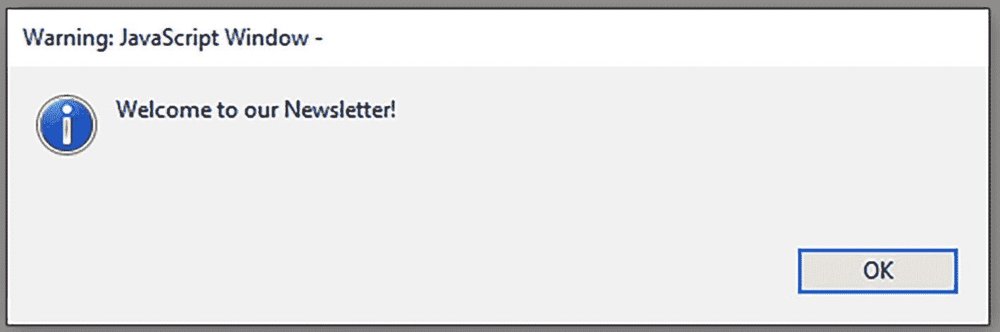

**图 8-1** 某人打开新闻简报 PDF 文件时出现的信息消息

> **注意**  
> 如果你想跟随着本课一起操作，或回顾最终结果，请从引言中的链接下载第 8 章的文件。标记为 “开始” 的文件是不带代码的文件，标记为 “结束” 的文件是最终结果。如果你希望将这些脚本添加到自己的 PDF 表单中，你还会找到一个包含原始脚本的文件夹。

如果你是从原始的 PDF 创建表单，请参考第 1 章中的 “表单回顾” 部分。

请记住，要查看字段的属性，你必须选择 `准备表单` 工具；只有这样，你才能右键单击或双击一个字段来查看其属性。


## 警报类型

JavaScript 至少提供了四种警报类型，可用于向客户端提示事件。此外，还有四种按钮类型可供选择。图 8-1 显示的是信息或状态类型。我之所以选择它，是因为我不想用警告来吓唬人，而这里实际上并非警告，更像是问候。

表 8-1 详细列出了警报的图标和按钮类型。

**表 8-1** 警报类型

| # | 图标类型 | # | 按钮类型 |
| --- | --- | --- | --- |
| 0 | 错误  表示错误的图标。圆圈中心有一个叉号。 | 0 |  确定按钮的图标。边框高亮显示。 |
| 1 | 警告  警告消息的图标。三角形中间有一个感叹号。 | 1 |  包含确定和取消按钮的截图。确定按钮高亮显示。 |
| 2 | 问题  问题的图标。表示圆圈内的问号。 | 2 |  是和否按钮的截图。是按钮高亮显示。 |
| 3 | 状态/信息  状态信息的图标。圆圈内有一个字母 I。 | 3 |  截图显示的是、否和取消按钮。是按钮边框高亮显示。 |
| 4 | 无图标 | 4 | 恢复默认  确定按钮边框高亮显示。 |

要实现这个警报示例，你需要将其*全局*添加，这意味着它将成为整个文档的一部分。当文档打开时，你希望看到这个警报。

为此，你需要转到“工具”菜单中的“JavaScript 工具”。请参考图 8-2 和图 8-3。

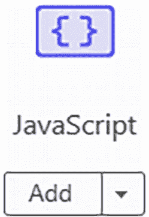

一个带有两个花括号的图标。底部写着文字“Javascript”。文字下方是一个带有下拉菜单的“添加”按钮。

**图 8-2** JavaScript 工具

## 创建文档级 JavaScript

现在，你需要从 JavaScript 菜单（图 8-3）中选择“文档级 JavaScripts”。如需查看，请参考本章文件夹中的 `Newsletter_2_End.pdf` 文件。如果你想练习，可以使用 `Newsletter_2_Start.pdf` 文件。

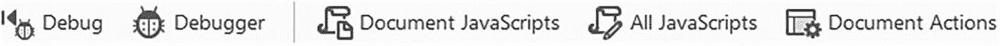

菜单栏的截图，包含以下选项：debug、debugger、document JavaScripts、all JavaScripts 和 document actions。

**图 8-3** JavaScript 菜单

当你首次开始为文档创建 JavaScript 时，“文档级 JavaScripts”对话框将显示为空白。尚未创建任何 JavaScript，因此你需要遵循以下步骤：

1. 输入脚本名称。请参考图 8-4。在本示例中，我输入了 `welcome`。

   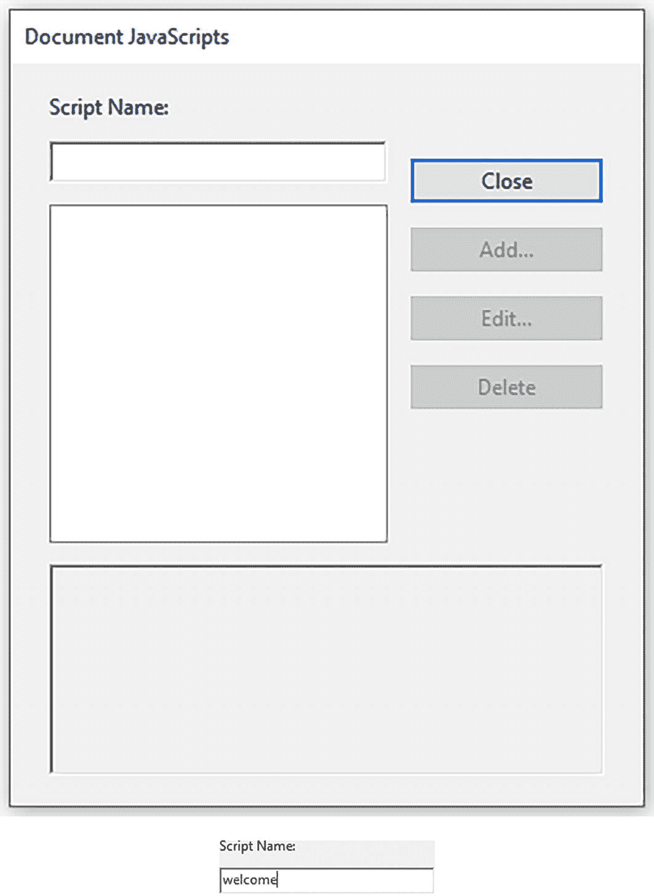

   文档级 JavaScripts 的对话框。有一个空白区域用于输入脚本名称。对话框下方的提示显示脚本名称为 `welcome`。

   **图 8-4** “文档级 JavaScripts”对话框

2. 点击右侧的“添加”按钮。请参考图 8-5。

   

   一个标记为“添加”的矩形按钮图标。

   **图 8-5** “添加”按钮

3. 在本示例中，进入“JavaScript 编辑器”对话框后，你可以高亮显示并删除默认文本，然后输入以下脚本：

   ```
   //Welcome Message on start
   app.alert("Welcome to our Newsletter!",3,0);
   ```

   如前所述，带有 `//` 的第一行是注释。它与代码的功能无关，只是提醒代码的用途。

   实际代码如下所示：

   ```
   app.alert("Welcome to our Newsletter!",3,0);
   ```

   这段代码调用了一个警报消息。在 `app.alert()` 中，你可以输入自定义文本（本例中为 `"Welcome to our Newsletter!"`）。然后，你可以选择希望显示的图标和按钮类型，它们之间用逗号分隔。请参考图 8-6。
   - `3` 表示警报图标类型（本例中为状态/信息）。请参考表 8-1。
   - `0` 表示按钮类型（本例中为确定按钮）。

   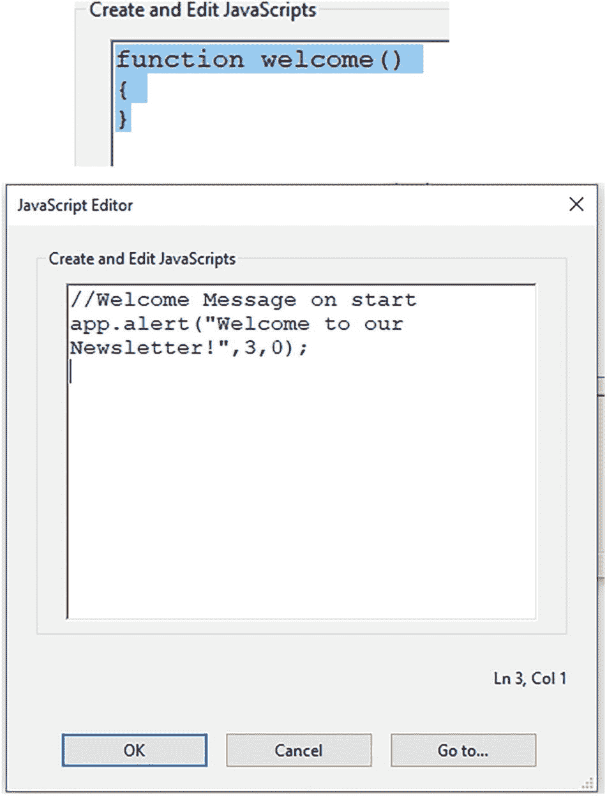

   创建和编辑 JavaScript 函数的对话框截图，函数名为 `welcome`。它包含一个 JavaScript 编辑器，其中包含一组用于启动时欢迎消息的代码。底部有确定、取消和转到按钮。

   **图 8-6** 已移除的代码以及输入到 JavaScript 编辑器中的新代码和消息

   根据警报类型的不同，你可能选择其他选项。

4. 输入完成后，点击编辑器中的“确定”按钮，然后点击“关闭”退出“文档级 JavaScripts”对话框。点击“关闭”按钮退出 JavaScript 工具。然后保存你的工作。

5. 关闭 PDF 并再次打开后，警报应会弹出。点击消息上的“确定”按钮，文档即可打开。


## 查看器版本与验证警报

假设您希望确保客户的 Reader 版本足够新，能够完成某些特定任务。

您可以创建并添加自己的查看器验证脚本，例如 `viewerVersion`。请参考图 8-7。此示例也见于文件 `Newsletter_2_End.pdf` 中的 `JavaScript 工具` > `文档 JavaScript`。

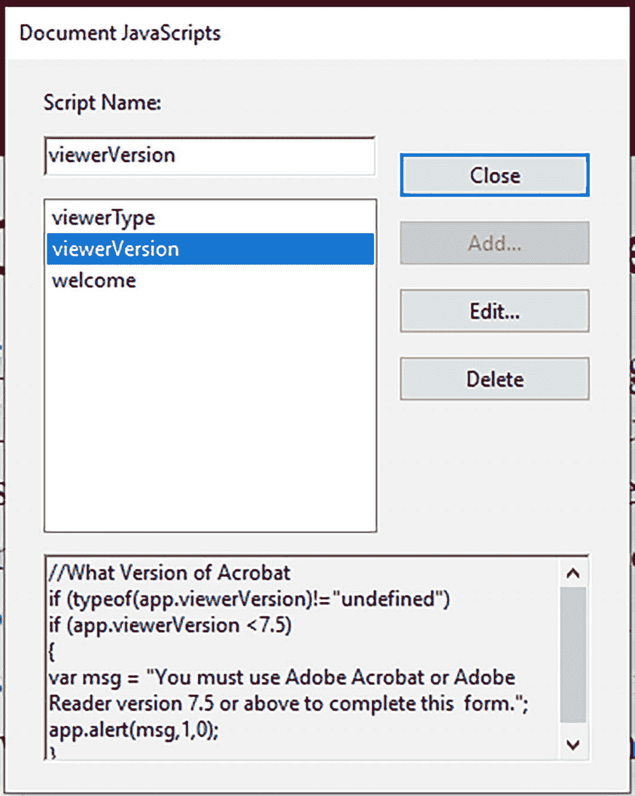

*一个标题为“文档 JavaScript”的对话框。脚本名称高亮显示为查看器版本。底部的一个矩形框内显示了一组针对 Acrobat 版本的代码。有四个按钮：关闭、添加、编辑和删除。*

**图 8-7** — 显示新闻稿 PDF 中使用的三个脚本的“文档 JavaScript”对话框

```
// 检查 Acrobat 版本
if (typeof(app.viewerVersion)!="undefined")
if (app.viewerVersion <7.5){
var msg = "您必须使用 Adobe Acrobat 或 Adobe Reader 7.5 或更高版本来填写此表单。";
app.alert(msg,1,0);
}
```

这段代码确保当文档在 Reader 中打开时，代码会与客户的软件交互，根据条件语句进行自我检查，如果版本低于 7.5，则使用 `1`（警告）来提醒客户，表明他们将难以完成此表单（见表 8-1）。客户随后会知道他们需要升级。然后点击`确定`，即 `(0)`。见图 8-8。

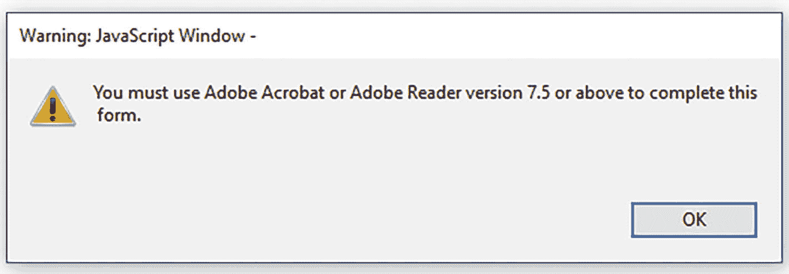

*JavaScript 窗口对话框的截图。其中说明应使用 Adobe Reader 7.5 或更高版本来填写表单。*

**图 8-8** — 显示的警告，让查看者知道他们需要升级软件才能完成表单

您也可以创建并添加一个 `viewerType` 验证。

```
if (typeof(app.viewerType)!="undefined")
if (app.viewerType == "Reader")
{
var msg = "您必须使用 Acrobat Standard、Acrobat Pro 或 Acrobat Pro Extended 版本来完成此表单。";
app.alert(msg,1,0);
}
```

如果客户使用的是 Reader 而非 Acrobat Pro，由于程序员已知的某些设置问题，他们可能无法完成此表单。如果您使用的是 Acrobat Pro，此警告将被忽略。

完成后，点击`确定`并保存您的工作。点击`编辑`按钮检查代码，如果不想进行更改，则点击`取消`。然后点击`关闭`退出对话框。就您自己的操作而言，在使用“文档 JavaScript”对话框时，如果出现错误，您可以点击`删除`按钮并重新创建该操作。请参考图 8-7。

> **注意：** 如果您认为客户可能会使用其他 Reader 或 PDF 程序打开他们的文件，您可能需要修改代码以反映这一点。请记住，浏览器之类的程序可能会破坏表单中的 JavaScript，因此请先与客户或同事一起测试警报。同时请记住，不要将版本设置得太高，因为大多数客户使用较旧版本的 Acrobat Pro 或 Reader 就能完成表单。目前，我使用的是 23.0 版本。然而，您的客户可能使用的是 18.0 版本，并且可以毫无问题地完成表单或查看文档，因此请相应地调整此警告，不要故意设置过高以引起困扰。

### 文档动作

其他类型的全局警报可能需要在另一个区域进行设置。从 JavaScript 工具中，选择`文档动作`。请参考图 8-9。

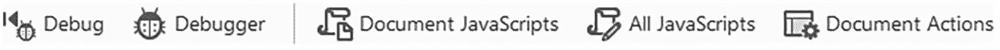

*菜单栏的截图，包含以下选项：调试、调试器、文档 JavaScript、所有 JavaScript 和文档动作。*

**图 8-9** — JavaScript 工具菜单

在这个 `Newsletter_2_End.pdf` 文件中，您可以看到两个文档动作。您之所以知道这一点，是因为每个已创建的动作旁边都有一个圆点。您可以通过点击`编辑`按钮来编辑选定的动作。`编辑全部`按钮会显示文档中当前所有的动作，而不仅仅是文档动作。如果您需要退出该对话框并返回到“文档动作”对话框，请点击`取消`。请参考图 8-10。

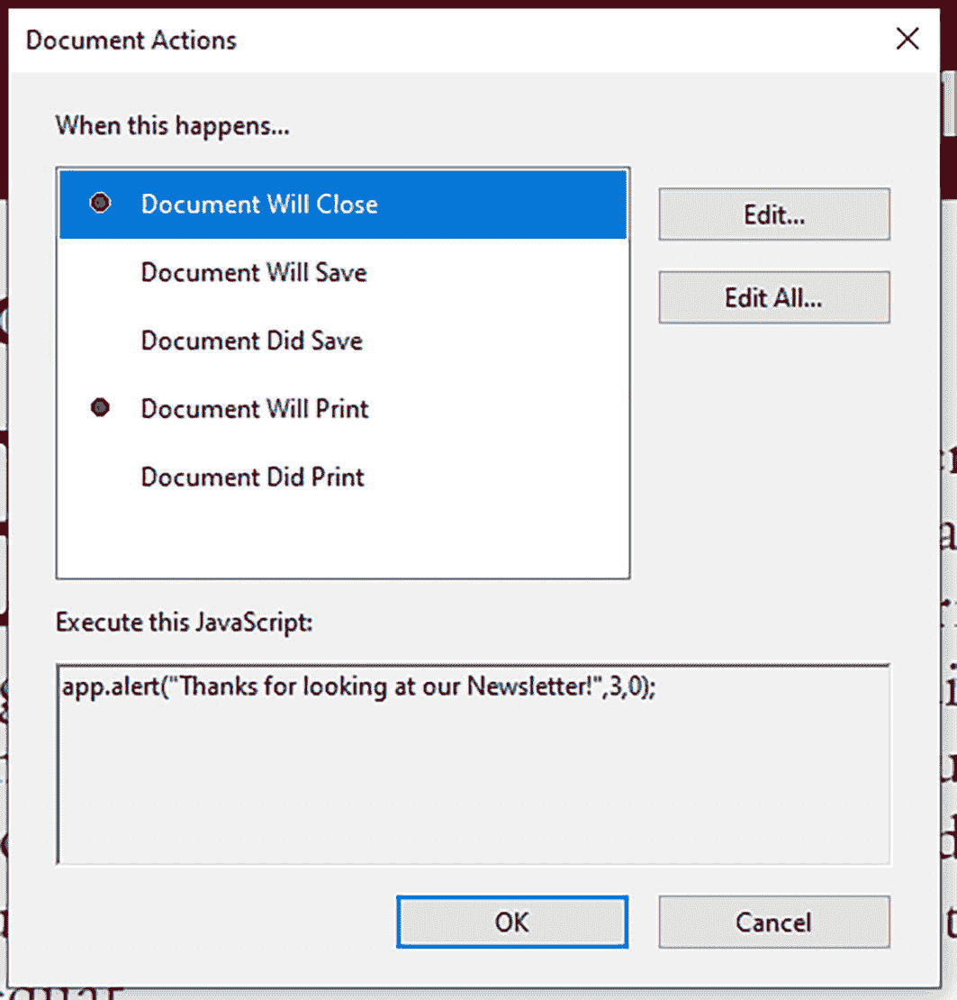

*一个标题为“文档动作”的对话框截图，其中包含关闭、保存和打印文档的选项列表。JavaScript 的执行代表了一种用于应用警报的代码。*

**图 8-10** — 文档动作对话框

#### 文档关闭时

当文档关闭时，您可能想添加一句友好的告别语，以感谢客户花时间阅读新闻稿。点击`编辑`按钮查看或输入以下代码：

```
app.alert("感谢您查看我们的新闻稿！",3,0);
```

完成后点击`确定`按钮退出 JavaScript 编辑器。如果您想提交所做的任何更改，请点击`确定`退出“文档动作”对话框。

此脚本类似于欢迎问候语；但是，您需要将其输入到此部分中，以便在文档关闭时生效。

#### 文档打印时

您可以输入类似这样的消息，在客户端点击`文件` → `打印`对话框中的`打印`后，文档打印前显示：

```
var msg = "希望您找到了需要的内容。"
app.alert(msg,3,1);
```

> **注意：** 在这种情况下，消息被写成一个单独的变量 `var msg`。

我本可以将其写成一行：

`app.alert("希望您找到了需要的内容。",3,1);`

结果是一样的。

然而，如果您认为消息较长或可能多次使用该消息，了解另一种写法是件好事。这样更容易访问。

以下是此区域可用的其他文档选项：

*   **保存前**: 消息在保存前出现。
*   **保存后**: 消息在保存后出现。
*   **打印后**: 消息在文档打印后出现。

完成后，点击`确定`按钮退出对话框，关闭 JavaScript 工具，并保存您的工作。

在接下来的章节中，您将进一步深入研究全局文档 JavaScript，因为您可以访问此区域来处理各种表单字段，以避免代码重复。


## 带按钮的警报

并非所有警报都需要全局触发。有时你希望警报仅在按下按钮或文本框输入错误时出现。要查看此按钮，请参考图 8-11 和 `Newsletter_2_End.pdf` 的第 4 页。


一张显示“警报信息”标签的矩形按钮截图。

**图 8-11**  Newsletter PDF 中的警报信息按钮

你可以在“准备表单”区域或“富媒体”区域创建按钮。请参考图 8-12。

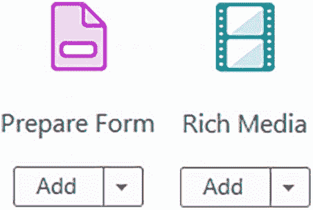

一张截图展示了两个图标，分别标注为“准备表单”和“富媒体”。每个图标都包含一个“添加”下拉菜单。

**图 8-12**  在“准备表单”或“富媒体”工具中均可找到按钮

接着，你可以在“按钮属性”对话框的“动作”选项卡中，使用“运行 JavaScript”操作为按钮添加一个警报动作。在本例中，我使用了 `Mouse Up`（鼠标释放）作为触发设置。请参考图 8-13。

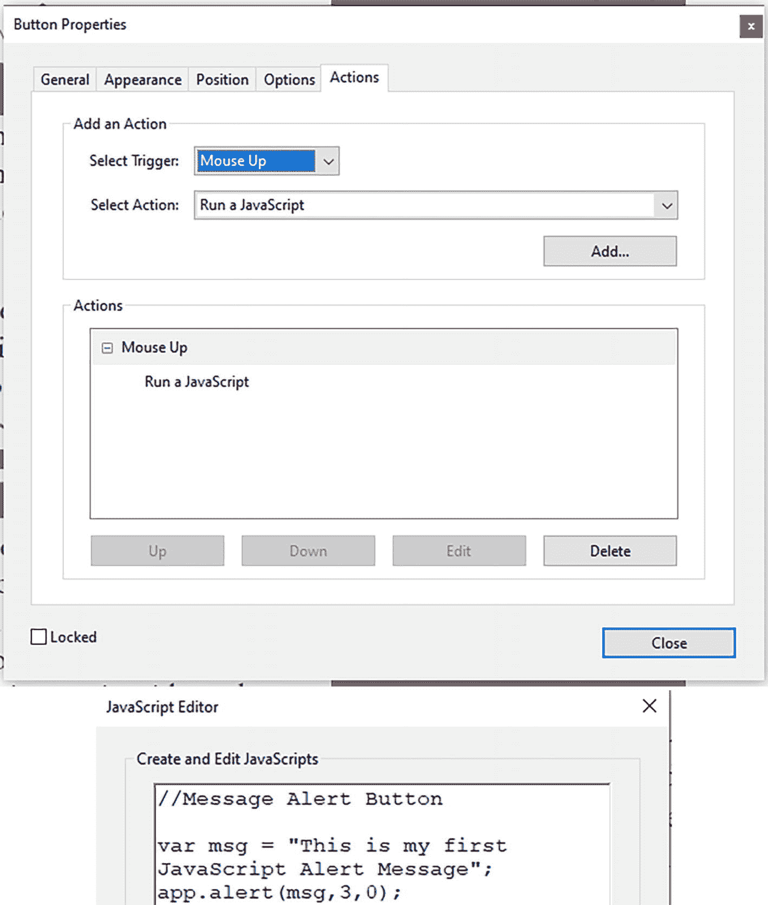

一张“按钮属性”对话框的截图。它有 5 个选项卡，其中“动作”选项卡被选中。它表明已选择“鼠标释放”作为触发动作来运行 JavaScript。底部的 JavaScript 编辑器包含一组用于“消息警报”按钮的代码。

**图 8-13**  在“按钮属性”对话框的“动作”选项卡中运行 JavaScript 动作。文本已输入到 JavaScript 编辑器中

与之前一样，你设置 `Mouse Up` 作为触发器，并选择 `Run a JavaScript` 动作。然后点击“添加”按钮并输入以下文本：

```
//消息警报按钮
var msg = "这是我的第一个 JavaScript 警报消息";
app.alert(msg,3,0);
```

点击 `OK` 退出编辑器，点击 `Close` 退出按钮属性界面，再次点击 `Close` 退出工具，然后保存你的工作。

图 8-14 展示了点击按钮时产生的警报。稍后你将了解这类警报。

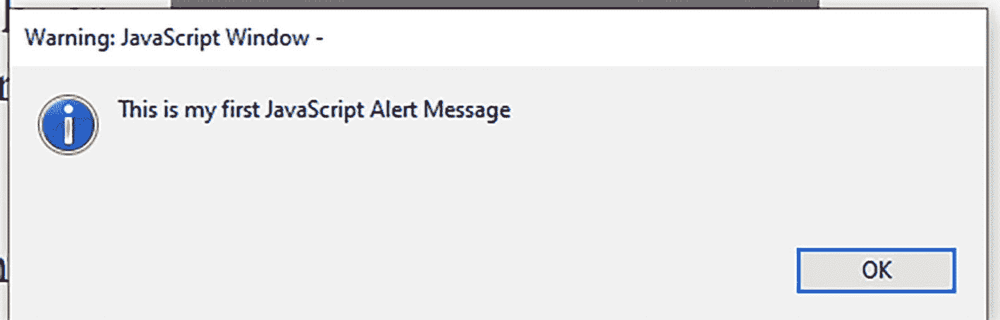

一张 JavaScript 窗口的对话框截图。文本显示：“这是我的第一个 JavaScript 警报消息”。

**图 8-14**  点击时产生的警报消息

在第 10 章中，我们将学习如何创建一个使用 JavaScript 打印特定页面的按钮。如果你在寻找有关警报播放不同声音或 `app.beep();` 的信息：共有四种类型；但你应该知道，这些选项在 macOS 和 UNIX 系统上会被忽略。由于它们是可选的，因此我不会将它们添加到代码中，而是让默认声音播放。

## 添加评论备注、签名和时间戳

如你所见，按钮非常适合警报，但你也可以使用它们向页面添加非表单和表单项目。

例如，你可能希望鼓励客户在审校完成后对特定页面添加评论。你可以添加一个按钮。请参见 `Project_Comment` PDF 文件中“开始”和“结束”页面上的按钮。请参考图 8-15 和图 8-16。

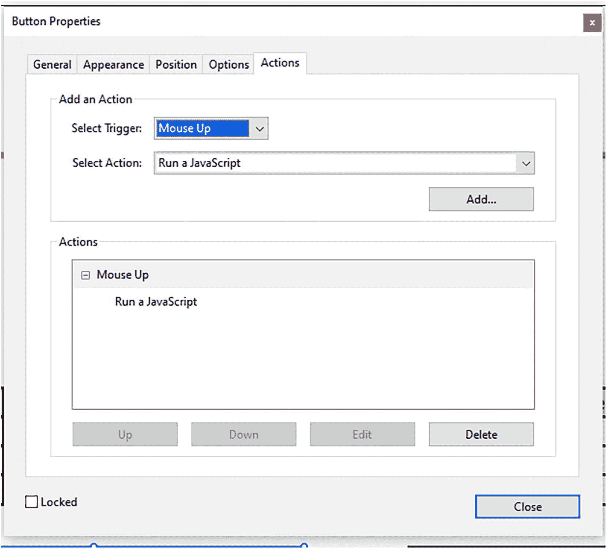

一张“按钮属性”对话框的截图。它有 4 个选项卡，其中“动作”选项卡被选中。它表明已选择“鼠标释放”作为运行 JavaScript 动作的触发器。

**图 8-16**  “按钮属性”对话框“动作”选项卡上的 `运行 JavaScript` 动作


一张显示“添加评论”标签的矩形按钮截图。

**图 8-15**  一个用于向页面添加评论或便签的按钮

与之前一样，要实现此功能，你需要在“动作”选项卡上为按钮选择 `Mouse Up` 触发器，然后选择 `Run a JavaScript`。点击“添加”按钮。请参考图 8-16 和图 8-17。

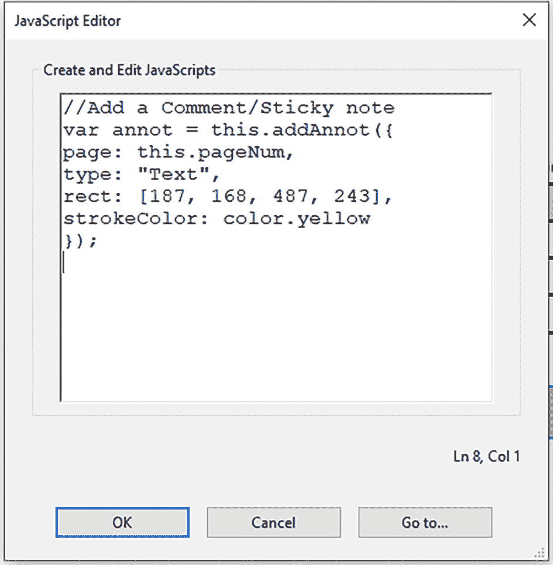

一张用于创建和编辑 JavaScript 的 JavaScript 编辑器截图。其中包含一段用于添加评论的代码片段。

**图 8-17**  输入到 JavaScript 编辑器中的文本

这次你需要输入以下代码：

```
//添加评论/便签
var annot = this.addAnnot({
page: this.pageNum,
type: "Text",
rect: [187, 168, 487, 243],
strokeColor: color.yellow
});
```

这里的代码写法略有不同。评论或有时被称为注释的对象，其属性中不具备直接添加 JavaScript 的能力，因此如果你想要包含颜色或位置等特定自定义设置，就必须间接添加动作——本例中通过按钮点击来实现。以下是其含义：当按钮被点击时，它会调用 `addAnnot` 或注释/评论。一个评论便签将被添加到按钮所在的页面 `this.pageNum` 上。

这将允许你添加文本。评论的类型将被设置为页面上特定的坐标位置。这个评论的图标颜色为黄色，但评论本身的填充颜色可能不同。然后用户可以在评论区域输入一些文本并发布，当你打开页面时，它就会显示出来。请参考图 8-18。

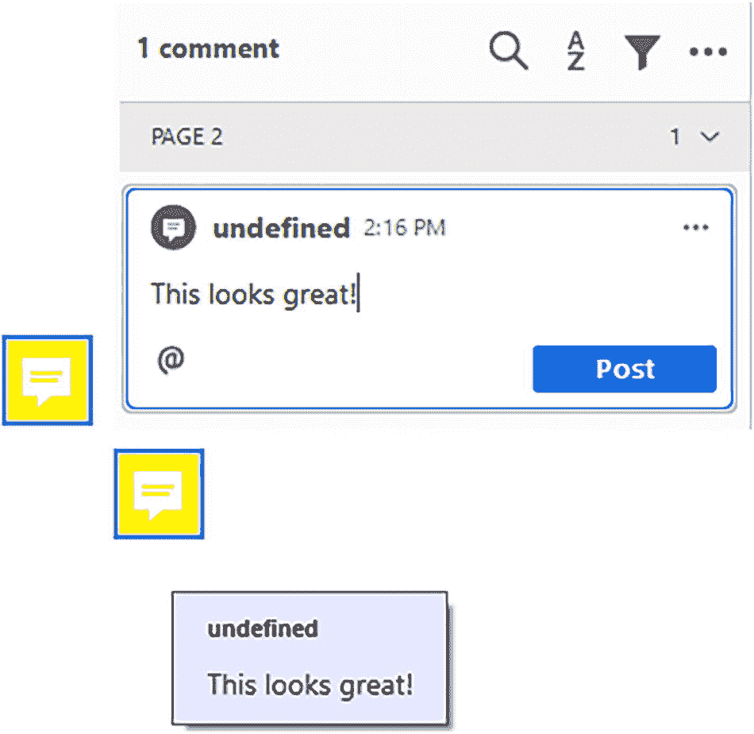

一张截图显示了一条来自“未定义用户”的评论，内容为“这看起来很棒”。对话框底部有一个“发布”按钮。另一张截图展示了底部的评论。

**图 8-18**  客户点击按钮并输入文字后产生的评论

在本例中，客户显示为 `Undefined`（未定义）。不过，他们稍后可以通过右键点击评论并在“常规属性”中设置新的作者名称来更改此项。请参考图 8-19。

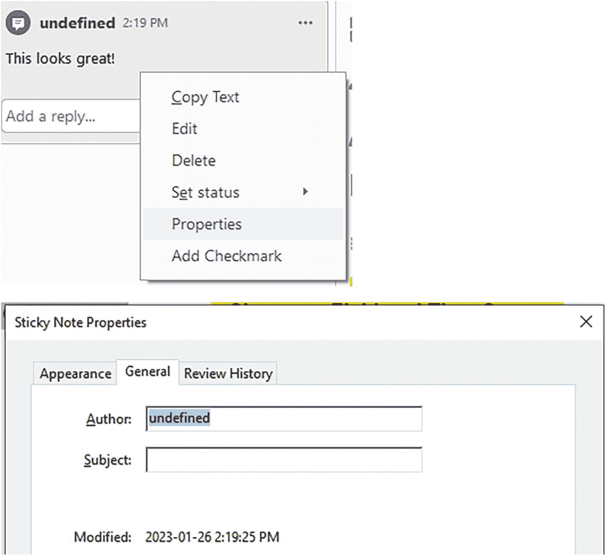

一组两个对话框。上方的对话框显示评论下的上下文菜单并高亮显示了“属性”选项。下方的对话框显示“便签属性”，包含用于输入作者名称、主题以及修改日期的文本框。

**图 8-19**  使用“属性”对话框后更改便签的作者名称

同样，你可以添加一行代码来预先设置作者名称。请参考以下代码清单中的粗体部分。评论区域的结果请参考图 8-20。


### 排版后的内容

截图显示了作者姓名 John Smith，以及时间指示：2:43 PM，还有评论图标。

图 8-20

使用 JavaScript 修改便签的作者名称

```
//添加评论/便签
var annot = this.addAnnot({
page: this.pageNum,
type: "Text",
author: "John Smith",
rect: [187, 168, 487, 243],
strokeColor: color.yellow
});
```

`Rect`属性（在此例中也被称为*数组*）指的是定义注释在页面上位置的矩形坐标。

颜色可以为`strokeColor`设置格式，从`color.yellow`到`color.red`或其他已知颜色。你将在第 10 章中了解其他类型的颜色格式。不过，我在此只想指出，你并不局限于便签类型的注释或`Text`类型。

例如，你可以将`Type`更改为其他选项，包括`Circle`、`Stamp`和`PolyLine`。

你可以在此在线资源代码参考指南中查阅其他注释选项，并了解注释类型和属性，以获取更多详情和适用于你的项目的编码示例：

[`https://opensource.adobe.com/dc-acrobat-sdk-docs/library/jsapiref/JS_API_AcroJS.html#annotation`](https://opensource.adobe.com/dc-acrobat-sdk-docs/library/jsapiref/JS_API_AcroJS.html#annotation)

[`https://opensource.adobe.com/dc-acrobat-sdk-docs/library/jsdevguide/JS_Dev_RMA.html?highlight=annotation`](https://opensource.adobe.com/dc-acrobat-sdk-docs/library/jsdevguide/JS_Dev_RMA.html?highlight=annotation)

**提示**

如果你不确定使用哪种`Type`设置，请确保将注释名称与“注释”工具中的实际注释进行比较。例如，在代码中，`Type`设置为`StrikeOut`将与注释“删除线”相同。`Caret`与“在光标处插入文本”相同，而`Ink`与使用绘图工具相同。请注意，像`Squiggly`这样的类型与注释云没有直接对应关系，可能表现为带下划线的文本。对于`Cloud`类型，你可以改用`Polygon`；不过，你可能需要修改代码中的额外属性，才能使其在页面上正确显示。

## 签名域与时间戳

使用按钮还可以做的一件事是添加表单域和时间戳。请参考“项目注释”PDF“结束”文件的第 2 页以及图 8-21。


截图显示了一个矩形按钮，上面标注着“签名域和时间戳”。

图 8-21

签名域与时间戳按钮

有时，你希望一个按钮同时做两件事，这是一种加快处理速度的方法。同样，在`Trigger`设置为`Mouse Up`的情况下，你可以在“动作”选项卡中选择“运行 JavaScript”。请参考图 8-22。

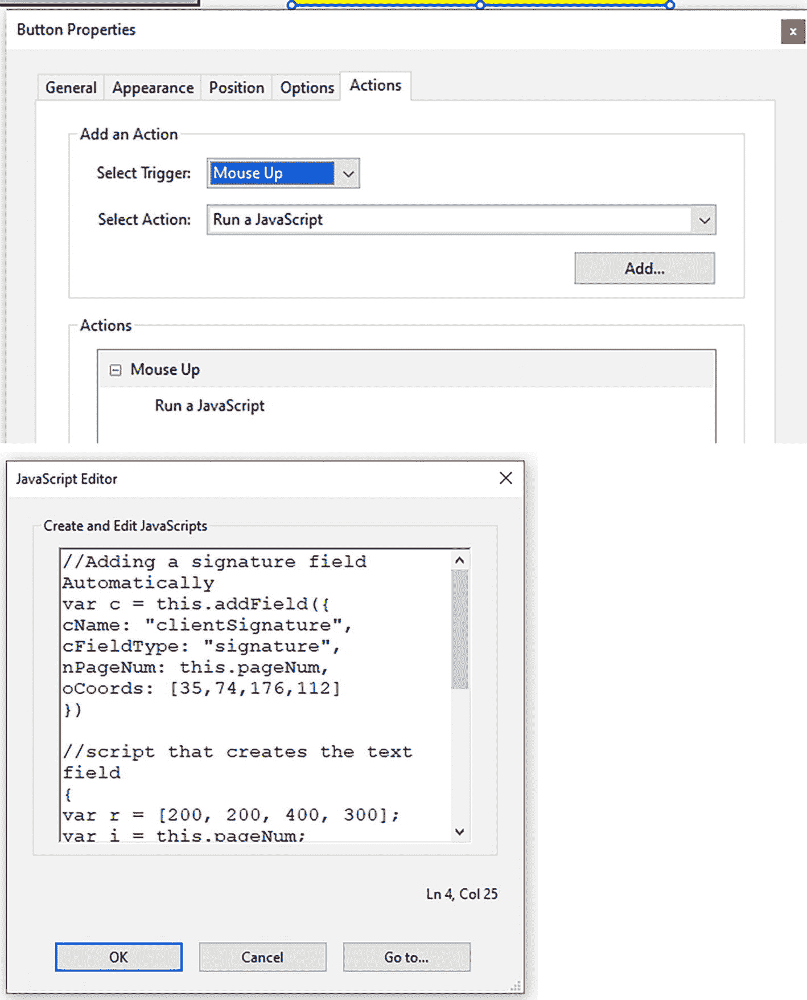

两个不同对话框的截图。上方截图显示了按钮属性，指示“动作”选项卡下的设置。触发器已选择“鼠标松开”来运行 JavaScript。下方截图显示了在 JavaScript 编辑器下用于添加签名域的一段代码片段。

图 8-22

使用“动作”选项卡为时间戳按钮添加的 JavaScript

两个脚本都位于同一个“JavaScript 编辑器”对话框中。请参考图 8-22 和图 8-23 查看点击按钮后的结果。

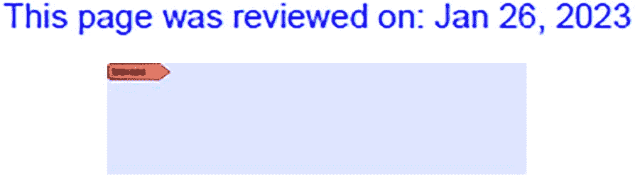

截图显示了签名域。它表示一个矩形空白区域，上方有一段文字，写着“此页面已于 2023 年 1 月 26 日查看”。

图 8-23

生成的签名域

本节中的签名代码如下所示：

```
//自动添加签名域
var c = this.addField({
cName: "clientSignature",
cFieldType: "signature",
nPageNum: this.pageNum,
oCoords: [35,74,176,112]
})
```

第一部分使用`var c`添加字段来控制签名放置的位置。该字段被命名为`clientSignature`以便于识别，因为所有字段都需要一个唯一的名称。字段类型为`signature`，仅用于签名，不适用于以下类型：

*   **文本**：`cFieldType`："`text`"
*   **按钮**：`cFieldType`："`button`"
*   **下拉列表**：`cFieldType`："`combobox`"
*   **列表框**：`cFieldType`："`listbox`"
*   **复选框**：`cFieldType`："`checkbox`"
*   **单选按钮**：`cFieldType`："`radiobutton`"

同样，我还为此页面设置了属性来放置该字段及其坐标。这些坐标可能与“位置”选项卡中的设置有关，默认情况下单位为“点”（大约），可能需要根据`cFieldType`以及你希望字段放置的位置进行调整。根据`cFieldType`的类型，如果你计划添加多个不同类型的字段，需要确保每个字段都有唯一的`cName`，并相应地调整`oCoords: [left, bottom, right, top]`。

*   你可以参考此链接：
*   [`https://opensource.adobe.com/dc-acrobat-sdk-docs/library/jsdevguide/JS_Dev_AcrobatForms.html`](https://opensource.adobe.com/dc-acrobat-sdk-docs/library/jsdevguide/JS_Dev_AcrobatForms.html)

在`this.addField()`之后，为了进一步设置新字段的颜色格式（我们将在第 10 章中更详细地探讨），我们需要执行另一步骤，使默认颜色不再是透明。在本例中，你接下来需要将刚创建的字段作为新变量获取，然后在这种情况下将颜色格式应用于边框。所有这些都可以在同一个 JavaScript 动作中完成。要查看此示例，请参考文件`Project_Comment_End_2.pdf`。

```
var b = this.getField("clientSignature");
b.strokeColor = color.red;
```

以下是“此页面已于 2023 年 1 月 26 日查看”的时间戳代码：


```javascript
//script that creates the text field
{
var r = [200, 200, 400, 300];
var i = this.pageNum;
var f = this.addField(String("completeDate."+i),"text",i,r);
f.textSize = 10;
f.alignment = "right";
f.textColor = color.blue;
f.fillColor = color.transparent;
f.textfont = font.HelvB;
f.strokeColor = color.transparent;
f.value = String("This page was reviewed on: " + util.printd("mmm dd, yyyy", new Date()));
f.readonly = true;
}
```

接下来，时间戳实际上是一个名为 `completeDate.1` 的文本字段，当用户单击按钮时，它会被添加到页面中，并显示今天的日期。文本框中绑定了多种属性，这些属性也会出现在签名域所在的同一页面上。这些属性包括：文本大小、对齐方式、文本颜色、背景填充颜色、字体类型以及描边或边框颜色等。然后，使用 `“mmm dd, yyyy”` 的日期格式将新日期戳印在页面上。并且，通过代码在“常规”选项卡中将此文本字段设置为只读。如果与实际选项卡相比，此处的定位或 `var r` 是一个以点为单位的近似位置。

> **注意：** 你可以将其颜色设置为蓝色或红色，也可以选择不同的字体。现在，这段文本（“此页面审核日期：日期”）已被锁定，因为 `readonly` 被设置为了 `true`。如果你希望将来能以某种方式编辑此文本，可以将其设置为 `false`。这就是所谓的*布尔表达式*；它只能为 `true` 或 `false`。你将在第 9 章中看到一种通过复选框为文本字段设置 `readonly` 的方法。

你将在第 10 章中了解使用 JavaScript 格式化文本和字段的其他原因。

虽然这是一个更高级的话题，但作为最后的说明，我将提及你还可以使用按钮来添加其他非表单项目，包括水印、书签和超链接。你可以在以下页面找到关于水印话题的更多信息：

[`https://opensource.adobe.com/dc-acrobat-sdk-docs/library/jsdevguide/JS_Dev_PDFCreation.html?highlight=watermark#adding-watermarks-and-backgrounds`](https://opensource.adobe.com/dc-acrobat-sdk-docs/library/jsdevguide/JS_Dev_PDFCreation.html?highlight=watermark#adding-watermarks-and-backgrounds)

## 总结

在本章中，你为文档添加了一些全局警报，也为按钮添加了一些警报。你还发现，可以使用按钮来创建评论/便签、签名域和时间戳。正如你所看到的，警报对于非表单文档很有用，而按钮则用于添加注释。

在下一章中，你将了解警报如何为表单提供帮助。

