# 10. 使用 JavaScript 进行各种类型的格式化

在上一章中，您了解了如何创建各种警报来帮助客户发现输入了错误信息。

**章节目标：** 在本章中，您将探索如何全局或单独地修改各种字段的外观，使其符合您选择的格式。您还将根据选中的单选按钮或复选框来修改结果值的外观。以下是您将要解决的其他主题：

*   创建允许标签跨越多行的按钮
*   当多行文本字段空间不足时，允许客户输入的文本流入另一个文本字段
*   使用 JavaScript 和按钮仅打印一页或一定范围的页面，而不是打印整个文档
*   创建一个用于通过电子邮件提交 PDF 的基本按钮

## 为文本字段添加全局格式

通过表单，使用“外观”和“选项”选项卡上的属性可以非常轻松地完成字体或字段颜色的格式化。请参考图 10-1。

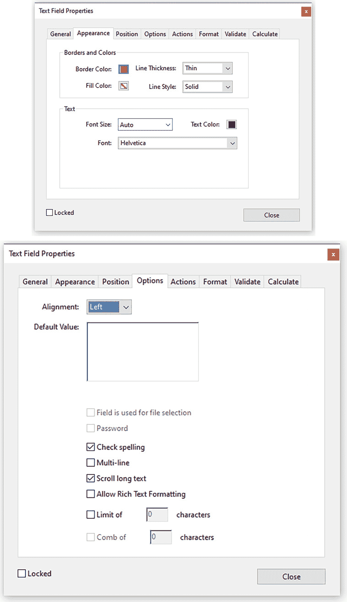

*图 10-1：显示格式化选项的“外观”和“选项”选项卡*

这两个选项卡适用于大多数字段，尽管其中的属性会根据字段类型而有所不同。在本章的示例中，我们讨论的是文本字段。但是，你在此处学到的大部分内容也可以应用于其他字段类型。你还将学习如何使用 JavaScript 访问这些属性。

在其他情况下，你可能希望所有字段具有相同的颜色或字体。你可以选中所有字段（用选框拖拽覆盖所有字段），然后右键单击“属性”，并在“外观”选项卡中设置各种新属性。请参考图 10-2。

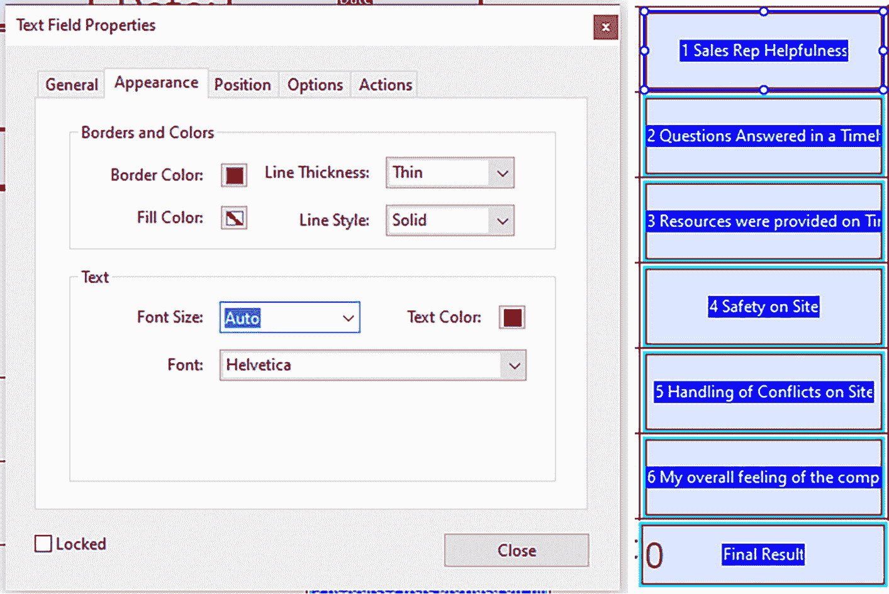

*图 10-2：同时高亮显示多个字段时的“外观”选项卡*

然而，这可能会导致错误，并且可能无法获得预期结果，尤其是当你忘记选中某些内容时。

**注意：** 如果你想在本课程中同步操作或查看最终结果，请从引言中的链接下载第 10 章的文件。标有“开始”的文件是不包含代码的文件，标有“结束”的文件是最终结果。如果你希望将这些脚本添加到自己的 PDF 表单中，你将找到一个包含原始脚本的文件夹。

如果你是从原始 PDF 创建表单，请参考第 1 章中的“表单审查”部分。

请记住，要查看字段的属性，必须选择“准备表单”工具；只有这样，你才能右键单击或双击字段来查看其属性。

使用 JavaScript，你可以快速更改颜色。要执行全局操作，你需要在 JavaScript 工具中进入文档级 JavaScript。请参阅本章文件夹中的文件 `TMC_Customer Survey_End_Part2_global.pdf`。格式化代码请参考图 10-3。

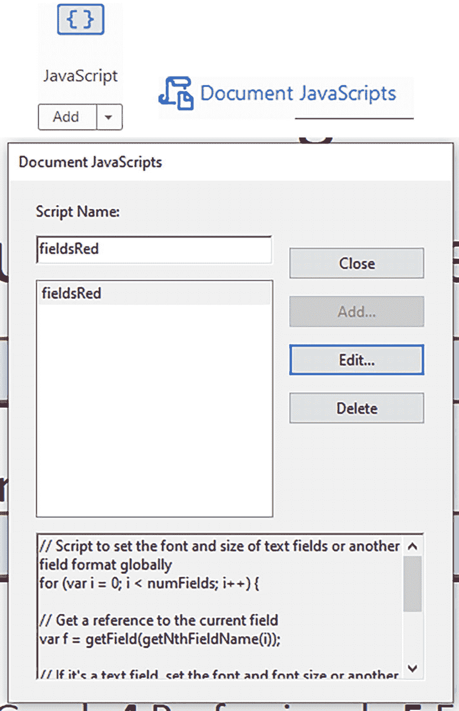

*图 10-3：JavaScript 工具和文档级 JavaScript 对话框*

以下是一个名为 `fieldsRed` 的 JavaScript 脚本。我添加了以下代码：

```javascript
// Script to set the font and size of text fields or another field format globally
for (var i = 0; i < numFields; i++) {
// Get a reference to the current field
var f = getField(getNthFieldName(i));
// If it's a text field, set the font and font size or another format like stroke color
if (f.type == "text") {
f.strokeColor = color.red;
}
}
```

要仅查找文本字段并为其应用红色描边颜色，请使用 JavaScript 的 `for()` 循环。请参考图 10-4 查看结果。


*图 10-4：在代码中添加 `for()` 循环后对字段的影响*

在 Acrobat JavaScript 中，循环并不常见，除非你想影响多个字段。最常用的是 `for()` 循环。JavaScript 中还有其他的循环，如 `for in`、`for of`、`while` 和 `do while`。为简化起见，我们只关注 `for()` 循环，如 `fieldsRed` 代码所示。

这个 `for()` 循环包含三条语句：

```javascript
"var i = 0; i < numFields; i++"
```

变量 `var i = 0;` 在循环（代码块）开始之前执行。与第 9 章前面介绍的数组示例一样，字段 0 是起点。

`i < numFields;` 定义了运行循环（代码块）的条件。`var i` 小于（`<`）`numFields`。你的表单可能非常大。由于不知道有多少个字段，因此使用 `numFields` 而非实际数字。你希望循环持续进行，直到到达表单的末尾。

`i++` 每次在循环（代码块）执行之后执行。这使循环持续进行，直到到达末尾。

中间部分充当控制逻辑：

```javascript
var f = getField(getNthFieldName(i));
// If it's a text field, set the font and font size or another format like stroke color
if (f.type == "text") {
f.strokeColor = color.red;
}
```

当字段数量被收集后，你使用条件 `if` 语句检查它们是否确实是文本字段。如果是，则可以将红色描边颜色应用于该字段。请注意文档中按钮字段是如何没有应用红色描边的；它们在循环过程中被排除了。

要格式化其他类型的字段而非文本，请格式化以下行：

- `if (f.type == "checkbox")`
- `if (f.type == "radiobutton")`
- `if (f.type == "button")`
- `if (f.type == "signature")`
- `if (f.type == "combobox")`
- `if (f.type == "listbox")`

或者使用此循环，如果你想将描边颜色更改为蓝色，可以更改此行：

```javascript
f.strokeColor = color.blue;
```

所有原本具有红色描边的字段将立即变为蓝色，并且你无需担心选中所有字段的问题。

### 颜色属性

表 10-1 中定义了你可以尝试的其他颜色。对于色彩空间，T = 透明，G = 灰度，RGB = 红、绿、蓝，CMYK = 青、品红、黄、黑。0 = 0% 颜色，1 = 100% 颜色。

*表 10-1：颜色属性*

| 颜色对象 | 关键字 | 等效 JavaScript |
| --- | --- | --- |
| 透明 | `color.transparent` | `[ "T" ]` |
| 黑色 | `color.black` | `[ "G", 0 ]` 或 `[ "RGB", 0,0,0 ]` 或 `[ "CMYK", 0,0,0,1 ]` |
| 白色 | `color.white` | `[ "G", 1 ]` 或 `[ "RGB", 1,1,1]` |
| 红色 | `color.red` | `[ "RGB", 1,0,0 ]` |
| 绿色 | `color.green` | `[ "RGB", 0,1,0 ]` |
| 蓝色 | `color.blue` | `[ "RGB", 0,0,1 ]` |
| 青色 | `color.cyan` | `[ "CMYK", 1,0,0,0 ]` |
| 品红 | `color.magenta` | `[ "CMYK", 0,1,0,0 ]` |
| 黄色 | `color.yellow` | `[ "CMYK", 0,0,1,0 ]` |
| 深灰色 | `color.dkGray` | `[ "G", 0.25 ]` |
| 灰色 | `color.gray` | `[ "G", 0.5 ]` |
| 浅灰色 | `color.ltGray` | `[ "G", 0.75 ]` |

某些颜色（如橙色或紫色）可能没有可以直接使用的关键字。在这种情况下，你需要计算出等效的 JavaScript。例如，对于橙色，你可以使用 `[ "CMYK", 0,0.5,1,0 ]`，在这种情况下，将品红设置为 50%，黄色设置为 100%。对于紫色，你可以编写 `[ "CMYK", 0.60,0.80,0,0 ]`，将青色设置为 60%，品红设置为 80%，或者尝试以类似方式使用数字找出 `"RGB"` 等效值。请记住，对于灰度或 `"G"`，较浅的颜色对应较大的数字。

## 数组与格式化属性变量示例

字段和注释（批注）都可以通过全局自定义字段属性来以多种方式受到影响。

例如，在第 9 章的数组文本中，您可以在 PDF 文档中分解出您想要针对的属性。

```
var gHelpText = new Array();
//spans
//String#0
gHelpText[0] = new Object();
gHelpText[0].text = "What's your full name?";
gHelpText[0].textColor = color.blue;
gHelpText[0].textFont = font.Times;
gHelpText[0].textSize = 16;
gHelpText[0].alignment = "center";
```

然而，要让这种格式生效并关联到数组的其他部分是很困难的，因为格式（如颜色）不会传递给字段，而只会作为文本字符串传递。

在这种情况下，更好的做法是将这些新属性中的大部分添加到`txtHelp`字段的“格式”选项卡中，作为针对该字段的自定义格式。请参考图 10-5。另请参考文件`TMC_OrderForm_End_rollover_format.pdf`。

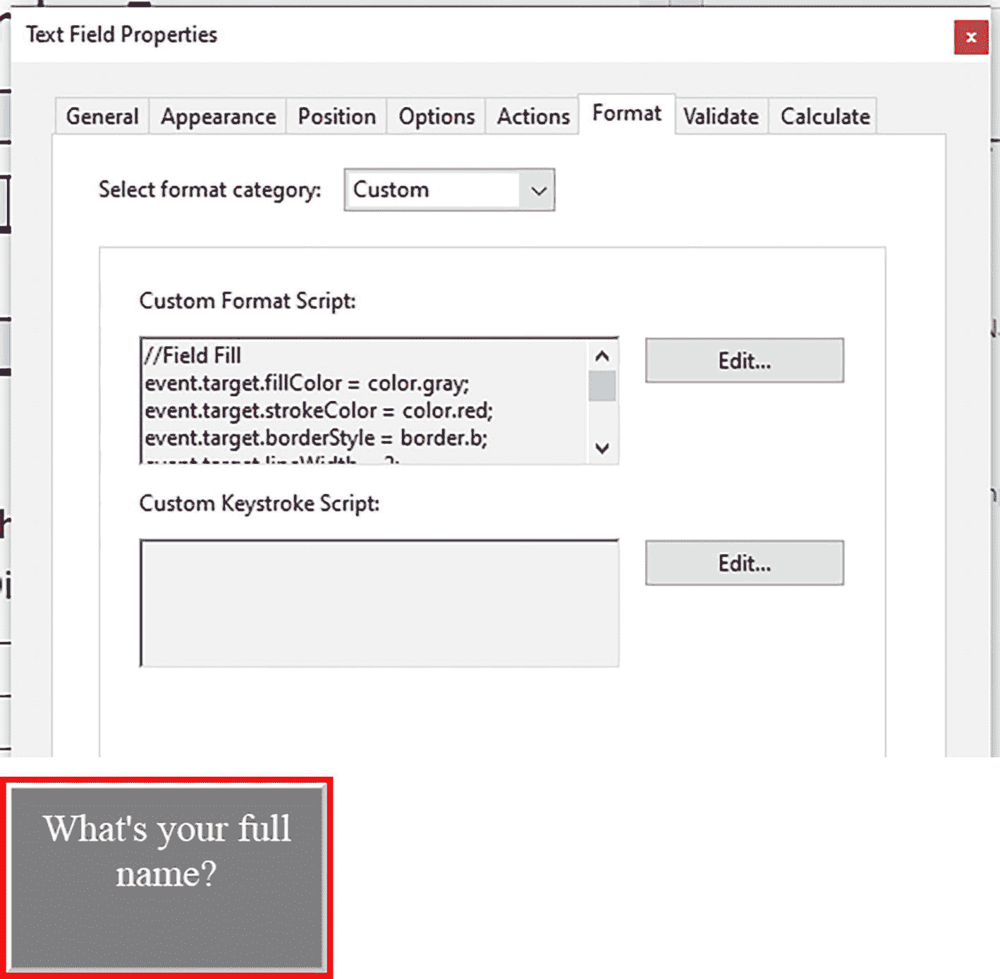

一个文本字段属性窗口的截图，其中“格式”选项卡已展开。其中包含一个用于格式类别的下拉菜单、一个自定义格式脚本列表以及自定义击键脚本。页面底部有一个带边框的方框，其中包含文本“What is your full name?”。

图 10-5

“文本字段属性”对话框的“格式”选项卡及自定义格式脚本

通过 JavaScript 代码，您可以控制该字段的以下属性：填充、描边、边框样式和描边宽度，以及字体属性（如颜色、文本字体或字体系列），以及大小和对齐方式。

```
//Field Fill
event.target.fillColor = color.gray;
event.target.strokeColor = color.red;
event.target.borderStyle = border.b;
event.target.lineWidth = 2;
//Fonts
event.target.textColor = color.white;
event.target.textFont =font.Times;
//fontFamily for Rich Text only
event.target.textSize = 14;
//Rich Text
event.target.richText = true;
event.target.alignment = "center";
```

但是，当您想要使用格式控制多个字段时，就需要回到文档 JavaScript 中，再次使用`for ()`循环来格式化这些字段，或者在本例中，将这些属性添加到变量`f`中。

这里我们可以看到如何将其添加到循环中以及最终结果。请参考图 10-6 和文件`TMC_Customer Survey_End_Part2_global_format2.pdf`。再次，我使用了名为`fieldsRed`的文档 JavaScript，但在脚本中添加了更多格式。

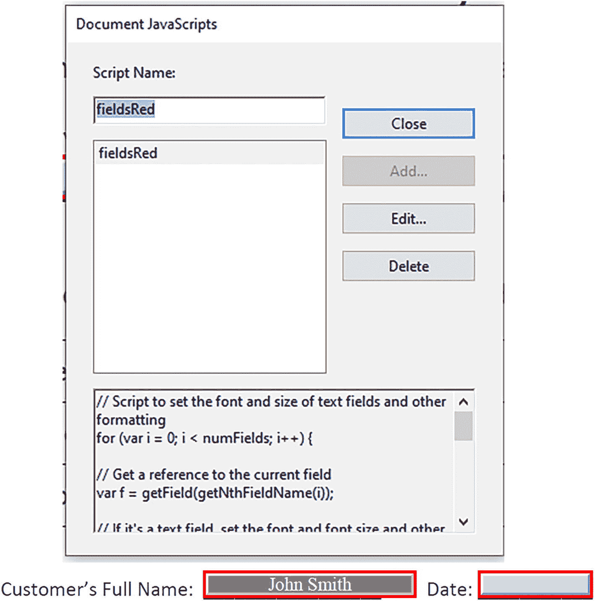

一个文档 JavaScript 的截图，显示了脚本名称“fields red”的详细信息，以及页面右侧的一个“关闭”选项卡。其中包含几行代码，用于设置文本字段的字体和大小以及其他格式，后面跟着字段，以及客户的全名“John Smith”和日期。

图 10-6

JavaScript 工具、“文档 JavaScript”对话框和字段

```
// Script to set the font and size of text fields and other formatting
for (var i = 0; i < numFields; i++) {
// Get a reference to the current field
var f = getField(getNthFieldName(i));
// If it's a text field, set the font and font size and other formatting
if (f.type == "text") {
//Field Fill
f.fillColor = color.gray;
f.strokeColor = color.red;
f.borderStyle = border.b;
f.lineWidth = 2;
//Fonts
f.textColor = color.white;
f.textFont = font.Times;
//f.fontFamily = ["Times","monospace"];
f.textSize = 14;
f.richText = true;
f.alignment = "center"
}
}
```

注：我们将在本章后面看到其他格式化示例，并解析 JavaScript 中的某些属性，包括什么是富文本格式。

## 多行按钮

您可能希望添加到表单中的另一种格式是使按钮的文本显示在两行或多行上。没有这种格式的按钮，当您在“选项”面板中输入标签时，文本通常只显示在一行上。没有自动的方法可以让文本分布在两行上，如图 10-7 所示。


一个包含文本“reset comments”的文本框截图。

图 10-7

一个文本显示在一行上的重置按钮

这个按钮会变得越来越长。一个办法是让文本变小。不幸的是，这样文本会变得难以阅读。您可以创建一个图标图形，但如果需要快速更改文本，文本将无法编辑。请参考图 10-8，查看文件`TMC_Customer Survey_Start_Part2_global.pdf`中按钮`MyButton`的当前属性。

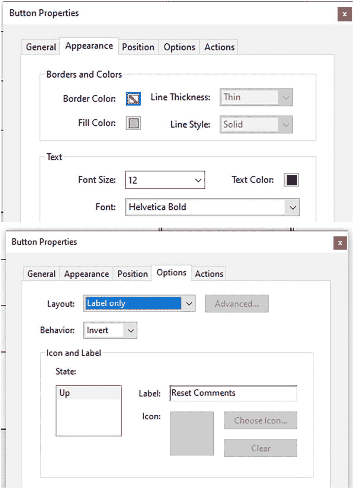

按钮属性的 2 个截图。1 中“外观”选项卡已展开，包含边框和颜色的详细信息，以及文本（包括颜色、粗细、样式、大小和字体）。2 中“选项”选项卡已展开，包含布局和行为的下拉菜单，以及图标和标签的详细信息。

图 10-8

“按钮属性”对话框的“外观”和“选项”选项卡，显示标签“Reset Comments”

JavaScript 再次提供了一个解决方案。请参考图 10-9 和文件`TMC_Customer Survey_End_Part2_global.pdf`。

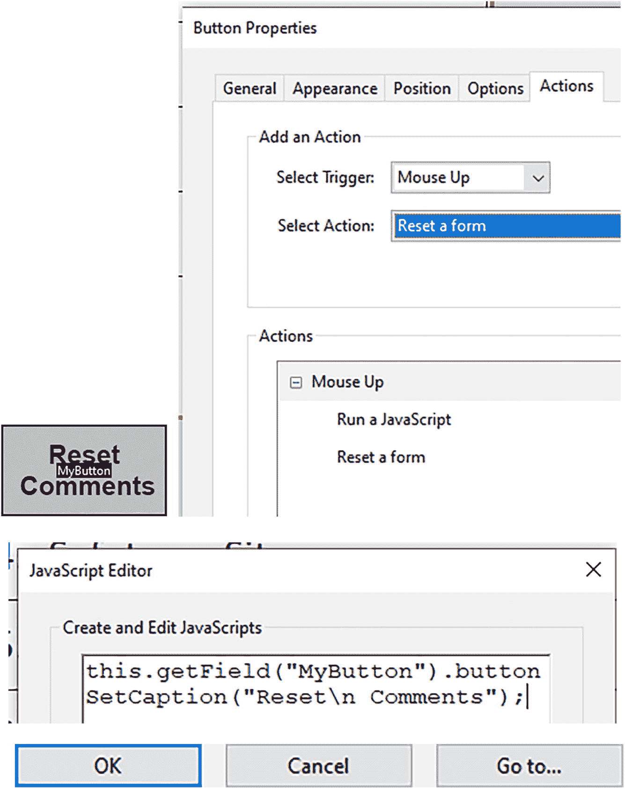

一个截图显示按钮属性，其中“动作”选项卡已展开。它有一个用于选择触发器和动作的下拉菜单，后面跟着一个动作列表和一个用于重置注释的文本框。它有一个用于 JavaScript 编辑器的弹出窗口，其中包含一组 2 行代码，用于创建和编辑 JavaScript 脚本。

图 10-9

运行 JavaScript 以使按钮上的文本变为多行

除了使用“重置表单”动作来重置注释字段之外，这还为按钮添加了一个 JavaScript 脚本，在“鼠标释放”触发器上执行。

以下是编辑器中的代码：

```
this.getField("MyButton").buttonSetCaption("Reset\n Comments");
```

只需这一行代码就能实现您所需的功能。在“常规”选项卡中调用按钮的名称`MyButton`，并告诉它您希望设置一个与“选项”选项卡上标签相同的标题。要将单词分成两行，请使用不可见字符`\n`。它的另一个名称是元字符。基本上，这意味着换行，因此单词*Comments*会移到第二行。当按钮需要多行文本时，这非常方便。

注：您可能已经注意到，在第 9 章中创建警告框并需要换行时，您使用了元字符`\n`。在第 11 章中，您将了解一些正则表达式，其中元字符可以与其他模式结合使用。

## 多行文本

按钮并非唯一需要多行输入的字段。需要大量文本的字段（例如评论）也可以设置为多行。如果你已经掌握了表单基础知识，就会知道只需在“选项”选项卡中选中多行复选框，即可将文本字段设为多行。请参见图 10-10 示例。

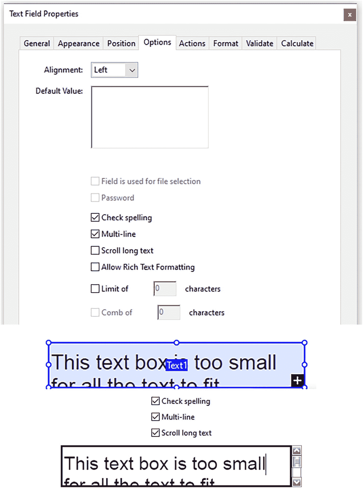

文本字段属性截图，其中展开了“选项”选项卡。该选项卡包含一个用于对齐方式的下拉菜单，以及用于拼写检查和多行功能的复选框。下方有两个很小的文本框（此文本框文字过小），其后是三个复选框，分别用于拼写检查、多行和滚动长文本。

图 10-10

在“选项”选项卡中，选中“多行”复选框，以便输入更多文本，然后勾选“滚动长文本”以获得滚动框。

创建文本评论字段时，一旦字段被填满，其末尾会出现一个加号符号。请参见图 10-10。

对于评论，如果你希望在电脑上阅读，可以勾选“滚动长文本”复选框。

虽然这便于在电脑上阅读，但打印时，你可能看不到框内包含的全部文本。

遗憾的是，Acrobat 没有可扩展的文本字段框。如果你的表单要求客户撰写冗长的陈述，而页面末尾的空间又很小，这就会成为一个问题。

以下是解决方法：创建第二页，并允许文本流入第二个评论文本字段。

这次我们将不使用“操作”选项卡，而是在“格式”选项卡上添加自定义格式。请参见图 10-11。

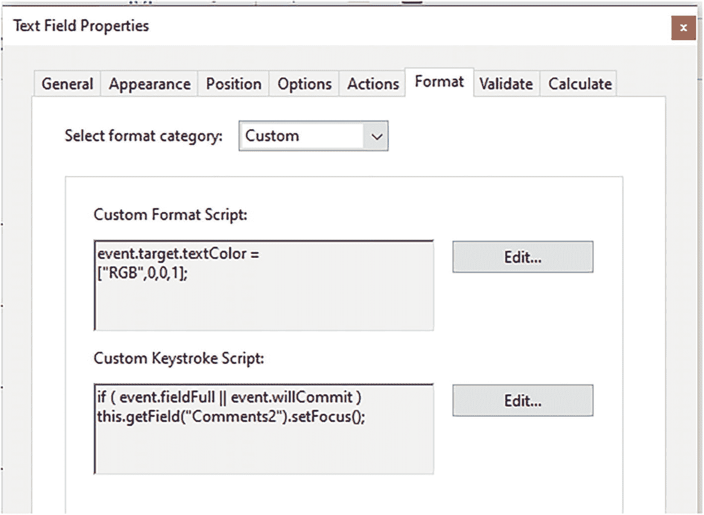

文本字段属性截图，其中“格式”选项卡被高亮显示。该选项卡包含一个用于选择格式类别的下拉菜单，以及两个框，分别用于自定义格式脚本和自定义按键脚本。每个框在页面右侧都有一个“编辑”选项卡。

图 10-11

已应用的“自定义按键脚本”设置

你可以在文件 `TMC_Customer Survey_End_Part2_global.pdf` 中查看示例。

在第 1 页的第一个字段 `Comments1` 中（该字段已在“选项”选项卡中启用了“检查拼写”和“多行”功能，但禁用了“滚动长文本”，图 10-10），我将以下代码放入“格式”选项卡（图 10-11）：

**自定义格式脚本**

```
event.target.textColor = ["RGB",0,0,1];
```

我本不需要编写这行代码，但我想展示如何调整文本颜色，正如之前在帮助文本示例中看到的那样。我希望此 `textColor` 与其他字段不同。因为我仅针对这一个字段，所以原本也可以直接在“外观”选项卡中设置。请参见图 10-12。

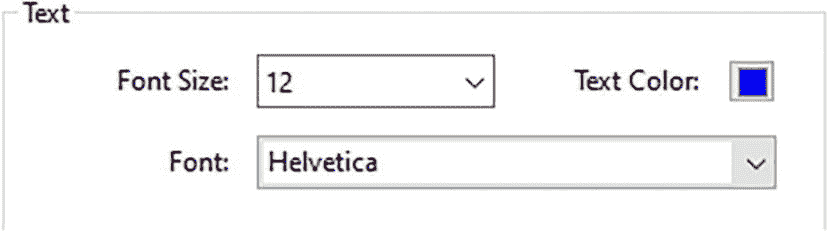

文本选项卡截图，其中包含一个字号下拉菜单（已选 12）、一个文本颜色框（已选蓝色），以及一个字体下拉菜单（已选 Helvetica）。

图 10-12

“外观”选项卡显示已设置的字号、文本颜色和字体

然而，在本章稍后部分以及第 11 章中，你将看到更复杂的示例，在这些示例中，这并非总是理想的做法；那时，使用 JavaScript 设置格式颜色会是更好的选择。

**自定义按键脚本**

```
if ( event.fieldFull || event.willCommit )
this.getField("Comments2").setFocus();
```

此代码允许用户在字段中输入。当脚本检测到文本字段已满或即将提交时，它会将焦点移至名为 `Comments2` 的下一个文本框字段。`willCommit` 用于在数据提交前验证当前的按键事件。请参阅 [`opensource.adobe.com/dc-acrobat-sdk-docs/library/jsapiref/JS_API_AcroJS.html#willcommit`](https://opensource.adobe.com/dc-acrobat-sdk-docs/library/jsapiref/JS_API_AcroJS.html#willcommit)。

这里，正如在第 6 章中一样，我们再次看到了 `setFocus()` 的另一种用途——这次是将焦点移动到一个新字段。

如果出于某种原因需要第三个框，你可以在 `Comments2` 框的“格式自定义按键脚本”中添加以下代码行：

```
//第二框转到第三框（如需要）
var t2=this.getField("Comments2");
if (event.fieldFull)
{
this.getField("Comments3").setFocus();
}
```

此示例中的变量 `t2` 是可选的，因为我们是在 `Comments2` 字段（或者说在此“事件”中）操作，但在处理多个字段时，你可能希望引用该变量以跟踪当前所在的字段，或者只是添加注释（`//`）。

最后一个字段 `Comments3` 不需要任何 JavaScript，其“格式”选项卡可设置为“无”。请参见图 10-13。

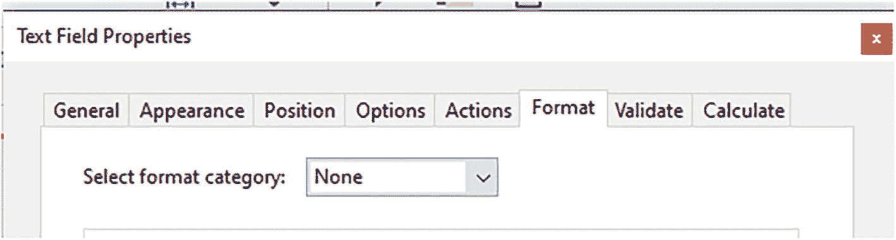

文本字段属性页面截图，包含常规、外观、位置、选项、操作、格式、验证和计算等选项卡，其中“格式”选项卡被高亮显示。该选项卡有一个用于选择格式类别的下拉菜单，目前选中的是“无”。

图 10-13

在“格式”选项卡中，类别被设置为“无”

然后，你可以在“操作”选项卡上修改“重置评论”按钮，使其重置全部三个字段。

此示例是一个很好的变通方案。但需注意：这种流转方法仅适用于直接向字段中键入内容。我发现粘贴文本并不总能自动流入第二个及后续的框中。在其他情况下，你可能更希望客户在评论（便签）中键入内容，然后稍后单独打印该评论。

## 使用复选框和文本字段实现复杂格式

在图 10-14 中，您可以看到如何使用复选框进行加减评分。与单选按钮一样，这无需 JavaScript 即可实现。请参阅文件 `TMC_Customer Survey_End_Part2b.pdf` 的第 1 页。

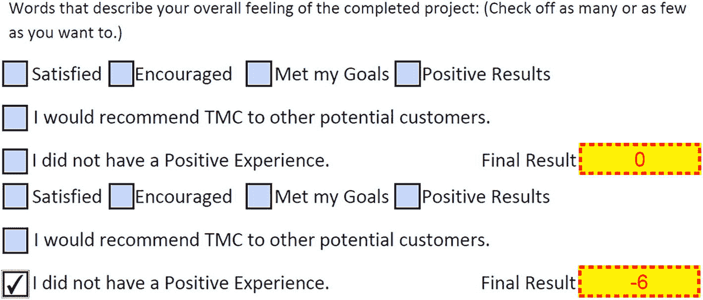

一个页面截图显示了 12 个用于描述已完成项目整体感受的复选框。其中一个已选中的选项写着：“我没有获得积极的体验”。右侧有两个高亮显示的最终结果框，一个值为 0，另一个值为 -6。

**图 10-14** – 根据评分改变选框字体样式和颜色的调查表

您需要做的只是在“选项”选项卡中为复选框赋予正值或负值。请参考图 10-15。

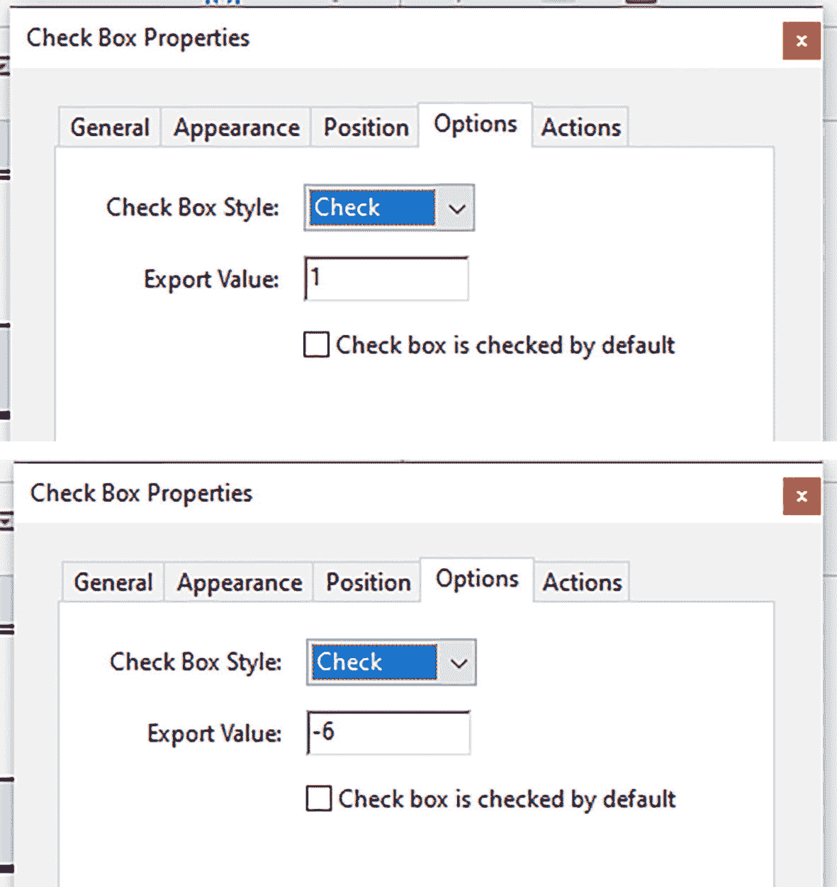

两张复选框属性页面的截图显示有“常规”、“外观”、“位置”、“选项”和“操作”选项卡。图 1 和图 2 中，“选项”选项卡被高亮显示，其中包含复选框样式的下拉菜单和导出值的输入框，第一个的导出值为 1，第二个为 -6。

**图 10-15** – “选项”选项卡中设置为正负导出值的复选框属性

在文本字段 `Final Result_4` 的“计算”选项卡中，您可以使用求和（`+`）值将它们全部相加。请参考图 10-16。

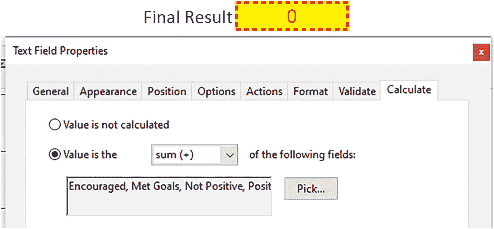

一个页面截图显示了一个值为 0 的最终结果文本框。还有一个文本字段属性窗口，其中有 8 个选项卡，“计算”选项卡被高亮显示。窗口中有两个选项，其中第二个“值”选项被选中，表示将某些字段的值进行求和。

**图 10-16** – 在“文本字段属性”窗口的“计算”选项卡中将值设置为求和（`+`）

然而，有时您可能需要提醒自己评分即将变为负数。

您可以先在“外观”选项卡上设置选框字段和文本的格式，而无需使用 JavaScript。但遗憾的是，如果数值从正数变为负数，其外观不会自动改变，除非您在“验证”选项卡部分添加条件脚本。请参考图 10-17。

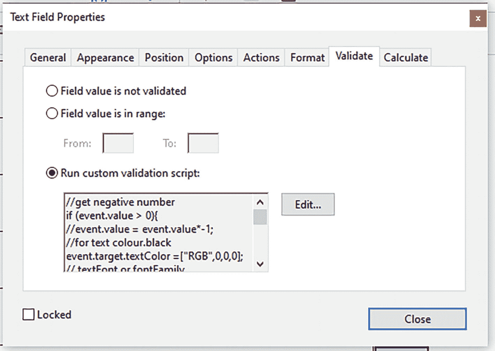

一个文本字段属性页面的截图显示有“常规”、“外观”、“位置”、“选项”、“操作”、“格式”、“验证”和“计算”选项卡，其中“验证”选项卡被高亮显示。窗口中有两个关于字段值验证和范围的选项，以及几行用于自定义验证脚本的代码。

**图 10-17** – 带有自定义验证脚本的“验证”选项卡

以下为代码：

```
//get negative number
if (event.value > 0){
//for text color.black
event.target.textColor =["RGB",0,0,0];
// textFont
event.target.textFont = font.Times;
//Size
event.target.textSize = 11;
//for field color.none
event.target.strokeColor = ["T"];
event.target.fillColor = color.transparent;
//left, center, right
event.target.alignment ="left";
}
else{
event.target.textColor = ["RGB",1,0,0];
// textFont
event.target.textFont = font.Helv;
//Size
event.target.textSize = 14;
//for field color.red
event.target.strokeColor = ["RGB",1,0,0];
//fill of field
event.target.fillColor = color.yellow;
// Borders 0=none, 1=thin, 2=medium, 3 = thick
event.target.lineWidth = 2;
// Border Style border.s= solid, border.b= beveled, border.d = dashed, border.i = inset, border.u = underline
event.target.borderStyle = border.d;
//left, center, right
event.target.alignment ="center";
}
```

虽然这乍一看可能很复杂，但实际上并非如此。您只是在数值变化时更改格式。请参考图 10-18。


一个页面截图显示有文字“最终结果 1”，随后是一个值为 -6 的最终结果框。该框带有虚线边框，且文字高亮显示。

**图 10-18** – 文本和字段格式根据数值变化

# 以下是简化的分解代码

```
if (event.value > 0){
// Change my formatting
}
else {
//Change my formatting to something else
}
```

当数值大于（`>`）0 时，请将字体、颜色和字段的格式更改为定义的样式。当数值小于（`<`）0 时，则将其更改为其他定义的样式。

在文本字段中可能受影响的格式属性及其示例如下：

## 填充颜色或 `fillColor`
字段的填充色

```
event.target.fillColor = color.transparent;
event.target.fillColor = color.yellow;
```

## 描边颜色或 `strokeColor`
字段的描边

```
event.target.strokeColor = ["T"]; // transparent
event.target.strokeColor = ["RGB",1,0,0]; // red
```

## 边框宽度或 `lineWidth`
字段的边框宽度

```
// Borders 0=none, 1=thin, 2=medium, 3 = thick
event.target.lineWidth =2;
```

## 边框样式或 `borderStyle`
字段的边框样式

```
// Border Style border.s= solid, border.b= beveled, border.d = dashed, border.i = inset, border.u = underline
event.target.borderStyle = border.d;
```

对于文本，您可以随后设置以下属性。

## 文本颜色或 `textColor`
影响文本的颜色。您可以使用 `color.black` 或 `["RGB",0,0,0]`。

```
event.target.textColor = ["RGB",0,0,0];
event.target.textColor = ["RGB",1,0,0];
//this is a red color
```

## 文本字体或 `textFont`

```
event.target.textFont =font.Times;
event.target.textFont =font.Helv;
```

> **注意**：对于粗斜体、斜体或粗体字体样式，请使用如下方式：
>
> `event.target.textFont=font.TimesBI;` 或 `font.HelvBI;`
>
> `event.target.textFont=font.TimesI;` 或 `font.HelvI;`
>
> `event.target.textFont=font.TimesB;` 或 `font.HelvB;`
>
> 其他字体包括：`font.Times`（Times）、`font.Cour`（Courier）、`font.Symbol`（Symbol 字体）和 `font.ZapfD`（Zapf Dingbats 字体）。其中一些字体在名称末尾添加 B、I 或 BI 后，可呈现粗体、斜体或粗斜体样式。

同样，如果您知道确切的字体名称，也可以使用字体系列来获取该字体。例如，在富文本上下文中，您可以像下面这样编写代码，以便根据用户计算机上可用的字体来更改字体。在此示例中，一旦在文档 JavaScript 中键入代码，您必须在“选项”选项卡中选中“允许富文本格式”复选框，如图 10-19 所示。

```
f = this.getField("Text1");
style = f.defaultStyle;
// If Times is not found on the user's system, use a monospace font. The field must be set for Rich Text.
style.fontFamily = ["Times", "monospace" ];
f.defaultStyle = style;
```

## 文本大小或 `textSize`
更改文本大小

```
event.target.textSize = 11;
event.target.textSize = 14;
```

## 文本对齐或字段内的对齐方式

```
//left, center, right
event.target.alignment ="left";
event.target.alignment ="center";
```

您不必在一个字段中使用所有这些属性。但是，在使用`if/else`条件语句时，您需要确保在大多数情况下都有开或关状态（当`if`格式如此，则`else`格式如彼）。

请注意，您可以使用相同的代码来影响在文本框中输入值的单选按钮，就像我在使用字段 `Final Result_3` 时所做的那样。我只是稍微更改了颜色。请参阅文件 `TMC_Customer Survey_End_Part2b.pdf` 的第 1 页。

请记住，如果您像之前的示例中那样在 `for()` 循环中设置全局变量，则无需编写 `event.target`。相反，在创建变量后，您可以像这样直接应用属性：

```
f.alignment ="center";
```

## 文本字段与评论的富文本格式

还有其他格式，但这些都属于富格式范畴，即使你在文本字段中勾选了“富格式”，或者像下面这样通过 JavaScript 设置：

```
event.target.richText = true;
```

在使用某些 PDF 工具（例如注释或评论，但不包括没有额外脚本的表单字段）时，还可以使用以下一些其他格式：

### 字体系列或 `fontFamily`
可用于带有富文本的文本字段，但当你试图确保用户字体在所有电脑上都能像之前展示的那样相似显示时，它也可以用于一个数组（列出多种字体）。它还可以用于注释中的文本。

```
style.fontFamily = ["Times", "monospace"];
```

### 字体样式或 `fontStyle`
有两种样式：正常和斜体。

```
example[0].fontStyle = "italic";
```

### 字体拉伸或 `fontStretch`
有几种样式可供选择：正常（默认）、超压缩、极压缩、压缩、半压缩、半扩展、扩展、极扩展和超扩展。

```
example[0].fontStretch = "expanded";
```

### 字体粗细或 `fontWeight`
它替代了粗体字的作用。正常指 700 以下，粗体指 700 以上。可选值为 100、200、300、400、500、600、700、800 和 900。默认值为 400。它与字体拉伸结合使用时效果最好。

```
example[0].fontWeight = 400;
```

### `strikethrough`
在文字上画一条线。值可以是 true 或 false。

```
example[0].strikethrough = true;
example[0].strikethrough = false;
```

### `subscript`
文本被设置为下标，字号减小，基线降低。

```
example[0].subscript = true;
example[0].subscript = false;
```

### `superscript`
文本被设置为上标，字号减小，基线升高。

```
example[0].superscript = true;
example[0].superscript = false;
```

### `underline`
文本被添加下划线。

```
example[0].underline = true;
example[0].underline = false;
```

### `rotation`
用于旋转字段或字段内的文本方向。此属性不常用。在向客户展示前，请务必先在 Reader 中测试，因为它可能产生意想不到的结果。你可能使用的数值取决于旋转角度，如 0、45、90、180 或 270。在文本字段中，如果需要旋转一个字段，请使用“常规”选项卡中名为“方向”的设置。

```
event.target.rotation = 0;
event.target.rotation = 90;
```

然而，有一种方法可以通过在文本字段中添加少量额外代码和一个数组来解决这个富格式问题。

对于文本字段，你可以在文本字段的“选项”选项卡中设置“允许富文本格式”。请参考图 10-19。

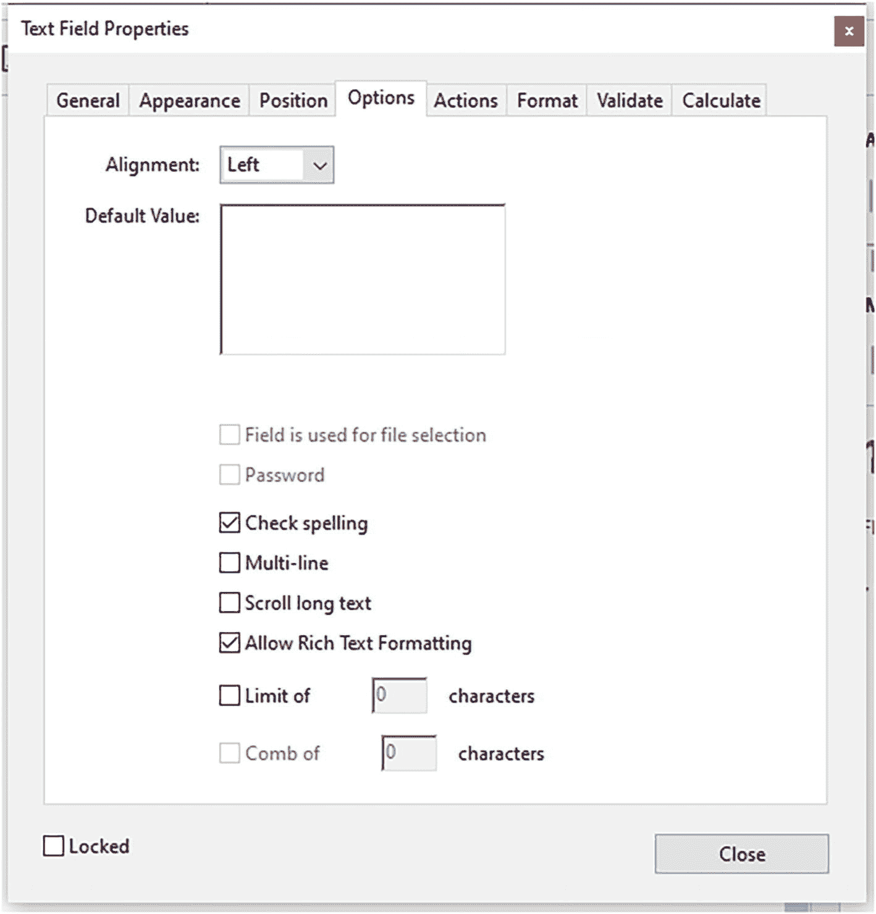

一张文本字段属性的截图，有 8 个选项卡，其中“选项”选项卡被高亮显示。它有一个用于对齐的下拉菜单、一个用于默认值的文本框，以及几个复选框，其中“拼写检查”和“富文本格式”已被选中。

图 10-19

使用“选项”选项卡设置允许富文本格式的选项

然后，在你的“格式”选项卡的“自定义格式脚本”字段中，添加以下 JavaScript 以获取丰富值。请参考图 10-20。

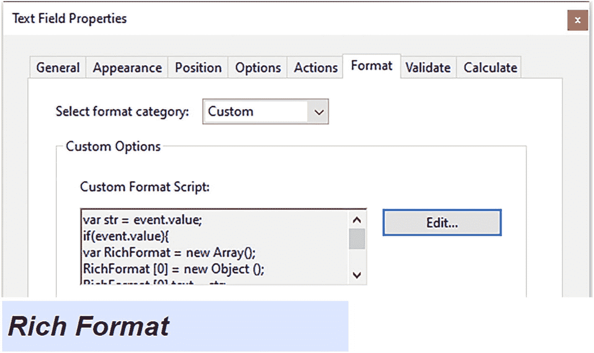

一张文本字段属性的截图，有常规、外观、位置、选项、动作、格式、验证和计算选项卡，其中“格式”选项卡被高亮显示。它有一个用于格式类别的下拉菜单，以及用于自定义格式脚本的选项，后面跟着一个包含文本和富格式的文本框。

图 10-20

使用“格式”选项卡进行富文本的自定义格式化

```
var str = event.value;
if(event.value){
var RichFormat = new Array();
RichFormat [0] = new Object();
RichFormat [0].text = str;
RichFormat [0].fontStyle = "italic";
event.richValue = RichFormat;
}
else{
event.value ="";
}
```

现在，你自己尝试将代码中的 `fontStyle` 替换为其他仅能通过富文本创建的选项，例如下划线（Underline）或删除线（Strike Through）。

或者，尝试通过向数组中添加元素来影响文本的某些部分。

```
var str = event.value;
if(event.value){
var RichFormat = new Array();
RichFormat [0] = new Object();
RichFormat [0].text = "$";
RichFormat [1] = new Object();
RichFormat [1].text = str + "$";
RichFormat [1].fontStyle = "italic";
event.richValue = RichFormat;
}
else{
event.value ="";
}
```

你可以参考我的示例文件 `Rich_Text_example.pdf` 和 `example2.pdf`。

### 评论示例

此时你可以回到第 8 章，处理评论和时间戳的示例。你在这里学到的大部分内容都可以应用到时间戳（它是一个文本字段）上，并且你可以回顾我在按钮的“动作”选项卡上使用的属性格式。请参考本章中名为 `Project_Comment_End_format2.pdf` 的示例文件。参见第 2 页。

然而，对于“动作”选项卡上按钮的评论或注释，你可以在鼠标松开触发器中更新以下“运行 JavaScript”代码，该代码将添加和更改默认图标，并为评论中预设的文本添加颜色、对齐方式以及一些富文本格式。

```
var annot = this.addAnnot({
page: this.pageNum,
type: "Text",
author: "John Smith",
point: [72,500],
popupRect: [72, 500,6*72,500-2*72],
popupOpen: true,
noteIcon: "Help",
strokeColor: color.yellow,
strokeFill: color.red
});
var spans = new Array();
spans[0] = new Object();
spans[0].text = "You're doing a great job!\r";
spans[0].textColor = color.blue;
spans[0].textSize = 18;
spans[0].textFont = font.Helv;
spans[0].alignment = "left";
spans[1] = new Object();
spans[1].text = "You have learned a lot!\r";
spans[1].textColor = color.red;
spans[1].textSize = 20;
spans[1].alignment = "center";
spans[2] = new Object();
spans[2].text = "This is the end of the comment.";
spans[2].textColor = color.green;
spans[2].fontStyle = "italic";
spans[2].underline = true;
spans[2].alignment = "right";
// Now give the rich field a rich value
annot.richContents = spans;
```

请参考图 10-21 了解它在评论窗格中的显示效果。文本中的代码 `\r` 用于将文本格式化为换行。请注意，绿色在某些背景上可能不太清晰易读，因此在使用彩色文本和与有色觉障碍（如色盲或视力受限）的客户打交道时，需要留意这一点。另请注意，评论在被移动或压缩后，有时右对齐的文本会恢复为左对齐。

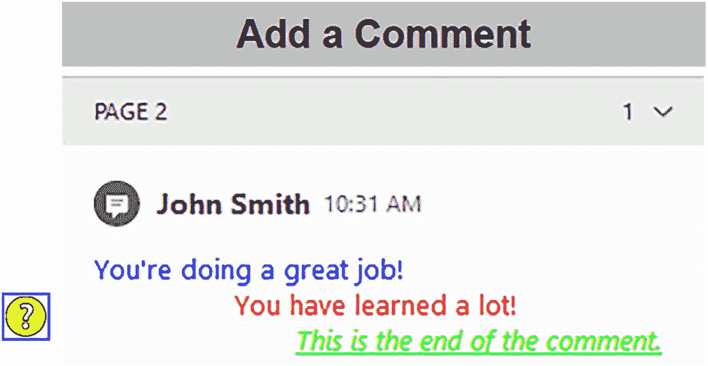

一张评论页面的截图，有一个带文本的框用于添加评论。它包含来自 John Smith 的 3 行不同颜色文本的评论，时间为 10 小时 31 分，内容为：你做得很好，你学了很多，以及一条带下划线的“这是评论的结尾”。

图 10-21

应用于评论的自定义格式

你可以在此处找到其他类似的注释示例：

[`https://opensource.adobe.com/dc-acrobat-sdk-docs/library/jsapiref/JS_API_AcroJS.html#annotation`](https://opensource.adobe.com/dc-acrobat-sdk-docs/library/jsapiref/JS_API_AcroJS.html#annotation)

#### 关于使用文本进行格式化的最终思考

作为使用 `textFont` 进行格式化的最后一点说明，编写下面这行代码的另一种方式是

```
event.target.textFont=font.Helv;
```

将实际名称放在引号中，就像这样：

```
event.target.textFont="Helvetica";
```

在这里，样式通过连字符添加：

```
event.target.textFont="Helvetica-Bold";
```

斜体的另一个名称是伪斜体（oblique），样式可以这样编写：

```
event.target.textFont="Helvetica-Oblique";
```

两种样式通常可以合并在一起：

```
event.target.textFont="Helvetica-BoldOblique";
```

对于不常见的名称，这里有更好的方法：

```
event.target.textFont="MinionPro-Regular";
```

以下代码可以让您访问不太传统的样式：

```
event.target.textFont="Arial-Black";
event.target.textFont="ArialNarrow";
```

并非所有样式都使用连字符。请参考您电脑的控制面板区域，并搜索 *字体* 以获取正确的字体名称。例如，`MinionPro-Italic` 写作为 `MinionPro-It`。当您双击字体进行预览并定位到预览框左上角的字体名称时，可以发现这一点。参考图 10-22。

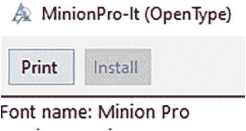

预览框的屏幕截图显示，顶部有 Minion Pro It、OpenType 字样，其左侧有一个字母 A 的字体。接着是“打印”和“安装”两个选项，其中“打印”选项被选中。页面底部有一行文字，显示为：字体名称，Minion Pro。

图 10-22

在代码中使用字体之前，请确切知道其名称

当您输入错误的名称时，将无法获得所需的字体或字体样式。同时，请注意您客户的电脑可能没有安装所有专用字体，因此请坚持使用安全的名称，例如 `Times`、`Courier`、`Arial` 或 `Helvetica`，以避免文本字段出现字体问题。

有关使用 `event.target` 的进一步讨论，请参考第 16 章。

## 静默打印

需要使用什么样的 JavaScript 才能通过表单中的 `Print` 按钮打印文档中的单个页面或页面范围？

参考图 10-23 来了解如何使用按钮打印文档中的所有页面。也请回顾第 2 章。

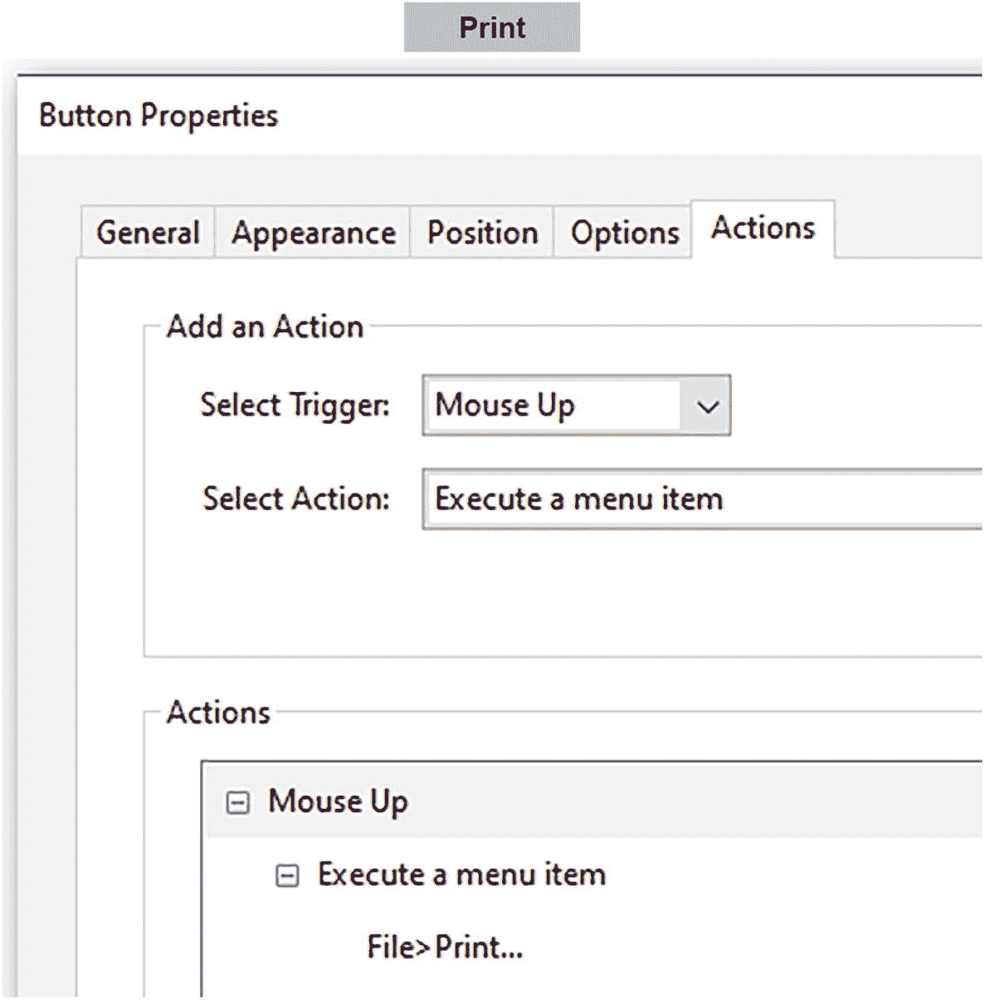

按钮属性页面的屏幕截图显示了 5 个选项卡：常规、外观、位置、选项和动作，其中“动作”选项卡被选中。它有一个“添加操作”区域，带有下拉菜单用于选择触发器和动作，下方是一个动作列表。

图 10-23

“动作”选项卡上的“执行菜单项”操作。选择 `文件` ➤ `打印` 以打印文档

关于此表单的另一个特性，即文件 `TMC_Customer Survey_End_Part2b.pdf` 中的静默打印。在大多数情况下，当您想在 Acrobat 中打印文档时，只需转到菜单并选择 `文件` ➤ `打印`。如第 2 章所示，您可以通过按钮和“动作”选项卡来完成。但是，此操作会打印整个文档，这可能不是您想要的结果。也许您只想打印表单页面本身，这可能是一页或一个页码范围。参考图 10-24。

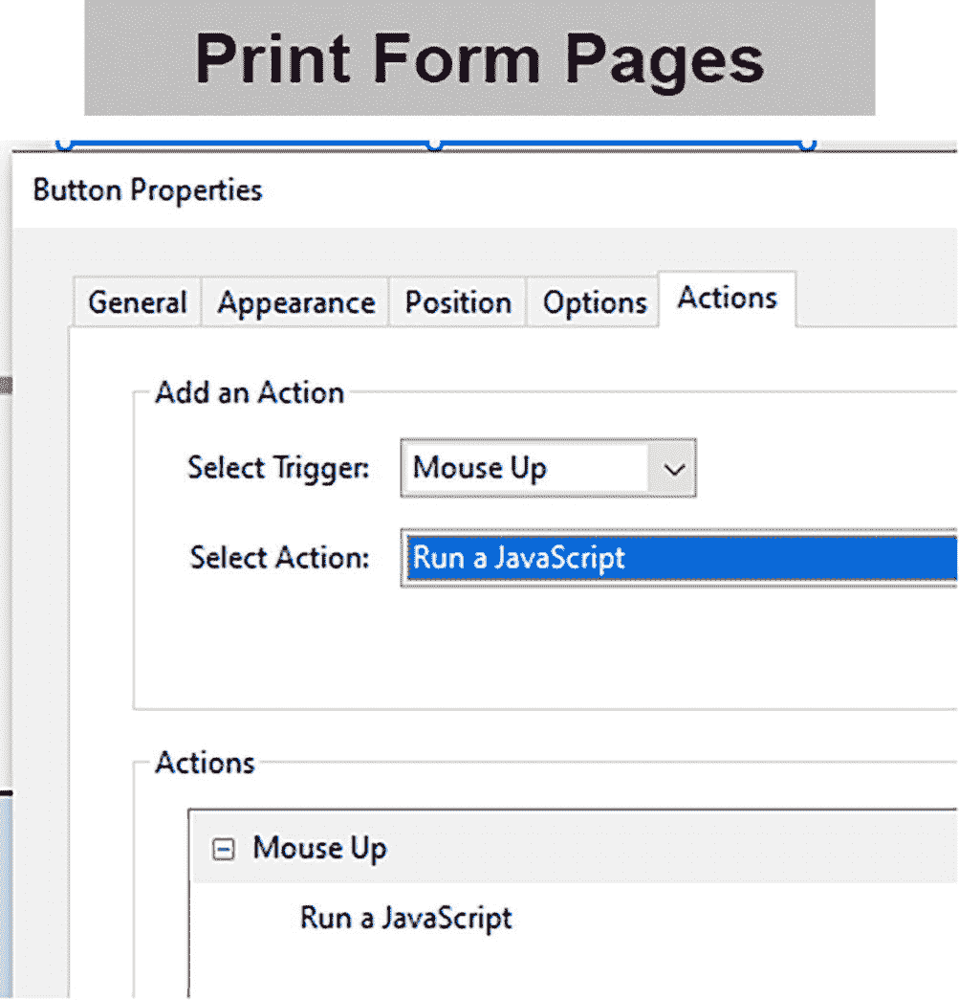

按钮属性页面的屏幕截图显示了 5 个选项卡：常规、外观、位置、选项和动作，其中“动作”选项卡被选中。它有一个“添加操作”区域，带有下拉菜单用于选择触发器和动作，其中“运行 JavaScript”操作被选中。

图 10-24

使用按钮和“动作”选项卡运行 JavaScript 以打印特定页面

以下是可以用来在按钮的“动作”选项卡上执行操作的代码：

```
// 静默打印当前页面
this.print(false, this.pageNum, this.pageNum);
```

当您将代码添加到按钮时，只有该按钮所在的页面会被打印。

如果用户收到如图 10-25 所示的消息，他们只需单击“是”按钮继续，或单击“否”取消打印。

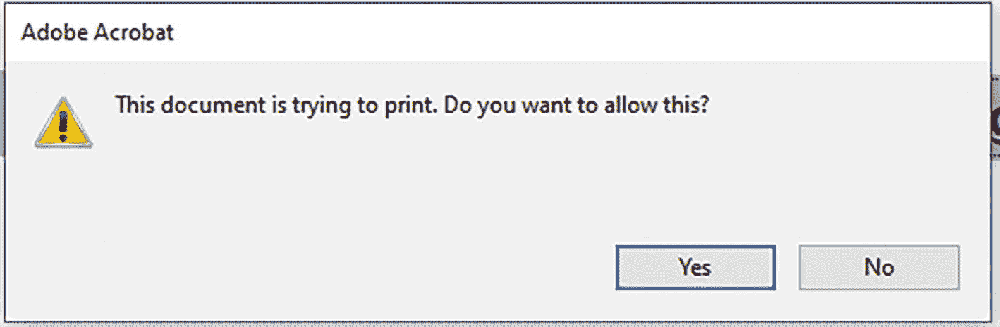

Adobe Acrobat 的一个消息窗口屏幕截图。它有一条警告消息，内容为“此文档正尝试打印，是否允许？”，后面跟着“是”和“否”两个选项，其中“是”被选中。

图 10-25

单击按钮时，Acrobat 弹出关于打印的警报消息

当您需要打印此表单页面及其下方的页面时，将代码更改为以下内容：

```
// 静默打印当前页面及其下方范围内的页面
this.print(false, this.pageNum, this.pageNum+1);
```

如果范围内的页面更多，则 `this.pageNum+1` 变为 `this.pageNum+2`，依此类推。只需确保按钮下方的当前页面数量与您设置的范围相匹配，否则当您尝试打印时会出错。

再次强调，这就像是一个数组：

```
this.pageNum (0) = 第 1 页
this.pageNum+1 = 第 2 页
this.pageNum+2 = 第 3 页
```

依此类推。

> **注意**
>
> 请注意，在使用此代码时，您的客户可能已将其默认打印机设置为 Adobe PDF。如果是这种情况，他们将被带到“将文件另存为 PDF”对话框，并能够将文件保存为 PDF，以便稍后使用 `文件` ➤ `打印` 打印。如果不是，他们将直接发送到打印机。另一种选择是将代码中的设置从 `false` 改为 `true`。这将允许打开 `打印` 对话框，用户便可以重置打印机并查看页码范围。

## 使用电子邮件提交按钮的选项

如果您或您的客户习惯使用 Adobe Acrobat 提交表单，本章讨论的最后一个主题是如何在 Acrobat 表单中添加用于电子邮件的提交按钮。请参考图 10-26。您可以在文件 `TMC_OrderForm_End_rollover_format_2.pdf` 中看到此按钮的示例。


一张带边框的突出显示按钮的截图。按钮内包含文字“提交”。

图 10-26

名为“提交”的发送电子邮件按钮

以下链接也将为您提供有关如何编写代码的进一步帮助。请参考“`mailDoc` 的 `Doc` 方法”部分。

[`https://opensource.adobe.com/dc-acrobat-sdk-docs/library/jsapiref/doc.html`](https://opensource.adobe.com/dc-acrobat-sdk-docs/library/jsapiref/doc.html)

我将仅指出此类按钮的基本起始代码。您也可以参考我的文件，但需要用自己的代码替换其中的某些行。

在本例中，对于提交按钮，您可以在“提交表单”对话框的“操作”选项卡上使用操作，而不是运行 JavaScript（本例中是在“鼠标释放”触发器上运行）。请参考图 10-27。

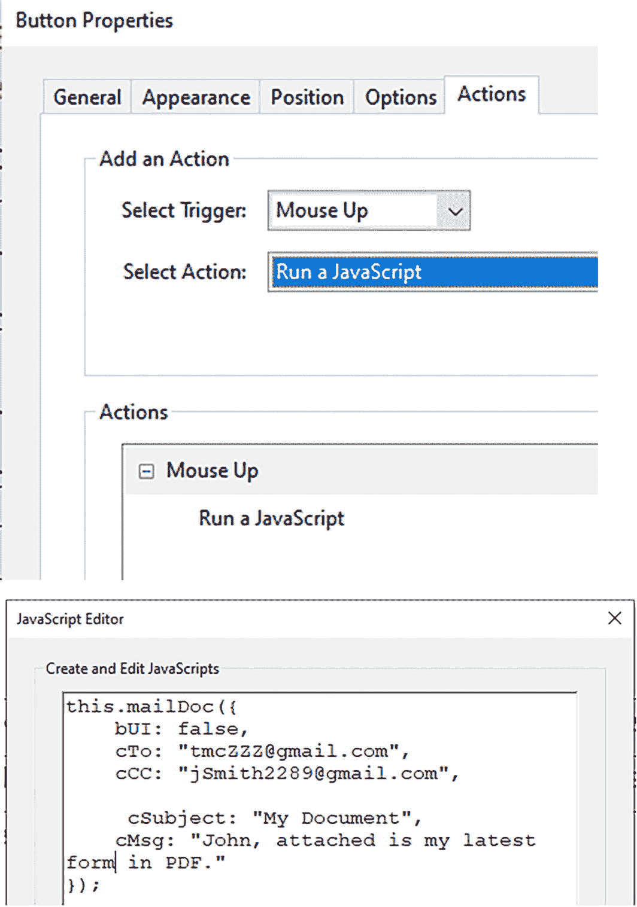

一张按钮属性对话框的截图，其中“操作”选项卡已被选中。它有一个“添加操作”的区域，带有下拉菜单用于选择触发器和操作，其中选择了“运行 JavaScript”操作。另外有一个 JavaScript 编辑器页面，其中包含几行用于创建和编辑 JavaScript 的代码。

图 10-27

按钮属性对话框的“操作”选项卡以及 JavaScript 编辑器中的代码

以下是 `this.mailDoc()` 的代码和消息窗口。在这种情况下，如果您要抄送某人，您需要编辑电子邮件地址，以及编辑主题行和消息内容。

```javascript
this.mailDoc({
bUI: false,
cTo: "tmcZZZ@gmail.com",
cCC: "JSmith2289@gmail.com",
cSubject: "我的文档",
cMsg: "John，附件是我最新的 PDF 表单。"
});
```

> **注意**
>
> 根据 Adobe 的说法，在 Windows 上，客户端计算机必须将其默认邮件程序配置为支持 MAPI 才能使用此方法。

然后，您需要单击“确定”关闭 JavaScript 编辑器，关闭“属性”对话框，并关闭“准备表单”工具。保存您的文件并测试按钮。

当用户单击“提交”按钮时，将弹出一个标题为“发送电子邮件”的对话框。请参考图 10-28。

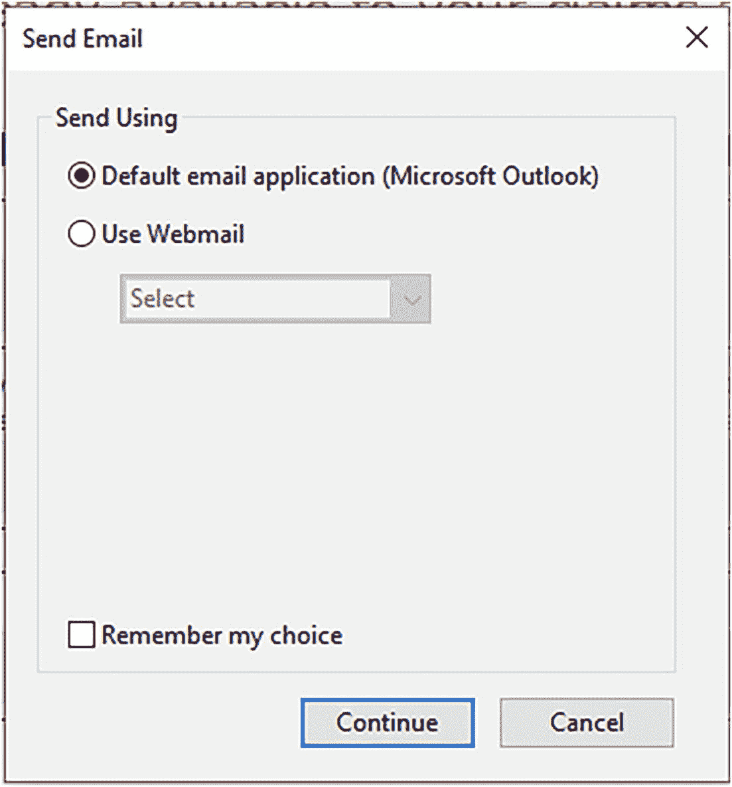

一张发送电子邮件页面的截图。它有两个发送选项：使用默认电子邮件应用程序或使用网络邮件，其中第一个选项被选中。有一个复选框用于记住选择。页面底部有“继续”和“取消”按钮，并且“继续”按钮被选中。

图 10-28

“发送电子邮件”对话框

然后，用户为“发送方式”设置选择电子邮件类型，可以是“默认电子邮件应用程序 (Microsoft Outlook)”，也可以是“使用网络邮件”，例如 Gmail 或用户可以设置并记住选择的其它账户。请参考图 10-29。

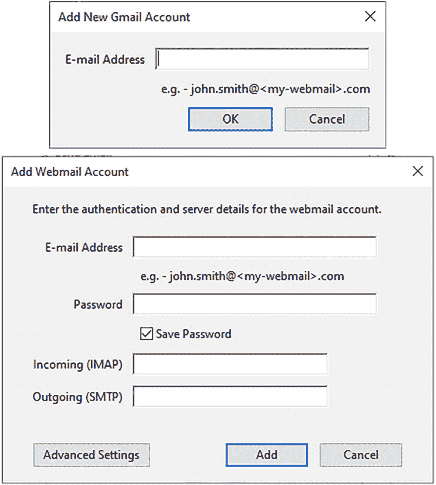

两张添加新 Gmail 账户和网络邮件账户页面的截图。第一张有一个输入电子邮件地址的框，后跟一个示例，以及一个“确定”按钮。第二张有用于输入电子邮件地址、密码、传入 IMAP、传出 SMTP 的框，以及一个“添加”按钮。

图 10-29

用户可以通过各种对话框选择并设置自己的网络账户

添加电子邮件地址并点击“继续”（图 10-28）后，如果是 Gmail 账户，Adobe Acrobat 会要求您登录您的账户，然后会在所选账户的指定草稿文件夹中创建一条消息。

对于 Microsoft，如果您的账户已设置好，用户将看到一条新消息，其中已附加了 PDF 文件，并且主题行和消息内容也已设置好。他们只需编辑消息并发送 PDF 文件即可。

请注意，如果文档中只需要少量签名，并非所有客户都愿意使用此流程提交表单。在这种情况下，使用 Adobe Sign 创建和分发用于电子签名的电子表单并要求在线签署可能更好。如果您同时处理多个客户且每个客户都需要相同的表单，这可能更高效。我们将在第 19 章和第 20 章中进一步讨论电子签名。

## 本章小结

如您所见，有许多有用的方法可以通过 JavaScript 自定义表单以满足您的需求。

- 自定义文本

- 字段

- 用于添加注释、打印和通过电子邮件发送表单的按钮

正如您在本章中所见，有许多选项可用于格式化表单字段和非表单项目。有时使用自定义格式，而其他时候“验证”选项卡是更好的选择。您可以全局添加 JavaScript 以影响多个字段，或使用“操作”选项卡仅影响单个字段。我建议在进入第三部分之前花些时间回顾本章。将其中一些 JavaScript 添加到您自己的表单中，并发现富文本如何改变您的字段以及注释。

在第二部分的大部分内容中，您主要学习了如何向文本字段、按钮和复选框添加 JavaScript。然而，正如您将在第三部分中看到的，一旦您开始向单选按钮、复选框、下拉列表和列表框添加 JavaScript，PDF 表单可能会变得复杂。