# 15. 操作向导与 JavaScript

第四部分包含一组额外的课程，我将其添加在书的末尾，面向那些更高级的 JavaScript 用户。

**本章目标：** 操作向导是 Adobe Acrobat Pro 中提供的另一个工具。借助它，你可以创建可以保存并随后在多个 PDF 文件中重复使用的任务或重复性操作（图 15-1）。

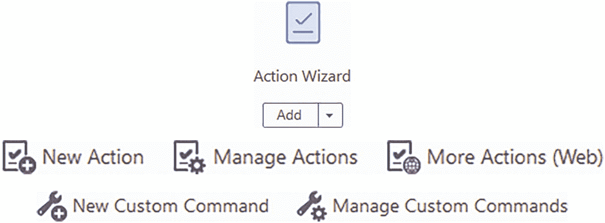

操作向导图标的截图，带有“添加”选项。下方包含子工具，例如新建动作、管理动作、更多动作 Web、新建自定义命令和管理自定义命令。

图 15-1

这些是您可以在“操作向导”工具菜单中找到的子工具

## 使用动作向导

动作向导已预置了一些可用动作。然而，当您点击左上角的“新建动作”按钮时，会弹出“创建新动作”对话框，您可以通过从可用工具列表中选择一个工具来创建新动作，这些工具与您在“表单属性”对话框的“动作”选项卡中看到的类似。并且与该选项卡一样，当您从“转到”或“更多工具”部分选择`执行 JavaScript` 或`文档 JavaScript`时，可以创建 JavaScript 动作。

**注意**

如果您想跟随本课内容进行操作，或查看最终结果，请从引言中的链接下载第 15 章的文档。您将找到一个包含原始脚本和`.sequ`文件的文件夹，如果您想将它们添加到自己的动作向导文件中，可以参考这些文件，稍后我会解释如何在管理动作时进行导入。对于这些示例，您可以使用我的两个代码略有不同的文件，命名为 `Watermark - Without PDF Extension.sequ` 和 `New Watermark-Without PDF Exentsion.sequ`，或者根据本章说明自行构建。

让我们来看一个示例。以下是如何在 Acrobat Pro 的 Acrobat 向导中自动添加 PDF 文件名称的方法：

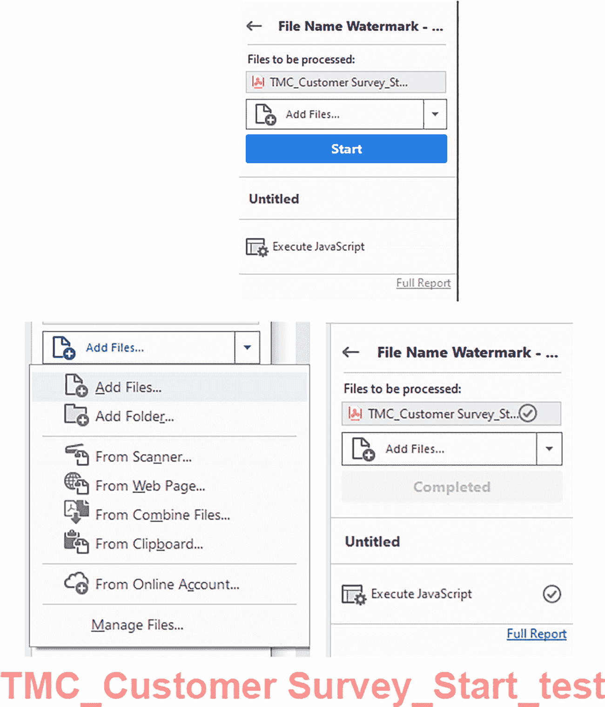

一个包含两个文件名称水印字段的截图，文件标题为“T M C 客户调查”，分别带有“添加文件”、“执行 JavaScript”选项以及“开始”或“完成”按钮。它还包括左侧的“添加文件”下拉列表，其中“添加文件”选项处于高亮状态。

**图 15-11** — 动作向导为文件添加水印

1.  打开您要应用此动作的文件（`文件` ➤ `打开`）。

2.  选择`工具` ➤ `动作向导` ➤ `新建动作`，如图 15-2 所示。

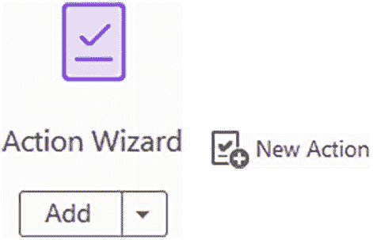

一个动作向导图标的截图，旁边有“添加”选项和“新建动作”工具。

**图 15-2** — 选择`动作向导` ➤ `新建动作`以开始项目

3.  选择`更多工具` ➤ `执行 JavaScript`。请参考图 15-3 和图 15-4。

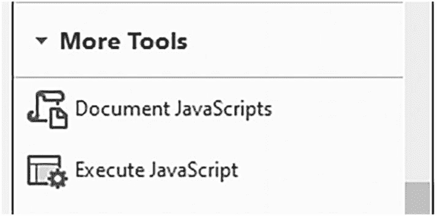

一个“更多工具”下拉列表的截图，包含“文档 JavaScript”和“执行 JavaScript”。

**图 15-4** — 选择`更多工具` ➤ `执行 JavaScript`

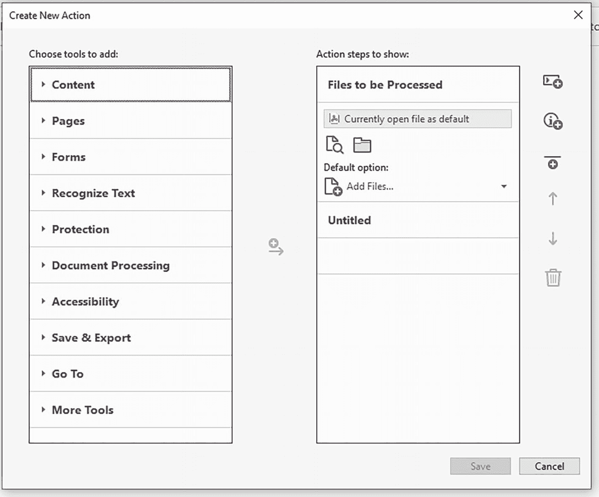

一个“创建新动作”窗口的截图，其中包含要添加的工具和要显示的动作步骤。“工具”下拉列表已选中内容，而“动作步骤”则列出了要处理的文件，当前打开的是 PDF 文件并使用默认选项。

**图 15-3** — “创建新动作”对话框中的众多选项

4.  点击`添加到右侧窗格`按钮，将该工具移至“要显示的动作步骤”一侧。请参考图 15-5。

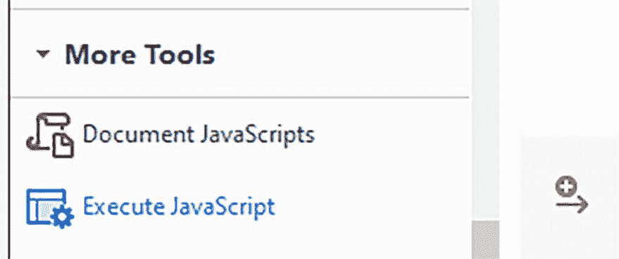

一个“更多工具”下拉列表的截图，包含“文档 JavaScript”和处于高亮状态的“执行 JavaScript”。

**图 15-5** — 选中的动作和`添加到右侧窗格`按钮

**注意：** 对于包含多个工具的更复杂动作，操作时您可以使用对话框最右侧的其他按钮图标（图 15-3）来添加面板、添加指令、添加分隔符、在列表中上移或下移某个动作，和/或从动作中移除选定项目。

5.  一旦`执行 JavaScript`选项位于右侧，双击`指定的设置`进入 JavaScript 编辑器。请注意，`提示用户`复选框应保持选中状态。请参考图 15-6。

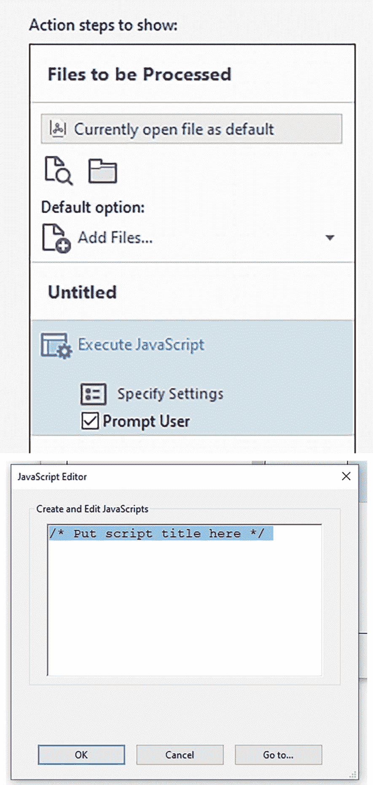

一个“要显示的动作步骤”截图，包含当前打开的文件、默认选项和处于高亮状态的“执行 JavaScript”。它还包括 JavaScript 编辑器对话框，其中有“创建和编辑 JavaScript”字段，以及一个高亮显示的“确定”按钮。

**图 15-6** — 打开“指定的设置”后进入 JavaScript 编辑器

JavaScript 编辑器随之出现，允许您开始输入代码。

6.  输入以下代码：

```javascript
    /* 我的脚本部分缺失，请查看我的高亮注释 */
    this.addWatermarkFromText({
    cText: this.documentFileName.replace(/\.pdf$/i,""),
    nFontSize: 12,
    cFont: "Arial,Bold",
    aColor: color.red,
    nOpacity: 0.4,
    nVertAlign: app.constants.align.bottom,
    nHorizAlign:app.constants.align.left,
    nVertValue: 18
    });
```

此脚本使用了您在第 11 章见过的正则表达式。您正在删除或替换文件名的`.pdf`扩展名为空白。`/i` 作为修饰符用于不区分大小写的匹配，然后使用 `.replace` 方法将 `.pdf` 设为空白。您还要求脚本将此文件的名称添加到页面左下角，字号为 12，垂直数值或位置为 18。同时将字体设置为红色，不透明度为 40%。在此情况下，1 等于 100%，0.1 等于 10%。如果您只希望文本默认为黑色，可以移除 `aColor` 和 `nOpacity` 这两行。

彩色的版本应类似图 15-11 所示，但具体取决于您如何命名文件。

有关正则表达式的更多信息，请访问以下页面：

[`www.w3schools.com/jsref/jsref_obj_regexp.asp`](http://www.w3schools.com/jsref/jsref_obj_regexp.asp)

[`https://developer.mozilla.org/en-US/docs/Web/JavaScript/Guide/Regular_Expressions`](https://developer.mozilla.org/en-US/docs/Web/JavaScript/Guide/Regular_Expressions)

**注意：** 如果您希望在水印末尾保留 `.pdf`，请移除命令 `.replace(/\.pdf$/i, "")`，仅保留 `cText: this.documentFileName`。

正则表达式的另一种写法是 `this.documentFileName.replace(/\.[^/.]+$/, ""),`。

这使用了元字符和量词，用于搜索字符串的开头并匹配结尾。这将匹配不以 `.pdf` 结尾的其他文件扩展名。例如，如果意图是先定位 Word `.doc` 文件，将其转换为 PDF，然后再添加水印，则此命令可以作为动作的一部分。这样，更多的文件扩展名（包括 Excel 和某些图形文件）就可以成为动作的一部分。不过，在之前的示例中，我将其设置为仅针对 PDF 的特定文件扩展名，但扩展名可以是小写或大写字母。

对于水印，您可以进一步控制对齐方式。

`nVertAlign: app.constants.align`。可以为 `top`（顶部）、`center`（居中）或 `bottom`（底部）。

`nHorizAlign:app.constants.align`。可以为 `left`（左）、`center`（中）或 `right`（右）。

您还可以使用 `nHorizValue` 和 `nVertValue` 来调整水印在页面上的位置。

`nHorizValue: -50, nVertValue: -50`

更多示例，请参考以下链接：

[`https://opensource.adobe.com/dc-acrobat-sdk-docs/library/jsapiref/doc.html?highlight=addwatermarkfromtext#addwatermarkfromtext`](https://opensource.adobe.com/dc-acrobat-sdk-docs/library/jsapiref/doc.html?highlight=addwatermarkfromtext#addwatermarkfromtext)

7.  点击`确定`按钮关闭 JavaScript 编辑器。

## 8. 保存动作

现在点击对话框中的`保存`按钮。请参考图 15-7。


**图 15-7** — 允许您保存动作的“保存”按钮

## 9. 命名与描述动作

当“保存动作”对话框打开时，在`动作名称`框中为动作命名，并在“保存动作”对话框中输入描述。请参考图 15-8。

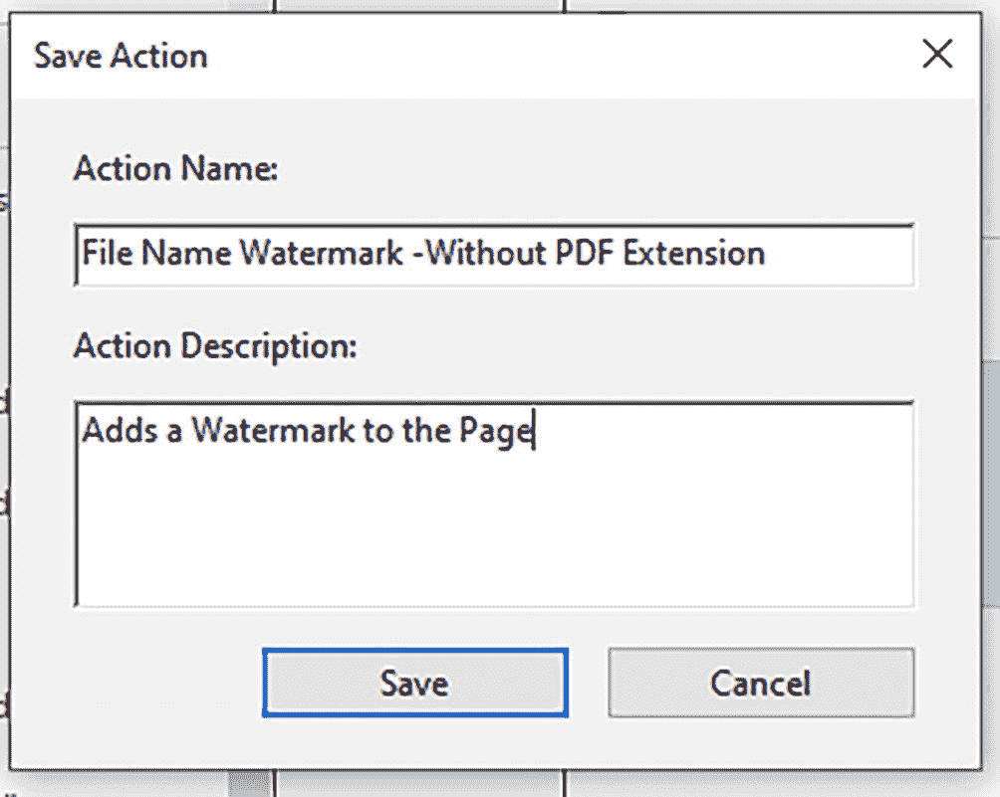

**图 15-8** 为操作添加名称和描述

## 10. 添加动作到列表

点击`保存`，该操作将添加到右侧的“操作列表”中。请参考图 15-9。

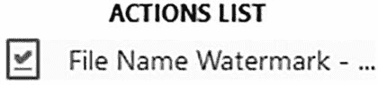

**图 15-9** 操作已添加到“操作列表”区域

如果你希望调整/编辑或删除此操作，可以在“管理操作”对话框中进行。请参考图 15-10。

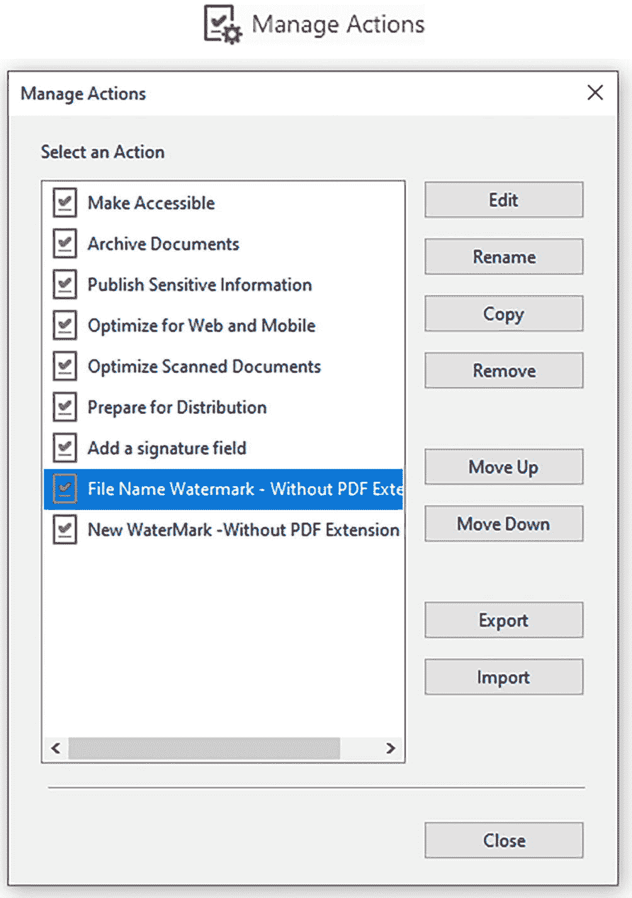

**图 15-10** “管理操作”工具及对话框

通过选择该操作并点击`编辑`，你可以在测试时发现错误后修改该操作。此区域的其他选项允许你重命名、复制和删除操作。但请注意，删除操作时要小心，不要误删了以后可能需要的自定义操作，因为无法撤销。值得庆幸的是，默认操作无法被删除或编辑，因为选中这些操作时，相关按钮会处于禁用状态。你还可以在列表中上下移动操作位置，以及将操作作为`.sequ`文件导出或导入，以便与他人共享操作文件，或将其备份到计算机上的某个文件夹中。现在，你可以先关闭此对话框。

## 11. 执行操作

要执行操作，请点击右侧窗格中的操作。此时你可以添加多个文件，或从下拉列表中选择其他选项。然后点击`开始`，接着当编辑器出现时，你便有机会编辑该操作。再点击`确定`，它会将文本添加到文件底部。如果你对结果满意，可将文件保存到新位置。请参考图 15-11。

如果你不希望文件名中包含下划线，请确保文件名中不含下划线。另外，如果你希望将“保存”作为操作的一部分，请自行查阅“保存与导出”工具部分。请参考图 15-3。我之所以省略此步骤，是为了让你能专注于脚本及对其进行测试。

请记住，如果你想与朋友和同事共享 JavaScript 操作，可以进行导入和导出。请参考图 15-10。这些操作保存为`.sequ`文件，本例中的文件也位于该文件夹中。你还可以通过点击“更多操作（网络）”按钮在网络上查找更多操作。请参考图 18-1，该图会将你引导至以下链接：

<https://acrobatusers.com/actions-exchange/>

### 复用第 8 章的 JavaScript

按照相同的步骤，你可以使用部分 JavaScript 代码来创建时间戳，并向多个文档添加签名字段。你可以参考我的文件 `Add a signature field.sequ` 作为示例。

```javascript
//Adding a signature field automatically
var c = this.addField({
cName: "clientSignature",
cFieldType: "signature",
nPageNum: this.pageNum,
oCoords: [35,74,176,112]
})
//script that creates the text field
{
var r = [200, 200, 400, 300];
var i = this.pageNum;
var f = this.addField(String("completeDate."+i),"text",i,r);
f.textSize = 10;
f.alignment = "right";
f.textColor = color.blue;
f.fillColor = color.transparent;
f.textfont = font.HelvB;
f.strokeColor = color.transparent;
f.value = String("This page was reviewed on: " + util.printd("mmm dd, yyyy", new Date()));
f.readonly = true;
}
```

> **注意**
>
> 你还可以在“更多工具”区域访问文档 JavaScript。请参考图 15-12。但是，请记得也要查看“转到”部分，因为那里有一些相关操作，包括“准备表单”、“JavaScript”以及其他用于电子签名的新工具，我们将在第 20 章中重点介绍这些工具。

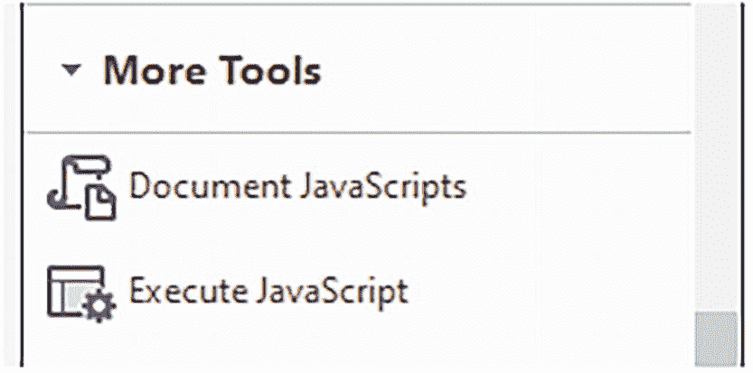

**图 15-12** JavaScript 选项

## 是自定义操作还是自定义命令？

在操作向导中，图 15-13 中的自定义命令是单步操作，适用于当前文档；而我们之前讨论的操作则是多步序列，适用于多个文件。请参考图 15-14。

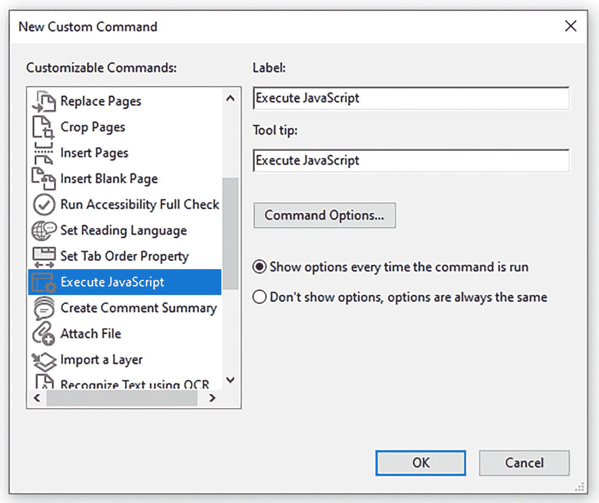

**图 15-14** “新建自定义命令”对话框


**图 15-13** 操作与命令选项

### 创建和管理自定义命令

自定义命令允许你预先配置命令（例如水印、页眉或页脚），以减少每次设置命令所需的时间。这可以节省重复性任务的时间。在本例中，如果你执行 JavaScript，在点击“命令选项”按钮并选择“每次运行命令时显示选项”或“不显示选项，选项始终相同”时，即可插入代码。然后，在添加标签和工具提示后，点击`确定`。

命令在“管理自定义命令”按钮下以 XML 格式导入或导出；它们与操作具有相似的管理选项。

操作和命令都可以使用 JavaScript。

有关操作向导和命令的更多信息，请访问以下链接：

<https://helpx.adobe.com/acrobat/using/action-wizard-acrobat-pro.html>

## 总结

在本章中，你了解了一种称为“操作向导”的工具。这个多功能工具允许你在多个文档中应用 JavaScript 操作，从而节省时间。你还可以与其他 Acrobat Pro 用户共享这些操作或命令，他们也可以使用该代码。请花点时间，使用你的操作向导工具向 PDF 文档添加一些新操作。
