# 第 12 章：使用下拉列表

到目前为止，你已经了解了如何使用 JavaScript 改进文本框、按钮、单选按钮和复选框。然而，还有其他类型的字段也可以实现动态效果。

**本章目标：** 你将学习如何将 JavaScript 与下拉列表（也称为*组合框*）结合使用，从而确保信息被准确输入或计算，避免客户输入错误信息。

> **注意：** 如果你想在本课中同步操作或查看最终结果，请从引言中的链接下载第 12 章 的文件。标有"Start"的文件是未包含代码的初始文件，标有"End"的文件是最终结果。你还会找到包含原始 MS Word 和 PDF 文件的文件夹（如果你想编辑它们），以及一个包含原始脚本的文件夹（如果你想将它们添加到自己的 PDF 表单中）。

如果你是从原始的 PDF 文件创建表单，请参考第 1 章中的"表单审查"部分。

请记住，要查看字段的属性，你必须选择"准备表单"工具；只有在此之后，你才能右键单击或双击一个字段来查看其属性。


## 当前技能申请表

在小公司中，雇主可能希望让员工向人力资源部提交一份表格，告知其当前的技能组合。在此示例中，员工从下拉列表中选择其部门名称，其姓名和其他一些信息会自动填入。如果其部门不在列表中，他们仍可在各个文本字段中自行输入这些信息。请参阅文件 `TMC_RequestForm_End.pdf`。参考图 12-1。

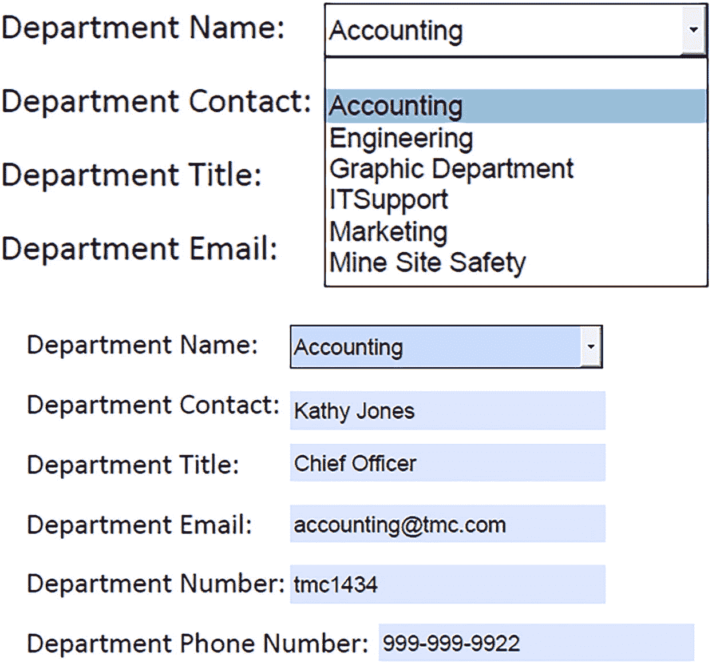

页面呈现了多个文本字段。从下拉列表中选择的部门名称“会计”会自动预先填入部门联系人、部门职位、部门电子邮件、部门编号和部门电话号码。

**图 12-1**  
当前技能申请表项目

此自动操作包含两部分：一个文档级 JavaScript 和一个附加到下拉列表的脚本。首先介绍文档级 JavaScript。参考图 12-2 和图 12-3。

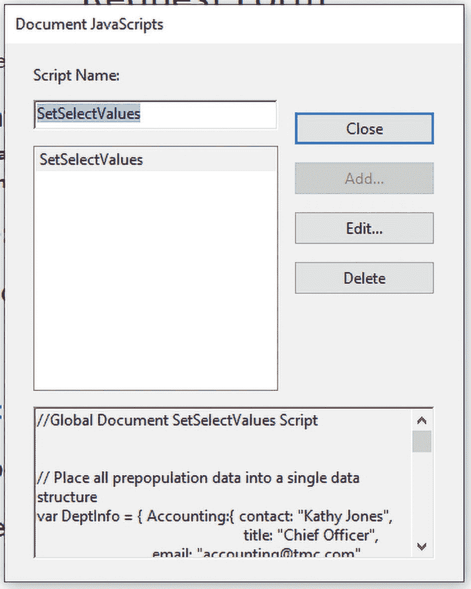

文档级 JavaScript 对话框的截图，脚本名称为 set select values。它有一个选定的关闭按钮。下方编辑器中已输入代码。

**图 12-3**  
文档级 JavaScript 对话框，其中通过“添加”按钮输入了脚本 `SetSelectValues`

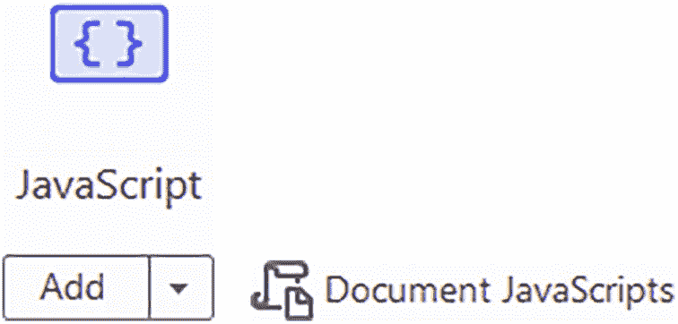

带有“添加”选项的 JavaScript 图标和文档级 JavaScript 工具的截图。

**图 12-2**  
进入 JavaScript 工具并选择文档级 JavaScript 子工具

我创建的文档级 JavaScript 名为 `SetSelectValues`。我在编辑器中输入了以下代码：

```
//全局文档 SetSelectValues 脚本
// 将所有预填充数据放入单一数据结构
var DeptInfo = { Accounting:{ contact: "Kathy Jones",
title: "Chief Officer",
email: "accounting@tmc.com",
deptnum: "tmc1434",
deptphone: "999-999-9922"},
Engineering:{ contact: "Frank R. Smith",
title: "Senior Specialist",
email: "engineering@tmc.com",
deptnum: "tmc1435",
deptphone: "999-999-9921" },
"Graphic Department":{ contact: "Nancy Smith",
title: "Artwork Planner",
email: "graphics@tmc.com",
deptnum: "tmc1436",
deptphone: "999-999-9923" },
ITSupport:{ contact: "Troy Carson",
title: "Official Coder",
email: "it@tmc.com",
deptnum: "tmc1437",
deptphone: "999-999-9927" },
Marketing:{ contact: "Janice Walker",
title: "Marketing Advisor ",
email: "marketing@tmc.com",
deptnum: "tmc1438",
deptphone: "999-999-9925" },
"Mine Site Safety":{ contact: "Rick James",
title: "Safety Officer",
email: "mss@tmc.com",
deptnum: "tmc1439",
deptphone: "999-999-9924"},
};
function SetSelectValues(cDeptName)
{
this.getField("DeptContact").value = DeptInfo[cDeptName].contact;
this.getField("DeptTitle").value = DeptInfo[cDeptName].title;
this.getField("DeptEmail").value = DeptInfo[cDeptName].email;
this.getField("DeptNumber").value = DeptInfo[cDeptName].deptnum;
this.getField("DeptPhone").value = DeptInfo[cDeptName].deptphone;
}
```

`SetSelectValues` 是一个函数，它调用名为 `DeptInfo` 的数组变量。请记住，数组/对象字面量是一种可以容纳多条信息的复杂变量。在上述数组中，共有六个部门。

- 会计
- 工程
- 图形设计部
- IT 支持
- 市场部
- 矿场安全部

每个部门都有五个需要填写的文本字段。

- 联系人
- 职位
- 电子邮件
- 部门编号
- 部门电话号码

从某种意义上说，这变成了数组中的数组，即*嵌套数组*，如果有更多部门或拥有额外联系信息的员工，可以继续向此数组添加内容。

**注意**  
虽然这种数组是通过索引访问的，但它看起来类似于第 9 章中提到的关联数组。就 JavaScript 而言，当指代方括号 `[ ]` 中的这些对象字面量时，更贴切的术语是*关联语法*。在此例中，它使用的是 `[cDeptName]`。然而，JavaScript 数组必须依赖数字索引，但作为对象，它们可以拥有命名索引。它不是使用索引或数字 0 到 3 来调用变量，而是使用文字来调用信息或对象字面量/变量。它也是嵌套的，因为它可以在一个对象字面量中包含另一个对象字面量。在本章后面，您将看到另一个也是嵌套的示例。

最后一部分，函数 `SetSelectValues` 现在必须从关联语法或对象中提取这些部分，以便从下拉列表中选择一个选项时，正确的信息或值能够按顺序过滤到文本字段中。

请注意每个字段如何调用名为 `cDeptName` 的项；然而，您在全局函数中任何地方都看不到它作为变量或关联语法的一部分。这是什么？`cDeptName` 指的是下拉字段 `DepartmentNames`。参考图 12-4。

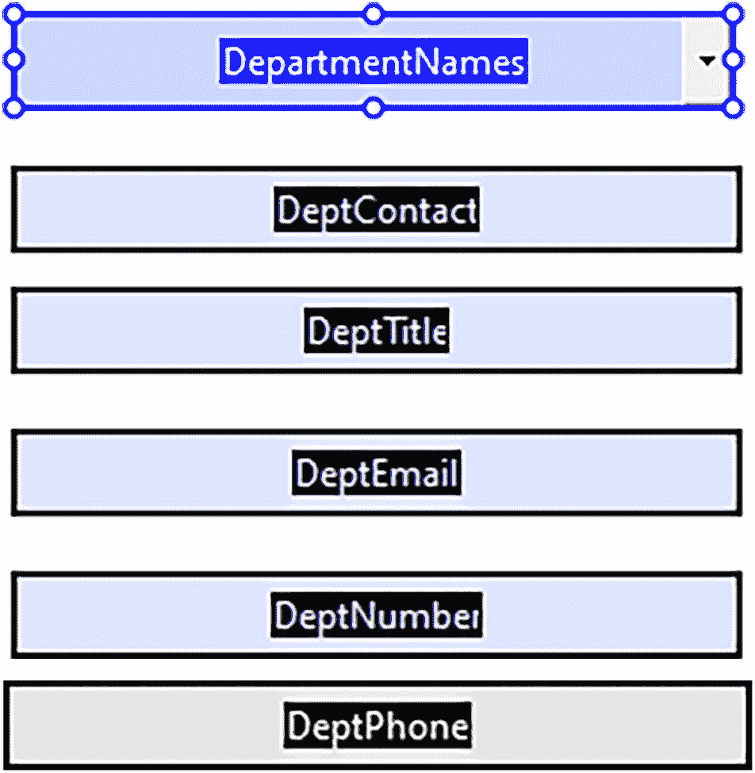

多个文本字段的截图，包含部门名称、部门联系人、部门职位、部门电子邮件、部门编号和部门电话。其中“部门名称”被高亮显示。

**图 12-4**  
“准备表单”工具视图中的下拉列表和文本字段

对于此下拉列表字段，我在“下拉选项”选项卡上勾选了“允许用户输入自定义文本”。这样，如果某个部门不在列表中，用户可以自行输入信息。同时勾选“立即提交所选值”，以便在松开下拉选择后，文本立即填充到其他字段。可以视情况勾选“检查拼写”框。在此例中，我们可能不想按字母顺序对项目排序，因此我保持其为未选中状态。参考图 12-5。

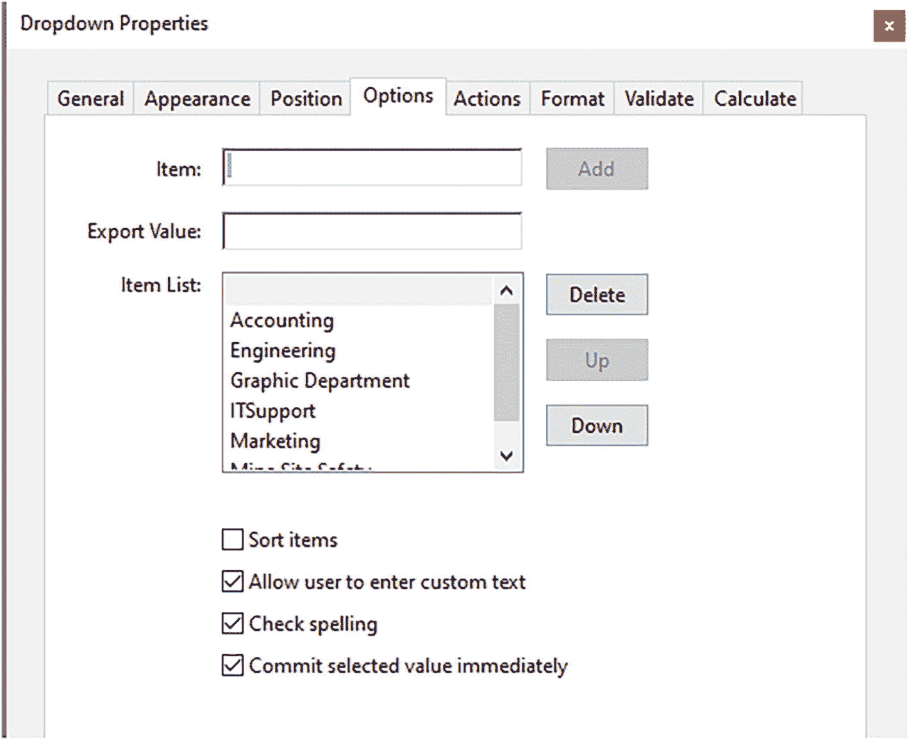

下拉属性对话框的截图，列出了“选项”选项卡下的项目、导出值、带有下拉列表的项目列表，以及已启用的选项：允许用户输入自定义文本、检查拼写和立即提交所选值。

**图 12-5**  
文档级 JavaScript 中引用的“下拉属性”对话框的“选项”选项卡

现在，在同一字段中，转到“格式”选项卡。参考图 12-6。

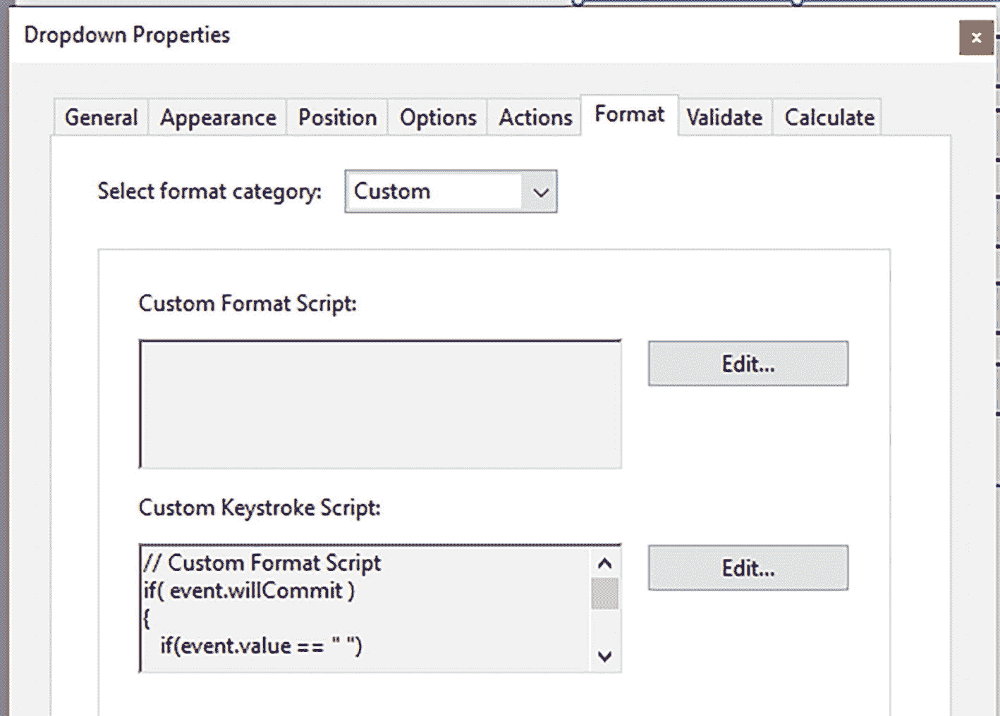

下拉属性对话框的截图，列出了“格式”选项卡下的选项，其中选择格式类别为“自定义”、自定义格式脚本和自定义按键脚本。这些脚本都有“编辑”按钮。

**图 12-6**  
包含自定义设置和自定义按键脚本的“格式”选项卡

在“格式”选项卡的“自定义按键脚本”部分输入以下 JavaScript：

```
// 自定义格式脚本
if( event.willCommit ){
if(event.value == " "){
this.resetForm(["DeptContact","DeptTitle","DeptEmail","DeptNumber",
"DeptPhone"]);
}
else{
SetSelectValues(event.value);
}
}
```

因此，您已创建此字段并将 JavaScript 应用到了自定义按键脚本区域（见图 12-6）。该脚本会“提交”，因为这在“选项”选项卡上也已勾选（见图 12-5），并且会执行以下两项操作之一：

- 如果您将下拉列表设为空白，则所有文本字段将变为空白或包含 `" "`。该列表将重置这些表单字段。
- 否则（`else`），它将与文档级 JavaScript 中的函数 `SetSelectValues` 建立连接，以便信息或值能够传递到文本字段中。


若没有此功能触发器，下拉字段将无法将任何数据放入下拉列表中。请注意，如果在下拉列表中将选择项重新设置为空白信息，则字段会立即自动重置为空白，因为下拉列表是`willCommit`事件的一部分。如前所述，那些在列表中找不到自己信息的人，可以按需在空白文本区域或其下方的其他文本字段中输入自己的数据，或者你也可以在"常规"选项卡中将这些字段设置为只读。

> **注意：** 文本字段未应用任何 JavaScript 代码。

## 零件订购表

有时，客户必须浏览多个项目，再浏览多个子项目，才能找到他们正在寻找的确切信息或项目。例如，在零售工作环境中，可能有不止一种类型的螺丝、不止一种尺寸的 T 恤或不止一种颜色的产品。几乎在任何工作中，你都能找到有多种变体的项目，而这些变体的价格可能因尺寸和材料而异。

零件订购表是这种场景的简化示例。请参阅 `TMC_PartsOrderForm_End.pdf` 文件。参考图 12-7。

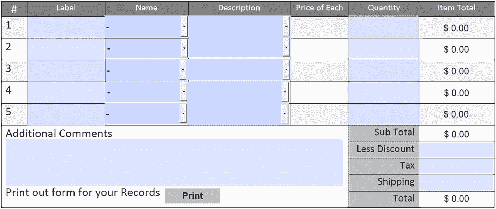

一个包含表格的页面，该表格有 7 列，标题为：序号、标签、名称、描述、单价、数量和小计，并在最后一列下方有合计、折扣后小计、税额、运费和总计，以及一个额外的备注框。

**图 12-7** — 零件订购表项目中的下拉列表

这次表单包含两个关联的下拉列表：名称 (`Row1.item`) 和描述 (`Row1.Description`)。至少有这样的五组设置。参考图 12-8。

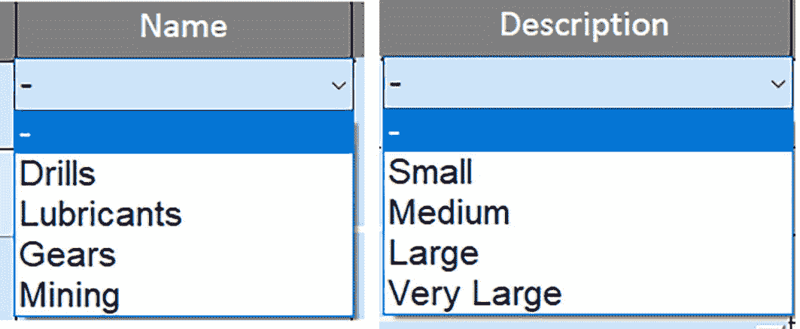

一个包含名称和描述下拉列表的截图。名称包括钻头、润滑剂、齿轮和采矿设备，而描述包括小、中、大和超大。

**图 12-8** — 当前项目中两个关联的下拉列表

一旦用户选择了名称，他们就可以选择描述。选择描述后，当用户跳出该字段时，零件的价格就会被设定。参考图 12-9。

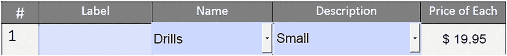

一个表格有五列，标题为：序号、标签、名称、描述和单价，其对应的属性值为：名称为钻头，描述为小，价格为$19.95。

**图 12-9** — 描述下拉列表更改了价格字段

客户只需决定他想购买多少个零件，订购表的价格和总计就会开始自动填充。用户稍后还可以添加折扣、税费和运费。我们稍后会查看这些字段。参考图 12-10。

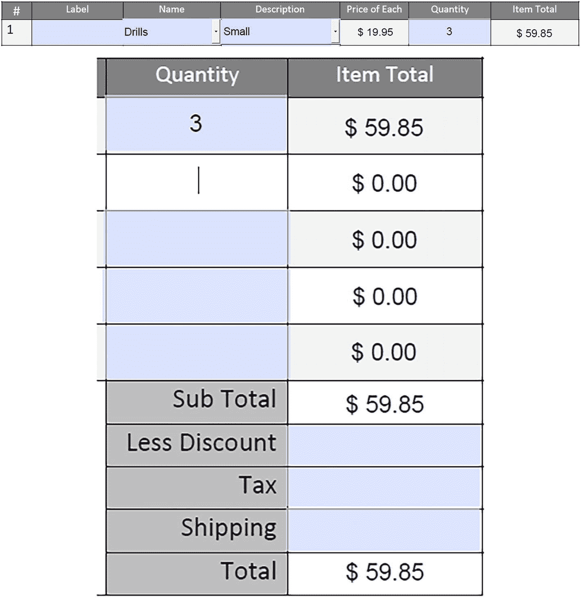

一个包含表格的页面，该表格有 7 列，标题为：序号、标签、名称、描述、单价、数量（为 3）和小计（为$59.85），以及合计、折扣后小计、税额、运费和总计（为$59.85）。

**图 12-10** — 当客户输入数量时，这会改变总价

让我们深入看看。再次，你需要创建一些全局文档 JavaScript。参考图 12-11。

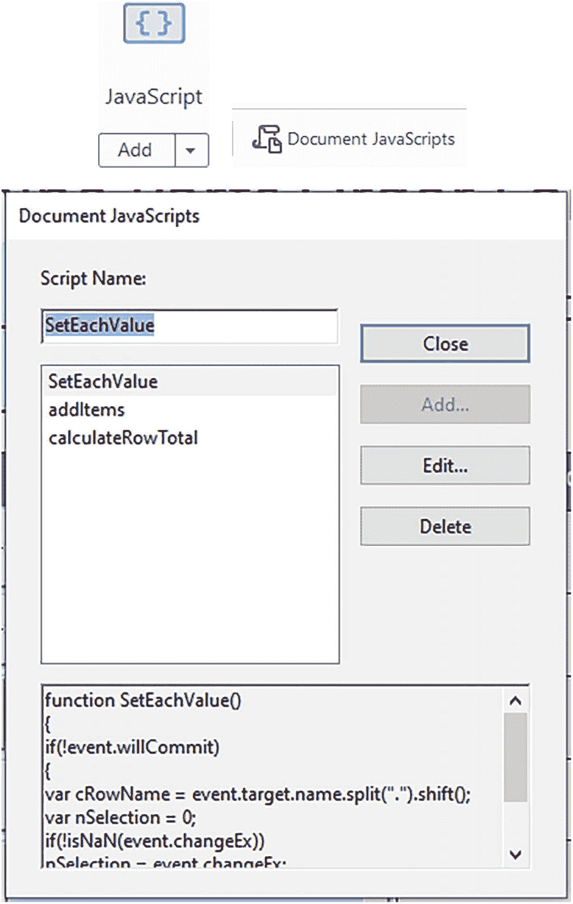

一个页面，顶部有 JavaScript 图标，包含添加选项卡和文档 JavaScript 工具。它包括文档 JavaScript 对话框，脚本名称为`set each value`，并且`set each value`包含添加项目和计算行合计。关闭按钮被高亮显示。

**图 12-11** — 影响项目中对话框内各个字段的文档 JavaScript 对话框设置

如你所见，随着在其他行中增加另一个关联下拉列表及相关下拉列表，需要更多的 JavaScript 代码。

你需要做的第一件事是创建你的关联语法/对象字面量数组和`addItems`函数。每个关联语法（`oArray`或`Object`）用一个逗号和方括号`[]`分隔。


```
// 全局文档 addItems（添加项目）
var oArray = {
钻头: [ ["-","无"], ["小号",19.95], ["中号",29.95], ["大号",39.95], ["特大号",44.95]],
润滑剂: [ ["-","无"], ["油",69.95], ["油脂",49.95], ["超级顺滑",79.95],["普通",139.95]],
齿轮:  [ ["-","无"], ["小号",149.95], ["中号",159.95], ["大号",219.95], ["特大号",339.95]],
采矿装备:[ ["-","无"], ["安全帽",39.95], ["镐",29.95], ["斧",19.95],["铲",49.95]]
};
function SetDescriptionEntries(){
if(event.willCommit){
var cRowName = event.target.name.split(".").shift();
var list = oArray[event.value];
if( (list != null) && (list.length > 0) ){
this.getField(cRowName + ".Description").setItems(list);
}
else{
this.getField(cRowName + ".Description").clearItems();
}
this.getField(cRowName + ".Each").value = 0;
}
}
```

## 备注

如果出于某种原因需要在另一个页面上添加一组独立的下拉列表，则必须创建另一个文档级 JavaScript（如`addItems2`），然后更改关联语法/对象名称以及函数名称，以避免冲突或从错误的对象中调用项目。

在之前的单一下拉列表示例中，你需要从下拉列表的项目中获取数据并将其复制到其他文本字段。一旦数组将项目粘贴到下拉列表（`Row1.item`），这次你需要将子项目复制到另一个名为 `Row1.Description` 的下拉列表。同样，如果名称下拉列表或项目中未找到任何值，则描述值将保持空白或被清除，并且没有可用选项。在此示例中，对于数组（`oArray`），关联语法分为四个项目名称，该语法的一部分随后将填充那些名称中包含“Row”或变量`cRowName`的字段。在此示例中，以下四个项目将以`cRowName`开头，填充与之对应的下拉列表`Row1.item`。它们分别是：

*   钻头
*   润滑剂
*   齿轮
*   采矿装备

`name`或（项目）的关联语法或对象的每个部分都会分为另一个用于子项目`Description`的下拉列表，以及一个包含每个项目单价的文本字段`Row1.Each`。你很快就会看到如何使用下一个函数来分离所调用的价格。

然后，你需要将`SetEachValue`函数添加为单独的文档级 JavaScript（图 12-11）。

```
function SetEachValue(){
if(!event.willCommit){
var cRowName = event.target.name.split(".").shift();
var nSelection = 0;
if(!isNaN(event.changeEx))
nSelection = event.changeEx;
this.getField(cRowName + ".Each").value = nSelection;
}
}
```

这些字段的名称类似于`Row1.item`、`Row2.item`等。使用这种顺序或模式，文档级 JavaScript 可以通过函数轻松调用每个项目。由于此类表单非常复杂，因此使用有序且有意义的名称至关重要。

如果事件不提交，由于感叹号（`!`）的覆盖，则该值将为 0。这可以处理对象数组中任何缺失的数字。如果输入的是非数字（`NaN`）如单词，则该值将保持为 0。否则，函数 `SetDescriptionEntries()`（我们之前看到的）将输入在关联语法中找到的每个项目的价格/单价，并在每次新选择时更改。

`event.changeEx` 通常与列表菜单和组合框一起使用，以辅助更改选择。有关更多详细信息，请参阅此链接：
[`https://opensource.adobe.com/dc-acrobat-sdk-docs/library/jsapiref/JS_API_AcroJS.html?highlight=changeex#event-properties`](https://opensource.adobe.com/dc-acrobat-sdk-docs/library/jsapiref/JS_API_AcroJS.html?highlight=changeex#event-properties)

每个项目的价格设置是从`description`下拉列表中选择的。描述和价格使用`split`方法拆分到各自的字段中，该方法从变量`cRowName`或项目处开始拆分，以将数组分解为包含名称中点（`"."`）的各个字段。你可以在调用的方法 `.split()` 和 `.shift()` 中看到这一点。`shift`方法移除对象关联示例 `["Oil",69.95]` 中的第一个项目，只留下价格，该价格现在将进入名为 `Row1.Each` 的每个项目单价字段。

还有其他方法可用于向关联语法添加或移除元素或对象字面量。以下为您提供几个供参考：

*   `pop()`：移除数组的最后一个元素，并返回剩余元素（示例：`["Oil",69.95]` => `Oil`）
*   `push()`：向数组末尾添加一个新元素，并返回新的数组长度
*   `unshift()`：向数组开头添加新元素，并返回新的数组长度
*   `splice()`：在数组任意位置添加/移除元素
*   `join()`：将数组的所有元素连接成一个字符串

此外，由于每个元素都用逗号分隔，这也有助于进行移位和排序。

有关这些方法及其更多功能的详细信息，请访问以下链接：

*   [`www.w3schools.com/js/js_array_methods.asp`](http://www.w3schools.com/js/js_array_methods.asp)
*   [`www.w3schools.com/jsref/jsref_split.asp`](http://www.w3schools.com/jsref/jsref_split.asp)
*   [`www.w3schools.com/jsref/jsref_obj_array.asp`](http://www.w3schools.com/jsref/jsref_obj_array.asp)
*   [`https://developer.mozilla.org/en-US/docs/Web/JavaScript/Reference/Global_Objects/Array`](https://developer.mozilla.org/en-US/docs/Web/JavaScript/Reference/Global_Objects/Array)

我在此处文档级 JavaScript 中创建了`SetEachValue`函数，因为我将多次使用它，并且希望能够根据我拥有的下拉列表数量，按需多次调用它。此外，我不必为每个字段重写此代码，这可能会导致错误。

最后一个文档级 JavaScript 函数（图 12-11）用于计算行的项目总计（`calculateRowTotal`）。但是，这不是小计或最终总计字段，只有在将所有多个项目加总后才能确定。请参考文件 `TMC_PartsOrderForm_End.pdf`。

```
// 全局文档 calculateRowTotal（计算行总计）
function CalculateRowTotal()
{
var cRowName = event.target.name.split(".").shift();
event.value = this.getField(cRowName + ".Each").value * this.getField(cRowName + ".Qty").value;
}
```

该函数再次使用了`split`和`shift`方法。但是，只有价格（`.Each`）与数量字段（`.Qty`）相乘，以便现在计算出行的总价（`.ItemTotal`）。

与`SetEachValue()`函数一样，此函数也将被多次使用，这就是为什么要在“文档级 JavaScript”工具中创建它的原因。每当你认为某个函数会被多次使用时，最好在“文档级 JavaScript”工具中设置好它，以便后续调用。

现在，你将查看零件订单表单的第一行，以了解所有内容是如何组合在一起的。我们将跳过标签字段，该字段格式化为“无”，因为它不是项目的一部分。请参考图 12-12。

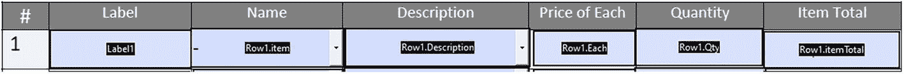

一个包含七列的表格，标题为序号、标签、名称、描述、单价、数量和项目总计，其中一行有对应的数据，并为名称和描述提供了下拉列表。

图 12-12


## 设置第一个下拉列表

第一个下拉列表 `Row1.item` 的设置如图 12-13 所示，以便它能够引用名为 `oArray` 的关联语法/对象。在“选项”选项卡上，不要在“项目名称”或“导出值”字段中输入任何内容；这些字段需要保持空白，然后由文档 JavaScript 填充，如“结束”示例所示。

![]

图 12-13：第一个下拉列表的“选项”选项卡上的下拉列表属性

在“格式”选项卡的“自定义击键脚本”区域，调用在文档 JavaScript 的`addItems`脚本中找到的`SetDescriptionEntries`函数。该函数引用了关联语法对象`oArray`，并用信息填充下一个下拉字段 `Row1.Description` 和文本字段 `Row1.Each`。当需要时，根据`.item`下拉列表中选择的内容，将数据传输到`.Description`下拉列表和`.Each`字段。请参考图 12-14。

![]

图 12-14：第一个下拉列表（`.item`）中带有自定义击键脚本的“下拉列表属性”对话框的“格式”选项卡

```
// Format Custom Keystroke for Name
SetDescriptionEntries();
```

对于所有其他的名称项目下拉列表，可以重复这些步骤，以便在“选项”选项卡上引用“格式”选项卡并填充下拉列表。要了解如何在其他下拉字段中使用相同的函数，请参考图 12-15。在我的“结束”文件中，可以右键单击该字段，然后从弹出菜单中查看属性。

![]

图 12-15：需要相同选项和格式设置的下拉字段，通过右键单击字段并从菜单中选择“属性”来访问

## 设置描述下拉列表

描述下拉列表 `Row1.Description` 保持空白，并且不在其“选项”选项卡上预设任何内容。JavaScript 将为您完成这项工作。请参考图 12-16。

![]

图 12-16：第一行第二个下拉列表的“下拉列表属性”对话框的“选项”选项卡

现在在“格式”选项卡的“自定义击键脚本”区域调用`SetEachValue`函数，以将值获取到每个字段（`.Each`）的价格中，并且可以将其添加到其他（`.Description`）字段中。请记住，如果价格被排除在关联语法之外或者是文本，则价格将显示为 0 或$0.00。请参考图 12-17。

![]

图 12-17：第二个下拉列表（`.Description`）的自定义击键脚本

```
// Format Custom Keystroke for Description
SetEachValue();
```

此代码被输入到每个描述下拉列表中。请参考图 12-18。

![]

图 12-18：需要相同选项和格式设置的下拉字段

## 设置价格字段

名为 `Row1.Each` 的每个字段的价格中没有 JavaScript。其设置来自前一个下拉列表（`.Description`）中的`SetEachValue`函数。但是，该文本字段已格式化为数字，保留两位小数，并带有货币符号。请注意，货币符号未添加到文档 JavaScript 中；只添加了数字。这些字段在“常规”选项卡上设置为只读。请参考图 12-19。

![]

图 12-19：为（`.Each`）在“格式”选项卡上设置为“数字”的文本字段属性

## 设置数量字段

对于数量列 `Row1.Qty` 也是如此。它不包含 JavaScript。只需将其格式化为数字，不带货币符号，并将小数位数设置为 0。此字段稍后将被引用，但未设置为只读。请参考图 12-20。

![]

图 12-20：为（`.Qty`）在“格式”选项卡上设置为不带货币符号的“数字”的“文本字段属性”对话框

## 设置项目总计字段

最后一个字段 `Row1.itemTotal`（格式化为数字，保留两位小数并带有货币符号，如图 12-19 所示），现在在“计算”选项卡上作为自定义计算脚本，将“单价”和“数量”字段的信息相乘。同样，该计算函数是从文档 JavaScript 部分引用的，并且可以应用于多个字段。请参考图 12-21。

![]

图 12-21：为（`.itemTotal`）在“计算”选项卡的自定义计算脚本中设置的文本字段属性

```
// Calculate Script Items
CalculateRowTotal();
```

我在“常规”选项卡上将 `itemTotal` 字段设置为只读。

## 设置最终计算字段

现在确保您的字段：小计、折扣、税费、运费和总计，都按照图 12-19 中的方式格式化为数字，保留两位小数并带有货币符号。小计和总计应在“常规”选项卡上设置为只读，以防止客户端覆盖数字。请参考图 12-22。

![]

图 12-22：项目中需要在预览和编辑模式下计算的最终文本字段


在过去的发票表单中，您使用过`value`或简化域表示法来操作这些字段。在这里，您可能想使用这些选项来累加`subTotal`和最终的`Total`字段。请参考图 12-23。

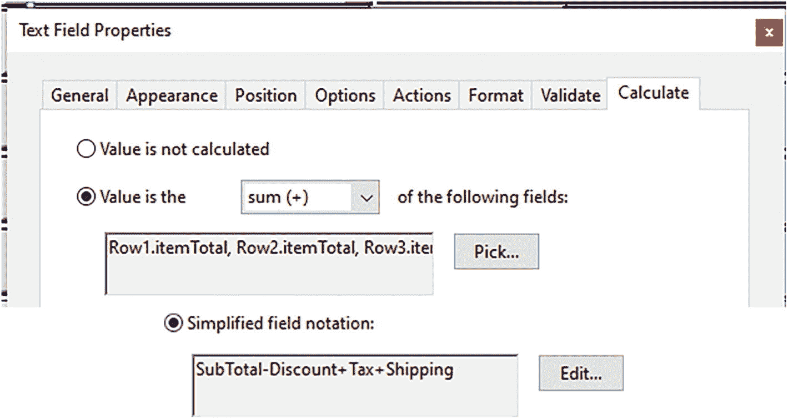

**图 12-23**

在“计算”选项卡上，对于基本场景，`SubTotal`和`Total`的计算不需要使用 JavaScript。

虽然前面的示例可以工作，但我发现它们有些小问题，而且刷新效果不佳。我们不希望表单用户因输入无法顺畅工作而感到沮丧和困惑。最终，我发现需要用 JavaScript 进行所有加减运算，这样表单才能顺畅运行。在`Subtotal`字段中，我将以下脚本放入“计算”选项卡的“自定义计算脚本”字段中。请参考图 12-24。

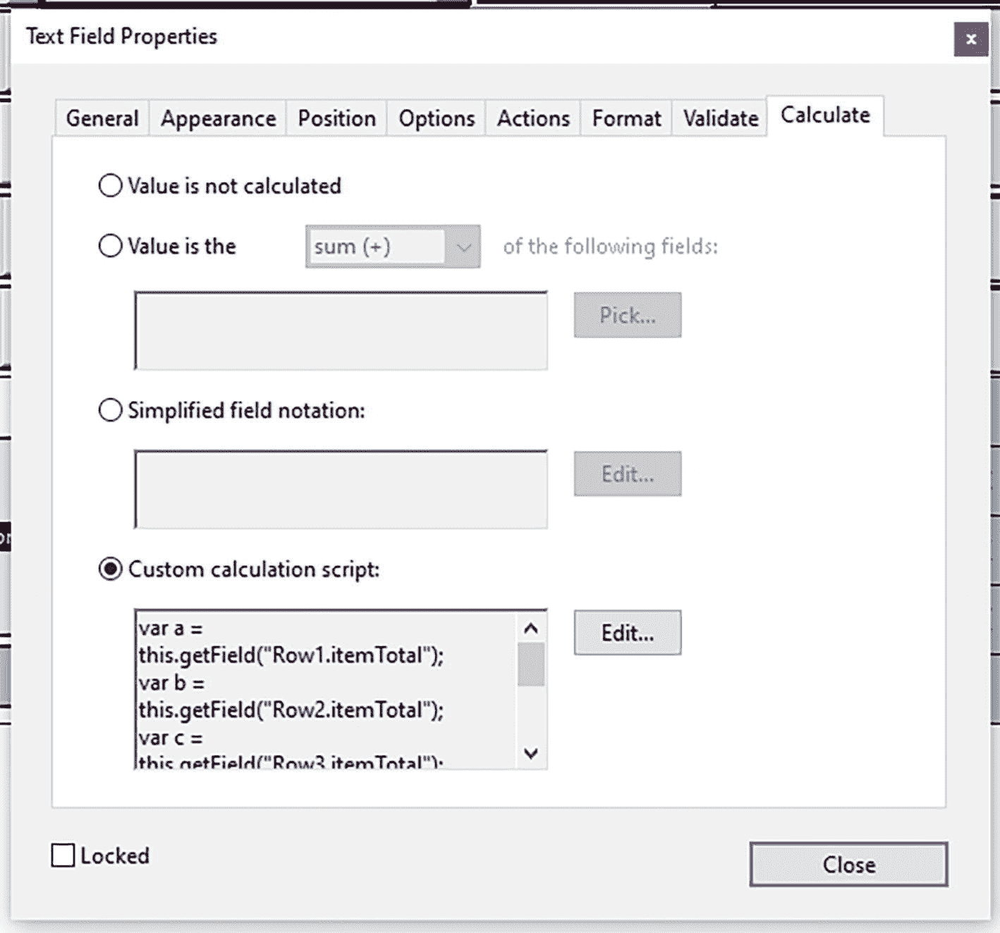

**图 12-24**

`SubTotal`字段的“计算”选项卡上的文本字段属性

```
// Subtotal Script
var a = this.getField("Row1.itemTotal");
var b = this.getField("Row2.itemTotal");
var c = this.getField("Row3.itemTotal");
var d = this.getField("Row4.itemTotal");
var f = this.getField("Row5.itemTotal");
event.value = a.value + b.value + c.value + d.value + f.value;
```

如您所见，这类似于您在前面的课程（如第 6 章）中尝试过的示例。对于`Total`字段，请参考图 12-25。

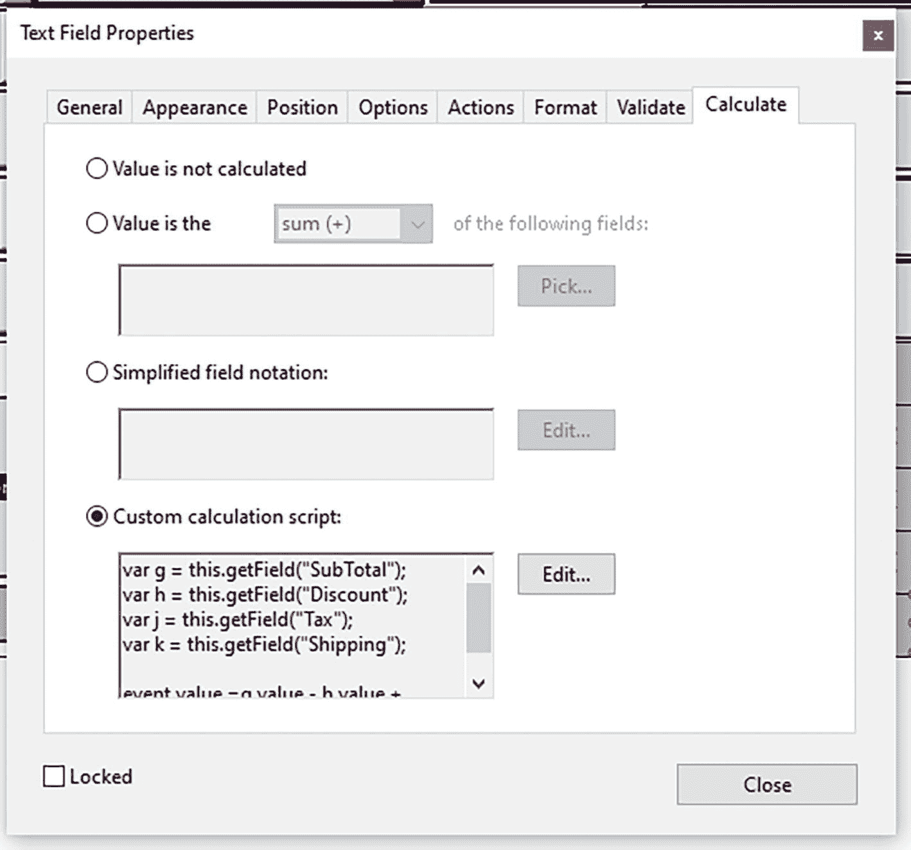

**图 12-25**

`Total`字段的“计算”选项卡上的文本字段属性

然后，对于“总计”或`Total`字段，我使用了以下自定义计算脚本：

```
// Total Script
var g = this.getField("SubTotal");
var h = this.getField("Discount");
var j = this.getField("Tax");
var k = this.getField("Shipping");
event.value = g.value - h.value + j.value + k.value;
```

对于这个基础示例，这是对我而言效果最好的方法。

请记住，如果您的字段没有按正确顺序跳转，请务必像在前面的章节中所做的那样，使用“准备表单”菜单中的“更多”来检查您的“Tab 键顺序”编号和“字段计算顺序”。反复测试表单对于获得正确的计算至关重要。当客户在复杂计算中出错时，您还需要添加一个“重置”按钮供他们使用。

## 使用选择日期和折扣的下拉列表

格式化为日期的下拉列表可以触发对特定或当前价格的折扣。

在此示例中，在文件`Discount_End.pdf`中，用户可以输入一个价格，然后从下拉列表中选择一个日期，以查看折扣百分比以及价格折扣。然后他们将看到新的最终价格。在此示例中，您不需要使用文档级 JavaScript。请参考图 12-26。

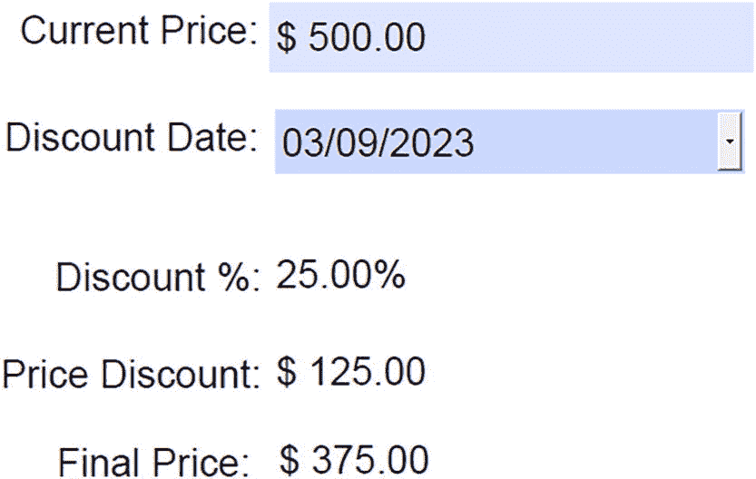

**图 12-26**

根据设定的日期计算价格折扣

对于您自己的项目，如果您要计算某些商品的价格（这些商品通常有一个固定价格，但在销售日期会贬值），这个功能可能会很有用。

此示例中的下拉列表包含一些设定的日期，每个日期在“选项”选项卡上都被赋予了一个导出值百分比。例如，0.25 代表 25%。请参考图 12-27。

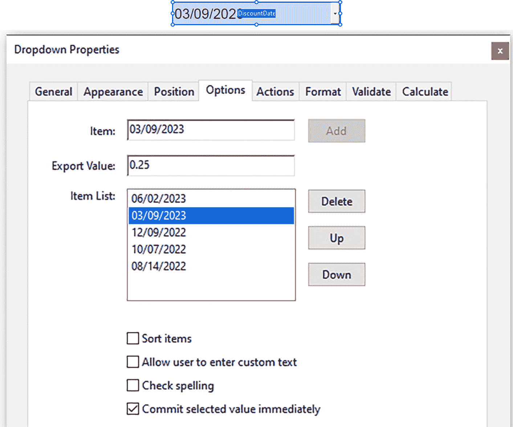

**图 12-27**

在“选项”选项卡上添加项目日期和值，并选择“提交选定的值”

然后，我在“格式”选项卡上将类别设置为“日期”，并确保选择了与我在“选项”选项卡上输入和添加项目时相似的格式。请参考图 12-28。

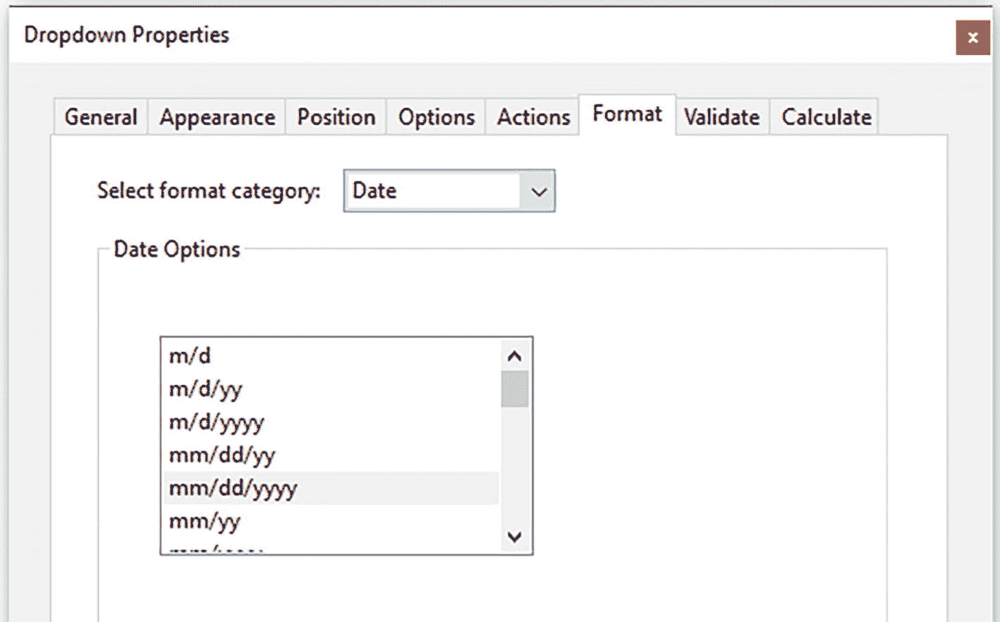

**图 12-28**

在“格式”选项卡上将您的下拉列表字段格式化为日期

> **注意：** 只有文本字段可以使用日期选择器，下拉列表格式化为日期后不能使用，因为我们只是从列表中选取一个日期。

接下来的三个文本字段设置为“只读”。`DiscountPercent`字段格式化为“百分比”。然后，`PriceDiscount`和`GrandTotal`字段都格式化为“数字”，并带有货币符号和两位小数。对于这三个字段，我在“计算”选项卡上设置了自定义计算脚本。这样我就能查看下拉列表`DiscountDate`中选项的导出值。请参考图 12-29。


**图 12-29**

在“计算”选项卡上设置自定义计算脚本

对于`DiscountPercent`文本字段，您可以通过调用`DiscountDate`的值来获取日期值。

```
event.value = this.getField("DiscountDate").value;
```

对于`PriceDiscount`文本字段，您可以将当前价格乘以折扣日期值。

```
event.value = this.getField("CurrentPrice").value * this.getField("DiscountDate").value;
```

对于`GrandTotal`文本字段，您可以从当前价格中减去价格折扣。

```
event.value = this.getField("CurrentPrice").value - this.getField("PriceDiscount").value;
```

## 总结

在制作包含多个下拉列表的复杂表单时，最好先在纸上或绘图程序中规划好，并决定您想要做什么。您可能需要一个数组、带对象字面量的关联语法或一个全局函数，但请先全部写下来。

一旦您构建好表单（类似于我所做的），请确保数字区域已正确格式化为“数字”或“自定义”，然后添加 JavaScript。测试表单，或者让其他人也测试一下。在客户使用之前找出所有问题至关重要。这里的重点是避免客户出错和感到沮丧，并在处理表单中的字段时获得您想要的结果。


### 加载冗长的单个下拉菜单或列表菜单

虽然不如之前的示例复杂，但有时你可能只需要加载一个包含 30 个或更多项目的单个下拉列表，而这些项目不会影响表单中的其他字段或菜单。请参阅此示例中的 `Load Single Menu` 文件夹。参考文件 `TMC_LoadDropDown_end.pdf`。

将这些内容输入到下拉菜单或列表框菜单中可能需要大量操作：你必须选择 `选项` 选项卡，输入项目名称，输入导出值，然后为每个项目单击 `添加` 按钮。此外，你可能希望在多个经常更改的菜单中使用相同的信息（请参阅文件 `Time_Sheet_End_multiload.pdf`）。为了在冗长的单个菜单上节省时间，我额外包含了这些文件，在这些文件中，我将下拉列表（组合框）或列表框的所有代码都放入了全局文档 JavaScript 区域。我将此函数命名为 `LoadOptions`。你可以在以下页面查看代码，并且在提供的文本文件以及 `Scripts` 文件夹中也可以找到它。与往常一样，请确保字段名称与 JavaScript 中编写的名称一致，以便连接能够正常工作。请参阅图 12-30。

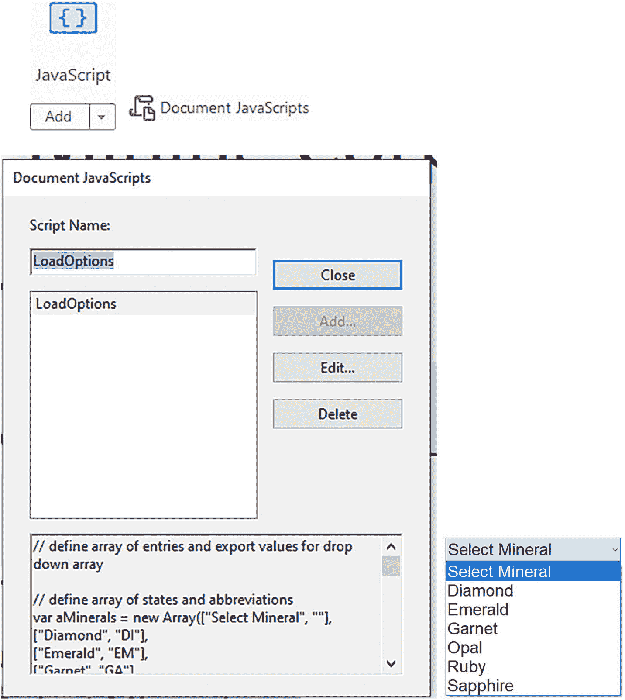

显示 **JavaScript** 图标的屏幕截图，其中包含“添加选项”和“文档 JavaScript”工具。它包括文档 JavaScript 对话框，脚本名称为“load options”，以及“load options”框和一个带有代码的编辑器。旁边的下拉列表突出显示了“选择矿物”选项。

**图 12-30**

文档 JavaScript 对话框中的 `LoadOptions` 脚本以及引用的下拉列表将加载项目和值

以下代码被添加到文件 `TMC_LoadDropDown_end.pdf` 的文档 JavaScript 工具中的编辑器：

```
// define array of entries and export values for drop-down array
// define array of minerals and abbreviations
var aMinerals = new Array(["Select Mineral", ""],
["Diamond", "DI"],
["Emerald", "EM"],
["Garnet", "GA"],
["Opal", "OP"],
["Ruby", "RB"],
["Sapphire", "SP"]);
// function to load a combo/list box with an array of values
function LoadOptions(oField, aValues) {
var bResult = false;
// load array of values into field object
if(oField.type != "combobox" && oField.type != "listbox") {
app.alert("Load Options function requires a combobox or listbox", 0, 0);
bResult = false;
}
else{
oField.setItems(aValues); // set values
bResult = true;
}
return bResult;
} // end LoadOptions
// load the data - comment out the following two lines after updating when only doing array changes to reset
LoadOptions(this.getField('Dropdown1'), aMinerals);
LoadOptions(this.getField('ListBox1'), aMinerals);
```

前面的示例仅适用于在同一个表单中加载下拉列表或列表框的列表项和导出值。如果你尝试将其加载到另一种类型的表单字段中，将会收到错误警报。这些字段引用的是名为 `aMinerals` 的数组。还要注意，如果你想加载并获取一个字段，可以使用单直引号（`''`）而不是双直引号（`""`）。如果你检查字段的 `选项` 选项卡，可以验证数组的 `oField` 和 `aValues` 是否正在加载和设置。

如果你没有使用列表框，可以注释掉那一行，或者添加更多的 `LoadOptions` 函数（如果其他命名的下拉字段需要可能经常更改的相同对象字面量）。请记住为所有下拉列表或列表框字段指定不同的名称。

我们将在下一章中更详细地讨论列表框。

### 使用 JavaScript 更改下拉列表自定义格式的技巧

与文本字段类似，你可以使用 `外观` 选项卡属性，或者使用 `文档 JavaScript` 对话框、`动作` 选项卡，或 `格式` 选项卡设置为 `自定义` 和自定义格式脚本区域来格式化大多数下拉列表组合框。

与文本字段一样，该字段可用的属性是第 10 章中提到的那些，包括 `fillColor`、`strokeColor`、`lineWidth`、`borderStyle`、`textColor`、`textFont`、`textSize` 和 `rotation`。你不能使用 `fontFamily`，因为它用于富文本字段设置或注释中。此外，你也不能使用对齐方式来居中文本；默认情况下它将保持左对齐。不过，对于包含多个单词的项目，你可以在文本中添加空格，甚至在代码的早期行中添加一个 `\t` 来添加制表符空格，如下所示：

```
["\tDiamond", "DI"],
```

然而，经过实验，我发现这似乎只影响用户跳出（tab out）后的列表框和下拉列表（组合框），在选中时无效。`\n` 也是如此。如果你尝试添加新行，必须跳出该字段才能正确显示。你还需要调整下拉列表的高度以适应这种情况。

```
["\tDiamond\nMineral", "DI"],
```

此外，似乎即使尝试在自定义 `格式` 区域调整代码，富文本（即使用户在列表中输入了自定义内容，或者无法格式化）也会在调试器中引发错误。有关更多详细信息，请参考此链接：

[`https://opensource.adobe.com/dc-acrobat-sdk-docs/library/jsdevguide/JS_Dev_AcrobatForms.html#44065`](https://opensource.adobe.com/dc-acrobat-sdk-docs/library/jsdevguide/JS_Dev_AcrobatForms.html#44065)

## 本章小结

在本章中，在处理下拉列表和文本框时，你遇到了一些复杂的 JavaScript。你学习了嵌套关联/对象字面量如何像数组一样工作，以及如何从这些关联语法函数中提取信息。你还了解了文档 JavaScript 的好处，以及在一个位置编写脚本如何节省时间，从而不必在多个位置进行多次编辑；你只需引用该脚本或其他字段即可。

在下一章中，你将更详细地研究可能是最被低估的字段之一：列表框。你刚刚看到，与下拉列表一样，你可以使用文档 JavaScript 将文本加载到列表框中。但是，它们不如下拉列表紧凑，那么你还能用它们做什么呢？

